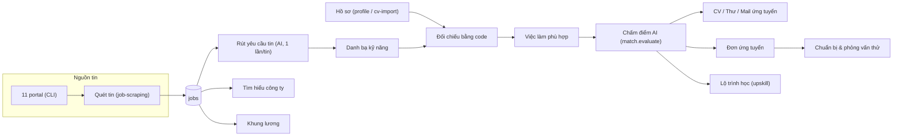
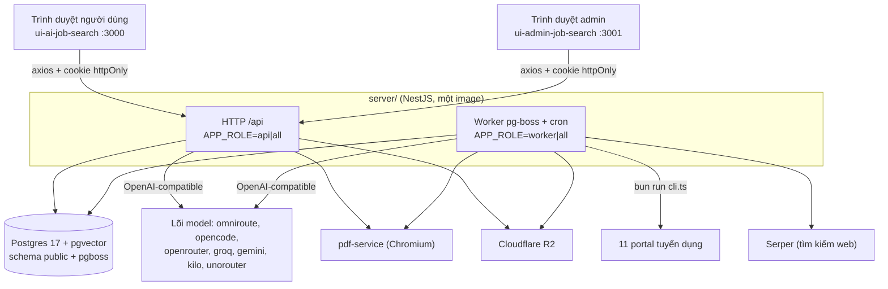
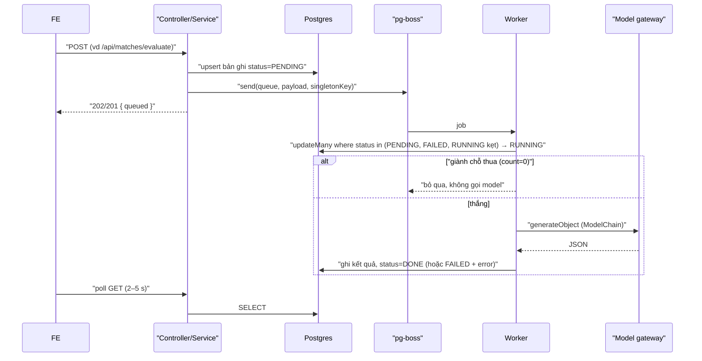
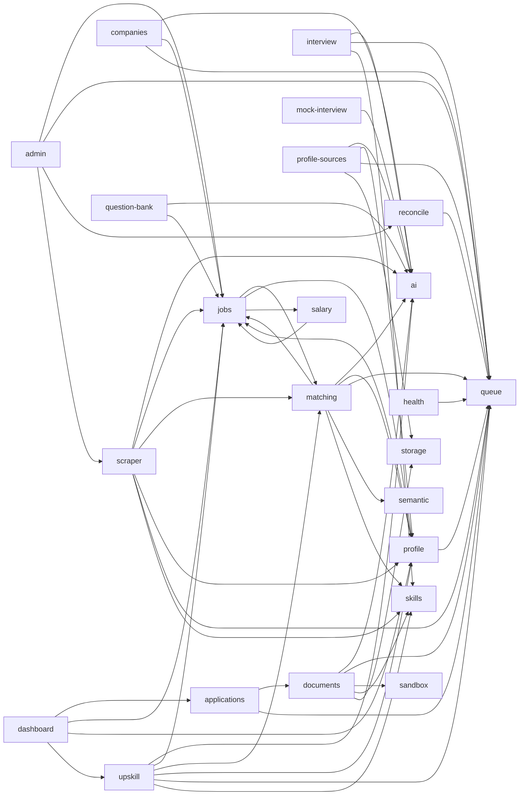

# 01 — Tổng quan hệ thống

> **Phạm vi:** toàn bộ backend `server/`, hai frontend `ui-ai-job-search` (người dùng, tên sản phẩm **Careelot**) và `ui-admin-job-search` (quản trị), các dịch vụ phụ `pdf-service/`, `omniroute-service/`, `opencode-service/`, CLI portal trong `.agents/skills/`.
> **Nguyên tắc:** tài liệu mô tả hệ thống **as-is**. Code là nguồn sự thật duy nhất.

## 1. Bài toán

Người tìm việc ở Việt Nam phải tự lục hàng chục portal tuyển dụng, đọc từng tin để đoán mình có hợp không, rồi viết CV/thư riêng cho từng nơi và tự ôn phỏng vấn. Hệ thống gom tin từ 11 portal mỗi đêm, đối chiếu từng tin với hồ sơ của từng người, và dùng mô hình ngôn ngữ để chấm độ phù hợp, viết tài liệu ứng tuyển, soạn bộ câu hỏi phỏng vấn, luyện phỏng vấn thử và chỉ ra kỹ năng nên học.

| Mục tiêu | Diễn giải |
|---|---|
| Gom tin một lần cho mọi người | Cron 23:00 quét các portal và ghi vào bảng `jobs` dùng chung; không quét theo từng người để tránh bị chặn IP ([job-scraping.md](./modules/job-scraping.md)) |
| Đối chiếu rẻ trước, AI sau | Yêu cầu của tin được rút **một lần** bằng model; việc so với từng hồ sơ là phép so khớp thuần bằng code ([matching.md](./modules/matching.md)) |
| AI đề xuất, người dùng chốt | Đọc CV ra bản nháp `ProfileDraft`, chỉ ghi vào hồ sơ khi người dùng bấm áp dụng ([cv-import.md](./modules/cv-import.md)) |
| Đường đọc không gọi AI | Dashboard, danh sách, chi tiết chỉ truy vấn SQL; kết quả AI được cache theo `promptHash` |
| Chạy được trên gateway model miễn phí | Chuỗi dự phòng nhiều lõi model, cầu dao, bể model tự kiểm ([ai-platform.md](./modules/ai-platform.md)) |

**Điểm mấu chốt:** hệ thống tách **đường ghi chậm có AI chạy nền** (hàng đợi pg-boss) khỏi **đường đọc nhanh không AI**. Mọi tính năng gọi model đều đi theo một khuôn: tạo bản ghi `PENDING` → giành chỗ chuyển `RUNNING` → `DONE`/`FAILED`; người dùng bấm lại khi `FAILED`, hệ thống không tự thử lại.

## 2. Business domain



| Nhóm nghiệp vụ | Module |
|---|---|
| Danh tính & hồ sơ | [auth](./modules/auth.md), [profile](./modules/profile.md), [cv-import](./modules/cv-import.md) |
| Kho tin | [jobs](./modules/jobs.md), [job-scraping](./modules/job-scraping.md) |
| Đánh giá phù hợp | [matching](./modules/matching.md), [dashboard](./modules/dashboard.md) |
| Ứng tuyển | [applications](./modules/applications.md), [documents](./modules/documents.md), [company-research](./modules/company-research.md), [salary](./modules/salary.md) |
| Phỏng vấn | [interview-prep](./modules/interview-prep.md), [question-bank](./modules/question-bank.md), [mock-interview](./modules/mock-interview.md) |
| Phát triển bản thân | [upskill](./modules/upskill.md) |
| Quản trị & nền tảng | [admin-console](./modules/admin-console.md), [ai-platform](./modules/ai-platform.md), [platform-operations](./modules/platform-operations.md) |

## 3. Kiến trúc



- **Một codebase, ba vai tiến trình** — `APP_ROLE` = `api` (chỉ HTTP), `worker` (chỉ hàng đợi + cron), `all` (mặc định, cả hai). Giá trị lạ thì tiến trình không khởi động ([app-role.ts](../../server/src/config/app-role.ts)).
- **Không có API route ở frontend.** Trình duyệt gọi thẳng backend; token nằm ở cookie httpOnly, `withCredentials: true` ([ui-ai-job-search/lib/axios.ts](../../../ui-ai-job-search/lib/axios.ts), [ui-admin-job-search/lib/axios.ts](../../../ui-admin-job-search/lib/axios.ts)).
- **Lớp toàn cục trong `CommonModule`**: `JwtAuthGuard` (mặc-định-đóng), `UserThrottlerGuard`, `RolesGuard`, `AllExceptionsFilter`, `PrismaExceptionFilter`, `RequestLogMiddleware` ([common.module.ts](../../server/src/common/common.module.ts)).
- **Seam thay thế được trong test**: `Ai`, `Queue`, `Storage`, `SkillRegistry`, `ProfileSource`, `SandboxRunner` (bảng seam ở [CLAUDE.md](../../CLAUDE.md)).
- **Khung prompt** nạp lúc chạy từ `.claude/skills/*.md` (runtime Claude Code gốc của bản fork); runtime Claude Code hiện không chạy được vì không có hồ sơ ứng viên — [ADR 0015](../adr/0015-khong-co-ho-so-ung-vien.md).

## 4. Tech stack

| Tầng | Công nghệ | Nguồn |
|---|---|---|
| Backend | NestJS 11, Express 5, Node ≥ 22.12 (bắt buộc: `ai` là ESM thuần) | [server/package.json](../../server/package.json) |
| ORM / DB | Prisma 7 (adapter-pg), PostgreSQL 17 + pgvector, `pg_trgm` | [schema.prisma](../../server/prisma/schema.prisma), [docker-compose.yml](../../server/docker-compose.yml) |
| Hàng đợi | pg-boss (schema `pgboss`), policy `exclusive` | [queue.service.ts](../../server/src/modules/queue/queue.service.ts) |
| Lịch | `cron` (`CronJob`, timezone `CRON_TIMEZONE`) qua `@nestjs/schedule` | [scrape-cron.service.ts](../../server/src/modules/scraper/services/scrape-cron.service.ts) |
| AI | Vercel AI SDK `ai` 7 + `@ai-sdk/openai-compatible`; embedding cục bộ `@huggingface/transformers` (multilingual-e5-base, 768 chiều) | [ai.service.ts](../../server/src/modules/ai/services/ai.service.ts), [local.embedder.ts](../../server/src/modules/semantic/local.embedder.ts) |
| Auth | `@nestjs/jwt`, passport-jwt, bcryptjs (cost 12), google-auth-library | [auth.service.ts](../../server/src/modules/auth/auth.service.ts) |
| Bảo vệ | helmet, `@nestjs/throttler`, ValidationPipe (`whitelist`, `forbidNonWhitelisted`) | [bootstrap.ts](../../server/src/bootstrap.ts) |
| Lưu file | Cloudflare R2 qua `@aws-sdk/client-s3` | [r2.storage.ts](../../server/src/modules/storage/r2.storage.ts) |
| In PDF | `pdf-service` (Chromium in HTML) cho cả CV lẫn thư xin việc; dự phòng `docker run`. LaTeX đã gỡ *(2026-10-19)* | [documents.md](./modules/documents.md#15-integrations) |
| Portal CLI | Bun + TypeScript, mỗi portal một thư mục `.agents/skills/<portal>-search/` | [portal-cli.service.ts](../../server/src/modules/scraper/services/portal-cli.service.ts) |
| Frontend | Next.js 16, React 19, Tailwind 4, TanStack Query 5, zustand, axios, react-hook-form | [ui-ai-job-search/package.json](../../../ui-ai-job-search/package.json), [ui-admin-job-search/package.json](../../../ui-admin-job-search/package.json) |
| Test | Jest (unit + e2e trên Postgres thật), Vitest + Playwright ở FE | [server/test](../../server/test/run-e2e.mjs) |

## 5. Data flow

### 5.1 Đường ghi (chậm, có AI, chạy nền)



Các tác vụ người dùng đang chờ trực tiếp (chấm điểm từng tin, sinh CV/thư, đọc CV, tìm hiểu công ty, upskill, phỏng vấn thử) có thêm **route stream NDJSON** chạy cùng service trong chính request; trình duyệt ngắt thì server vẫn chạy tới cuối và tự ghi `DONE`/`FAILED` ([ndjson.ts](../../server/src/common/ndjson.ts)).

### 5.2 Đường đọc (nhanh, không AI)

`GET /api/dashboard`, `/api/jobs`, `/api/matches`, `/api/interview`, `/api/learning`… chỉ chạy truy vấn Prisma. Điểm "Khớp x/y" trên danh sách việc làm là kết quả đối chiếu bằng code đã lưu sẵn ở `job_requirement_matches`; điểm AI chỉ có khi người dùng bấm chấm.

## 6. Chuẩn API

| Quy ước | Giá trị | Nguồn |
|---|---|---|
| Tiền tố | `/api` | [bootstrap.ts](../../server/src/bootstrap.ts) |
| Định dạng | JSON; route stream trả `application/x-ndjson`, heartbeat 10 s | [ndjson.ts](../../server/src/common/ndjson.ts) |
| Xác thực | Cookie httpOnly chứa access token (15 phút) + refresh token (7 ngày, path `/api/auth/refresh`) | [auth.md](./modules/auth.md) |
| Phân trang | `limit` 1–100 (mặc định 20), `offset` 0–100.000; trả `{ items, total, limit, offset }` | [pagination.dto.ts](../../server/src/common/dto/pagination.dto.ts) |
| Lỗi | `{ statusCode, message, failureKind?, requestId? }`, thông điệp tiếng Việt | [11-error-handling.md](./11-error-handling.md) |
| Truy vết | Header `x-request-id` (giữ của client nếu khớp `^[\w-]{1,64}$`) | [bootstrap.ts](../../server/src/bootstrap.ts) |
| Giới hạn body | 1 MB (vượt → 413) | [bootstrap.ts](../../server/src/bootstrap.ts) |
| Rate limit | 120 lượt/60 s theo `user:<id>` hoặc IP; route AI 10/phút; đăng nhập 10/phút; quét 3/giờ; PDF 10/phút; route công khai 60/phút | [throttle.ts](../../server/src/common/throttle.ts) |
| Swagger | `/api/docs`, chỉ khi `NODE_ENV !== production` | [bootstrap.ts](../../server/src/bootstrap.ts) |

Chi tiết từng endpoint: [06-api-overview.md](./06-api-overview.md).

## 7. Biến môi trường

Nguồn duy nhất của giá trị mặc định là [configuration.ts](../../server/src/config/configuration.ts); giải thích dài nằm trong [.env.example](../../server/.env.example).

| Nhóm | Biến | Mặc định | Ý nghĩa nghiệp vụ |
|---|---|---|---|
| Server | `PORT`, `NODE_ENV`, `CORS_ORIGIN`, `TRUST_PROXY` | 4000, development, `http://localhost:3000`, 0 | `TRUST_PROXY` phải bằng số proxy thật, nếu không client tự khai IP để né rate limit |
| Vai | `APP_ROLE` | `all` | Tách tiến trình API và worker khi scale |
| DB | `DATABASE_URL`, `TEST_DATABASE_URL` | — | Test e2e bắt buộc tên DB kết thúc `_test` |
| Auth | `JWT_SECRET`, `JWT_ACCESS_EXPIRES_IN`, `JWT_REFRESH_EXPIRES_IN`, `GOOGLE_CLIENT_ID` | —, 15m, 7d, rỗng | `JWT_SECRET` rỗng hoặc còn giá trị mẫu `thay-bang…` thì app không khởi động ([main.ts](../../server/src/main.ts)) |
| AI | `MODEL_PROVIDER`, `MODEL_ID`, `MODEL_FALLBACK_IDS`, `AI_FAST_MODEL_ID`, `AI_FAST_FALLBACK_IDS`, `MAIN_TASK_PROVIDERS`, `FAST_TASK_PROVIDERS`, `AI_CHAIN_BUDGET_MS`, `AI_HEALTHCHECK_*`, `AI_PROBE_TIMEOUT_MS`, `AI_CIRCUIT_BREAKER_*`, `AI_STRUCTURED_OUTPUTS`, khoá từng lõi (`AI_API_KEY`, `OPENROUTER_API_KEY`, `GROQ_API_KEY`, `GOOGLE_GEMINI_API_KEY`, `UNOROUTER_API_KEY`, `KILO_API_KEY`, `OMNIROUTE_*`, `OPENCODE_*`) | omniroute, rỗng, …, 240000 | Chi tiết ở [ai-platform.md](./modules/ai-platform.md#15-integrations) |
| Quét | `PORTALS_DIR`, `SCRAPER_*`, `SCRAPE_CRON_ENABLED`, `SCRAPE_CRON_SCHEDULE`, `CRON_TIMEZONE` | `../.agents/skills`, …, true, `0 23 * * *`, `Asia/Ho_Chi_Minh` | [job-scraping.md](./modules/job-scraping.md#15-integrations) |
| Đối chiếu | `MATCH_MIN_PERCENT`, `MATCH_AI_AUTO`, `MATCH_AI_TOP_N`, `MATCH_AI_MAX_PER_RUN`, `MATCH_AI_COOLDOWN_HOURS`, `SKILL_DICTIONARY_MODEL_ID` | 50, false, 3, 300, 6, rỗng | [matching.md](./modules/matching.md) |
| Reconcile | `RECONCILE_CRON_ENABLED`, `RECONCILE_CRON_SCHEDULE`, `QUEUE_POLICY_MIGRATE` | true, `*/10 * * * *`, rỗng | [platform-operations.md](./modules/platform-operations.md) |
| Rate limit | `THROTTLE_TTL_MS`, `THROTTLE_LIMIT`, `THROTTLE_DISABLED` | 60000, 120, false | `THROTTLE_DISABLED=true` chỉ dành cho test |
| Web | `SERPER_API_KEY`, `SERPER_URL`, `SERPER_MAX_RESULTS`, `AGENT_FETCH_TIMEOUT_MS`, `AGENT_FETCH_MAX_BYTES` | rỗng, …, 5, 20000, 2000000 | Serper rỗng = tìm hiểu công ty trả bản UNKNOWN |
| Tài liệu | `PDF_SERVICE_URL` | rỗng (= dùng `docker run`) | Thiếu trên server thì xuất PDF hỏng lúc người dùng bấm |
| Lưu file | `R2_ENDPOINT`, `R2_BUCKET`, `R2_ACCESS_KEY_ID`, `R2_SECRET_ACCESS_KEY` | rỗng | |
| Skill | `SKILLS_DIR` | `../.claude/skills` | Phải trỏ ra gốc repo, không phải `server/.claude` |
| FE | `NEXT_PUBLIC_API_URL` | `http://localhost:4000/api` (người dùng), `/api` (admin) | Quên đặt khi deploy thì mọi request đi vào localhost |

## 8. Cách chạy (máy dev)

```bash
cd server
pnpm install
cp .env.example .env          # sinh JWT_SECRET thật: openssl rand -base64 48
pnpm db:up                    # Postgres (pgvector) qua Docker
pnpm db:migrate
pnpm db:seed                  # tài khoản demo, mật khẩu chung Demo@12345 (CHỈ dev)
pnpm start:dev                # http://localhost:4000/api

cd ../../ui-ai-job-search && pnpm dev        # :3000
cd ../ui-admin-job-search && pnpm dev        # :3001
```

Kiểm trước khi coi thay đổi là xong: `pnpm lint && pnpm test && pnpm test:e2e` ([CLAUDE.md](../../CLAUDE.md)).

## 9. Deployment

| Thành phần | Cách chạy | Nguồn |
|---|---|---|
| `app` | Image `ghcr.io/.../server`, build từ gốc repo (cần `.claude/skills`, `.agents/skills`), healthcheck `GET /api/health` | [Dockerfile](../../Dockerfile), [docker-compose.yml](../../server/docker-compose.yml) |
| `migrate` | Profile riêng, `prisma migrate deploy` | [docker-compose.yml](../../server/docker-compose.yml) |
| `postgres` | `pgvector/pgvector:pg17`, chỉ bind loopback | |
| `omniroute`, `opencode`, `pdf` | Image dựng sẵn trên ghcr, server chỉ `pull` | |
| CI | Lint skill, security guard, typecheck + test từng portal CLI, build/lint backend, Trivy, build + push image | [ci.yml](../../.github/workflows/ci.yml) |
| Máy chủ đích | Oracle Cloud Always Free (ARM A1), Caddy đứng trước (`TRUST_PROXY=1`) | [DEPLOY-ORACLE.md](../DEPLOY-ORACLE.md) |

> **Possible Business Rule:** chạy nhiều bản app thì chỉ đúng **một** bản được giữ cron (`SCRAPE_CRON_ENABLED`, `RECONCILE_CRON_ENABLED`); cờ "đang chạy" của cron nằm trong bộ nhớ tiến trình ([platform-operations.md#R8](./modules/platform-operations.md)).

## 10. Phụ thuộc giữa các module

Suy từ `import` trong `server/src/modules` (bỏ thư mục con nội bộ):



`auth`, `queue`, `sandbox`, `semantic`, `storage` không phụ thuộc module nghiệp vụ nào. `common/` không được import `modules/` (ESLint chặn).

## Source References

**Backend:** [main.ts](../../server/src/main.ts) · [bootstrap.ts](../../server/src/bootstrap.ts) · [app.module.ts](../../server/src/app.module.ts) · [common.module.ts](../../server/src/common/common.module.ts) · [configuration.ts](../../server/src/config/configuration.ts) · [app-role.ts](../../server/src/config/app-role.ts) · [.env.example](../../server/.env.example) · [package.json](../../server/package.json) · [schema.prisma](../../server/prisma/schema.prisma) · [docker-compose.yml](../../server/docker-compose.yml) · [Dockerfile](../../Dockerfile) · [ci.yml](../../.github/workflows/ci.yml) · [server/README.md](../../server/README.md) · [CLAUDE.md](../../CLAUDE.md) · [DEPLOY-ORACLE.md](../DEPLOY-ORACLE.md)

**Frontend:** [ui-ai-job-search/README.md](../../../ui-ai-job-search/README.md) · [ui-ai-job-search/lib/axios.ts](../../../ui-ai-job-search/lib/axios.ts) · [ui-admin-job-search/lib/axios.ts](../../../ui-admin-job-search/lib/axios.ts) · [ui-admin-job-search/package.json](../../../ui-admin-job-search/package.json)
