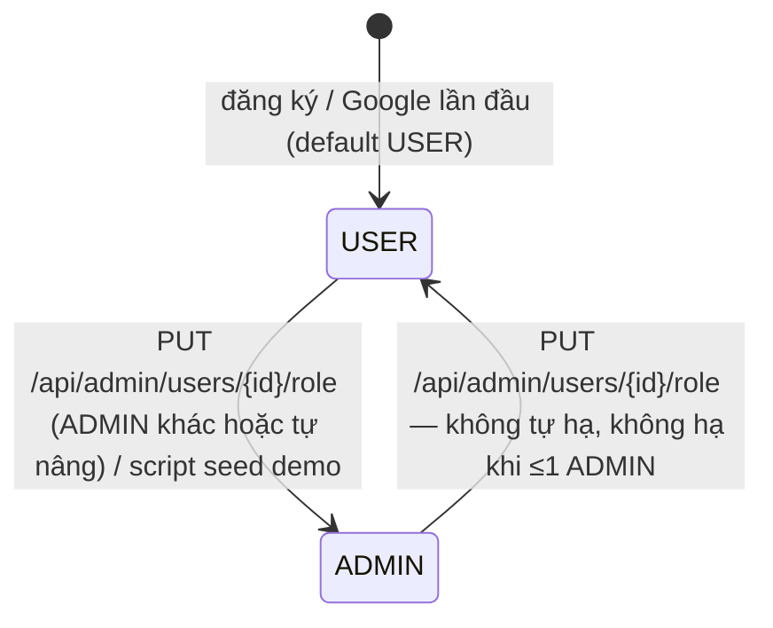

# 02 — Vai trò người dùng và actor

> **Phạm vi:** enum `UserRole`, guard toàn cục, các actor hệ thống (cron, worker hàng đợi, script vận hành), hai frontend.
> **Nguyên tắc:** tài liệu mô tả hệ thống **as-is**. Code là nguồn sự thật duy nhất.

## 1. Danh sách actor

| Actor | Loại | Định danh trong code | Mô tả |
|---|---|---|---|
| Khách | Người | Request không có token hợp lệ | Chỉ gọi được route `@Public()`: xem tin công khai, tra lương, ngân hàng câu hỏi, đọc bản tìm hiểu công ty, đăng ký/đăng nhập |
| Người dùng (USER) | Người | `User.role = USER` | Người tìm việc. Mọi dữ liệu cá nhân khoá theo `userId` lấy từ token |
| Quản trị viên (ADMIN) | Người | `User.role = ADMIN` | Vận hành: kho tin, quét, danh bạ kỹ năng, hàng đợi, sức khoẻ AI, tài khoản. **Cũng là một USER**: có hồ sơ và dùng được mọi tính năng người dùng |
| Cron quét tin `scrape.nightly` | Hệ thống | [scrape-cron.service.ts](../../server/src/modules/scraper/services/scrape-cron.service.ts) | 23:00 giờ VN, tạo `ScrapeRun` không chủ (`userId = null`) cho mỗi portal |
| Cron nhặt việc rơi `reconcile.stuck-work` | Hệ thống | [reconcile-cron.service.ts](../../server/src/modules/reconcile/services/reconcile-cron.service.ts) | Mỗi 10 phút, xếp lại hoặc đánh `FAILED` việc kẹt |
| Cron kiểm model `ai.healthcheck` *(2026-10-19, chưa commit)* | Hệ thống | [model-health.service.ts](../../server/src/modules/ai/services/model-health.service.ts) | Lúc khởi động và 23:35, probe các model để dựng bể model |
| Worker hàng đợi | Hệ thống | 11 processor pg-boss ([08-background-jobs.md](./08-background-jobs.md)) | Thực thi việc nền thay mặt người dùng đã tạo bản ghi |
| Script vận hành | Người vận hành (dòng lệnh) | `server/scripts/*.mjs` | Seed demo, nạp/làm giàu ngân hàng câu hỏi, crawl bảng lương, backfill. Chạy thẳng vào DB, không qua API |
| Portal tuyển dụng | Hệ thống ngoài | `.agents/skills/<portal>-search/` | 11 nguồn tin bị gọi qua CLI ([07-integrations.md](./07-integrations.md)) |
| Gateway model | Hệ thống ngoài | `modules/ai/providers/*` | 7 lõi model OpenAI-compatible |

Không có webhook vào: không actor ngoài nào gọi ngược vào hệ thống ([09-notifications.md](./09-notifications.md)).

## 2. Vai trò tài khoản

| Vai trò | Năng lực | Giới hạn |
|---|---|---|
| USER | Hồ sơ, đọc CV, xem/lưu tin, chấm điểm, tài liệu, đơn ứng tuyển, phỏng vấn, lộ trình học, tìm hiểu công ty | Chỉ thấy dữ liệu của chính mình; route gọi model 10 lượt/phút; không vào được `/api/admin/**`, `/api/scrape`, `/api/skills`, `/api/queue/stats`, route quản trị của matching |
| ADMIN | Mọi năng lực của USER + toàn bộ route `@Roles('ADMIN')` | Không xem dữ liệu nghiệp vụ của người khác qua route người dùng (route người dùng vẫn khoá `userId`); xem được hồ sơ tóm tắt và mức dùng AI của người khác qua `/api/admin/users/:id` |

Quy tắc đổi vai trò (BR-ADM-03…06) ở [admin-console.md](./modules/admin-console.md#7-business-rules). Vai trò được **đọc tươi từ DB mỗi request**, nên hạ quyền có hiệu lực ngay request kế dù token cũ còn hạn (BR-AUTH-20, [jwt.strategy.ts](../../server/src/modules/auth/jwt.strategy.ts)).

## 3. Ma trận chức năng × vai trò

Ký hiệu: ✅ được · ❌ bị chặn · 👁 chỉ đọc · — không áp dụng.

| Chức năng | Khách | USER | ADMIN | Hệ thống |
|---|---|---|---|---|
| Đăng ký, đăng nhập (mật khẩu/Google), refresh, đăng xuất | ✅ | ✅ | ✅ | — |
| Xem tin công khai (`/api/public/jobs`, `/api/jobs/filters`) | 👁 | 👁 | 👁 | — |
| Tra cứu lương (`/api/salary/*`) | 👁 | 👁 | 👁 | — |
| Ngân hàng câu hỏi — danh sách/bộ lọc | 👁 | 👁 | 👁 | — |
| Ngân hàng câu hỏi — xin đáp án (gọi model) | ❌ | ✅ | ✅ | — |
| Đọc bản tìm hiểu công ty | 👁 | 👁 | 👁 | — |
| Làm mới bản tìm hiểu công ty (gọi model) | ❌ | ✅ | ✅ | Worker `company.brief` |
| Hồ sơ, Chọn nhanh, thêm kỹ năng | ❌ | ✅ | ✅ | — |
| Đọc CV → bản nháp → áp dụng | ❌ | ✅ | ✅ | Worker `profile.synthesize` |
| Danh sách/chi tiết tin, lưu tin, "Việc làm phù hợp" | ❌ | ✅ | ✅ | — |
| Chấm điểm AI một tin | ❌ | ✅ | ✅ | Worker `match.evaluate` |
| Rút yêu cầu tin, dựng danh bạ kỹ năng, phát suất chấm | ❌ | ❌ | ✅ | Worker `job.requirements`, `skill.canonicalize`, `match.requirements`, `match.shortlist` |
| CV / thư / mail ứng tuyển, xuất PDF | ❌ | ✅ | ✅ | Worker `document.generate` |
| Đơn ứng tuyển | ❌ | ✅ | ✅ | — |
| Chuẩn bị phỏng vấn, tự trả lời, nhận xét | ❌ | ✅ | ✅ | Worker `interview.prep` |
| Phỏng vấn thử | ❌ | ✅ | ✅ | — |
| Lộ trình học, báo cáo upskill | ❌ | ✅ | ✅ | Worker `upskill.report` |
| Dashboard | ❌ | ✅ | ✅ | — |
| Quét tin theo yêu cầu, nạp lại portal | ❌ | ❌ | ✅ | Cron `scrape.nightly` |
| Console quản trị (`/api/admin/**`), `/api/skills`, `/api/queue/stats` | ❌ | ❌ | ✅ | — |
| Đổi vai trò tài khoản | ❌ | ❌ | ✅ | `pnpm db:seed` (dev) |
| Nhặt việc kẹt | — | — | ✅ (chạy ngay) | Cron `reconcile.stuck-work` |
| `/api/health` | ✅ | ✅ | ✅ | Healthcheck Docker |

Ma trận theo từng endpoint: [04-permission.md](./04-permission.md).

## 4. Trạng thái tài khoản

Bảng `users` **không có cột trạng thái** (không có khoá/kích hoạt/xoá mềm) — [schema.prisma:33](../../server/prisma/schema.prisma#L33). Các "trạng thái" quan sát được đều là suy ra:

| Trạng thái suy ra | Điều kiện | Hệ quả |
|---|---|---|
| Tài khoản mật khẩu | `passwordHash` khác null, `googleId` null | Đăng nhập bằng email/mật khẩu |
| Tài khoản Google | `googleId` khác null, `passwordHash` null | Không đăng nhập bằng mật khẩu được; liên kết Google xoá `passwordHash` (BR-AUTH-12) |
| Phiên bị thu hồi | `tokenVersion` trong token ≠ trong DB | Mọi token cũ bị từ chối (BR-AUTH-17). Hiện chỉ nhánh liên kết Google tăng `tokenVersion` ([auth.md#R1](./modules/auth.md)) |
| Hồ sơ chưa chọn ngành | `Profile.occupationCode` null hoặc `OTHER` | Dashboard bắt buộc bước "Chọn nhanh"; "Việc làm phù hợp" trả rỗng kèm `needsOccupation` (BR-PRF-18, BR-JOB-10) |
| Hồ sơ chưa đủ | `Profile.completion < 30` | Không được đối chiếu/chấm tự động và không góp từ khoá quét tin (BR-PRF-17) |

> **Possible Business Rule:** không có chức năng khoá hay xoá tài khoản qua API. Xoá user (chỉ bằng SQL) sẽ cascade xoá dữ liệu cá nhân, còn `ScrapeRun.userId` và `AiCall.userId` về null; file CV trên R2 thì **không** bị xoá ([cv-import.md#R2](./modules/cv-import.md)).

## 5. Phân vai ở frontend

| Frontend | Ai dùng | Cách chặn | Mức |
|---|---|---|---|
| `ui-ai-job-search` (Careelot, :3000) | Khách + USER + ADMIN | `SessionProvider` gọi `/auth/me`; khách chỉ vào được `/dashboard/jobs`, `/dashboard/salary`, `/salary/*`, `/login`, `/register` | ⚠️ Chỉ FE (backend vẫn chặn bằng guard) |
| `ui-admin-job-search` (:3001) | ADMIN | `AdminGate` chỉ render console khi `role = ADMIN`; tài khoản USER thấy "Tài khoản này không có quyền quản trị." nhưng không bị đăng xuất | ⚠️ Chỉ FE; mọi route admin vẫn có `RolesGuard` |

## Source References

**Backend:** [schema.prisma — User/UserRole](../../server/prisma/schema.prisma#L28) · [roles.guard.ts](../../server/src/common/guards/roles.guard.ts) · [roles.decorator.ts](../../server/src/common/decorators/roles.decorator.ts) · [public.decorator.ts](../../server/src/common/decorators/public.decorator.ts) · [jwt.strategy.ts](../../server/src/modules/auth/jwt.strategy.ts) · [admin-users.service.ts](../../server/src/modules/admin/services/admin-users.service.ts) · [role-change.ts](../../server/src/modules/admin/utils/role-change.ts) · [scrape-cron.service.ts](../../server/src/modules/scraper/services/scrape-cron.service.ts) · [reconcile-cron.service.ts](../../server/src/modules/reconcile/services/reconcile-cron.service.ts) · [seed-demo.mjs](../../server/scripts/seed-demo.mjs)

**Frontend:** [session-provider.tsx](../../../ui-ai-job-search/providers/session-provider.tsx) · [public-job.ts — isGuestPath](../../../ui-ai-job-search/lib/public-job.ts) · [admin-gate.tsx](../../../ui-admin-job-search/components/shell/admin-gate.tsx) · [ui-admin-job-search/app/(console)/layout.tsx](../../../ui-admin-job-search/app/%28console%29/layout.tsx)

**Module liên quan:** [auth.md](./modules/auth.md) · [admin-console.md](./modules/admin-console.md) · [profile.md](./modules/profile.md)
