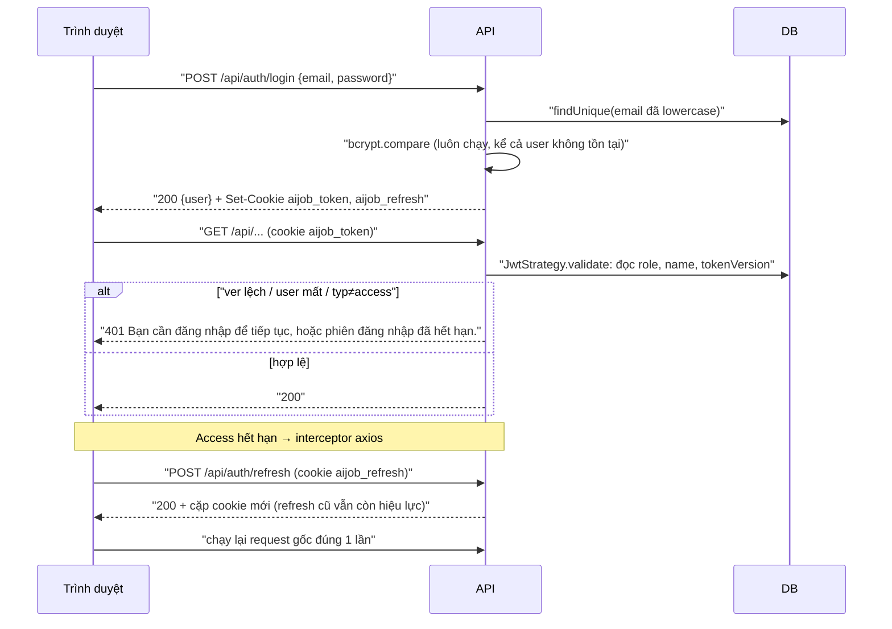

# 03 — Xác thực

> **Phạm vi:** `server/src/modules/auth/**`, `server/src/common/guards/**`, interceptor axios của hai frontend.
> **Nguyên tắc:** tài liệu mô tả hệ thống **as-is**. Code là nguồn sự thật duy nhất. Luồng chi tiết, validation và rủi ro đầy đủ nằm ở [modules/auth.md](./modules/auth.md); file này tóm tắt cơ chế.

## 1. Cơ chế token / phiên

| Thành phần | Giá trị | Nguồn |
|---|---|---|
| Kiểu | JWT ký HMAC bằng `JWT_SECRET` (một secret cho cả hai loại token) | [auth.service.ts](../../server/src/modules/auth/auth.service.ts) |
| Access token | `typ = access`, hạn `JWT_ACCESS_EXPIRES_IN` (15m), cookie `aijob_token` path `/` | [auth.cookie.ts](../../server/src/modules/auth/auth.cookie.ts) |
| Refresh token | `typ = refresh`, hạn `JWT_REFRESH_EXPIRES_IN` (7d), cookie `aijob_refresh` **path `/api/auth/refresh`** — chỉ đi qua mạng khi gọi refresh | [auth.cookie.ts](../../server/src/modules/auth/auth.cookie.ts) |
| Payload | `{ sub, email, typ, ver }` — `ver` = `User.tokenVersion` | [jwt-payload.ts](../../server/src/modules/auth/jwt-payload.ts) |
| Cờ cookie | `httpOnly`, `sameSite=lax`, `secure` khi production, `domain = COOKIE_DOMAIN` nếu có. `maxAge` cố định 15 phút / 7 ngày (không đọc theo biến hạn JWT — [auth.md#R5](./modules/auth.md)) | [auth.cookie.ts](../../server/src/modules/auth/auth.cookie.ts) |
| Body đăng nhập | Chỉ `{ user }`, **không** trả token trong JSON | [auth.controller.ts](../../server/src/modules/auth/auth.controller.ts) |
| Đọc token | Cookie trước, header `Authorization: Bearer` sau | [jwt.strategy.ts](../../server/src/modules/auth/jwt.strategy.ts) |
| Băm mật khẩu | bcrypt cost 12 | [auth.service.ts](../../server/src/modules/auth/auth.service.ts) |
| Khởi động | `JWT_SECRET` rỗng hoặc bắt đầu `thay-bang` → app ném lỗi, không khởi động | [main.ts](../../server/src/main.ts) |

## 2. Các luồng

| Luồng | Endpoint | Tóm tắt | Chi tiết |
|---|---|---|---|
| Đăng ký | `POST /api/auth/register` | Email trim + lowercase, mật khẩu 8–72, tên 1–200; tạo `User` (role USER) kèm `Profile` rỗng; trùng email → 409 `Email đã được đăng ký`; trả 201 + cookie | [auth.md — Luồng A](./modules/auth.md#4-business-flow) |
| Đăng nhập | `POST /api/auth/login` | Sai email hay sai mật khẩu cùng một câu 401 `Email hoặc mật khẩu không đúng`; tài khoản chỉ Google cũng nhận câu này | Luồng B |
| Google | `POST /api/auth/google` | Kiểm ID token (audience = `GOOGLE_CLIENT_ID`, `email_verified`); tìm theo `googleId` rồi theo email; liên kết vào tài khoản mật khẩu thì **xoá `passwordHash` và tăng `tokenVersion`**; email đã gắn Google khác → 409 | Luồng C |
| Gia hạn | `POST /api/auth/refresh` | Đọc cookie refresh; kiểm `typ = refresh` và `ver`; phát cặp mới. Không xoay vòng: refresh cũ còn dùng được tới hết hạn | Luồng D |
| Đăng xuất | `POST /api/auth/logout` | `@Public`, chỉ xoá hai cookie; **không** tăng `tokenVersion` | Luồng E |
| Tài khoản hiện tại | `GET /api/auth/me` | Trả `{ id, email, name, role }` đọc tươi từ DB | Luồng F |
| Đổi mật khẩu / quên mật khẩu / xác thực email | — | **Không tồn tại trong code** (grep `password` trong `modules/auth` chỉ có register/login) | [auth.md#R3](./modules/auth.md) |

## 3. Xác thực mỗi request

1. `JwtAuthGuard` là `APP_GUARD` toàn cục, chạy **trước** `UserThrottlerGuard` và `RolesGuard` ([common.module.ts](../../server/src/common/common.module.ts)).
2. Route có `@Public()` → bỏ qua xác thực (và `request.user` không được gán, kể cả khi client gửi token — nên throttle của route công khai luôn đếm theo IP).
3. Route còn lại → `JwtStrategy.validate` kiểm `typ = access`, tra `User` theo `sub`, so `ver` với `tokenVersion`; lỗi bất kỳ → 401 `Bạn cần đăng nhập để tiếp tục, hoặc phiên đăng nhập đã hết hạn.` ([jwt-auth.guard.ts](../../server/src/common/guards/jwt-auth.guard.ts)).
4. `request.user = { id, email, name, role }` — role đọc từ DB, không đọc claim ([schema.prisma:26](../../server/prisma/schema.prisma#L26)).

## 4. Vô hiệu hoá phiên

| Cách | Có trong code? | Hiệu lực |
|---|---|---|
| Tăng `User.tokenVersion` | Có, **chỉ** ở nhánh liên kết Google | Mọi access/refresh token cũ bị từ chối ngay |
| Đăng xuất | Có | Chỉ xoá cookie ở trình duyệt đó; token đã bị sao chép vẫn dùng được tới hết hạn |
| "Đăng xuất mọi thiết bị" / thu hồi theo admin | Không | — |
| Hạ quyền ADMIN → USER | Có (admin) | Có hiệu lực ngay request kế vì role đọc từ DB, không cần thu hồi token |

## 5. Xác thực phía frontend

- Axios `withCredentials: true`; interceptor gặp 401 thì gọi `POST /auth/refresh` **một lần dùng chung** cho mọi request đang chờ, rồi chạy lại request gốc một lần; không áp cho `/auth/refresh`, `/auth/login`, `/auth/register` ([ui-ai-job-search/lib/axios.ts](../../../ui-ai-job-search/lib/axios.ts), [ui-admin-job-search/lib/axios.ts](../../../ui-admin-job-search/lib/axios.ts)).
- Route stream dùng `fetch` (không qua interceptor): 401 thì báo `Phiên đăng nhập đã hết hạn.` ([model-stream.ts](../../../ui-ai-job-search/lib/model-stream.ts)).
- `SessionProvider` gọi `/auth/me`; khách chỉ ở lại được các trang `isGuestPath` (`/dashboard` — trang chào, việc làm, thị trường, tra cứu lương, phân tích CV), còn lại chuyển `/login?next=…`, đường dẫn này chuyển tiếp về `/dashboard?auth=login&next=…` và mở modal đăng nhập (không còn trang đăng nhập riêng, *2026-10-27*); `next` chỉ nhận đường dẫn nội bộ (BR-AUTH-23). Đăng nhập qua modal gọi `SessionProvider.refresh` và `resetQueries` thay cho tải lại trang *(2026-10-27)*.
- Admin: `AdminGate` chặn console khi `role ≠ ADMIN`.

## 6. Auth realtime

Không tồn tại trong code: không có WebSocket/SSE có xác thực riêng. Route stream NDJSON là HTTP POST thường, đi qua cùng `JwtAuthGuard` và cookie.

## 7. Bảng lỗi xác thực

| Tình huống | HTTP | Thông điệp |
|---|---|---|
| Email đăng ký đã tồn tại | 409 | `Email đã được đăng ký` |
| Sai thông tin đăng nhập | 401 | `Email hoặc mật khẩu không đúng` |
| Email đã gắn Google khác | 409 | `Email này đã liên kết với một tài khoản Google khác` |
| ID token Google hỏng | 401 | `Token Google không hợp lệ` |
| Thiếu cookie refresh | 401 | `Thiếu refresh token` |
| Refresh hỏng/hết hạn/sai loại | 401 | `Refresh token không hợp lệ` |
| User mất hoặc phiên bị thu hồi (khi refresh) | 401 | `Phiên đăng nhập đã kết thúc` |
| Token thiếu/sai ở route bảo vệ | 401 | `Bạn cần đăng nhập để tiếp tục, hoặc phiên đăng nhập đã hết hạn.` |
| Thiếu vai trò | 403 | `Không có quyền truy cập` |
| Quá 10 lượt/phút ở register/login/google/refresh | 429 | `Bạn thao tác quá nhanh. Hãy đợi một lát rồi thử lại.` |

Nguồn từng dòng: [auth.md §13](./modules/auth.md#13-exceptions).

## 8. Đánh giá bảo mật

| Điểm | Đánh giá |
|---|---|
| ✅ Token chỉ ở cookie httpOnly, refresh bó path | Giảm rủi ro XSS đọc token và giảm số lần refresh đi qua mạng |
| ✅ Chống dò tài khoản | Một thông điệp cho mọi sai sót đăng nhập, bcrypt luôn chạy (hash đệm) |
| ✅ Role đọc tươi | Hạ quyền không chờ token hết hạn |
| ✅ Mặc-định-đóng | Route mới không gắn `@Public()` thì tự cần đăng nhập |
| ⚠️ Không thu hồi khi đăng xuất, refresh không xoay vòng | [auth.md#R1, R2](./modules/auth.md) — 🟡 |
| ⚠️ Không xác thực email, không đặt lại mật khẩu; liên kết Google xoá mật khẩu vĩnh viễn | [auth.md#R3](./modules/auth.md) — 🟡 |
| ⚠️ Throttle đăng nhập chỉ theo IP, phụ thuộc `TRUST_PROXY` đúng | [auth.md#R6](./modules/auth.md) — 🟡 |
| ⚠️ `MaxLength(72)` đếm ký tự, bcrypt cắt 72 **byte** (chữ có dấu chiếm 2–3 byte) | [auth.md#R4](./modules/auth.md) — 🟢 |
| ℹ️ CSRF | Dựa vào `sameSite=lax` + CORS `origin` cụ thể với `credentials: true` ([main.ts](../../server/src/main.ts)); không có token CSRF riêng |

## Source References

**Backend:** [auth.controller.ts](../../server/src/modules/auth/auth.controller.ts) · [auth.service.ts](../../server/src/modules/auth/auth.service.ts) · [google-auth.service.ts](../../server/src/modules/auth/google-auth.service.ts) · [jwt.strategy.ts](../../server/src/modules/auth/jwt.strategy.ts) · [jwt-payload.ts](../../server/src/modules/auth/jwt-payload.ts) · [auth.cookie.ts](../../server/src/modules/auth/auth.cookie.ts) · [auth.dto.ts](../../server/src/modules/auth/auth.dto.ts) · [jwt-auth.guard.ts](../../server/src/common/guards/jwt-auth.guard.ts) · [user-throttler.guard.ts](../../server/src/common/guards/user-throttler.guard.ts) · [throttle.ts](../../server/src/common/throttle.ts) · [main.ts](../../server/src/main.ts) · [auth-refresh.e2e-spec.ts](../../server/test/auth-refresh.e2e-spec.ts) · [auth-google.e2e-spec.ts](../../server/test/auth-google.e2e-spec.ts)

**Frontend:** [ui-ai-job-search/lib/axios.ts](../../../ui-ai-job-search/lib/axios.ts) · [model-stream.ts](../../../ui-ai-job-search/lib/model-stream.ts) · [session-provider.tsx](../../../ui-ai-job-search/providers/session-provider.tsx) · [ui-ai-job-search/services/auth.ts](../../../ui-ai-job-search/services/auth.ts) · [ui-admin-job-search/lib/axios.ts](../../../ui-admin-job-search/lib/axios.ts) · [admin-gate.tsx](../../../ui-admin-job-search/components/shell/admin-gate.tsx)
