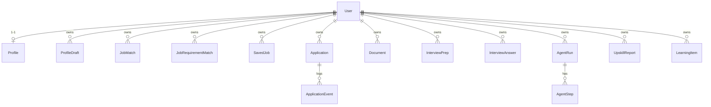

# 04 — Phân quyền và cách ly dữ liệu

> **Phạm vi:** guard toàn cục, decorator `@Public` / `@Roles`, rate limit, mọi endpoint của backend.
> **Nguyên tắc:** tài liệu mô tả hệ thống **as-is**. Code là nguồn sự thật duy nhất.

## 1. Các lớp kiểm soát truy cập

Thứ tự chạy theo thứ tự đăng ký `APP_GUARD` trong [common.module.ts](../../server/src/common/common.module.ts):

| # | Lớp | Cơ chế | Lỗi | Nguồn |
|---|---|---|---|---|
| 1 | Xác thực | `JwtAuthGuard` toàn cục, **mặc-định-đóng**; mở bằng `@Public()` | 401 `Bạn cần đăng nhập để tiếp tục, hoặc phiên đăng nhập đã hết hạn.` | [jwt-auth.guard.ts](../../server/src/common/guards/jwt-auth.guard.ts) |
| 2 | Tần suất | `UserThrottlerGuard`: khoá đếm `user:<id>` khi đã đăng nhập, `ip:<ip>` khi chưa; trần chung 120 lượt / 60 s; trần riêng bằng decorator | 429 `Bạn thao tác quá nhanh. Hãy đợi một lát rồi thử lại.` | [user-throttler.guard.ts](../../server/src/common/guards/user-throttler.guard.ts), [throttle.ts](../../server/src/common/throttle.ts) |
| 3 | Vai trò | `RolesGuard` toàn cục; route có `@Roles('ADMIN')` cần `request.user.role` (đọc tươi từ DB) thuộc danh sách | 403 `Không có quyền truy cập` | [roles.guard.ts](../../server/src/common/guards/roles.guard.ts) |
| 4 | Sở hữu | Không có guard chung; **mỗi service tự khoá `userId`** trong `where` (đọc và ghi). Bản ghi của người khác trả **404**, không lộ 403/409 | 404 theo thông điệp từng module | Từng service |
| 5 | Đầu vào | `ValidationPipe` `whitelist + forbidNonWhitelisted + transform`; DTO công khai dạng `PickType` để bộ lọc gắn với tài khoản nhận 400 | 400 mảng thông điệp tiếng Việt | [bootstrap.ts](../../server/src/bootstrap.ts) |
| 6 | Trường trả ra | Route công khai `select` theo danh sách trắng (`PUBLIC_JOB_FIELDS`, `LIST_FIELDS`, `PUBLIC_BRIEF_SELECT`…); lỗi thô của model không trả ra, chỉ trả `failureKind` | — | [public-job.ts](../../server/src/modules/jobs/utils/public-job.ts) |

Trần riêng:

| Decorator | Trần | Dùng cho |
|---|---|---|
| `ThrottleAuth` | 10 / phút | register, login, google, refresh |
| `ThrottleAi` | 10 / phút | mọi route gọi model của người dùng |
| `ThrottlePdf` | 10 / phút | `GET /api/documents/:id/pdf` |
| `ThrottleScrape` | 3 / giờ | `POST /api/scrape` |
| `@Throttle` 60 / phút | 60 / phút (theo IP) | route `@Public` đọc dữ liệu: tin công khai, bộ lọc tin, lương, ngân hàng câu hỏi, bản tìm hiểu công ty |
| `@SkipThrottle` | không giới hạn | `GET /api/health` |

## 2. Ma trận quyền theo từng endpoint

Sinh tự động từ mục §9 của các file module (script ở [README §7](./README.md#7-bảo-trì-tài-liệu)); "USER" nghĩa là mọi tài khoản đã đăng nhập (ADMIN cũng gọi được).

[//]: # (GEN:PERM)

| # | Method | URL | Vai trò tối thiểu | Throttle riêng | Kiểm sở hữu | Module |
|---|---|---|---|---|---|---|
| 1 | POST | `/api/auth/register` | Public | ThrottleAuth 10/phút | không áp dụng (dữ liệu chung) | [auth](./modules/auth.md#9-api-mapping) |
| 2 | POST | `/api/auth/login` | Public | ThrottleAuth 10/phút | không áp dụng (dữ liệu chung) | [auth](./modules/auth.md#9-api-mapping) |
| 3 | POST | `/api/auth/google` | Public | ThrottleAuth 10/phút | không áp dụng (dữ liệu chung) | [auth](./modules/auth.md#9-api-mapping) |
| 4 | POST | `/api/auth/refresh` | Public | ThrottleAuth 10/phút | không áp dụng (dữ liệu chung) | [auth](./modules/auth.md#9-api-mapping) |
| 5 | POST | `/api/auth/logout` | Public | — | không áp dụng (dữ liệu chung) | [auth](./modules/auth.md#9-api-mapping) |
| 6 | GET | `/api/auth/me` | USER | — | token → chính mình | [auth](./modules/auth.md#9-api-mapping) |
| 7 | GET | `/api/profile` | USER | — | `userId` từ token (upsert) | [profile](./modules/profile.md#9-api-mapping) |
| 8 | PUT | `/api/profile` | USER | — | `userId` từ token | [profile](./modules/profile.md#9-api-mapping) |
| 9 | POST | `/api/profile/skills` | USER | — | `userId` từ token | [profile](./modules/profile.md#9-api-mapping) |
| 10 | POST | `/api/profile/quick-start` | USER | — | `userId` từ token | [profile](./modules/profile.md#9-api-mapping) |
| 11 | POST | `/api/profile-drafts/cv` | USER | ThrottleAi 10/phút | tạo gắn `userId` | [cv-import](./modules/cv-import.md#9-api-mapping) |
| 12 | GET | `/api/profile-drafts/latest` | USER | — | `where userId` | [cv-import](./modules/cv-import.md#9-api-mapping) |
| 13 | GET | `/api/profile-drafts/:id/file` | USER | — | `findFirst {id, userId}` → 404 | [cv-import](./modules/cv-import.md#9-api-mapping) |
| 14 | GET | `/api/profile-drafts/:id` | USER | — | `findFirst {id, userId}` → 404 | [cv-import](./modules/cv-import.md#9-api-mapping) |
| 15 | POST | `/api/profile-drafts/:id/synthesize-stream` | USER | ThrottleAi 10/phút | `updateMany {id, userId, status}` | [cv-import](./modules/cv-import.md#9-api-mapping) |
| 16 | POST | `/api/profile-drafts/:id/retry` | USER | ThrottleAi 10/phút | `findFirst` + `updateMany {id, userId, FAILED}` | [cv-import](./modules/cv-import.md#9-api-mapping) |
| 17 | PUT | `/api/profile-drafts/:id/apply` | USER | — | `{id, userId}` khi đọc và ghi | [cv-import](./modules/cv-import.md#9-api-mapping) |
| 18 | GET | `/api/jobs` | USER | — | quan hệ (lưu/điểm/đơn) lọc theo `userId` | [jobs](./modules/jobs.md#9-api-mapping) |
| 19 | GET | `/api/jobs/filters` | Public | 60/phút | không áp dụng (dữ liệu chung) | [jobs](./modules/jobs.md#9-api-mapping) |
| 20 | GET | `/api/jobs/:id` | USER | — | lưu/điểm/đơn lọc theo `userId` | [jobs](./modules/jobs.md#9-api-mapping) |
| 21 | POST | `/api/jobs/:id/save` | USER | — | khoá `userId_jobId` | [jobs](./modules/jobs.md#9-api-mapping) |
| 22 | DELETE | `/api/jobs/:id/save` | USER | — | `deleteMany {userId, jobId}` | [jobs](./modules/jobs.md#9-api-mapping) |
| 23 | GET | `/api/public/jobs` | Public | 60/phút | không áp dụng (dữ liệu chung) | [jobs](./modules/jobs.md#9-api-mapping) |
| 24 | GET | `/api/public/jobs/:id` | Public | 60/phút | không áp dụng (dữ liệu chung) | [jobs](./modules/jobs.md#9-api-mapping) |
| 25 | POST | `/api/scrape` | ADMIN | 3/giờ | không áp dụng (admin xem toàn hệ thống) | [job-scraping](./modules/job-scraping.md#9-api-mapping) |
| 26 | POST | `/api/scrape/portals/reload` | ADMIN | — | không áp dụng (admin xem toàn hệ thống) | [job-scraping](./modules/job-scraping.md#9-api-mapping) |
| 27 | GET | `/api/matches` | USER | — | `where userId` | [matching](./modules/matching.md#9-api-mapping) |
| 28 | GET | `/api/matches/:jobId` | USER | — | khoá `userId_jobId` | [matching](./modules/matching.md#9-api-mapping) |
| 29 | POST | `/api/matches/evaluate` | USER | ThrottleAi 10/phút | `userId` từ token | [matching](./modules/matching.md#9-api-mapping) |
| 30 | POST | `/api/matches/evaluate-stream/:jobId` | USER | ThrottleAi 10/phút | `userId` truyền xuống service | [matching](./modules/matching.md#9-api-mapping) |
| 31 | POST | `/api/matches/requirements/:jobId` | ADMIN | ThrottleAi 10/phút | không áp dụng (admin xem toàn hệ thống) | [matching](./modules/matching.md#9-api-mapping) |
| 32 | POST | `/api/matches/dictionary/rebuild` | ADMIN | — | không áp dụng (admin xem toàn hệ thống) | [matching](./modules/matching.md#9-api-mapping) |
| 33 | POST | `/api/matches/shortlist/dispatch` | ADMIN | — | không áp dụng (admin xem toàn hệ thống) | [matching](./modules/matching.md#9-api-mapping) |
| 34 | GET | `/api/applications` | USER | — | `where userId` | [applications](./modules/applications.md#9-api-mapping) |
| 35 | GET | `/api/applications/jobs` | USER | — | `where userId` | [applications](./modules/applications.md#9-api-mapping) |
| 36 | POST | `/api/applications` | USER | @ThrottleAi 10/phút | tạo gắn `userId`; đọc `JobMatch(userId, jobId)` | [applications](./modules/applications.md#9-api-mapping) |
| 37 | PUT | `/api/applications/:id/status` | USER | — | `findFirst` + `updateMany {id, userId, status}` | [applications](./modules/applications.md#9-api-mapping) |
| 38 | PUT | `/api/applications/:id/interview-date` | USER | — | `updateMany {id, userId}` | [applications](./modules/applications.md#9-api-mapping) |
| 39 | GET | `/api/documents` | USER | — | `where userId` | [documents](./modules/documents.md#9-api-mapping) |
| 40 | POST | `/api/documents/job-from-url` | USER | @ThrottleAi | không áp dụng (dữ liệu chung) | [documents](./modules/documents.md#9-api-mapping) |
| 41 | GET | `/api/documents/cv-templates` | USER | — | không áp dụng (dữ liệu chung) | [documents](./modules/documents.md#9-api-mapping) |
| 42 | GET | `/api/documents/:id` | USER | — | `findFirst {id, userId}` → 404 | [documents](./modules/documents.md#9-api-mapping) |
| 43 | PUT | `/api/documents/:id/template` | USER | — | `update {id, userId}` | [documents](./modules/documents.md#9-api-mapping) |
| 44 | POST | `/api/documents/:id/preview` | USER | — | `findFirst {id, userId}` | [documents](./modules/documents.md#9-api-mapping) |
| 45 | PUT | `/api/documents/:id/cv` | USER | — | `update {id, userId}` | [documents](./modules/documents.md#9-api-mapping) |
| 46 | GET | `/api/documents/:id/pdf` | USER | @ThrottlePdf | `findFirst {id, userId}` | [documents](./modules/documents.md#9-api-mapping) |
| 47 | POST | `/api/documents/:id/generate-stream` | USER | @ThrottleAi | claim theo `userId` (404 qua sự kiện error) | [documents](./modules/documents.md#9-api-mapping) |
| 48 | POST | `/api/documents/cv` | USER | @ThrottleAi | tạo gắn `userId` | [documents](./modules/documents.md#9-api-mapping) |
| 49 | POST | `/api/documents/cover-letter` | USER | @ThrottleAi | tạo gắn `userId` | [documents](./modules/documents.md#9-api-mapping) |
| 50 | POST | `/api/documents/application-email` | USER | @ThrottleAi | tạo gắn `userId` | [documents](./modules/documents.md#9-api-mapping) |
| 51 | GET | `/api/interview` | USER | — | `where userId` | [interview-prep](./modules/interview-prep.md#9-api-mapping) |
| 52 | GET | `/api/interview/:jobId` | USER | — | khoá `userId_jobId` | [interview-prep](./modules/interview-prep.md#9-api-mapping) |
| 53 | POST | `/api/interview/prep` | USER | ThrottleAi 10/phút | khoá `userId_jobId` | [interview-prep](./modules/interview-prep.md#9-api-mapping) |
| 54 | PUT | `/api/interview/:jobId/answers/:kind/:index` | USER | — | khoá `userId_jobId(_questionKey)` | [interview-prep](./modules/interview-prep.md#9-api-mapping) |
| 55 | POST | `/api/interview/:jobId/answers/:kind/:index/feedback` | USER | ThrottleAi 10/phút | khoá `userId_jobId(_questionKey)` | [interview-prep](./modules/interview-prep.md#9-api-mapping) |
| 56 | GET | `/api/question-bank/filters` | Public | 60/phút | không áp dụng (dữ liệu chung) | [question-bank](./modules/question-bank.md#9-api-mapping) |
| 57 | GET | `/api/question-bank` | Public | 60/phút | không áp dụng (dữ liệu chung) | [question-bank](./modules/question-bank.md#9-api-mapping) |
| 58 | POST | `/api/question-bank/:id/answer` | USER | ThrottleAi 10/phút | không áp dụng (dữ liệu chung) | [question-bank](./modules/question-bank.md#9-api-mapping) |
| 59 | GET | `/api/mock-interviews` | USER | — | `where userId` | [mock-interview](./modules/mock-interview.md#9-api-mapping) |
| 60 | GET | `/api/mock-interviews/:id` | USER | — | `findFirst {id, userId}` | [mock-interview](./modules/mock-interview.md#9-api-mapping) |
| 61 | POST | `/api/mock-interviews` | USER | ThrottleAi 10/phút | bối cảnh khoá `userId` | [mock-interview](./modules/mock-interview.md#9-api-mapping) |
| 62 | POST | `/api/mock-interviews/:id/turn` | USER | ThrottleAi 10/phút | `{id, userId}` + claim kèm `userId` | [mock-interview](./modules/mock-interview.md#9-api-mapping) |
| 63 | GET | `/api/upskill` | USER | — | `where userId` | [upskill](./modules/upskill.md#9-api-mapping) |
| 64 | GET | `/api/upskill/in-flight` | USER | — | `where userId` | [upskill](./modules/upskill.md#9-api-mapping) |
| 65 | GET | `/api/upskill/:id` | USER | — | `findFirst {id, userId}` | [upskill](./modules/upskill.md#9-api-mapping) |
| 66 | POST | `/api/upskill/generate` | USER | 10/phút | tạo gắn `userId`; đọc `JobMatch(userId, jobId)` | [upskill](./modules/upskill.md#9-api-mapping) |
| 67 | POST | `/api/upskill/generate-stream` | USER | 10/phút | như trên | [upskill](./modules/upskill.md#9-api-mapping) |
| 68 | GET | `/api/learning` | USER | — | `userId` | [upskill](./modules/upskill.md#9-api-mapping) |
| 69 | PUT | `/api/learning/:key` | USER | — | upsert `(userId, skillKey)` | [upskill](./modules/upskill.md#9-api-mapping) |
| 70 | DELETE | `/api/learning/:key` | USER | — | `deleteMany {userId, skillKey}` | [upskill](./modules/upskill.md#9-api-mapping) |
| 71 | GET | `/api/companies/brief/by-job/:jobId` | Public | throttle 60/phút | không áp dụng (dữ liệu chung) | [company-research](./modules/company-research.md#9-api-mapping) |
| 72 | POST | `/api/companies/brief/by-job/:jobId` | USER | ThrottleAi 10/phút | không áp dụng (dữ liệu chung) | [company-research](./modules/company-research.md#9-api-mapping) |
| 73 | POST | `/api/companies/brief/by-job/:jobId/stream` | USER | ThrottleAi 10/phút | không áp dụng (dữ liệu chung) | [company-research](./modules/company-research.md#9-api-mapping) |
| 74 | GET | `/api/salary/occupations` | Public | 60/phút | không áp dụng (dữ liệu chung) | [salary](./modules/salary.md#9-api-mapping) |
| 75 | GET | `/api/salary/positions` | Public | 60/phút | không áp dụng (dữ liệu chung) | [salary](./modules/salary.md#9-api-mapping) |
| 76 | GET | `/api/salary/positions/:slug` | Public | 60/phút | không áp dụng (dữ liệu chung) | [salary](./modules/salary.md#9-api-mapping) |
| 77 | GET | `/api/dashboard` | USER | — | mọi truy vấn lọc `userId` | [dashboard](./modules/dashboard.md#9-api-mapping) |
| 78 | GET | `/api/dashboard/skill-gaps` | USER | — | `userId` | [dashboard](./modules/dashboard.md#9-api-mapping) |
| 79 | GET | `/api/admin/overview` | ADMIN | — | không áp dụng (admin xem toàn hệ thống) | [admin-console](./modules/admin-console.md#9-api-mapping) |
| 80 | GET | `/api/admin/ai-health` | ADMIN | — | không áp dụng (admin xem toàn hệ thống) | [admin-console](./modules/admin-console.md#9-api-mapping) |
| 81 | GET | `/api/admin/ai-failures` | ADMIN | — | không áp dụng (admin xem toàn hệ thống) | [admin-console](./modules/admin-console.md#9-api-mapping) |
| 82 | GET | `/api/admin/ai-failures/facets` | ADMIN | — | không áp dụng (admin xem toàn hệ thống) | [admin-console](./modules/admin-console.md#9-api-mapping) |
| 83 | GET | `/api/admin/ai-calls/:id` | ADMIN | — | không áp dụng (admin xem toàn hệ thống) | [admin-console](./modules/admin-console.md#9-api-mapping) |
| 84 | GET | `/api/admin/ai-usage` | ADMIN | — | không áp dụng (admin xem toàn hệ thống) | [admin-console](./modules/admin-console.md#9-api-mapping) |
| 85 | POST | `/api/admin/scrape/run-now` | ADMIN | — | không áp dụng (admin xem toàn hệ thống) | [admin-console](./modules/admin-console.md#9-api-mapping) |
| 86 | POST | `/api/admin/jobs/backfill-taxonomy` | ADMIN | — | không áp dụng (admin xem toàn hệ thống) | [admin-console](./modules/admin-console.md#9-api-mapping) |
| 87 | POST | `/api/admin/reconcile/run-now` | ADMIN | — | không áp dụng (admin xem toàn hệ thống) | [admin-console](./modules/admin-console.md#9-api-mapping) |
| 88 | GET | `/api/admin/queue/config` | ADMIN | — | không áp dụng (admin xem toàn hệ thống) | [admin-console](./modules/admin-console.md#9-api-mapping) |
| 89 | PUT | `/api/admin/queue/config/:queueName` | ADMIN | — | không áp dụng (admin xem toàn hệ thống) | [admin-console](./modules/admin-console.md#9-api-mapping) |
| 90 | GET | `/api/admin/jobs` | ADMIN | — | không áp dụng (admin xem toàn hệ thống) | [admin-console](./modules/admin-console.md#9-api-mapping) |
| 91 | GET | `/api/admin/jobs/sources` | ADMIN | — | không áp dụng (admin xem toàn hệ thống) | [admin-console](./modules/admin-console.md#9-api-mapping) |
| 92 | GET | `/api/admin/jobs/:id` | ADMIN | — | không áp dụng (admin xem toàn hệ thống) | [admin-console](./modules/admin-console.md#9-api-mapping) |
| 93 | GET | `/api/admin/scrape/portals` | ADMIN | — | không áp dụng (admin xem toàn hệ thống) | [admin-console](./modules/admin-console.md#9-api-mapping) |
| 94 | GET | `/api/admin/scrape/batches` | ADMIN | — | không áp dụng (admin xem toàn hệ thống) | [admin-console](./modules/admin-console.md#9-api-mapping) |
| 95 | GET | `/api/admin/skills/summary` | ADMIN | — | không áp dụng (admin xem toàn hệ thống) | [admin-console](./modules/admin-console.md#9-api-mapping) |
| 96 | GET | `/api/admin/skills` | ADMIN | — | không áp dụng (admin xem toàn hệ thống) | [admin-console](./modules/admin-console.md#9-api-mapping) |
| 97 | GET | `/api/admin/skills/:id` | ADMIN | — | không áp dụng (admin xem toàn hệ thống) | [admin-console](./modules/admin-console.md#9-api-mapping) |
| 98 | PUT | `/api/admin/skills/:id` | ADMIN | — | không áp dụng (admin xem toàn hệ thống) | [admin-console](./modules/admin-console.md#9-api-mapping) |
| 99 | POST | `/api/admin/skills/aliases/move` | ADMIN | — | không áp dụng (admin xem toàn hệ thống) | [admin-console](./modules/admin-console.md#9-api-mapping) |
| 100 | POST | `/api/admin/skills/:id/merge` | ADMIN | — | không áp dụng (admin xem toàn hệ thống) | [admin-console](./modules/admin-console.md#9-api-mapping) |
| 101 | POST | `/api/admin/skills/rematch` | ADMIN | — | không áp dụng (admin xem toàn hệ thống) | [admin-console](./modules/admin-console.md#9-api-mapping) |
| 102 | GET | `/api/admin/users` | ADMIN | — | không áp dụng (admin xem toàn hệ thống) | [admin-console](./modules/admin-console.md#9-api-mapping) |
| 103 | GET | `/api/admin/users/:id` | ADMIN | — | không áp dụng (admin xem toàn hệ thống) | [admin-console](./modules/admin-console.md#9-api-mapping) |
| 104 | PUT | `/api/admin/users/:id/role` | ADMIN | — | không áp dụng (admin xem toàn hệ thống) | [admin-console](./modules/admin-console.md#9-api-mapping) |
| 105 | GET | `/api/admin/ai/models/health` | ADMIN | — | không áp dụng (admin xem toàn hệ thống) | [ai-platform](./modules/ai-platform.md#9-api-mapping) |
| 106 | POST | `/api/admin/ai/models/health-check` | ADMIN | — | không áp dụng (admin xem toàn hệ thống) | [ai-platform](./modules/ai-platform.md#9-api-mapping) |
| 107 | GET | `/api/skills` | ADMIN | — | không áp dụng (admin xem toàn hệ thống) | [ai-platform](./modules/ai-platform.md#9-api-mapping) |
| 108 | POST | `/api/skills/reload` | ADMIN | — | không áp dụng (admin xem toàn hệ thống) | [ai-platform](./modules/ai-platform.md#9-api-mapping) |
| 109 | GET | `/api/health` | Public | @SkipThrottle | không áp dụng (dữ liệu chung) | [platform-operations](./modules/platform-operations.md#9-api-mapping) |
| 110 | GET | `/api/queue/stats` | ADMIN | — | không áp dụng (admin xem toàn hệ thống) | [platform-operations](./modules/platform-operations.md#9-api-mapping) |

[//]: # (/GEN:PERM)

## 3. Cách ly dữ liệu

Hệ thống đa người dùng trên **một database, một schema**, không có khái niệm tenant/tổ chức. Cách ly theo **chuỗi sở hữu `userId`**:

| Nhóm dữ liệu | Bảng | Ai đọc được |
|---|---|---|
| Riêng tư theo người dùng | `profiles`, `profile_drafts`, `job_matches`, `job_requirement_matches`, `saved_jobs`, `applications`, `application_events`, `documents`, `interview_preps`, `interview_answers`, `agent_runs`, `agent_steps`, `upskill_reports`, `learning_items` | Chỉ chủ sở hữu qua route người dùng; ADMIN chỉ thấy bản tóm tắt qua `/api/admin/users/:id` |
| Dùng chung, công khai một phần | `jobs`, `salary_references` (chỉ `PUBLIC`), `interview_questions` (chỉ `READY`), `company_briefs` | Khách đọc theo danh sách trắng trường; người đăng nhập thấy thêm (vd lương của tin) |
| Dùng chung, nội bộ | `job_requirements`, `canonical_skills`, `skill_aliases`, `scrape_runs`, `occupation_crawls`, `queue_configs`, `ai_calls` | ADMIN qua console; worker |

Quy tắc bắt buộc khi viết route mới (CLAUDE.md, xếp thành BR-SYS ở [10-business-rules.md](./10-business-rules.md)): `userId` là tham số **bắt buộc** trong chữ ký service; lệnh **ghi** theo id cũng mang `userId` trong `where`; route stream truyền `userId` xuống để service tự khoá.

## 4. Rủi ro phân quyền đã kiểm chứng

| Rủi ro | Mức | Chi tiết |
|---|---|---|
| Chốt "admin cuối cùng" đọc-rồi-ghi, không nguyên tử | 🟡 | [admin-console.md#R2](./modules/admin-console.md) |
| `AiCall.responseText` chứa CV người thật; chỉ an toàn nhờ `select` liệt kê tường minh và hàm che theo `purpose` | 🟡 | [ai-platform.md#R5](./modules/ai-platform.md), BR-ADM-08 |
| Ghi `finish`/`fail` của bản nháp CV theo `where {id}` không kèm `userId` (chỉ worker gọi, id từ payload hàng đợi) | 🟢 | [cv-import.md#R4](./modules/cv-import.md) |
| Mọi người dùng đăng nhập đều làm mới được bản tìm hiểu dùng chung của bất kỳ công ty nào (tốn lượt model) | Possible Business Rule | [company-research.md](./modules/company-research.md) |
| Chặn khách ở trang "Việc làm phù hợp", chặn USER ở app admin | ⚠️ Chỉ FE — backend vẫn chặn bằng guard nên **không** phải lỗ hổng | BR-JOB-32, BR-ADM-49 |
| Throttle đăng nhập chỉ theo IP; sai `TRUST_PROXY` thì client tự khai IP | 🟡 | [auth.md#R6](./modules/auth.md) |

Không phát hiện IDOR: mọi route người dùng có `:id` đều khoá `userId` (cột "Kiểm sở hữu" ở §2), và e2e [security.e2e-spec.ts](../../server/test/security.e2e-spec.ts) kiểm truy cập chéo tài khoản.

## 5. Checklist kiểm thử cho QA

- [ ] Gọi từng route không phải `@Public` **không có cookie** → 401 với thông điệp chuẩn.
- [ ] Gọi từng route `@Roles('ADMIN')` bằng tài khoản USER → 403 `Không có quyền truy cập`.
- [ ] Hạ một ADMIN xuống USER, dùng **token cũ** gọi `/api/admin/overview` → 403 ngay (role đọc từ DB).
- [ ] Với mỗi route có `:id` của tài nguyên cá nhân: tài khoản A gọi id của B → 404, B không bị thay đổi.
- [ ] Gửi thêm trường lạ vào body/query → 400 `<trường> không phải là trường hợp lệ`.
- [ ] Route công khai (`/api/public/jobs`, `/api/salary/*`, `/api/question-bank`, `/api/jobs/filters`, `GET /api/companies/brief/by-job/:jobId`): gọi không token → 200, không có trường lương/`externalId`; gửi tham số chỉ dành cho người đăng nhập → 400.
- [ ] Gọi route AI 11 lần trong một phút → lần 11 nhận 429.
- [ ] `POST /api/auth/login` sai mật khẩu 11 lần/phút cùng IP → 429.
- [ ] Admin tự hạ quyền mình → bị chặn (BR-ADM-04).
- [ ] `GET /api/admin/ai-calls/:id` của lời gọi `document.*`/`profile.*` → `responseText` bị che (BR-ADM-08).

## Source References

**Backend:** [common.module.ts](../../server/src/common/common.module.ts) · [jwt-auth.guard.ts](../../server/src/common/guards/jwt-auth.guard.ts) · [roles.guard.ts](../../server/src/common/guards/roles.guard.ts) · [user-throttler.guard.ts](../../server/src/common/guards/user-throttler.guard.ts) · [throttle.ts](../../server/src/common/throttle.ts) · [public.decorator.ts](../../server/src/common/decorators/public.decorator.ts) · [roles.decorator.ts](../../server/src/common/decorators/roles.decorator.ts) · [app.module.ts](../../server/src/app.module.ts) · [response-redaction.ts](../../server/src/modules/admin/utils/response-redaction.ts) · [security.e2e-spec.ts](../../server/test/security.e2e-spec.ts) · [throttle.e2e-spec.ts](../../server/test/throttle.e2e-spec.ts) · [public-jobs.e2e-spec.ts](../../server/test/public-jobs.e2e-spec.ts)

**Module:** mọi file trong [modules/](./modules/) — mục §9 và §16.
