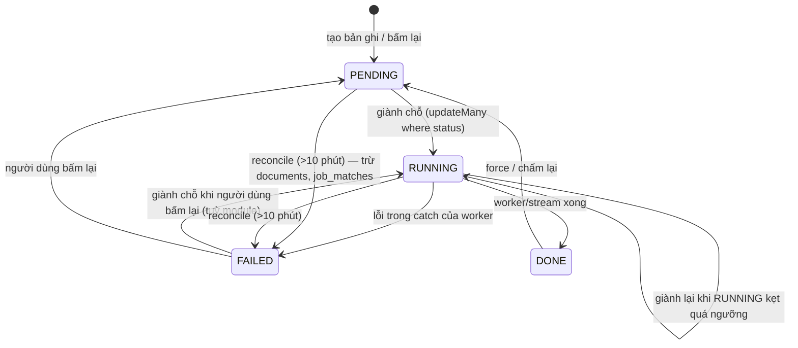

# 05 — Tổng quan cơ sở dữ liệu

> **Phạm vi:** [server/prisma/schema.prisma](../../server/prisma/schema.prisma) (1.345 dòng), 54 migration trong [server/prisma/migrations](../../server/prisma/migrations), schema `pgboss` do pg-boss tự quản.
> **Nguyên tắc:** tài liệu mô tả hệ thống **as-is**. Code là nguồn sự thật duy nhất. Chi tiết trường và index của từng bảng nằm ở mục §11 của file module sở hữu bảng đó.

## 1. Danh mục bảng

PostgreSQL 17 + extension `vector` (pgvector) và `pg_trgm`. 27 model Prisma, khoá chính `cuid()` trừ khi ghi khác.

| # | Bảng (`@@map`) | Model | Nhóm | Module sở hữu | Mô tả |
|---|---|---|---|---|---|
| 1 | `users` | User | Danh tính | [auth](./modules/auth.md#11-database) | Tài khoản, vai trò, `tokenVersion` |
| 2 | `profiles` | Profile | Danh tính | [profile](./modules/profile.md#11-database) | Hồ sơ ứng viên 1-1 với user |
| 3 | `profile_drafts` | ProfileDraft | Danh tính | [cv-import](./modules/cv-import.md#11-database) | Bản nháp hồ sơ do model đọc từ CV, chờ người dùng áp dụng |
| 4 | `jobs` | Job | Kho tin | [jobs](./modules/jobs.md#11-database) | Tin tuyển dụng dùng chung |
| 5 | `saved_jobs` | SavedJob | Kho tin | [jobs](./modules/jobs.md#11-database) | Tin người dùng đã lưu |
| 6 | `scrape_runs` | ScrapeRun | Kho tin | [job-scraping](./modules/job-scraping.md#11-database) | Một lượt quét một portal |
| 7 | `occupation_crawls` | OccupationCrawl | Kho tin | [job-scraping](./modules/job-scraping.md#11-database) | Mốc quét gần nhất của (portal, ngành) để xoay vòng |
| 8 | `job_requirements` | JobRequirement | Đánh giá | [matching](./modules/matching.md#11-database) | Yêu cầu rút từ một tin (1-1 với `jobs`) |
| 9 | `job_requirement_matches` | JobRequirementMatch | Đánh giá | [matching](./modules/matching.md#11-database) | Đối chiếu bằng code hồ sơ × tin |
| 10 | `canonical_skills` | CanonicalSkill | Đánh giá | [matching](./modules/matching.md#11-database) | Kỹ năng chuẩn + embedding `vector(768)` |
| 11 | `skill_aliases` | SkillAlias | Đánh giá | [matching](./modules/matching.md#11-database) | Cách viết → kỹ năng chuẩn |
| 12 | `job_matches` | JobMatch | Đánh giá | [matching](./modules/matching.md#11-database) | Kết quả chấm điểm AI |
| 13 | `applications` | Application | Ứng tuyển | [applications](./modules/applications.md#11-database) | Đơn ứng tuyển (user, job) |
| 14 | `application_events` | ApplicationEvent | Ứng tuyển | [applications](./modules/applications.md#11-database) | Nhật ký chuyển trạng thái đơn |
| 15 | `documents` | Document | Ứng tuyển | [documents](./modules/documents.md#11-database) | CV, thư xin việc, mail ứng tuyển |
| 16 | `company_briefs` | CompanyBrief | Ứng tuyển | [company-research](./modules/company-research.md#11-database) | Bản tìm hiểu công ty dùng chung |
| 17 | `salary_references` | SalaryReference | Ứng tuyển | [salary](./modules/salary.md#11-database) | Lương tham chiếu theo vị trí |
| 18 | `salary_reference_bands` | SalaryReferenceBand | Ứng tuyển | [salary](./modules/salary.md#11-database) | Mốc lương theo kinh nghiệm |
| 19 | `interview_preps` | InterviewPrep | Phỏng vấn | [interview-prep](./modules/interview-prep.md#11-database) | Bộ câu hỏi chuẩn bị cho (user, job) |
| 20 | `interview_answers` | InterviewAnswer | Phỏng vấn | [interview-prep](./modules/interview-prep.md#11-database) | Câu tự trả lời + nhận xét |
| 21 | `interview_questions` | InterviewQuestion | Phỏng vấn | [question-bank](./modules/question-bank.md#11-database) | Ngân hàng câu hỏi tĩnh |
| 22 | `agent_runs` | AgentRun | Phỏng vấn | [mock-interview](./modules/mock-interview.md#11-database) | Buổi phỏng vấn thử (workflow `interview`) |
| 23 | `agent_steps` | AgentStep | Phỏng vấn | [mock-interview](./modules/mock-interview.md#11-database) | Từng lượt của buổi |
| 24 | `upskill_reports` | UpskillReport | Phát triển | [upskill](./modules/upskill.md#11-database) | Báo cáo khoảng trống kỹ năng |
| 25 | `learning_items` | LearningItem | Phát triển | [upskill](./modules/upskill.md#11-database) | Kỹ năng đang học / bỏ qua / xong |
| 26 | `ai_calls` | AiCall | Nền tảng | [ai-platform](./modules/ai-platform.md#11-database) | Nhật ký mọi lời gọi model |
| 27 | `queue_configs` | QueueConfig | Nền tảng | [platform-operations](./modules/platform-operations.md#11-database) | Concurrency/serial từng hàng đợi |
| — | schema `pgboss` | (pg-boss) | Nền tảng | [platform-operations](./modules/platform-operations.md) | Bảng job/queue của pg-boss, không có model Prisma |

## 2. ER Diagram

```mermaid
erDiagram
  User ||--o| Profile : has
  User ||--o{ ProfileDraft : uploads
  User ||--o{ SavedJob : saves
  User ||--o{ JobMatch : "AI score"
  User ||--o{ JobRequirementMatch : "rule match"
  User ||--o{ Application : applies
  User ||--o{ Document : owns
  User ||--o{ InterviewPrep : prepares
  User ||--o{ InterviewAnswer : answers
  User ||--o{ AgentRun : practices
  User ||--o{ UpskillReport : requests
  User ||--o{ LearningItem : learns
  User |o--o{ ScrapeRun : "null = system"
  User |o--o{ AiCall : "null = system"
  Job ||--o| JobRequirement : "extracted once"
  Job ||--o{ JobRequirementMatch : ""
  Job ||--o{ JobMatch : ""
  Job ||--o{ SavedJob : ""
  Job ||--o{ Application : ""
  Job |o--o{ Document : "SetNull"
  Job ||--o{ InterviewPrep : ""
  Job ||--o{ InterviewAnswer : ""
  Job |o--o{ AgentRun : "SetNull"
  Job |o--o{ Job : "duplicateOf (SetNull)"
  Application ||--o{ ApplicationEvent : logs
  AgentRun ||--o{ AgentStep : steps
  AgentRun |o--o{ Document : "SetNull (unused)"
  CanonicalSkill ||--o{ SkillAlias : aliases
  SalaryReference ||--o{ SalaryReferenceBand : bands
```

Bảng không có khoá ngoại tới bảng khác: `occupation_crawls`, `company_briefs` (khoá logic `nameKey` từ `Job.company`), `interview_questions`, `queue_configs`, `upskill_reports.jobId` (cột thường, không FK), `learning_items.skillKey` (id kỹ năng chuẩn hoặc tên gấp dấu, không FK).

## 3. Chi tiết từng bảng (tóm tắt)

| Bảng | Trường nghiệp vụ chính | Ràng buộc / index đáng chú ý |
|---|---|---|
| `users` | `role`, `email`, `passwordHash?`, `googleId?`, `tokenVersion`, `name` | `email` unique, `googleId` unique |
| `profiles` | danh tính (`headline`, `location`, `phone`…), kỹ năng (`primarySkills`, `secondarySkills`, `lackingSkills`), kinh nghiệm, định hướng, `currentSalary`, `expectedSalary`, khối JSON (`experiences`, `educations`, `projects`…), `occupationCode?`, `subOccupationCode?`, `experienceLevel`, `completion`, `lastFanOutAt?` | `userId` unique; index `lastFanOutAt` |
| `profile_drafts` | `status`, `evidence` (Json), `proposal` (Json), `storageKey`, `filename`, `generatedAt`, `appliedAt`, `error` | index `(userId, createdAt desc)` |
| `jobs` | `source`, `externalId?`, `url`, `title`, `company`, `location`, `workMode`, dẫn xuất (`provinceCode`, `occupationCode`, `subOccupationCode`, `searchText`, `dedupeKey`), `duplicateOfId?`, `salaryRaw`, `salaryMin/Max/currency` (đọc từ `salaryRaw` bởi `derivedFields`, chỉ lương VND theo tháng — BR-JOB-29b *(2026-10-19)*), `tags`, `categories`, `description`, `postedAt?`, `scrapedAt` | unique `(source, externalId)`; index `(scrapedAt desc, id desc)` và 3 biến thể theo tỉnh/ngành/nghề; GIN trigram trên `searchText`; `dedupeKey` **cố ý không unique** |
| `saved_jobs` | `savedAt` | unique `(userId, jobId)` |
| `scrape_runs` | `userId?`, `status`, `portal`, `queries` (Json), `jobsFound/New/Queued`, `startedAt`, `finishedAt`, `error` | index `(userId, createdAt)`, `(portal, createdAt)` |
| `occupation_crawls` | `lastCrawledAt` | PK `(portal, occupationCode)` |
| `job_requirements` | `status`, `requiredSkills`, `niceToHaveSkills`, `minYears`, `seniority`, `citizenshipRequired`, `workPermitRequired`, `city`, `remotePolicy`, `sourceHash` | PK `jobId`; index `status` |
| `job_requirement_matches` | `met`, `total`, `percent`, `rank`, `eligibility`, `locationPass`, `hash` | PK `(userId, jobId)`; index `(userId, percent desc)`, `(userId, rank desc)` |
| `canonical_skills` | `name`, `model`, `embedding vector(768)` | index `model` |
| `skill_aliases` | `key` (PK, đã gấp dấu), `raw`, `skillId`, `source` | index `skillId` |
| `job_matches` | `status`, eligibility (`eligibility`, `eligibilityQuote`, `eligibilityNote`), 4 điểm + ghi chú, `locationPass`, `overallScore`, `verdict`, `strengths`, `gaps`, `recommendation`, `promptHash`, `evaluatedAt`, `error` | unique `(userId, jobId)`; index `(userId, overallScore desc)`, `(userId, status)` |
| `applications` | `status`, `appliedAt?`, `closedAt?`, `interviewAt?` | unique `(userId, jobId)`; index `(userId, status, updatedAt desc)` |
| `application_events` | `fromStatus?`, `toStatus`, `note?` | index `(applicationId, createdAt)` |
| `documents` | `kind`, `status`, `language`, `title`, `content` (Json), `templateId` (mặc định `classic`; thư mượn mẫu của CV cùng tin), `templateOptions`, `layout`, `identity`, `agentRunId?` — cột `storageKey` đã bỏ *(2026-10-19)* | index `(userId, kind, createdAt desc)` |
| `company_briefs` | `nameKey`, `name`, `verdict`, `summary`, `pros`, `cons`, `confidence`, `rating?`, `reviewCount?`, `sources` (Json), `expiresAt` | `nameKey` unique |
| `salary_references` | `source`, `sourceUrl`, `visibility`, `industrySlug`, `positionSlug`, `positionName`, `occupationCode?`, `avgMonthly`, `rangeMin/Max`, `currency` | unique `(source, positionSlug)`; index `(occupationCode, visibility)` |
| `salary_reference_bands` | `experienceLabel`, `min/avg/maxAmount` | unique `(referenceId, experienceLabel)` |
| `interview_preps` | `status`, `starAnswers`, `toughQuestions` (Json), `questionsToAsk`, `talkingPoints`, `likelyProbes`, `promptHash` | unique `(userId, jobId)` |
| `interview_answers` | `questionKey`, `kind`, `question`, `text`, `feedback` (Json), `feedbackKey` | unique `(userId, jobId, questionKey)` |
| `interview_questions` | `source`, `sourceId?`, `sourceText`, `status`, `text`, `industry`, `type`, `difficulty`, `sourcePracticeCount`, `why`, `keyPoints`, `answerGuide`, `sampleAnswer`, `verified` | unique `(source, sourceId)`; 3 index theo `status` |
| `agent_runs` | `workflow`, `status`, `jobId?`, `input`, `result`, `review`, `question`, `answer`, `messages`, `startedAt`, `finishedAt` | index `(userId, createdAt)`, `(userId, jobId, createdAt)` |
| `agent_steps` | `index`, `text`, `toolCalls`, `toolResults`, `durationMs` | unique `(runId, index)` |
| `upskill_reports` | `mode`, `status`, `jobId?`, `jobsAnalysed`, `hardGaps`, `synthesisedGaps`, `learningPlan`, `summary` — **không có `updatedAt`** | index `(userId, createdAt desc)` |
| `learning_items` | `skillKey`, `skillName`, `status`, `steps Boolean[3]`, `days` | unique `(userId, skillKey)` |
| `ai_calls` | `userId?`, `purpose`, `provider`, `modelId`, `ok`, `failureKind`, `errorMessage`, `durationMs`, `inputTokens`, `outputTokens`, `cachedTokens`, `finishReason`, `responseText` (**dữ liệu cá nhân**) | index `createdAt desc`, `(purpose, ok)`, `userId` |
| `queue_configs` | `queueName`, `concurrency` (mặc định 1), `serial`, `note` | `queueName` unique |

## 4. Ràng buộc duy nhất (🔒 cứng)

| Bảng | Unique | Ý nghĩa nghiệp vụ | BR |
|---|---|---|---|
| `users` | `email`; `googleId` | Một email một tài khoản; một tài khoản Google gắn một user | BR-AUTH-02, BR-AUTH-10 |
| `profiles` | `userId` | Một hồ sơ mỗi người | BR-PRF-01 |
| `jobs` | `(source, externalId)` | Không nhân đôi tin khi quét lại | BR-JOB-31, BR-SCR-34 |
| `saved_jobs` | `(userId, jobId)` | Lưu tin idempotent | BR-JOB-16 |
| `job_matches` | `(userId, jobId)` | Một kết quả chấm cho mỗi cặp | BR-MAT-47 |
| `job_requirements` | PK `jobId` | Một bản yêu cầu mỗi tin | BR-MAT-47 |
| `job_requirement_matches` | PK `(userId, jobId)` | | BR-MAT-39 |
| `skill_aliases` | PK `key` | Một cách viết thuộc đúng một kỹ năng | BR-ADM-40 |
| `applications` | `(userId, jobId)` | Một đơn mỗi tin | BR-APP-01 |
| `interview_preps` | `(userId, jobId)` | Một bộ đề mỗi tin | BR-INT-01 |
| `interview_answers` | `(userId, jobId, questionKey)` | Khoá theo vân tay chữ câu hỏi | BR-INT-16 |
| `interview_questions` | `(source, sourceId)` | Nạp lại không nhân đôi | BR-QB-03 |
| `agent_steps` | `(runId, index)` | | BR-MOCK-13 |
| `learning_items` | `(userId, skillKey)` | | BR-UPS-22 |
| `company_briefs` | `nameKey` | Một bản mỗi công ty | BR-CMP-01 |
| `salary_references` | `(source, positionSlug)` | | BR-SAL-04 |
| `salary_reference_bands` | `(referenceId, experienceLabel)` | | BR-SAL-05 |
| `occupation_crawls` | PK `(portal, occupationCode)` | | BR-SCR-38 |
| `queue_configs` | `queueName` | | BR-OPS-14 |
| pg-boss | `(queue, singletonKey)` khi policy `exclusive` | Không có hai việc chưa xong cùng khoá | BR-OPS-04 |

## 5. Enum và trạng thái

| Enum | Giá trị | Dùng ở | State machine |
|---|---|---|---|
| `UserRole` | USER, ADMIN | `users.role` | [auth.md §12](./modules/auth.md#12-state-machine), [admin-console.md §12](./modules/admin-console.md#12-state-machine) |
| `MatchStatus` | PENDING, RUNNING, DONE, FAILED | `job_matches`, `job_requirements`, `profile_drafts`, `documents`, `interview_preps`, `upskill_reports`, `scrape_runs` | §12 của từng module |
| `AgentRunStatus` | PENDING, RUNNING, WAITING_USER, DONE, FAILED | `agent_runs.status` | [mock-interview.md §12](./modules/mock-interview.md#12-state-machine) |
| `ApplicationStatus` | VIEWED, APPLIED, WITHDRAWN | `applications.status`, `application_events` | [applications.md §12](./modules/applications.md#12-state-machine) |
| `EligibilityVerdict` | PASS, FAIL, UNVERIFIED | `job_matches`, `job_requirement_matches` | — |
| `FitVerdict` | STRONG, GOOD, MODERATE, WEAK, POOR | `job_matches.verdict` | — |
| `JobSeniority` | INTERN, FRESHER, JUNIOR, MIDDLE, SENIOR, LEAD, UNKNOWN | `profiles.experienceLevel`, `job_requirements.seniority` | — |
| `RemotePolicy` | ONSITE, HYBRID, REMOTE, UNKNOWN | `job_requirements.remotePolicy` | — |
| `AliasSource` | EXACT, LLM, MANUAL | `skill_aliases.source` | [admin-console.md §12](./modules/admin-console.md#12-state-machine) |
| `DocumentKind` | CV, COVER_LETTER, APPLICATION_EMAIL, FORM_ANSWER (không còn sinh) | `documents.kind` | — |
| `DocumentLanguage` | VI, EN | `documents.language` | — |
| `InterviewQuestionKind` | STAR, TOUGH | `interview_answers.kind` | — |
| `InterviewQuestionSource` | X_INTERVIEW, GENERATED, USER (hai giá trị sau chưa có code tạo) | `interview_questions.source` | — |
| `InterviewQuestionType` | KIEN_THUC, QUY_TRINH, HANH_VI, DONG_CO | `interview_questions.type` | — |
| `InterviewQuestionStatus` | RAW, READY, REJECTED | `interview_questions.status` | [question-bank.md §12](./modules/question-bank.md#12-state-machine) |
| `LearningStatus` | LEARNING, SKIPPED, DONE | `learning_items.status` | [upskill.md §12](./modules/upskill.md#12-state-machine) |
| `UpskillMode` | AGGREGATE, TARGETED | `upskill_reports.mode` | — |
| `AiFailureKind` | SCHEMA, TIMEOUT, UPSTREAM, OTHER | `ai_calls.failureKind` | — |
| `BriefConfidence` | HIGH, MEDIUM, LOW | `company_briefs.confidence` | — |
| `CompanyVerdict` | POSITIVE, MIXED, NEGATIVE, NO_REVIEWS_YET, UNKNOWN | `company_briefs.verdict` | — |
| `SalaryRefVisibility` | INTERNAL, PUBLIC | `salary_references.visibility` | [salary.md §12](./modules/salary.md#12-state-machine) |

Vòng đời chung của bảng có `MatchStatus` (mỗi module có biến thể riêng ở §12):

Tên tiếng Việt của từng giá trị: [12-glossary.md](./12-glossary.md#4-đối-chiếu-enum--nghĩa-tiếng-việt).

## 6. Chiến lược xoá

Không có xoá mềm ở bảng nào. Không có API xoá tài khoản; xoá user chỉ bằng SQL.

| Khi xoá | Bảng con | Hành vi |
|---|---|---|
| `User` | `profiles`, `profile_drafts`, `job_matches`, `job_requirement_matches`, `saved_jobs`, `applications`, `documents`, `interview_preps`, `interview_answers`, `agent_runs`, `upskill_reports`, `learning_items` | **Cascade** |
| `User` | `scrape_runs.userId`, `ai_calls.userId` | **SetNull** — giữ lịch sử hệ thống |
| `Job` | `job_requirements`, `job_requirement_matches`, `job_matches`, `saved_jobs`, `applications`, `interview_preps`, `interview_answers` | Cascade |
| `Job` | `documents.jobId`, `agent_runs.jobId`, `jobs.duplicateOfId` | SetNull — giữ CV và buổi luyện người dùng đã làm |
| `Application` | `application_events` | Cascade |
| `AgentRun` | `agent_steps` cascade; `documents.agentRunId` SetNull | |
| `CanonicalSkill` | `skill_aliases` | Cascade (gộp kỹ năng chuyển alias trước rồi mới xoá — BR-ADM-39) |
| `SalaryReference` | `salary_reference_bands` | Cascade |

Các lệnh xoá có trong code: bỏ lưu tin (`saved_jobs`), xoá mục lộ trình học (`learning_items`), xoá câu tự trả lời bằng chuỗi rỗng (`interview_answers`), xoá kỹ năng rỗng khi chuyển/gộp alias, xoá `job_requirement_matches` khi không còn khớp. **Tin tuyển dụng không bao giờ bị xoá hay hết hạn** ([jobs.md#R2](./modules/jobs.md)); `ai_calls` không được dọn ([ai-platform.md#R5](./modules/ai-platform.md)).

## 7. Toàn vẹn dữ liệu

| Cơ chế | Dùng ở | Nguồn |
|---|---|---|
| Giành chỗ có điều kiện `updateMany({ where: { id, status: <cho phép> } })`, `count = 0` thì dừng | Mọi worker/stream có trạng thái; đổi trạng thái đơn ứng tuyển | [CLAUDE.md](../../CLAUDE.md), BR-MAT-10, BR-DOC-09, BR-APP-12, BR-MOCK-10 |
| Tạo rồi bắt `P2002` (`isUniqueViolation`) thay cho kiểm-rồi-tạo | `job_matches`, đăng ký, lưu tin… | [prisma-errors.ts](../../server/src/prisma/prisma-errors.ts) |
| `$transaction` | Đổi trạng thái đơn + ghi event; mỗi lượt phỏng vấn thử; ghi lại `job_requirement_matches`; chuyển/gộp alias | BR-APP-13, BR-MOCK-12, BR-MAT-39, BR-ADM-37 |
| Hash chống làm lại | `job_matches.promptHash`, `job_requirements.sourceHash`, `job_requirement_matches.hash`, `interview_preps.promptHash` | [matching.md](./modules/matching.md) |
| Reconcile | 7 bảng có `MatchStatus` + `agent_runs` | [platform-operations.md](./modules/platform-operations.md) |

Kiểm-rồi-tạo còn sót (không nguyên tử): một buổi phỏng vấn đang chạy ([mock-interview.md#R1](./modules/mock-interview.md)), trần 3 kỹ năng đang học ([upskill.md#R5](./modules/upskill.md)), admin cuối cùng ([admin-console.md#R2](./modules/admin-console.md)).

## 8. Seed và migration

| Việc | Lệnh / file | Ghi chú |
|---|---|---|
| Migration | `pnpm db:migrate` (dev), service `migrate` (`prisma migrate deploy`) trên server | 54 thư mục từ `20260809060243_init` tới `20261019100000_drop_document_storage_key` *(2026-10-19)* |
| Seed demo | `pnpm db:seed` → [seed-demo.mjs](../../server/scripts/seed-demo.mjs), hồ sơ ở [demo-personas.mjs](../../server/scripts/demo-personas.mjs) | `admin@aijob.local` (ADMIN), `demo@aijob.local` và 7 hồ sơ ngoài IT; mật khẩu chung `Demo@12345`, **chỉ dev**; `ON CONFLICT DO UPDATE` nên chạy lại được |
| Seed `queue_configs` | Lúc khởi động, `createMany skipDuplicates` từ [queue.defaults.ts](../../server/src/modules/queue/queue.defaults.ts) | Không ghi đè chỗ admin đã sửa (BR-OPS-11) |
| Ngân hàng câu hỏi | [import-interview-questions.mjs](../../server/scripts/import-interview-questions.mjs) → [enrich-interview-questions.mjs](../../server/scripts/enrich-interview-questions.mjs) → [answer-interview-questions.mjs](../../server/scripts/answer-interview-questions.mjs) | [question-bank.md](./modules/question-bank.md) |
| Bảng lương | [crawl-salary-reference.mjs](../../server/scripts/crawl-salary-reference.mjs) | Nạp `INTERNAL`; lật `PUBLIC` bằng SQL tay |
| Danh bạ kỹ năng | [build-skill-dictionary.mjs](../../server/scripts/build-skill-dictionary.mjs) hoặc `POST /api/matches/dictionary/rebuild` | |
| Backfill | `backfill-*.mjs`, `POST /api/admin/jobs/backfill-taxonomy` | |
| DB test | `TEST_DATABASE_URL` tên kết thúc `_test`; harness TRUNCATE mọi bảng | [CLAUDE.md](../../CLAUDE.md) |

## Source References

**Backend:** [schema.prisma](../../server/prisma/schema.prisma) · [migrations/](../../server/prisma/migrations) · [prisma-errors.ts](../../server/src/prisma/prisma-errors.ts) · [prisma-exception.filter.ts](../../server/src/common/filters/prisma-exception.filter.ts) · [reconcile.service.ts](../../server/src/modules/reconcile/services/reconcile.service.ts) · [queue.defaults.ts](../../server/src/modules/queue/queue.defaults.ts) · [seed-demo.mjs](../../server/scripts/seed-demo.mjs) · [docker-compose.yml](../../server/docker-compose.yml)

**Module:** mục §11 và §12 của mọi file trong [modules/](./modules/).
