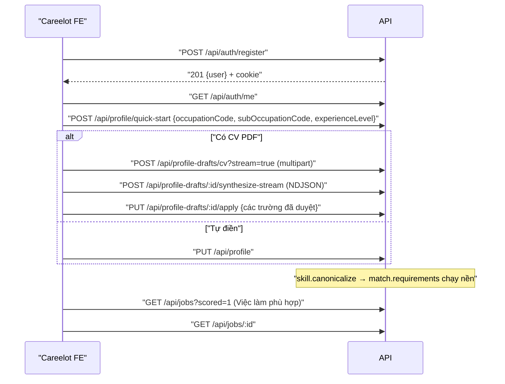

# 06 — Tổng quan API

> **Phạm vi:** mọi controller trong `server/src/modules/**`, tiền tố `/api`.
> **Nguyên tắc:** tài liệu mô tả hệ thống **as-is**. Code là nguồn sự thật duy nhất. Bảng §3 được sinh tự động từ mục §9 của các file module, nên luôn là hợp của các bảng API Mapping.

## 1. Quy ước chung

| Quy ước | Chi tiết |
|---|---|
| Base URL | `http://localhost:4000/api` (dev); FE đọc `NEXT_PUBLIC_API_URL` |
| Xác thực | Cookie httpOnly `aijob_token`; mặc định mọi route cần đăng nhập, trừ route `@Public` ([03-authentication.md](./03-authentication.md)) |
| Body | JSON, tối đa 1 MB; field lạ → 400 (`forbidNonWhitelisted`) |
| Upload | Duy nhất `POST /api/profile-drafts/cv`: `multipart/form-data`, field `file`, PDF ≤ 10 MB |
| Tải file | `GET /api/documents/:id/pdf` (PDF, in từ HTML), `GET /api/profile-drafts/:id/file` (PDF gốc) |
| Stream | Route `*-stream`, `/turn`, `POST /api/mock-interviews`: `application/x-ndjson`, mỗi dòng một sự kiện `{type: "partial", data}` · `{type: "done", result}` · `{type: "error", message, failureKind?, statusCode?}`; dòng trống mỗi 10 s để giữ kết nối |
| Việc nền | Route tạo việc trả `201/202` kèm id; FE poll route GET tương ứng mỗi 2–5 s |
| Phân trang | `?limit=1..100&offset=0..100000` → `{ items, total, limit, offset }` |
| Mảng trong query | Lặp tên: `province=HN&province=HCM` (không dùng `province[]`) |
| Lỗi | [11-error-handling.md](./11-error-handling.md) |
| Swagger | `/api/docs` khi không phải production |

## 2. Bản đồ API theo module

| Module | Tiền tố | Số endpoint | Vai trò |
|---|---|---|---|
| [auth](./modules/auth.md#9-api-mapping) | `/api/auth` | 6 | Public + USER |
| [profile](./modules/profile.md#9-api-mapping) | `/api/profile` | 4 | USER |
| [cv-import](./modules/cv-import.md#9-api-mapping) | `/api/profile-drafts` | 7 | USER |
| [jobs](./modules/jobs.md#9-api-mapping) | `/api/jobs`, `/api/public/jobs` | 7 | USER + Public |
| [job-scraping](./modules/job-scraping.md#9-api-mapping) | `/api/scrape` | 2 | ADMIN |
| [matching](./modules/matching.md#9-api-mapping) | `/api/matches` | 7 | USER + ADMIN |
| [applications](./modules/applications.md#9-api-mapping) | `/api/applications` | 5 | USER |
| [documents](./modules/documents.md#9-api-mapping) | `/api/documents` | 12 | USER |
| [interview-prep](./modules/interview-prep.md#9-api-mapping) | `/api/interview` | 5 | USER |
| [question-bank](./modules/question-bank.md#9-api-mapping) | `/api/question-bank` | 3 | Public + USER |
| [mock-interview](./modules/mock-interview.md#9-api-mapping) | `/api/mock-interviews` | 4 | USER |
| [upskill](./modules/upskill.md#9-api-mapping) | `/api/upskill`, `/api/learning` | 8 | USER |
| [company-research](./modules/company-research.md#9-api-mapping) | `/api/companies` | 3 | Public + USER |
| [salary](./modules/salary.md#9-api-mapping) | `/api/salary` | 3 | Public |
| [dashboard](./modules/dashboard.md#9-api-mapping) | `/api/dashboard` | 2 | USER |
| [admin-console](./modules/admin-console.md#9-api-mapping) | `/api/admin` | 27 | ADMIN |
| [ai-platform](./modules/ai-platform.md#9-api-mapping) | `/api/admin/ai/models`, `/api/skills` | 4 | ADMIN |
| [platform-operations](./modules/platform-operations.md#9-api-mapping) | `/api/health`, `/api/queue/stats` | 2 | Public + ADMIN |
| **Tổng** | | **111** | |

## 3. Bảng tra cứu nhanh toàn bộ endpoint

[//]: # (GEN:API)

| # | Method | URL | Role | Mục đích nghiệp vụ | Controller#method | Module |
|---|---|---|---|---|---|---|
| 1 | POST | `/api/auth/register` | Public | Tạo tài khoản mật khẩu | `AuthController#register` | [auth](./modules/auth.md#9-api-mapping) |
| 2 | POST | `/api/auth/login` | Public | Đăng nhập mật khẩu | `AuthController#login` | [auth](./modules/auth.md#9-api-mapping) |
| 3 | POST | `/api/auth/google` | Public | Đăng nhập/đăng ký/liên kết Google | `AuthController#google` | [auth](./modules/auth.md#9-api-mapping) |
| 4 | POST | `/api/auth/refresh` | Public (cần cookie refresh) | Đổi refresh lấy cặp token mới | `AuthController#refresh` | [auth](./modules/auth.md#9-api-mapping) |
| 5 | POST | `/api/auth/logout` | Public | Xoá cookie phiên trên trình duyệt này | `AuthController#logout` | [auth](./modules/auth.md#9-api-mapping) |
| 6 | GET | `/api/auth/me` | USER/ADMIN | Lấy tài khoản hiện tại kèm vai trò | `AuthController#me` | [auth](./modules/auth.md#9-api-mapping) |
| 7 | GET | `/api/profile` | USER/ADMIN | Xem hồ sơ của mình (tự tạo nếu thiếu) | `ProfileController#get` | [profile](./modules/profile.md#9-api-mapping) |
| 8 | PUT | `/api/profile` | USER/ADMIN | Cập nhật một phần hồ sơ | `ProfileController#update` | [profile](./modules/profile.md#9-api-mapping) |
| 9 | POST | `/api/profile/skills` | USER/ADMIN | Thêm một kỹ năng nếu chưa có | `ProfileController#addSkill` | [profile](./modules/profile.md#9-api-mapping) |
| 10 | POST | `/api/profile/quick-start` | USER/ADMIN | Ghi ngành/nghề/cấp bậc người dùng chọn | `ProfileController#quickStart` | [profile](./modules/profile.md#9-api-mapping) |
| 11 | POST | `/api/profile-drafts/cv` | USER/ADMIN | Nộp CV PDF, rút text, tạo bản nháp (`?stream=true` không xếp hàng) | `ProfileDraftController#uploadCv` | [cv-import](./modules/cv-import.md#9-api-mapping) |
| 12 | GET | `/api/profile-drafts/latest` | USER/ADMIN | Bản nháp mới nhất | `#latest` | [cv-import](./modules/cv-import.md#9-api-mapping) |
| 13 | GET | `/api/profile-drafts/:id/file` | USER/ADMIN | Mở file CV gốc | `#file` | [cv-import](./modules/cv-import.md#9-api-mapping) |
| 14 | GET | `/api/profile-drafts/:id` | USER/ADMIN | Xem một bản nháp | `#get` | [cv-import](./modules/cv-import.md#9-api-mapping) |
| 15 | POST | `/api/profile-drafts/:id/synthesize-stream` | USER/ADMIN | Đọc CV bằng model, đẩy từng phần | `#synthesizeStream` | [cv-import](./modules/cv-import.md#9-api-mapping) |
| 16 | POST | `/api/profile-drafts/:id/retry` | USER/ADMIN | Chạy lại bản `FAILED` qua hàng đợi | `#retry` | [cv-import](./modules/cv-import.md#9-api-mapping) |
| 17 | PUT | `/api/profile-drafts/:id/apply` | USER/ADMIN | Ghi giá trị đã duyệt vào hồ sơ | `#apply` | [cv-import](./modules/cv-import.md#9-api-mapping) |
| 18 | GET | `/api/jobs` | USER | Danh sách tin, "Việc làm phù hợp" khi `scored=true` | `JobsController#list` | [jobs](./modules/jobs.md#9-api-mapping) |
| 19 | GET | `/api/jobs/filters` | Public (60/phút) | Danh mục bộ lọc kèm số tin | `JobsController#filters` | [jobs](./modules/jobs.md#9-api-mapping) |
| 20 | GET | `/api/jobs/:id` | USER | Chi tiết tin + đơn, điểm, đối chiếu, gợi ý lương | `JobsController#get` | [jobs](./modules/jobs.md#9-api-mapping) |
| 21 | POST | `/api/jobs/:id/save` | USER | Lưu tin (200) | `JobsController#save` | [jobs](./modules/jobs.md#9-api-mapping) |
| 22 | DELETE | `/api/jobs/:id/save` | USER | Bỏ lưu tin (200) | `JobsController#unsave` | [jobs](./modules/jobs.md#9-api-mapping) |
| 23 | GET | `/api/public/jobs` | Public (60/phút) | Danh sách cho khách, không lương | `PublicJobsController#list` | [jobs](./modules/jobs.md#9-api-mapping) |
| 24 | GET | `/api/public/jobs/:id` | Public (60/phút) | Chi tiết cho khách, đoạn trích | `PublicJobsController#get` | [jobs](./modules/jobs.md#9-api-mapping) |
| 25 | POST | `/api/scrape` | ADMIN (3/giờ) | Xếp một lượt quét một portal theo hồ sơ của admin | `ScraperController#start` | [job-scraping](./modules/job-scraping.md#9-api-mapping) |
| 26 | POST | `/api/scrape/portals/reload` | ADMIN | Nạp lại danh sách portal từ đĩa | `ScraperController#reloadPortals` | [job-scraping](./modules/job-scraping.md#9-api-mapping) |
| 27 | GET | `/api/matches` | USER | Danh sách tin đã chấm AI | `MatchingController#list` | [matching](./modules/matching.md#9-api-mapping) |
| 28 | GET | `/api/matches/:jobId` | USER | Chi tiết điểm AI (mọi trạng thái) | `MatchingController#get` | [matching](./modules/matching.md#9-api-mapping) |
| 29 | POST | `/api/matches/evaluate` | USER | Xếp hàng chấm AI | `MatchingController#enqueue` | [matching](./modules/matching.md#9-api-mapping) |
| 30 | POST | `/api/matches/evaluate-stream/:jobId?force=` | USER | Chấm AI và stream từng phần | `MatchingController#evaluateStream` | [matching](./modules/matching.md#9-api-mapping) |
| 31 | POST | `/api/matches/requirements/:jobId?force=` | ADMIN | Rút yêu cầu một tin bằng AI (đồng bộ) | `MatchingController#extractRequirements` | [matching](./modules/matching.md#9-api-mapping) |
| 32 | POST | `/api/matches/dictionary/rebuild` | ADMIN | Quét toàn kho, dựng lại danh bạ kỹ năng | `MatchingController#rebuildDictionary` | [matching](./modules/matching.md#9-api-mapping) |
| 33 | POST | `/api/matches/shortlist/dispatch?userId=` | ADMIN | Phát suất chấm AI ngay | `MatchingController#dispatchShortlist` | [matching](./modules/matching.md#9-api-mapping) |
| 34 | GET | `/api/applications` | USER | Danh sách đơn + CV của tin | `ApplicationsController#list` | [applications](./modules/applications.md#9-api-mapping) |
| 35 | GET | `/api/applications/jobs` | USER | Tin của các đơn để đổ ô chọn | `ApplicationsController#jobs` | [applications](./modules/applications.md#9-api-mapping) |
| 36 | POST | `/api/applications` | USER (`@ThrottleAi` 10/phút) | Tạo đơn, tuỳ chọn sinh CV + thư | `ApplicationsController#create` | [applications](./modules/applications.md#9-api-mapping) |
| 37 | PUT | `/api/applications/:id/status` | USER | Đổi trạng thái + ghi nhật ký | `ApplicationsController#updateStatus` | [applications](./modules/applications.md#9-api-mapping) |
| 38 | PUT | `/api/applications/:id/interview-date` | USER | Ghi/xoá ngày phỏng vấn | `ApplicationsController#setInterviewDate` | [applications](./modules/applications.md#9-api-mapping) |
| 39 | GET | `/api/documents` | USER | Danh sách tài liệu | `DocumentsController#list` | [documents](./modules/documents.md#9-api-mapping) |
| 40 | POST | `/api/documents/job-from-url` | USER (`@ThrottleAi`) | Bóc tin từ URL | `#extractJob` | [documents](./modules/documents.md#9-api-mapping) |
| 41 | GET | `/api/documents/cv-templates` | USER | Danh mục mẫu CV | `#templates` | [documents](./modules/documents.md#9-api-mapping) |
| 42 | GET | `/api/documents/:id` | USER | Chi tiết tài liệu | `#get` | [documents](./modules/documents.md#9-api-mapping) |
| 43 | PUT | `/api/documents/:id/template` | USER | Lưu mẫu + thiết kế CV | `#setTemplate` | [documents](./modules/documents.md#9-api-mapping) |
| 44 | POST | `/api/documents/:id/preview` | USER | HTML xem trước bản nháp CV / thư | `#previewDraft` | [documents](./modules/documents.md#9-api-mapping) |
| 45 | PUT | `/api/documents/:id/cv` | USER | Lưu CV đã sửa | `#updateCv` | [documents](./modules/documents.md#9-api-mapping) |
| 46 | GET | `/api/documents/:id/pdf` | USER (`@ThrottlePdf`) | Tải PDF | `#pdf` | [documents](./modules/documents.md#9-api-mapping) |
| 47 | POST | `/api/documents/:id/generate-stream` | USER (`@ThrottleAi`) | Sinh nội dung dạng stream | `#generateStream` | [documents](./modules/documents.md#9-api-mapping) |
| 48 | POST | `/api/documents/cv` | USER (`@ThrottleAi`) | Tạo CV | `#cv` | [documents](./modules/documents.md#9-api-mapping) |
| 49 | POST | `/api/documents/cover-letter` | USER (`@ThrottleAi`) | Tạo Thư xin việc | `#coverLetter` | [documents](./modules/documents.md#9-api-mapping) |
| 50 | POST | `/api/documents/application-email` | USER (`@ThrottleAi`) | Tạo Mail ứng tuyển | `#applicationEmail` | [documents](./modules/documents.md#9-api-mapping) |
| 51 | GET | `/api/interview` | USER | Danh sách bộ đề kèm mức sẵn sàng | `InterviewController#list` | [interview-prep](./modules/interview-prep.md#9-api-mapping) |
| 52 | GET | `/api/interview/:jobId` | USER | Chi tiết bộ đề + câu trả lời | `InterviewController#get` | [interview-prep](./modules/interview-prep.md#9-api-mapping) |
| 53 | POST | `/api/interview/prep` | USER (ThrottleAi 10/phút) | Xếp soạn / soạn lại bộ đề | `InterviewController#enqueue` | [interview-prep](./modules/interview-prep.md#9-api-mapping) |
| 54 | PUT | `/api/interview/:jobId/answers/:kind/:index` | USER | Lưu / xoá câu tự trả lời | `InterviewController#saveAnswer` | [interview-prep](./modules/interview-prep.md#9-api-mapping) |
| 55 | POST | `/api/interview/:jobId/answers/:kind/:index/feedback` | USER (ThrottleAi 10/phút) | Lưu và nhờ AI nhận xét | `InterviewController#feedback` | [interview-prep](./modules/interview-prep.md#9-api-mapping) |
| 56 | GET | `/api/question-bank/filters` | Public (60/phút) | Số câu theo ngành, loại, độ khó | `QuestionBankController#filters` | [question-bank](./modules/question-bank.md#9-api-mapping) |
| 57 | GET | `/api/question-bank` | Public (60/phút) | Danh sách câu hỏi có lọc | `QuestionBankController#list` | [question-bank](./modules/question-bank.md#9-api-mapping) |
| 58 | POST | `/api/question-bank/:id/answer` | USER (ThrottleAi 10/phút) | Lấy hoặc sinh đáp án cho câu | `QuestionBankController#answer` | [question-bank](./modules/question-bank.md#9-api-mapping) |
| 59 | GET | `/api/mock-interviews` | USER | Danh sách buổi luyện của mình | `MockInterviewController#list` | [mock-interview](./modules/mock-interview.md#9-api-mapping) |
| 60 | GET | `/api/mock-interviews/:id` | USER | Chi tiết buổi luyện + các bước | `MockInterviewController#get` | [mock-interview](./modules/mock-interview.md#9-api-mapping) |
| 61 | POST | `/api/mock-interviews` | USER (ThrottleAi 10/phút) | Mở buổi luyện, stream câu hỏi đầu | `MockInterviewController#open` | [mock-interview](./modules/mock-interview.md#9-api-mapping) |
| 62 | POST | `/api/mock-interviews/:id/turn` | USER (ThrottleAi 10/phút) | Gửi câu trả lời, stream lượt tiếp | `MockInterviewController#turn` | [mock-interview](./modules/mock-interview.md#9-api-mapping) |
| 63 | GET | `/api/upskill` | USER | Báo cáo DONE mới nhất | `UpskillController#latest` | [upskill](./modules/upskill.md#9-api-mapping) |
| 64 | GET | `/api/upskill/in-flight` | USER | Lượt đang chạy để nối lại | `UpskillController#inFlight` | [upskill](./modules/upskill.md#9-api-mapping) |
| 65 | GET | `/api/upskill/:id` | USER | Chi tiết một báo cáo của mình | `UpskillController#get` | [upskill](./modules/upskill.md#9-api-mapping) |
| 66 | POST | `/api/upskill/generate` | USER (10/phút) | Tạo báo cáo, xếp hàng | `UpskillController#enqueue` | [upskill](./modules/upskill.md#9-api-mapping) |
| 67 | POST | `/api/upskill/generate-stream` | USER (10/phút) | Tạo báo cáo, stream NDJSON | `UpskillController#generateStream` | [upskill](./modules/upskill.md#9-api-mapping) |
| 68 | GET | `/api/learning` | USER | Kỹ năng thiếu + kế hoạch | `LearningController#overview` | [upskill](./modules/upskill.md#9-api-mapping) |
| 69 | PUT | `/api/learning/:key` | USER | Học/bỏ qua/cập nhật một kỹ năng | `LearningController#save` | [upskill](./modules/upskill.md#9-api-mapping) |
| 70 | DELETE | `/api/learning/:key` | USER | Bỏ một kỹ năng khỏi kế hoạch | `LearningController#remove` | [upskill](./modules/upskill.md#9-api-mapping) |
| 71 | GET | `/api/companies/brief/by-job/:jobId` | Public (throttle 60/phút) | Xem bản tìm hiểu công ty của tin | `CompanyController#brief` | [company-research](./modules/company-research.md#9-api-mapping) |
| 72 | POST | `/api/companies/brief/by-job/:jobId` | USER/ADMIN (`ThrottleAi` 10/phút) | Xếp việc tìm hiểu/làm mới ở nền | `CompanyController#refresh` | [company-research](./modules/company-research.md#9-api-mapping) |
| 73 | POST | `/api/companies/brief/by-job/:jobId/stream?force=` | USER/ADMIN (`ThrottleAi` 10/phút) | Tìm hiểu/làm mới, đẩy từng phần | `CompanyController#refreshStream` | [company-research](./modules/company-research.md#9-api-mapping) |
| 74 | GET | `/api/salary/occupations` | Public (60/phút) | Ngành có dữ liệu lương | `SalaryController#occupations` | [salary](./modules/salary.md#9-api-mapping) |
| 75 | GET | `/api/salary/positions` | Public (60/phút) | Danh sách vị trí + khoảng lương | `SalaryController#positions` | [salary](./modules/salary.md#9-api-mapping) |
| 76 | GET | `/api/salary/positions/:slug` | Public (60/phút) | Chi tiết một vị trí | `SalaryController#position` | [salary](./modules/salary.md#9-api-mapping) |
| 77 | GET | `/api/dashboard` | USER | Tổng quan tìm việc | `DashboardController#overview` | [dashboard](./modules/dashboard.md#9-api-mapping) |
| 78 | GET | `/api/dashboard/skill-gaps` | USER | 6 kỹ năng thiếu đầu | `DashboardController#skillGaps` | [dashboard](./modules/dashboard.md#9-api-mapping) |
| 79 | GET | /api/admin/overview | ADMIN | Tổng quan vận hành + cảnh báo | AdminController#overview | [admin-console](./modules/admin-console.md#9-api-mapping) |
| 80 | GET | /api/admin/ai-health | ADMIN | Sức khoẻ AI | AdminController#aiHealth | [admin-console](./modules/admin-console.md#9-api-mapping) |
| 81 | GET | /api/admin/ai-failures | ADMIN | Nhật ký lỗi AI | AdminController#failures | [admin-console](./modules/admin-console.md#9-api-mapping) |
| 82 | GET | /api/admin/ai-failures/facets | ADMIN | Giá trị lọc purpose/model | AdminController#failureFacets | [admin-console](./modules/admin-console.md#9-api-mapping) |
| 83 | GET | /api/admin/ai-calls/:id | ADMIN | Chi tiết một lời gọi AI (che dữ liệu cá nhân) | AdminController#aiCall | [admin-console](./modules/admin-console.md#9-api-mapping) |
| 84 | GET | /api/admin/ai-usage | ADMIN | Token theo ngày/model/tác vụ/người dùng | AdminController#aiUsage | [admin-console](./modules/admin-console.md#9-api-mapping) |
| 85 | POST | /api/admin/scrape/run-now | ADMIN | Quét mọi portal ngay | AdminController#scrapeNow | [admin-console](./modules/admin-console.md#9-api-mapping) |
| 86 | POST | /api/admin/jobs/backfill-taxonomy | ADMIN | Tính lại tỉnh/ngành/dedupe/searchText | AdminController#backfillTaxonomy | [admin-console](./modules/admin-console.md#9-api-mapping) |
| 87 | POST | /api/admin/reconcile/run-now | ADMIN | Nhặt việc nền bị rơi ngay | AdminController#reconcileNow | [admin-console](./modules/admin-console.md#9-api-mapping) |
| 88 | GET | /api/admin/queue/config | ADMIN | Danh sách cấu hình hàng đợi | AdminController#queueConfigList | [admin-console](./modules/admin-console.md#9-api-mapping) |
| 89 | PUT | /api/admin/queue/config/:queueName | ADMIN | Ghi đè concurrency/serial/note | AdminController#queueConfigUpdate | [admin-console](./modules/admin-console.md#9-api-mapping) |
| 90 | GET | /api/admin/jobs | ADMIN | Danh sách tin trong kho | AdminJobsController#list | [admin-console](./modules/admin-console.md#9-api-mapping) |
| 91 | GET | /api/admin/jobs/sources | ADMIN | Nguồn tin + số tin | AdminJobsController#sources | [admin-console](./modules/admin-console.md#9-api-mapping) |
| 92 | GET | /api/admin/jobs/:id | ADMIN | Chi tiết tin, yêu cầu, tin trùng | AdminJobsController#detail | [admin-console](./modules/admin-console.md#9-api-mapping) |
| 93 | POST | /api/admin/jobs/re-extract | ADMIN | Xếp rút lại yêu cầu cho nhiều tin *(2026-10-21)* | AdminJobsController#reExtract | [admin-console](./modules/admin-console.md#9-api-mapping) |
| 94 | GET | /api/admin/scrape/portals | ADMIN | Tình trạng từng portal | AdminScrapeController#portals | [admin-console](./modules/admin-console.md#9-api-mapping) |
| 95 | GET | /api/admin/scrape/batches | ADMIN | Lịch sử quét gom theo lượt | AdminScrapeController#batches | [admin-console](./modules/admin-console.md#9-api-mapping) |
| 96 | GET | /api/admin/skills/summary | ADMIN | Đếm kỹ năng và alias theo nguồn | AdminSkillsController#summary | [admin-console](./modules/admin-console.md#9-api-mapping) |
| 97 | GET | /api/admin/skills | ADMIN | Danh sách kỹ năng chuẩn | AdminSkillsController#list | [admin-console](./modules/admin-console.md#9-api-mapping) |
| 98 | GET | /api/admin/skills/:id | ADMIN | Chi tiết kỹ năng + láng giềng | AdminSkillsController#detail | [admin-console](./modules/admin-console.md#9-api-mapping) |
| 99 | PUT | /api/admin/skills/:id | ADMIN | Đổi tên kỹ năng chuẩn | AdminSkillsController#rename | [admin-console](./modules/admin-console.md#9-api-mapping) |
| 100 | POST | /api/admin/skills/aliases/move | ADMIN | Chuyển một alias | AdminSkillsController#moveAlias | [admin-console](./modules/admin-console.md#9-api-mapping) |
| 101 | POST | /api/admin/skills/:id/merge | ADMIN | Gộp kỹ năng `:id` vào đích | AdminSkillsController#merge | [admin-console](./modules/admin-console.md#9-api-mapping) |
| 102 | POST | /api/admin/skills/rematch | ADMIN | Xếp đối chiếu lại toàn kho | AdminSkillsController#rematch | [admin-console](./modules/admin-console.md#9-api-mapping) |
| 103 | GET | /api/admin/users | ADMIN | Danh sách tài khoản | AdminUsersController#list | [admin-console](./modules/admin-console.md#9-api-mapping) |
| 104 | GET | /api/admin/users/:id | ADMIN | Chi tiết tài khoản + mức dùng AI | AdminUsersController#detail | [admin-console](./modules/admin-console.md#9-api-mapping) |
| 105 | PUT | /api/admin/users/:id/role | ADMIN | Đổi vai trò | AdminUsersController#updateRole | [admin-console](./modules/admin-console.md#9-api-mapping) |
| 106 | GET | `/api/admin/ai/models/health` *(2026-10-19, chưa commit)* | ADMIN | Xem bể model, độ trễ probe, model đang cách ly | `ModelHealthController#status` | [ai-platform](./modules/ai-platform.md#9-api-mapping) |
| 107 | POST | `/api/admin/ai/models/health-check` *(2026-10-19, chưa commit)* | ADMIN | Chạy kiểm tra model ở nền, trả ngay trạng thái | `ModelHealthController#check` | [ai-platform](./modules/ai-platform.md#9-api-mapping) |
| 108 | GET | `/api/skills` | ADMIN | Liệt kê skill đang nạp | `SkillsController#list` | [ai-platform](./modules/ai-platform.md#9-api-mapping) |
| 109 | POST | `/api/skills/reload` | ADMIN | Nạp lại skill từ đĩa | `SkillsController#reload` | [ai-platform](./modules/ai-platform.md#9-api-mapping) |
| 110 | GET | `/api/health` | Public (`@SkipThrottle`) | Liveness probe | `HealthController#live` ([health.controller.ts:18](../../server/src/modules/health/health.controller.ts#L18)) | [platform-operations](./modules/platform-operations.md#9-api-mapping) |
| 111 | GET | `/api/queue/stats` | ADMIN | Số job chờ/chạy/tổng và concurrency từng hàng đợi | `HealthController#queueStats` ([health.controller.ts:29](../../server/src/modules/health/health.controller.ts#L29)) | [platform-operations](./modules/platform-operations.md#9-api-mapping) |

[//]: # (/GEN:API)

## 4. Thứ tự gọi API theo kịch bản end-to-end

### 4.1 Đăng ký → hồ sơ → việc làm phù hợp

### 4.2 Chấm điểm → tài liệu → nộp đơn

1. `POST /api/matches/evaluate-stream/:jobId` (hoặc `POST /api/matches/evaluate` rồi poll `GET /api/matches/:jobId`).
2. `GET /api/companies/brief/by-job/:jobId` → nếu chưa có/cũ: `POST /api/companies/brief/by-job/:jobId/stream`.
3. `POST /api/documents/cv {jobId, stream: true}` → `POST /api/documents/:id/generate-stream` → tuỳ chọn `PUT /api/documents/:id/template`, `PUT /api/documents/:id/cv`, `POST /api/documents/:id/preview` → `GET /api/documents/:id/pdf`.
4. `POST /api/documents/cover-letter` / `POST /api/documents/application-email` (tương tự).
5. `POST /api/applications {jobId}` (trạng thái `VIEWED`; nếu không `skipDocuments` thì cần `JobMatch` DONE và không `FAIL`, tự xếp sinh CV + thư) → `PUT /api/applications/:id/status {status: APPLIED}`.

### 4.3 Phỏng vấn

1. `POST /api/interview/prep {jobId}` → poll `GET /api/interview/:jobId` tới `DONE`.
2. `PUT /api/interview/:jobId/answers/:kind/:index {text}` → `POST .../feedback`.
3. `PUT /api/applications/:id/interview-date {interviewAt}`.
4. `POST /api/mock-interviews {jobId, question}` (NDJSON, header `X-Run-Id`) → lặp `POST /api/mock-interviews/:id/turn {text}` tới khi `DONE` → `GET /api/mock-interviews/:id`.
5. Ngoài lề: `GET /api/question-bank` → `POST /api/question-bank/:id/answer`.

### 4.4 Phát triển kỹ năng

`GET /api/learning` → `PUT /api/learning/:key {skillName, status: LEARNING}` → `PUT /api/learning/:key {skillName, status: LEARNING, steps}` (đủ 3 bước → `DONE`, kỹ năng vào `secondarySkills`) · `POST /api/upskill/generate-stream` → `GET /api/upskill`.

### 4.5 Vận hành hằng ngày (ADMIN)

`GET /api/admin/overview` → `GET /api/admin/scrape/batches`, `GET /api/admin/scrape/portals` → khi cần `POST /api/admin/scrape/run-now` · `GET /api/admin/ai-health`, `GET /api/admin/ai/models/health` → `POST /api/admin/ai/models/health-check` · `GET /api/admin/skills` → `POST /api/admin/skills/:id/merge` → `POST /api/admin/skills/rematch` · `GET /api/queue/stats` → `PUT /api/admin/queue/config/:queueName` (cần khởi động lại worker) · `POST /api/admin/reconcile/run-now`.

## Source References

**Backend:** 25 controller trong [server/src/modules](../../server/src/modules) — danh sách đầy đủ ở §18 từng file module · [bootstrap.ts](../../server/src/bootstrap.ts) · [ndjson.ts](../../server/src/common/ndjson.ts) · [stream-event.ts](../../server/src/common/stream-event.ts) · [pagination.dto.ts](../../server/src/common/dto/pagination.dto.ts)

**Frontend:** [ui-ai-job-search/services](../../../ui-ai-job-search/services/index.ts) · [ui-admin-job-search/services](../../../ui-admin-job-search/services/index.ts) · [model-stream.ts](../../../ui-ai-job-search/lib/model-stream.ts)
