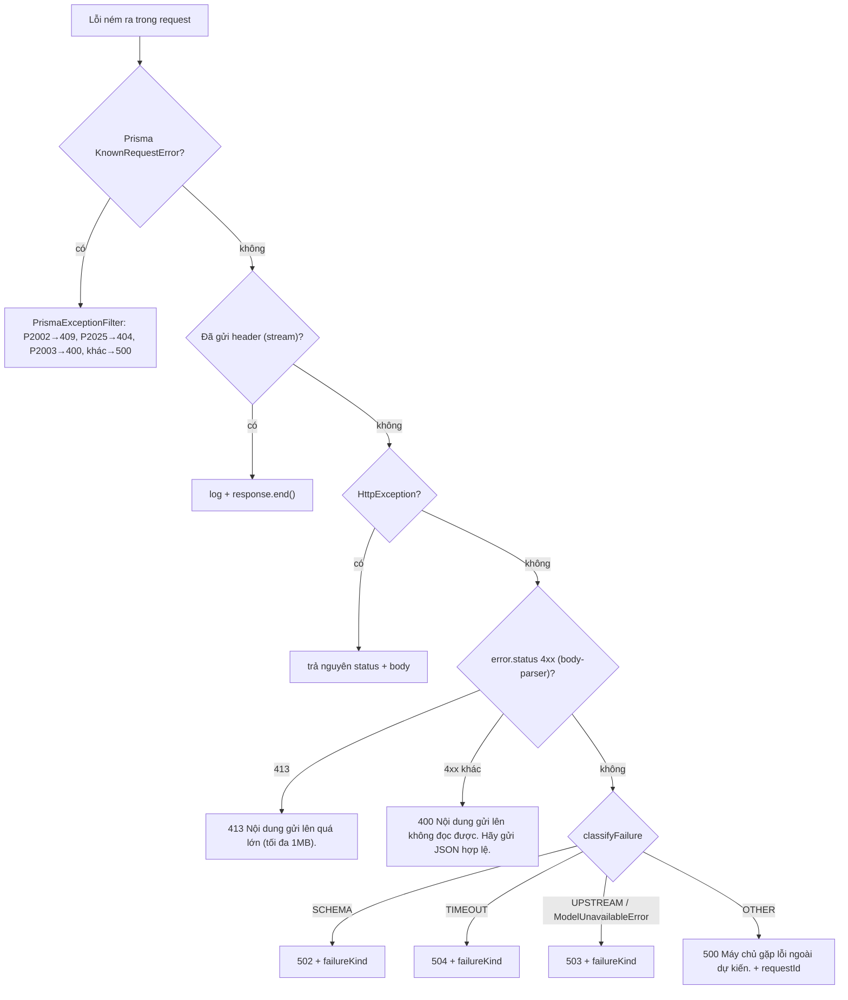

# 11 — Xử lý lỗi

> **Phạm vi:** `server/src/common/filters/**`, `common/validation-message.ts`, `common/ndjson.ts`, `common/ai/**`, xử lý lỗi ở hai frontend.
> **Nguyên tắc:** tài liệu mô tả hệ thống **as-is**. Code là nguồn sự thật duy nhất. Thông điệp lỗi riêng của từng nghiệp vụ nằm ở §13 Exceptions của file module.

## 1. Định dạng response lỗi chuẩn

```json
{ "statusCode": 404, "message": "Không tìm thấy tài liệu" }
{ "statusCode": 400, "message": ["Email không đúng định dạng email", "Mật khẩu phải có ít nhất 8 ký tự"], "error": "Bad Request" }
{ "statusCode": 503, "message": "Nhà cung cấp AI đang quá tải hoặc đã hết lượt gọi. Hãy thử lại sau vài phút.", "failureKind": "UPSTREAM", "requestId": "…" }
{ "statusCode": 500, "message": "Máy chủ gặp lỗi ngoài dự kiến. Hãy thử lại sau.", "requestId": "…" }
```

- `message` là **chuỗi** hoặc **mảng chuỗi** (lỗi validation). FE xử lý cả hai ([axios.ts `apiErrorMessage`](../../../ui-ai-job-search/lib/axios.ts)).
- `failureKind` chỉ có khi lỗi đến từ model/dịch vụ ngoài; `requestId` có ở lỗi 5xx do filter dựng (cũng có trong header `x-request-id` của mọi response).
- Không bao giờ trả stack trace hay thông điệp lỗi thô của model.

### Chuỗi xử lý



Nguồn: [all-exceptions.filter.ts](../../server/src/common/filters/all-exceptions.filter.ts), [prisma-exception.filter.ts](../../server/src/common/filters/prisma-exception.filter.ts), [failure-kind.ts](../../server/src/common/ai/failure-kind.ts).

## 2. Bảng mã HTTP

| HTTP | Khi nào | Thông điệp chuẩn | Nguồn |
|---|---|---|---|
| 200 / 201 | Thành công; POST tạo mới trả 201 (Nest mặc định) | — | |
| 202 | Việc nền đã xếp (`run-now`, `rematch`…) | `{ queued, note? }` | [admin-console.md](./modules/admin-console.md) |
| 400 | Validation, field lạ, JSON hỏng, FK sai (P2003), điều kiện nghiệp vụ (vd JD dán tay thiếu trường, tin không có tên công ty) | `Dữ liệu gửi lên không hợp lệ` · `Dữ liệu tham chiếu không hợp lệ` · `Nội dung gửi lên không đọc được. Hãy gửi JSON hợp lệ.` | [validation-message.ts](../../server/src/common/validation-message.ts) |
| 401 | Chưa đăng nhập, token hỏng/hết hạn/bị thu hồi; sai mật khẩu | `Bạn cần đăng nhập để tiếp tục, hoặc phiên đăng nhập đã hết hạn.` · `Email hoặc mật khẩu không đúng` | [03-authentication.md](./03-authentication.md#7-bảng-lỗi-xác-thực) |
| 403 | Thiếu vai trò | `Không có quyền truy cập` | [roles.guard.ts](../../server/src/common/guards/roles.guard.ts) |
| 404 | Không có tài nguyên **hoặc không phải của mình**; P2025 | `Không tìm thấy dữ liệu` hoặc thông điệp riêng | §13 module |
| 409 | Trùng (P2002); thua giành chỗ; trạng thái không cho phép (đã có buổi phỏng vấn đang chạy, làm mới bản công ty trong vòng 1 giờ…) | `Dữ liệu đã tồn tại` hoặc thông điệp riêng | §13 module |
| 413 | Body > 1 MB | `Nội dung gửi lên quá lớn (tối đa 1MB).` | |
| 422 | Thao tác không áp dụng cho loại/trạng thái tài liệu; in PDF hỏng | vd `Tài liệu đang ở trạng thái ${status} và chưa có nội dung để sửa.` | [documents.md §13](./modules/documents.md#13-exceptions) |
| 429 | Vượt rate limit | `Bạn thao tác quá nhanh. Hãy đợi một lát rồi thử lại.` | [app.module.ts](../../server/src/app.module.ts) |
| 500 | Lỗi ngoài dự kiến | `Máy chủ gặp lỗi ngoài dự kiến. Hãy thử lại sau.` | |
| 502 | Model trả sai schema (SCHEMA) | `AI trả về kết quả không đúng cấu trúc. Hãy thử lại; nếu vẫn lỗi thì báo lại.` | |
| 503 | Gateway/dịch vụ quá tải, hết lượt, bể model rỗng (UPSTREAM) | `Nhà cung cấp AI đang quá tải hoặc đã hết lượt gọi. Hãy thử lại sau vài phút.` (lỗi AI) · `Dịch vụ phía sau đang quá tải hoặc tạm ngưng. Hãy thử lại sau vài phút.` (khác) | |
| 504 | Quá giờ (TIMEOUT) | `Quá thời gian chờ phản hồi. Hãy thử lại sau vài phút.` | |

## 3. Lỗi validation

- `ValidationPipe` với `exceptionFactory: vietnameseValidationError`: mỗi ràng buộc vi phạm thành một câu `<Nhãn trường> <mô tả>`; nhãn lấy từ `FIELD_LABELS` (vd `email` → "Email", `primarySkills` → "Kỹ năng chính"), trường không có nhãn giữ tên gốc.
- Trường lạ: `<Nhãn> không phải là trường hợp lệ`. Mảng: `Mỗi mục trong <Nhãn> …`.
- ⚠️ DTO có `message` tự viết bị ghép thêm nhãn lần nữa, ví dụ `Email Email không hợp lệ` ([auth.md#R9](./modules/auth.md)) — ảnh hưởng mọi module dùng `message` riêng trong decorator.
- Lỗi validation **trong** route stream trả HTTP 400 thường (pipe chạy trước handler); lỗi nghiệp vụ ném ra trước sự kiện đầu tiên thì thành sự kiện `{type: "error", message, statusCode}` với HTTP 200 ([ndjson.ts](../../server/src/common/ndjson.ts)).

## 4. Lỗi trong việc nền

Việc nền không trả HTTP lỗi: worker ghi `status = FAILED` + `error` (thông điệp thô, chỉ lưu DB). Route đọc chuyển `error` thành `failureKind` (`withFailureKind`) — người dùng không thấy lỗi thô. FE dịch `failureKind` thành câu tiếng Việt và chỉ mời thử lại khi khác `SCHEMA` ([failure-message.ts](../../../ui-ai-job-search/lib/failure-message.ts)). Reconcile đánh `FAILED` với thông điệp cố định khi việc kẹt.

## 5. Các chỗ trả mã sai (đã kiểm chứng)

| Chỗ | Đang trả | Nên trả | Nguồn |
|---|---|---|---|
| `PUT /api/admin/queue/config/:queueName` với `serial` sai kiểu (thiếu `@IsBoolean`) | 500 | 400 | [admin-console.md#R5](./modules/admin-console.md) |
| Tạo thư xin việc cho `jobId` không tồn tại | 400 (FK P2003) | 404 như CV/mail | [documents.md#R7](./modules/documents.md) |
| `POST /api/matches/evaluate` với `jobId` không tồn tại | 400 (FK P2003) | 404 | [matching.md#R10](./modules/matching.md) |
| Lỗi hạ tầng PDF (dịch vụ chết, thiếu image) | 422 | 503 | [documents.md#R7](./modules/documents.md) |
| Đua đăng nhập Google lần đầu (chưa chạy thử) | 409 `Dữ liệu đã tồn tại` | 200 | [auth.md#R7](./modules/auth.md) |
| `PUT /api/profile` gửi `null` cho trường JSON/mảng (chưa chạy thử) | có thể 500 | 400 hoặc xoá khối | Possible Business Rule ở [profile.md](./modules/profile.md) |
| Hàng đợi chưa khai khoá dedup | 500 `Hàng đợi "<q>" chưa khai khoá dedup…` | — (lỗi lập trình, đúng là 500) | [queue-key.ts](../../server/src/modules/queue/queue-key.ts) |

## 6. Thông điệp lỗi theo module

| Module | Tình huống tiêu biểu | Bảng đầy đủ |
|---|---|---|
| auth | 409 email trùng, 401 sai mật khẩu/refresh | [auth.md §13](./modules/auth.md#13-exceptions) |
| profile | 400 mã ngành không thuộc danh mục, 400 gửi `occupationCode` qua `PUT` | [profile.md §13](./modules/profile.md#13-exceptions) |
| cv-import | 400 PDF scan/mật khẩu/quá 10 MB, 409 retry thua đua | [cv-import.md §13](./modules/cv-import.md#13-exceptions) |
| jobs | 404 tin không tồn tại | [jobs.md §13](./modules/jobs.md#13-exceptions) |
| job-scraping | 400 portal không tồn tại | [job-scraping.md §13](./modules/job-scraping.md#13-exceptions) |
| matching | 404 chưa có điểm, 502/503/504 model | [matching.md §13](./modules/matching.md#13-exceptions) |
| applications | 409 đơn trùng / thua tranh chấp đổi trạng thái; 400 chưa chấm điểm, không đủ điều kiện, đơn đã ở trạng thái đó | [applications.md §13](./modules/applications.md#13-exceptions) |
| documents | 400 JD dán tay thiếu trường, 422 sai loại/trạng thái, 422 PDF | [documents.md §13](./modules/documents.md#13-exceptions) |
| interview-prep | 404 chưa soạn xong câu hỏi | [interview-prep.md §13](./modules/interview-prep.md#13-exceptions) |
| question-bank | 404 câu không tồn tại hoặc chưa `READY` | [question-bank.md §13](./modules/question-bank.md#13-exceptions) |
| mock-interview | 409 đang có buổi chưa xong; 400 buổi không chờ trả lời / đang xử lý câu trước | [mock-interview.md §13](./modules/mock-interview.md#13-exceptions) |
| upskill | 400 vượt 3 kỹ năng đang học | [upskill.md §13](./modules/upskill.md#13-exceptions) |
| company-research | 400 tin không ghi rõ công ty, 409 làm mới trong vòng 1 giờ | [company-research.md §13](./modules/company-research.md#13-exceptions) |
| salary | 404 vị trí | [salary.md §13](./modules/salary.md#13-exceptions) |
| admin-console | 400 tự hạ quyền / gộp vào chính nó | [admin-console.md §13](./modules/admin-console.md#13-exceptions) |
| ai-platform | 503 bể model rỗng, 404 skill | [ai-platform.md §13](./modules/ai-platform.md#13-exceptions) |
| platform-operations | 413, 400 JSON, 500 chung | [platform-operations.md §13](./modules/platform-operations.md#13-exceptions) |

## 7. Xử lý lỗi phía frontend

| Cơ chế | Hành vi | Nguồn |
|---|---|---|
| `apiErrorMessage(error, fallback)` | Lấy `message` (chuỗi hoặc nối mảng bằng `, `); không có response → `Không kết nối được tới máy chủ` | [ui-ai-job-search/lib/axios.ts](../../../ui-ai-job-search/lib/axios.ts), [ui-admin-job-search/lib/axios.ts](../../../ui-admin-job-search/lib/axios.ts) |
| Interceptor 401 | Refresh một lần rồi chạy lại; refresh hỏng thì ném 401 gốc → về `/login` | như trên |
| `streamModel` | HTTP không OK → `Máy chủ trả về HTTP <code>` (bỏ mất thông điệp server — [mock-interview.md#R5](./modules/mock-interview.md), [company-research.md#R6](./modules/company-research.md)); sự kiện `error` → câu theo `failureKind`; 40 s không có dữ liệu → `Máy chủ ngừng phản hồi…`; đứt → `Kết nối đứt giữa chừng.` | [model-stream.ts](../../../ui-ai-job-search/lib/model-stream.ts) |
| `failureMessage(kind)` | Câu tiếng Việt cho SCHEMA/TIMEOUT/UPSTREAM/OTHER; không mời thử lại khi `SCHEMA` | [failure-message.ts](../../../ui-ai-job-search/lib/failure-message.ts) |
| Toast | Hiện thông điệp trên | [toast-provider.tsx](../../../ui-ai-job-search/providers/toast-provider.tsx) |

## 8. Khuyến nghị

1. Sửa các chỗ trả mã sai ở §5 (thêm `@IsBoolean`, kiểm tồn tại `Job` trước khi tạo để trả 404, đổi lỗi hạ tầng PDF sang 503).
2. `streamModel` nên đọc body JSON khi HTTP không OK để giữ thông điệp nghiệp vụ (409…).
3. Sửa `translateConstraint` để không ghép nhãn vào `message` tự viết.
4. `/api/health` nên có biến thể readiness kiểm DB và pg-boss.

## Source References

**Backend:** [all-exceptions.filter.ts](../../server/src/common/filters/all-exceptions.filter.ts) · [prisma-exception.filter.ts](../../server/src/common/filters/prisma-exception.filter.ts) · [prisma-errors.ts](../../server/src/prisma/prisma-errors.ts) · [validation-message.ts](../../server/src/common/validation-message.ts) · [failure-kind.ts](../../server/src/common/ai/failure-kind.ts) · [failure-view.ts](../../server/src/common/ai/failure-view.ts) · [ndjson.ts](../../server/src/common/ndjson.ts) · [stream-event.ts](../../server/src/common/stream-event.ts) · [error-messages.e2e-spec.ts](../../server/test/error-messages.e2e-spec.ts) · [body-limit.e2e-spec.ts](../../server/test/body-limit.e2e-spec.ts)

**Frontend:** [ui-ai-job-search/lib/axios.ts](../../../ui-ai-job-search/lib/axios.ts) · [model-stream.ts](../../../ui-ai-job-search/lib/model-stream.ts) · [failure-message.ts](../../../ui-ai-job-search/lib/failure-message.ts) · [ui-admin-job-search/lib/axios.ts](../../../ui-admin-job-search/lib/axios.ts)
