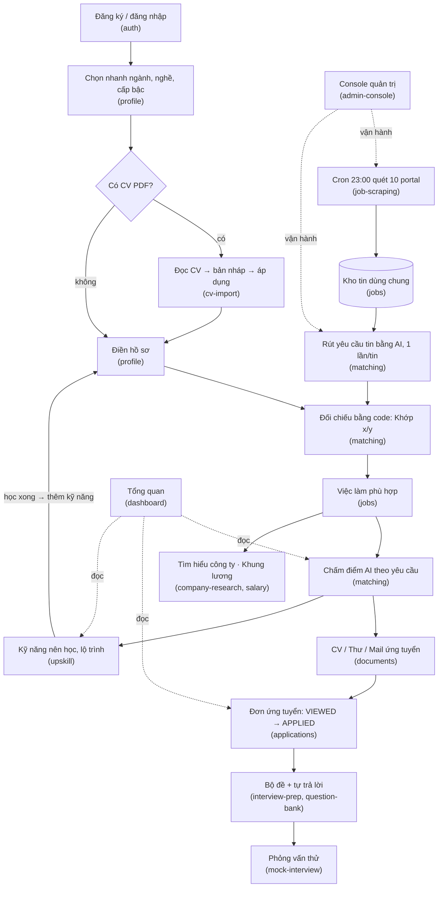

# Business Flows — AI Job Search (Careelot)

| | |
|---|---|
| **Phiên bản** | 1.15 |
| **Ngày phát hành** | 2026-10-19 |
| **Ngày cập nhật** | 2026-10-27 (1.15: `/dashboard` của khách là trang chào, Chấm CV là lối vào chính; đăng nhập qua modal không tải lại trang; link chia sẻ dẫn về Chấm CV kèm mã mời; chấm CV cho khách `POST /api/cv-check` — AI tách dòng có trần 4/khách và 50/ngày giữ bằng bảng `usage_counters`, code chấm điểm, file không rời trình duyệt; 1.14: CV hồ sơ tải thẳng lên R2 qua URL ký sẵn, server chỉ xác nhận và đọc; mở file gốc qua URL ký sẵn; 1.13: gợi ý viết lại một chỗ trên CV — câu Kinh nghiệm/Dự án, mô tả dự án, năng lực, giới thiệu, chức danh — số bịa thành `[__]`, 20 lượt/24 giờ; tìm hiểu công ty bỏ phần trang làm mờ chờ đăng nhập (review mẫu ITviec); 1.12: phỏng vấn thử bằng giọng nói qua Gemini Live — server cấp token khoá cấu hình, hạn mức 30 phút/24 giờ, lưu từng lượt và tổng kết qua `finish`; 1.11: câu lỗi trả người dùng không còn lộ tên trạng thái nội bộ; FE đọc thông điệp lỗi của route stream; 1.10: nhắc học bằng Web Push, giờ học do người dùng chọn; 1.9: hồ sơ chọn nhiều nghề trong một ngành và nhiều tỉnh làm việc, "Việc làm phù hợp" lọc theo các nghề và tỉnh đó; khách dùng tính năng cần tài khoản thì mở modal đăng nhập; 1.8: gỡ portal CareerLink; 1.7: tìm hiểu công ty dùng Tavily làm nguồn tìm kiếm chính, Serper dự phòng; 1.6: thêm `POST /admin/jobs/re-extract`; lỗi đẩy hàng đợi ghi bản ghi `FAILED`, xếp việc chuyển từ controller vào service; 1.1: đã sửa 8 vấn đề gốc mức 🟠; 1.2: gỡ LaTeX, mọi PDF in từ HTML; 1.3: `streamObject` không còn treo khi provider từ chối ngay; 1.4: mọi lõi lọc model theo `structured_output` của catalog; 1.5: lọc omniroute theo mẫu, loại bỏ `auto/*` và router alias, thêm `opencode-direct`) |
| **Phạm vi** | Backend `server/` (NestJS, 25 module, 111 endpoint, 27 bảng), frontend người dùng `ui-ai-job-search`, frontend quản trị `ui-admin-job-search`, dịch vụ phụ (`pdf-service`, `omniroute-service`, `opencode-service`), CLI portal `.agents/skills/`. Gồm cả thay đổi **chưa commit** ở `modules/ai` (bể model, model health) trên nhánh `dev` tại ngày phát hành, đánh dấu `*(2026-10-19, chưa commit)*` |
| **Phương pháp** | Reverse engineering từ mã nguồn: lần từng endpoint controller → service → Prisma → side effect (hàng đợi, tích hợp), đối chiếu e2e và ADR. Code là nguồn sự thật duy nhất |

## 1. Bộ tài liệu này là gì

Mô tả hệ thống **đang thực sự làm gì** (as-is), không phải hệ thống lý tưởng. Mọi khẳng định có link tới file nguồn; chỗ code lệch nghiệp vụ hợp lý được ghi thành rủi ro thay vì bị "làm đẹp".

| Đối tượng | Đọc gì trước | Làm được gì |
|---|---|---|
| Developer mới | 01 → 06 → file module đang sửa | Hiểu toàn hệ thống mà không cần đọc code |
| QA / Tester | 10, rồi §7 / §8 / §13 của module; checklist ở 04 và 09 | Suy ra test case từ Business Rules, Validation Rules, Exceptions |
| Business Analyst | 01, 02, §3–§4 của module | Viết SRS, user story, acceptance criteria |
| Product Owner | README §4, 10 §3–§4 | Hiểu luồng end-to-end và rủi ro tồn đọng |
| Solution Architect | 01, 05, 07, 08 | Hiểu kiến trúc, phụ thuộc, tích hợp, mô hình dữ liệu |
| Auditor | 03, 04, 05 §6, `ai_calls` ở [ai-platform](./modules/ai-platform.md) | Rà phân quyền, cách ly dữ liệu, dữ liệu cá nhân |

## 2. Quy ước đọc tài liệu

| Ký hiệu | Ý nghĩa |
|---|---|
| `BR-<MOD>-nn` | Mã Business Rule, duy nhất toàn bộ tài liệu. Quy tắc xuyên suốt: `BR-SYS-nn`. Chen giữa: hậu tố chữ (dạng `BR-<MOD>-16b`) |
| `> **Possible Business Rule:** …` | Suy luận chưa chắc chắn, cần chủ dự án xác nhận |
| `⚠️ Sai lệch / Rủi ro nghiệp vụ` | Code lệch nghiệp vụ đúng hoặc lỗ hổng/nợ kỹ thuật **đã kiểm chứng trong code** |
| `✅ **Đã sửa YYYY-MM-DD**` | Rủi ro đã khắc phục, giữ lại để lưu lịch sử |
| `*(YYYY-MM-DD)*` | Hành vi mới thêm/thay đổi vào ngày đó |
| 🔒 / ✅ / ⚠️ | Mức đảm bảo: Cứng (DB) / Mềm (service, guard, DTO) / Chỉ frontend |
| DB · SV · DTO · GD · FE | Nơi thực thi: database · service · validator · guard/middleware · frontend |
| 🔴 🟠 🟡 🟢 | Mức rủi ro: Khẩn cấp · Cao · Trung bình · Thấp |
| `module#Rn` | Rủi ro số n ở §17 của file module |

Mỗi luồng nghiệp vụ có 5 phần: **Preconditions · Main Flow · Alternative Flow · Failure Flow · Postconditions**. Mỗi file module có đúng 18 mục; mục không có nội dung ghi "Không có" kèm lý do.

## 3. Cấu trúc bộ tài liệu

### File cấp hệ thống

| File | Nội dung |
|---|---|
| [01-system-overview.md](./01-system-overview.md) | Bài toán, domain, kiến trúc, tech stack, data flow, chuẩn API, biến môi trường, cách chạy, deployment, phụ thuộc module |
| [02-user-roles.md](./02-user-roles.md) | Actor (cả cron/worker), vai trò, ma trận chức năng × vai trò, trạng thái tài khoản |
| [03-authentication.md](./03-authentication.md) | JWT trong cookie httpOnly, refresh, Google, vô hiệu phiên, lỗi, đánh giá bảo mật |
| [04-permission.md](./04-permission.md) | Các lớp kiểm soát, ma trận quyền **từng endpoint**, cách ly dữ liệu, rủi ro, checklist QA |
| [05-database-overview.md](./05-database-overview.md) | 27 bảng, ER, unique, enum, chiến lược xoá, toàn vẹn, seed/migration |
| [06-api-overview.md](./06-api-overview.md) | Quy ước, bản đồ API, bảng tra cứu 111 endpoint, kịch bản gọi API end-to-end |
| [07-integrations.md](./07-integrations.md) | 11 tích hợp ngoài đang dùng (LaTeX đã gỡ), xử lý lỗi, bảng suy giảm khi dịch vụ chết |
| [08-background-jobs.md](./08-background-jobs.md) | 3 cron, 11 hàng đợi, reconcile, rủi ro nhiều instance, giám sát |
| [09-notifications.md](./09-notifications.md) | Kết luận: không có kênh thông báo đẩy; cơ chế kéo thay thế |
| [10-business-rules.md](./10-business-rules.md) | Danh mục tập trung 26 BR-SYS + 519 BR module, 115 rủi ro theo mức (10 đã sửa), thứ tự ưu tiên khắc phục |
| [11-error-handling.md](./11-error-handling.md) | Định dạng lỗi, mã HTTP, validation, chỗ trả mã sai, xử lý lỗi ở FE |
| [12-glossary.md](./12-glossary.md) | Thuật ngữ, đối chiếu UI ↔ backend, enum ↔ tiếng Việt, viết tắt |

### File module

| Module | Tiền tố BR | Vai trò chính |
|---|---|---|
| [auth](./modules/auth.md) | BR-AUTH | Đăng ký, đăng nhập (mật khẩu, Google), phiên, guard |
| [profile](./modules/profile.md) | BR-PRF | Hồ sơ ứng viên, Chọn nhanh, mức hoàn thiện, suy ngành |
| [cv-import](./modules/cv-import.md) | BR-CVI | Đọc CV PDF → bản nháp → người dùng áp dụng |
| [jobs](./modules/jobs.md) | BR-JOB | Kho tin, bộ lọc, "Việc làm phù hợp", tin công khai, lưu tin, taxonomy |
| [job-scraping](./modules/job-scraping.md) | BR-SCR | Quét 10 portal hằng đêm, lập truy vấn, chống trùng |
| [matching](./modules/matching.md) | BR-MAT | Rút yêu cầu tin, danh bạ kỹ năng, đối chiếu bằng code, chấm điểm AI |
| [applications](./modules/applications.md) | BR-APP | Đơn ứng tuyển và trạng thái |
| [documents](./modules/documents.md) | BR-DOC | CV, thư xin việc, mail ứng tuyển, mẫu, xuất PDF |
| [interview-prep](./modules/interview-prep.md) | BR-INT | Bộ câu hỏi phỏng vấn, tự trả lời, nhận xét |
| [question-bank](./modules/question-bank.md) | BR-QB | Ngân hàng câu hỏi tĩnh, đáp án sinh lười |
| [mock-interview](./modules/mock-interview.md) | BR-MOCK | Phỏng vấn thử nhiều lượt |
| [upskill](./modules/upskill.md) | BR-UPS | Kỹ năng nên học, lộ trình học, báo cáo upskill |
| [company-research](./modules/company-research.md) | BR-CMP | Tìm hiểu công ty từ trang review công khai |
| [salary](./modules/salary.md) | BR-SAL | Tra cứu lương, khung lương đàm phán |
| [dashboard](./modules/dashboard.md) | BR-DSH | Trang tổng quan người dùng |
| [admin-console](./modules/admin-console.md) | BR-ADM | Console vận hành: tài khoản, kho tin, quét, danh bạ, hàng đợi, sức khoẻ AI |
| [ai-platform](./modules/ai-platform.md) | BR-AI | AiService, chuỗi model, bể model, nhật ký `ai_calls`, khung prompt |
| [platform-operations](./modules/platform-operations.md) | BR-OPS | Hàng đợi, reconcile, health, sandbox, storage, xử lý lỗi chung |

## 4. Bản đồ nghiệp vụ tổng quát

**Điểm mấu chốt:**

- **Một kho tin cho mọi người, một lần rút yêu cầu cho mỗi tin.** Chi phí model tỉ lệ với số tin, không với số người × số tin. Việc so hồ sơ với tin là phép so bằng code.
- **AI chỉ chạy khi người dùng bấm** (chấm điểm, viết tài liệu, phỏng vấn…); tự chấm sau lượt quét và phát suất AI đều **mặc định tắt** vì gateway miễn phí có hạn mức.
- **AI đề xuất, người dùng chốt:** model không bao giờ ghi thẳng vào hồ sơ; các trường nhạy cảm (số điện thoại, kỹ năng còn thiếu) model không được đề xuất.

## 5. Nguyên tắc bất biến quan trọng nhất

1. **Chuỗi sở hữu `userId`.** Mọi dữ liệu cá nhân treo dưới `User` và mọi truy vấn khoá theo `userId` lấy từ token (BR-SYS-06); tài nguyên của người khác trả 404. Bảng dùng chung (`jobs`, danh bạ kỹ năng, bản tìm hiểu công ty, lương, ngân hàng câu hỏi) không chứa dữ liệu cá nhân — trừ `ai_calls.responseText`, chỉ ra ngoài qua `select` tường minh và hàm che (BR-SYS-23).
2. **Mặc-định-đóng.** Route mới tự cần đăng nhập; mở cho khách phải đủ bộ ba throttle riêng + danh sách trắng trường + DTO `PickType` (BR-SYS-01, BR-SYS-07).
3. **Đường đọc không gọi AI** (BR-SYS-08).
4. **Giành chỗ có điều kiện + reconcile + không tự thử lại `FAILED`** (BR-SYS-09…11): không việc nào chạy hai lần, không việc nào kẹt `RUNNING` mãi, không vòng lặp tốn tiền.
5. **Lỗi thô không ra ngoài; output model bị cắt chứ không bị từ chối** (BR-SYS-13, BR-SYS-15).
6. **Thứ tự timeout** model \< chuỗi 240 s \< HTTP 300 s \< kẹt 600 s (BR-SYS-16).

## 6. Trạng thái nợ kỹ thuật

115 rủi ro đã kiểm chứng; còn mở: **0 🔴 · 2 🟠 · 40 🟡 · 63 🟢**, đã sửa: **10** *(2026-10-19)*. Danh sách và thứ tự ưu tiên khắc phục: [10-business-rules.md §3–§4](./10-business-rules.md#3-danh-mục-sai-lệch-và-rủi-ro). Việc nên làm tiếp:

1. Dữ liệu x-interview: đã ẩn khỏi Google và khách, nhưng API vẫn công khai ([salary#R1](./modules/salary.md), [question-bank#R2](./modules/question-bank.md)).
2. Nhóm 🟡 bảo mật phiên: đăng xuất không thu hồi token, refresh không xoay vòng, không có đặt lại mật khẩu ([auth](./modules/auth.md)).
3. Nhóm 🟡 race kiểm-rồi-tạo: [mock-interview#R1](./modules/mock-interview.md), [admin-console#R2](./modules/admin-console.md), [upskill#R5](./modules/upskill.md).

## 7. Bảo trì tài liệu

Khi code đổi, cập nhật theo thứ tự:

1. **File module** chịu ảnh hưởng (§4 luồng, §7 BR, §9 API, §11 DB, §12 state machine, §13 lỗi, §17 rủi ro). Hành vi mới đánh `*(YYYY-MM-DD)*`; rủi ro đã sửa chuyển thành `✅ **Đã sửa YYYY-MM-DD**`; tính năng đã gỡ ghi "ĐÃ XÁC MINH KHÔNG CÒN TRONG CODE".
2. Chạy `python docs/business-flows/_gen.py --write` — script [`_gen.py`](./_gen.py) gom lại bảng BR và rủi ro ở **10**, bảng endpoint ở **06** và ma trận quyền ở **04** từ §7, §17, §9 của các file module (đừng sửa tay giữa hai marker `[//]: # (GEN:…)`). Endpoint mới cần kiểm sở hữu thì thêm vào từ điển `OWN` trong script.
3. **10** — sửa tay §1 (BR-SYS) và §4 (thứ tự ưu tiên) nếu cần.
4. **06** — bảng §2 (số endpoint mỗi module) và kịch bản §4.
5. **05** — khi đổi `schema.prisma`.
6. File hệ thống còn lại nếu chạm phần xuyên suốt; rồi `CLAUDE.md` / ADR nếu quyết định thay đổi.
7. Tăng **phiên bản** và **ngày cập nhật** ở bảng đầu README.

Bộ tài liệu phải đọc được như **MDX** (trình soạn thảo rich-text khoá file có cú pháp HTML/JSX): ngoài code, viết `\<`, `\{`, `\}` thay cho `<`, `{`, `}`; comment dùng `[//]: # (…)`; đường dẫn có ngoặc trong link mã hoá thành `%28`, `%29`, `%5B`, `%5D`; trong ô bảng tránh `|` bên trong inline code.

## Source References

**Backend:** [server/src](../../server/src/app.module.ts) · [schema.prisma](../../server/prisma/schema.prisma) · [CLAUDE.md](../../CLAUDE.md) · [server/README.md](../../server/README.md) · [docs/adr/](../adr/README.md)

**Frontend:** [ui-ai-job-search](../../../ui-ai-job-search/README.md) · [ui-admin-job-search](../../../ui-admin-job-search/README.md)
