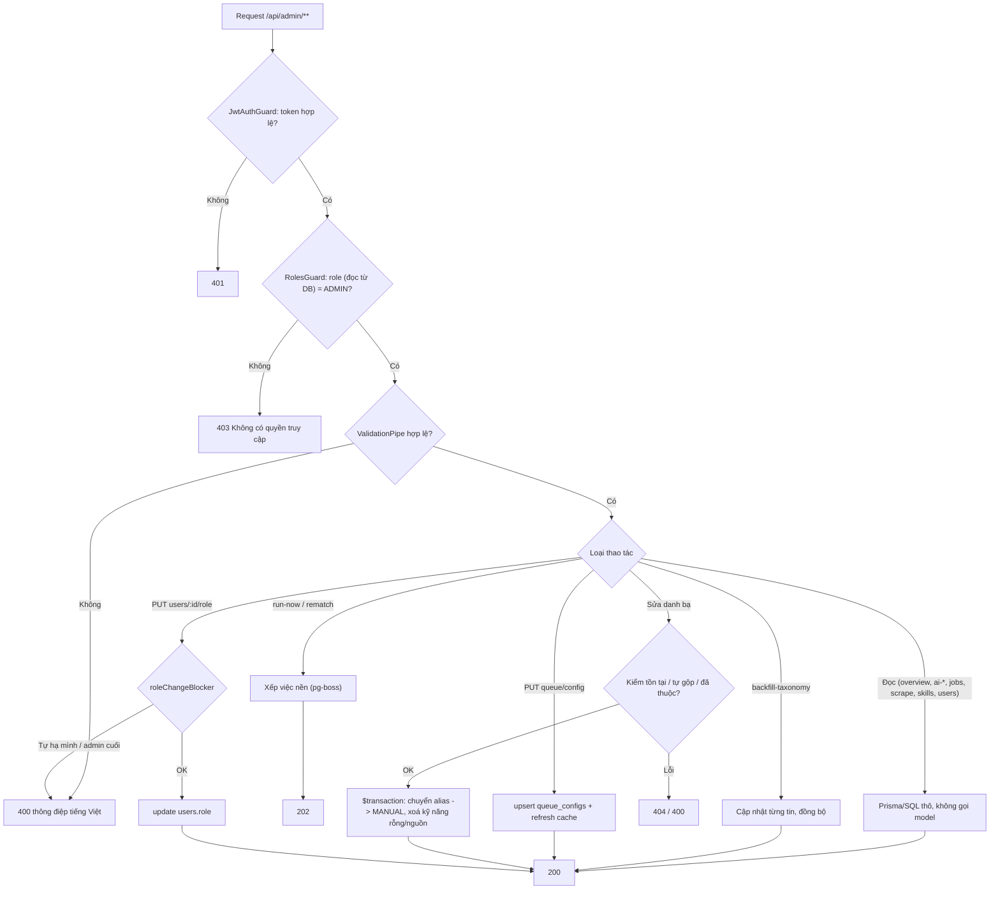
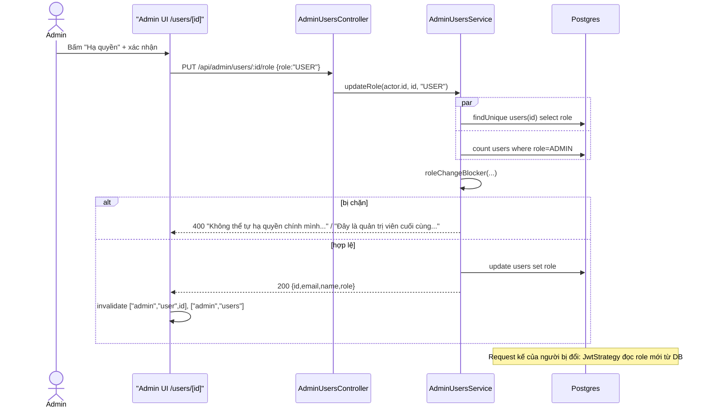
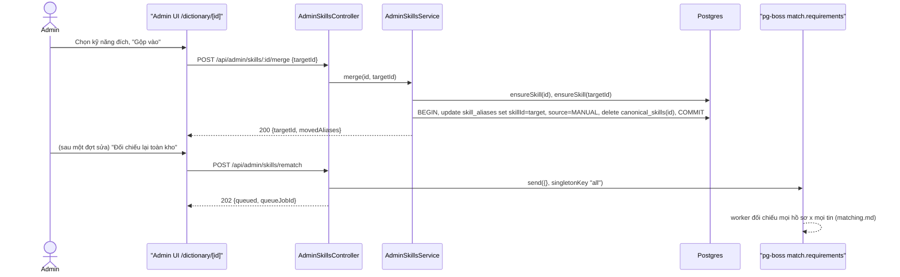
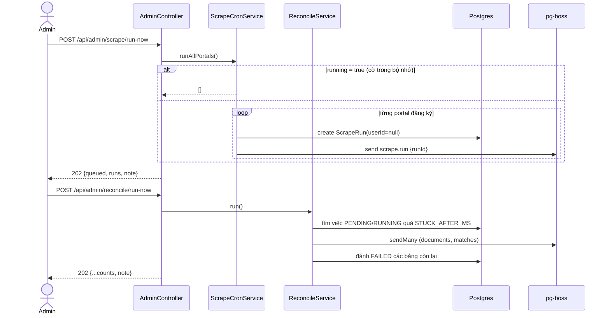
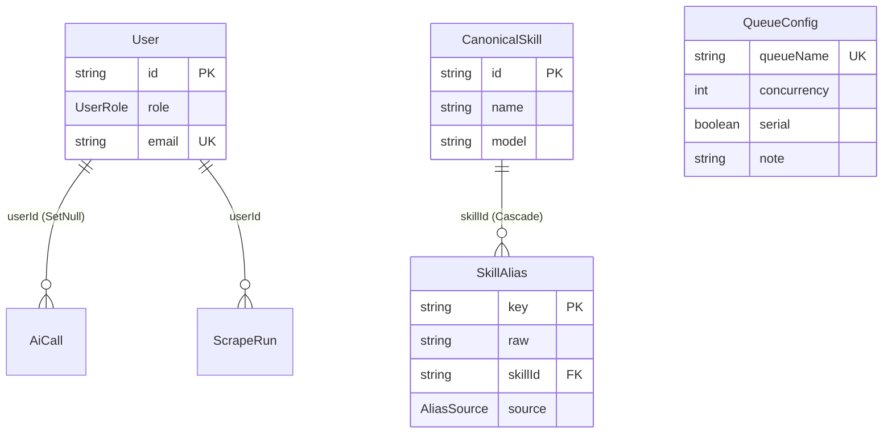
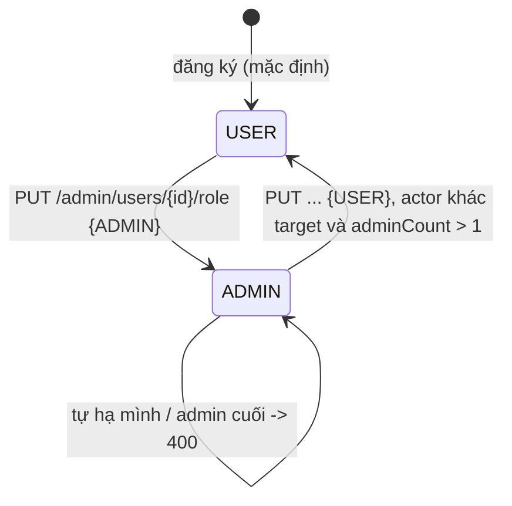
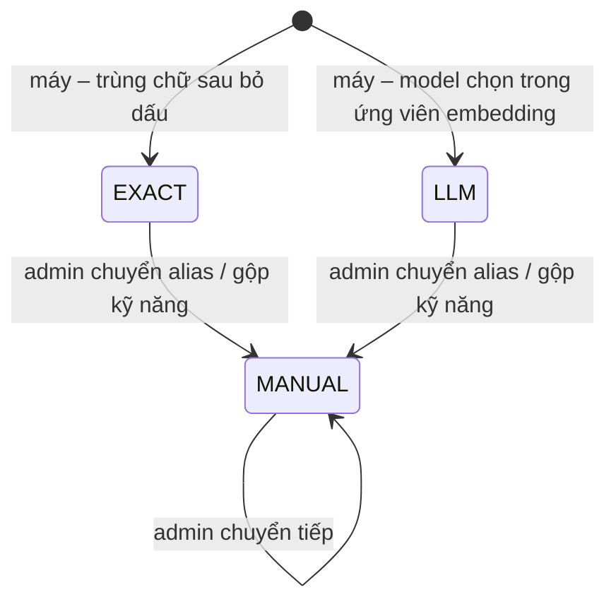

# Admin Console — Bảng điều khiển quản trị

> **Phạm vi:** backend [`server/src/modules/admin/**`](../../../server/src/modules/admin/admin.module.ts) (5 controller, 5 service, 8 util, 1 DTO) và bảng `QueueConfig` (ghi qua admin); frontend quản trị [`ui-admin-job-search/app/(console)/**`](../../../../ui-admin-job-search/app/%28console%29/layout.tsx), [`app/login`](../../../../ui-admin-job-search/app/login/page.tsx), `services/*.ts`, `hooks/*`.
> **Nguyên tắc:** tài liệu mô tả hệ thống **as-is**. Code là nguồn sự thật duy nhất.
>
> Ngoài phạm vi (chỉ nêu ở bảng endpoint module khác): `/api/admin/ai/models/*` → [ai-platform.md](./ai-platform.md); cơ chế reconcile, hàng đợi → [platform-operations.md](./platform-operations.md); quét tin → [job-scraping.md](./job-scraping.md); danh bạ kỹ năng và đối chiếu → [matching.md](./matching.md).

---

## 1. Purpose

| Mục tiêu | Diễn giải |
|---|---|
| Quan sát sức khoẻ AI | Tỉ lệ thành công, độ trễ p50/p95, lỗi gom theo `purpose` × `failureKind`, token tiêu theo ngày/model/tác vụ/người dùng — đọc từ bảng `ai_calls` |
| Tổng quan vận hành một màn | Chỉ số so kỳ trước, nhóm lỗi, hàng đợi đang dồn, portal hỏng, cảnh báo "cần xử lý" sinh bằng ngưỡng cứng trong code |
| Quản lý tài khoản | Xem danh sách/chi tiết người dùng, mức dùng AI, đổi vai trò `USER` ↔ `ADMIN` với hai chốt chặn |
| Soát kho tin | Lọc tin theo nguồn, trạng thái rút yêu cầu, tin gốc/tin trùng; xem JD, yêu cầu đã rút, nhóm tin trùng |
| Biên tập danh bạ kỹ năng | Đổi tên kỹ năng chuẩn, chuyển một cách viết (alias) sang kỹ năng khác, gộp hai kỹ năng, xếp hàng đối chiếu lại toàn kho |
| Theo dõi quét tin | Tình trạng từng portal (chuỗi hỏng, xu hướng tin mới, chạm trần), lịch sử gom theo lượt |
| Thao tác bảo trì thủ công | Quét ngay, nhặt việc rơi ngay, tính lại taxonomy, chỉnh concurrency hàng đợi |

**Điểm mấu chốt:**
- Toàn bộ module là **đường đọc thuần SQL** — không endpoint nào trong `modules/admin` gọi model. Các nút "gọi model" trên giao diện admin (rút yêu cầu một tin, dựng lại danh bạ, phát suất) đi qua endpoint của module `matching`.
- Mọi controller gắn `@Roles('ADMIN')` ở mức class; quyền được đọc **tươi từ database** mỗi request nên đổi vai trò có hiệu lực ngay ở request kế.
- Dữ liệu cá nhân trong `AiCall.responseText` bị che ở API chi tiết lời gọi AI.

## 2. Actors

| Actor | Quyền trong module | Ghi chú |
|---|---|---|
| ADMIN | Gọi mọi endpoint `/api/admin/**` | `RolesGuard` toàn cục so `request.user.role` với `@Roles('ADMIN')` ([roles.guard.ts:17](../../../server/src/common/guards/roles.guard.ts#L17)) |
| USER (đã đăng nhập) | Không có quyền — nhận 403 `Không có quyền truy cập` | Đăng nhập được vào app admin nhưng màn hình hiện "Tài khoản này không có quyền quản trị" |
| Khách (chưa đăng nhập) | 401 | `JwtAuthGuard` toàn cục, không route nào trong module là `@Public()` |
| Hệ thống — `QueueConfigService.onModuleInit` | Seed bảng `queue_configs` lúc khởi động (`createMany … skipDuplicates`) | [queue-config.service.ts:22](../../../server/src/modules/queue/queue-config.service.ts#L22) |
| Hệ thống — cron quét tin / cron reconcile | Chạy cùng hàm mà nút "chạy ngay" của admin gọi | `ScrapeCronService.runAllPortals`, `ReconcileService.run` |
| Hệ thống — worker `match.requirements` | Xử lý việc "đối chiếu lại toàn kho" do admin xếp | Thuộc [matching.md](./matching.md) |

## 3. Business Features

| # | Tính năng | Actor | Endpoint / cơ chế |
|---|---|---|---|
| F1 | Tổng quan vận hành | ADMIN | `GET /api/admin/overview?days=` |
| F2 | Sức khoẻ AI (tóm tắt — chi tiết ở ai-platform) | ADMIN | `GET /api/admin/ai-health?days=` |
| F3 | Nhật ký lỗi AI + bộ lọc | ADMIN | `GET /api/admin/ai-failures`, `GET /api/admin/ai-failures/facets` |
| F4 | Xem một lời gọi AI (có che dữ liệu cá nhân) | ADMIN | `GET /api/admin/ai-calls/:id` |
| F5 | Thống kê token AI | ADMIN | `GET /api/admin/ai-usage?days=` |
| F6 | Quét tin ngay | ADMIN | `POST /api/admin/scrape/run-now` |
| F7 | Tính lại taxonomy kho tin | ADMIN | `POST /api/admin/jobs/backfill-taxonomy?all=` |
| F8 | Nhặt việc rơi ngay | ADMIN | `POST /api/admin/reconcile/run-now` |
| F9 | Xem/chỉnh concurrency hàng đợi | ADMIN | `GET /api/admin/queue/config`, `PUT /api/admin/queue/config/:queueName` |
| F10 | Soát kho tin | ADMIN | `GET /api/admin/jobs`, `GET /api/admin/jobs/sources`, `GET /api/admin/jobs/:id` |
| F11 | Theo dõi portal và lượt quét | ADMIN | `GET /api/admin/scrape/portals`, `GET /api/admin/scrape/batches` |
| F12 | Xem danh bạ kỹ năng | ADMIN | `GET /api/admin/skills/summary`, `GET /api/admin/skills`, `GET /api/admin/skills/:id` |
| F13 | Sửa danh bạ kỹ năng (đổi tên, chuyển alias, gộp) | ADMIN | `PUT /api/admin/skills/:id`, `POST /api/admin/skills/aliases/move`, `POST /api/admin/skills/:id/merge` |
| F14 | Đối chiếu lại toàn kho | ADMIN | `POST /api/admin/skills/rematch` → hàng đợi `match.requirements` |
| F15 | Quản lý người dùng | ADMIN | `GET /api/admin/users`, `GET /api/admin/users/:id` |
| F16 | Đổi vai trò | ADMIN | `PUT /api/admin/users/:id/role` |
| F17 | Đăng nhập app quản trị + cổng ADMIN ở FE | ADMIN | `POST /api/auth/login` + `GET /api/auth/me` (module auth), `AdminGate` |
| F18 | Rút lại yêu cầu cho nhiều tin *(2026-10-21)* | ADMIN | `POST /api/admin/jobs/re-extract` → hàng đợi `extract.requirements` |

## 4. Business Flow

> Precondition chung cho mọi luồng A–P: người gọi có access token hợp lệ (cookie httpOnly hoặc Bearer), `tokenVersion` khớp, và `role = ADMIN` đọc từ DB ([jwt.strategy.ts:34](../../../server/src/modules/auth/jwt.strategy.ts#L34)). Thiếu token → 401; khác ADMIN → 403 `Không có quyền truy cập`. Global throttler theo user: `THROTTLE_LIMIT` 120 lượt / `THROTTLE_TTL_MS` 60 giây ([configuration.ts:153](../../../server/src/config/configuration.ts#L153)); module không khai `@Throttle` riêng nào. Query/body đi qua `ValidationPipe({ whitelist, transform, forbidNonWhitelisted })` ([bootstrap.ts:47](../../../server/src/bootstrap.ts#L47)) — trường lạ hoặc sai kiểu → 400 với danh sách thông điệp tiếng Việt (mặc định `Dữ liệu gửi lên không hợp lệ`).

### Luồng A — Tổng quan vận hành (F1)
- **Preconditions:** chung.
- **Main Flow:**
  1. `GET /api/admin/overview?days=N` (`days` 1–30, mặc định **1**) → `AdminController.overview` ([admin.controller.ts:60](../../../server/src/modules/admin/controllers/admin.controller.ts#L60)).
  2. `granularityFor(days)`: `days ≤ 1` → theo **giờ**, ngược lại theo **ngày** ([ai-usage.ts:63](../../../server/src/modules/admin/utils/ai-usage.ts#L63)). `windowStart` tính đầu ô đầu tiên theo giờ Việt Nam (UTC+7) — 24 ô giờ, hoặc `days` ô ngày ([ai-usage.ts:77](../../../server/src/modules/admin/utils/ai-usage.ts#L77)). Kỳ trước dài bằng kỳ này (`previousSince`).
  3. Song song 12 truy vấn ([admin.service.ts:221](../../../server/src/modules/admin/services/admin.service.ts#L221)): đếm lời gọi `ok` hai kỳ, tổng token hai kỳ, tổng `ScrapeRun.jobsNew` hai kỳ, 8 nhóm lỗi nhiều nhất (`purpose` × `failureKind`) kỳ này và số tương ứng kỳ trước, phân bố `failureKind`, chuỗi theo ô (SQL thô theo giờ VN), lượt quét **mới nhất của mỗi portal** (không giới hạn thời gian), thống kê hàng đợi pg-boss.
  4. Lấy một `errorMessage` mẫu mới nhất cho mỗi nhóm lỗi (SQL `distinct on`).
  5. `buildOverview` ([overview.ts:182](../../../server/src/modules/admin/utils/overview.ts#L182)) dựng: `metrics` (lời gọi, tỉ lệ thành công, token, tin mới, hàng chờ/đang chạy), `series` đủ ô (ô rỗng = 0), `errorGroups`, `queues` (chỉ hàng có việc), `portals` (chỉ portal còn đăng ký), và danh sách `attention`.
  6. `attention` sinh theo ngưỡng `OVERVIEW_THRESHOLDS` ([overview.ts:11](../../../server/src/modules/admin/utils/overview.ts#L11)) — xem BR-ADM-20..23. Sắp `danger` trước `warning`.
- **Alternative Flow:** không có lời gọi AI trong kỳ → `successRate.current = null`, không sinh cảnh báo AI. Kỳ trước \< 20 lời gọi → `successRate.previous = null` (không so được).
- **Failure Flow:** `days` ngoài 1–30 hoặc không phải số nguyên → 400. Lỗi DB/pg-boss → 500.
- **Postconditions:** không ghi gì. FE tự làm mới mỗi 30 giây.

### Luồng B — Sức khoẻ AI (F2, tóm tắt)
- **Main Flow:** `GET /api/admin/ai-health?days=N` (1–90, mặc định 7) đọc **tối đa 5.000** lời gọi mới nhất trong cửa sổ ([admin.service.ts:47](../../../server/src/modules/admin/services/admin.service.ts#L47)), `buildAiHealth` tính tổng, `successRate` (1 chữ số thập phân), p50/p95 (percentile theo hạng trần), lỗi theo `failureKind` (null → `OTHER`), nhóm theo `purpose` (sắp tỉ lệ thành công tăng dần) và theo `modelId` ([ai-health.ts:63](../../../server/src/modules/admin/utils/ai-health.ts#L63)).
- **Failure Flow:** `days` sai → 400.
- **Postconditions:** chỉ đọc. Màn `/ai-health` còn tab "model pool" gọi `/api/admin/ai/models/*` — thuộc [ai-platform.md](./ai-platform.md).

### Luồng C — Nhật ký lỗi AI (F3)
- **Main Flow:**
  1. `GET /api/admin/ai-failures?from&to&failureKind&purpose&model&limit&offset`.
  2. `failuresWhere` ([filters.ts:27](../../../server/src/modules/admin/utils/filters.ts#L27)): luôn `ok = false`; `from` → `createdAt ≥`, `to` → `createdAt <`; `failureKind = OTHER` khớp cả `OTHER` **lẫn `null`**; `purpose` so khớp **chính xác**; `model` khớp chuỗi con không phân biệt hoa thường trên `modelId` **hoặc** `provider`.
  3. `findMany` + `count` trong một `$transaction`, sắp `createdAt desc`, chọn đúng 8 trường (`id, purpose, provider, modelId, failureKind, errorMessage, durationMs, createdAt`) ([admin.service.ts:66](../../../server/src/modules/admin/services/admin.service.ts#L66)) — **không** có `responseText`.
  4. `GET /api/admin/ai-failures/facets?from&to` trả các `purpose` và cặp `provider/modelId` có lời gọi hỏng trong khoảng, kèm số lần, để FE dựng ô chọn ([admin.service.ts:91](../../../server/src/modules/admin/services/admin.service.ts#L91)).
- **Alternative Flow:** không truyền `from/to` → không lọc thời gian (toàn bộ lịch sử).
- **Failure Flow:** `failureKind` ngoài `SCHEMA|TIMEOUT|UPSTREAM|OTHER`, ngày không ISO-8601, `purpose` > 100 ký tự, `model` > 200, `limit` ngoài 1–100, `offset` ngoài 0–100.000 → 400.
- **Postconditions:** chỉ đọc. Trả dạng trang `{ items, total, limit, offset }`.

### Luồng D — Xem một lời gọi AI (F4)
- **Main Flow:**
  1. `GET /api/admin/ai-calls/:id` → `findUnique` với `select` liệt kê tường minh, kèm `user { id, email, name }` ([admin.service.ts:120](../../../server/src/modules/admin/services/admin.service.ts#L120)).
  2. `visibleResponse` ([response-redaction.ts:6](../../../server/src/modules/admin/utils/response-redaction.ts#L6)): nếu có `responseText` **và** (lời gọi gắn một `userId` **hoặc** `purpose` bắt đầu bằng `document.`, `profile.`, `interview.`, `question.`) → trả `responseText: null, responseRedacted: true`. Ngược lại trả nguyên văn, `responseRedacted: false`.
- **Failure Flow:** không có bản ghi → 404 `Không tìm thấy lời gọi AI: <id>`.
- **Postconditions:** chỉ đọc. FE hiện khối "Phản hồi thô của model" chỉ khi không bị che ([ai-call-modal.tsx:116](../../../../ui-admin-job-search/components/admin/ai-call-modal.tsx#L116)).

### Luồng E — Thống kê token AI (F5)
- **Main Flow:** `GET /api/admin/ai-usage?days=N` (1–90, mặc định 7) → 9 truy vấn song song ([admin.service.ts:153](../../../server/src/modules/admin/services/admin.service.ts#L153)): tổng (lời gọi, input, output, cached), số hỏng, `untrackedCalls` (lời gọi có `inputTokens = null`), theo model và theo `purpose` (kèm số hỏng), theo `userId` (bỏ null), chuỗi theo ô. `totalTokens = input + output` (cached **đã nằm trong** input, không cộng thêm). Top **10** người dùng theo token, ghép `email`, `name`.
- **Failure Flow:** `days` sai → 400.
- **Postconditions:** chỉ đọc.

### Luồng F — Quét tin ngay (F6)
- **Main Flow:**
  1. `POST /api/admin/scrape/run-now` → `ScrapeCronService.runAllPortals()` ([scrape-cron.service.ts:54](../../../server/src/modules/scraper/services/scrape-cron.service.ts#L54)) — chính hàm cron 23h dùng.
  2. Nếu cờ trong bộ nhớ `running = true` → trả `[]`. Ngược lại với **từng** portal đã đăng ký: tạo `ScrapeRun` với `userId = null`, xếp `scrape.run { runId }`. Lỗi một portal chỉ ghi log, portal khác vẫn chạy.
  3. Trả **202** `{ queued, runs: [{portal, runId}], note }` với `note` = `Đang quét ở nền. Theo dõi bằng GET /api/scrape/runs.` hoặc `Không có portal nào được đăng ký, hoặc lượt quét trước còn đang chạy.` ([admin.controller.ts:99](../../../server/src/modules/admin/controllers/admin.controller.ts#L99)).
- **Alternative Flow:** không portal nào hoặc lượt trước chưa xếp xong → `queued: 0`, vẫn 202.
- **Failure Flow:** không có nhánh 4xx; lỗi tạo run/xếp hàng bị nuốt trong vòng lặp.
- **Postconditions:** N bản ghi `ScrapeRun` (PENDING) + N việc trong hàng `scrape.run`. Vòng đời run thuộc [job-scraping.md](./job-scraping.md).

### Luồng G — Tính lại taxonomy (F7)
- **Main Flow:**
  1. `POST /api/admin/jobs/backfill-taxonomy?all=true|false` → `TaxonomyBackfillService.run(all === 'true')` ([backfill.service.ts:19](../../../server/src/modules/jobs/taxonomy/backfill.service.ts#L19)), **đồng bộ trong request**.
  2. `all=false`: chỉ tin `searchText = null`; `all=true`: toàn kho. Đọc lô 500 tin theo `id asc`, `update` **từng tin** với `derivedFields` (tỉnh, ngành, `dedupeKey`, `searchText`…).
  3. Trả **200** `{ processed, missingProvince, missingDedupeKey }`.
- **Alternative Flow:** giá trị `all` khác chuỗi `"true"` (kể cả `"1"`, `"TRUE"`) đều coi là `false`; không validate.
- **Failure Flow:** lỗi DB giữa chừng → 500, những tin đã cập nhật **không** rollback (mỗi `update` là một lệnh riêng).
- **Postconditions:** các cột dẫn xuất của `jobs` được ghi lại. Không gọi model.

### Luồng H — Nhặt việc rơi ngay (F8)
- **Main Flow:** `POST /api/admin/reconcile/run-now` → `ReconcileService.run()` (cùng hàm cron) → trả **202** `{ documents, matches, agentRuns, upskillReports, interviewPreps, profileDrafts, jobRequirements, scrapeRuns, deferred, note }`. `reconcileNote` ghép câu ([reconcile-note.ts:3](../../../server/src/modules/admin/utils/reconcile-note.ts#L3)): `documents + matches` → `Đã xếp lại N việc vào hàng đợi. Worker sẽ xử lý ở nền.`; sáu loại còn lại → `Đã đánh hỏng N việc bị kẹt; người dùng bấm chạy lại được.`; `deferred` → `Còn N việc vượt trần, để lượt sau.`; không có gì → `Không tìm thấy việc nào bị rơi.`
- **Failure Flow:** lỗi DB/hàng đợi → 500.
- **Postconditions:** như reconcile tự động — xem [platform-operations.md](./platform-operations.md).

### Luồng I — Cấu hình hàng đợi (F9)
- **Main Flow (đọc):** `GET /api/admin/queue/config?limit&offset` → `findAll()` làm mới cache rồi trả mọi dòng `queue_configs`, phân trang trong bộ nhớ (`pageFromArray`).
- **Main Flow (ghi):**
  1. `PUT /api/admin/queue/config/:queueName` body `{ concurrency?, serial?, note? }`.
  2. `QueueConfigService.update` ([queue-config.service.ts:56](../../../server/src/modules/queue/queue-config.service.ts#L56)) **ghi đè cả ba trường**: thiếu `concurrency` → **1**, thiếu `serial` → **false**, thiếu `note` → **null**.
  3. `upsert` theo `queueName` (tạo mới nếu chưa có — **không** kiểm tên có phải hàng đợi thật), làm mới cache, ghi log, trả `{ queueName, concurrency, serial, note }` (200).
- **Alternative Flow:** `serial = true` → `getConcurrency` trả 1 bất kể `concurrency`.
- **Failure Flow:** `concurrency` không nguyên hoặc ngoài 1–50 → 400; `note` không phải chuỗi → 400.
- **Postconditions:** dòng `queue_configs` thay đổi. **Worker đang chạy KHÔNG nhận số mới** — pg-boss chốt `localConcurrency` lúc `boss.work()` đăng ký ([queue.service.ts:150](../../../server/src/modules/queue/queue.service.ts#L150)); cần khởi động lại tiến trình worker (ADR [0010](../../adr/0010-hang-doi.md) dòng `queue-config.service.ts`, chốt 2026-10-16). Xem R1.

### Luồng J — Soát kho tin (F10)
- **Main Flow:**
  1. `GET /api/admin/jobs?q&source&requirement&canonicalOnly&from&to&limit&offset` ([admin-jobs.service.ts:17](../../../server/src/modules/admin/services/admin-jobs.service.ts#L17)): `source` khớp chính xác; `canonicalOnly=true` → `duplicateOfId = null`; `requirement=NONE` → chưa có `JobRequirement`, giá trị khác → `requirements.status = X`; `q` khớp chuỗi con không phân biệt hoa thường trên `title` hoặc `company`; `from/to` lọc `scrapedAt`. Sắp `scrapedAt desc, id desc`. Kèm `_count` của `matches`, `duplicates`, `applications`.
  2. `GET /api/admin/jobs/sources?limit&offset`: `groupBy source` sắp tên tăng dần + đếm số nguồn khác nhau bằng SQL thô.
  3. `GET /api/admin/jobs/:id`: trả JD đầy đủ, lương, `dedupeKey`, `requirements` (kỹ năng bắt buộc/ưu tiên, số năm, seniority, `error`…), tin gốc (`duplicateOf`) và tối đa **20** tin trùng mới nhất.
- **Failure Flow:** `requirement` ngoài `NONE|PENDING|RUNNING|DONE|FAILED`, `q` > 200, `source` > 100, ngày sai → 400; `:id` không tồn tại → 404 `Không tìm thấy tin: <id>`.
- **Postconditions:** chỉ đọc. Nút "Rút lại" ở màn chi tiết gọi `POST /api/matches/requirements/:jobId?force=true` (module matching, có gọi model).

### Luồng J2 — Rút lại yêu cầu cho nhiều tin (F18) *(2026-10-21)*
- **Main Flow:** `POST /api/admin/jobs/re-extract` body `{ jobIds }` (1–100 chuỗi) → `AdminJobsService.reExtract` ([admin-jobs.service.ts:148](../../../server/src/modules/admin/services/admin-jobs.service.ts#L148)):
  1. Khử trùng `jobIds`, giữ những id có thật trong `Job`.
  2. Một transaction: `createMany(skipDuplicates)` tạo `JobRequirement` `PENDING` cho tin chưa có; `updateMany` đưa mọi dòng **không đang `RUNNING`** về `PENDING`, xoá `error` và `sourceHash` để lượt rút sau không bị coi là "chưa đổi".
  3. `queue.sendMany('extract.requirements', requirementBatches(ids))` → **202** `{ queued: <số tin>, message }`.
- **Failure Flow:** không id nào tồn tại → 404 `Không tìm thấy tin hợp lệ để rút.`; mảng rỗng hoặc > 100 phần tử → 400 (DTO). Đẩy hàng đợi ném lỗi → các dòng còn `PENDING` thành `FAILED` với `Không thể đưa vào hàng đợi: <lỗi>`, request nhận 500.
- **Postconditions:** dòng đang `RUNNING` giữ nguyên, lượt đang chạy tự ghi kết quả. Có gọi model, nhưng ở worker (module matching), không trong request.

### Luồng K — Theo dõi portal và lượt quét (F11)
- **Main Flow:**
  1. Cả hai endpoint đọc tối đa **2.000** `ScrapeRun` mới nhất trong khoảng `from/to` (lọc `createdAt`), kèm email người khởi chạy ([admin-scrape.service.ts:50](../../../server/src/modules/admin/services/admin-scrape.service.ts#L50)).
  2. `GET /api/admin/scrape/portals`: với mỗi portal mô tả bởi `JobSourceRouter.describePortals()`, `portalStats` ([scrape-batches.ts:77](../../../server/src/modules/admin/utils/scrape-batches.ts#L77)) lấy **14** lượt gần nhất: số lượt, số hỏng, `failStreak` (số lượt FAILED liên tiếp tính từ mới nhất), `lastRun`, `lastSuccessAt`, `newSeries` (tin mới của các lượt DONE, cũ → mới), `hitCap = jobsFound ≥ cap` của lượt DONE gần nhất. Trả kèm `cap = scraper.maxJobsPerPortal` (mặc định 100).
  3. `GET /api/admin/scrape/batches?failedOnly`: bỏ run của portal không còn đăng ký, `groupBatches` ([scrape-batches.ts:26](../../../server/src/modules/admin/utils/scrape-batches.ts#L26)) gom các run cách lượt đầu nhóm ≤ **5 phút**, mỗi portal tối đa một run/nhóm, và **không trộn** run có `userId` (manual) với run `userId = null`. `failedOnly=true` → chỉ nhóm có ≥ 1 run FAILED.
- **Failure Flow:** ngày sai, `limit/offset` sai → 400.
- **Postconditions:** chỉ đọc. FE bảng lượt quét tự làm mới mỗi 5 giây khi còn run đang chạy.

### Luồng L — Xem danh bạ kỹ năng (F12)
- **Main Flow:**
  1. `GET /api/admin/skills/summary` → `{ skills: <số CanonicalSkill>, aliases: { EXACT: n, LLM: n, MANUAL: n } }`.
  2. `GET /api/admin/skills?q&source&limit&offset` ([admin-skills.service.ts:38](../../../server/src/modules/admin/services/admin-skills.service.ts#L38)): `source` → có ít nhất một alias nguồn đó; `q` khớp `name` **hoặc** `raw` của alias (không phân biệt hoa thường) **hoặc** `key` chứa `foldTerm(q)` (bỏ dấu). Sắp `createdAt desc`. Mỗi kỹ năng kèm tổng alias và 6 alias cũ nhất.
  3. `GET /api/admin/skills/:id`: mọi alias + **8** kỹ năng láng giềng gần nhất theo khoảng cách cosine embedding (`1 - (a <=> b)`), chỉ so trong **cùng `model`** embedding.
- **Failure Flow:** `source` ngoài `EXACT|LLM|MANUAL`, `q` > 200 → 400; `:id` không tồn tại → 404 `Không tìm thấy kỹ năng: <id>`.

### Luồng M — Sửa danh bạ kỹ năng (F13)
- **M1. Đổi tên** — `PUT /api/admin/skills/:id` `{ name }`: `name` được trim, rỗng sau trim → 400; kiểm kỹ năng tồn tại (404 `Không tìm thấy kỹ năng: <id>`), `update name` ([admin-skills.service.ts:109](../../../server/src/modules/admin/services/admin-skills.service.ts#L109)). Không kiểm trùng tên với kỹ năng khác. Trả `{ id, name }`.
- **M2. Chuyển một cách viết** — `POST /api/admin/skills/aliases/move` `{ key, skillId }` (200) ([admin-skills.service.ts:118](../../../server/src/modules/admin/services/admin-skills.service.ts#L118)):
  1. Song song: tìm alias theo `key`, kiểm kỹ năng đích tồn tại.
  2. Không có đích → 404 `Không tìm thấy kỹ năng: <skillId>`; không có alias → 404 `Không tìm thấy cách viết: <key>`; alias đã thuộc đích → 400 `Cách viết này đã thuộc kỹ năng đó.`
  3. Trong `$transaction`: đặt `skillId = đích`, **`source = MANUAL`**; đếm alias còn lại của kỹ năng cũ; còn 0 → **xoá kỹ năng cũ**.
  4. Trả `{ key, from, to, removedEmptySkill }`. FE chuyển sang trang kỹ năng đích nếu kỹ năng đang xem bị xoá.
- **M3. Gộp kỹ năng** — `POST /api/admin/skills/:id/merge` `{ targetId }` (200) ([admin-skills.service.ts:147](../../../server/src/modules/admin/services/admin-skills.service.ts#L147)):
  1. `id === targetId` → 400 `Không thể gộp một kỹ năng vào chính nó.`
  2. Kiểm cả hai tồn tại → 404 `Không tìm thấy kỹ năng: <id>`.
  3. Trong `$transaction`: chuyển **mọi** alias của nguồn sang đích, đánh `source = MANUAL`; xoá kỹ năng nguồn (embedding của nó mất theo). Tên kỹ năng đích giữ nguyên.
  4. Trả `{ targetId, movedAliases }`.
- **Alternative Flow:** kỹ năng bị xoá giữa bước kiểm và transaction (hai admin thao tác song song) → Prisma `P2025` → 404 `Không tìm thấy dữ liệu`, hoặc `P2003` → 400 `Dữ liệu tham chiếu không hợp lệ`; transaction rollback ([prisma-exception.filter.ts:20](../../../server/src/common/filters/prisma-exception.filter.ts#L20)).
- **Failure Flow:** `key`, `skillId`, `targetId` rỗng hoặc không phải chuỗi → 400.
- **Postconditions:** alias mang `MANUAL` không bao giờ bị máy ghi đè — luồng nạp danh bạ bỏ qua mọi `key` đã có ([skill-dictionary.service.ts](../../../server/src/modules/matching/ai/services/skill-dictionary.service.ts)). Kết quả đối chiếu kỹ năng đã lưu (`job_requirement_matches`) **không** tự tính lại — admin phải chạy F14 (FE nhắc: "Nên chạy sau khi đã gộp hoặc chuyển xong một đợt kỹ năng").

### Luồng N — Đối chiếu lại toàn kho (F14)
- **Main Flow:** `POST /api/admin/skills/rematch` → `queue.send('match.requirements', {})` với `singletonKey = 'all'` → **202** `{ queued: queueJobId !== null, queueJobId }` ([admin-skills.service.ts:163](../../../server/src/modules/admin/services/admin-skills.service.ts#L163)).
- **Alternative Flow:** đã có một việc `all` đang chờ → pg-boss bỏ, `queued: false, queueJobId: null`; FE báo `Đã có một lượt đối chiếu toàn kho đang chờ; không xếp thêm.`
- **Postconditions:** worker `match.requirements` đối chiếu mọi hồ sơ × mọi tin (không gọi model), sau đó tự phát suất chấm AI trong hạn mức — thuộc [matching.md](./matching.md).

### Luồng O — Quản lý người dùng (F15)
- **Main Flow:**
  1. `GET /api/admin/users?q&role&limit&offset` ([admin-users.service.ts:27](../../../server/src/modules/admin/services/admin-users.service.ts#L27)): `q` khớp chuỗi con trong `email` hoặc `name`; `role` lọc chính xác. Sắp `createdAt desc`. Trả `id, email, name, role, createdAt, profile { headline, completion }` và `_count` (documents, matches, applications, aiCalls, scrapeRuns). **Không** trả `passwordHash`, `googleId`, `tokenVersion`.
  2. `GET /api/admin/users/:id`: thêm `updatedAt`, `profile { headline, occupationCode, completion, primarySkills, updatedAt }`, `usage { inputTokens, outputTokens, lastCallAt }` (tổng toàn thời gian) và 10 lời gọi AI mới nhất (không có `responseText`, `errorMessage`).
- **Failure Flow:** `role` ngoài `USER|ADMIN`, `q` > 200 → 400; `:id` không có → 404 `Không tìm thấy người dùng: <id>`.

### Luồng P — Đổi vai trò (F16)
- **Preconditions:** chung; người gọi là ADMIN.
- **Main Flow:**
  1. `PUT /api/admin/users/:id/role` `{ role: 'USER' | 'ADMIN' }` → `updateRole(actor.id, id, role)` ([admin-users.controller.ts:36](../../../server/src/modules/admin/controllers/admin-users.controller.ts#L36)).
  2. Song song: đọc `role` hiện tại của user đích, đếm số user `role = ADMIN` ([admin-users.service.ts:118](../../../server/src/modules/admin/services/admin-users.service.ts#L118)).
  3. Không có user đích → 404 `Không tìm thấy người dùng: <id>`.
  4. `roleChangeBlocker` ([role-change.ts:3](../../../server/src/modules/admin/utils/role-change.ts#L3)) theo thứ tự: vai trò không đổi → cho qua; nâng lên ADMIN → luôn cho qua; hạ chính mình → 400 `Không thể tự hạ quyền chính mình. Nhờ một quản trị viên khác làm việc này.`; `adminCount ≤ 1` → 400 `Đây là quản trị viên cuối cùng; hạ quyền sẽ không còn ai vào được trang quản trị.`
  5. `update role` theo `id`, trả `{ id, email, name, role }` (200).
- **Alternative Flow:** gửi đúng vai trò hiện tại → vẫn chạy `update` (không đổi giá trị), 200.
- **Failure Flow:** `role` khác `USER|ADMIN` (ví dụ `ROOT`) → 400.
- **Postconditions:** vai trò mới có hiệu lực **ngay request kế tiếp** của người bị đổi, vì `JwtStrategy.validate` đọc `role` từ DB mỗi request; không cần tăng `tokenVersion`. Không ghi nhật ký kiểm toán (audit log) nào.

### Luồng Q — Đăng nhập app quản trị và cổng ADMIN (F17, phía FE)
- **Main Flow:** trang `/login` gọi `POST /auth/login` rồi `GET /auth/me` (vì body login không có `role`); `role !== 'ADMIN'` → hiện `Tài khoản này không có quyền quản trị.` và **không** đăng xuất (cookie dùng chung với app người dùng) ([login/page.tsx:34](../../../../ui-admin-job-search/app/login/page.tsx#L34)). `next` qua `safeNextPath` chặn open redirect. Mọi trang `(console)` bọc `AdminGate`: chưa có phiên → skeleton, `role ≠ ADMIN` → màn "không có quyền" ([admin-gate.tsx:13](../../../../ui-admin-job-search/components/shell/admin-gate.tsx#L13)).
- **Failure Flow:** 401 ở login → `Email hoặc mật khẩu không đúng`; 401 khi đang dùng → axios thử `/auth/refresh` một lần, hỏng nữa thì về `/login?next=…`.
- **Postconditions:** `AdminGate` chỉ để FE khỏi gọi API vô ích — người giữ dữ liệu thật là `RolesGuard` (⚠️ phần FE là "Chỉ frontend").

## 5. Mermaid Flowchart

## 6. Sequence Diagram

### 6.1 Đổi vai trò

### 6.2 Gộp kỹ năng rồi đối chiếu lại

### 6.3 Quét ngay / nhặt việc rơi ngay (dùng chung hàm với cron)

## 7. Business Rules

| Mã BR | Quy tắc | Nơi thực thi | Mức | Nguồn code |
|---|---|---|---|---|
| BR-ADM-01 | Mọi route `/api/admin/**` của module chỉ dành cho `role = ADMIN`, khai bằng `@Roles('ADMIN')` mức class, không `@UseGuards` | GD | ✅ | [admin.controller.ts:40](../../../server/src/modules/admin/controllers/admin.controller.ts#L40), [admin-users.controller.ts:17](../../../server/src/modules/admin/controllers/admin-users.controller.ts#L17), [admin-jobs.controller.ts:15](../../../server/src/modules/admin/controllers/admin-jobs.controller.ts#L15), [admin-skills.controller.ts:29](../../../server/src/modules/admin/controllers/admin-skills.controller.ts#L29), [admin-scrape.controller.ts:10](../../../server/src/modules/admin/controllers/admin-scrape.controller.ts#L10) |
| BR-ADM-02 | Vai trò được đọc tươi từ DB mỗi request; đổi vai trò có hiệu lực ngay request kế, không cần thu hồi token | GD | ✅ | [jwt.strategy.ts:34](../../../server/src/modules/auth/jwt.strategy.ts#L34) |
| BR-ADM-03 | Nâng lên ADMIN luôn được phép (kể cả với chính mình); giữ nguyên vai trò không bị chặn | SV | ✅ | [role-change.ts:10](../../../server/src/modules/admin/utils/role-change.ts#L10) |
| BR-ADM-04 | Admin không được tự hạ quyền chính mình | SV | ✅ | [role-change.ts:12](../../../server/src/modules/admin/utils/role-change.ts#L12) |
| BR-ADM-05 | Không được hạ quyền khi hệ thống chỉ còn ≤ 1 ADMIN | SV | ✅ (không nguyên tử, xem R2) | [role-change.ts:15](../../../server/src/modules/admin/utils/role-change.ts#L15), [admin-users.service.ts:119](../../../server/src/modules/admin/services/admin-users.service.ts#L119) |
| BR-ADM-06 | Chỉ có hai vai trò `USER`, `ADMIN` | DTO + DB | 🔒 | [admin.dto.ts:43](../../../server/src/modules/admin/admin.dto.ts#L43), [schema.prisma:28](../../../server/prisma/schema.prisma#L28) |
| BR-ADM-07 | API admin về người dùng không bao giờ trả `passwordHash`, `googleId`, `tokenVersion` — `select` liệt kê trường | SV | ✅ | [admin-users.service.ts:45](../../../server/src/modules/admin/services/admin-users.service.ts#L45) |
| BR-ADM-08 | `responseText` của một lời gọi AI bị che (`null`, `responseRedacted: true`) khi lời gọi gắn với một người dùng HOẶC `purpose` bắt đầu bằng `document.`/`profile.`/`interview.`/`question.` | SV | ✅ | [response-redaction.ts:1](../../../server/src/modules/admin/utils/response-redaction.ts#L1) |
| BR-ADM-09 | Danh sách lỗi AI và chi tiết user không bao giờ trả `responseText` (select tường minh) | SV | ✅ | [admin.service.ts:74](../../../server/src/modules/admin/services/admin.service.ts#L74), [schema.prisma:930](../../../server/prisma/schema.prisma#L930) |
| BR-ADM-10 | Lọc lỗi AI theo `failureKind = OTHER` gồm cả bản ghi `failureKind = null`; thống kê sức khoẻ cũng quy null về `OTHER` | SV | ✅ | [filters.ts:31](../../../server/src/modules/admin/utils/filters.ts#L31), [ai-health.ts:49](../../../server/src/modules/admin/utils/ai-health.ts#L49) |
| BR-ADM-11 | Lọc `model` ở nhật ký lỗi khớp chuỗi con trên `modelId` hoặc `provider`; `purpose` khớp chính xác | SV | ✅ | [filters.ts:36](../../../server/src/modules/admin/utils/filters.ts#L36) |
| BR-ADM-12 | Khoảng thời gian `from` bao gồm, `to` loại trừ (`gte`/`lt`) | SV | ✅ | [filters.ts:4](../../../server/src/modules/admin/utils/filters.ts#L4) |
| BR-ADM-13 | Cửa sổ thống kê ≤ 1 ngày chia theo giờ (24 ô), > 1 ngày chia theo ngày; ô tính theo giờ Việt Nam và ô rỗng điền 0 | SV | ✅ | [ai-usage.ts:63](../../../server/src/modules/admin/utils/ai-usage.ts#L63), [ai-usage.ts:77](../../../server/src/modules/admin/utils/ai-usage.ts#L77), [ai-usage.ts:89](../../../server/src/modules/admin/utils/ai-usage.ts#L89) |
| BR-ADM-14 | `totalTokens = inputTokens + outputTokens`; `cachedTokens` báo riêng, không cộng thêm; lời gọi `inputTokens = null` đếm là `untrackedCalls` | SV | ✅ | [ai-usage.ts:23](../../../server/src/modules/admin/utils/ai-usage.ts#L23), [admin.service.ts:172](../../../server/src/modules/admin/services/admin.service.ts#L172) |
| BR-ADM-15 | Top người dùng tốn token giới hạn 10, sắp theo tổng token rồi số lời gọi | SV | ✅ | [admin.service.ts:30](../../../server/src/modules/admin/services/admin.service.ts#L30), [ai-usage.ts:48](../../../server/src/modules/admin/utils/ai-usage.ts#L48) |
| BR-ADM-16 | `ai-health` chỉ tính trên tối đa 5.000 lời gọi mới nhất của cửa sổ; percentile theo hạng trần | SV | ✅ | [admin.service.ts:37](../../../server/src/modules/admin/services/admin.service.ts#L37), [ai-health.ts:37](../../../server/src/modules/admin/utils/ai-health.ts#L37) |
| BR-ADM-17 | Tổng quan so kỳ hiện tại với kỳ liền trước cùng độ dài | SV | ✅ | [overview.ts:44](../../../server/src/modules/admin/utils/overview.ts#L44) |
| BR-ADM-18 | Tỉ lệ thành công kỳ trước chỉ được so khi kỳ đó có ≥ 20 lời gọi | SV | ✅ | [overview.ts:34](../../../server/src/modules/admin/utils/overview.ts#L34) |
| BR-ADM-19 | Nhóm lỗi trên tổng quan gom theo `purpose` × `failureKind`, lấy 8 nhóm nhiều nhất, kèm số kỳ trước và một thông điệp mẫu mới nhất | SV | ✅ | [admin.service.ts:255](../../../server/src/modules/admin/services/admin.service.ts#L255), [admin.service.ts:318](../../../server/src/modules/admin/services/admin.service.ts#L318) |
| BR-ADM-20 | Cảnh báo `danger` "AI chỉ thành công X%" khi kỳ có ≥ 20 lời gọi và tỉ lệ \< 80%, nêu loại lỗi chiếm nhiều nhất | SV | ✅ | [overview.ts:64](../../../server/src/modules/admin/utils/overview.ts#L64) |
| BR-ADM-21 | Cảnh báo `warning` khi tổng việc chờ trong mọi hàng đợi > 50 | SV | ✅ | [overview.ts:87](../../../server/src/modules/admin/utils/overview.ts#L87) |
| BR-ADM-22 | Cảnh báo `warning` cho mỗi portal (còn đăng ký) có lượt quét gần nhất FAILED | SV | ✅ | [overview.ts:98](../../../server/src/modules/admin/utils/overview.ts#L98) |
| BR-ADM-23 | Cảnh báo `warning` khi chưa từng quét hoặc lượt quét gần nhất (của portal còn đăng ký) cũ hơn 26 giờ | SV | ✅ | [overview.ts:110](../../../server/src/modules/admin/utils/overview.ts#L110) |
| BR-ADM-24 | Thống kê và lịch sử quét chỉ tính portal còn đăng ký; run của portal đã gỡ bị loại | SV | ✅ | [filters.ts:15](../../../server/src/modules/admin/utils/filters.ts#L15), [admin-scrape.service.ts:35](../../../server/src/modules/admin/services/admin-scrape.service.ts#L35) |
| BR-ADM-25 | Gom run thành một lượt khi cách run đầu nhóm ≤ 5 phút, mỗi portal một run/lượt, không trộn run manual (có `userId`) với run hệ thống | SV | ✅ | [scrape-batches.ts:14](../../../server/src/modules/admin/utils/scrape-batches.ts#L14), [scrape-batches.ts:35](../../../server/src/modules/admin/utils/scrape-batches.ts#L35) |
| BR-ADM-26 | Sức khoẻ portal xét 14 lượt gần nhất; "chạm trần" khi lượt DONE gần nhất có `jobsFound ≥ scraper.maxJobsPerPortal` | SV | ✅ | [scrape-batches.ts:64](../../../server/src/modules/admin/utils/scrape-batches.ts#L64), [scrape-batches.ts:105](../../../server/src/modules/admin/utils/scrape-batches.ts#L105) |
| BR-ADM-27 | Màn quét chỉ đọc tối đa 2.000 run mới nhất trong khoảng | SV | ✅ | [admin-scrape.service.ts:14](../../../server/src/modules/admin/services/admin-scrape.service.ts#L14) |
| BR-ADM-28 | "Quét ngay" dùng chung hàm cron: quét tuần tự mọi portal, tạo run `userId = null`; đang có lượt chạy trong cùng tiến trình thì không xếp thêm | SV | ✅ | [scrape-cron.service.ts:54](../../../server/src/modules/scraper/services/scrape-cron.service.ts#L54) |
| BR-ADM-29 | Tính lại taxonomy mặc định chỉ xử lý tin `searchText = null`; `all=true` (đúng chuỗi `"true"`) tính lại toàn kho | SV | ✅ | [admin.controller.ts:123](../../../server/src/modules/admin/controllers/admin.controller.ts#L123), [backfill.service.ts:20](../../../server/src/modules/jobs/taxonomy/backfill.service.ts#L20) |
| BR-ADM-30 | PUT cấu hình hàng đợi ghi đè cả ba trường; trường vắng về mặc định `concurrency = 1`, `serial = false`, `note = null` | SV | ✅ | [queue-config.service.ts:60](../../../server/src/modules/queue/queue-config.service.ts#L60) |
| BR-ADM-31 | `concurrency` hàng đợi là số nguyên 1–50 | DTO | ✅ | [admin.dto.ts:28](../../../server/src/modules/admin/admin.dto.ts#L28) |
| BR-ADM-32 | `serial = true` ép concurrency hiệu lực về 1 | SV | ✅ | [queue-config.service.ts:46](../../../server/src/modules/queue/queue-config.service.ts#L46) |
| BR-ADM-33 | Concurrency mới chỉ có hiệu lực với worker sau khi khởi động lại tiến trình (chốt 2026-10-16) | SV | ✅ | [queue.service.ts:150](../../../server/src/modules/queue/queue.service.ts#L150), [ADR 0010](../../adr/0010-hang-doi.md) |
| BR-ADM-34 | Mỗi `queueName` có tối đa một dòng cấu hình | DB | 🔒 | [schema.prisma:1169](../../../server/prisma/schema.prisma#L1169) |
| BR-ADM-35 | Chuyển hay gộp alias đều đánh `source = MANUAL`; alias MANUAL không bị máy ghi đè vì luồng nạp danh bạ bỏ qua key đã có | SV | ✅ | [admin-skills.service.ts:131](../../../server/src/modules/admin/services/admin-skills.service.ts#L131), [admin-skills.service.ts:156](../../../server/src/modules/admin/services/admin-skills.service.ts#L156), [schema.prisma:378](../../../server/prisma/schema.prisma#L378) |
| BR-ADM-36 | Không chuyển alias sang kỹ năng nó đang thuộc | SV | ✅ | [admin-skills.service.ts:124](../../../server/src/modules/admin/services/admin-skills.service.ts#L124) |
| BR-ADM-37 | Chuyển alias cuối cùng đi thì kỹ năng nguồn bị xoá luôn (trong cùng transaction) | SV | ✅ | [admin-skills.service.ts:128](../../../server/src/modules/admin/services/admin-skills.service.ts#L128) |
| BR-ADM-38 | Không gộp một kỹ năng vào chính nó | SV | ✅ | [admin-skills.service.ts:148](../../../server/src/modules/admin/services/admin-skills.service.ts#L148) |
| BR-ADM-39 | Gộp kỹ năng: dồn mọi alias sang đích rồi xoá kỹ năng nguồn, nguyên tử trong một transaction; tên đích giữ nguyên | SV | ✅ | [admin-skills.service.ts:153](../../../server/src/modules/admin/services/admin-skills.service.ts#L153) |
| BR-ADM-40 | Một `key` (đã bỏ dấu, hạ chữ thường) chỉ thuộc đúng một kỹ năng chuẩn; xoá kỹ năng thì alias xoá theo (cascade) | DB | 🔒 | [schema.prisma:385](../../../server/prisma/schema.prisma#L385), [schema.prisma:390](../../../server/prisma/schema.prisma#L390) |
| BR-ADM-41 | Tên kỹ năng chuẩn được trim, không rỗng, ≤ 200 ký tự; không yêu cầu duy nhất | DTO | ✅ | [admin.dto.ts:115](../../../server/src/modules/admin/admin.dto.ts#L115) |
| BR-ADM-42 | Kỹ năng láng giềng: 8 kỹ năng gần nhất theo cosine embedding, chỉ so trong cùng `model` embedding | SV | ✅ | [admin-skills.service.ts:95](../../../server/src/modules/admin/services/admin-skills.service.ts#L95) |
| BR-ADM-43 | Tìm kỹ năng khớp tên, nguyên văn alias (không phân biệt hoa thường) hoặc key đã bỏ dấu | SV | ✅ | [admin-skills.service.ts:41](../../../server/src/modules/admin/services/admin-skills.service.ts#L41) |
| BR-ADM-44 | Sửa danh bạ không tự đối chiếu lại; "đối chiếu lại toàn kho" là thao tác riêng: xoá dấu `hash` của mọi cặp rồi xếp `match.requirements` với `singletonKey 'all'` *(2026-10-19)*. | SV | ✅ | [admin-skills.service.ts:163](../../../server/src/modules/admin/services/admin-skills.service.ts#L163) |
| BR-ADM-45 | Lọc tin `requirement=NONE` nghĩa là tin chưa có bản ghi `JobRequirement`; `canonicalOnly` chỉ lấy tin gốc (`duplicateOfId = null`) | SV | ✅ | [admin-jobs.service.ts:20](../../../server/src/modules/admin/services/admin-jobs.service.ts#L20) |
| BR-ADM-46 | Chi tiết tin hiển thị tối đa 20 tin trùng mới nhất | SV | ✅ | [admin-jobs.service.ts:124](../../../server/src/modules/admin/services/admin-jobs.service.ts#L124) |
| BR-ADM-47 | Phân trang: `limit` 1–100 (mặc định 20), `offset` 0–100.000 | DTO | ✅ | [pagination.dto.ts:10](../../../server/src/common/dto/pagination.dto.ts#L10) |
| BR-ADM-48 | Module admin không gọi model ở bất kỳ endpoint nào (đường đọc thuần SQL) | SV | ✅ | [admin.module.ts](../../../server/src/modules/admin/admin.module.ts) (không import `AiModule`) |
| BR-ADM-49 | Chỉ tài khoản ADMIN được vào app quản trị; tài khoản USER đăng nhập được nhưng bị chặn ở màn hình, không bị đăng xuất | FE | ⚠️ | [login/page.tsx:34](../../../../ui-admin-job-search/app/login/page.tsx#L34), [admin-gate.tsx:30](../../../../ui-admin-job-search/components/shell/admin-gate.tsx#L30) |
| BR-ADM-50 | Nút "Hạ quyền" bị vô hiệu với chính mình trên giao diện | FE | ⚠️ (backend vẫn chặn bằng BR-ADM-04) | [user-detail-view.tsx:237](../../../../ui-admin-job-search/app/%28console%29/users/%5Bid%5D/user-detail-view.tsx#L237) |
| BR-ADM-51 | Mọi thao tác ghi trên màn Bảo trì, Danh bạ, Người dùng đều qua hộp xác nhận | FE | ⚠️ | [confirm-action.tsx](../../../../ui-admin-job-search/components/admin/confirm-action.tsx), [maintenance-view.tsx:38](../../../../ui-admin-job-search/app/%28console%29/maintenance/maintenance-view.tsx#L38) |
| BR-ADM-52 | Rút lại yêu cầu hàng loạt không đụng dòng `JobRequirement` đang `RUNNING`; dòng khác về `PENDING` và mất `sourceHash` *(2026-10-21)* | SV | ✅ | [admin-jobs.service.ts:160](../../../server/src/modules/admin/services/admin-jobs.service.ts#L160) |

> **Possible Business Rule:** sau khi gộp/chuyển một đợt kỹ năng, admin **phải** bấm "Đối chiếu lại toàn kho" để điểm khớp kỹ năng của người dùng phản ánh danh bạ mới (FE chỉ nhắc, không ép). Cần chủ dự án xác nhận đây là chủ ý thay vì tự xếp rematch sau mỗi lần gộp.

> **Possible Business Rule:** đổi tên kỹ năng chuẩn cho phép trùng tên với kỹ năng khác (không có unique trên `canonical_skills.name`). Có thể là chủ ý (hai kỹ năng khác `model` embedding) — cần xác nhận.

## 8. Validation Rules

Mọi DTO đi qua `ValidationPipe` toàn cục `whitelist + forbidNonWhitelisted + transform`; lỗi trả 400 kèm mảng thông điệp tiếng Việt do `vietnameseValidationError` sinh ([validation-message.ts:151](../../../server/src/common/validation-message.ts#L151)). `trimmed` = cắt khoảng trắng, chuỗi rỗng sau cắt thành `undefined` ([admin.dto.ts:16](../../../server/src/modules/admin/admin.dto.ts#L16)).

**PaginationQueryDto** (cha của mọi DTO danh sách)

| Field | Ràng buộc | DTO/Schema | Lỗi trả về |
|---|---|---|---|
| limit | tuỳ chọn, ép số, nguyên, 1–100 | [pagination.dto.ts:11](../../../server/src/common/dto/pagination.dto.ts#L11) | 400 |
| offset | tuỳ chọn, ép số, nguyên, 0–100.000 | [pagination.dto.ts:18](../../../server/src/common/dto/pagination.dto.ts#L18) | 400 |

**AiHealthQueryDto / AiUsageQueryDto / OverviewQueryDto**

| Field | Ràng buộc | DTO/Schema | Lỗi trả về |
|---|---|---|---|
| days | tuỳ chọn, ép số, nguyên, 1–90 (ai-health, ai-usage) / 1–30 (overview); mặc định 7 / 7 / 1 ở controller | [admin.dto.ts:19](../../../server/src/modules/admin/admin.dto.ts#L19), [admin.dto.ts:139](../../../server/src/modules/admin/admin.dto.ts#L139), [admin.dto.ts:152](../../../server/src/modules/admin/admin.dto.ts#L152) | 400 |

**TimeRangeQueryDto** (cha của ScrapePortalsQueryDto, ScrapeBatchesQueryDto, FailuresQueryDto) và **FailureFacetsQueryDto**

| Field | Ràng buộc | DTO/Schema | Lỗi trả về |
|---|---|---|---|
| from, to | tuỳ chọn, ISO-8601 | [admin.dto.ts:161](../../../server/src/modules/admin/admin.dto.ts#L161), [admin.dto.ts:205](../../../server/src/modules/admin/admin.dto.ts#L205) | 400 |
| failedOnly (batches) | tuỳ chọn; `true`/`"true"` → true, mọi giá trị khác → false; boolean | [admin.dto.ts:173](../../../server/src/modules/admin/admin.dto.ts#L173) | 400 nếu không ép được |

**FailuresQueryDto**

| Field | Ràng buộc | DTO/Schema | Lỗi trả về |
|---|---|---|---|
| failureKind | tuỳ chọn, ∈ `SCHEMA, TIMEOUT, UPSTREAM, OTHER` | [admin.dto.ts:187](../../../server/src/modules/admin/admin.dto.ts#L187) | 400 |
| purpose | tuỳ chọn, trim, chuỗi, ≤ 100 | idem | 400 |
| model | tuỳ chọn, trim, chuỗi, ≤ 200 | idem | 400 |

**UpdateQueueConfigDto** (body `PUT queue/config/:queueName`)

| Field | Ràng buộc | DTO/Schema | Lỗi trả về |
|---|---|---|---|
| concurrency | tuỳ chọn, số nguyên 1–50 (không ép kiểu: chuỗi `"5"` bị từ chối) | [admin.dto.ts:28](../../../server/src/modules/admin/admin.dto.ts#L28) | 400 |
| serial | tuỳ chọn; **không có validator kiểu** (chỉ `@IsOptional`) | idem | Giá trị không phải boolean lọt qua DTO, lỗi ở Prisma (R5) |
| note | tuỳ chọn, chuỗi; **không có `@MaxLength`** | idem | 400 nếu không phải chuỗi |
| :queueName (path) | không validate | — | — (R4) |

**UsersQueryDto / UpdateUserRoleDto**

| Field | Ràng buộc | DTO/Schema | Lỗi trả về |
|---|---|---|---|
| q | tuỳ chọn, trim, chuỗi, ≤ 200 | [admin.dto.ts:45](../../../server/src/modules/admin/admin.dto.ts#L45) | 400 |
| role (query) | tuỳ chọn, ∈ `USER, ADMIN` | idem | 400 |
| role (body) | **bắt buộc**, ∈ `USER, ADMIN` | [admin.dto.ts:57](../../../server/src/modules/admin/admin.dto.ts#L57) | 400 |

**AdminJobsQueryDto / JobSourcesQueryDto**

| Field | Ràng buộc | DTO/Schema | Lỗi trả về |
|---|---|---|---|
| q | tuỳ chọn, trim, chuỗi, ≤ 200 | [admin.dto.ts:70](../../../server/src/modules/admin/admin.dto.ts#L70) | 400 |
| source | tuỳ chọn, trim, chuỗi, ≤ 100 | idem | 400 |
| requirement | tuỳ chọn, ∈ `NONE, PENDING, RUNNING, DONE, FAILED` | [admin.dto.ts:62](../../../server/src/modules/admin/admin.dto.ts#L62) | 400 |
| canonicalOnly | tuỳ chọn, `true`/`"true"` → true, khác → false | idem | 400 |
| from, to | tuỳ chọn, ISO-8601 (lọc `scrapedAt`) | idem | 400 |

**SkillsQueryDto / RenameSkillDto / MoveAliasDto / MergeSkillDto**

| Field | Ràng buộc | DTO/Schema | Lỗi trả về |
|---|---|---|---|
| q | tuỳ chọn, trim, chuỗi, ≤ 200 | [admin.dto.ts:103](../../../server/src/modules/admin/admin.dto.ts#L103) | 400 |
| source | tuỳ chọn, ∈ `EXACT, LLM, MANUAL` | idem | 400 |
| name | bắt buộc, trim, chuỗi, không rỗng, ≤ 200 | [admin.dto.ts:115](../../../server/src/modules/admin/admin.dto.ts#L115) | 400 |
| key | bắt buộc, chuỗi, không rỗng; **không có `@MaxLength`** | [admin.dto.ts:123](../../../server/src/modules/admin/admin.dto.ts#L123) | 400 |
| skillId | bắt buộc, chuỗi, không rỗng; không `@MaxLength` | idem | 400 |
| targetId | bắt buộc, chuỗi, không rỗng; không `@MaxLength` | [admin.dto.ts:133](../../../server/src/modules/admin/admin.dto.ts#L133) | 400 |

**Query `all` của backfill-taxonomy:** không qua DTO; so đúng chuỗi `"true"` ([admin.controller.ts:123](../../../server/src/modules/admin/controllers/admin.controller.ts#L123)). Vì không có DTO nên `forbidNonWhitelisted` không áp — query lạ không bị 400.

**Validation phía FE (⚠️ chỉ frontend):** modal cấu hình hàng đợi chặn `concurrency` ngoài 1–50 và luôn gửi đủ ba trường ([queue-config-modal.tsx:33](../../../../ui-admin-job-search/app/%28console%29/queues/queue-config-modal.tsx#L33)); đổi tên kỹ năng trim trước khi gửi.

## 9. API Mapping

Tiền tố `/api`. Role = ADMIN cho mọi dòng. Throttle: chỉ global (120/60s theo user).

| Method | URL | Role | Mục đích nghiệp vụ | Controller#method | Service | DTO | Response |
|---|---|---|---|---|---|---|---|
| GET | /api/admin/overview | ADMIN | Tổng quan vận hành + cảnh báo | AdminController#overview | AdminService.overview | OverviewQueryDto | 200 `{windowDays, since, previousSince, granularity, thresholds, metrics, series, errorGroups, queues, queueCount, portals, attention}` |
| GET | /api/admin/ai-health | ADMIN | Sức khoẻ AI | AdminController#aiHealth | AdminService.aiHealth | AiHealthQueryDto | 200 `AiHealth & {windowDays}` |
| GET | /api/admin/ai-failures | ADMIN | Nhật ký lỗi AI | AdminController#failures | AdminService.recentFailures | FailuresQueryDto | 200 Page |
| GET | /api/admin/ai-failures/facets | ADMIN | Giá trị lọc purpose/model | AdminController#failureFacets | AdminService.failureFacets | FailureFacetsQueryDto | 200 `{purposes[], models[]}` |
| GET | /api/admin/ai-calls/:id | ADMIN | Chi tiết một lời gọi AI (che dữ liệu cá nhân) | AdminController#aiCall | AdminService.aiCall | — | 200 / 404 |
| GET | /api/admin/ai-usage | ADMIN | Token theo ngày/model/tác vụ/người dùng | AdminController#aiUsage | AdminService.aiUsage | AiUsageQueryDto | 200 |
| POST | /api/admin/scrape/run-now | ADMIN | Quét mọi portal ngay | AdminController#scrapeNow | ScrapeCronService.runAllPortals | — | 202 `{queued, runs, note}` |
| POST | /api/admin/jobs/backfill-taxonomy | ADMIN | Tính lại tỉnh/ngành/dedupe/searchText | AdminController#backfillTaxonomy | TaxonomyBackfillService.run | query `all` | 200 `{processed, missingProvince, missingDedupeKey}` |
| POST | /api/admin/reconcile/run-now | ADMIN | Nhặt việc nền bị rơi ngay | AdminController#reconcileNow | ReconcileService.run + reconcileNote | — | 202 `ReconcileResult & {note}` |
| GET | /api/admin/queue/config | ADMIN | Danh sách cấu hình hàng đợi | AdminController#queueConfigList | QueueConfigService.findAll | QueueConfigQueryDto | 200 Page\<QueueConfigItem\> |
| PUT | /api/admin/queue/config/:queueName | ADMIN | Ghi đè concurrency/serial/note | AdminController#queueConfigUpdate | QueueConfigService.update | UpdateQueueConfigDto | 200 QueueConfigItem |
| GET | /api/admin/jobs | ADMIN | Danh sách tin trong kho | AdminJobsController#list | AdminJobsService.list | AdminJobsQueryDto | 200 Page |
| GET | /api/admin/jobs/sources | ADMIN | Nguồn tin + số tin | AdminJobsController#sources | AdminJobsService.sources | JobSourcesQueryDto | 200 Page\<\{source,count\}> |
| GET | /api/admin/jobs/:id | ADMIN | Chi tiết tin, yêu cầu, tin trùng | AdminJobsController#detail | AdminJobsService.detail | — | 200 / 404 |
| POST | /api/admin/jobs/re-extract | ADMIN | Xếp rút lại yêu cầu cho nhiều tin *(2026-10-21)* | AdminJobsController#reExtract | AdminJobsService.reExtract | ReExtractJobsDto | 202 `{queued, message}` / 404 |
| GET | /api/admin/scrape/portals | ADMIN | Tình trạng từng portal | AdminScrapeController#portals | AdminScrapeService.portals | ScrapePortalsQueryDto | 200 `{cap, ...Page<PortalStats>}` |
| GET | /api/admin/scrape/batches | ADMIN | Lịch sử quét gom theo lượt | AdminScrapeController#batches | AdminScrapeService.batches | ScrapeBatchesQueryDto | 200 Page\<Batch\> |
| GET | /api/admin/skills/summary | ADMIN | Đếm kỹ năng và alias theo nguồn | AdminSkillsController#summary | AdminSkillsService.summary | — | 200 |
| GET | /api/admin/skills | ADMIN | Danh sách kỹ năng chuẩn | AdminSkillsController#list | AdminSkillsService.list | SkillsQueryDto | 200 Page |
| GET | /api/admin/skills/:id | ADMIN | Chi tiết kỹ năng + láng giềng | AdminSkillsController#detail | AdminSkillsService.detail | — | 200 / 404 |
| PUT | /api/admin/skills/:id | ADMIN | Đổi tên kỹ năng chuẩn | AdminSkillsController#rename | AdminSkillsService.rename | RenameSkillDto | 200 `{id,name}` |
| POST | /api/admin/skills/aliases/move | ADMIN | Chuyển một alias | AdminSkillsController#moveAlias | AdminSkillsService.moveAlias | MoveAliasDto | 200 `{key,from,to,removedEmptySkill}` |
| POST | /api/admin/skills/:id/merge | ADMIN | Gộp kỹ năng `:id` vào đích | AdminSkillsController#merge | AdminSkillsService.merge | MergeSkillDto | 200 `{targetId, movedAliases}` |
| POST | /api/admin/skills/rematch | ADMIN | Xếp đối chiếu lại toàn kho | AdminSkillsController#rematch | AdminSkillsService.rematchAll | — | 202 `{queued, queueJobId}` |
| GET | /api/admin/users | ADMIN | Danh sách tài khoản | AdminUsersController#list | AdminUsersService.list | UsersQueryDto | 200 Page |
| GET | /api/admin/users/:id | ADMIN | Chi tiết tài khoản + mức dùng AI | AdminUsersController#detail | AdminUsersService.detail | — | 200 / 404 |
| PUT | /api/admin/users/:id/role | ADMIN | Đổi vai trò | AdminUsersController#updateRole | AdminUsersService.updateRole | UpdateUserRoleDto | 200 / 400 / 404 |

**Endpoint ở module khác mà app quản trị gọi / tác động lên module này**

| Method | URL | Role | Module | Ghi chú |
|---|---|---|---|---|
| GET | /api/admin/ai/models/health | ADMIN | ai-platform | Tab model pool ở `/ai-health` — [ai-platform.md](./ai-platform.md) |
| POST | /api/admin/ai/models/health-check | ADMIN | ai-platform | idem ([model-health.controller.ts:8](../../../server/src/modules/ai/controllers/model-health.controller.ts#L8)) |
| GET | /api/queue/stats | ADMIN | platform-operations | Màn Hàng đợi ([health.controller.ts:23](../../../server/src/modules/health/health.controller.ts#L23)) |
| POST | /api/scrape/portals/reload | ADMIN | job-scraping | Nút nạp lại portal ở màn Quét ([scraper.controller.ts:25](../../../server/src/modules/scraper/scraper.controller.ts#L25)) |
| POST | /api/matches/requirements/:jobId?force=true | ADMIN (+ `@ThrottleAi`) | matching | Nút "Rút lại" ở chi tiết tin — **gọi model đồng bộ** ([matching.controller.ts:82](../../../server/src/modules/matching/matching.controller.ts#L82)) |
| POST | /api/matches/dictionary/rebuild | ADMIN | matching | Màn Bảo trì: xếp `skill.canonicalize {round: 0}` |
| POST | /api/matches/shortlist/dispatch?userId= | ADMIN | matching | Màn Bảo trì: phát suất chấm AI |
| GET / POST | /api/skills, /api/skills/reload | ADMIN | ai-platform | Màn Khung prompt `/skills` ([skills.controller.ts:9](../../../server/src/modules/skills/skills.controller.ts#L9)) |
| POST / GET | /api/auth/login, /api/auth/me, /api/auth/logout, /api/auth/refresh | Public / USER | auth | Đăng nhập app quản trị |
| — | cron `ScrapeCronService` 23h, cron `ReconcileService` | Hệ thống | job-scraping, platform-operations | Cùng hàm với F6, F8 |
| — | `QueueConfigService.onModuleInit` | Hệ thống | platform-operations | Seed `queue_configs` lúc khởi động |

## 10. Frontend Mapping

App `ui-admin-job-search`, axios `baseURL = /api`, `withCredentials` ([lib/axios.ts](../../../../ui-admin-job-search/lib/axios.ts)). Dữ liệu tải qua `useApiQuery` (TanStack Query) ([use-api-query.ts](../../../../ui-admin-job-search/hooks/use-api-query.ts)); `use-async-data.ts` giữ cách xử lý 401 → `/login?next=` và phân biệt 403.

| Route FE | Vai trò | Mục đích | Hook / API client |
|---|---|---|---|
| `/login` | Mọi người | Đăng nhập, chặn tài khoản không ADMIN | `authService.login`, `authService.me` ([page.tsx](../../../../ui-admin-job-search/app/login/page.tsx)) |
| `(console)/layout` | ADMIN | `SessionProvider` + `Sidebar` + `AdminGate` | [layout.tsx](../../../../ui-admin-job-search/app/%28console%29/layout.tsx) |
| `/` | ADMIN | Tổng quan, chọn kỳ, tự làm mới 30 giây | `adminService.overview` ([overview-view.tsx](../../../../ui-admin-job-search/app/%28console%29/_overview/overview-view.tsx)) |
| `/ai-health` | ADMIN | Sức khoẻ AI + tab model pool (chi tiết ở ai-platform) | `adminService.aiHealth`, `modelPoolHealth`, `triggerModelHealthCheck` ([ai-health-view.tsx](../../../../ui-admin-job-search/app/%28console%29/ai-health/ai-health-view.tsx)) |
| `/ai-failures` | ADMIN | Nhật ký lỗi, lọc thời gian/loại/tác vụ/model, 25 dòng/trang, mở modal lời gọi | `adminService.aiFailures`, `aiFailureFacets`, `aiCall` ([ai-failures-view.tsx](../../../../ui-admin-job-search/app/%28console%29/ai-failures/ai-failures-view.tsx), [ai-call-modal.tsx](../../../../ui-admin-job-search/components/admin/ai-call-modal.tsx)) |
| `/ai-usage` | ADMIN | Token theo ngày/model/tác vụ/người dùng | `adminService.aiUsage` ([ai-usage-view.tsx](../../../../ui-admin-job-search/app/%28console%29/ai-usage/ai-usage-view.tsx)) |
| `/dictionary` | ADMIN | Danh bạ kỹ năng, nút "Đối chiếu lại toàn kho" | `dictionaryService.summary`, `list`, `rematch` ([dictionary-view.tsx](../../../../ui-admin-job-search/app/%28console%29/dictionary/dictionary-view.tsx)) |
| `/dictionary/[id]` | ADMIN | Chi tiết, đổi tên, chuyển alias, gộp (cả với láng giềng) | `dictionaryService.detail`, `rename`, `moveAlias`, `merge` ([skill-detail-view.tsx](../../../../ui-admin-job-search/app/%28console%29/dictionary/%5Bid%5D/skill-detail-view.tsx), [skill-picker.tsx](../../../../ui-admin-job-search/app/%28console%29/dictionary/skill-picker.tsx)) |
| `/jobs` | ADMIN | Kho tin, lọc nguồn/trạng thái yêu cầu | `jobsService.list`, `sources` ([jobs-view.tsx](../../../../ui-admin-job-search/app/%28console%29/jobs/jobs-view.tsx)) |
| `/jobs/[id]` | ADMIN | Chi tiết tin, nút "Rút lại" yêu cầu (gọi model, timeout 180 s) | `jobsService.detail`, `extractRequirements` ([job-detail-view.tsx](../../../../ui-admin-job-search/app/%28console%29/jobs/%5Bid%5D/job-detail-view.tsx)) |
| `/maintenance` | ADMIN | Tính lại taxonomy (thiếu / toàn bộ), dựng lại danh bạ, phát suất chấm AI | `adminService.backfillTaxonomy`, `matchingService.rebuildDictionary`, `dispatchShortlist` ([maintenance-view.tsx](../../../../ui-admin-job-search/app/%28console%29/maintenance/maintenance-view.tsx)) |
| `/queues` | ADMIN | Thống kê hàng đợi (tự làm mới 5 s khi bật "live"), chỉnh cấu hình, nhặt việc rơi | `queueService.stats`, `adminService.queueConfig`, `updateQueueConfig`, `reconcileNow` ([queues-view.tsx](../../../../ui-admin-job-search/app/%28console%29/queues/queues-view.tsx), [queue-config-modal.tsx](../../../../ui-admin-job-search/app/%28console%29/queues/queue-config-modal.tsx)) |
| `/scrape` | ADMIN | Sức khoẻ portal, lịch sử lượt (poll 5 s khi còn run bận), quét ngay, nạp lại portal | `scraperService.portalHealth`, `batches`, `reloadPortals`, `adminService.scrapeNow` ([scrape-view.tsx](../../../../ui-admin-job-search/app/%28console%29/scrape/scrape-view.tsx), [batch-matrix-card.tsx](../../../../ui-admin-job-search/app/%28console%29/scrape/batch-matrix-card.tsx), [portal-health-card.tsx](../../../../ui-admin-job-search/app/%28console%29/scrape/portal-health-card.tsx)) |
| `/skills` | ADMIN | Khung prompt đang nạp, nút nạp lại | `skillsService.list`, `reload` ([skills-view.tsx](../../../../ui-admin-job-search/app/%28console%29/skills/skills-view.tsx)) |
| `/users` | ADMIN | Danh sách tài khoản, lọc vai trò | `usersService.list` ([users-view.tsx](../../../../ui-admin-job-search/app/%28console%29/users/users-view.tsx)) |
| `/users/[id]` | ADMIN | Chi tiết, mức dùng AI, nâng/hạ quyền | `usersService.detail`, `updateRole` ([user-detail-view.tsx](../../../../ui-admin-job-search/app/%28console%29/users/%5Bid%5D/user-detail-view.tsx)) |
| `/settings` | ADMIN | Cài đặt hiển thị (cỡ chữ, giao diện) — chỉ lưu `localStorage`, không gọi API | [display-card.tsx](../../../../ui-admin-job-search/app/%28console%29/settings/display-card.tsx) |

Thuật ngữ UI ↔ backend: "Danh bạ / Từ điển kỹ năng" ↔ `CanonicalSkill` + `SkillAlias`; "Cách viết" ↔ `SkillAlias`; "Đối chiếu lại toàn kho" ↔ hàng `match.requirements`; "Rút yêu cầu" ↔ `JobRequirement` (`job.requirements`); "Lượt quét" ↔ `ScrapeRun`; "Lượt đêm" ↔ batch không manual; "Phát suất chấm AI" ↔ `ai.shortlist`.

## 11. Database

Module **ghi** vào: `users.role`, `canonical_skills` (đổi tên, xoá), `skill_aliases` (`skillId`, `source`), `queue_configs` (upsert), `jobs` (cột taxonomy qua backfill), và gián tiếp `scrape_runs`/pg-boss qua run-now/reconcile. Đọc: `ai_calls`, `users`, `profiles`, `jobs`, `job_requirements`, `scrape_runs`, `canonical_skills`, `skill_aliases`, trạng thái pg-boss.

**QueueConfig** (`queue_configs`) — [schema.prisma:1165](../../../server/prisma/schema.prisma#L1165)

| Field | Kiểu | Ghi chú |
|---|---|---|
| id | String cuid | PK |
| queueName | String **@unique** | Tên hàng, ví dụ `match.evaluate` |
| concurrency | Int, mặc định 1 | Số việc song song mỗi tiến trình worker |
| serial | Boolean, mặc định false | true → ép 1 |
| note | String? | Ghi chú admin; seed `Bắt buộc tuần tự để tránh chặn IP` cho hàng serial |
| createdAt / updatedAt | DateTime | |

**User** (phần module chạm) — [schema.prisma:33](../../../server/prisma/schema.prisma#L33): `role UserRole @default(USER)`, `email @unique`, `tokenVersion` (không bị module đổi).

**CanonicalSkill** (`canonical_skills`) — [schema.prisma:352](../../../server/prisma/schema.prisma#L352): `id`, `name` (không unique), `model` (`@@index([model])`), `embedding vector(768)`, `createdAt`.

**SkillAlias** (`skill_aliases`) — [schema.prisma:383](../../../server/prisma/schema.prisma#L383): `key` **PK** (đã bỏ dấu + hạ chữ thường), `raw`, `skillId` → `CanonicalSkill` **onDelete: Cascade**, `source AliasSource`, `@@index([skillId])`.

**AiCall** (`ai_calls`, chỉ đọc) — [schema.prisma:891](../../../server/prisma/schema.prisma#L891): `userId?` (onDelete SetNull), `purpose`, `provider`, `modelId`, `ok`, `failureKind?`, `errorMessage?`, `durationMs`, `inputTokens?`, `outputTokens?`, `cachedTokens?`, `finishReason?`, `responseText?` (chứa dữ liệu cá nhân, chỉ ghi khi hỏng). Index: `createdAt desc`, `(purpose, ok)`, `userId`.

## 12. State Machine

### 12.1 `User.role`

| Từ → Sang | Trigger | Điều kiện |
|---|---|---|
| (mới) → USER | Đăng ký (module auth) | `@default(USER)` |
| USER → ADMIN | `PUT /api/admin/users/:id/role` | Người gọi là ADMIN; luôn cho phép |
| ADMIN → USER | idem | `actorId ≠ targetId` **và** số ADMIN > 1 (đọc trước khi ghi, không khoá) |
| ADMIN → ADMIN, USER → USER | idem | Không đổi, vẫn ghi lại, 200 |
| (ngoài API) → ADMIN | `pnpm db:seed` ép `role = 'ADMIN'` cho `admin@aijob.local` | Chỉ DB dev (CLAUDE.md) |

### 12.2 `SkillAlias.source` và vòng đời `CanonicalSkill` (phần admin chạm)

| Từ → Sang | Trigger | Điều kiện |
|---|---|---|
| EXACT/LLM/MANUAL → MANUAL | `POST /admin/skills/aliases/move` | Alias và kỹ năng đích tồn tại, đích ≠ kỹ năng hiện tại |
| EXACT/LLM/MANUAL → MANUAL | `POST /admin/skills/:id/merge` | Nguồn ≠ đích, cả hai tồn tại; áp cho mọi alias của nguồn |
| MANUAL → EXACT/LLM | — | **Không có đường nào**: luồng nạp danh bạ bỏ qua key đã có |
| CanonicalSkill tồn tại → bị xoá | Chuyển alias cuối cùng đi; hoặc bị gộp vào kỹ năng khác | Trong cùng transaction |

### 12.3 Các trạng thái chỉ đọc
`ScrapeRun.status` (PENDING/RUNNING/DONE/FAILED), `JobRequirement.status` (PENDING/RUNNING/DONE/FAILED, cộng giá trị lọc ảo `NONE` = chưa có bản ghi), `AiCall.ok` + `failureKind` được module hiển thị và lọc nhưng **không** chuyển trạng thái — máy trạng thái nằm ở [job-scraping.md](./job-scraping.md), [matching.md](./matching.md), [ai-platform.md](./ai-platform.md). `QueueConfig` không có trường trạng thái.

## 13. Exceptions

| Tình huống | HTTP | Thông điệp nguyên văn | Nguồn |
|---|---|---|---|
| Chưa đăng nhập / token hỏng / `tokenVersion` lệch | 401 | (Unauthorized mặc định) | [jwt.strategy.ts:48](../../../server/src/modules/auth/jwt.strategy.ts#L48) |
| Không phải ADMIN | 403 | `Không có quyền truy cập` | [roles.guard.ts:30](../../../server/src/common/guards/roles.guard.ts#L30) |
| DTO sai / trường lạ | 400 | Mảng thông điệp tiếng Việt, mặc định `Dữ liệu gửi lên không hợp lệ` | [validation-message.ts:151](../../../server/src/common/validation-message.ts#L151) |
| Lời gọi AI không tồn tại | 404 | `Không tìm thấy lời gọi AI: ${id}` | [admin.service.ts:141](../../../server/src/modules/admin/services/admin.service.ts#L141) |
| Tin không tồn tại | 404 | `Không tìm thấy tin: ${id}` | [admin-jobs.service.ts:138](../../../server/src/modules/admin/services/admin-jobs.service.ts#L138) |
| Kỹ năng không tồn tại (detail, rename, move đích, merge) | 404 | `Không tìm thấy kỹ năng: ${id}` | [admin-skills.service.ts:93](../../../server/src/modules/admin/services/admin-skills.service.ts#L93), [admin-skills.service.ts:173](../../../server/src/modules/admin/services/admin-skills.service.ts#L173) |
| Alias không tồn tại | 404 | `Không tìm thấy cách viết: ${key}` | [admin-skills.service.ts:123](../../../server/src/modules/admin/services/admin-skills.service.ts#L123) |
| Alias đã thuộc kỹ năng đích | 400 | `Cách viết này đã thuộc kỹ năng đó.` | [admin-skills.service.ts:125](../../../server/src/modules/admin/services/admin-skills.service.ts#L125) |
| Gộp kỹ năng vào chính nó | 400 | `Không thể gộp một kỹ năng vào chính nó.` | [admin-skills.service.ts:149](../../../server/src/modules/admin/services/admin-skills.service.ts#L149) |
| Kỹ năng bị xoá giữa lúc kiểm và lúc ghi (race) | 404 / 400 | `Không tìm thấy dữ liệu` (P2025) / `Dữ liệu tham chiếu không hợp lệ` (P2003) | [prisma-exception.filter.ts:20](../../../server/src/common/filters/prisma-exception.filter.ts#L20) |
| Người dùng không tồn tại (detail, đổi vai trò) | 404 | `Không tìm thấy người dùng: ${id}` | [admin-users.service.ts:82](../../../server/src/modules/admin/services/admin-users.service.ts#L82), [admin-users.service.ts:127](../../../server/src/modules/admin/services/admin-users.service.ts#L127) |
| Tự hạ quyền chính mình | 400 | `Không thể tự hạ quyền chính mình. Nhờ một quản trị viên khác làm việc này.` | [role-change.ts:13](../../../server/src/modules/admin/utils/role-change.ts#L13) |
| Hạ quyền admin cuối cùng | 400 | `Đây là quản trị viên cuối cùng; hạ quyền sẽ không còn ai vào được trang quản trị.` | [role-change.ts:16](../../../server/src/modules/admin/utils/role-change.ts#L16) |
| Quét ngay khi không có portal / lượt trước đang chạy | 202 (không phải lỗi) | `Không có portal nào được đăng ký, hoặc lượt quét trước còn đang chạy.` | [admin.controller.ts:108](../../../server/src/modules/admin/controllers/admin.controller.ts#L108) |
| Đối chiếu lại khi đã có lượt `all` đang chờ | 202 | `{ queued: false, queueJobId: null }` | [admin-skills.service.ts:165](../../../server/src/modules/admin/services/admin-skills.service.ts#L165) |
| Rút lại hàng loạt mà không id nào tồn tại *(2026-10-21)* | 404 | `Không tìm thấy tin hợp lệ để rút.` | [admin-jobs.service.ts:157](../../../server/src/modules/admin/services/admin-jobs.service.ts#L157) |
| Rút lại hàng loạt, đẩy hàng đợi lỗi *(2026-10-21)* | 500 | Dòng `PENDING` ghi `Không thể đưa vào hàng đợi: <lỗi>` | [admin-jobs.service.ts:176](../../../server/src/modules/admin/services/admin-jobs.service.ts#L176) |
| Lỗi DB khác / `serial` sai kiểu | 500 | (InternalServerError) | [prisma-exception.filter.ts:39](../../../server/src/common/filters/prisma-exception.filter.ts#L39) |

## 14. Notifications

Không có. Module không gửi email, push hay thông báo trong ứng dụng; mọi phản hồi là kết quả HTTP đồng bộ và toast trên giao diện admin (ví dụ `Đã nâng <email> lên quản trị viên.`, `Đã gộp N cách viết vào "<tên>".`). Người bị đổi vai trò **không** được báo — họ chỉ nhận 403 (hoặc thấy quyền mới) ở request kế tiếp. Ghi log server: `QueueConfigService.update` log `Hàng đợi "<tên>": concurrency=…, serial=…`.

## 15. Integrations

| Tích hợp | Cách dùng | Nguồn |
|---|---|---|
| pg-boss (qua `QueueService`) | `getStats()` cho tổng quan; `send('match.requirements', {})` cho rematch; run-now/reconcile xếp `scrape.run`, `document.generate`, `match.evaluate` | [admin.service.ts:285](../../../server/src/modules/admin/services/admin.service.ts#L285), [admin-skills.service.ts:164](../../../server/src/modules/admin/services/admin-skills.service.ts#L164) |
| `JobSourceRouter` (danh sách portal từ `.agents/skills/`) | `listPortals()`, `describePortals()` để lọc/mô tả portal | [admin-scrape.service.ts:27](../../../server/src/modules/admin/services/admin-scrape.service.ts#L27) |
| `ScrapeCronService`, `ReconcileService`, `TaxonomyBackfillService`, `QueueConfigService` | Gọi trực tiếp từ `AdminController` | [admin.controller.ts:42](../../../server/src/modules/admin/controllers/admin.controller.ts#L42) |
| pgvector | Toán tử `<=>` tìm kỹ năng láng giềng | [admin-skills.service.ts:95](../../../server/src/modules/admin/services/admin-skills.service.ts#L95) |
| Biến môi trường | `SCRAPER_MAX_JOBS_PER_PORTAL` (mặc định 100, ngưỡng "chạm trần"), `THROTTLE_LIMIT`/`THROTTLE_TTL_MS`, `APP_ROLE` (quyết định tiến trình nào chạy worker), `SCRAPE_CRON_ENABLED` (nhắc trong cảnh báo `scrape-stale`), `NEXT_PUBLIC_API_URL`, `NEXT_PUBLIC_USER_APP_URL` (FE) | [configuration.ts:120](../../../server/src/config/configuration.ts#L120), [app-role.ts](../../../server/src/config/app-role.ts), [overview.ts:123](../../../server/src/modules/admin/utils/overview.ts#L123) |

Không gọi model, không gọi dịch vụ ngoài nào.

## 16. Security

- **Phân quyền:** `@Roles('ADMIN')` mức class trên cả 5 controller; `JwtAuthGuard` và `RolesGuard` là guard toàn cục mặc-định-đóng. e2e kiểm: tài khoản thường gọi `/api/admin/ai-failures`, `/api/admin/ai-health`, `/api/admin/reconcile/run-now` → 403; chưa đăng nhập `/api/admin/ai-health` → 401 ([admin.e2e-spec.ts:126](../../../server/test/admin.e2e-spec.ts#L126), [security.e2e-spec.ts:54](../../../server/test/security.e2e-spec.ts#L54)).
- **Kiểm sở hữu:** không áp — admin đọc dữ liệu của mọi người dùng theo thiết kế. Không route nào khoá theo `userId` của người gọi; `actor.id` chỉ dùng cho chốt tự hạ quyền.
- **Rate limit:** chỉ throttler toàn cục theo user (120/phút). Không có `@Throttle` riêng cho thao tác nặng (`backfill-taxonomy?all=true`, `run-now`).
- **Dữ liệu nhạy cảm:**
  - `passwordHash`, `googleId`, `tokenVersion` không bao giờ được chọn ([admin-users.service.ts:45](../../../server/src/modules/admin/services/admin-users.service.ts#L45)); e2e `tìm theo email, không trả passwordHash` ([admin-data.e2e-spec.ts:78](../../../server/test/admin-data.e2e-spec.ts#L78)).
  - `AiCall.responseText` (có thể chứa CV người thật) chỉ đi ra ở `GET /admin/ai-calls/:id` và bị che theo BR-ADM-08; e2e `che phản hồi thô của tác vụ mang dữ liệu cá nhân` ([admin-data.e2e-spec.ts:112](../../../server/test/admin-data.e2e-spec.ts#L112)). Ghi chú trong schema cấm đổi các truy vấn admin thành select-tất-cả ([schema.prisma:930](../../../server/prisma/schema.prisma#L930)).
  - `errorMessage` của lời gọi AI **không** bị che (xem Possible BR ở §17 R6).
  - Email người dùng hiển thị ở top người dùng tốn token, lịch sử quét, chi tiết lời gọi AI — chấp nhận vì chỉ ADMIN xem.
- **Tác động ngay của đổi vai trò:** role đọc từ DB mỗi request nên hạ quyền có hiệu lực tức thì; e2e `nâng quyền có hiệu lực ngay ở request kế tiếp` ([admin-data.e2e-spec.ts:91](../../../server/test/admin-data.e2e-spec.ts#L91)).
- **FE:** `AdminGate` và chặn ở `/login` chỉ là tiện ích giao diện; `safeNextPath` chặn open redirect ở `?next=`. Token nằm trong cookie httpOnly, không lưu localStorage ([services/auth.ts](../../../../ui-admin-job-search/services/auth.ts)).
- **Không có audit log** cho đổi vai trò, gộp kỹ năng, chỉnh hàng đợi (chỉ log ứng dụng cho hàng đợi).

## 17. ⚠️ Sai lệch / Rủi ro nghiệp vụ

**R1 — Giao diện báo "Worker nhận giá trị mới trong vòng 30 giây" nhưng worker chỉ nhận sau khi khởi động lại.**
- ✅ **Đã sửa 2026-10-19:** toast và mô tả bảng ở màn Hàng đợi đổi thành "có hiệu lực sau khi khởi động lại worker" ([queue-config-modal.tsx:47](../../../../ui-admin-job-search/app/%28console%29/queues/queue-config-modal.tsx#L47), [queues-view.tsx:150](../../../../ui-admin-job-search/app/%28console%29/queues/queues-view.tsx#L150)). Số `concurrency` trên màn vẫn là giá trị đã lưu, không phải giá trị worker đang chạy.
- Bằng chứng: toast `Đã lưu cấu hình ${row.name}. Worker nhận giá trị mới trong vòng 30 giây.` ([queue-config-modal.tsx:47](../../../../ui-admin-job-search/app/%28console%29/queues/queue-config-modal.tsx#L47)); backend chỉ đọc `getConcurrency` lúc `boss.work()` đăng ký ([queue.service.ts:150](../../../server/src/modules/queue/queue.service.ts#L150)), không có timer làm mới; ADR 0010 ghi rõ "đã gỡ timer làm mới cache 30 giây … chấp nhận restart" (chốt 2026-10-16). Thêm nữa `getStats()` trả `concurrency` từ cache vừa cập nhật ([queue.service.ts:68](../../../server/src/modules/queue/queue.service.ts#L68)) nên màn Hàng đợi hiển thị số mới dù worker vẫn chạy số cũ. Với `APP_ROLE` tách `api`/`worker`, cache chỉ được làm mới ở tiến trình nhận request.
- Tác động: admin tin rằng đã giảm tải (ví dụ hạ concurrency gọi model khi gateway 429) nhưng thực tế không đổi tới lần deploy kế.
- Đề xuất: sửa câu toast/ghi chú trên màn thành "có hiệu lực sau khi khởi động lại worker"; cân nhắc hiển thị riêng "đang chạy" và "đã lưu".
- Mức đề xuất: 🟠

**R2 — Chốt "admin cuối cùng" không nguyên tử; hai admin hạ quyền nhau đồng thời có thể để hệ thống còn 0 ADMIN.**
- Bằng chứng: `findUnique` + `count({ role: 'ADMIN' })` chạy song song rồi `update` riêng, không transaction/điều kiện ([admin-users.service.ts:119](../../../server/src/modules/admin/services/admin-users.service.ts#L119), [admin-users.service.ts:138](../../../server/src/modules/admin/services/admin-users.service.ts#L138)). Với A hạ B và B hạ A cùng lúc khi chỉ có 2 admin, cả hai đều thấy `adminCount = 2` và cùng qua. Ngoài race này, nhánh `adminCount ≤ 1` thực tế **không đạt được** qua HTTP: người gọi phải là ADMIN và tự hạ mình đã bị chặn trước, nên khi đích là ADMIN khác thì luôn có ≥ 2 admin. Không có e2e cho nhánh này (chỉ unit [role-change.spec.ts](../../../server/test/unit/modules/admin/utils/role-change.spec.ts)).
- Tác động: mất hoàn toàn quyền vào trang quản trị; phải sửa DB thủ công (dev có `pnpm db:seed`).
- Đề xuất: ghi có điều kiện kiểu "giành chỗ" (`updateMany` kèm điều kiện còn admin khác, hoặc transaction serializable) — đúng mẫu CLAUDE.md.
- Mức đề xuất: 🟡

**R3 — Ghi chú của "Quét ngay" trỏ tới route không tồn tại, và lượt quét do admin bấm bị xếp chung nhóm với lượt cron.**
- Bằng chứng: `note: 'Đang quét ở nền. Theo dõi bằng GET /api/scrape/runs.'` ([admin.controller.ts:107](../../../server/src/modules/admin/controllers/admin.controller.ts#L107)) nhưng `ScraperController` chỉ có `POST /scrape` và `POST /scrape/portals/reload` ([scraper.controller.ts:14](../../../server/src/modules/scraper/scraper.controller.ts#L14)). `runAllPortals` tạo run với `userId = null` ([scrape-cron.service.ts:71](../../../server/src/modules/scraper/services/scrape-cron.service.ts#L71)) nên `groupBatches` đánh `manual = false` ([scrape-batches.ts:45](../../../server/src/modules/admin/utils/scrape-batches.ts#L45)) — không phân biệt được lượt admin bấm tay với lượt cron 23h, và không biết admin nào bấm.
- Tác động: thông tin sai cho người đọc API; lịch sử vận hành thiếu dấu vết người khởi chạy.
- Đề xuất: đổi note sang màn `/scrape` hoặc `GET /api/admin/scrape/batches`; cân nhắc truyền `actor.id` vào run.
- Mức đề xuất: 🟢

**R4 — `PUT /admin/queue/config/:queueName` nhận tên hàng đợi bất kỳ và ghi đè trường vắng về mặc định.**
- Bằng chứng: `upsert` theo `queueName` không đối chiếu `QUEUE` ([queue-config.service.ts:66](../../../server/src/modules/queue/queue-config.service.ts#L66)); thiếu `concurrency` → 1, thiếu `serial` → false, thiếu `note` → null ([queue-config.service.ts:60](../../../server/src/modules/queue/queue-config.service.ts#L60)). FE tự gửi đủ ba trường (chú thích ở [services/admin.ts:71](../../../../ui-admin-job-search/services/admin.ts#L71)).
- Tác động: gõ sai tên sinh dòng rác; một client gửi `{ concurrency: 5 }` sẽ âm thầm tắt `serial` của hàng bắt buộc tuần tự (ví dụ hàng quét tin, ghi chú seed "Bắt buộc tuần tự để tránh chặn IP"). Chỉ ADMIN gọi được.
- Đề xuất: 404 khi tên không thuộc `QUEUE`; giữ giá trị cũ cho trường vắng hoặc bắt buộc đủ trường ở DTO.
- Mức đề xuất: 🟡

**R5 — DTO thiếu ràng buộc theo quy ước dự án.**
- Bằng chứng: `UpdateQueueConfigDto.serial` chỉ có `@IsOptional` (không `@IsBoolean`) và `note` không `@MaxLength` ([admin.dto.ts:35](../../../server/src/modules/admin/admin.dto.ts#L35)); `MoveAliasDto.key/skillId`, `MergeSkillDto.targetId` không `@MaxLength` ([admin.dto.ts:123](../../../server/src/modules/admin/admin.dto.ts#L123)). CLAUDE.md yêu cầu "Chuỗi trong DTO có `@MaxLength`".
- Tác động: `serial: "yes"` lọt DTO và hỏng ở Prisma thành 500 thay vì 400; ghi chú dài tuỳ ý. Chỉ ADMIN gọi được nên tác động thấp.
- Đề xuất: thêm `@IsBoolean()`, `@MaxLength`.
- Mức đề xuất: 🟢

**R6 — Thống kê bị cắt ngầm khi vượt trần dòng.**
- Bằng chứng: `ai-health` lấy tối đa 5.000 lời gọi ([admin.service.ts:53](../../../server/src/modules/admin/services/admin.service.ts#L53)); màn quét lấy tối đa 2.000 run ([admin-scrape.service.ts:54](../../../server/src/modules/admin/services/admin-scrape.service.ts#L54)). Response không có cờ báo bị cắt; `total` của `ai-health` là số dòng đã đọc, không phải số lời gọi thật trong cửa sổ.
- Tác động: với `days=90` và lưu lượng lớn, tỉ lệ thành công/p95 chỉ phản ánh phần mới nhất mà nhãn vẫn ghi "90 ngày". Chưa đo lưu lượng thật — theo CLAUDE.md, chỉ xử lý khi số đo gần ngưỡng.
- Đề xuất: trả thêm cờ `truncated` hoặc ghi số đo vào ADR khi gần ngưỡng.
- Mức đề xuất: 🟢

> **Possible Business Rule:** `AiCall.errorMessage` được trả nguyên văn ở `GET /admin/ai-failures`, tổng quan (mẫu lỗi) và chi tiết lời gọi, không qua che. `errorMessage` được dựng từ lỗi SDK + danh sách lỗi zod (`errorMessageOf` trong [schema-prompt.ts:30](../../../server/src/modules/ai/utils/schema-prompt.ts#L30)) — **chưa kiểm chứng** liệu thông điệp lỗi zod/SDK có thể mang đoạn dữ liệu cá nhân (giá trị trường CV) hay không. Cần chủ dự án xác nhận.

> **Possible Business Rule:** `POST /admin/jobs/backfill-taxonomy?all=true` chạy đồng bộ trong request, cập nhật từng tin một. Với kho ~3.500 tin chưa có số đo thời gian chạy; nếu vượt `server.setTimeout` 5 phút thì client nhận lỗi trong khi server vẫn ghi tiếp (chưa kiểm chứng bằng đo).

## 18. Source References

**Backend — module admin**
- [admin.module.ts](../../../server/src/modules/admin/admin.module.ts)
- [admin.dto.ts](../../../server/src/modules/admin/admin.dto.ts)
- [controllers/admin.controller.ts](../../../server/src/modules/admin/controllers/admin.controller.ts)
- [controllers/admin-jobs.controller.ts](../../../server/src/modules/admin/controllers/admin-jobs.controller.ts)
- [controllers/admin-scrape.controller.ts](../../../server/src/modules/admin/controllers/admin-scrape.controller.ts)
- [controllers/admin-skills.controller.ts](../../../server/src/modules/admin/controllers/admin-skills.controller.ts)
- [controllers/admin-users.controller.ts](../../../server/src/modules/admin/controllers/admin-users.controller.ts)
- [services/admin.service.ts](../../../server/src/modules/admin/services/admin.service.ts)
- [services/admin-jobs.service.ts](../../../server/src/modules/admin/services/admin-jobs.service.ts)
- [services/admin-scrape.service.ts](../../../server/src/modules/admin/services/admin-scrape.service.ts)
- [services/admin-skills.service.ts](../../../server/src/modules/admin/services/admin-skills.service.ts)
- [services/admin-users.service.ts](../../../server/src/modules/admin/services/admin-users.service.ts)
- [utils/ai-health.ts](../../../server/src/modules/admin/utils/ai-health.ts)
- [utils/ai-usage.ts](../../../server/src/modules/admin/utils/ai-usage.ts)
- [utils/filters.ts](../../../server/src/modules/admin/utils/filters.ts)
- [utils/overview.ts](../../../server/src/modules/admin/utils/overview.ts)
- [utils/reconcile-note.ts](../../../server/src/modules/admin/utils/reconcile-note.ts)
- [utils/response-redaction.ts](../../../server/src/modules/admin/utils/response-redaction.ts)
- [utils/role-change.ts](../../../server/src/modules/admin/utils/role-change.ts)
- [utils/scrape-batches.ts](../../../server/src/modules/admin/utils/scrape-batches.ts)

**Backend — phụ thuộc**
- [queue/queue-config.service.ts](../../../server/src/modules/queue/queue-config.service.ts), [queue/queue.service.ts](../../../server/src/modules/queue/queue.service.ts), [queue/queue-key.ts](../../../server/src/modules/queue/queue-key.ts)
- [scraper/services/scrape-cron.service.ts](../../../server/src/modules/scraper/services/scrape-cron.service.ts), [scraper/scraper.controller.ts](../../../server/src/modules/scraper/scraper.controller.ts)
- [reconcile/services/reconcile.service.ts](../../../server/src/modules/reconcile/services/reconcile.service.ts)
- [jobs/taxonomy/backfill.service.ts](../../../server/src/modules/jobs/taxonomy/backfill.service.ts)
- [matching/ai/services/skill-dictionary.service.ts](../../../server/src/modules/matching/ai/services/skill-dictionary.service.ts), [matching/matching.controller.ts](../../../server/src/modules/matching/matching.controller.ts)
- [auth/jwt.strategy.ts](../../../server/src/modules/auth/jwt.strategy.ts), [common/guards/roles.guard.ts](../../../server/src/common/guards/roles.guard.ts)
- [common/dto/pagination.dto.ts](../../../server/src/common/dto/pagination.dto.ts), [common/pagination.ts](../../../server/src/common/pagination.ts)
- [common/filters/prisma-exception.filter.ts](../../../server/src/common/filters/prisma-exception.filter.ts), [common/validation-message.ts](../../../server/src/common/validation-message.ts), [bootstrap.ts](../../../server/src/bootstrap.ts)
- [config/configuration.ts](../../../server/src/config/configuration.ts), [config/app-role.ts](../../../server/src/config/app-role.ts)
- [modules/health/health.controller.ts](../../../server/src/modules/health/health.controller.ts), [modules/ai/controllers/model-health.controller.ts](../../../server/src/modules/ai/controllers/model-health.controller.ts), [modules/skills/skills.controller.ts](../../../server/src/modules/skills/skills.controller.ts)
- [prisma/schema.prisma](../../../server/prisma/schema.prisma) (User L33, CanonicalSkill L352, SkillAlias L383, AiCall L891, QueueConfig L1165)
- ADR: [0010-hang-doi.md](../../adr/0010-hang-doi.md), [0007-quet-tin-da-nganh.md](../../adr/0007-quet-tin-da-nganh.md), [0011-do-truoc-khi-doan.md](../../adr/0011-do-truoc-khi-doan.md)

**Backend — test**
- [test/admin.e2e-spec.ts](../../../server/test/admin.e2e-spec.ts), [test/admin-data.e2e-spec.ts](../../../server/test/admin-data.e2e-spec.ts), [test/reconcile.e2e-spec.ts](../../../server/test/reconcile.e2e-spec.ts), [test/queue.e2e-spec.ts](../../../server/test/queue.e2e-spec.ts), [test/security.e2e-spec.ts](../../../server/test/security.e2e-spec.ts)
- Unit: [test/unit/modules/admin/utils/](../../../server/test/unit/modules/admin/utils/role-change.spec.ts) (ai-health, ai-usage, filters, overview, reconcile-note, response-redaction, role-change, scrape-batches)

**Frontend — ui-admin-job-search**
- [app/login/page.tsx](../../../../ui-admin-job-search/app/login/page.tsx), [app/(console)/layout.tsx](../../../../ui-admin-job-search/app/%28console%29/layout.tsx), [app/(console)/page.tsx](../../../../ui-admin-job-search/app/%28console%29/page.tsx)
- [_overview/overview-view.tsx](../../../../ui-admin-job-search/app/%28console%29/_overview/overview-view.tsx), [_overview/attention-panel.tsx](../../../../ui-admin-job-search/app/%28console%29/_overview/attention-panel.tsx), [_overview/error-groups-panel.tsx](../../../../ui-admin-job-search/app/%28console%29/_overview/error-groups-panel.tsx), [_overview/side-panels.tsx](../../../../ui-admin-job-search/app/%28console%29/_overview/side-panels.tsx)
- [ai-health/ai-health-view.tsx](../../../../ui-admin-job-search/app/%28console%29/ai-health/ai-health-view.tsx), [ai-failures/ai-failures-view.tsx](../../../../ui-admin-job-search/app/%28console%29/ai-failures/ai-failures-view.tsx), [ai-usage/ai-usage-view.tsx](../../../../ui-admin-job-search/app/%28console%29/ai-usage/ai-usage-view.tsx)
- [dictionary/dictionary-view.tsx](../../../../ui-admin-job-search/app/%28console%29/dictionary/dictionary-view.tsx), [dictionary/skill-picker.tsx](../../../../ui-admin-job-search/app/%28console%29/dictionary/skill-picker.tsx), [dictionary/[id]/skill-detail-view.tsx](../../../../ui-admin-job-search/app/%28console%29/dictionary/%5Bid%5D/skill-detail-view.tsx)
- [jobs/jobs-view.tsx](../../../../ui-admin-job-search/app/%28console%29/jobs/jobs-view.tsx), [jobs/[id]/job-detail-view.tsx](../../../../ui-admin-job-search/app/%28console%29/jobs/%5Bid%5D/job-detail-view.tsx)
- [maintenance/maintenance-view.tsx](../../../../ui-admin-job-search/app/%28console%29/maintenance/maintenance-view.tsx), [queues/queues-view.tsx](../../../../ui-admin-job-search/app/%28console%29/queues/queues-view.tsx), [queues/queue-config-modal.tsx](../../../../ui-admin-job-search/app/%28console%29/queues/queue-config-modal.tsx)
- [scrape/scrape-view.tsx](../../../../ui-admin-job-search/app/%28console%29/scrape/scrape-view.tsx), [scrape/batch-matrix-card.tsx](../../../../ui-admin-job-search/app/%28console%29/scrape/batch-matrix-card.tsx), [scrape/portal-health-card.tsx](../../../../ui-admin-job-search/app/%28console%29/scrape/portal-health-card.tsx)
- [settings/display-card.tsx](../../../../ui-admin-job-search/app/%28console%29/settings/display-card.tsx), [skills/skills-view.tsx](../../../../ui-admin-job-search/app/%28console%29/skills/skills-view.tsx)
- [users/users-view.tsx](../../../../ui-admin-job-search/app/%28console%29/users/users-view.tsx), [users/[id]/user-detail-view.tsx](../../../../ui-admin-job-search/app/%28console%29/users/%5Bid%5D/user-detail-view.tsx)
- Services: [admin.ts](../../../../ui-admin-job-search/services/admin.ts), [auth.ts](../../../../ui-admin-job-search/services/auth.ts), [dictionary.ts](../../../../ui-admin-job-search/services/dictionary.ts), [jobs.ts](../../../../ui-admin-job-search/services/jobs.ts), [matching.ts](../../../../ui-admin-job-search/services/matching.ts), [queue.ts](../../../../ui-admin-job-search/services/queue.ts), [scraper.ts](../../../../ui-admin-job-search/services/scraper.ts), [skills.ts](../../../../ui-admin-job-search/services/skills.ts), [users.ts](../../../../ui-admin-job-search/services/users.ts)
- Hooks: [use-api-query.ts](../../../../ui-admin-job-search/hooks/use-api-query.ts), [use-async-data.ts](../../../../ui-admin-job-search/hooks/use-async-data.ts), [use-debounce.ts](../../../../ui-admin-job-search/hooks/use-debounce.ts), [use-paged-filters.ts](../../../../ui-admin-job-search/hooks/use-paged-filters.ts)
- Components: [components/shell/admin-gate.tsx](../../../../ui-admin-job-search/components/shell/admin-gate.tsx), [components/admin/ai-call-modal.tsx](../../../../ui-admin-job-search/components/admin/ai-call-modal.tsx), [components/admin/confirm-action.tsx](../../../../ui-admin-job-search/components/admin/confirm-action.tsx), [lib/axios.ts](../../../../ui-admin-job-search/lib/axios.ts)
