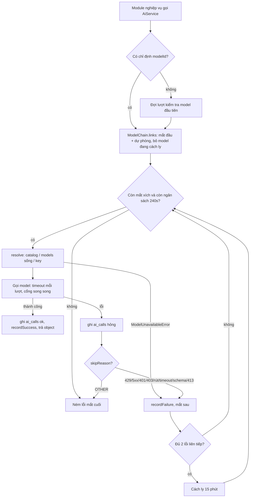
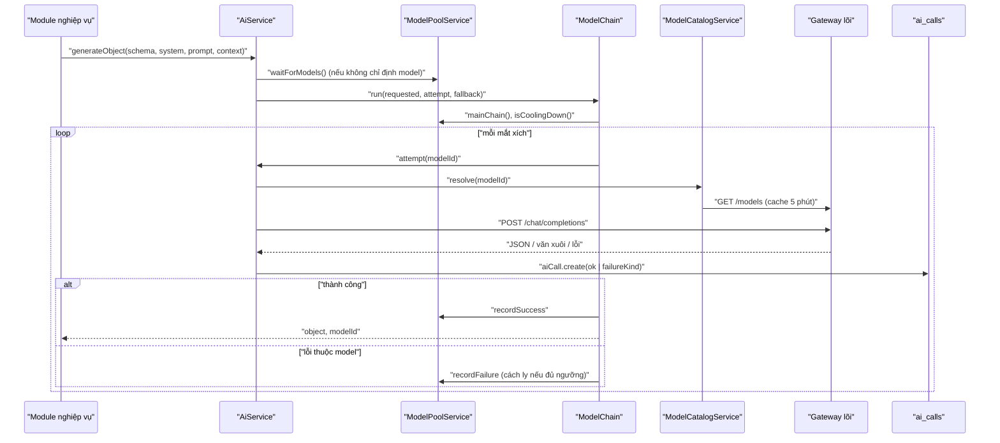
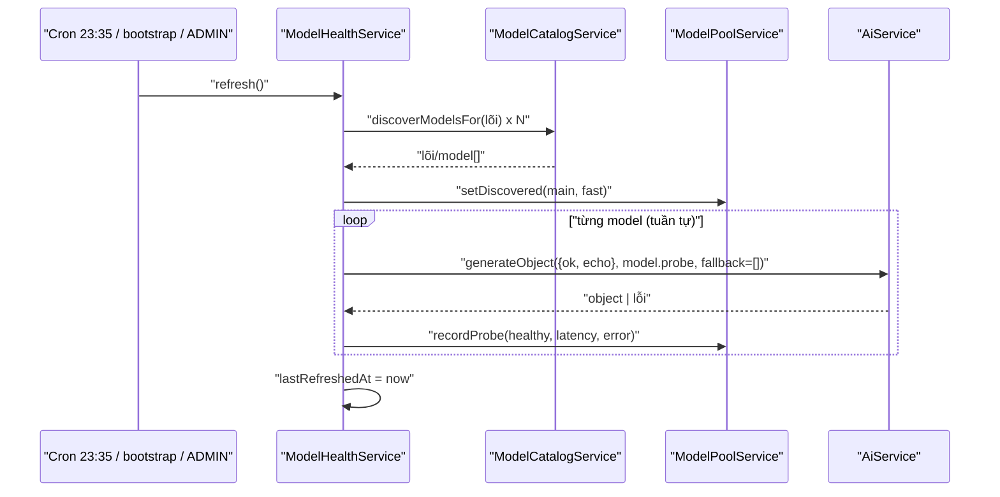
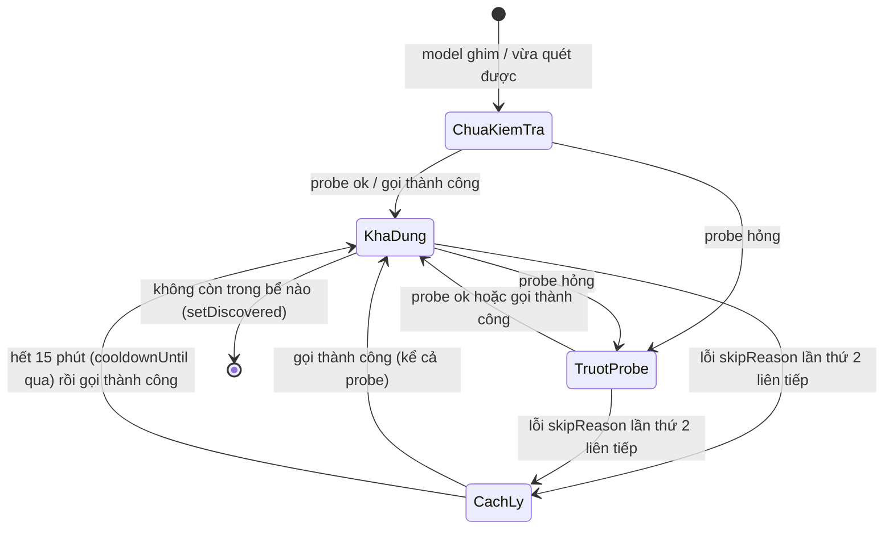

# AI Platform — Nền tảng gọi model AI và khung prompt

> **Phạm vi:** `server/src/modules/ai/**` (`AiService`, `ModelChain`, `ModelCatalogService`, `ModelPoolService`, `ModelHealthService`, `model-health.controller.ts`, `LanguageModelFactory`, `AiCallLog`, 8 lõi trong `providers/`, `utils/` gồm `concurrency-gate`, `fast-model-scheduler`, `json-stream`, `json-text`, `model-env`, `model-pool`, `model-ref`, `request-body`, `schema-prompt`, `sdk-warnings`, `stream`, `catalog`), `server/src/common/ai/**`, `server/src/common/model-output.ts`, `server/src/modules/skills/**` (`SkillRegistryService`, `PromptBuilderService`, `skills.controller.ts`, `shared-placeholders`), bảng `AiCall`, enum `AiFailureKind`. Tích hợp: `omniroute-service/`, `opencode-service/`, các gateway model. Frontend admin: `/ai-health` (tab "Bể model & cầu dao") và `/skills` của `ui-admin-job-search`.
> **Nguyên tắc:** tài liệu mô tả hệ thống **as-is**. Code là nguồn sự thật duy nhất.
>
> Phần **bể model động, probe định kỳ, cầu dao và route `/api/admin/ai/models/*`** là code đang nằm trên đĩa nhưng **chưa commit** *(2026-10-19, chưa commit)* — xem mục "Cập nhật 2026-10-19" trong [ADR 0012](../../adr/0012-loi-model-va-chuoi-du-phong.md).

## 1. Purpose

| Mục tiêu | Diễn giải |
|---|---|
| Một cửa duy nhất cho mọi lời gọi model | Mọi module nghiệp vụ gọi model qua seam `Ai` (`AiService`): `generateObject`, `streamObject`, `streamText` ([ai.types.ts:41](../../../server/src/modules/ai/ai.types.ts#L41)). Không module nào gọi SDK `ai` trực tiếp |
| Chạy được trên model miễn phí, hay hỏng | Chuỗi dự phòng nhiều lõi/model (`ModelChain`), trần thời gian cho cả chuỗi, ép định dạng JSON theo từng lõi, bóc JSON khỏi văn xuôi, nắn output thay vì từ chối |
| Tự chọn model còn sống *(2026-10-19, chưa commit)* | Bể model động: quét `/models` của các lõi, probe từng model, xếp hạng, cầu dao cách ly model lỗi liên tiếp; không cần ghim tên model trong `.env` |
| Quan sát được chi phí và lỗi | Mỗi lượt gọi (kể cả lượt hỏng, kể cả probe) ghi một dòng `ai_calls` có `purpose`, model, thời gian, token, phân loại lỗi |
| Khung prompt lấy từ đặc tả | `SkillRegistryService` nạp `.claude/skills/*/SKILL.md` lúc khởi động; `PromptBuilderService` thay placeholder hồ sơ và cắt mục cần dùng |

**Điểm mấu chốt:** đây là module hạ tầng — không có dữ liệu nghiệp vụ của riêng nó, nhưng **quyết định chi phí, độ trễ và độ tin cậy** của mọi tính năng AI (chấm điểm, CV, phỏng vấn, upskill, tìm hiểu công ty…). Hai quy tắc định hình mọi thứ: (1) **không bao giờ tự thay model khác** khi model được chỉ định không tồn tại — gõ sai `.env` không được thành hoá đơn ([model-catalog.service.ts:170](../../../server/src/modules/ai/services/model-catalog.service.ts#L170)); (2) lỗi **thuộc về model** thì đi tiếp mắt xích, lỗi **thuộc về tác vụ** thì ném ngay ([model-chain.ts:86](../../../server/src/modules/ai/services/model-chain.ts#L86)).

## 2. Actors

| Actor | Quyền trong module | Ghi chú |
|---|---|---|
| Module nghiệp vụ (matching, documents, interview, mock-interview, upskill, companies, scraper, profile-sources, question-bank) | Gọi `AiService`, `SkillRegistryService.get`, `PromptBuilderService` | Mỗi lời gọi khai `context.purpose` (và `userId` nếu có) |
| ADMIN | Xem trạng thái bể model, kích hoạt kiểm tra model; xem/nạp lại skill | `@Roles('ADMIN')` ở cấp controller |
| USER | Không có endpoint nào | Bị 403 ở cả 4 route (e2e [security.e2e-spec.ts:67](../../../server/test/security.e2e-spec.ts#L67)) |
| Cron `ai.healthcheck` *(2026-10-19, chưa commit)* | Quét và probe bể model | Mặc định 23:35 theo `CRON_TIMEZONE`, chạy ở **mọi** tiến trình |
| Bootstrap ứng dụng | Lượt probe đầu tiên; nạp skill | `onApplicationBootstrap` / `onModuleInit` |
| Gateway/lõi model | Phục vụ `/models`, `/chat/completions` | opencode (qua `opencode-service`), opencode-direct, openrouter, omniroute, kilo, groq, unorouter, gemini |
| models.opencode.ai | Catalog model JSON | Cho lõi không khai `baseURLEnv` |

## 3. Business Features

| # | Tính năng | Actor | Endpoint / cơ chế |
|---|---|---|---|
| F1 | Sinh object theo schema (không stream) | Module nghiệp vụ | `AiService.generateObject` |
| F2 | Sinh object dạng stream (mảnh dần) | Module nghiệp vụ | `AiService.streamObject` |
| F3 | Sinh văn bản stream (luyện phỏng vấn) | mock-interview | `AiService.streamText` |
| F4 | Chuỗi dự phòng + ngân sách thời gian | Hệ thống | `ModelChain.run` |
| F5 | Phân giải model (catalog, `/models` sống, key, adapter) | Hệ thống | `ModelCatalogService.resolve` |
| F6 | Ép định dạng đầu ra theo lõi, bóc JSON | Hệ thống | `withFormatFallback`, `extractJsonFromResponse`, `extractJsonFromStream` |
| F7 | Chọn mắt đầu bể fast theo hạn mức còn lại | Hệ thống | `fastModelChain`, `fast-model-scheduler` |
| F8 | Cổng song song theo lõi | Hệ thống | `ConcurrencyGate` (`OPENCODE_APP_CONCURRENCY`) |
| F9 | Nhật ký lượt gọi | Hệ thống | `AiCallLog.record` → `ai_calls` |
| F10 | Bể model động + cầu dao *(2026-10-19, chưa commit)* | Hệ thống | `ModelPoolService` |
| F11 | Kiểm tra sức khoẻ model (quét + probe) *(2026-10-19, chưa commit)* | Cron, bootstrap, ADMIN | `ModelHealthService.refresh`; `POST /api/admin/ai/models/health-check` |
| F12 | Xem trạng thái bể model *(2026-10-19, chưa commit)* | ADMIN | `GET /api/admin/ai/models/health` |
| F13 | Nạp khung prompt từ `.claude/skills` | Bootstrap, ADMIN | `SkillRegistryService.reload`; `GET /api/skills`, `POST /api/skills/reload` |
| F14 | Dựng prompt từ hồ sơ | Module nghiệp vụ | `PromptBuilderService.render/keepSections/dropSubsection/profileSummary`, `renderShared` |
| F15 | Khuôn schema output "cắt không từ chối" | Module nghiệp vụ | `common/model-output.ts` |
| F16 | Phân loại lỗi model, che lỗi thô với người dùng | Hệ thống | `common/ai/failure-kind.ts`, `failure-view.ts` |

## 4. Business Flow

### Luồng A — `generateObject` (F1, F4, F5, F6, F9)

**Preconditions:** caller truyền `schema` zod, `system`, `prompt`, `context.purpose`; tuỳ chọn `modelId`, `fallbackModelIds`, `maxRetries`, `timeoutMs`.

**Main Flow:**
1. `readyFor(modelId)`: không chỉ định model → đợi lượt kiểm tra model đầu tiên (`pool.waitForModels()`) *(2026-10-19, chưa commit)* ([ai.service.ts:93](../../../server/src/modules/ai/services/ai.service.ts#L93)).
2. `ModelChain.run` dựng chuỗi `links(requested, fallbackOverride)` ([model-chain.ts:60](../../../server/src/modules/ai/services/model-chain.ts#L60)):
   - mắt đầu = `requested` ?? model đầu bể main ?? `MODEL_ID`;
   - các mắt sau = `fallbackOverride` (thay hẳn) ?? bể main (nếu có) ?? `MODEL_FALLBACK_IDS`;
   - khử trùng theo dạng chuẩn `lõi/model`;
   - bỏ model đang bị cầu dao cách ly, **trừ khi** cả chuỗi đều đang bị cách ly *(2026-10-19, chưa commit)*.
3. Với từng mắt xích: nếu đã qua `AI_CHAIN_BUDGET_MS` (mặc định 240 000) **và** không phải mắt đầu → dừng, ném lỗi của mắt trước ([model-chain.ts:99](../../../server/src/modules/ai/services/model-chain.ts#L99)).
4. `withFormatFallback` ([ai.service.ts:127](../../../server/src/modules/ai/services/ai.service.ts#L127)):
   1. `modeFor` → `ModelCatalogService.resolve` (Luồng E) để biết lõi, chế độ `structuredOutputs` (lõi có `honorsResponseFormat` và `AI_STRUCTURED_OUTPUTS=true`), chế độ đã "học" theo lõi.
   2. `attempt(options, mode)`: dựng model (`LanguageModelFactory.create`), ghi lượt dùng cho bộ lập lịch fast, xin chỗ ở `ConcurrencyGate`, gọi SDK `generateObject` với `maxRetries` (mặc định 2) và `AbortSignal.timeout(timeoutMs ?? 90 000)`.
   3. Chế độ `structuredOutputs=false` → nối JSON Schema của zod vào cuối system prompt ("--- ĐỊNH DẠNG ĐẦU RA BẮT BUỘC ---") ([schema-prompt.ts:8](../../../server/src/modules/ai/utils/schema-prompt.ts#L8)).
   4. Mọi phản hồi `application/json` đi qua `extractJsonFromResponse` bóc JSON khỏi văn xuôi/hàng rào ```` ``` ```` ([json-text.ts:58](../../../server/src/modules/ai/utils/json-text.ts#L58)); thân request được sửa theo lõi (`stream:false`, bỏ `response_format: json_object`) ([request-body.ts:4](../../../server/src/modules/ai/utils/request-body.ts#L4)).
   5. Thành công → ghi `ai_calls` (`ok=true`, token vào/ra/cache) và trả `{ object, modelId }`.
5. Thành công ở mắt nào → `pool.recordSuccess(lõi/model)` (đặt lại bộ đếm lỗi, mở cầu dao).

**Alternative Flow:**
- Gateway báo không hỗ trợ `response_format` → ghi nhớ chế độ ngược lại **cho cả lõi** (`learnedModes`, trong RAM tiến trình) và thử lại một lần ([ai.service.ts:140](../../../server/src/modules/ai/services/ai.service.ts#L140)).
- `NoObjectGeneratedError` và lõi có hai chế độ (`switchable`) → thử lại **đúng một lần** ở chế độ còn lại; lõi chỉ một chế độ (`honorsResponseFormat:false`) thì ném luôn.
- Lỗi thuộc về model (`skipReason` khác null) → `recordFailure` (trừ lỗi "prompt vượt trần token") và đi tiếp mắt sau.

**Failure Flow:**
- Lỗi không thuộc `skipReason` (`OTHER`) → ném ngay cho caller.
- Hết mắt xích hoặc hết ngân sách → ném lỗi của mắt cuối đã thử.
- Mỗi lượt hỏng ghi `ai_calls` `ok=false`, `failureKind`, `errorMessage` (≤ 800 ký tự, kèm chi tiết lệch schema), `finishReason`, `responseText` (cắt giữa còn 2 000 ký tự); log chỉ in độ dài phản hồi, không in nội dung ([ai.service.ts:257](../../../server/src/modules/ai/services/ai.service.ts#L257)).
- `ModelUnavailableError` (thiếu key, model không có, bể trống…) ném **trước** khi gọi mạng nên **không** có dòng `ai_calls`.

**Postconditions:** ≥ 1 dòng `ai_calls` cho mỗi mắt xích đã thực sự gọi mạng; trạng thái cầu dao trong RAM cập nhật.

### Luồng B — `streamObject` (F2)

**Preconditions:** như Luồng A (không có `maxRetries`).

**Main Flow:**
1. `readyFor` rồi `ModelChain.run(… streamOnce …)` ([ai.service.ts:279](../../../server/src/modules/ai/services/ai.service.ts#L279)).
2. `streamOnce`: lõi/model **không** stream được JSON (`canStream = honorsResponseFormat || streamsJson`) → rơi thẳng về đường không-stream (`withoutStreaming` → `attempt`), trả `partials` rỗng ([ai.service.ts:299](../../../server/src/modules/ai/services/ai.service.ts#L299)).
3. Stream được → `beginStream`: gọi SDK `streamObject`, bọc phản hồi SSE bằng `extractJsonFromStream` (chỉ giữ object JSON đầu tiên trong `delta.content`) ([json-stream.ts:68](../../../server/src/modules/ai/utils/json-stream.ts#L68)).
4. **Giữ lại tới mảnh đầu tiên** rồi mới trao `partials` cho caller — model trả văn xuôi thì chưa byte nào rời server, còn đường lùi ([ai.service.ts:338](../../../server/src/modules/ai/services/ai.service.ts#L338)).
5. `onFinish` nhả cổng song song, ghi `ai_calls` (ok/hỏng, token).

**Alternative Flow:** không phát được mảnh nào (`NoObjectGeneratedError`): lõi hai chế độ → thử lại một lần ở chế độ kia; lõi một chế độ → rơi về đường không-stream.

**Failure Flow:** hỏng **sau** mảnh đầu → hỏng hẳn (không đổi model); `object` reject cho caller. Lỗi trước mảnh đầu → đi theo `skipReason` của `ModelChain`. Provider từ chối ngay khi mở stream (429 sau hết lượt thử lại) thì SDK chỉ báo qua `onError`, `result.object` không bao giờ xong; `beginStream` ghép `onError` vào `object` nên lượt đó vẫn nhả cổng, ghi `ai_calls` và chuyển mắt xích *(2026-10-20)*.

**Postconditions:** như Luồng A.

### Luồng C — `streamText` (F3)

**Preconditions:** `system`, `messages`, `context`; tuỳ chọn `modelId`.

**Main Flow:**
1. `readyFor`, rồi dùng `modelId ?? chain.links()[0]` — **không có chuỗi dự phòng** ([ai.service.ts:404](../../../server/src/modules/ai/services/ai.service.ts#L404)).
2. Mở model ở chế độ văn bản (không ép JSON, không lọc stream), xin chỗ cổng song song, gọi SDK `streamText` với timeout (mặc định 90 000).
3. `onFinish` → ghi `ai_calls` `ok=true`; `onError` → ghi `ok=false` + `failureKind`. Cả hai nhả cổng.

**Alternative Flow:** không có.

**Failure Flow:** lỗi không đi qua `ModelChain` nên **không** cộng vào cầu dao (ADR 0012 cập nhật 2026-10-19).

**Postconditions:** một dòng `ai_calls` (ghi bất đồng bộ).

### Luồng D — Chọn mắt đầu bể fast (F7)

**Preconditions:** caller thuộc nhóm "người dùng đang chờ" gọi `fastModelChain(estimatedTokens)`: `company.brief`, `document.*` (2 chỗ), `job.fromUrl`, `interview.feedback`/`question.answer`, `match.evaluate` (stream), `interview.open`/`interview.turn`.

**Main Flow:**
1. Đọc bể fast qua `fastPoolResolver` (do `ModelPoolService` đăng ký lúc khởi tạo) *(2026-10-19, chưa commit)* ([model-env.ts:20](../../../server/src/modules/ai/utils/model-env.ts#L20)).
2. Ứng viên = bể fast; bể trống thì `[AI_FAST_MODEL_ID, ...AI_FAST_FALLBACK_IDS]` (đọc thẳng `process.env`).
3. `fallbackModelIds` = bể fast nếu có ≥ 2 model; ngược lại `AI_FAST_FALLBACK_IDS` (có thể `undefined` → `ModelChain` dùng chuỗi chung).
4. `pickStart` chọn ứng viên đầu tiên còn hạn mức theo `rateLimitFor` của lõi (cửa sổ trượt đếm lượt/token trong RAM, ước token bằng `estimateTokens`) ([fast-model-scheduler.ts:44](../../../server/src/modules/ai/utils/fast-model-scheduler.ts#L44)); không ai còn chỗ → `AI_FAST_MODEL_ID`.

**Alternative Flow:** không có ứng viên nào → `modelId` undefined → Luồng A dùng bể main.

**Failure Flow:** không có (hàm thuần).

**Postconditions:** trả `{ modelId?, fallbackModelIds? }` để caller trải vào options.

### Luồng E — Phân giải model (F5)

**Preconditions:** chuỗi `lõi/model` hoặc `undefined`.

**Main Flow** ([model-catalog.service.ts:171](../../../server/src/modules/ai/services/model-catalog.service.ts#L171)):
1. `ref ?? MODEL_ID`; rỗng → `ModelUnavailableError` "Bể model đang trống…" *(2026-10-19, chưa commit)*.
2. `parseModelRef`: tách ở dấu `/` **đầu tiên**; tiền tố không phải lõi đã khai → cả chuỗi là model id của lõi mặc định `MODEL_PROVIDER` ([model-ref.ts:4](../../../server/src/modules/ai/utils/model-ref.ts#L4)).
3. Tìm `ProviderDescriptor`; lõi lạ → lỗi.
4. Lấy API key theo lõi; rỗng → lỗi "chưa có API key".
5. Lấy danh sách model: lõi có `baseURLEnv` → hỏi `<baseURL>/models` (cache 5 phút, timeout 10 s); lõi khác → catalog `OPENCODE_MODELS_URL` (cache 5 phút).
6. `selectModel`: model phải có trong danh sách, adapter npm được hỗ trợ, không nằm trong `knownNoStructuredOutput` ([catalog.ts:37](../../../server/src/modules/ai/utils/catalog.ts#L37)).
7. `assertServed`: nếu `/models` sống trả được danh sách thì model phải có mặt; OpenRouter còn phải khai `structured_outputs`.
8. Trả `ResolvedModel` (baseURL, key, header, cờ `explicitStreamFlag`, `dropJsonMode`, `honorsResponseFormat`, `streamsJson`).

**Alternative Flow:** `/models` sống không gọi được ở bước 7 → bỏ qua kiểm tra (chỉ bước 5 bắt buộc).

**Failure Flow:** mọi lỗi phân giải là `ModelUnavailableError` → `ModelChain` coi là lỗi của model, đi tiếp.

**Postconditions:** không ghi DB.

### Luồng F — Kiểm tra sức khoẻ model *(2026-10-19, chưa commit)* (F10, F11)

**Preconditions:** `AI_HEALTHCHECK_ENABLED` khác `'false'` (mặc định bật).

**Main Flow** ([model-health.service.ts:81](../../../server/src/modules/ai/services/model-health.service.ts#L81)):
1. Trigger: `onApplicationBootstrap` (lượt đầu, được `pool.trackFirstRefresh` ghi nhớ), cron `AI_HEALTHCHECK_SCHEDULE` (mặc định `35 23 * * *`, múi `CRON_TIMEZONE`), hoặc ADMIN gọi `POST /api/admin/ai/models/health-check`.
2. Một lượt đang chạy thì lượt mới trả về chính lượt đó (`running ??=`).
3. `discover` bể main theo `MAIN_TASK_PROVIDERS` (mặc định `omniroute,opencode-direct,opencode,openrouter` *(2026-10-23)*), rồi bể fast theo `FAST_TASK_PROVIDERS` (mặc định `groq,gemini,unorouter,omniroute,kilo,openrouter`): `discoverModelsFor` từng lõi (lõi lạ/thiếu key/lỗi → `[]`; mọi lõi đều bỏ model mà catalog `models.opencode.ai` có ghi nhưng không khai `structured_output: true`; lõi/model catalog không biết hoặc catalog tải hỏng thì giữ nguyên *(2026-10-20)*), lọc `isProbeCandidate` (bỏ model không phải chat; bỏ bộ định tuyến tự chọn model hộ `…/openrouter/free`, `…/openrouter/auto` vì mỗi lượt gọi trúng một model khác nên điểm probe vô nghĩa *(2026-10-20)*; lõi trả phí `openrouter/unorouter/kilo/opencode` chỉ lấy model có chữ `free`; opencode/opencode-direct lọc bỏ model thử nghiệm; unorouter lọc bỏ checkpoint vẽ ảnh), bỏ model đã ghim, nạp toàn bộ model hợp lệ vào bể ([model-pool.ts:42](../../../server/src/modules/ai/utils/model-pool.ts#L42)).
4. `pool.setDiscovered(main, fast)`; xoá tình trạng của model không còn trong bể nào.
5. Probe **tuần tự** từng model trong hợp hai bể: `ai.generateObject` với schema `{ ok: boolean, echo: number }`, prompt "Respond in JSON with ok=true and echo=123.", `purpose = 'model.probe'`, `fallbackModelIds: []`, `maxRetries: 0`, `timeoutMs = AI_PROBE_TIMEOUT_MS` (6 000) ([model-health.service.ts:134](../../../server/src/modules/ai/services/model-health.service.ts#L134)).
6. Khoẻ khi `ok === true && echo === 123`; ghi `recordProbe(healthy, latency, error)`. Sai giá trị → lỗi `Trả JSON đúng dạng nhưng sai giá trị`.
7. Ghi `lastRefreshedAt`, log `Kiểm tra model xong: x/y khoẻ`.

**Alternative Flow:** kiểm tra bị tắt → không cron, không lượt đầu; `waitForModels` trả ngay; bể chỉ còn model ghim trong `.env`.

**Failure Flow:** lỗi bất kỳ trong lượt → chỉ log `Kiểm tra model hỏng: …`, không ném (`lastRefreshedAt` không đổi).

**Postconditions:** bể main/fast được xếp lại theo `rankModels`: model trượt probe xuống cuối → model ghim trước model quét được → theo thứ tự lõi → theo độ trễ probe ([model-pool.ts:51](../../../server/src/modules/ai/utils/model-pool.ts#L51)); mỗi probe ghi một dòng `ai_calls`.

### Luồng G — Cầu dao *(2026-10-19, chưa commit)* (F10)

**Preconditions:** `ModelChain` có `pool`.

**Main Flow** ([model-pool.service.ts:155](../../../server/src/modules/ai/services/model-pool.service.ts#L155)):
1. Mắt xích hỏng với lỗi thuộc `skipReason` (trừ "prompt vượt trần token") → `consecutiveFailures += 1`, ghi `error = reason`.
2. Đạt `AI_CIRCUIT_BREAKER_THRESHOLD` (2) và chưa bị cách ly → `cooldownUntil = now + AI_CIRCUIT_BREAKER_COOLDOWN_MS` (900 000 = 15 phút), log `Cách ly <model> 15 phút sau 2 lỗi liên tiếp (…)`.
3. Trong thời gian cách ly `links()` bỏ model đó, kể cả khi caller chỉ định nó.
4. Một lần gọi thành công (kể cả probe) → `healthy=true`, bộ đếm 0, mở cầu dao.

**Alternative Flow:** mọi mắt đều đang bị cách ly → giữ nguyên chuỗi (không trả rỗng).

**Failure Flow:** không có.

**Postconditions:** trạng thái chỉ nằm trong RAM của tiến trình, mất khi khởi động lại.

### Luồng H — Xem / kích hoạt kiểm tra model qua admin *(2026-10-19, chưa commit)* (F11, F12)

**Preconditions:** đăng nhập với role `ADMIN`.

**Main Flow:**
1. `GET /api/admin/ai/models/health` → `ModelHealthService.status()` → **200** `{ mainPool, fastPool, mainProviders, fastProviders, cooldownMs, models: ModelHealth[], isRefreshing, lastRefreshedAt }` ([model-health.controller.ts:14](../../../server/src/modules/ai/controllers/model-health.controller.ts#L14)).
2. `POST /api/admin/ai/models/health-check` → khởi động `refresh()` **không chờ** (`void`), trả ngay **200** trạng thái hiện tại (thường `isRefreshing: true`) ([model-health.controller.ts:22](../../../server/src/modules/ai/controllers/model-health.controller.ts#L22)).
3. FE hỏi lại mỗi 3 giây khi `isRefreshing`.

**Alternative Flow:** đang có lượt chạy → `POST` không tạo lượt mới.

**Failure Flow:** 401 (chưa đăng nhập), 403 (không phải ADMIN).

**Postconditions:** như Luồng F (chỉ ở tiến trình nhận request).

### Luồng I — Nạp và tra khung prompt (F13)

**Preconditions:** `SKILLS_DIR` (mặc định `../.claude/skills`, tính từ thư mục làm việc của tiến trình) ([configuration.ts:97](../../../server/src/config/configuration.ts#L97)).

**Main Flow** ([skill-registry.service.ts:48](../../../server/src/modules/skills/services/skill-registry.service.ts#L48)):
1. `onModuleInit` gọi `reload()`; ADMIN có thể gọi `POST /api/skills/reload`.
2. Xoá sạch bản đồ skill rồi đọc thư mục; mỗi thư mục con có `SKILL.md` là một skill. Không có `SKILL.md` → bỏ qua (warn).
3. Đọc frontmatter (`name`, `description`, `allowed-tools` tách dấu phẩy, `framework_version`), thân, và mọi file `.md` khác cùng thư mục (không đệ quy) làm file tham chiếu.
4. `contentHash = fingerprint(thân + tên/nội dung tham chiếu theo thứ tự tên, 16)`.
5. Lưu theo tên thư mục và (nếu khác) theo `name` frontmatter.
6. `GET /api/skills` / `POST /api/skills/reload` trả **200/201** `{ skills: SkillManifest[] }` (tên, mô tả, tools, version, hash, số byte thân, danh sách tham chiếu + byte).
7. Module nghiệp vụ gọi `get(name)`: `job-application-assistant` (matching, documents, interview), `upskill` (upskill).

**Alternative Flow:** thư mục không đọc được → log `Không đọc được thư mục skill: <dir>`, registry rỗng.

**Failure Flow:** `get` tên không có → **404** `Không tìm thấy skill: <name>` (lan tới request nghiệp vụ đang gọi).

**Postconditions:** bản đồ skill trong RAM của tiến trình được thay mới.

### Luồng J — Dựng prompt từ hồ sơ (F14, F15)

**Preconditions:** `Profile | null`.

**Main Flow** ([prompt-builder.service.ts:66](../../../server/src/modules/skills/services/prompt-builder.service.ts#L66)):
1. `render`: thay token `[YOUR_*]`/`[SKILLS_YOU_LACK]`… bằng giá trị hồ sơ; token không có ánh xạ hoặc giá trị trống → `(hồ sơ chưa cung cấp thông tin này)`.
2. `renderShared` (cho prompt dùng chung giữa người dùng, phục vụ cache prompt): thay token bằng câu trỏ cố định `(xem «Nhãn»)` và thêm một dòng ghi chú ([shared-placeholders.ts:31](../../../server/src/modules/skills/utils/shared-placeholders.ts#L31), [ADR 0014](../../adr/0014-token-va-cache-prompt.md)).
3. `keepSections` giữ các mục `## …` có tiêu đề bắt đầu bằng tên yêu cầu; `dropSubsection` bỏ mục `### …` khớp.
4. `profileSummary`: các dòng "- Nhãn: giá trị" (bỏ dòng rỗng), JSON kinh nghiệm/dự án/học vấn/chứng chỉ/đặc điểm cắt ở 1 500/1 200/800/600/600 ký tự, cả khối cắt ở 4 000 ký tự; không có hồ sơ → `Ứng viên chưa hoàn thiện hồ sơ.`

**Alternative/Failure Flow:** không có (hàm thuần).

**Postconditions:** chuỗi prompt.

## 5. Mermaid Flowchart



## 6. Sequence Diagram

### Lời gọi `generateObject` có chuỗi dự phòng



### Kiểm tra sức khoẻ model (cron / bootstrap / admin) *(2026-10-19, chưa commit)*



## 7. Business Rules

| Mã BR | Quy tắc | Nơi thực thi | Mức | Nguồn code |
|---|---|---|---|---|
| BR-AI-01 | Mọi lời gọi model đi qua `AiService` (seam `Ai`); module nghiệp vụ không gọi SDK trực tiếp | SV | ✅ | [ai.types.ts:41](../../../server/src/modules/ai/ai.types.ts#L41), [ai.module.ts](../../../server/src/modules/ai/ai.module.ts) |
| BR-AI-02 | Không bao giờ tự thay model khác khi model được chỉ định không tồn tại/không phục vụ — ném `ModelUnavailableError` | SV | ✅ | [model-catalog.service.ts:170](../../../server/src/modules/ai/services/model-catalog.service.ts#L170) |
| BR-AI-03 | Chuỗi: mắt đầu = model yêu cầu ?? đầu bể main ?? `MODEL_ID`; dự phòng = `fallbackModelIds` của caller (thay hẳn) ?? bể main ?? `MODEL_FALLBACK_IDS`; khử trùng theo `lõi/model` | SV | ✅ | [model-chain.ts:60](../../../server/src/modules/ai/services/model-chain.ts#L60) |
| BR-AI-04 | Đi tiếp mắt sau khi lỗi là: model không khả dụng, model bị rút, 429/hết hạn mức, 413/prompt quá lớn, 401/403, 5xx, **timeout**, **sai schema**; lỗi khác ném ngay | SV | ✅ | [model-chain.ts:32](../../../server/src/modules/ai/services/model-chain.ts#L32) |
| BR-AI-05 | Ngân sách cả chuỗi `AI_CHAIN_BUDGET_MS` (240 s): quá ngân sách thì không mở mắt mới (mắt đang chạy không bị ngắt) | SV | ✅ | [model-chain.ts:99](../../../server/src/modules/ai/services/model-chain.ts#L99), [configuration.ts:42](../../../server/src/config/configuration.ts#L42) |
| BR-AI-06 | Timeout mặc định một lượt gọi 90 s; `maxRetries` SDK mặc định 2 (trong cùng một lượt) | SV | ✅ | [ai.service.ts:40](../../../server/src/modules/ai/services/ai.service.ts#L40), [ai.service.ts:211](../../../server/src/modules/ai/services/ai.service.ts#L211) |
| BR-AI-07 | Chế độ ép định dạng theo **lõi**: lõi `honorsResponseFormat:false` (opencode, omniroute, groq, unorouter) chỉ dùng chế độ bơm JSON Schema vào prompt; lõi khác dùng `response_format` khi `AI_STRUCTURED_OUTPUTS=true` | SV | ✅ | [language-model.ts:23](../../../server/src/modules/ai/services/language-model.ts#L23), [providers/](../../../server/src/modules/ai/providers/index.ts) |
| BR-AI-08 | Lõi từ chối `response_format` → ghi nhớ chế độ ngược lại cho cả lõi (tới khi khởi động lại) | SV | ✅ | [ai.service.ts:140](../../../server/src/modules/ai/services/ai.service.ts#L140) |
| BR-AI-09 | Không ra object và lõi có hai chế độ → thử lại **đúng một lần** ở chế độ kia; lõi một chế độ không lật | SV | ✅ | [ai.service.ts:149](../../../server/src/modules/ai/services/ai.service.ts#L149), [ai.service.ts:306](../../../server/src/modules/ai/services/ai.service.ts#L306) |
| BR-AI-10 | Bóc JSON khỏi văn xuôi/hàng rào: phản hồi JSON đi qua `extractJson` (cân bằng ngoặc, chỉ theo `{` đầu tiên); stream SSE chỉ giữ object JSON đầu tiên | SV | ✅ | [json-text.ts:44](../../../server/src/modules/ai/utils/json-text.ts#L44), [json-stream.ts:1](../../../server/src/modules/ai/utils/json-stream.ts#L1) |
| BR-AI-11 | `streamObject` chỉ stream khi lõi/model nằm trong danh sách cho phép (`streamsJson`) hoặc lõi tôn trọng `response_format`; ngoài ra gọi đường không-stream | SV | ✅ | [catalog.ts:29](../../../server/src/modules/ai/utils/catalog.ts#L29), [ai.service.ts:299](../../../server/src/modules/ai/services/ai.service.ts#L299) |
| BR-AI-12 | `streamObject` giữ lại tới mảnh đầu tiên; hỏng sau mảnh đầu thì hỏng hẳn, không đổi model | SV | ✅ | [ai.service.ts:338](../../../server/src/modules/ai/services/ai.service.ts#L338) |
| BR-AI-13 | `streamText` không có chuỗi dự phòng và không cộng vào cầu dao | SV | ✅ | [ai.service.ts:404](../../../server/src/modules/ai/services/ai.service.ts#L404) |
| BR-AI-14 | Mỗi lượt gọi mạng ghi một dòng `ai_calls` (kể cả hỏng, kể cả probe); lỗi ghi nhật ký không bao giờ làm hỏng lượt gọi | SV | ✅ | [ai-call-log.ts:29](../../../server/src/modules/ai/services/ai-call-log.ts#L29) |
| BR-AI-15 | Lượt hỏng lưu `failureKind`, `errorMessage` ≤ 800 ký tự (+ chi tiết lệch schema), `finishReason`, `responseText` cắt GIỮA còn 2 000 ký tự; log ứng dụng không in nội dung phản hồi | SV | ✅ | [ai.service.ts:45](../../../server/src/modules/ai/services/ai.service.ts#L45), [stream.ts:16](../../../server/src/modules/ai/utils/stream.ts#L16) |
| BR-AI-16 | Phân loại lỗi: `SCHEMA` (NoObjectGenerated/không khớp schema), `TIMEOUT` (Timeout/Abort), `UPSTREAM` (APICallError, 429, rút model, 5xx), `OTHER`; bóc `RetryError` trước khi phân loại | SV | ✅ | [failure-kind.ts:36](../../../server/src/common/ai/failure-kind.ts#L36) |
| BR-AI-17 | Người dùng cuối chỉ thấy phân loại lỗi (`Không hoàn thành được tác vụ.` + `failureKind`), lỗi thô nằm lại trong log/DB; `HttpException` giữ nguyên câu | SV | ✅ | [failure-view.ts:15](../../../server/src/common/ai/failure-view.ts#L15) |
| BR-AI-18 | Cổng song song theo lõi: chỉ lõi `opencode` có trần, `OPENCODE_APP_CONCURRENCY` (mặc định 2), theo tiến trình | SV | ✅ | [concurrency-gate.ts:1](../../../server/src/modules/ai/utils/concurrency-gate.ts#L1), [configuration.ts:87](../../../server/src/config/configuration.ts#L87) |
| BR-AI-19 | Bể fast: chọn mắt đầu là model đầu tiên còn hạn mức theo `rateLimitFor` của lõi (Groq 8 000 token/phút, 200 000 token/ngày, 1 000 lượt/ngày — model Groq quét được mà chưa có trong bảng dùng đúng mức này thay vì coi là vô hạn *(2026-10-24)*; Gemini theo nhóm model; UnoRouter 1 lượt/phút), đếm trong RAM 25 giờ | SV | ✅ | [fast-model-scheduler.ts:44](../../../server/src/modules/ai/utils/fast-model-scheduler.ts#L44), [groq.ts:4](../../../server/src/modules/ai/providers/groq.ts#L4), [gemini.ts:9](../../../server/src/modules/ai/providers/gemini.ts#L9), [unorouter.ts:10](../../../server/src/modules/ai/providers/unorouter.ts#L10) |
| BR-AI-20 | Ước token = ⌈ký tự/3,5⌉ + 1 200 (cố ý ước cao) | SV | ✅ | [token-estimate.ts:6](../../../server/src/common/ai/token-estimate.ts#L6) |
| BR-AI-21 | Lõi thiếu API key bị coi là không khả dụng (ném lỗi, chuỗi đi tiếp); opencode/omniroute/kilo mặc định key `public` | SV | ✅ | [model-catalog.service.ts:53](../../../server/src/modules/ai/services/model-catalog.service.ts#L53), [configuration.ts:62](../../../server/src/config/configuration.ts#L62) |
| BR-AI-22 | Model phải có trong catalog/`/models`, adapter được hỗ trợ (`@ai-sdk/openai-compatible`, `@openrouter/ai-sdk-provider`), không nằm trong danh sách đã đo là hỏng structured output; OpenRouter phải khai `structured_outputs` | SV | ✅ | [catalog.ts:37](../../../server/src/modules/ai/utils/catalog.ts#L37), [model-catalog.service.ts:213](../../../server/src/modules/ai/services/model-catalog.service.ts#L213), [openrouter.ts:7](../../../server/src/modules/ai/providers/openrouter.ts#L7) |
| BR-AI-23 | Catalog và `/models` sống cache 5 phút, timeout tải 10 s | SV | ✅ | [model-catalog.service.ts:14](../../../server/src/modules/ai/services/model-catalog.service.ts#L14) |
| BR-AI-24 | *(2026-10-19, chưa commit)* Không ghim model nào mặc định: `MODEL_ID`, `MODEL_FALLBACK_IDS`, `AI_FAST_MODEL_ID`, `AI_FAST_FALLBACK_IDS` mặc định rỗng; model ghim xếp trước model quét được nhưng vẫn qua probe và cầu dao | SV | ✅ | [configuration.ts:40](../../../server/src/config/configuration.ts#L40), [model-pool.service.ts:51](../../../server/src/modules/ai/services/model-pool.service.ts#L51) |
| BR-AI-25 | *(2026-10-19, chưa commit)* Bể rỗng và không chỉ định model → lỗi "Bể model đang trống…" thay vì đoán model | SV | ✅ | [model-catalog.service.ts:173](../../../server/src/modules/ai/services/model-catalog.service.ts#L173) |
| BR-AI-26 | *(2026-10-19, chưa commit)* Lời gọi không chỉ định model đợi lượt kiểm tra model đầu tiên sau khi khởi động | SV | ✅ | [ai.service.ts:93](../../../server/src/modules/ai/services/ai.service.ts#L93), [model-pool.service.ts:83](../../../server/src/modules/ai/services/model-pool.service.ts#L83) |
| BR-AI-27 | *(2026-10-19, chưa commit)* Quét toàn bộ model mới của từng lõi (bỏ trần 5 model); bỏ model không phải chat; bỏ router alias (`…/openrouter/free`, `…/openrouter/auto`); lõi trả phí (openrouter, unorouter, kilo, opencode) chỉ lấy model có chữ `free`; opencode/opencode-direct bỏ model thử nghiệm (`preview`, `alpha`, `beta`, `test`, `exp`); unorouter lọc bỏ checkpoint vẽ ảnh; omniroute lọc lúc quét theo `filterModel` (chặn kênh hỏng `auto/`, `oc/`, `dva/`, `aug/`, `zc/`, `cxa/`, `tllm/`, `cl/`, `cline/`, `antigravity/gemini-3.7`, `antigravity/gemini-pro-agent`, `antigravity/gemini-3.1-pro`, router alias, `claude-haiku`; nhận `ddgw/`, `cfp/`, `antigravity/` và mọi model có chữ `free`; model ghim không bị chặn bởi `filterModel`) *(2026-10-20)* | SV | ✅ | [model-health.service.ts:117](../../../server/src/modules/ai/services/model-health.service.ts#L117), [model-pool.ts:42](../../../server/src/modules/ai/utils/model-pool.ts#L42), [omniroute.ts:27](../../../server/src/modules/ai/providers/omniroute.ts#L27) |
| BR-AI-28 | *(2026-10-19, chưa commit)* Probe: một lượt `generateObject` `{ok, echo}` không dự phòng, không thử lại, timeout 6 s; khoẻ khi `ok=true` và `echo=123`; probe tuần tự | SV | ✅ | [model-health.service.ts:134](../../../server/src/modules/ai/services/model-health.service.ts#L134) |
| BR-AI-29 | *(2026-10-19, chưa commit)* Xếp hạng bể: trượt probe xuống cuối → ghim trước quét → thứ tự lõi trong `*_TASK_PROVIDERS` → độ trễ probe tăng dần | SV | ✅ | [model-pool.ts:51](../../../server/src/modules/ai/utils/model-pool.ts#L51) |
| BR-AI-30 | *(2026-10-19, chưa commit)* Cầu dao: lỗi thuộc `skipReason` (trừ prompt quá lớn) cộng bộ đếm; đủ 2 lần liên tiếp thì cách ly 15 phút, kể cả khi caller chỉ định model đó; cả chuỗi cách ly thì giữ nguyên chuỗi; thành công (kể cả probe) mở lại | SV | ✅ | [model-chain.ts:80](../../../server/src/modules/ai/services/model-chain.ts#L80), [model-chain.ts:113](../../../server/src/modules/ai/services/model-chain.ts#L113), [model-pool.service.ts:145](../../../server/src/modules/ai/services/model-pool.service.ts#L145) |
| BR-AI-31 | *(2026-10-19, chưa commit)* Kiểm tra model chạy lúc khởi động và theo lịch `AI_HEALTHCHECK_SCHEDULE` ở **mọi** tiến trình; chỉ một lượt chạy cùng lúc trong một tiến trình | SV | ✅ | [model-health.service.ts:48](../../../server/src/modules/ai/services/model-health.service.ts#L48), [model-health.service.ts:81](../../../server/src/modules/ai/services/model-health.service.ts#L81) |
| BR-AI-32 | Route quản trị model và skill chỉ dành cho `ADMIN` (`@Roles('ADMIN')` cấp controller) | GD | ✅ | [model-health.controller.ts:9](../../../server/src/modules/ai/controllers/model-health.controller.ts#L9), [skills.controller.ts:9](../../../server/src/modules/skills/skills.controller.ts#L9) |
| BR-AI-33 | Skill = thư mục con có `SKILL.md` trong `SKILLS_DIR`; file `.md` khác cùng thư mục là tham chiếu; `contentHash` 16 ký tự gộp thân + tham chiếu | SV | ✅ | [skill-registry.service.ts:48](../../../server/src/modules/skills/services/skill-registry.service.ts#L48) |
| BR-AI-34 | Tra skill không có → 404 `Không tìm thấy skill: <name>` | SV | ✅ | [skill-registry.service.ts:121](../../../server/src/modules/skills/services/skill-registry.service.ts#L121) |
| BR-AI-35 | Placeholder hồ sơ không có giá trị/không ánh xạ → `(hồ sơ chưa cung cấp thông tin này)`; tóm tắt hồ sơ trong prompt tối đa 4 000 ký tự | SV | ✅ | [prompt-builder.service.ts:66](../../../server/src/modules/skills/services/prompt-builder.service.ts#L66), [prompt-builder.service.ts:166](../../../server/src/modules/skills/services/prompt-builder.service.ts#L166) |
| BR-AI-36 | Prompt dùng chung giữa người dùng thay placeholder bằng câu trỏ cố định để phần đầu prompt giống hệt từng byte (cache prompt) | SV | ✅ | [shared-placeholders.ts:31](../../../server/src/modules/skills/utils/shared-placeholders.ts#L31) |
| BR-AI-37 | Schema output của model CẮT chứ không từ chối: chuỗi trim + cắt độ dài, mảng bỏ rỗng + cắt số lượng, enum lạ → giá trị dự phòng, số nguyên kẹp trong khoảng, số năm ngoài khoảng → null; chỉ `requiredCappedText*` từ chối chuỗi rỗng | SV (zod) | ✅ | [model-output.ts:3](../../../server/src/common/model-output.ts#L3), [ADR 0017](../../adr/0017-cat-chuoi-model-output.md) |
| BR-AI-38 | Sửa thân request theo lõi: omniroute thêm `stream:false` nếu thiếu; groq bỏ `response_format: json_object`; omniroute gửi header tắt nén/tắt bộ nhớ | SV | ✅ | [request-body.ts:4](../../../server/src/modules/ai/utils/request-body.ts#L4), [omniroute.ts:10](../../../server/src/modules/ai/providers/omniroute.ts#L10) |
| BR-AI-39 | Cảnh báo SDK về `responseFormat` (đã xử lý chủ ý) bị lọc khỏi log; cảnh báo khác ghi `warn` | SV | ✅ | [sdk-warnings.ts:22](../../../server/src/modules/ai/utils/sdk-warnings.ts#L22) |
| BR-AI-40 | Quét model mới của **mọi lõi** chỉ nhận model mà catalog `models.opencode.ai` khai `structured_output: true`; model hoặc lõi catalog không biết thì giữ (`omniroute`, `opencode-direct`), model ghim trong `.env` không bị lọc. Lõi mang tên khác trong catalog khai `catalogId`/`catalogModelId` (`gemini` → `google`, bỏ tiền tố `models/`). Đo 7 ngày tới 2026-10-20: model không khai — `mimo-v2.6-flash-free`, `nemotron-3.5-super-vl-free`, `nemotron-3-ultra-free` — là nhóm hỏng SCHEMA/TIMEOUT nhiều nhất *(2026-10-20)* | SV | ✅ | [model-catalog.service.ts:276](../../../server/src/modules/ai/services/model-catalog.service.ts#L276), [gemini.ts:43](../../../server/src/modules/ai/providers/gemini.ts#L43) |

> **Possible Business Rule:** Probe chỉ chứng minh model trả được JSON ngắn; khi không ghim model, model đứng đầu bể main là model nhanh nhất qua probe (có thể là model nhỏ) và nó chạy cả `match.evaluate`. ADR 0012 ghi là "rủi ro đã chấp nhận" — cần chủ dự án xác nhận vẫn chấp nhận khi đưa lên production.

> **Possible Business Rule:** Lỗi sai schema hiện **đi tiếp** chuỗi dự phòng (xem R1). Cần xác nhận đây là quyết định mới (thay quy tắc "lỗi schema không đi tiếp" trong `CLAUDE.md`/ADR 0012) hay là sai lệch.

## 8. Validation Rules

Module không có DTO đầu vào từ HTTP (4 route đều không nhận body/query).

**`GenerateObjectOptions` / `StreamObjectOptions` / `StreamTextOptions`** (hợp đồng nội bộ, [ai.types.ts](../../../server/src/modules/ai/ai.types.ts))

| Field | Ràng buộc | DTO/Schema | Lỗi trả về |
|---|---|---|---|
| `schema` | `ZodType<T>` bắt buộc | kiểu TS | lệch schema → `NoObjectGeneratedError` (SCHEMA) |
| `context.purpose` | chuỗi bắt buộc | kiểu TS | — |
| `context.userId` | tuỳ chọn | kiểu TS | — |
| `modelId` | `lõi/model` hoặc `model` của lõi mặc định | `parseModelRef` | `ModelUnavailableError` |
| `timeoutMs` | mặc định 90 000 | `AiService` | TIMEOUT |
| `maxRetries` | mặc định 2 (chỉ `generateObject`) | `AiService` | — |

**Khuôn schema output dùng chung** ([model-output.ts](../../../server/src/common/model-output.ts))

| Helper | Ràng buộc | Lỗi trả về |
|---|---|---|
| `cappedText(max)`, `cappedTextVi(max)`, `cappedTextIn(lang, max)` | chuỗi; trim; cắt `max` | sai kiểu → SCHEMA |
| `optionalCappedText(max)` | chuỗi hoặc null, mặc định null; chuỗi rỗng → null | — |
| `requiredCappedText(max)`, `requiredCappedTextVi(max)` | `.min(1)` rồi cắt `max` | chuỗi rỗng → SCHEMA |
| `boundedList(item, max)` | bóc phần tử dạng `{x: "…"}` thành chuỗi, bỏ rỗng, cắt `max` | — |
| `looseEnum(values, fallback)` | giá trị lạ hoặc vắng → `fallback` | — |
| `boundedInt(min, max)` | làm tròn rồi kẹp trong [min; max] | sai kiểu → SCHEMA |
| `optionalYears(max)` | null hoặc âm/vượt `max` → null; làm tròn | — |

**Biến môi trường số** ([configuration.ts:5](../../../server/src/config/configuration.ts#L5)): `AI_CHAIN_BUDGET_MS`, `AI_PROBE_TIMEOUT_MS`, `AI_CIRCUIT_BREAKER_THRESHOLD`, `AI_CIRCUIT_BREAKER_COOLDOWN_MS` phải là số nguyên, nếu không ứng dụng không khởi động: `Biến môi trường <NAME> phải là số nguyên, nhận "<raw>"`. `OPENCODE_APP_CONCURRENCY` không hợp lệ → mặc định 2.

## 9. API Mapping

| Method | URL | Role | Mục đích nghiệp vụ | Controller#method | Service | DTO | Response |
|---|---|---|---|---|---|---|---|
| GET | `/api/admin/ai/models/health` *(2026-10-19, chưa commit)* | ADMIN | Xem bể model, độ trễ probe, model đang cách ly | `ModelHealthController#status` | `ModelHealthService.status` → `ModelPoolService.status` | — | 200 `ModelHealthStatus` |
| POST | `/api/admin/ai/models/health-check` *(2026-10-19, chưa commit)* | ADMIN | Chạy kiểm tra model ở nền, trả ngay trạng thái | `ModelHealthController#check` | `ModelHealthService.refresh` (không chờ), `status` | — | 200 `ModelHealthStatus` (`@HttpCode(200)`) |
| GET | `/api/skills` | ADMIN | Liệt kê skill đang nạp | `SkillsController#list` | `SkillRegistryService.list` | — | 200 `{ skills: SkillManifest[] }` |
| POST | `/api/skills/reload` | ADMIN | Nạp lại skill từ đĩa | `SkillsController#reload` | `SkillRegistryService.reload`, `list` | — | 201 `{ skills: SkillManifest[] }` |

Không route nào có `@Throttle` riêng — chỉ trần toàn cục (`THROTTLE_LIMIT` 120 / `THROTTLE_TTL_MS` 60 000).

**Endpoint ở module khác tác động lên module này**

| Endpoint / cơ chế | Module | Tác động |
|---|---|---|
| Mọi route/worker gọi model (`match.evaluate`, `job.requirements`, `skill.canonicalize`, `document.cv/coverLetter/applicationEmail`, `interview.prep/open/turn/feedback`, `upskill.gaps/plan`, `company.brief`, `profile.synthesize`, `job.fromUrl`, `question.answer`, `scrape.plan`…) | matching, documents, interview, mock-interview, upskill, companies, profile-sources, question-bank, scraper | Tạo lượt gọi, dòng `ai_calls`, cộng/đặt lại cầu dao |
| `GET /api/admin/ai-failures`, `/api/admin/ai-usage`, `/api/admin/ai-health`, chi tiết người dùng | admin ([admin-console.md](./admin-console.md)) | Đọc bảng `ai_calls` (select liệt kê tường minh, không trả `responseText` trong danh sách) |
| `ReconcileService`, `ai.healthcheck` cron | platform-operations ([platform-operations.md](./platform-operations.md)) | Thứ tự timeout: một lượt gọi \< `AI_CHAIN_BUDGET_MS` \< `server.setTimeout` 300 s \< `STUCK_AFTER_MS` 10 phút |

## 10. Frontend Mapping

| Route FE | Vai trò | Mục đích | Hook / API client |
|---|---|---|---|
| `/ai-health` — tab "Bể model & cầu dao" ([page.tsx](\<../../../../ui-admin-job-search/app/(console)/ai-health/page.tsx>), [model-pool-tab.tsx](\<../../../../ui-admin-job-search/app/(console)/ai-health/model-pool-tab.tsx>)) *(2026-10-19, chưa commit ở backend)* | ADMIN | Bảng model (vị trí trong bể main/fast, trạng thái "Cách ly (còn n phút)" / "Chưa kiểm tra" / "Trượt probe" / "Khả dụng", độ trễ probe, lỗi liên tiếp, kiểm tra cuối, lỗi gần nhất); nút "Kiểm tra ngay", "Làm mới"; tự hỏi lại mỗi 3 giây khi `isRefreshing` | `useApiQuery(keys.modelPoolHealth(), adminService.modelPoolHealth)`; `adminService.triggerModelHealthCheck()` ([admin.ts:34](../../../../ui-admin-job-search/services/admin.ts#L34)) |
| `/ai-health` — tab "Lịch sử lời gọi" | ADMIN | Thống kê `ai_calls` | Thuộc [admin-console.md](./admin-console.md) |
| `/skills` — "Prompt skills" ([skills-view.tsx](\<../../../../ui-admin-job-search/app/(console)/skills/skills-view.tsx>)) | ADMIN | Danh sách skill, hash nội dung, file tham chiếu; nút "Nạp lại" (toast `Đã nạp lại n skill từ SKILL.md.`) | `skillsService.list()`, `skillsService.reload()` ([skills.ts](../../../../ui-admin-job-search/services/skills.ts)) |

Frontend người dùng không gọi trực tiếp module này; người dùng chỉ thấy hệ quả (nhãn lỗi theo `failureKind`, xem `ui-ai-job-search/lib/model-stream.ts`).

## 11. Database

**Bảng `ai_calls` (model `AiCall`)** — [schema.prisma:891](../../../server/prisma/schema.prisma#L891)

| Field | Kiểu | Ghi chú |
|---|---|---|
| `id` | String cuid | PK |
| `userId` | String? → `User` (`onDelete: SetNull`) | Chỉ có khi caller truyền `context.userId` |
| `purpose` | String | Tên tác vụ, ví dụ `match.evaluate`, `company.brief`, `model.probe` |
| `provider`, `modelId` | String | Lõi và model đã gọi |
| `ok` | Boolean | |
| `failureKind` | `AiFailureKind?` | Chỉ khi hỏng |
| `errorMessage` | Text? | ≤ 800 ký tự (+ chi tiết lệch schema) |
| `durationMs` | Int | |
| `inputTokens`, `outputTokens` | Int? | `inputTokens` đã gồm token đọc từ cache |
| `cachedTokens` | Int? | Phần đọc lại từ cache nhà cung cấp ([ADR 0014](../../adr/0014-token-va-cache-prompt.md)) |
| `finishReason` | String? | Chỉ khi hỏng |
| `responseText` | Text? | Chỉ khi hỏng; **có thể chứa dữ liệu cá nhân** (CV) |
| `createdAt` | DateTime | |

Index: `createdAt DESC`, `(purpose, ok)`, `userId`.

**Enum `AiFailureKind`** — [schema.prisma:875](../../../server/prisma/schema.prisma#L875): `SCHEMA`, `TIMEOUT`, `UPSTREAM`, `OTHER`.

**Trạng thái không nằm trong DB** (RAM từng tiến trình): bể model (`discovered`, `health: Map<lõi/model, ModelHealth>`), `learnedModes`, bộ đếm hạn mức của `fast-model-scheduler`, cổng song song, cache catalog/`/models`, bản đồ skill.

## 12. State Machine

**`AiCall.ok` / `failureKind`:** bản ghi bất biến, ghi một lần (không chuyển trạng thái).

**Tình trạng một model trong bể (`ModelHealth`)** *(2026-10-19, chưa commit)*:



| Từ | Sang | Trigger | Điều kiện |
|---|---|---|---|
| (chưa có) | Chưa kiểm tra | Model ghim hoặc quét được | — |
| Chưa kiểm tra / Khả dụng | Trượt probe | `recordProbe(healthy=false)` | Probe lỗi hoặc sai giá trị |
| Bất kỳ | Khả dụng | `recordSuccess` / `recordProbe(true)` | Gọi thành công |
| Bất kỳ (chưa cách ly) | Cách ly | `recordFailure` | `consecutiveFailures >= AI_CIRCUIT_BREAKER_THRESHOLD` |
| Cách ly | (được thử lại) | Thời gian | `now >= cooldownUntil`; bộ đếm giữ nguyên nên một lỗi nữa là cách ly lại |
| Bất kỳ | Xoá | `setDiscovered` | Không còn trong bể main/fast |

**Lượt kiểm tra (`ModelHealthService`)**: `Rảnh` → `Đang chạy` (`refresh()`, `running` khác undefined) → `Rảnh` (xong/hỏng, `finally`). Lượt gọi lại khi đang chạy trả về lượt hiện có.

## 13. Exceptions

| Tình huống | HTTP | Thông điệp nguyên văn | Nguồn |
|---|---|---|---|
| Bể rỗng, không chỉ định model | (lỗi nội bộ → route caller) | `Bể model đang trống: chưa lượt kiểm tra nào tìm được model khoẻ. Bấm "Kiểm tra ngay" ở trang Sức khoẻ AI.` | [model-catalog.service.ts:175](../../../server/src/modules/ai/services/model-catalog.service.ts#L175) |
| Lõi không đăng ký | nội bộ | `Không biết lõi model "<id>". Các lõi đã khai: <list>.` | [model-catalog.service.ts:182](../../../server/src/modules/ai/services/model-catalog.service.ts#L182) |
| Lõi thiếu key | nội bộ | `Lõi <label> chưa có API key. Đặt <ENV> trong .env.` | [model-catalog.service.ts:58](../../../server/src/modules/ai/services/model-catalog.service.ts#L58) |
| Catalog thiếu lõi | nội bộ | `Catalog không có lõi <label> (<id>).` | [model-catalog.service.ts:82](../../../server/src/modules/ai/services/model-catalog.service.ts#L82) |
| `/models` không gọi được / rỗng | nội bộ | `Không hỏi được <url>/models của lõi <label>: …` / `Lõi <label> tại <url> không trả model nào.` | [model-catalog.service.ts:93](../../../server/src/modules/ai/services/model-catalog.service.ts#L93) |
| Tải catalog lỗi | nội bộ | `Không thể tải model catalog (<status>)` | [model-catalog.service.ts:125](../../../server/src/modules/ai/services/model-catalog.service.ts#L125) |
| Model không có trong lõi | nội bộ | `Lõi <label> không có model "<id>" (đang phục vụ n model: …).` | [catalog.ts:47](../../../server/src/modules/ai/utils/catalog.ts#L47) |
| Adapter không cài | nội bộ | `Model <ref> cần adapter <npm>, dự án không cài.` | [catalog.ts:52](../../../server/src/modules/ai/utils/catalog.ts#L52) |
| Model đã đo là hỏng structured output | nội bộ | `Model <ref> đã ĐO là không giữ được structured output.` | [catalog.ts:57](../../../server/src/modules/ai/utils/catalog.ts#L57) |
| Gateway không phục vụ model | nội bộ | `Lõi <label> hiện không phục vụ model "<id>".` | [model-catalog.service.ts:231](../../../server/src/modules/ai/services/model-catalog.service.ts#L231) |
| OpenRouter khai không hỗ trợ structured output | nội bộ | `Lõi <label> khai model "<id>" không hỗ trợ structured output.` | [model-catalog.service.ts:236](../../../server/src/modules/ai/services/model-catalog.service.ts#L236) |
| Lỗi model trên route stream (mọi module) | 200 + sự kiện `error` | `Không hoàn thành được tác vụ.` + `failureKind` | [failure-view.ts:25](../../../server/src/common/ai/failure-view.ts#L25) |
| Probe trả sai giá trị | — (ghi vào bể) | `Trả JSON đúng dạng nhưng sai giá trị` | [model-health.service.ts:152](../../../server/src/modules/ai/services/model-health.service.ts#L152) |
| Skill không tồn tại | 404 | `Không tìm thấy skill: <name>` | [skill-registry.service.ts:123](../../../server/src/modules/skills/services/skill-registry.service.ts#L123) |
| Route admin/skills không token / không phải ADMIN | 401 / 403 | (guard toàn cục) | [security.e2e-spec.ts:48](../../../server/test/security.e2e-spec.ts#L48) |
| Biến môi trường số sai | khởi động thất bại | `Biến môi trường <NAME> phải là số nguyên, nhận "<raw>"` | [configuration.ts:10](../../../server/src/config/configuration.ts#L10) |

Các lỗi "nội bộ" là `ModelUnavailableError`; `ModelChain` coi là lỗi của model và đi tiếp. Nếu là mắt cuối, lỗi lan tới caller: route stream đổi thành sự kiện `error` với `failureKind = OTHER`; route thường đi qua bộ lọc lỗi toàn cục (xem [platform-operations.md](./platform-operations.md)).

## 14. Notifications

Không có thông báo tới người dùng. Kênh duy nhất là log ứng dụng: `Cách ly <model> … phút sau n lỗi liên tiếp (…)`, `Kiểm tra model xong: x/y khoẻ`, `Dừng chuỗi sau …s: đã vượt ngân sách …s`, `Bỏ qua <model> (<lý do>), thử <model kế>`.

## 15. Integrations

| Lõi (`providers/`) | Base URL | Key | Danh sách model | Đặc điểm |
|---|---|---|---|---|
| `opencode` ([opencode.ts](../../../server/src/modules/ai/providers/opencode.ts)) | `OPENCODE_SERVICE_URL` (rỗng → theo catalog) | `AI_API_KEY` (mặc định `public`) | `/models` của `opencode-service` hoặc catalog | Chỉ chế độ bơm schema; stream JSON mọi model; User-Agent `OPENCODE_USER_AGENT`; 2 model bị chặn structured output; cổng song song phía app |
| `opencode-direct` ([opencode-direct.ts](../../../server/src/modules/ai/providers/opencode-direct.ts)) | `OPENCODE_DIRECT_BASE_URL` | `OPENCODE_DIRECT_API_KEY` (mặc định `public`) | `/models` của Zen API hoặc catalog | Gọi thẳng Zen API không qua container; giả lập vân tay CLI v2; catalogId: 'opencode'; chỉ chế độ bơm schema *(2026-10-20)* |
| `openrouter` ([openrouter.ts](../../../server/src/modules/ai/providers/openrouter.ts)) | theo catalog | `OPENROUTER_API_KEY` (rỗng = tắt) | catalog | Phải khai `structured_outputs` |
| `omniroute` ([omniroute.ts](../../../server/src/modules/ai/providers/omniroute.ts)) | `OMNIROUTE_BASE_URL` (mặc định `http://localhost:20128/v1`) | `OMNIROUTE_API_KEY` (mặc định `public`) | `/models` của gateway | Chỉ chế độ bơm schema; không stream JSON; thêm `stream:false`; header `x-omniroute-compression: off`, `x-omniroute-no-memory: true`; `filterModel` lúc quét loại kênh hỏng (`auto/`, `oc/`, `dva/`, `aug/`, `zc/`, `cxa/`, `tllm/`, `cl/`, `cline/`, `antigravity/gemini-3.7`, `antigravity/gemini-pro-agent`, `antigravity/gemini-3.1-pro`, router alias, `claude-haiku`), giữ `ddgw/`, `cfp/`, `antigravity/`, model có chữ `free`; `resolve` không lọc `filterModel` để cho phép ghim model *(2026-10-20)* |
| `kilo` ([kilo.ts](../../../server/src/modules/ai/providers/kilo.ts)) | theo catalog | `KILO_API_KEY` (mặc định `public`) | catalog | 2 model bị chặn structured output; `.env.example` cảnh báo model free tự khai có thể dùng prompt để huấn luyện |
| `groq` ([groq.ts](../../../server/src/modules/ai/providers/groq.ts)) | `GROQ_BASE_URL` | `GROQ_API_KEY` (rỗng = tắt) | `/models` | Chỉ chế độ bơm schema; bỏ `json_object`; hạn mức token/lượt |
| `unorouter` ([unorouter.ts](../../../server/src/modules/ai/providers/unorouter.ts)) | `UNOROUTER_BASE_URL` | `UNOROUTER_API_KEY` (rỗng = tắt) | `/models` | Chỉ chế độ bơm schema; 1 lượt/phút |
| `gemini` ([gemini.ts](../../../server/src/modules/ai/providers/gemini.ts)) | `GOOGLE_GEMINI_BASE_URL` | `GOOGLE_GEMINI_API_KEY` (rỗng = tắt) | `/models` | Hạn mức theo nhóm model (lượt/phút, lượt/ngày) |

**Dịch vụ phụ:**
- `opencode-service/` ([server.js](../../../opencode-service/server.js)): container bọc CLI `opencode` (một `opencode serve` sống sẵn + `run --attach`), phơi HTTP kiểu OpenAI: `GET /health`, `GET /v1/models`, `POST /v1/chat/completions`; trần `OPENCODE_MAX_CONCURRENCY` (mặc định 5) phía container, timeout `OPENCODE_TIMEOUT_MS` 180 000.
- `omniroute-service/` ([Dockerfile](../../../omniroute-service/Dockerfile)): ảnh `diegosouzapw/omniroute` cài thêm Playwright/Chromium; cổng 20128; biến `OMNIROUTE_JWT_SECRET`, `OMNIROUTE_KEY_SECRET`, `OMNIROUTE_PASSWORD` chỉ dùng khi chạy bằng container.
- Catalog: `OPENCODE_MODELS_URL` (mặc định `https://models.opencode.ai/api.json`).

**Biến môi trường của module** ([configuration.ts:38](../../../server/src/config/configuration.ts#L38), [.env.example:52](../../../server/.env.example#L52)): `MODEL_PROVIDER` (mặc định `omniroute`), `MODEL_ID`, `MODEL_FALLBACK_IDS`, `AI_FAST_MODEL_ID`, `AI_FAST_FALLBACK_IDS`, `MAIN_TASK_PROVIDERS`, `FAST_TASK_PROVIDERS`, `AI_CHAIN_BUDGET_MS`, `AI_HEALTHCHECK_ENABLED`, `AI_HEALTHCHECK_SCHEDULE`, `AI_PROBE_TIMEOUT_MS`, `AI_CIRCUIT_BREAKER_THRESHOLD`, `AI_CIRCUIT_BREAKER_COOLDOWN_MS`, `AI_STRUCTURED_OUTPUTS` (mặc định `true`), các key/base URL ở bảng trên, `OPENCODE_USER_AGENT`, `OPENCODE_APP_CONCURRENCY`, `OPENCODE_MODELS_URL`, `SKILLS_DIR`, `CRON_TIMEZONE`.

**Khung prompt:** `.claude/skills/job-application-assistant/`, `.claude/skills/upskill/` (thư mục `job-scraper/` cũng được nạp nhưng không module nào `get`). Vị trí thư mục bị CI khoá (xem `CLAUDE.md`).

## 16. Security

- **Phân quyền:** 4 route đều `@Roles('ADMIN')` ở cấp controller, không `@Public()`; e2e ghim 401 khi không token và 403 với USER ([security.e2e-spec.ts:59](../../../server/test/security.e2e-spec.ts#L59)). `/api/skills` từng không có guard — đã có test chặn tái phát.
- **Không có dữ liệu theo người dùng** để kiểm sở hữu; `ai_calls.userId` chỉ để thống kê.
- **Rate limit:** chỉ trần toàn cục. `POST /api/admin/ai/models/health-check` tốn khoảng 30–60 lượt gọi model mỗi lần (theo ADR 0012) nhưng chống chạy chồng bằng `running ??=`.
- **Dữ liệu nhạy cảm:** `ai_calls.responseText` chứa nguyên văn đầu ra hỏng (có thể là CV người thật); log ứng dụng cố ý chỉ in độ dài ([ai.service.ts:256](../../../server/src/modules/ai/services/ai.service.ts#L256)). API key nằm trong `ConfigService`, gửi qua header `Authorization`; log debug in header của lõi (không gồm key) ([language-model.ts:49](../../../server/src/modules/ai/services/language-model.ts#L49)).
- **Gateway nội bộ:** ADR 0012 ghi OmniRoute `/v1/*` không kiểm key — chỉ được `expose` trong mạng compose, không mở `ports` công khai.
- **Prompt injection:** xử lý ở prompt của từng module (ví dụ "RANH GIỚI TIN CẬY" trong [company-research.md](./company-research.md)); `schemaInstruction` cấm đổi tên/thêm trường.

## 17. ⚠️ Sai lệch / Rủi ro nghiệp vụ

**R1 — Lỗi sai schema đi tiếp chuỗi dự phòng, trái với bất biến đã ghi.** ✅ **Đã sửa 2026-10-19** (mức cũ: 🟠)
- Kết luận: code đúng, tài liệu lỗi thời. Đi tiếp khi SCHEMA/TIMEOUT là quyết định có số đo ngày 2026-10-05 (commit `c1a2613`: 126 hỏng / 23 xong trong 6 giờ vì chuỗi không bao giờ thử model khác). Đã sửa `CLAUDE.md` và thêm ghi chú thay thế vào [ADR 0012](../../adr/0012-loi-model-va-chuoi-du-phong.md).
- Mô tả: `CLAUDE.md` ("Lỗi schema không đi tiếp chuỗi dự phòng") và ADR 0012 ("Chuỗi đi tiếp trong đúng NĂM trường hợp…", "Lỗi schema vẫn ném ngay như cũ") nói lỗi schema phải ném ngay. Code (đã có từ trước bản chưa commit) trả `'model trả sai định dạng'` cho `SCHEMA` và `'mắt xích chậm, vượt timeout'` cho `TIMEOUT`, nên cả hai đều đi tiếp mắt sau; phần cập nhật 2026-10-19 của ADR 0012 lại liệt kê "sai schema" là lỗi cộng cầu dao.
- Bằng chứng: [model-chain.ts:40](../../../server/src/modules/ai/services/model-chain.ts#L40); [ADR 0012](../../adr/0012-loi-model-va-chuoi-du-phong.md) dòng 49 và 67 so với dòng 268.
- Tác động: một tác vụ có prompt/schema quá khó sẽ thử lần lượt nhiều model (tốn lượt gọi, cộng dồn thời gian tới trần 240 s) và che tín hiệu "model quá yếu cho tác vụ"; người đọc tài liệu sẽ suy luận sai về chi phí.
- Đề xuất: chủ dự án chốt một quy tắc, rồi sửa `CLAUDE.md`/ADR 0012 hoặc `skipReason` cho khớp.

**R2 — Chuỗi có thể vượt `server.setTimeout` 300 s.** Mức đề xuất: 🟡
- Mô tả: ngân sách 240 s chỉ được kiểm **trước khi mở** mắt mới; mắt mở ở giây 239 vẫn chạy trọn timeout riêng (90 s mặc định, 120 s với `company.brief`), và trong một mắt `withFormatFallback`/`streamOnce` còn có thể thử lại một lần nữa với timeout mới. Ngoài ra thời gian chờ `waitForModels` (Luồng A bước 1) nằm **ngoài** ngân sách.
- Bằng chứng: [model-chain.ts:99](../../../server/src/modules/ai/services/model-chain.ts#L99), [ai.service.ts:156](../../../server/src/modules/ai/services/ai.service.ts#L156), [ai.service.ts:212](../../../server/src/modules/ai/services/ai.service.ts#L212), [main.ts:40](../../../server/src/main.ts#L40).
- Tác động: request HTTP đồng bộ có thể bị Node cắt trước khi chuỗi xong (thứ tự timeout ở ADR 0011 không còn được bảo đảm tuyệt đối). Chưa đo xảy ra thực tế.
- Đề xuất: truyền phần ngân sách còn lại làm timeout của mắt cuối, hoặc ghi rõ giới hạn trong ADR 0011.

**R3 — Lượt kiểm tra model đầu tiên không có trần chờ.** *(2026-10-19, chưa commit)* Mức đề xuất: 🟡
- Mô tả: mọi lời gọi không chỉ định model (phần lớn tác vụ nền, và mọi tác vụ khi bể fast/`AI_FAST_*` trống) đợi `firstRefresh` xong. Lượt này probe **tuần tự** toàn bộ hợp hai bể (đến 5 model × số lõi mỗi bể + model ghim), mỗi probe tới 6 s (có thể ×2 nếu lõi hai chế độ), cộng thời gian tải `/models`/catalog (timeout 10 s mỗi lõi).
- Bằng chứng: [ai.service.ts:93](../../../server/src/modules/ai/services/ai.service.ts#L93), [model-pool.service.ts:83](../../../server/src/modules/ai/services/model-pool.service.ts#L83), [model-health.service.ts:106](../../../server/src/modules/ai/services/model-health.service.ts#L106).
- Tác động: sau mỗi lần deploy/khởi động, request của người dùng có thể treo vài phút trước khi chuỗi bắt đầu đếm ngân sách. Chưa đo thời gian một lượt thực tế.
- Đề xuất: đo thời gian lượt đầu; nếu cần, cho `waitForModels` một trần hoặc probe song song có giới hạn.

**R4 — Bể model và cầu dao sống trong RAM từng tiến trình.** *(2026-10-19, chưa commit)* Mức đề xuất: 🟡
- Mô tả: tách `APP_ROLE=api`/`worker` hay chạy nhiều bản thì mỗi tiến trình tự probe (tốn gấp nhiều lần ~30–60 lượt gọi), giữ bể riêng; route admin chỉ thấy và chỉ làm mới bể của tiến trình nhận request. Lịch mặc định 23:35 chạy **sau** cron quét tin 23:00 (`SCRAPE_CRON_SCHEDULE` mặc định `0 23 * * *`), trái mục tiêu "probe trước giờ crawl".
- Bằng chứng: [model-health.service.ts:48](../../../server/src/modules/ai/services/model-health.service.ts#L48) (không kiểm vai tiến trình), [configuration.ts:56](../../../server/src/config/configuration.ts#L56), [configuration.ts:146](../../../server/src/config/configuration.ts#L146). ADR 0012 đã ghi là "giới hạn đã chấp nhận".
- Tác động: admin bấm "Kiểm tra ngay" không cứu được worker đang đâm vào model chết; đợt crawl đêm dùng kết quả probe của hôm trước.
- Đề xuất: đặt `AI_HEALTHCHECK_SCHEDULE` trước `SCRAPE_CRON_SCHEDULE` trong cấu hình triển khai; khi tách vai thì cân nhắc lưu trạng thái bể vào DB.

**R5 — `ai_calls` không có cơ chế dọn và giữ dữ liệu cá nhân vô thời hạn.** Mức đề xuất: 🟡
- Mô tả: mọi lượt gọi (thêm 30–60 dòng `model.probe` mỗi lượt kiểm tra mỗi tiến trình) ghi vào `ai_calls`; không có `deleteMany` nào trên bảng này trong `src/`. `responseText` của lượt hỏng có thể là CV người thật; xoá người dùng chỉ đặt `userId = null` (`onDelete: SetNull`) nên nội dung vẫn còn.
- Bằng chứng: [ai-call-log.ts:31](../../../server/src/modules/ai/services/ai-call-log.ts#L31), [schema.prisma:893](../../../server/prisma/schema.prisma#L893), chú thích "CHỨA DỮ LIỆU CÁ NHÂN" trong schema.
- Tác động: bảng phình theo thời gian; dữ liệu cá nhân của người dùng đã xoá vẫn còn trong log AI.
- Đề xuất: chính sách lưu giữ (ví dụ xoá `responseText` sau N ngày) — cần chủ dự án quyết.

**R6 — Cấu hình model đọc `process.env` ngoài `configuration.ts`.** Mức đề xuất: 🟢
- Mô tả: `fastModelChain` đọc thẳng `process.env.AI_FAST_MODEL_ID`, `AI_FAST_FALLBACK_IDS`, `MODEL_PROVIDER` và lặp lại mặc định `'omniroute'` đã có ở `configuration.ts`, trái quy ước "mặc định cấu hình chỉ nằm ở `config/configuration.ts`".
- Bằng chứng: [model-env.ts:24](../../../server/src/modules/ai/utils/model-env.ts#L24), [model-env.ts:33](../../../server/src/modules/ai/utils/model-env.ts#L33), [configuration.ts:39](../../../server/src/config/configuration.ts#L39).
- Tác động: đổi mặc định ở một nơi mà quên nơi kia → bể fast và bể main hiểu lõi mặc định khác nhau.
- Đề xuất: đọc qua `ConfigService` (ví dụ đăng ký cùng `fastPoolResolver`).

**R7 — Nạp lại skill chỉ tác động tiến trình nhận request, và có khoảng trống giữa chừng.** Mức đề xuất: 🟢
- Mô tả: `reload()` gọi `this.skills.clear()` rồi mới đọc đĩa bất đồng bộ — trong khoảng đó `get()` ném 404 cho request đang chạy. Khi tách vai `api`/`worker`, `POST /api/skills/reload` không tới worker, trong khi màn admin ghi "sửa xong bấm Nạp lại, không cần khởi động lại máy chủ".
- Bằng chứng: [skill-registry.service.ts:49](../../../server/src/modules/skills/services/skill-registry.service.ts#L49), [skills-view.tsx:60](../../../../ui-admin-job-search/app/%28console%29/skills/skills-view.tsx#L60).
- Tác động: lỗi 404 hiếm gặp khi admin nạp lại; worker dùng khung prompt cũ tới lần khởi động sau.
- Đề xuất: dựng bản đồ mới rồi thay một lần; ghi chú giới hạn khi tách vai.

**R8 — Lệch tài liệu `.env.example` về ánh xạ biến/hàng đợi.** Mức đề xuất: 🟢
- Mô tả: `.env.example` nói `AI_FAST_MODEL_ID` "không ảnh hưởng đường chạy NỀN … hàng đợi COMPANY_BRIEF", nhưng worker `company.brief` dùng chung `briefCall` → `fastModelChain`; và đoạn chú thích `SERPER_API_KEY` vẫn nói về "tool `web_search`"/`web-search.tool.ts` của agent đã gỡ.
- Bằng chứng: [.env.example:226](../../../server/.env.example#L226), [.env.example:209](../../../server/.env.example#L209), [company-brief.prompt.ts:66](../../../server/src/modules/companies/utils/company-brief.prompt.ts#L66).
- Đề xuất: cập nhật chú thích.

> ✅ **Đã sửa 2026-10-20** — đã đọc mã SDK `ai@7.0.58`: lỗi khi mở stream đi ra dạng chunk `error` → `onError`, KHÔNG gọi `onFinish` và KHÔNG kết thúc `result.object`. `streamObject` trước đó không khai `onError` nên treo vĩnh viễn và rò một chỗ trong `ConcurrencyGate` (gặp thật: `upskill.gaps` nằm `RUNNING` sau khi OpenRouter trả 429, 2026-10-19). Nay `beginStream` khai `onError` như `streamText` ([ai.service.ts:355](../../../server/src/modules/ai/services/ai.service.ts#L355)).

## 18. Source References

**Backend — modules/ai**
- [ai.module.ts](../../../server/src/modules/ai/ai.module.ts), [ai.types.ts](../../../server/src/modules/ai/ai.types.ts)
- [controllers/model-health.controller.ts](../../../server/src/modules/ai/controllers/model-health.controller.ts) *(chưa commit)*
- [services/ai.service.ts](../../../server/src/modules/ai/services/ai.service.ts), [services/model-chain.ts](../../../server/src/modules/ai/services/model-chain.ts), [services/model-catalog.service.ts](../../../server/src/modules/ai/services/model-catalog.service.ts), [services/language-model.ts](../../../server/src/modules/ai/services/language-model.ts), [services/ai-call-log.ts](../../../server/src/modules/ai/services/ai-call-log.ts)
- [services/model-pool.service.ts](../../../server/src/modules/ai/services/model-pool.service.ts), [services/model-health.service.ts](../../../server/src/modules/ai/services/model-health.service.ts) *(chưa commit)*
- [providers/index.ts](../../../server/src/modules/ai/providers/index.ts), [providers/types.ts](../../../server/src/modules/ai/providers/types.ts), [opencode.ts](../../../server/src/modules/ai/providers/opencode.ts), [opencode-direct.ts](../../../server/src/modules/ai/providers/opencode-direct.ts), [openrouter.ts](../../../server/src/modules/ai/providers/openrouter.ts), [omniroute.ts](../../../server/src/modules/ai/providers/omniroute.ts), [kilo.ts](../../../server/src/modules/ai/providers/kilo.ts), [groq.ts](../../../server/src/modules/ai/providers/groq.ts), [unorouter.ts](../../../server/src/modules/ai/providers/unorouter.ts), [gemini.ts](../../../server/src/modules/ai/providers/gemini.ts)
- [utils/catalog.ts](../../../server/src/modules/ai/utils/catalog.ts), [utils/concurrency-gate.ts](../../../server/src/modules/ai/utils/concurrency-gate.ts), [utils/fast-model-scheduler.ts](../../../server/src/modules/ai/utils/fast-model-scheduler.ts), [utils/json-stream.ts](../../../server/src/modules/ai/utils/json-stream.ts), [utils/json-text.ts](../../../server/src/modules/ai/utils/json-text.ts), [utils/model-env.ts](../../../server/src/modules/ai/utils/model-env.ts), [utils/model-pool.ts](../../../server/src/modules/ai/utils/model-pool.ts) *(chưa commit)*, [utils/model-ref.ts](../../../server/src/modules/ai/utils/model-ref.ts), [utils/request-body.ts](../../../server/src/modules/ai/utils/request-body.ts), [utils/schema-prompt.ts](../../../server/src/modules/ai/utils/schema-prompt.ts), [utils/sdk-warnings.ts](../../../server/src/modules/ai/utils/sdk-warnings.ts), [utils/stream.ts](../../../server/src/modules/ai/utils/stream.ts)

**Backend — common & skills**
- [common/ai/failure-kind.ts](../../../server/src/common/ai/failure-kind.ts), [common/ai/failure-view.ts](../../../server/src/common/ai/failure-view.ts), [common/ai/token-estimate.ts](../../../server/src/common/ai/token-estimate.ts), [common/model-output.ts](../../../server/src/common/model-output.ts)
- [skills/skills.module.ts](../../../server/src/modules/skills/skills.module.ts), [skills/skills.controller.ts](../../../server/src/modules/skills/skills.controller.ts), [skills/services/skill-registry.service.ts](../../../server/src/modules/skills/services/skill-registry.service.ts), [skills/services/prompt-builder.service.ts](../../../server/src/modules/skills/services/prompt-builder.service.ts), [skills/utils/shared-placeholders.ts](../../../server/src/modules/skills/utils/shared-placeholders.ts), [skills/utils/skill-manifest.ts](../../../server/src/modules/skills/utils/skill-manifest.ts)
- [config/configuration.ts](../../../server/src/config/configuration.ts), [.env.example](../../../server/.env.example), [main.ts](../../../server/src/main.ts)
- [prisma/schema.prisma](../../../server/prisma/schema.prisma#L875)
- Test: [security.e2e-spec.ts](../../../server/test/security.e2e-spec.ts), [ai.service.spec.ts](../../../server/test/unit/modules/ai/ai.service.spec.ts), [model-pool.service.spec.ts](../../../server/test/unit/modules/ai/model-pool.service.spec.ts), [model-catalog-structured-output.spec.ts](../../../server/test/unit/modules/ai/model-catalog-structured-output.spec.ts), [model-chain-budget.spec.ts](../../../server/test/unit/modules/ai/model-chain-budget.spec.ts), [schema-array-caps.spec.ts](../../../server/test/unit/modules/ai/schema-array-caps.spec.ts), [failure-kind.spec.ts](../../../server/test/unit/common/ai/failure-kind.spec.ts), [prompt-builder.service.spec.ts](../../../server/test/unit/modules/skills/prompt-builder.service.spec.ts)
- ADR: [0011](../../adr/0011-do-truoc-khi-doan.md), [0012](../../adr/0012-loi-model-va-chuoi-du-phong.md), [0013](../../adr/0013-ep-dinh-dang-dau-ra.md), [0014](../../adr/0014-token-va-cache-prompt.md), [0017](../../adr/0017-cat-chuoi-model-output.md)

**Tích hợp**
- [opencode-service/server.js](../../../opencode-service/server.js), [omniroute-service/Dockerfile](../../../omniroute-service/Dockerfile)

**Frontend admin (ui-admin-job-search)**
- [app/(console)/ai-health/page.tsx](../../../../ui-admin-job-search/app/%28console%29/ai-health/page.tsx), [ai-health-view.tsx](../../../../ui-admin-job-search/app/%28console%29/ai-health/ai-health-view.tsx), [model-pool-tab.tsx](../../../../ui-admin-job-search/app/%28console%29/ai-health/model-pool-tab.tsx)
- [app/(console)/skills/skills-view.tsx](../../../../ui-admin-job-search/app/%28console%29/skills/skills-view.tsx)
- [services/admin.ts](../../../../ui-admin-job-search/services/admin.ts), [services/skills.ts](../../../../ui-admin-job-search/services/skills.ts)
