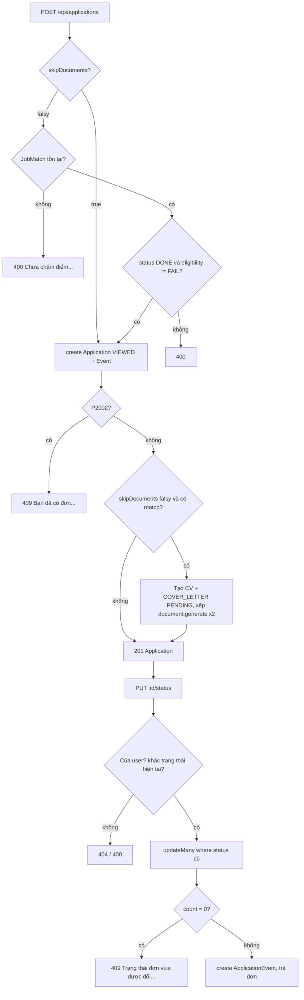
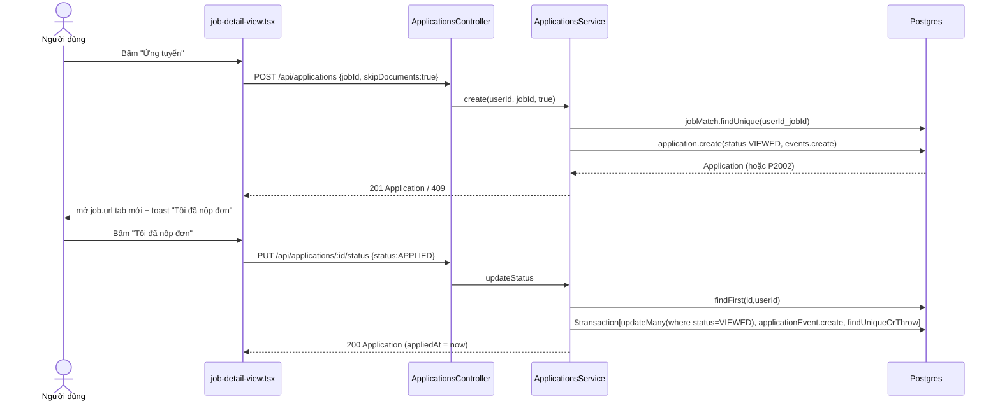
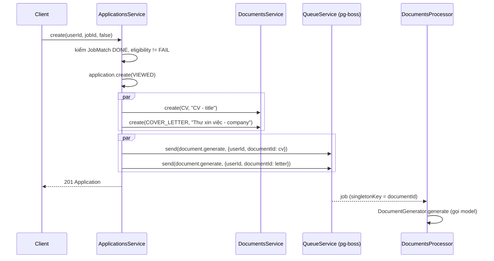
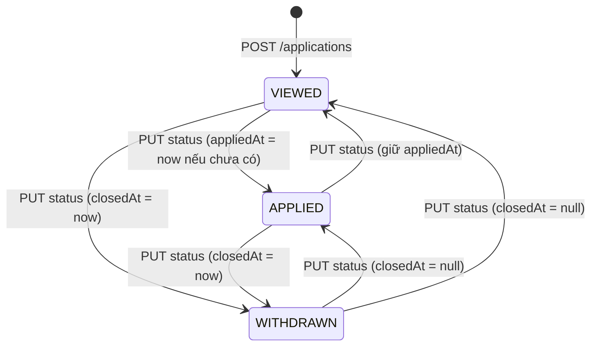

# Applications — Đơn ứng tuyển (Lịch sử ứng tuyển)

> **Phạm vi:** `server/src/modules/applications/**` (controller, service, DTO, `transitions.ts`), bảng `Application`, `ApplicationEvent`, enum `ApplicationStatus`. Màn hình FE: `/dashboard/applications` ("Lịch sử ứng tuyển"), nút "Ứng tuyển" ở `/dashboard/jobs/[id]`, ô ngày phỏng vấn và hộp "Thêm vị trí" ở `/dashboard/interview`.
> **Nguyên tắc:** tài liệu mô tả hệ thống **as-is**. Code là nguồn sự thật duy nhất.

---

## 1. Purpose

| Mục tiêu | Diễn giải |
|---|---|
| Ghi nhận người dùng quan tâm/nộp đơn cho một tin | Mỗi cặp (người dùng, tin tuyển dụng) có tối đa **một** `Application` — ràng buộc unique `(userId, jobId)` ([schema.prisma:983](../../../server/prisma/schema.prisma#L983)). |
| Theo dõi trạng thái đơn | Ba trạng thái `VIEWED` (Đã xem) → `APPLIED` (Đã nộp) → `WITHDRAWN` (Đã hủy), người dùng tự đổi qua lại ([transitions.ts](../../../server/src/modules/applications/transitions.ts)). |
| Ghi nhật ký chuyển trạng thái | Mỗi lần tạo/đổi trạng thái ghi một `ApplicationEvent` (`fromStatus` → `toStatus`, `note`). |
| Mốc thời gian nghiệp vụ | `appliedAt` (lần đầu chuyển sang APPLIED), `closedAt` (lúc chuyển sang trạng thái cuối), `interviewAt` (ngày phỏng vấn người dùng tự ghi). |
| Cung cấp dữ liệu cho module khác | `countsFor` (tổng/đang mở) cho Dashboard; danh sách tin theo trạng thái cho hộp "Thêm vị trí" của Interview; `interview`, `mock-interview` đọc `Application` theo `(userId, jobId)`. |
| (Tuỳ chọn) chuẩn bị tài liệu | Khi tạo đơn **không** kèm `skipDocuments`, backend tạo 1 CV + 1 Thư xin việc và xếp hàng đợi `document.generate` (xem [documents.md](./documents.md)). |

**Điểm mấu chốt:**
- Đơn ứng tuyển là **sổ theo dõi do người dùng tự khai** — hệ thống không nộp đơn hộ, không đồng bộ với portal. "Đã nộp" nghĩa là người dùng bấm "Tôi đã nộp đơn".
- `transitions.ts` **không phải máy trạng thái có ràng buộc**: backend chấp nhận mọi chuyển đổi giữa 3 trạng thái, chỉ chặn "đổi sang chính trạng thái đang có". Danh sách bước tiếp theo (`NEXT_STATUSES`) chỉ có ở FE.
- Đổi trạng thái dùng **giành chỗ có điều kiện** (`updateMany where status = trạng thái vừa đọc`) trong transaction để hai request đồng thời không ghi hai sự kiện từ cùng một trạng thái.
- Luồng FE hiện tại **luôn** tạo đơn với `skipDocuments: true`; nhánh sinh tài liệu tự động chỉ còn reachable khi gọi API trực tiếp.

## 2. Actors

| Actor | Quyền trong module | Ghi chú |
|---|---|---|
| USER (đã đăng nhập) | Tạo đơn, xem danh sách đơn của mình, đổi trạng thái, ghi/xoá ngày phỏng vấn, lấy danh sách tin của các đơn | Mọi truy vấn khoá theo `userId` từ JWT. Không có route `@Public()` nào. |
| ADMIN | Không có route riêng trong module | Admin chỉ thấy **số đếm** `applications` của từng user qua `admin/users` ([admin-users.service.ts](../../../server/src/modules/admin/services/admin-users.service.ts)). |
| Hệ thống — worker `document.generate` | Sinh CV/thư xin việc do `POST /applications` xếp hàng | Thuộc module Documents ([documents.md](./documents.md)). |
| Khách (chưa đăng nhập) | Không có quyền | Guard JWT toàn cục mặc-định-đóng; FE chuyển về `/login?next=…` khi nhận 401 ([job-detail-view.tsx](../../../../ui-ai-job-search/app/dashboard/jobs/[id]/job-detail-view.tsx)). |

## 3. Business Features

| # | Tính năng | Actor | Endpoint / cơ chế |
|---|---|---|---|
| F1 | Tạo đơn ứng tuyển (có/không sinh tài liệu) | USER | `POST /api/applications` |
| F2 | Danh sách đơn (lọc trạng thái, phân trang, kèm CV của tin) | USER | `GET /api/applications` |
| F3 | Danh sách tin của các đơn (đổ ô chọn) | USER | `GET /api/applications/jobs` |
| F4 | Đổi trạng thái đơn + ghi nhật ký | USER | `PUT /api/applications/:id/status` |
| F5 | Ghi/đổi/xoá ngày phỏng vấn | USER | `PUT /api/applications/:id/interview-date` |
| F6 | Đếm đơn tổng/đang mở cho Dashboard | Hệ thống | `ApplicationsService.countsFor` (gọi từ `DashboardService`) |

## 4. Business Flow

### Luồng A — Tạo đơn ứng tuyển (F1)

**Preconditions**
- Người dùng đã đăng nhập (JWT hợp lệ).
- Body hợp lệ theo `CreateApplicationDto`: `jobId` chuỗi ≤ 40 ký tự; `skipDocuments` tuỳ chọn ([applications.dto.ts:13](../../../server/src/modules/applications/applications.dto.ts#L13)).
- Chưa vượt `@ThrottleAi()` — 10 lượt/phút/người dùng ([applications.controller.ts:42](../../../server/src/modules/applications/applications.controller.ts#L42), [throttle.ts](../../../server/src/common/throttle.ts)).

**Main Flow** ([applications.service.ts:44](../../../server/src/modules/applications/applications.service.ts#L44))
1. FE (`/dashboard/jobs/[id]`, nút "Ứng tuyển") gọi `POST /api/applications` `{ jobId, skipDocuments: true }` ([job-detail-view.tsx:84](../../../../ui-ai-job-search/app/dashboard/jobs/[id]/job-detail-view.tsx#L84)).
2. Service đọc `JobMatch` theo `(userId, jobId)` (status, eligibility, overallScore, verdict, job.title/company).
3. Nếu `skipDocuments` **falsy** thì kiểm 3 điều kiện (xem Alternative Flow A1).
4. Tạo `Application` với `status = 'VIEWED'` và nested-create một `ApplicationEvent` (`fromStatus = null`, `toStatus = VIEWED`). Ghi chú sự kiện:
   - có `JobMatch`: `"Tạo đơn từ kết quả chấm điểm {overallScore ?? 0}/100 ({verdict ?? 'chưa có kết luận'})"`;
   - không có: `"Đã xem tin tuyển dụng"`.
5. Trả về `Application` kèm `job` (id, title, company, companyLogo, location, salaryRaw, url) — HTTP 201.
6. FE mở `job.url` ở tab mới và hiện toast "Đã lưu tin này vào Lịch sử ứng tuyển (Đã xem)… bấm **Tôi đã nộp đơn**" → gọi Luồng D với `APPLIED`.

**Alternative Flow**
- **A1 — `skipDocuments` falsy (chỉ khi gọi API trực tiếp):**
  1. Không có `JobMatch` → 400 `"Chưa chấm điểm công việc này. Hãy chạy đánh giá độ phù hợp trước khi tạo đơn."`
  2. `JobMatch.status !== 'DONE'` → 400 `` `Kết quả chấm điểm công việc này chưa xong. Đợi chấm xong, hoặc chấm lại nếu lần trước lỗi, rồi tạo đơn.` ``
  3. `eligibility === 'FAIL'` → 400 `` `Công việc này không đủ điều kiện ứng tuyển: ${eligibilityNote ?? 'tin tuyển dụng đòi điều kiện mà hồ sơ không đáp ứng'}` ``
  4. Sau khi tạo đơn: `prepareDocuments` tạo **song song** 2 `Document` (`CV` tiêu đề `"CV - {title}"`, `COVER_LETTER` tiêu đề `"Thư xin việc - {company}"`) rồi xếp 2 việc `document.generate` ([applications.service.ts:115](../../../server/src/modules/applications/applications.service.ts#L115)).
- **A2 — FE đã có đơn cho tin:** FE không gọi API, chỉ mở `job.url` ([job-detail-view.tsx](../../../../ui-ai-job-search/app/dashboard/jobs/[id]/job-detail-view.tsx)).

**Failure Flow**
- Trùng `(userId, jobId)` → bắt `P2002` bằng `isUniqueViolation` → 409 `"Bạn đã có đơn ứng tuyển cho công việc này"` ([applications.service.ts:94](../../../server/src/modules/applications/applications.service.ts#L94)).
- `jobId` không tồn tại (nhánh `skipDocuments: true`) → vi phạm khoá ngoại `P2003` → `PrismaExceptionFilter` trả 400 `"Dữ liệu tham chiếu không hợp lệ"` ([prisma-exception.filter.ts](../../../server/src/common/filters/prisma-exception.filter.ts)).
- Vượt throttle → 429 `"Bạn thao tác quá nhanh. Hãy đợi một lát rồi thử lại."`.
- FE: lỗi 401 → chuyển `/login?next=/dashboard/jobs/{id}`; lỗi khác → vẫn mở `job.url`.
- Nhánh A1: nếu tạo `Document` hoặc xếp hàng đợi hỏng **sau** khi đơn đã tạo → 500, đơn vẫn tồn tại (không cùng transaction) — xem §17 R3.

**Postconditions**
- 1 `Application` (`VIEWED`) + 1 `ApplicationEvent`. Nhánh A1: thêm 2 `Document` `PENDING` và 2 việc trong hàng đợi `document.generate`.

### Luồng B — Xem danh sách đơn (F2)

**Preconditions:** đã đăng nhập; query hợp lệ (`status` ∈ ALL_STATUSES, `limit` 1–100, `offset` 0–100000).

**Main Flow** ([applications.service.ts:157](../../../server/src/modules/applications/applications.service.ts#L157))
1. FE `/dashboard/applications` gọi `GET /api/applications?limit=&offset=&status=` ([applications-view.tsx](../../../../ui-ai-job-search/app/dashboard/applications/applications-view.tsx)).
2. Trong `$transaction` gồm `findMany` + `count`, `where = { userId, status? }`, sắp `updatedAt desc`, mặc định 20 dòng.
3. Mỗi đơn kèm `job` (APPLICATION_JOB) và `documents` = các `Document` kind `CV` **của chính user** cho tin đó, sắp `status asc, createdAt desc`.
4. Trả `{ items, total, limit, offset }`.
5. FE hiển thị cột CV: có CV `DONE` → nút mở PDF (`GET /documents/:id/pdf`, in bằng HTML/Chromium theo mẫu đã chọn *(2026-10-19)*); có CV `PENDING/RUNNING` → "Đang viết CV…"; không có → nút "Tạo CV cho tin này" (`POST /documents/cv { jobId }`).

**Alternative Flow:** không truyền `status` → mọi trạng thái.
**Failure Flow:** query sai → 400 (ValidationPipe, thông điệp tiếng Việt qua `vietnameseValidationError`), ví dụ `status` lạ.
**Postconditions:** không ghi gì (đường đọc, không gọi AI).

### Luồng C — Danh sách tin của đơn (F3)

**Preconditions:** đã đăng nhập; `status` tuỳ chọn ∈ ALL_STATUSES.
**Main Flow** ([applications.service.ts:140](../../../server/src/modules/applications/applications.service.ts#L140))
1. Hộp "Thêm vị trí" ở trang Phỏng vấn gọi `GET /api/applications/jobs?status=APPLIED` ([add-position-modal.tsx:59](../../../../ui-ai-job-search/app/dashboard/interview/add-position-modal.tsx#L59)).
2. `findMany where { userId, status? }` sắp `updatedAt desc`, **không phân trang**.
3. Trả mảng `{ jobId, title, company, companyLogo }`.

**Alternative Flow:** không có `status` → mọi đơn.
**Failure Flow:** `status` lạ → 400.
**Postconditions:** không ghi.

### Luồng D — Đổi trạng thái đơn (F4)

**Preconditions:** đã đăng nhập; body `UpdateStatusDto` hợp lệ (`status` ∈ `VIEWED|APPLIED|WITHDRAWN`, `note` ≤ 1000 ký tự).

**Main Flow** ([applications.service.ts:193](../../../server/src/modules/applications/applications.service.ts#L193))
1. FE gọi `PUT /api/applications/:id/status { status, note? }` (dropdown ở Lịch sử ứng tuyển hoặc "Tôi đã nộp đơn" trong toast).
2. `findFirst where { id, userId }` — không thấy → 404 `"Không tìm thấy đơn ứng tuyển"`.
3. `status` trùng trạng thái hiện tại → 400 `Đơn đã ở đúng trạng thái này rồi, không cần đổi lại.` *(2026-10-26: trước đó lộ tên enum)*.
4. Tính mốc thời gian bằng `timestampsFor` ([transitions.ts:20](../../../server/src/modules/applications/transitions.ts#L20)):
   - `appliedAt` = `now` nếu chuyển sang `APPLIED` **và** chưa có `appliedAt`; ngược lại giữ giá trị cũ (kể cả khi lùi về VIEWED/WITHDRAWN).
   - `closedAt` = `now` nếu trạng thái đích là trạng thái cuối (`WITHDRAWN`), ngược lại `null` (mở lại đơn xoá ngày đóng).
5. Trong `$transaction`: `updateMany where { id, userId, status: <trạng thái vừa đọc> }`; `count === 0` → 409 `"Trạng thái đơn vừa được đổi ở nơi khác. Hãy tải lại rồi thử lại."`.
6. Tạo `ApplicationEvent { fromStatus, toStatus, note }`.
7. Trả đơn mới kèm `job` (không kèm mô tả tin hay nhật ký).
8. FE invalidate cache `applicationStatus` và chi tiết tin.

**Alternative Flow:** người dùng mở lại đơn `WITHDRAWN` → `APPLIED`/`VIEWED` được chấp nhận; `closedAt` về `null`.
**Failure Flow:** 404 (không phải chủ đơn hoặc không tồn tại), 400 (trùng trạng thái / DTO sai), 409 (thua tranh chấp). FE hiện nguyên câu lỗi dưới dòng đơn ("Không đổi được trạng thái" nếu không có câu).
**Postconditions:** `status`, `appliedAt`, `closedAt`, `updatedAt` cập nhật; thêm đúng 1 `ApplicationEvent`.

### Luồng E — Ghi/xoá ngày phỏng vấn (F5)

**Preconditions:** đã đăng nhập; body `{ interviewAt: string ISO 8601 (strict) | null }`.
**Main Flow** ([applications.service.ts:242](../../../server/src/modules/applications/applications.service.ts#L242))
1. Trang Phỏng vấn gọi `PUT /api/applications/:id/interview-date`; FE gửi ngày người dùng chọn lúc 09:00 giờ máy (`new Date(\`$\{date\}T09:00:00\`).toISOString()`) hoặc `null` ([interview-date.tsx:40](../../../../ui-ai-job-search/app/dashboard/interview/interview-date.tsx#L40)).
2. Controller đổi chuỗi thành `Date` (hoặc giữ `null`) ([applications.controller.ts:71](../../../server/src/modules/applications/applications.controller.ts#L71)).
3. `updateMany where { id, userId } data { interviewAt }`; `count = 0` → 404 `"Không tìm thấy đơn ứng tuyển"`.
4. Trả đơn kèm `job`.

**Alternative Flow:** `interviewAt: null` → xoá ngày.
**Failure Flow:** chuỗi không phải ISO 8601 hoặc thiếu trường → 400 `"Ngày phỏng vấn phải là chuỗi ISO 8601 hoặc null"`.
**Postconditions:** chỉ `interviewAt` đổi; **không** ghi `ApplicationEvent`, không ràng buộc với `status` (comment schema: "không ràng buộc với trạng thái đơn").

### Luồng F — Đếm đơn cho Dashboard (F6)

**Preconditions:** được gọi bởi `DashboardService` ([dashboard.service.ts](../../../server/src/modules/dashboard/dashboard.service.ts)).
**Main Flow:** `groupBy status where { userId }`; `total` = tổng; `active` = tổng các nhóm **không** thuộc `FINAL_STATUSES` (tức VIEWED + APPLIED) ([applications.service.ts:255](../../../server/src/modules/applications/applications.service.ts#L255)).
**Alternative / Failure Flow:** không có — lỗi DB lan lên route Dashboard.
**Postconditions:** không ghi.

## 5. Mermaid Flowchart

## 6. Sequence Diagram

### Nút "Ứng tuyển" trên trang chi tiết tin

### Tạo đơn kèm sinh tài liệu (gọi API trực tiếp, `skipDocuments` vắng)

## 7. Business Rules

| Mã BR | Quy tắc | Nơi thực thi | Mức | Nguồn code |
|---|---|---|---|---|
| BR-APP-01 | Mỗi người dùng có tối đa một đơn cho một tin; tạo trùng trả 409 "Bạn đã có đơn ứng tuyển cho công việc này". | DB + SV | 🔒 Cứng | [schema.prisma:983](../../../server/prisma/schema.prisma#L983), [applications.service.ts:94](../../../server/src/modules/applications/applications.service.ts#L94) |
| BR-APP-02 | Đơn mới luôn bắt đầu ở `VIEWED` và kèm một sự kiện nhật ký `fromStatus = null`. | SV | ✅ Mềm | [applications.service.ts:75](../../../server/src/modules/applications/applications.service.ts#L75) |
| BR-APP-03 | Khi tạo đơn mà không bỏ qua tài liệu, tin phải đã được chấm điểm (`JobMatch` tồn tại) với `status = DONE`. | SV | ✅ Mềm | [applications.service.ts:57](../../../server/src/modules/applications/applications.service.ts#L57) |
| BR-APP-04 | Khi tạo đơn mà không bỏ qua tài liệu, tin có `eligibility = FAIL` bị từ chối kèm lý do `eligibilityNote`. | SV | ✅ Mềm | [applications.service.ts:68](../../../server/src/modules/applications/applications.service.ts#L68) |
| BR-APP-05 | `skipDocuments: true` bỏ qua cả ba kiểm tra chấm điểm và không sinh tài liệu — đơn chỉ là dấu "đã xem tin". | SV | ✅ Mềm | [applications.service.ts:57](../../../server/src/modules/applications/applications.service.ts#L57), [applications.service.ts:103](../../../server/src/modules/applications/applications.service.ts#L103) |
| BR-APP-06 | Tạo đơn không bỏ qua tài liệu sinh đồng thời 1 CV ("CV - \{title\}") và 1 Thư xin việc ("Thư xin việc - \{company\}") qua hàng đợi `document.generate`. | SV | ✅ Mềm | [applications.service.ts:115](../../../server/src/modules/applications/applications.service.ts#L115) |
| BR-APP-07 | `POST /applications` chịu throttle như route gọi model: 10 lượt/phút/người dùng. | GD | ✅ Mềm | [applications.controller.ts:42](../../../server/src/modules/applications/applications.controller.ts#L42), [throttle.ts](../../../server/src/common/throttle.ts) |
| BR-APP-08 | Tập trạng thái hợp lệ là `VIEWED`, `APPLIED` (mở) và `WITHDRAWN` (cuối); giá trị khác bị DTO từ chối. | DTO | ✅ Mềm | [transitions.ts:3](../../../server/src/modules/applications/transitions.ts#L3), [applications.dto.ts:32](../../../server/src/modules/applications/applications.dto.ts#L32) |
| BR-APP-09 | Không được đổi sang chính trạng thái đang có (400 "Đơn đã ở đúng trạng thái này rồi…", không lộ tên trạng thái); mọi chuyển đổi khác giữa ba trạng thái đều được phép, kể cả mở lại đơn đã hủy. | SV | ✅ Mềm | [applications.service.ts:205](../../../server/src/modules/applications/applications.service.ts#L205) |
| BR-APP-10 | `appliedAt` chỉ được ghi ở lần **đầu tiên** chuyển sang `APPLIED` và không bị xoá khi lùi trạng thái. | SV | ✅ Mềm | [transitions.ts:26](../../../server/src/modules/applications/transitions.ts#L26) |
| BR-APP-11 | `closedAt` = thời điểm chuyển sang trạng thái cuối (`WITHDRAWN`); chuyển sang trạng thái mở thì `closedAt` về `null`. | SV | ✅ Mềm | [transitions.ts:30](../../../server/src/modules/applications/transitions.ts#L30) |
| BR-APP-12 | Đổi trạng thái là giành chỗ có điều kiện theo trạng thái vừa đọc; thua tranh chấp trả 409, không ghi sự kiện thứ hai. | SV | ✅ Mềm | [applications.service.ts:215](../../../server/src/modules/applications/applications.service.ts#L215) |
| BR-APP-13 | Mỗi lần đổi trạng thái thành công ghi đúng một `ApplicationEvent` (from, to, note) trong cùng transaction. | SV | ✅ Mềm | [applications.service.ts:226](../../../server/src/modules/applications/applications.service.ts#L226) |
| BR-APP-14 | Ngày phỏng vấn độc lập với trạng thái đơn, nhận ISO 8601 hoặc `null` (xoá), không ghi nhật ký. | DTO + SV | ✅ Mềm | [applications.dto.ts:42](../../../server/src/modules/applications/applications.dto.ts#L42), [applications.service.ts:242](../../../server/src/modules/applications/applications.service.ts#L242) |
| BR-APP-15 | "Đơn đang mở" (Dashboard) = đơn không ở trạng thái cuối, tức `VIEWED` + `APPLIED`. | SV | ✅ Mềm | [applications.service.ts:255](../../../server/src/modules/applications/applications.service.ts#L255), [transitions.ts:12](../../../server/src/modules/applications/transitions.ts#L12) |
| BR-APP-16 | Danh sách đơn kèm CV của chính người dùng cho tin đó (CV của người khác cùng tin không lộ), sắp theo trạng thái rồi mới nhất. | SV | ✅ Mềm | [applications.service.ts:173](../../../server/src/modules/applications/applications.service.ts#L173) |
| BR-APP-17 | Danh sách đơn và danh sách tin sắp theo `updatedAt` giảm dần (đơn vừa đổi lên đầu). | SV | ✅ Mềm | [applications.service.ts:143](../../../server/src/modules/applications/applications.service.ts#L143), [applications.service.ts:167](../../../server/src/modules/applications/applications.service.ts#L167) |
| BR-APP-18 | Bước tiếp theo hiển thị trong dropdown: VIEWED→\{APPLIED, WITHDRAWN\}, APPLIED→\{WITHDRAWN, VIEWED\}, WITHDRAWN→\{APPLIED, VIEWED\}. | FE | ⚠️ Chỉ frontend | [application-status.ts](../../../../ui-ai-job-search/lib/application-status.ts) |
| BR-APP-19 | Xoá tin hoặc xoá người dùng thì xoá theo (Cascade) các đơn và nhật ký của chúng. | DB | 🔒 Cứng | [schema.prisma:960](../../../server/prisma/schema.prisma#L960), [schema.prisma:994](../../../server/prisma/schema.prisma#L994) |

> **Possible Business Rule:** Khi người dùng lùi đơn từ `APPLIED` về `VIEWED`, `appliedAt` vẫn giữ — Dashboard đếm "hoạt động nộp đơn 30 ngày" theo `appliedAt` nên vẫn tính đơn này. Cần xác nhận đây là ý đồ ("đã từng nộp") hay nên xoá `appliedAt`.

> **Possible Business Rule:** `ApplicationEvent` được thiết kế cho câu hỏi "đơn này im lặng bao lâu rồi" (comment schema), nhưng hiện chưa route nào đọc nhật ký; `mock-interview` tính `quietDays` từ `appliedAt`/`updatedAt` thay vì từ nhật ký.

## 8. Validation Rules

### `CreateApplicationDto` ([applications.dto.ts:13](../../../server/src/modules/applications/applications.dto.ts#L13))

| Field | Ràng buộc | DTO/Schema | Lỗi trả về |
|---|---|---|---|
| `jobId` | bắt buộc, `@IsString`, `@MaxLength(40)` | CreateApplicationDto | 400 (thông điệp dịch qua `vietnameseValidationError`, nhãn "Công việc") |
| `skipDocuments` | `@IsOptional` — **không có validator kiểu** | CreateApplicationDto | Không bao giờ lỗi; giá trị truthy bất kỳ được coi là bỏ qua (xem R1) |
| trường lạ | `forbidNonWhitelisted` | ValidationPipe toàn cục | 400 "`<trường>` không phải là trường hợp lệ" |

### `ListApplicationsDto` / `ApplicationJobsDto` ([applications.dto.ts:20](../../../server/src/modules/applications/applications.dto.ts#L20))

| Field | Ràng buộc | DTO/Schema | Lỗi trả về |
|---|---|---|---|
| `status` | tuỳ chọn, `@IsIn(ALL_STATUSES)` | cả hai DTO | 400 "… chỉ nhận một trong các giá trị: VIEWED, APPLIED, WITHDRAWN" |
| `limit` | tuỳ chọn, số nguyên 1–100 (mặc định 20) | PaginationQueryDto (chỉ List) | 400 |
| `offset` | tuỳ chọn, số nguyên 0–100000 | PaginationQueryDto (chỉ List) | 400 |

### `UpdateStatusDto` ([applications.dto.ts:32](../../../server/src/modules/applications/applications.dto.ts#L32))

| Field | Ràng buộc | DTO/Schema | Lỗi trả về |
|---|---|---|---|
| `status` | bắt buộc, `@IsIn(ALL_STATUSES)` | UpdateStatusDto | 400 |
| `note` | tuỳ chọn, chuỗi ≤ 1000 ký tự | UpdateStatusDto | 400 |

### `InterviewDateDto` ([applications.dto.ts:42](../../../server/src/modules/applications/applications.dto.ts#L42))

| Field | Ràng buộc | DTO/Schema | Lỗi trả về |
|---|---|---|---|
| `interviewAt` | `null` hoặc chuỗi `@IsISO8601({strict:true})`; vắng mặt cũng bị kiểm (undefined ≠ null) | InterviewDateDto | 400 "Ngày phỏng vấn phải là chuỗi ISO 8601 hoặc null" |

## 9. API Mapping

| Method | URL | Role | Mục đích nghiệp vụ | Controller#method | Service | DTO | Response |
|---|---|---|---|---|---|---|---|
| GET | `/api/applications` | USER | Danh sách đơn + CV của tin | `ApplicationsController#list` | `ApplicationsService.list` | `ListApplicationsDto` (query) | `Page<Application & {job, documents}>` |
| GET | `/api/applications/jobs` | USER | Tin của các đơn để đổ ô chọn | `ApplicationsController#jobs` | `ApplicationsService.jobOptions` | `ApplicationJobsDto` (query) | `{jobId,title,company,companyLogo}[]` |
| POST | `/api/applications` | USER (`@ThrottleAi` 10/phút) | Tạo đơn, tuỳ chọn sinh CV + thư | `ApplicationsController#create` | `ApplicationsService.create` | `CreateApplicationDto` | 201 `Application & {job}` |
| PUT | `/api/applications/:id/status` | USER | Đổi trạng thái + ghi nhật ký | `ApplicationsController#updateStatus` | `ApplicationsService.updateStatus` | `UpdateStatusDto` | 200 `Application & {job}` |
| PUT | `/api/applications/:id/interview-date` | USER | Ghi/xoá ngày phỏng vấn | `ApplicationsController#setInterviewDate` | `ApplicationsService.setInterviewDate` | `InterviewDateDto` | 200 `Application & {job}` |

Nguồn: [applications.controller.ts](../../../server/src/modules/applications/applications.controller.ts).

**Endpoint ở module khác tác động lên / đọc module này**

| Endpoint | Module | Tác động |
|---|---|---|
| `GET /api/dashboard` | Dashboard | Gọi `countsFor` (tổng/đang mở), đếm đơn `APPLIED`, đọc `appliedAt` 30 ngày ([dashboard.service.ts](../../../server/src/modules/dashboard/dashboard.service.ts)) |
| `GET /api/interview`, `GET /api/interview/:jobId` | Interview | Đọc `Application` theo `(userId, jobId)` để hiện trạng thái đơn và ngày phỏng vấn ([interview.service.ts](../../../server/src/modules/interview/interview.service.ts)) — xem [interview-prep.md](./interview-prep.md) |
| Các route `/api/mock-interviews/*` | Mock interview | Đọc `status`, `appliedAt`, `updatedAt` để tính `quietDays` ([mock-interview.service.ts](../../../server/src/modules/mock-interview/services/mock-interview.service.ts)) — xem [mock-interview.md](./mock-interview.md) |
| `GET /api/admin/users`, `GET /api/admin/users/:id` | Admin | Đếm `_count.applications` mỗi user ([admin-users.service.ts](../../../server/src/modules/admin/services/admin-users.service.ts)) |
| `POST /api/documents/cv` | Documents | Nút "Tạo CV cho tin này" ở Lịch sử ứng tuyển — xem [documents.md](./documents.md) |
| `GET /api/documents/:id/pdf` | Documents | Nút mở CV của đơn (in bằng HTML/Chromium, không còn tham số `engine` *(2026-10-19)*) |

## 10. Frontend Mapping

| Route FE | Vai trò | Mục đích | Hook / API client |
|---|---|---|---|
| `/dashboard/applications` ([page.tsx](../../../../ui-ai-job-search/app/dashboard/applications/page.tsx), [applications-view.tsx](../../../../ui-ai-job-search/app/dashboard/applications/applications-view.tsx)) | USER | "Lịch sử ứng tuyển": bảng đơn, lọc trạng thái, đổi trạng thái, mở/tạo CV cho tin | `useApiQuery(keys.applicationList)` → `applicationsService.list`, `.updateStatus`; `documentsService.pdf`, `.createCv` |
| `/dashboard/jobs/[id]` ([job-detail-view.tsx](../../../../ui-ai-job-search/app/dashboard/jobs/[id]/job-detail-view.tsx)) | USER | Nút "Ứng tuyển" (tạo đơn `skipDocuments: true`) và "Tôi đã nộp đơn" | `applicationsService.create`, `.updateStatus` |
| `/dashboard/interview` — hộp "Thêm vị trí" ([add-position-modal.tsx](../../../../ui-ai-job-search/app/dashboard/interview/add-position-modal.tsx)) | USER | Chọn tin từ các đơn `APPLIED` | `applicationsService.jobs("APPLIED")` |
| `/dashboard/interview` — ô ngày phỏng vấn ([interview-date.tsx](../../../../ui-ai-job-search/app/dashboard/interview/interview-date.tsx)) | USER | Ghi/xoá ngày phỏng vấn | `applicationsService.setInterviewDate` |

Nhãn hiển thị: `VIEWED` "Đã xem", `APPLIED` "Đã nộp", `WITHDRAWN` "Đã hủy" ([application-status.ts](../../../../ui-ai-job-search/lib/application-status.ts)). API client: [services/applications.ts](../../../../ui-ai-job-search/services/applications.ts).

## 11. Database

### `applications` — model `Application` ([schema.prisma:960](../../../server/prisma/schema.prisma#L960))

| Field | Kiểu | Ghi chú |
|---|---|---|
| `id` | String cuid | PK |
| `userId` | String | FK `User`, `onDelete: Cascade` |
| `jobId` | String | FK `Job`, `onDelete: Cascade` |
| `status` | `ApplicationStatus` | mặc định `VIEWED` |
| `appliedAt` | DateTime? | lần đầu sang APPLIED |
| `closedAt` | DateTime? | lúc sang trạng thái cuối |
| `interviewAt` | DateTime? | người dùng tự ghi |
| `createdAt` / `updatedAt` | DateTime | `updatedAt` tự cập nhật |

Index: `@@unique([userId, jobId])`; `@@index([userId, status, updatedAt desc])` (danh sách lọc trạng thái); `@@index([jobId])`.
Thiết kế cố ý **không** có cột `cvDocumentId`/`coverLetterDocumentId`/`interviewPrepId` — tài liệu của đơn suy ra bằng truy vấn theo `(userId, jobId)` (comment schema).

### `application_events` — model `ApplicationEvent` ([schema.prisma:994](../../../server/prisma/schema.prisma#L994))

| Field | Kiểu | Ghi chú |
|---|---|---|
| `id` | String cuid | PK |
| `applicationId` | String | FK `Application`, `onDelete: Cascade` |
| `fromStatus` | `ApplicationStatus?` | `null` ở sự kiện tạo đơn |
| `toStatus` | `ApplicationStatus` | |
| `note` | Text? | ghi chú người dùng hoặc ghi chú tự sinh lúc tạo |
| `createdAt` | DateTime | |

Index: `@@index([applicationId, createdAt])`.

### Enum `ApplicationStatus` ([schema.prisma:945](../../../server/prisma/schema.prisma#L945))
`VIEWED` (đã xem tin, chưa nộp) · `APPLIED` (đã nộp, chờ hồi âm) · `WITHDRAWN` (đã hủy — tự rút hoặc thôi theo).

## 12. State Machine

| Từ → Sang | Trigger | Điều kiện | Side effect |
|---|---|---|---|
| (không) → VIEWED | `POST /applications` | Không trùng `(userId, jobId)`; nếu không `skipDocuments`: match DONE, eligibility ≠ FAIL | Event `null→VIEWED`; nhánh A1 xếp 2 tài liệu |
| VIEWED → APPLIED | `PUT :id/status` | Chủ đơn; status hiện tại vẫn là VIEWED lúc ghi | `appliedAt = now` nếu null; `closedAt = null`; event |
| VIEWED → WITHDRAWN | `PUT :id/status` | như trên | `closedAt = now`; event |
| APPLIED → WITHDRAWN | `PUT :id/status` | như trên | `closedAt = now`; event |
| APPLIED → VIEWED | `PUT :id/status` | như trên | giữ `appliedAt`; `closedAt = null`; event |
| WITHDRAWN → APPLIED | `PUT :id/status` | như trên | `appliedAt` giữ hoặc = now nếu chưa từng nộp; `closedAt = null`; event |
| WITHDRAWN → VIEWED | `PUT :id/status` | như trên | `closedAt = null`; event |
| X → X | `PUT :id/status` | — | **Bị từ chối** 400 "Đơn đã ở đúng trạng thái này rồi…" |

Không có trạng thái nào do hệ thống tự chuyển (không cron, không worker). Bảng không có `MatchStatus` nên không thuộc `ReconcileService`.

## 13. Exceptions

| Tình huống | HTTP | Thông điệp nguyên văn | Nguồn |
|---|---|---|---|
| Tạo đơn (không skip) khi chưa có JobMatch | 400 | `Chưa chấm điểm công việc này. Hãy chạy đánh giá độ phù hợp trước khi tạo đơn.` | [applications.service.ts:59](../../../server/src/modules/applications/applications.service.ts#L59) |
| JobMatch chưa DONE | 400 | `Kết quả chấm điểm công việc này chưa xong. Đợi chấm xong, hoặc chấm lại nếu lần trước lỗi, rồi tạo đơn.` | [applications.service.ts:64](../../../server/src/modules/applications/applications.service.ts#L64) |
| Eligibility FAIL | 400 | `Công việc này không đủ điều kiện ứng tuyển: ${match.eligibilityNote ?? 'tin tuyển dụng đòi điều kiện mà hồ sơ không đáp ứng'}` | [applications.service.ts:69](../../../server/src/modules/applications/applications.service.ts#L69) |
| Đơn trùng | 409 | `Bạn đã có đơn ứng tuyển cho công việc này` | [applications.service.ts:96](../../../server/src/modules/applications/applications.service.ts#L96) |
| `jobId` không tồn tại (P2003) | 400 | `Dữ liệu tham chiếu không hợp lệ` | [prisma-exception.filter.ts](../../../server/src/common/filters/prisma-exception.filter.ts) |
| Đơn không tồn tại / của người khác (đổi trạng thái, ngày PV) | 404 | `Không tìm thấy đơn ứng tuyển` | [applications.service.ts:203](../../../server/src/modules/applications/applications.service.ts#L203), [applications.service.ts:247](../../../server/src/modules/applications/applications.service.ts#L247) |
| Đổi sang trạng thái đang có | 400 | `Đơn đã ở đúng trạng thái này rồi, không cần đổi lại.` | [applications.service.ts:206](../../../server/src/modules/applications/applications.service.ts#L206) |
| Thua tranh chấp đổi trạng thái | 409 | `Trạng thái đơn vừa được đổi ở nơi khác. Hãy tải lại rồi thử lại.` | [applications.service.ts:221](../../../server/src/modules/applications/applications.service.ts#L221) |
| Ngày phỏng vấn sai định dạng | 400 | `Ngày phỏng vấn phải là chuỗi ISO 8601 hoặc null` | [applications.dto.ts:46](../../../server/src/modules/applications/applications.dto.ts#L46) |
| Vượt throttle `POST /applications` | 429 | `Bạn thao tác quá nhanh. Hãy đợi một lát rồi thử lại.` | [app.module.ts](../../../server/src/app.module.ts) |
| Thiếu/sai token | 401 | (guard JWT toàn cục — xem [auth.md](./auth.md)) | — |

## 14. Notifications

Không có. Module không gửi email/push/in-app notification; phản hồi duy nhất là toast phía FE ("Đã lưu tin này vào Lịch sử ứng tuyển…", lỗi đổi trạng thái hiện dưới dòng đơn) ([job-detail-view.tsx](../../../../ui-ai-job-search/app/dashboard/jobs/[id]/job-detail-view.tsx), [applications-view.tsx](../../../../ui-ai-job-search/app/dashboard/applications/applications-view.tsx)).

## 15. Integrations

| Tích hợp | Cách dùng | Nguồn |
|---|---|---|
| Module Documents (`DocumentsService.create`) | Tạo 2 `Document` khi tạo đơn không skip | [applications.service.ts:121](../../../server/src/modules/applications/applications.service.ts#L121) |
| Hàng đợi pg-boss `document.generate` | Xếp 2 việc sinh tài liệu, `singletonKey = documentId`, concurrency 8 | [queue.service.ts](../../../server/src/modules/queue/queue.service.ts), [queue.defaults.ts](../../../server/src/modules/queue/queue.defaults.ts) |
| Bảng `JobMatch` (module Matching) | Đọc điều kiện tạo đơn (status, eligibility, điểm, verdict) — chỉ đọc, không gọi AI | [applications.service.ts:45](../../../server/src/modules/applications/applications.service.ts#L45), xem [matching.md](./matching.md) |

Không gọi dịch vụ ngoài trực tiếp.

## 16. Security

- **Xác thực:** guard JWT toàn cục mặc-định-đóng; controller không có `@Public()`, không gắn lại `@UseGuards` ([applications.controller.ts](../../../server/src/modules/applications/applications.controller.ts)).
- **Kiểm sở hữu:** mọi truy vấn khoá `userId` từ `@CurrentUser()`; đổi trạng thái đọc `findFirst {id, userId}` rồi ghi `updateMany {id, userId, status}`; ngày phỏng vấn ghi `updateMany {id, userId}`. Đơn người khác → 404 (không lộ tồn tại). e2e: "không đổi được trạng thái đơn của người khác", "danh sách đơn chỉ kèm CV của chính mình", "không thấy đơn của người khác" ([applications.e2e-spec.ts](../../../server/test/applications.e2e-spec.ts)).
- **Lưu ý:** bước đọc lại sau ghi (`findUniqueOrThrow({ where: { id } })`) không kèm `userId`, nhưng chỉ chạy sau khi lệnh ghi có `userId` đã thành công.
- **Rate limit:** `POST /applications` 10/phút/người dùng (`@ThrottleAi`, e2e [applications-throttle.e2e-spec.ts](../../../server/test/applications-throttle.e2e-spec.ts)); các route khác theo throttle toàn cục (mặc định 120 lượt/60 giây, tracker theo `user:<id>`).
- **Dữ liệu trả ra:** response chỉ kèm phần tin cần để vẽ dòng (`APPLICATION_JOB`), không kèm mô tả tin hay nhật ký (e2e "response chỉ kèm phần tin để vẽ dòng").
- **Dữ liệu nhạy cảm:** `note` là chữ người dùng tự gõ, lưu Text, không trả lại qua API nào.

## 17. ⚠️ Sai lệch / Rủi ro nghiệp vụ

### R1 — `skipDocuments` không có validator kiểu
- **Mô tả:** Trường chỉ có `@IsOptional()`, không có `@IsBoolean()`. Mọi giá trị truthy (kể cả chuỗi `"false"`, số `1`) được coi là bỏ qua kiểm tra chấm điểm.
- **Bằng chứng:** [applications.dto.ts:16](../../../server/src/modules/applications/applications.dto.ts#L16), [applications.service.ts:57](../../../server/src/modules/applications/applications.service.ts#L57).
- **Tác động:** Thấp — chỉ ảnh hưởng client gọi API trực tiếp; không vượt quyền.
- **Đề xuất:** thêm `@IsBoolean()`.
- **Mức đề xuất:** 🟢

### R2 — `transitions.ts` không ràng buộc chuyển trạng thái; comment schema lệch với enum
- **Mô tả:** Backend cho mọi chuyển đổi giữa 3 trạng thái (trừ trùng). Comment schema còn nhắc trạng thái không tồn tại: `closedAt` "HIRED / REJECTED / NO_RESPONSE", `appliedAt` "nằm ở RANKED".
- **Bằng chứng:** [transitions.ts](../../../server/src/modules/applications/transitions.ts), [schema.prisma:970](../../../server/prisma/schema.prisma#L970)–[schema.prisma:975](../../../server/prisma/schema.prisma#L975).
- **Tác động:** Người đọc tưởng có máy trạng thái chặt; luật bước tiếp theo chỉ có ở FE (BR-APP-18).
- **Đề xuất:** cập nhật comment schema; xác nhận với chủ dự án rằng chuyển tự do là chủ ý (e2e "người dùng mở lại được đơn đã đóng" cho thấy là chủ ý).
- **Mức đề xuất:** 🟢

### R3 — Tạo đơn và chuẩn bị tài liệu không nguyên tử; tài liệu luôn tạo mới
- **Mô tả:** Nhánh không skip tạo `Application` trước, rồi mới `documents.create` ×2 và `queue.send` ×2 ngoài transaction. Lỗi ở bước sau → client nhận 500 dù đơn đã tạo; gọi lại thì 409. Ngoài ra luôn tạo CV + thư mới dù người dùng đã có CV cho tin đó.
- **Bằng chứng:** [applications.service.ts:77](../../../server/src/modules/applications/applications.service.ts#L77)–[applications.service.ts:110](../../../server/src/modules/applications/applications.service.ts#L110), [applications.service.ts:115](../../../server/src/modules/applications/applications.service.ts#L115).
- **Tác động:** Hiện thấp vì FE luôn gửi `skipDocuments: true`; nếu bỏ skip sẽ có đơn "mồ côi tài liệu". (Tài liệu `PENDING` mà không vào được hàng đợi sẽ được `ReconcileService` nhặt sau 10 phút.)
- **Đề xuất:** xác nhận nhánh này còn dùng không; nếu không, gỡ; nếu có, ghi rõ hành vi khi lỗi.
- **Mức đề xuất:** 🟡

### R4 — Nhật ký `ApplicationEvent` chỉ ghi, không có đường đọc
- **Mô tả:** Không route/service nào đọc `ApplicationEvent`; ngày phỏng vấn cũng không ghi nhật ký.
- **Bằng chứng:** grep `applicationEvent` trong `server/src/modules` chỉ thấy lệnh ghi ở [applications.service.ts:226](../../../server/src/modules/applications/applications.service.ts#L226) và nested create ở dòng 83.
- **Tác động:** Dữ liệu tích luỹ nhưng người dùng không xem được lịch sử; "im lặng bao lâu" đang tính bằng cột khác.
- **Đề xuất:** quyết định có hiển thị lịch sử không; nếu không thì ghi rõ mục đích lưu.
- **Mức đề xuất:** 🟢

### R5 — `appliedAt` không bị xoá khi lùi trạng thái
- **Mô tả:** `APPLIED → VIEWED/WITHDRAWN` giữ `appliedAt`. Dashboard đếm hoạt động nộp đơn 30 ngày theo `appliedAt`, trong khi chỉ số "đã nộp" lại đếm theo `status = APPLIED` → hai số có thể lệch nhau.
- **Bằng chứng:** [transitions.ts:26](../../../server/src/modules/applications/transitions.ts#L26), [dashboard.service.ts](../../../server/src/modules/dashboard/dashboard.service.ts) (`application.count where status APPLIED` và `findMany where appliedAt >= monthAgo`).
- **Tác động:** Hiển thị lệch nhẹ trên Dashboard.
- **Đề xuất:** xác nhận nghĩa nghiệp vụ (xem Possible Business Rule ở §7).
- **Mức đề xuất:** 🟢

### R6 — Nút CV ở Lịch sử ứng tuyển hiện tiêu đề rỗng và in PDF bằng LaTeX
- *(2026-10-19)* Phần "in PDF bằng LaTeX" đã hết: backend mặc định in CV bằng `html` ([documents.md#R2](./documents.md)); phần tiêu đề rỗng vẫn còn.
- ✅ **Đã sửa 2026-10-19 (phần LaTeX):** LaTeX đã gỡ hẳn — `GET /api/documents/:id/pdf` không còn tham số `engine`, mọi tài liệu in bằng HTML/Chromium ([documents.service.ts:308](../../../server/src/modules/documents/services/documents.service.ts#L308)). Phần tiêu đề rỗng vẫn còn.
- **Mô tả:** CV tạo qua `POST /documents/cv` có `title = ''`; bảng đơn hiển thị nguyên `cv.title` làm nhãn nút → nút không có chữ. (Trước 2026-10-19: nút gọi `documentsService.pdf(id)` không truyền `engine` nên in bằng LaTeX, bỏ qua mẫu/bố cục/mục ẩn — nay đã hết.)
- **Bằng chứng:** [documents.service.ts:95](../../../server/src/modules/documents/services/documents.service.ts#L95) (`this.create(userId, 'CV', '', …)`), [applications-view.tsx:107](../../../../ui-ai-job-search/app/dashboard/applications/applications-view.tsx#L107), [documents.controller.ts:130](../../../server/src/modules/documents/documents.controller.ts#L130).
- **Tác động:** Nút mở PDF không có nhãn chữ. (Phần "tải về bản CV khác với bản đã thiết kế" đã hết cùng LaTeX — [documents.md](./documents.md) R2.)
- **Đề xuất:** dùng nhãn dự phòng khi `title` rỗng.
- **Mức đề xuất:** 🟡

## 18. Source References

**Backend**
- [applications.controller.ts](../../../server/src/modules/applications/applications.controller.ts)
- [applications.service.ts](../../../server/src/modules/applications/applications.service.ts)
- [applications.dto.ts](../../../server/src/modules/applications/applications.dto.ts)
- [applications.module.ts](../../../server/src/modules/applications/applications.module.ts)
- [transitions.ts](../../../server/src/modules/applications/transitions.ts)
- [schema.prisma — ApplicationStatus / Application / ApplicationEvent](../../../server/prisma/schema.prisma#L945)
- [throttle.ts](../../../server/src/common/throttle.ts), [app.module.ts](../../../server/src/app.module.ts) (throttle toàn cục, `THROTTLED_MESSAGE`)
- [bootstrap.ts](../../../server/src/bootstrap.ts) (ValidationPipe whitelist/forbidNonWhitelisted)
- [prisma-exception.filter.ts](../../../server/src/common/filters/prisma-exception.filter.ts), [prisma-errors.ts](../../../server/src/prisma/prisma-errors.ts)
- [pagination.dto.ts](../../../server/src/common/dto/pagination.dto.ts), [pagination.ts](../../../server/src/common/pagination.ts)
- [documents.service.ts](../../../server/src/modules/documents/services/documents.service.ts), [queue.service.ts](../../../server/src/modules/queue/queue.service.ts)
- [dashboard.service.ts](../../../server/src/modules/dashboard/dashboard.service.ts), [interview.service.ts](../../../server/src/modules/interview/interview.service.ts), [mock-interview.service.ts](../../../server/src/modules/mock-interview/services/mock-interview.service.ts), [admin-users.service.ts](../../../server/src/modules/admin/services/admin-users.service.ts)
- Test: [applications.e2e-spec.ts](../../../server/test/applications.e2e-spec.ts), [applications-throttle.e2e-spec.ts](../../../server/test/applications-throttle.e2e-spec.ts)

**Frontend**
- [app/dashboard/applications/page.tsx](../../../../ui-ai-job-search/app/dashboard/applications/page.tsx)
- [app/dashboard/applications/applications-view.tsx](../../../../ui-ai-job-search/app/dashboard/applications/applications-view.tsx)
- [app/dashboard/jobs/[id]/job-detail-view.tsx](../../../../ui-ai-job-search/app/dashboard/jobs/[id]/job-detail-view.tsx)
- [app/dashboard/interview/add-position-modal.tsx](../../../../ui-ai-job-search/app/dashboard/interview/add-position-modal.tsx)
- [app/dashboard/interview/interview-date.tsx](../../../../ui-ai-job-search/app/dashboard/interview/interview-date.tsx)
- [services/applications.ts](../../../../ui-ai-job-search/services/applications.ts)
- [lib/application-status.ts](../../../../ui-ai-job-search/lib/application-status.ts)
