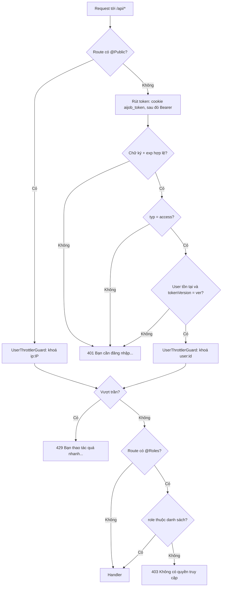
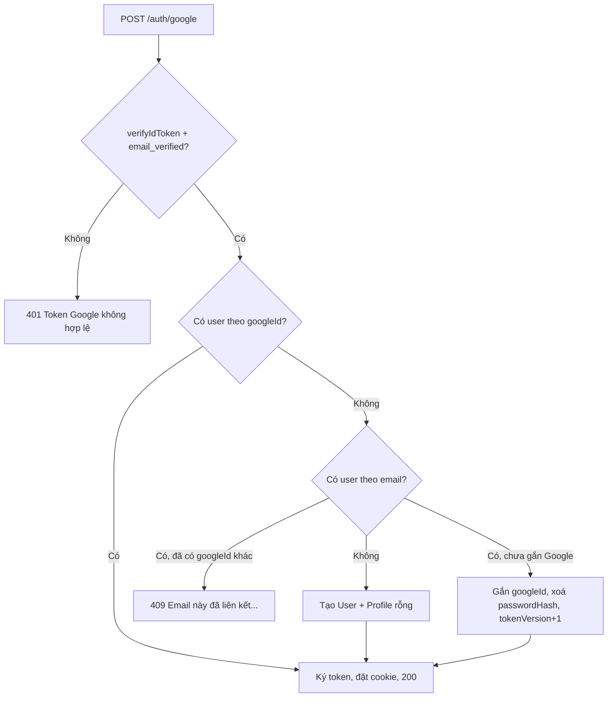
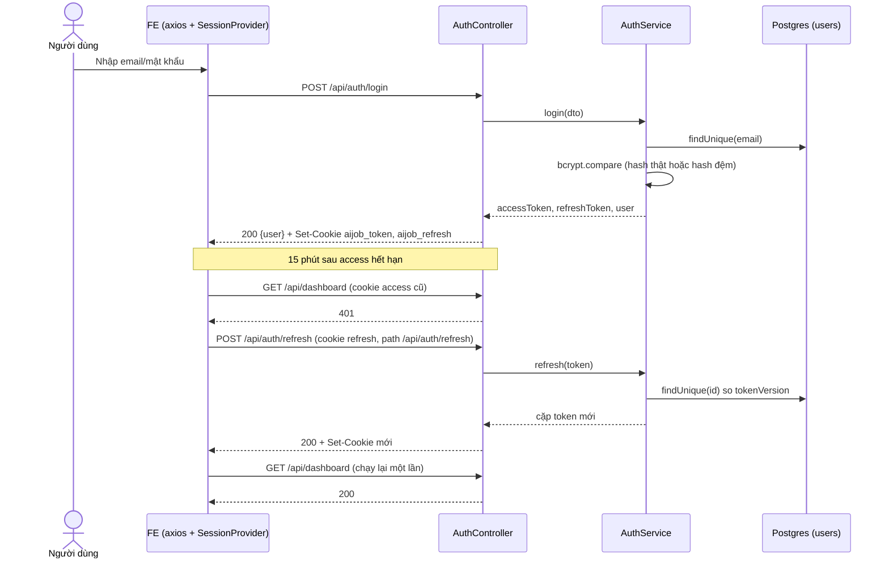
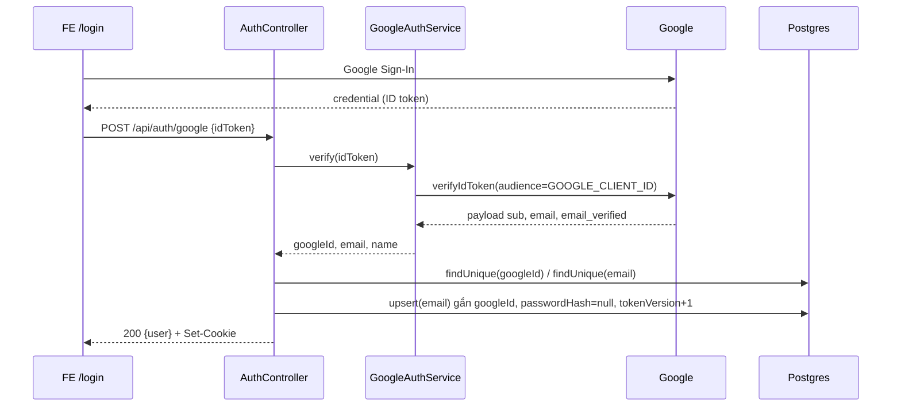
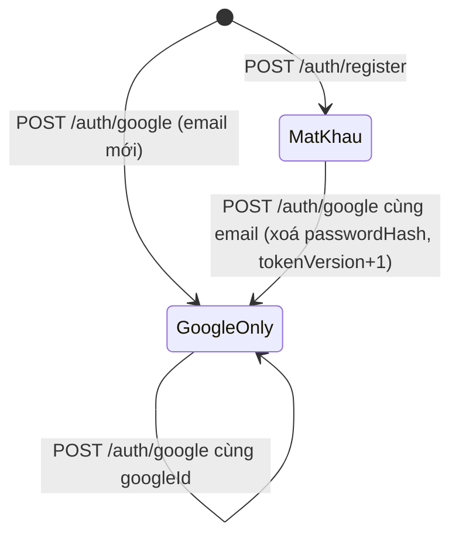
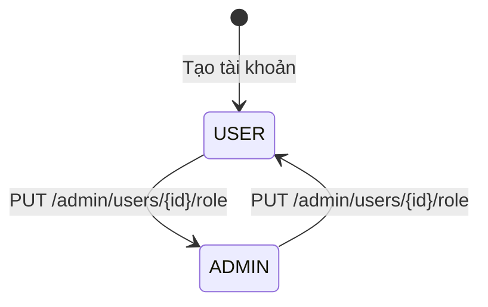

# Auth — Xác thực, phiên đăng nhập và phân quyền

> **Phạm vi:** `server/src/modules/auth/**` (register, login, Google, refresh, logout, me, cookie, JWT strategy), `server/src/common/guards/**` (`JwtAuthGuard`, `RolesGuard`, `UserThrottlerGuard`), `server/src/common/decorators/**` (`@Public`, `@Roles`, `@CurrentUser`), `server/src/common/throttle.ts`, model `User`. Frontend người dùng: `/login`, `/register`, `SessionProvider`, interceptor refresh của axios. Frontend admin: `/login`, `AdminGate`, `SessionProvider` của console.
> **Nguyên tắc:** tài liệu mô tả hệ thống **as-is**. Code là nguồn sự thật duy nhất.

## 1. Purpose

| Mục tiêu | Diễn giải |
|---|---|
| Định danh người dùng | Tạo tài khoản bằng email + mật khẩu hoặc bằng tài khoản Google; mỗi email là một tài khoản duy nhất ([auth.service.ts:42](../../../server/src/modules/auth/auth.service.ts#L42), [schema.prisma:36](../../../server/prisma/schema.prisma#L36)). |
| Duy trì phiên an toàn | Phát cặp JWT access (ngắn hạn) + refresh (dài hạn) **chỉ qua cookie httpOnly**, frontend không bao giờ cầm token ([auth.controller.ts:99](../../../server/src/modules/auth/auth.controller.ts#L99), [auth.cookie.ts](../../../server/src/modules/auth/auth.cookie.ts)). |
| Thu hồi phiên tức thì | Cột `User.tokenVersion` được so với claim `ver` ở MỌI request; lệch là 401 ngay, kể cả access token còn hạn ([jwt.strategy.ts:47](../../../server/src/modules/auth/jwt.strategy.ts#L47), [auth.service.ts:135](../../../server/src/modules/auth/auth.service.ts#L135)). |
| Phân quyền theo vai trò | Hai vai trò `USER` / `ADMIN`; vai trò đọc tươi từ DB mỗi request nên hạ quyền có hiệu lực ngay ([jwt.strategy.ts:37](../../../server/src/modules/auth/jwt.strategy.ts#L37), [roles.guard.ts](../../../server/src/common/guards/roles.guard.ts)). |
| Chống lạm dụng | Trần 10 lượt/phút cho các route đăng nhập/đăng ký/refresh, đếm theo IP ([throttle.ts:9](../../../server/src/common/throttle.ts#L9)). |

**Điểm mấu chốt:**
- Toàn bộ API **mặc định đóng**: `JwtAuthGuard` là guard toàn cục, route nào muốn mở phải gắn `@Public()` ([common.module.ts:17](../../../server/src/common/common.module.ts#L17), [jwt-auth.guard.ts:19](../../../server/src/common/guards/jwt-auth.guard.ts#L19)).
- Access và refresh ký **cùng một bí mật**; chỉ claim `typ` phân biệt chúng ([jwt-payload.ts:13](../../../server/src/modules/auth/jwt-payload.ts#L13)).
- Không có đổi mật khẩu, quên mật khẩu, xác thực email hay "đăng xuất mọi thiết bị" trong code hiện tại.

## 2. Actors

| Actor | Quyền trong module | Ghi chú |
|---|---|---|
| Khách (chưa đăng nhập) | `register`, `login`, `google`, `refresh`, `logout` (đều `@Public`) | Bị đếm throttle theo IP |
| Người dùng (`USER`) | `GET /auth/me`, mọi route không gắn `@Roles` | Vai trò mặc định khi tạo tài khoản ([schema.prisma:35](../../../server/prisma/schema.prisma#L35)) |
| Quản trị viên (`ADMIN`) | Như USER + route gắn `@Roles('ADMIN')` | Chỉ thành ADMIN qua `PUT /api/admin/users/:id/role` (module admin) hoặc seed |
| Google Identity | Xác minh ID token (chữ ký, audience, `email_verified`) | `google-auth-library` `OAuth2Client.verifyIdToken` ([google-auth.service.ts:24](../../../server/src/modules/auth/google-auth.service.ts#L24)) |
| Hệ thống — `JwtAuthGuard` / `JwtStrategy` | Rút token, kiểm chữ ký/hạn/typ/ver, nạp `request.user` | Guard toàn cục |
| Hệ thống — `UserThrottlerGuard` | Đếm lượt theo `user:<id>` hoặc `ip:<ip>` | Guard toàn cục, chạy sau JwtAuthGuard |
| Hệ thống — `RolesGuard` | So `request.user.role` với `@Roles` | Guard toàn cục |

## 3. Business Features

| # | Tính năng | Actor | Endpoint / cơ chế |
|---|---|---|---|
| F1 | Đăng ký bằng email/mật khẩu | Khách | `POST /api/auth/register` |
| F2 | Đăng nhập bằng email/mật khẩu | Khách | `POST /api/auth/login` |
| F3 | Đăng nhập / đăng ký / liên kết bằng Google | Khách | `POST /api/auth/google` |
| F4 | Gia hạn phiên bằng refresh token | Khách (cookie refresh) | `POST /api/auth/refresh` + interceptor axios FE |
| F5 | Đăng xuất khỏi thiết bị hiện tại | Khách/USER | `POST /api/auth/logout` |
| F6 | Lấy thông tin tài khoản hiện tại | USER/ADMIN | `GET /api/auth/me` |
| F7 | Xác thực mọi request (mặc định đóng) | Hệ thống | `JwtAuthGuard` + `JwtStrategy` |
| F8 | Phân quyền theo vai trò | Hệ thống | `@Roles` + `RolesGuard` |
| F9 | Giới hạn tần suất | Hệ thống | `UserThrottlerGuard` + `@ThrottleAuth/@ThrottleAi/@ThrottleScrape/@ThrottlePdf` |
| F10 | Chặn giao diện theo phiên (FE người dùng) | FE | `SessionProvider` |
| F11 | Chặn console admin cho tài khoản không phải ADMIN (FE admin) | FE | `/login` admin + `AdminGate` |

## 4. Business Flow

### Luồng A — Đăng ký (F1)

**Preconditions:** người dùng chưa đăng nhập; email chưa tồn tại; chưa vượt 10 lượt/phút/IP.

**Main Flow:**
1. Form tạo tài khoản trong modal kiểm tra mật khẩu ≥ 8 ký tự và hai lần nhập khớp ([register-form.tsx](../../../../ui-ai-job-search/components/auth/register-form.tsx)), rồi gọi `POST /api/auth/register` với `{ email, password, name }`.
2. `UserThrottlerGuard` áp trần `@ThrottleAuth` 10/phút, khoá `ip:<ip>` (route public nên chưa có `request.user`) ([user-throttler.guard.ts:7](../../../server/src/common/guards/user-throttler.guard.ts#L7)).
3. `ValidationPipe` (whitelist + forbidNonWhitelisted) chạy `RegisterDto`: email được `trim().toLowerCase()` rồi `@IsEmail`; mật khẩu 8–72 ký tự; tên 1–200 ký tự ([auth.dto.ts:7](../../../server/src/modules/auth/auth.dto.ts#L7)).
4. `AuthService.register` băm mật khẩu bcrypt cost 12 và tạo `User` kèm `Profile` rỗng trong một nested write ([auth.service.ts:42](../../../server/src/modules/auth/auth.service.ts#L42)).
5. Ký access + refresh với `ver = tokenVersion` (0) ([auth.service.ts:142](../../../server/src/modules/auth/auth.service.ts#L142)).
6. Controller đặt cookie `aijob_token` và `aijob_refresh`, trả **HTTP 201** `{ user: { id, email, name } }` ([auth.controller.ts:30](../../../server/src/modules/auth/auth.controller.ts#L30)).
7. Modal nạp lại phiên tại chỗ rồi chuyển tới `next` nếu có (đã lọc bằng `safeNextPath`) ([login-modal.tsx](../../../../ui-ai-job-search/components/auth/login-modal.tsx)).

**Alternative Flow:** đăng ký bằng nút Google trên cùng trang → Luồng C.

**Failure Flow:**
- Email trùng (kể cả khác hoa/thường) → Prisma `P2002` bị bắt → **409** `Email đã được đăng ký` ([auth.service.ts:53](../../../server/src/modules/auth/auth.service.ts#L53)); FE hiện khung "Email này đã được đăng ký. Đăng nhập thay vì tạo mới" ([register-form.tsx](../../../../ui-ai-job-search/components/auth/register-form.tsx)).
- Sai định dạng → **400** (thông điệp xem §8/§13).
- Vượt trần → **429** `Bạn thao tác quá nhanh. Hãy đợi một lát rồi thử lại.` ([app.module.ts:31](../../../server/src/app.module.ts#L31)).

**Postconditions:** có 1 `User` (role `USER`, `tokenVersion = 0`, `googleId = null`) và 1 `Profile` rỗng; trình duyệt giữ hai cookie httpOnly.

### Luồng B — Đăng nhập email/mật khẩu (F2)

**Preconditions:** tài khoản tồn tại và có `passwordHash`.

**Main Flow:**
1. `POST /api/auth/login` `{ email, password }`; throttle 10/phút/IP.
2. `LoginDto`: email chuẩn hoá + `@IsEmail`; `password` chỉ cần là chuỗi (không giới hạn độ dài) ([auth.dto.ts:23](../../../server/src/modules/auth/auth.dto.ts#L23)).
3. Tìm user theo email; **luôn** chạy `bcrypt.compare` — khi không có user hoặc user không có mật khẩu thì so với một hash đệm cố định (`timingPadHash`) để thời gian phản hồi không lộ email có tồn tại hay không ([auth.service.ts:21](../../../server/src/modules/auth/auth.service.ts#L21), [auth.service.ts:66](../../../server/src/modules/auth/auth.service.ts#L66)).
4. Khớp → ký cặp token với `ver` hiện tại, đặt cookie, trả **HTTP 200** `{ user }`.

**Alternative Flow:** FE admin dùng cùng endpoint, sau đó gọi thêm `/auth/me` để kiểm vai trò (Luồng J).

**Failure Flow:** sai email hoặc mật khẩu, hoặc tài khoản chỉ đăng nhập Google (`passwordHash = null`) → **401** `Email hoặc mật khẩu không đúng` ([auth.service.ts:71](../../../server/src/modules/auth/auth.service.ts#L71)). Lần thứ 11 trong một phút → **429**, bị chặn trước handler nên không tốn lượt bcrypt ([throttle.e2e-spec.ts:24](../../../server/test/throttle.e2e-spec.ts#L24)).

**Postconditions:** cookie mới được đặt; không ghi gì vào DB.

### Luồng C — Đăng nhập / liên kết bằng Google (F3)

**Preconditions:** FE có `NEXT_PUBLIC_GOOGLE_CLIENT_ID` (không có thì nút Google bị ẩn — [google-sign-in-button.tsx:18](../../../../ui-ai-job-search/components/auth/google-sign-in-button.tsx#L18)); backend có `GOOGLE_CLIENT_ID`.

**Main Flow:**
1. Google Identity Services trả `credential` (ID token) cho FE; FE gọi `POST /api/auth/google` `{ idToken }`.
2. `GoogleAuthService.verify`: `verifyIdToken` với `audience = GOOGLE_CLIENT_ID`; payload phải có `sub`, `email`, và `email_verified = true`. Tên lấy `payload.name`, thiếu thì dùng email ([google-auth.service.ts:21](../../../server/src/modules/auth/google-auth.service.ts#L21)).
3. Email được `trim().toLowerCase()`.
4. Tìm user theo `googleId` (không theo email, vì email ở Google có thể đổi) ([auth.service.ts:80](../../../server/src/modules/auth/auth.service.ts#L80)).
   - Có → ký token cho user đó.
5. Không có → tìm user theo email:
   - Email đã gắn **một `googleId` khác** → **409** `Email này đã liên kết với một tài khoản Google khác` ([auth.service.ts:89](../../../server/src/modules/auth/auth.service.ts#L89)).
   - Email đã có tài khoản mật khẩu (chưa gắn Google) → `upsert` nhánh update: gắn `googleId`, **xoá `passwordHash`**, **tăng `tokenVersion`** ⇒ mọi access/refresh token phát trước đó chết ngay ([auth.service.ts:94](../../../server/src/modules/auth/auth.service.ts#L94)). Đây là chủ đích chống *pre-account takeover* ([auth-google.e2e-spec.ts:90](../../../server/test/auth-google.e2e-spec.ts#L90)).
   - Email chưa có → tạo `User` mới (`passwordHash = null`) + `Profile` rỗng.
6. Đặt hai cookie, trả **HTTP 200** `{ user }`.

**Alternative Flow:** cùng một `googleId` đăng nhập lại → vào đúng user cũ, không tạo thêm ([auth-google.e2e-spec.ts:50](../../../server/test/auth-google.e2e-spec.ts#L50)).

**Failure Flow:**
- ID token sai/hết hạn/sai audience/chưa xác minh email → **401** `Token Google không hợp lệ` ([google-auth.service.ts:30](../../../server/src/modules/auth/google-auth.service.ts#L30), [google-auth.service.ts:34](../../../server/src/modules/auth/google-auth.service.ts#L34)).
- `idToken` rỗng → **400** (xem §13).
- FE hiển thị mọi lỗi Google bằng một câu chung `Đăng nhập bằng Google không thành công` ([google-sign-in-button.tsx:31](../../../../ui-ai-job-search/components/auth/google-sign-in-button.tsx#L31)).

**Postconditions:** user có `googleId`; nếu là nhánh liên kết thì không còn đăng nhập bằng mật khẩu được và `tokenVersion` đã tăng 1.

### Luồng D — Gia hạn phiên (F4)

**Preconditions:** trình duyệt còn cookie `aijob_refresh` (path `/api/auth/refresh`, sống 7 ngày).

**Main Flow:**
1. Một request API bất kỳ trả 401 → interceptor axios FE (trừ `/auth/refresh`, `/auth/login`, `/auth/register`) gọi `POST /api/auth/refresh` **một lần**, các request 401 song song dùng chung lời gọi đó (`refreshOnce`), rồi chạy lại request gốc đúng một lần (`_retried`) ([axios.ts:25](../../../../ui-ai-job-search/lib/axios.ts#L25), [axios.ts:43](../../../../ui-ai-job-search/lib/axios.ts#L43)).
2. Backend đọc cookie `aijob_refresh` ([auth.controller.ts:74](../../../server/src/modules/auth/auth.controller.ts#L74)); throttle 10/phút/IP.
3. `jwt.verify` (chữ ký + hạn); payload phải là `typ = 'refresh'` ([auth.service.ts:116](../../../server/src/modules/auth/auth.service.ts#L116)).
4. Nạp user theo `sub`; `tokenVersion` phải bằng `ver` ([auth.service.ts:126](../../../server/src/modules/auth/auth.service.ts#L126)).
5. Ký cặp token MỚI, đặt lại hai cookie, trả **200** `{ user }`.

**Alternative Flow:** refresh hỏng → interceptor ném lại lỗi 401 gốc; `QueryProvider` (FE người dùng) hoặc `SessionProvider` đưa về `/login?next=…` ([query-provider.tsx:15](../../../../ui-ai-job-search/providers/query-provider.tsx#L15)).

**Failure Flow:**
- Không có cookie → **401** `Thiếu refresh token` ([auth.service.ts:114](../../../server/src/modules/auth/auth.service.ts#L114)).
- Cookie rác, hết hạn, hoặc là access token (`typ = access`) → **401** `Refresh token không hợp lệ` ([auth.service.ts:123](../../../server/src/modules/auth/auth.service.ts#L123)).
- User không còn, hoặc `tokenVersion` đã đổi → **401** `Phiên đăng nhập đã kết thúc` ([auth.service.ts:136](../../../server/src/modules/auth/auth.service.ts#L136)).

**Postconditions:** trình duyệt có access mới (15 phút) và refresh mới (7 ngày). Refresh token cũ **không** bị vô hiệu (xem §17 R2).

### Luồng E — Đăng xuất (F5)

**Preconditions:** không cần token (route `@Public` để người có token hết hạn vẫn ra được).

**Main Flow:**
1. FE gọi `POST /api/auth/logout` (lỗi bị nuốt) ([session-provider.tsx:68](../../../../ui-ai-job-search/providers/session-provider.tsx#L68)).
2. Backend `clearCookie` cả `aijob_token` (path `/`) và `aijob_refresh` (path `/api/auth/refresh`), trả **200** `{ ok: true }` ([auth.controller.ts:82](../../../server/src/modules/auth/auth.controller.ts#L82), [auth.cookie.ts:36](../../../server/src/modules/auth/auth.cookie.ts#L36)).
3. FE người dùng xoá cache TanStack Query, chuyển sang trạng thái khách và `router.replace('/dashboard')` (trang chào cho khách) *(sửa 2026-10-27)*; FE admin `window.location.assign('/login')` (nạp lại cả trang để xoá cache React Query) ([session.tsx:34](../../../../ui-admin-job-search/components/shell/session.tsx#L34)).

**Alternative Flow:** không có.

**Failure Flow:** không có nhánh lỗi nghiệp vụ.

**Postconditions:** cookie của **trình duyệt này** bị xoá; `tokenVersion` không đổi nên phiên trên thiết bị khác vẫn sống ([auth-refresh.e2e-spec.ts:186](../../../server/test/auth-refresh.e2e-spec.ts#L186)).

### Luồng F — Lấy tài khoản hiện tại (F6)

**Preconditions:** access token hợp lệ (cookie hoặc Bearer).

**Main Flow:** `GET /api/auth/me` → `JwtStrategy.validate` nạp `{ id, email, name, role }` tươi từ DB → controller trả nguyên `request.user` (**200**) ([auth.controller.ts:91](../../../server/src/modules/auth/auth.controller.ts#L91)).

**Alternative Flow:** không có.

**Failure Flow:** thiếu/sai/hết hạn token, token là refresh, user đã xoá hoặc `tokenVersion` lệch → **401** `Bạn cần đăng nhập để tiếp tục, hoặc phiên đăng nhập đã hết hạn.` ([jwt-auth.guard.ts:10](../../../server/src/common/guards/jwt-auth.guard.ts#L10)).

**Postconditions:** không ghi DB.

### Luồng G — Xác thực mọi request (F7)

**Preconditions:** route không gắn `@Public()`.

**Main Flow:**
1. `JwtAuthGuard.canActivate` đọc metadata `isPublic` ở handler rồi class; có → cho qua **không** chạy passport (nên `request.user` không có, kể cả khi client gửi token hợp lệ) ([jwt-auth.guard.ts:19](../../../server/src/common/guards/jwt-auth.guard.ts#L19)).
2. Không public → `passport-jwt` rút token theo thứ tự: cookie `aijob_token` trước, header `Authorization: Bearer` sau ([jwt.strategy.ts:25](../../../server/src/modules/auth/jwt.strategy.ts#L25)); kiểm chữ ký + `exp`.
3. `validate`: payload phải `typ = 'access'`; nạp user; `tokenVersion === ver` ([jwt.strategy.ts:34](../../../server/src/modules/auth/jwt.strategy.ts#L34)).
4. `request.user = { id, email, name, role }`; `@CurrentUser()` lấy ra cho controller ([current-user.decorator.ts](../../../server/src/common/decorators/current-user.decorator.ts)).

**Alternative Flow:** lỗi không phải `UnauthorizedException` (ví dụ DB sập) được ném nguyên, không bị nắn thành 401 ([jwt-auth.guard.ts:29](../../../server/src/common/guards/jwt-auth.guard.ts#L29)).

**Failure Flow:** mọi lỗi xác thực → **401** `Bạn cần đăng nhập để tiếp tục, hoặc phiên đăng nhập đã hết hạn.`

**Postconditions:** request mang `user`; throttle và RolesGuard dùng nó.

### Luồng H — Phân quyền theo vai trò (F8)

**Preconditions:** route/controller gắn `@Roles('ADMIN')` ([roles.decorator.ts](../../../server/src/common/decorators/roles.decorator.ts)).

**Main Flow:** `RolesGuard` lấy danh sách vai trò yêu cầu (handler ưu tiên hơn class); rỗng → cho qua; có → `request.user.role` phải nằm trong danh sách ([roles.guard.ts:17](../../../server/src/common/guards/roles.guard.ts#L17)).

**Alternative Flow:** route không gắn `@Roles` → mọi user đã đăng nhập đều qua.

**Failure Flow:** không đủ vai trò → **403** `Không có quyền truy cập` ([roles.guard.ts:30](../../../server/src/common/guards/roles.guard.ts#L30)). Chưa đăng nhập → 401 từ JwtAuthGuard trước.

**Postconditions:** không ghi DB. Hạ quyền trong DB có hiệu lực ngay ở request kế tiếp ([security.e2e-spec.ts:128](../../../server/test/security.e2e-spec.ts#L128)).

### Luồng I — Giới hạn tần suất (F9)

**Preconditions:** throttler không bị tắt bằng `THROTTLE_DISABLED=true` ([app.module.ts:47](../../../server/src/app.module.ts#L47)).

**Main Flow:**
1. Trần mặc định toàn cục: `THROTTLE_LIMIT` (120) lượt / `THROTTLE_TTL_MS` (60.000 ms) cho mỗi handler ([configuration.ts:153](../../../server/src/config/configuration.ts#L153)).
2. Decorator ghi đè cho từng route: `ThrottleAuth` 10/phút, `ThrottleAi` 10/phút, `ThrottlePdf` 10/phút, `ThrottleScrape` 3/giờ ([throttle.ts](../../../server/src/common/throttle.ts)).
3. Khoá đếm: `user:<id>` khi đã xác thực, ngược lại `ip:<req.ip>` ([user-throttler.guard.ts:7](../../../server/src/common/guards/user-throttler.guard.ts#L7)). `req.ip` chỉ là IP thật khi `TRUST_PROXY` > 0 ([main.ts:20](../../../server/src/main.ts#L20)).

**Failure Flow:** vượt trần → **429** `Bạn thao tác quá nhanh. Hãy đợi một lát rồi thử lại.`

**Postconditions:** bộ đếm nằm trong bộ nhớ tiến trình (không chia sẻ giữa nhiều instance) — theo comment của [throttle.e2e-spec.ts:21](../../../server/test/throttle.e2e-spec.ts#L21).

### Luồng J — Chặn giao diện theo phiên (F10, F11)

**Preconditions:** người dùng mở một trang dưới `/dashboard` (FE người dùng) hoặc console admin.

**Main Flow (FE người dùng):**
1. `SessionProvider` (bọc `app/dashboard/layout.tsx`) gọi `/auth/me` một lần; trong lúc chờ chỉ hiện spinner ([session-provider.tsx:43](../../../../ui-ai-job-search/providers/session-provider.tsx#L43), [layout.tsx:18](../../../../ui-ai-job-search/app/dashboard/layout.tsx#L18)).
2. 401 → đánh dấu `anonymous`; nếu đường dẫn không phải trang khách (`/dashboard/jobs`, `/dashboard/jobs/:id`, `/dashboard/salary`, `/dashboard/salary/:x` — [public-job.ts:14](../../../../ui-ai-job-search/lib/public-job.ts#L14)) thì `router.replace('/login?next=…')` ([session-provider.tsx:62](../../../../ui-ai-job-search/providers/session-provider.tsx#L62)).
3. `/login` và `/register` không còn giao diện riêng: chuyển về `/dashboard?auth=login|register` giữ `next`, `ref` ([redirect.ts](../../../../ui-ai-job-search/lib/redirect.ts) (`authEntryPath`)); trang chủ mở modal tương ứng, gỡ `auth`/`next` khỏi URL, đã đăng nhập thì đi thẳng tới `next` *(2026-10-27)*. `next` lọc qua `safeNextPath` (chỉ nhận đường dẫn nội bộ bắt đầu bằng `/`, loại ký tự điều khiển/`\`, phải cùng origin giả) ([redirect.ts:4](../../../../ui-ai-job-search/lib/redirect.ts#L4)).

**Main Flow (FE admin):**
1. Trang `/login` admin gọi `login` rồi `/auth/me`; `role !== 'ADMIN'` → hiện `Tài khoản này không có quyền quản trị.` và **không** đăng xuất (cookie dùng chung với app người dùng) ([page.tsx:30](../../../../ui-admin-job-search/app/login/page.tsx#L30)).
2. Mọi trang trong `(console)` bọc `SessionProvider` + `AdminGate`; user không phải ADMIN thấy màn `AccessDenied` với nút "Đổi tài khoản" và "Về Careelot" ([admin-gate.tsx:13](../../../../ui-admin-job-search/components/shell/admin-gate.tsx#L13), [layout.tsx](../../../../ui-admin-job-search/app/%28console%29/layout.tsx)).
3. 401 ở bất kỳ query/mutation → `window.location.assign('/login?next=…')` ([query-client.tsx:15](../../../../ui-admin-job-search/lib/query-client.tsx#L15)).

**Failure Flow:** FE người dùng: `/auth/me` lỗi khác 401 (500, mất mạng) → spinner mãi (xem §17 R8).

**Postconditions:** chặn ở FE chỉ để không gọi API vô ích; người giữ dữ liệu thật là guard backend.

## 5. Mermaid Flowchart

## 6. Sequence Diagram

## 7. Business Rules

| Mã BR | Quy tắc | Nơi thực thi | Mức | Nguồn code |
|---|---|---|---|---|
| BR-AUTH-01 | Email được `trim()` + `toLowerCase()` trước khi kiểm định dạng và lưu/tra cứu (register, login, Google) | DTO, SV | ✅ Mềm | [auth.dto.ts:4](../../../server/src/modules/auth/auth.dto.ts#L4), [auth.service.ts:78](../../../server/src/modules/auth/auth.service.ts#L78) |
| BR-AUTH-02 | Mỗi email chỉ một tài khoản; đăng ký trùng trả 409 `Email đã được đăng ký` (bắt `P2002`, đúng cả khi hai request đồng thời) | DB, SV | 🔒 Cứng | [schema.prisma:36](../../../server/prisma/schema.prisma#L36), [auth.service.ts:52](../../../server/src/modules/auth/auth.service.ts#L52) |
| BR-AUTH-03 | Mật khẩu đăng ký 8–72 ký tự; tên 1–200 ký tự | DTO | ✅ Mềm | [auth.dto.ts:12](../../../server/src/modules/auth/auth.dto.ts#L12) |
| BR-AUTH-04 | Mật khẩu chỉ lưu dạng bcrypt cost 12 | SV | ✅ Mềm | [auth.service.ts:19](../../../server/src/modules/auth/auth.service.ts#L19), [auth.service.ts:48](../../../server/src/modules/auth/auth.service.ts#L48) |
| BR-AUTH-05 | Tạo tài khoản (mật khẩu hoặc Google) luôn tạo kèm một `Profile` rỗng trong cùng nested write | SV | ✅ Mềm | [auth.service.ts:49](../../../server/src/modules/auth/auth.service.ts#L49), [auth.service.ts:105](../../../server/src/modules/auth/auth.service.ts#L105) |
| BR-AUTH-06 | Tài khoản mới luôn có vai trò `USER`; không có đường tự nâng quyền | DB | 🔒 Cứng | [schema.prisma:35](../../../server/prisma/schema.prisma#L35) |
| BR-AUTH-07 | Đăng nhập sai email hay sai mật khẩu trả cùng một thông điệp 401 và luôn chạy bcrypt (hash đệm) để không lộ email tồn tại | SV | ✅ Mềm | [auth.service.ts:62](../../../server/src/modules/auth/auth.service.ts#L62) |
| BR-AUTH-08 | Tài khoản không có `passwordHash` (chỉ Google) không đăng nhập được bằng mật khẩu | SV | ✅ Mềm | [auth.service.ts:68](../../../server/src/modules/auth/auth.service.ts#L68) |
| BR-AUTH-09 | ID token Google chỉ được chấp nhận khi đúng audience `GOOGLE_CLIENT_ID`, có `sub`, `email` và `email_verified = true` | SV | ✅ Mềm | [google-auth.service.ts:21](../../../server/src/modules/auth/google-auth.service.ts#L21) |
| BR-AUTH-10 | Google: nhận diện user theo `googleId` trước, email sau; `googleId` là duy nhất | DB, SV | 🔒 Cứng | [schema.prisma:40](../../../server/prisma/schema.prisma#L40), [auth.service.ts:80](../../../server/src/modules/auth/auth.service.ts#L80) |
| BR-AUTH-11 | Email đã gắn một Google khác thì không bị liên kết đè (409) | SV | ✅ Mềm | [auth.service.ts:85](../../../server/src/modules/auth/auth.service.ts#L85) |
| BR-AUTH-12 | Liên kết Google vào tài khoản mật khẩu cùng email: xoá mật khẩu và tăng `tokenVersion` để tước mọi phiên/mật khẩu do người đăng ký trước đặt | SV | ✅ Mềm | [auth.service.ts:94](../../../server/src/modules/auth/auth.service.ts#L94) |
| BR-AUTH-13 | Phát cặp JWT cùng bí mật: access (`typ=access`, mặc định `15m`) và refresh (`typ=refresh`, mặc định `7d`), payload `{sub, email, typ, ver}` | SV | ✅ Mềm | [auth.service.ts:150](../../../server/src/modules/auth/auth.service.ts#L150), [configuration.ts:29](../../../server/src/config/configuration.ts#L29) |
| BR-AUTH-14 | Token chỉ đi qua cookie httpOnly (`aijob_token` path `/` 15 phút; `aijob_refresh` path `/api/auth/refresh` 7 ngày; `sameSite=lax`; `secure` khi production; `domain = COOKIE_DOMAIN`); body chỉ trả `{ user }` | SV | ✅ Mềm | [auth.cookie.ts](../../../server/src/modules/auth/auth.cookie.ts), [auth.controller.ts:99](../../../server/src/modules/auth/auth.controller.ts#L99) |
| BR-AUTH-15 | Token được rút từ cookie `aijob_token` trước, header Bearer sau | GD | ✅ Mềm | [jwt.strategy.ts:25](../../../server/src/modules/auth/jwt.strategy.ts#L25) |
| BR-AUTH-16 | Access token không đổi được token mới; refresh token không dùng làm Bearer (claim `typ`) | SV, GD | ✅ Mềm | [jwt-payload.ts:20](../../../server/src/modules/auth/jwt-payload.ts#L20), [auth.service.ts:122](../../../server/src/modules/auth/auth.service.ts#L122), [jwt.strategy.ts:35](../../../server/src/modules/auth/jwt.strategy.ts#L35) |
| BR-AUTH-17 | Thu hồi phiên bằng `tokenVersion`: lệch `ver` thì cả access đang còn hạn lẫn refresh đều bị từ chối ngay | SV, GD | ✅ Mềm | [jwt.strategy.ts:47](../../../server/src/modules/auth/jwt.strategy.ts#L47), [auth.service.ts:135](../../../server/src/modules/auth/auth.service.ts#L135) |
| BR-AUTH-18 | Refresh thành công phát lại CẢ HAI token; refresh token cũ vẫn hợp lệ tới hết hạn (không xoay vòng/không phát hiện tái sử dụng) | SV | ✅ Mềm | [auth.service.ts:113](../../../server/src/modules/auth/auth.service.ts#L113) |
| BR-AUTH-19 | Đăng xuất chỉ xoá cookie của trình duyệt gọi, không tăng `tokenVersion`; route `@Public` | SV | ✅ Mềm | [auth.controller.ts:82](../../../server/src/modules/auth/auth.controller.ts#L82) |
| BR-AUTH-20 | Vai trò và tên trả về `/auth/me` (và trong `request.user`) luôn đọc tươi từ DB, không lấy từ claim | GD | ✅ Mềm | [jwt.strategy.ts:37](../../../server/src/modules/auth/jwt.strategy.ts#L37) |
| BR-AUTH-21 | `register`, `login`, `google`, `refresh` giới hạn 10 lượt/phút, đếm theo IP | GD | ✅ Mềm | [throttle.ts:9](../../../server/src/common/throttle.ts#L9), [auth.controller.ts:31](../../../server/src/modules/auth/auth.controller.ts#L31) |
| BR-AUTH-22 | Ứng dụng từ chối khởi động khi `JWT_SECRET` rỗng hoặc còn giá trị mẫu bắt đầu bằng `thay-bang` | SV (bootstrap) | ✅ Mềm | [main.ts:23](../../../server/src/main.ts#L23) |
| BR-AUTH-23 | Sau đăng nhập/đăng ký chỉ chuyển tới `next` nếu là đường dẫn nội bộ an toàn; mặc định `/dashboard` (FE người dùng), `/` (FE admin) | FE | ⚠️ Chỉ FE | [redirect.ts:4](../../../../ui-ai-job-search/lib/redirect.ts#L4), [login-modal.tsx](../../../../ui-ai-job-search/components/auth/login-modal.tsx) |
| BR-AUTH-24 | Đăng ký trên FE yêu cầu nhập lại mật khẩu khớp | FE | ⚠️ Chỉ FE | [register-form.tsx](../../../../ui-ai-job-search/components/auth/register-form.tsx) |
| BR-AUTH-25 | FE tự refresh một lần khi gặp 401 (gộp các request song song), không áp cho `/auth/refresh`, `/auth/login`, `/auth/register` | FE | ⚠️ Chỉ FE | [axios.ts:25](../../../../ui-ai-job-search/lib/axios.ts#L25) |
| BR-AUTH-26 | Khu `/dashboard` không render khi chưa xác định đã đăng nhập; khách chỉ xem được trang việc làm và tra cứu lương | FE | ⚠️ Chỉ FE | [session-provider.tsx:78](../../../../ui-ai-job-search/providers/session-provider.tsx#L78), [public-job.ts:14](../../../../ui-ai-job-search/lib/public-job.ts#L14) |
| BR-AUTH-27 | Console admin chỉ hiển thị nội dung khi `role = ADMIN`; tài khoản USER đăng nhập admin không bị đăng xuất khỏi app người dùng | FE | ⚠️ Chỉ FE | [page.tsx:34](../../../../ui-admin-job-search/app/login/page.tsx#L34), [admin-gate.tsx:30](../../../../ui-admin-job-search/components/shell/admin-gate.tsx#L30) |
| BR-AUTH-28 | Đăng ký email và Google nhận `ref` tuỳ chọn (mã mời); khớp mã thì ghi `referredById`, mã lạ bỏ qua; Google chỉ ghi khi tạo tài khoản mới ([referrals.md](./referrals.md)) *(2026-10-26)* | SV | ✅ | [auth.service.ts](../../../server/src/modules/auth/auth.service.ts) |

> Các quy tắc **xuyên suốt** (mặc định đóng bằng `JwtAuthGuard` toàn cục + `@Public`; `RolesGuard` toàn cục + `@Roles('ADMIN')`; throttle mặc định 120/phút đếm theo user hoặc IP; ValidationPipe whitelist/forbidNonWhitelisted) được agent chính đánh mã `BR-SYS-nn`; ở đây chỉ mô tả cơ chế (§4 Luồng G, H, I).

> **Possible Business Rule:** Tài khoản đăng ký bằng mật khẩu có thể được người sở hữu thật của email "giành lại" bằng Google (BR-AUTH-12) nhưng KHÔNG có chiều ngược lại — người đã liên kết Google mất hẳn đăng nhập bằng mật khẩu, và hệ thống không có đặt lại mật khẩu. Cần chủ dự án xác nhận đây là chủ đích lâu dài.

> **Possible Business Rule:** Không có giới hạn số lần đăng nhập sai theo TÀI KHOẢN (chỉ theo IP). Chưa rõ đây là quyết định hay là việc chưa làm.

## 8. Validation Rules

Mọi DTO chạy qua `ValidationPipe({ whitelist, transform, forbidNonWhitelisted })`; thông điệp đi qua `vietnameseValidationError` ([bootstrap.ts:46](../../../server/src/bootstrap.ts#L46)). Lưu ý: thông điệp tuỳ biến tiếng Việt bị gắn thêm nhãn trường ở đầu (xem §17 R9) — cột "Lỗi trả về" ghi đúng chuỗi thực tế.

**`RegisterDto`** ([auth.dto.ts:7](../../../server/src/modules/auth/auth.dto.ts#L7))

| Field | Ràng buộc | DTO/Schema | Lỗi trả về (400) |
|---|---|---|---|
| email | `Transform` trim + lowercase; `@IsEmail` | RegisterDto | `Email Email không hợp lệ` |
| password | `@IsString`, `@MinLength(8)`, `@MaxLength(72)` | RegisterDto | `Mật khẩu phải là chuỗi ký tự` / `Mật khẩu Mật khẩu tối thiểu 8 ký tự` / `Mật khẩu Mật khẩu tối đa 72 ký tự` |
| name | `@IsString`, `@MinLength(1)`, `@MaxLength(200)` | RegisterDto | `Họ tên phải là chuỗi ký tự` / `Họ tên Tên không được để trống` / `Họ tên Tên tối đa 200 ký tự` |
| (trường lạ) | forbidNonWhitelisted | ValidationPipe | `<Nhãn> không phải là trường hợp lệ` |

**`LoginDto`** ([auth.dto.ts:23](../../../server/src/modules/auth/auth.dto.ts#L23))

| Field | Ràng buộc | DTO/Schema | Lỗi trả về (400) |
|---|---|---|---|
| email | trim + lowercase; `@IsEmail` | LoginDto | `Email Email không hợp lệ` |
| password | `@IsString` (không giới hạn độ dài, giới hạn chung body 1MB) | LoginDto | `Mật khẩu phải là chuỗi ký tự` |

**`GoogleLoginDto`** ([auth.dto.ts:32](../../../server/src/modules/auth/auth.dto.ts#L32))

| Field | Ràng buộc | DTO/Schema | Lỗi trả về (400) |
|---|---|---|---|
| idToken | `@IsString`, `@MinLength(1)` | GoogleLoginDto | `idToken phải là chuỗi ký tự` / `idToken Thiếu ID token` |

**Kiểm tra phía FE** (không thay được backend)

| Field | Ràng buộc | Nơi | Lỗi hiển thị |
|---|---|---|---|
| password (register) | ≥ 8 ký tự | [register-form.tsx](../../../../ui-ai-job-search/components/auth/register-form.tsx) | `Mật khẩu cần ít nhất 8 ký tự` |
| confirm | bằng password | [register-form.tsx](../../../../ui-ai-job-search/components/auth/register-form.tsx) | `Hai lần nhập mật khẩu không khớp` |
| email/password/name | `required`, `type=email` của HTML | login-form, register-form | Trình duyệt |

## 9. API Mapping

| Method | URL | Role | Mục đích nghiệp vụ | Controller#method | Service | DTO | Response |
|---|---|---|---|---|---|---|---|
| POST | `/api/auth/register` | Public | Tạo tài khoản mật khẩu | `AuthController#register` | `AuthService.register` | `RegisterDto` | 201 `{ user: {id,email,name} }` + 2 cookie |
| POST | `/api/auth/login` | Public | Đăng nhập mật khẩu | `AuthController#login` | `AuthService.login` | `LoginDto` | 200 `{ user }` + 2 cookie |
| POST | `/api/auth/google` | Public | Đăng nhập/đăng ký/liên kết Google | `AuthController#google` | `AuthService.loginWithGoogle`, `GoogleAuthService.verify` | `GoogleLoginDto` | 200 `{ user }` + 2 cookie |
| POST | `/api/auth/refresh` | Public (cần cookie refresh) | Đổi refresh lấy cặp token mới | `AuthController#refresh` | `AuthService.refresh` | — (cookie `aijob_refresh`) | 200 `{ user }` + 2 cookie |
| POST | `/api/auth/logout` | Public | Xoá cookie phiên trên trình duyệt này | `AuthController#logout` | — | — | 200 `{ ok: true }` + xoá 2 cookie |
| GET | `/api/auth/me` | USER/ADMIN | Lấy tài khoản hiện tại kèm vai trò | `AuthController#me` | `JwtStrategy.validate` | — | 200 `{ id, email, name, role }` |

**Endpoint ở module khác tác động lên module này**

| Method | URL | Module | Tác động |
|---|---|---|---|
| PUT | `/api/admin/users/:id/role` | admin-console | Đổi `User.role` USER ↔ ADMIN; có hiệu lực ngay với token đang dùng vì vai trò đọc tươi ([admin-users.controller.ts:36](../../../server/src/modules/admin/controllers/admin-users.controller.ts#L36)) |
| GET | `/api/admin/users`, `/api/admin/users/:id` | admin-console | Đọc danh sách/chi tiết `User` |

## 10. Frontend Mapping

| Route FE | Vai trò | Mục đích | Hook / API client |
|---|---|---|---|
| `/login` (user) | Khách | Chỉ chuyển hướng tới `/dashboard?auth=login` (giữ `next`), trang chủ mở modal đăng nhập email/mật khẩu hoặc Google *(sửa 2026-10-27)* | [redirect.ts](../../../../ui-ai-job-search/lib/redirect.ts) (`authEntryPath`), [login-modal.tsx](../../../../ui-ai-job-search/components/auth/login-modal.tsx), `authService.login`, [google-sign-in-button.tsx](../../../../ui-ai-job-search/components/auth/google-sign-in-button.tsx) |
| `/register` (user) | Khách | Chỉ chuyển hướng tới `/dashboard?auth=register` (giữ `next`, `ref`), trang chủ mở modal tạo tài khoản, xử lý 409 trùng email *(sửa 2026-10-27)* | [redirect.ts](../../../../ui-ai-job-search/lib/redirect.ts) (`authEntryPath`), [register-form.tsx](../../../../ui-ai-job-search/components/auth/register-form.tsx), `authService.register` |
| `/dashboard/**` (user) | USER | Khung đã đăng nhập; chặn render tới khi `/auth/me` trả lời | [session-provider.tsx](../../../../ui-ai-job-search/providers/session-provider.tsx), [use-session.ts](../../../../ui-ai-job-search/hooks/use-session.ts) |
| Sidebar, `/dashboard/settings` (user) | USER | Nút đăng xuất; hiển thị tên/email/vai trò | `useSession().logout`, [settings-view.tsx](../../../../ui-ai-job-search/app/dashboard/settings/settings-view.tsx) |
| (mọi request) | — | Tự refresh token khi 401 | [axios.ts](../../../../ui-ai-job-search/lib/axios.ts), [query-provider.tsx](../../../../ui-ai-job-search/providers/query-provider.tsx) |
| `/login` (admin) | Khách/ADMIN | Đăng nhập rồi kiểm `role` qua `/auth/me` | [page.tsx](../../../../ui-admin-job-search/app/login/page.tsx), [auth.ts](../../../../ui-admin-job-search/services/auth.ts) |
| `(console)/**` (admin) | ADMIN | Chặn hiển thị cho tài khoản không phải ADMIN | [admin-gate.tsx](../../../../ui-admin-job-search/components/shell/admin-gate.tsx), [session.tsx](../../../../ui-admin-job-search/components/shell/session.tsx), [query-client.tsx](../../../../ui-admin-job-search/lib/query-client.tsx) |

Không có `middleware.ts`/`proxy.ts` Next.js ở cả hai frontend — chặn hoàn toàn ở phía client ([session-provider.tsx:30](../../../../ui-ai-job-search/providers/session-provider.tsx#L30)).

## 11. Database

**Bảng `User`** ([schema.prisma:33](../../../server/prisma/schema.prisma#L33))

| Field | Kiểu | Ràng buộc / mặc định | Ý nghĩa |
|---|---|---|---|
| id | String | `@id @default(cuid())` | Khoá chính, là `sub` trong JWT |
| role | `UserRole` | `@default(USER)` | Vai trò |
| email | String | `@unique` | Đã chuẩn hoá chữ thường |
| passwordHash | String? | — | Null khi tài khoản chỉ dùng Google |
| googleId | String? | `@unique` | `sub` của Google |
| tokenVersion | Int | `@default(0)` | Tăng để vô hiệu mọi token đã phát |
| name | String | — | Tên hiển thị |
| createdAt / updatedAt | DateTime | `now()` / `@updatedAt` | — |

Quan hệ: `profile` (1–1) và mọi bảng dữ liệu người dùng (`JobMatch`, `Document`, `Application`, `ProfileDraft`, `AiCall`…) đều trỏ về `User`. Index: unique `email`, unique `googleId`.

**Enum `UserRole`** ([schema.prisma:28](../../../server/prisma/schema.prisma#L28)): `USER`, `ADMIN`.

Không có bảng phiên/refresh token — refresh là JWT không trạng thái.

## 12. State Machine

`User` không có trường trạng thái kiểu enum; hai trường mang tính trạng thái là `role` và "phương thức đăng nhập" (suy ra từ `passwordHash`/`googleId`).

| Trường | Từ → Sang | Trigger | Điều kiện |
|---|---|---|---|
| passwordHash/googleId | (chưa có) → có mật khẩu | `POST /auth/register` | Email chưa tồn tại |
| passwordHash/googleId | (chưa có) → chỉ Google | `POST /auth/google` | Email và googleId chưa tồn tại |
| passwordHash/googleId | có mật khẩu → chỉ Google | `POST /auth/google` | Email trùng, tài khoản chưa có `googleId` |
| tokenVersion | n → n+1 | Liên kết Google ở trên | Chỉ nhánh này trong code |
| role | USER → ADMIN / ADMIN → USER | `PUT /api/admin/users/:id/role` (module admin) | Do admin thực hiện |

## 13. Exceptions

| Tình huống | HTTP | Thông điệp nguyên văn | Nguồn |
|---|---|---|---|
| Email đăng ký đã tồn tại | 409 | `Email đã được đăng ký` | [auth.service.ts:54](../../../server/src/modules/auth/auth.service.ts#L54) |
| Sai email/mật khẩu hoặc tài khoản chỉ Google | 401 | `Email hoặc mật khẩu không đúng` | [auth.service.ts:71](../../../server/src/modules/auth/auth.service.ts#L71) |
| Email đã gắn Google khác | 409 | `Email này đã liên kết với một tài khoản Google khác` | [auth.service.ts:91](../../../server/src/modules/auth/auth.service.ts#L91) |
| ID token Google hỏng / chưa xác minh email | 401 | `Token Google không hợp lệ` | [google-auth.service.ts:30](../../../server/src/modules/auth/google-auth.service.ts#L30) |
| Thiếu cookie refresh | 401 | `Thiếu refresh token` | [auth.service.ts:114](../../../server/src/modules/auth/auth.service.ts#L114) |
| Refresh rác/hết hạn/sai `typ` | 401 | `Refresh token không hợp lệ` | [auth.service.ts:123](../../../server/src/modules/auth/auth.service.ts#L123) |
| User không còn hoặc đã bị thu hồi phiên | 401 | `Phiên đăng nhập đã kết thúc` | [auth.service.ts:136](../../../server/src/modules/auth/auth.service.ts#L136) |
| Route cần đăng nhập mà token thiếu/sai/hết hạn/bị thu hồi | 401 | `Bạn cần đăng nhập để tiếp tục, hoặc phiên đăng nhập đã hết hạn.` | [jwt-auth.guard.ts:10](../../../server/src/common/guards/jwt-auth.guard.ts#L10) |
| Thiếu vai trò | 403 | `Không có quyền truy cập` | [roles.guard.ts:30](../../../server/src/common/guards/roles.guard.ts#L30) |
| Vượt trần throttle | 429 | `Bạn thao tác quá nhanh. Hãy đợi một lát rồi thử lại.` | [app.module.ts:31](../../../server/src/app.module.ts#L31) |
| Body không hợp lệ | 400 | Mảng thông điệp ở §8; rỗng thì `Dữ liệu gửi lên không hợp lệ` | [validation-message.ts:151](../../../server/src/common/validation-message.ts#L151) |
| Đua upsert Google lần đầu (chưa kiểm chứng bằng test) | 409 | `Dữ liệu đã tồn tại` (PrismaExceptionFilter) | [prisma-exception.filter.ts:21](../../../server/src/common/filters/prisma-exception.filter.ts#L21) |
| Thiếu `JWT_SECRET` lúc khởi động | — (không khởi động) | `JWT_SECRET chưa được đặt. Sinh khóa thật trước khi chạy.` | [main.ts:25](../../../server/src/main.ts#L25) |

Thông điệp FE: `Email hoặc mật khẩu không đúng` (khi 401), `Đăng nhập không thành công`, `Tạo tài khoản không thành công`, `Đăng nhập bằng Google không thành công`, `Không nhận được token từ Google`, `Không kết nối được tới máy chủ`, admin: `Tài khoản này không có quyền quản trị.`

## 14. Notifications

Không có. Module không gửi email/thông báo nào (không có email chào mừng, xác thực email hay cảnh báo đăng nhập/liên kết Google); phản hồi chỉ hiển thị trên giao diện.

## 15. Integrations

| Hệ thống | Mục đích | Cấu hình | Nguồn |
|---|---|---|---|
| Google Identity (`google-auth-library`) | Xác minh ID token | `GOOGLE_CLIENT_ID` (backend), `NEXT_PUBLIC_GOOGLE_CLIENT_ID` (FE, `@react-oauth/google`) | [google-auth.service.ts](../../../server/src/modules/auth/google-auth.service.ts), [google-sign-in-button.tsx](../../../../ui-ai-job-search/components/auth/google-sign-in-button.tsx) |
| `@nestjs/jwt` + `passport-jwt` | Ký/kiểm JWT | `JWT_SECRET`, `JWT_ACCESS_EXPIRES_IN` (15m), `JWT_REFRESH_EXPIRES_IN` (7d) | [auth.module.ts](../../../server/src/modules/auth/auth.module.ts), [configuration.ts:29](../../../server/src/config/configuration.ts#L29) |
| `@nestjs/throttler` | Rate limit | `THROTTLE_LIMIT`, `THROTTLE_TTL_MS`, `THROTTLE_DISABLED`, `TRUST_PROXY` | [app.module.ts:38](../../../server/src/app.module.ts#L38) |
| Cookie / CORS | Phiên qua cookie cross-origin | `COOKIE_DOMAIN`, `CORS_ORIGIN` (một origin, `credentials: true`), `NODE_ENV=production` bật `secure` | [auth.cookie.ts:13](../../../server/src/modules/auth/auth.cookie.ts#L13), [main.ts:30](../../../server/src/main.ts#L30) |
| FE ↔ API | Base URL | `NEXT_PUBLIC_API_URL` (mặc định `http://localhost:4000/api`), `withCredentials: true` | [axios.ts](../../../../ui-ai-job-search/lib/axios.ts) |

## 16. Security

- **Phân quyền:** mặc định đóng (guard toàn cục); route mở phải `@Public()`; route admin chỉ cần `@Roles('ADMIN')` ([common.module.ts:17](../../../server/src/common/common.module.ts#L17)). Thứ tự guard: `JwtAuthGuard` → `UserThrottlerGuard` → `RolesGuard`.
- **Kiểm tra sở hữu:** không áp dụng trong module (mọi thao tác trên chính tài khoản lấy từ token); module khác dùng `@CurrentUser().id` để khoá dữ liệu.
- **Token:** chỉ trong cookie httpOnly; body không bao giờ chứa `accessToken`/`refreshToken` ([security.e2e-spec.ts:245](../../../server/test/security.e2e-spec.ts#L245)). `sameSite=lax` giảm CSRF cho request POST cross-site; CORS chỉ một origin.
- **Thu hồi:** `tokenVersion` (chỉ tăng ở nhánh liên kết Google trong code hiện tại).
- **Chống dò tài khoản:** cùng thông điệp lỗi + bcrypt hash đệm khi đăng nhập. Đăng ký vẫn trả 409 khi email tồn tại (lộ sự tồn tại email qua đăng ký — đánh đổi chấp nhận để UX báo "đăng nhập thay vì tạo mới").
- **Rate limit:** 10/phút/IP cho 4 route auth; 120/phút mặc định.
- **Dữ liệu nhạy cảm:** `passwordHash` không bao giờ trả ra (`/auth/me` chỉ select `id,email,name,role`); log request có `x-request-id`.
- **Open redirect:** `safeNextPath` ở cả hai FE.

## 17. ⚠️ Sai lệch / Rủi ro nghiệp vụ

**R1 — Đăng xuất không thu hồi được token; không có "đăng xuất mọi thiết bị".** Mức đề xuất: 🟡
- Mô tả: logout chỉ xoá cookie trình duyệt hiện tại; `tokenVersion` chỉ tăng trong nhánh liên kết Google. Không có route đổi mật khẩu/đăng xuất toàn bộ/khoá tài khoản.
- Bằng chứng: [auth.controller.ts:86](../../../server/src/modules/auth/auth.controller.ts#L86); `tokenVersion: { increment: 1 }` chỉ xuất hiện ở [auth.service.ts:99](../../../server/src/modules/auth/auth.service.ts#L99).
- Tác động: refresh token bị lộ (log, máy dùng chung) dùng được tới 7 ngày; người dùng không tự cắt được phiên trên máy khác.
- Đề xuất: thêm route "đăng xuất mọi thiết bị" tăng `tokenVersion`; cân nhắc tăng `tokenVersion` khi admin hạ quyền/khoá.

**R2 — Refresh token không xoay vòng.** Mức đề xuất: 🟡
- Mô tả: mỗi lần refresh phát refresh mới nhưng cái cũ vẫn hợp lệ tới hết hạn; không phát hiện tái sử dụng.
- Bằng chứng: [auth.service.ts:113](../../../server/src/modules/auth/auth.service.ts#L113)-139 không ghi gì vào DB.
- Tác động: kẻ giữ một refresh token cũ có thể tự gia hạn song song với chủ tài khoản suốt 7 ngày mỗi lần.
- Đề xuất: lưu `jti`/phiên refresh hoặc tăng `tokenVersion` khi phát hiện refresh cũ bị dùng lại.

**R3 — Không xác thực email, không quên/đổi mật khẩu.** Mức đề xuất: 🟡
- Mô tả: đăng ký không cần xác minh email; tài khoản đã liên kết Google mất đăng nhập mật khẩu vĩnh viễn; người quên mật khẩu không có đường khôi phục (FE cài đặt cũng ghi "backend chưa có endpoint cập nhật").
- Bằng chứng: [auth.controller.ts](../../../server/src/modules/auth/auth.controller.ts) chỉ có 6 route; [settings-view.tsx:60](../../../../ui-ai-job-search/app/dashboard/settings/settings-view.tsx#L60).
- Tác động: người dùng mật khẩu quên mật khẩu là mất tài khoản (trừ khi email là Gmail để đăng nhập Google — khi đó mật khẩu bị xoá).
- Đề xuất: thêm luồng đặt lại mật khẩu qua email hoặc ít nhất đổi mật khẩu khi đang đăng nhập.

**R4 — Giới hạn 72 tính theo ký tự, bcrypt cắt theo 72 byte.** Mức đề xuất: 🟢
- Mô tả: `@MaxLength(72)` đếm ký tự; mật khẩu tiếng Việt có dấu (2–3 byte/ký tự) dưới 72 ký tự vẫn có thể vượt 72 byte và phần đuôi bị bỏ qua khi băm.
- Bằng chứng: [auth.dto.ts:14](../../../server/src/modules/auth/auth.dto.ts#L14); lý do giới hạn ghi ở [security.e2e-spec.ts:272](../../../server/test/security.e2e-spec.ts#L272).
- Tác động: hai mật khẩu khác nhau ở phần đuôi được coi là một (rất hiếm trong thực tế).
- Đề xuất: kiểm theo `Buffer.byteLength` hoặc tiền băm SHA-256.

**R5 — Thời hạn cookie cố định, không theo biến môi trường JWT.** Mức đề xuất: 🟢
- Mô tả: cookie access luôn 15 phút, refresh luôn 7 ngày, trong khi thời hạn JWT đọc từ `JWT_ACCESS_EXPIRES_IN`/`JWT_REFRESH_EXPIRES_IN`.
- Bằng chứng: [auth.cookie.ts:9](../../../server/src/modules/auth/auth.cookie.ts#L9)-11 so với [configuration.ts:32](../../../server/src/config/configuration.ts#L32)-33.
- Tác động: đổi env (ví dụ access 1h) thì cookie vẫn biến mất sau 15 phút — cấu hình không có tác dụng như người vận hành kỳ vọng.
- Đề xuất: suy `maxAge` từ cùng cấu hình.

**R6 — Throttle auth theo IP phụ thuộc `TRUST_PROXY`; không khoá theo tài khoản.** Mức đề xuất: 🟡
- Mô tả: route auth là public nên khoá luôn là `ip:<req.ip>`; `trust proxy` chỉ bật khi `TRUST_PROXY > 0` (mặc định 0).
- Bằng chứng: [user-throttler.guard.ts:7](../../../server/src/common/guards/user-throttler.guard.ts#L7), [main.ts:20](../../../server/src/main.ts#L20), [configuration.ts:27](../../../server/src/config/configuration.ts#L27).
- Tác động: deploy sau reverse proxy mà quên đặt biến → toàn bộ người dùng chung 10 lượt đăng nhập/phút; ngược lại kẻ tấn công đổi IP thì dò mật khẩu một tài khoản không bị chặn.
- Đề xuất: ghi rõ yêu cầu `TRUST_PROXY` khi deploy; thêm trần theo email.

**R7 — Hai lượt đăng nhập Google đầu tiên đồng thời có thể trả 409 chung.** Mức đề xuất: 🟢
- Mô tả: nhánh Google là đọc-rồi-`upsert`, không bắt `P2002`; hai request cùng email mới chạy song song có thể đụng unique `email`/`googleId`, rơi vào `PrismaExceptionFilter` → 409 `Dữ liệu đã tồn tại`. Đường code đã đọc; chưa kiểm chứng bằng chạy thử.
- Bằng chứng: [auth.service.ts:80](../../../server/src/modules/auth/auth.service.ts#L80)-107.
- Tác động: người dùng bấm hai lần thấy lỗi, bấm lại là vào được.
- Đề xuất: bắt `isUniqueViolation` rồi đọc lại theo `googleId`.

**R8 — FE người dùng treo spinner khi `/auth/me` lỗi khác 401.** Mức đề xuất: 🟡
- Mô tả: chỉ 401 mới đặt `anonymous`; lỗi 5xx/mất mạng để `user = null`, `guestAllowed = false` ⇒ điều kiện spinner đúng mãi, không thông báo, không nút thử lại.
- Bằng chứng: [session-provider.tsx:51](../../../../ui-ai-job-search/providers/session-provider.tsx#L51), [session-provider.tsx:78](../../../../ui-ai-job-search/providers/session-provider.tsx#L78).
- Tác động: backend chập chờn → người dùng thấy trang quay vô tận, kể cả trang khách.
- Đề xuất: hiển thị lỗi + nút thử lại khi lỗi không phải 401.

**R9 — Thông điệp validation tuỳ biến bị lặp nhãn trường.** Mức đề xuất: 🟢
- Mô tả: `translateConstraint` luôn ghép `<nhãn> <tail>` khi thông điệp không bắt đầu bằng tên property tiếng Anh; các thông điệp đã viết sẵn tiếng Việt trong DTO bị thành `Email Email không hợp lệ`, `Mật khẩu Mật khẩu tối thiểu 8 ký tự`, `Họ tên Tên không được để trống`, `idToken Thiếu ID token` (đã chạy thử hàm). Lỗi nằm ở hạ tầng chung nên ảnh hưởng mọi module dùng `message` tuỳ biến.
- Bằng chứng: [validation-message.ts:128](../../../server/src/common/validation-message.ts#L128)-130; [auth.dto.ts:9](../../../server/src/modules/auth/auth.dto.ts#L9).
- Tác động: thông báo lỗi trên form đăng ký (FE hiển thị nguyên `message` qua `apiErrorMessage`) đọc lủng củng.
- Đề xuất: bỏ qua bước ghép nhãn khi constraint có `message` tuỳ biến, hoặc bỏ `message` khỏi DTO để dùng bản dịch chung.

**R10 — Logout FE người dùng không xoá cache React Query.** Mức đề xuất: 🟢
- Mô tả: FE người dùng điều hướng SPA (`router.replace`) sau logout, cache `QueryClient` (staleTime 30s) giữ dữ liệu phiên cũ; FE admin cố ý `window.location.assign` để tránh đúng điều này. Chưa kiểm chứng bằng chạy thử việc tài khoản sau có thấy dữ liệu cũ hay không.
- Bằng chứng: [session-provider.tsx:68](../../../../ui-ai-job-search/providers/session-provider.tsx#L68)-76; [query-provider.tsx:37](../../../../ui-ai-job-search/providers/query-provider.tsx#L37); so với [session.tsx:45](../../../../ui-admin-job-search/components/shell/session.tsx#L45).
- Tác động: đăng nhập tài khoản khác trong cùng tab có thể thoáng thấy dữ liệu tài khoản trước.
- Đề xuất: `queryClient.clear()` hoặc nạp lại toàn trang khi đăng xuất.

**R11 — FE nuốt lý do lỗi Google.** Mức đề xuất: 🟢
- Mô tả: mọi lỗi `POST /auth/google` (kể cả 409 "Email này đã liên kết với một tài khoản Google khác" và 429) hiển thị cùng một câu.
- Bằng chứng: [google-sign-in-button.tsx:31](../../../../ui-ai-job-search/components/auth/google-sign-in-button.tsx#L31).
- Tác động: người dùng không biết vì sao không đăng nhập được.
- Đề xuất: dùng `apiErrorMessage`.

## 18. Source References

**Backend**
- [auth.controller.ts](../../../server/src/modules/auth/auth.controller.ts)
- [auth.service.ts](../../../server/src/modules/auth/auth.service.ts)
- [google-auth.service.ts](../../../server/src/modules/auth/google-auth.service.ts)
- [jwt.strategy.ts](../../../server/src/modules/auth/jwt.strategy.ts)
- [jwt-payload.ts](../../../server/src/modules/auth/jwt-payload.ts)
- [auth.cookie.ts](../../../server/src/modules/auth/auth.cookie.ts)
- [auth.dto.ts](../../../server/src/modules/auth/auth.dto.ts)
- [auth.module.ts](../../../server/src/modules/auth/auth.module.ts)
- [jwt-auth.guard.ts](../../../server/src/common/guards/jwt-auth.guard.ts)
- [roles.guard.ts](../../../server/src/common/guards/roles.guard.ts)
- [user-throttler.guard.ts](../../../server/src/common/guards/user-throttler.guard.ts)
- [public.decorator.ts](../../../server/src/common/decorators/public.decorator.ts), [roles.decorator.ts](../../../server/src/common/decorators/roles.decorator.ts), [current-user.decorator.ts](../../../server/src/common/decorators/current-user.decorator.ts)
- [throttle.ts](../../../server/src/common/throttle.ts)
- [common.module.ts](../../../server/src/common/common.module.ts), [app.module.ts](../../../server/src/app.module.ts), [main.ts](../../../server/src/main.ts), [bootstrap.ts](../../../server/src/bootstrap.ts)
- [configuration.ts](../../../server/src/config/configuration.ts)
- [validation-message.ts](../../../server/src/common/validation-message.ts), [prisma-exception.filter.ts](../../../server/src/common/filters/prisma-exception.filter.ts)
- [schema.prisma — User](../../../server/prisma/schema.prisma#L33), [UserRole](../../../server/prisma/schema.prisma#L28)
- [admin-users.controller.ts](../../../server/src/modules/admin/controllers/admin-users.controller.ts)
- Test: [auth-refresh.e2e-spec.ts](../../../server/test/auth-refresh.e2e-spec.ts), [auth-google.e2e-spec.ts](../../../server/test/auth-google.e2e-spec.ts), [security.e2e-spec.ts](../../../server/test/security.e2e-spec.ts), [throttle.e2e-spec.ts](../../../server/test/throttle.e2e-spec.ts)

**Frontend người dùng**
- [app/login/page.tsx](../../../../ui-ai-job-search/app/login/page.tsx), [app/register/page.tsx](../../../../ui-ai-job-search/app/register/page.tsx), [redirect.ts](../../../../ui-ai-job-search/lib/redirect.ts) (`authEntryPath`), [login-modal.tsx](../../../../ui-ai-job-search/components/auth/login-modal.tsx), [register-form.tsx](../../../../ui-ai-job-search/components/auth/register-form.tsx)
- [components/auth/google-sign-in-button.tsx](../../../../ui-ai-job-search/components/auth/google-sign-in-button.tsx)
- [services/auth.ts](../../../../ui-ai-job-search/services/auth.ts), [hooks/use-session.ts](../../../../ui-ai-job-search/hooks/use-session.ts)
- [providers/session-provider.tsx](../../../../ui-ai-job-search/providers/session-provider.tsx), [providers/query-provider.tsx](../../../../ui-ai-job-search/providers/query-provider.tsx)
- [lib/axios.ts](../../../../ui-ai-job-search/lib/axios.ts), [lib/redirect.ts](../../../../ui-ai-job-search/lib/redirect.ts), [lib/public-job.ts](../../../../ui-ai-job-search/lib/public-job.ts)
- [app/dashboard/layout.tsx](../../../../ui-ai-job-search/app/dashboard/layout.tsx), [app/dashboard/settings/settings-view.tsx](../../../../ui-ai-job-search/app/dashboard/settings/settings-view.tsx)

**Frontend admin**
- [app/login/page.tsx](../../../../ui-admin-job-search/app/login/page.tsx)
- [app/(console)/layout.tsx](../../../../ui-admin-job-search/app/%28console%29/layout.tsx)
- [components/shell/admin-gate.tsx](../../../../ui-admin-job-search/components/shell/admin-gate.tsx), [components/shell/session.tsx](../../../../ui-admin-job-search/components/shell/session.tsx)
- [services/auth.ts](../../../../ui-admin-job-search/services/auth.ts), [lib/axios.ts](../../../../ui-admin-job-search/lib/axios.ts), [lib/query-client.tsx](../../../../ui-admin-job-search/lib/query-client.tsx), [utils/redirect.ts](../../../../ui-admin-job-search/utils/redirect.ts)
