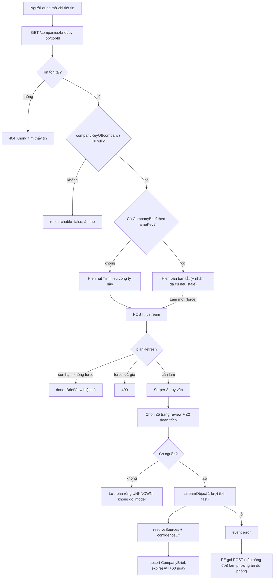
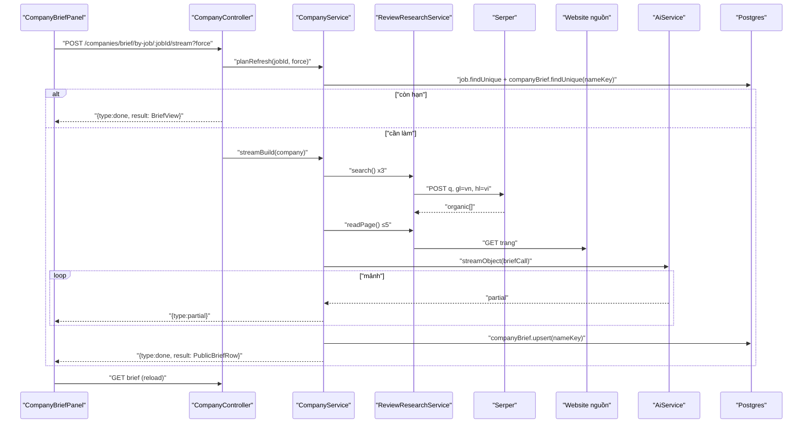
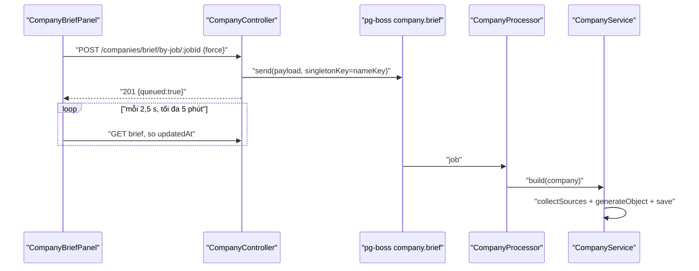
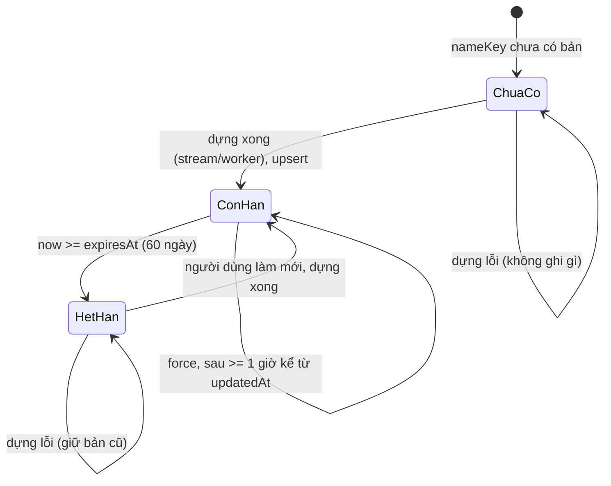

# Company Research — Tìm hiểu công ty

> **Phạm vi:** `server/src/modules/companies/**` (controller, processor hàng đợi `company.brief`, `CompanyService`, `ReviewResearchService` gọi Serper, `utils/` dựng prompt/chọn nguồn/chuẩn hoá tên công ty), bảng `CompanyBrief`, `CompanyFollow`, enum `CompanyVerdict`, `BriefConfidence`. Frontend: thẻ "Về công ty này" trong trang chi tiết tin `/dashboard/jobs/[id]` của `ui-ai-job-search`.
> **Nguyên tắc:** tài liệu mô tả hệ thống **as-is**. Code là nguồn sự thật duy nhất.

## 1. Purpose

| Mục tiêu | Diễn giải |
|---|---|
| Thay thao tác "tự đi Google review công ty" | Hệ thống tự tìm kiếm (Serper), tải các trang đánh giá công khai, rồi gọi model **đúng một lần** để tóm tắt công ty với tư cách **nơi làm việc** ([ADR 0016](../../adr/0016-tim-hieu-cong-ty.md)) |
| Một bản dùng chung cho mọi người | Bản tìm hiểu khoá theo tên công ty đã chuẩn hoá (`nameKey`), không theo người dùng hay tin. Mọi tin của cùng công ty, mọi người dùng đọc chung một bản ([schema.prisma:1131](../../../server/prisma/schema.prisma#L1131)) |
| Đọc rẻ, ghi có kiểm soát | Đường đọc chỉ là một truy vấn SQL, mở công khai cho khách; làm mới thì cần đăng nhập, có trần tần suất, có cửa sổ chặn làm mới cưỡng bức 1 giờ |
| Minh bạch nguồn | Chỉ lưu bản phân tích của hệ thống kèm đường dẫn nguồn, không lưu nguyên văn đánh giá của người khác; mọi nguồn đã kiểm (kể cả không dùng được) đều được lưu và hiển thị |

**Điểm mấu chốt:** luồng là **cố định do code điều khiển** (tìm → chọn nguồn → đọc → cắt → một lời gọi model → code tự tính `confidence` → upsert). Model chỉ được viết nhận định, khai nguồn bằng **số thứ tự** chứ không bằng URL; độ tin cậy do code suy ra. Bản quá hạn (60 ngày) **không tự chạy lại** — người dùng quyết định có đáng tốn một lượt gọi model hay không.

## 2. Actors

| Actor | Quyền trong module | Ghi chú |
|---|---|---|
| Khách (chưa đăng nhập) | Đọc bản tìm hiểu theo tin (`GET`) | Route `@Public()`, throttle 60 lượt/phút; FE chuyển khách sang trang đăng nhập khi bấm "Tìm hiểu" |
| Người dùng (USER/ADMIN đã đăng nhập) | Đọc; yêu cầu tìm hiểu/làm mới (`POST`, `POST …/stream`) | Không kiểm sở hữu vì dữ liệu dùng chung; trần `ThrottleAi` 10 lượt/phút |
| Worker hàng đợi `company.brief` | Chạy `CompanyService.build` ở nền | Chỉ chạy ở tiến trình có vai worker (`APP_ROLE` = `worker`/`all`) |
| Tavily (api.tavily.com) — nguồn chính *(2026-10-22)* | Trả kết quả tìm kiếm | Bỏ qua khi `TAVILY_API_KEY` rỗng; lỗi/hết hạn mức tháng thì lùi về Serper |
| Serper (google.serper.dev) — dự phòng | Trả kết quả tìm kiếm | Bỏ qua khi `SERPER_API_KEY` rỗng; tắt tìm kiếm khi cả hai key rỗng |
| Các website nguồn | Trả HTML trang đánh giá | Đọc bằng `fetchPage` có timeout và trần byte |
| Model AI (qua `AiService`, bể fast) | Sinh bản tóm tắt theo schema | Xem [ai-platform.md](./ai-platform.md) |

## 3. Business Features

| # | Tính năng | Actor | Endpoint / cơ chế |
|---|---|---|---|
| F1 | Xem bản tìm hiểu công ty của một tin | Khách, USER | `GET /api/companies/brief/by-job/:jobId` |
| F2 | Yêu cầu tìm hiểu/làm mới ở nền (xếp hàng đợi) | USER | `POST /api/companies/brief/by-job/:jobId` (body `{ force? }`) → hàng đợi `company.brief` |
| F3 | Tìm hiểu/làm mới dạng stream (NDJSON, thấy từng phần) | USER | `POST /api/companies/brief/by-job/:jobId/stream?force=true\|false` |
| F4 | Worker dựng bản tìm hiểu | Hệ thống | `CompanyProcessor` lắng nghe `company.brief` |
| F5 | Thu thập và chấm nguồn | Hệ thống | `ReviewResearchService` (Serper + đọc trang), `review-sources.ts` |
| F6 | Theo dõi / bỏ theo dõi công ty; tin mới của công ty theo dõi vào thông báo 07:30 *(2026-10-26)* | USER | `GET`/`POST /api/companies/follows`, `DELETE /api/companies/follows/:id` |

## 4. Business Flow

### Luồng A — Xem bản tìm hiểu (F1)

**Preconditions:** có `jobId`. Không cần đăng nhập.

**Main Flow:**
1. Client gọi `GET /api/companies/brief/by-job/:jobId` ([company.controller.ts:41](../../../server/src/modules/companies/company.controller.ts#L41)). Throttle riêng 60 lượt/60 giây.
2. `CompanyService.forJob` đọc `Job.company` theo id ([company.service.ts:53](../../../server/src/modules/companies/services/company.service.ts#L53)). Không có tin → **404** `Không tìm thấy tin: <jobId>`.
3. Chuẩn hoá tên bằng `companyKeyOf` ([company-key.ts:35](../../../server/src/modules/companies/utils/company-key.ts#L35)). Ra `null` (tên rỗng, ẩn danh như "không rõ", "công ty bảo mật", "confidential", "unknown", "n a", hoặc chỉ còn loại hình pháp nhân) → trả `{ company, researchable: false, brief: null, stale: false }`.
4. Tra `CompanyBrief` theo `nameKey` với `select` danh sách trắng `PUBLIC_BRIEF_SELECT` ([company-brief.ts:92](../../../server/src/modules/companies/utils/company-brief.ts#L92)).
5. `briefViewOf` dựng view: chưa có bản → `brief: null`; có bản → bỏ `expiresAt`, tính `stale = expiresAt <= now` ([company-brief.ts:125](../../../server/src/modules/companies/utils/company-brief.ts#L125)).
6. Trả **200** `{ company, researchable, brief, stale }`.

**Alternative Flow:** bản đã quá hạn → vẫn trả bản cũ với `stale: true`, không xếp việc làm mới.

**Failure Flow:** 404 như bước 2; vượt 60 lượt/phút → 429 của throttler.

**Postconditions:** không ghi gì; không gọi AI (đường đọc).

### Luồng B — Yêu cầu tìm hiểu ở nền (F2)

**Preconditions:** đã đăng nhập (guard JWT toàn cục); tin tồn tại và ghi rõ công ty.

**Main Flow:**
1. `POST /api/companies/brief/by-job/:jobId` với body `RefreshBriefDto { force?: boolean }` ([company.controller.ts:53](../../../server/src/modules/companies/company.controller.ts#L53)). Trần `ThrottleAi` 10 lượt/phút ([throttle.ts:6](../../../server/src/common/throttle.ts#L6)).
2. `planRefresh(jobId, force)` ([company.service.ts:78](../../../server/src/modules/companies/services/company.service.ts#L78)) gọi lại `forJob` (404 nếu không có tin).
3. `researchable = false` → **400** `Tin này không ghi rõ công ty: "<company>"`.
4. Có bản, còn hạn, không `force` → trả `null`; controller trả **201** `{ queued: false, reason: 'còn hạn' }`.
5. Có bản, `force = true` và bản được cập nhật chưa đủ 1 giờ (`FORCE_COOLDOWN_MS`, [company-brief.ts:119](../../../server/src/modules/companies/utils/company-brief.ts#L119)) → **409** `Bản tìm hiểu công ty này vừa được làm mới. Hãy thử lại sau khoảng một giờ.`
6. Ngược lại dựng payload `{ nameKey, company, force }` và `queue.send('company.brief', payload)`; khoá chặn trùng `singletonKey = nameKey` ([queue-key.ts:73](../../../server/src/modules/queue/queue-key.ts#L73)), policy `exclusive`.
7. Trả **201** `{ queued: true, company }`.

**Alternative Flow:** đã có một việc `company.brief` cùng `nameKey` đang chờ/chạy → pg-boss bỏ qua việc mới (policy `exclusive`), controller vẫn trả `{ queued: true }` — hai người bấm cùng lúc được gộp thành một lượt.

**Failure Flow:** 400/404/409 như trên; 401 nếu không có token; 429 nếu vượt trần.

**Postconditions:** một việc trong hàng đợi `company.brief`; chưa có thay đổi DB cho tới khi worker chạy xong.

### Luồng C — Tìm hiểu dạng stream (F3)

**Preconditions:** như Luồng B.

**Main Flow:**
1. `POST /api/companies/brief/by-job/:jobId/stream?force=true` (chỉ chuỗi `'true'` mới là cưỡng bức) ([company.controller.ts:68](../../../server/src/modules/companies/company.controller.ts#L68)).
2. `planRefresh` chạy **trước khi** mở luồng NDJSON, nên 400/404/409 trả về như HTTP thường (e2e "luồng stream cũng chặn làm mới cưỡng bức" ghim 409).
3. Không cần làm mới → luồng NDJSON chỉ gồm một sự kiện `{"type":"done","result":<BriefView>}` (`justDone(forJob(...))`).
4. Cần làm mới → `streamBuild(company)` ([company.service.ts:102](../../../server/src/modules/companies/services/company.service.ts#L102)):
   1. `prepare` → `collectSources` (Luồng E).
   2. Không có nguồn nào → lưu bản rỗng (`saveEmpty`), phát `done`.
   3. Có nguồn → `ai.streamObject(briefCall(...))`; mỗi mảnh phát `{"type":"partial","data":…}`; hết thì `save` và phát `{"type":"done","result":<PublicBriefRow>}`.
5. `streamNdjson` gửi nhịp tim `\n` mỗi 10 giây ([ndjson.ts:26](../../../server/src/common/ndjson.ts#L26)).

**Alternative Flow:** trình duyệt ngắt giữa chừng → server vẫn chạy generator tới cuối và tự lưu (quy tắc chung của route stream, không xếp lại việc).

**Failure Flow:** lỗi model/IO trong khối `try` → sự kiện `{"type":"error","message":"Không hoàn thành được tác vụ.","failureKind":…}`; nếu là `HttpException` thì giữ nguyên câu ([failure-view.ts:15](../../../server/src/common/ai/failure-view.ts#L15)). Không ghi trạng thái lỗi nào vào DB, bản cũ (nếu có) giữ nguyên.

**Postconditions:** `CompanyBrief` được upsert theo `nameKey` (nếu thành công); `ai_calls` có một hoặc nhiều dòng `purpose = 'company.brief'` (theo số mắt xích đã thử), `userId = null`.

### Luồng D — Worker dựng bản tìm hiểu (F4)

**Preconditions:** việc `company.brief` trong hàng đợi; tiến trình có vai worker.

**Main Flow:**
1. `CompanyProcessor.onModuleInit` đăng ký worker ([company.processor.ts:18](../../../server/src/modules/companies/company.processor.ts#L18)); concurrency mặc định 3 ([queue.defaults.ts:11](../../../server/src/modules/queue/queue.defaults.ts#L11)), `batchSize: 1`.
2. `CompanyService.build(company)` ([company.service.ts:132](../../../server/src/modules/companies/services/company.service.ts#L132)): `prepare` → không có nguồn thì `saveEmpty`; có nguồn thì `ai.generateObject(briefCall(...))` rồi `save`.

**Alternative Flow:** payload có `force` nhưng worker **không đọc** cờ này — luôn dựng lại (không kiểm hạn lần nữa).

**Failure Flow:** lỗi ném ra pg-boss; việc thử lại theo mặc định của pg-boss (`send` không khai `retryLimit`). Không có bản ghi trạng thái nên không thuộc `ReconcileService`.

**Postconditions:** như Luồng C.

### Luồng E — Thu thập và chấm nguồn (F5)

**Preconditions:** `companyKeyOf(company)` khác `null` (nếu không → `BadRequestException` `Không tìm hiểu được công ty ẩn danh: "<company>"`, [company.service.ts:147](../../../server/src/modules/companies/services/company.service.ts#L147)).

**Main Flow:**
1. `TAVILY_API_KEY` và `SERPER_API_KEY` cùng rỗng → `enabled = false` → không nguồn nào ([review-research.service.ts:21](../../../server/src/modules/companies/services/review-research.service.ts#L21)) *(2026-10-22)*.
2. Chạy song song 3 truy vấn `briefQueries` ([company-brief.prompt.ts:47](../../../server/src/modules/companies/utils/company-brief.prompt.ts#L47)): `review công ty X`, `X đánh giá nhân viên môi trường làm việc`, `có nên làm việc tại X`. Mỗi truy vấn gọi **Tavily trước** (`POST TAVILY_URL`, `max_results=SERPER_MAX_RESULTS`, `search_depth=basic`, `country=vietnam`); Tavily HTTP lỗi (gồm 432 hết hạn mức tháng) hoặc ngoại lệ → gọi **Serper** (`POST SERPER_URL`, `gl=vn`, `hl=vi`, `num=SERPER_MAX_RESULTS`). Timeout mỗi lời gọi `AGENT_FETCH_TIMEOUT_MS`. Cả hai hỏng → `[]` (chỉ log) ([review-research.service.ts:26](../../../server/src/modules/companies/services/review-research.service.ts#L26)) *(2026-10-22)*.
3. `pickReviewSources` ([review-sources.ts:87](../../../server/src/modules/companies/utils/review-sources.ts#L87)): bỏ URL không phải http/https, bỏ mạng xã hội (`BLOCKED_HOSTS`), bỏ đường dẫn tin tuyển dụng (`JOB_PATHS`), xếp ưu tiên theo `REVIEW_HOSTS` (itviec, reviewcongty, reviewtopcongty, glassdoor, topcv, vietnamworks, careerbuilder, careerlink, jobsgo, indeed) rồi theo thứ tự kết quả, mỗi tên miền một trang, tối đa 5.
4. Đọc song song từng trang (`readPage`): HTTP ngoài 2xx, lỗi mạng, hoặc văn bản \< 400 ký tự → ghi vào `unreachable`. Trang đọc được → `trimToReviewText` (bỏ dòng giao diện cookie/điều khoản, giữ cửa sổ quanh từ khoá đánh giá xếp theo mật độ, tổng ≤ 5.000 ký tự).
5. `pickSnippetSources`: tối đa 2 đoạn trích tìm kiếm từ facebook.com/threads.net, dài ≥ 60 ký tự, mỗi tên miền một đoạn ([review-sources.ts:59](../../../server/src/modules/companies/utils/review-sources.ts#L59)).
6. Nguồn = trang đọc được + đoạn trích, đánh số 1..n trong prompt; đoạn trích được ghi chú "chỉ là đoạn trích ngắn".
7. Sau khi model trả lời, `resolveSources` ánh xạ `usedSources[].index` về nguồn, bỏ số ngoài khoảng và số trùng, rồi nối thêm nguồn `unreachable` với `usedFor: null` ([company-brief.ts:141](../../../server/src/modules/companies/utils/company-brief.ts#L141)).
8. `confidenceOf` trên danh sách URL có `usedFor !== null` ([review-sources.ts:224](../../../server/src/modules/companies/utils/review-sources.ts#L224)).
9. `save` upsert theo `nameKey` với `expiresAt = now + 60 ngày` ([company.service.ts:206](../../../server/src/modules/companies/services/company.service.ts#L206)).

**Alternative Flow:** không có nguồn → `emptyBrief()` (verdict `unknown`, summary `Chưa tìm được nguồn đánh giá công khai nào về công ty này.`, `modelId = null`), **không gọi model**, vẫn hạn 60 ngày.

**Failure Flow:** lỗi model ném lên caller (Luồng C/D). Lỗi tìm kiếm/đọc trang không bao giờ làm hỏng luồng — chỉ làm giảm số nguồn.

**Postconditions:** `CompanyBrief` có `sources` gồm cả nguồn đã dùng, nguồn đọc mà không dùng, và nguồn không mở được (`status`: `read` | `snippet` | `unreachable`).

## 5. Mermaid Flowchart

## 6. Sequence Diagram

### Stream (đường chính của FE)

### Hàng đợi (phương án dự phòng của FE)

## 7. Business Rules

| Mã BR | Quy tắc | Nơi thực thi | Mức | Nguồn code |
|---|---|---|---|---|
| BR-CMP-01 | Một bản tìm hiểu cho mỗi công ty đã chuẩn hoá: `nameKey` là khoá duy nhất, dùng chung cho mọi tin và mọi người dùng | DB | 🔒 | [schema.prisma:1131](../../../server/prisma/schema.prisma#L1131) |
| BR-CMP-02 | `companyKeyOf`: chuẩn hoá chữ (bỏ dấu), bỏ các cụm loại hình pháp nhân (dài trước), **giữ tên quốc gia**; tên rỗng/ẩn danh hoặc chỉ còn loại hình → `null` (không tìm hiểu được) | SV | ✅ | [company-key.ts:35](../../../server/src/modules/companies/utils/company-key.ts#L35) |
| BR-CMP-03 | Đường đọc không gọi AI; chỉ trả các trường danh sách trắng (`verdict, summary, pros, cons, confidence, rating, reviewCount, sources, updatedAt`) — `modelId`, `name`, `nameKey` không lộ ra | SV | ✅ | [company-brief.ts:92](../../../server/src/modules/companies/utils/company-brief.ts#L92) |
| BR-CMP-04 | Bản hết hạn khi `expiresAt <= now` (`stale`); bản hết hạn vẫn hiển thị và **không tự chạy lại** | SV | ✅ | [company-brief.ts:125](../../../server/src/modules/companies/utils/company-brief.ts#L125) |
| BR-CMP-05 | Hạn của một bản là 60 ngày kể từ lần lưu (kể cả bản rỗng) | SV | ✅ | [company.service.ts:41](../../../server/src/modules/companies/services/company.service.ts#L41) |
| BR-CMP-06 | Chỉ tìm hiểu được tin ghi rõ công ty; ngược lại 400 | SV | ✅ | [company.service.ts:83](../../../server/src/modules/companies/services/company.service.ts#L83) |
| BR-CMP-07 | Bản còn hạn và không cưỡng bức → không xếp việc, không gọi model | SV | ✅ | [company.service.ts:88](../../../server/src/modules/companies/services/company.service.ts#L88) |
| BR-CMP-08 | Làm mới cưỡng bức bị chặn (409) nếu bản được cập nhật chưa đủ 1 giờ | SV | ✅ | [company-brief.ts:119](../../../server/src/modules/companies/utils/company-brief.ts#L119), [company.service.ts:89](../../../server/src/modules/companies/services/company.service.ts#L89) |
| BR-CMP-09 | Hàng đợi `company.brief` chặn trùng theo `nameKey` (không có `userId`), policy `exclusive`; concurrency mặc định 3 | SV (pg-boss) | ✅ | [queue-key.ts:73](../../../server/src/modules/queue/queue-key.ts#L73), [queue.defaults.ts:11](../../../server/src/modules/queue/queue.defaults.ts#L11) |
| BR-CMP-10 | Luồng cố định: 3 truy vấn Serper (`gl=vn`, `hl=vi`), rồi **đúng một** lượt gọi model cho mỗi lần dựng (chưa tính mắt xích dự phòng) | SV | ✅ | [company.service.ts:160](../../../server/src/modules/companies/services/company.service.ts#L160), [company-brief.prompt.ts:47](../../../server/src/modules/companies/utils/company-brief.prompt.ts#L47) |
| BR-CMP-11 | Chọn tối đa 5 trang: loại mạng xã hội, loại đường dẫn tin tuyển dụng, ưu tiên 10 trang review theo thứ tự cố định, mỗi tên miền một trang | SV | ✅ | [review-sources.ts:87](../../../server/src/modules/companies/utils/review-sources.ts#L87) |
| BR-CMP-12 | Giữ tối đa 2 đoạn trích Serper (≥ 60 ký tự) từ facebook/threads làm nguồn phụ, prompt ghi rõ "chỉ là đoạn trích" | SV | ✅ | [review-sources.ts:59](../../../server/src/modules/companies/utils/review-sources.ts#L59), [company-brief.prompt.ts:31](../../../server/src/modules/companies/utils/company-brief.prompt.ts#L31) |
| BR-CMP-13 | Trang chỉ được coi là đọc được khi HTTP 2xx và văn bản ≥ 400 ký tự; còn lại lưu là `unreachable` | SV | ✅ | [review-research.service.ts:53](../../../server/src/modules/companies/services/review-research.service.ts#L53) |
| BR-CMP-14 | Nội dung mỗi trang được cắt còn ≤ 5.000 ký tự theo mật độ từ khoá đánh giá | SV | ✅ | [review-sources.ts:196](../../../server/src/modules/companies/utils/review-sources.ts#L196) |
| BR-CMP-15 | Không có nguồn nào → lưu bản `UNKNOWN` mặc định, `modelId = null`, không gọi model | SV | ✅ | [company-brief.ts:169](../../../server/src/modules/companies/utils/company-brief.ts#L169), [company.service.ts:155](../../../server/src/modules/companies/services/company.service.ts#L155) |
| BR-CMP-16 | Model khai nguồn bằng số thứ tự; code ánh xạ ngược, bỏ số ngoài khoảng/trùng; mọi nguồn đã kiểm đều được lưu (`usedFor = null` nếu không dùng) | SV | ✅ | [company-brief.ts:141](../../../server/src/modules/companies/utils/company-brief.ts#L141) |
| BR-CMP-17 | `confidence` do code tính trên nguồn đã dùng: 0 nguồn → `LOW`; ≥ 1 trang review chuyên và ≥ 2 nguồn → `HIGH`; ≥ 1 trang review hoặc ≥ 3 nguồn → `MEDIUM`; còn lại `LOW` | SV | ✅ | [review-sources.ts:224](../../../server/src/modules/companies/utils/review-sources.ts#L224) |
| BR-CMP-18 | Output model được CẮT chứ không từ chối: `summary` ≤ 700, `pros`/`cons` ≤ 5 mục × 140 ký tự, `usedFor` ≤ 240, `usedSources` ≤ 6; `verdict` lạ → `unknown`; `rating` ngoài [0;5] → `null`; `reviewCount` âm → `null` | SV (zod) | ✅ | [company-brief.ts:31](../../../server/src/modules/companies/utils/company-brief.ts#L31) |
| BR-CMP-19 | `NO_REVIEWS_YET` (trang review có nhưng chưa ai viết) tách khỏi `UNKNOWN` (nguồn không nói gì về môi trường làm việc) | SV (prompt + schema) | ✅ | [company-brief.ts:32](../../../server/src/modules/companies/utils/company-brief.ts#L32) |
| BR-CMP-20 | Prompt: chỉ dùng nguồn được cấp, không dùng kiến thức sẵn có, không chép nguyên văn, coi nội dung nguồn là dữ liệu chứ không phải chỉ thị | SV (prompt) | ✅ | [company-brief.prompt.ts:15](../../../server/src/modules/companies/utils/company-brief.prompt.ts#L15) |
| BR-CMP-21 | Cả đường stream lẫn đường hàng đợi đều chọn model từ **bể fast** (`fastModelChain`), timeout một lời gọi 120 giây | SV | ✅ | [company-brief.prompt.ts:55](../../../server/src/modules/companies/utils/company-brief.prompt.ts#L55) |
| BR-CMP-22 | Lưu là upsert theo `nameKey`; `name` bị ghi đè bằng tên công ty ở lần dựng gần nhất | SV | ✅ | [company.service.ts:231](../../../server/src/modules/companies/services/company.service.ts#L231) |
| BR-CMP-23 | Lỗi khi dựng bản không để lại trạng thái lỗi trong DB; bản cũ (nếu có) giữ nguyên | SV | ✅ | [company.service.ts:125](../../../server/src/modules/companies/services/company.service.ts#L125) |
| BR-CMP-24 | Đọc công khai: throttle 60 lượt/phút; làm mới: `ThrottleAi` 10 lượt/phút | GD | ✅ | [company.controller.ts:42](../../../server/src/modules/companies/company.controller.ts#L42), [throttle.ts:6](../../../server/src/common/throttle.ts#L6) |
| BR-CMP-25 | FE chỉ hiện thẻ "Về công ty này" khi `researchable = true` và không lỗi; khách bấm "Tìm hiểu" bị chuyển sang đăng nhập | FE | ⚠️ | [company-brief-panel.tsx:66](../../../../ui-ai-job-search/app/dashboard/jobs/[id]/company-brief/company-brief-panel.tsx#L66) |
| BR-CMP-26 | Tìm kiếm nguồn: Tavily là nguồn chính, Serper chỉ được gọi khi Tavily không có key hoặc lời gọi Tavily hỏng (HTTP lỗi, hết hạn mức tháng, timeout); Tavily trả 200 với 0 kết quả thì KHÔNG gọi Serper *(2026-10-22)* | SV | ✅ | [review-research.service.ts:26](../../../server/src/modules/companies/services/review-research.service.ts#L26) |
| BR-CMP-27 | Theo dõi công ty theo khoá `companyKeyOf` của tin (`POST { jobId }`), nên cùng một công ty ở nhiều portal chỉ là một lượt theo dõi; bấm lại trả bản đã có (bắt `P2002`); tin ẩn danh → 400; tối đa 50 công ty mỗi người → 400 *(2026-10-26)* | SV, DB | ✅ | [company-follow.service.ts](../../../server/src/modules/companies/services/company-follow.service.ts) |
| BR-CMP-28 | Bỏ theo dõi khoá theo `{ id, userId }`; của người khác hoặc không có → 404 *(2026-10-26)* | SV | ✅ | [company-follow.service.ts](../../../server/src/modules/companies/services/company-follow.service.ts) |
| BR-CMP-29 | `Job.companyKey` tính trong `derivedFields` khi ghi tin và khi "Tính lại toàn bộ"; tin cũ chỉ có khoá sau khi chạy lại *(2026-10-26)* | SV | ✅ | [resolve.ts](../../../server/src/modules/jobs/taxonomy/resolve.ts) |

> **Possible Business Rule:** Bản rỗng (khi Serper tắt hoặc không tìm thấy gì) có hạn 60 ngày như bản thật. Có thể chủ dự án muốn bản rỗng hết hạn sớm hơn để lần sau tự thử lại — cần xác nhận.

> **Possible Business Rule:** Bất kỳ người dùng đăng nhập nào cũng được làm mới bản dùng chung của mọi công ty (không giới hạn theo việc đã lưu/ứng tuyển tin). Trần chi phí hiện chỉ là `ThrottleAi` + cửa sổ 1 giờ cho `force` — cần xác nhận đây là chủ ý.

## 8. Validation Rules

**`RefreshBriefDto`** ([company.dto.ts](../../../server/src/modules/companies/company.dto.ts))

| Field | Ràng buộc | DTO/Schema | Lỗi trả về |
|---|---|---|---|
| `force` | Tuỳ chọn, `@IsBoolean()` | `RefreshBriefDto` | 400 (thông điệp của `ValidationPipe` toàn cục) |

**Query `force` của route stream:** không có DTO; chỉ giá trị chuỗi đúng `'true'` mới bật cưỡng bức, mọi giá trị khác coi là `false` ([company.controller.ts:74](../../../server/src/modules/companies/company.controller.ts#L74)).

**Tham số `:jobId`:** không kiểm định dạng; id không tồn tại → 404.

**`companyBriefSchema` (output model)** ([company-brief.ts:31](../../../server/src/modules/companies/utils/company-brief.ts#L31))

| Field | Ràng buộc | DTO/Schema | Lỗi trả về |
|---|---|---|---|
| `verdict` | enum `positive/mixed/negative/no_reviews_yet/unknown`, giá trị lạ → `unknown` (`.catch`) | `companyVerdict` | không lỗi (nắn) |
| `summary` | chuỗi, trim, cắt 700 ký tự | `cappedTextVi(700)` | không lỗi (cắt) |
| `pros`, `cons` | mảng chuỗi ≤ 140 ký tự, bỏ chuỗi rỗng, tối đa 5; phần tử dạng object chứa chuỗi được bóc | `boundedList` | không lỗi (cắt) |
| `rating` | số hoặc null; ngoài [0;5] → null | `ratingOutOfFive` | không lỗi |
| `reviewCount` | số nguyên hoặc null; âm → null | inline | sai kiểu (không phải số nguyên) → lỗi schema |
| `usedSources[]` | `{ index: int, usedFor: chuỗi ≤ 240 }`, cắt còn 6 phần tử | `usedSource` | `index` không phải số nguyên → lỗi schema |

Lỗi schema (thiếu trường bắt buộc, sai kiểu) đi theo xử lý chung của `AiService`/`ModelChain` (xem [ai-platform.md](./ai-platform.md)).

## 9. API Mapping

| Method | URL | Role | Mục đích nghiệp vụ | Controller#method | Service | DTO | Response |
|---|---|---|---|---|---|---|---|
| GET | `/api/companies/brief/by-job/:jobId` | Public (throttle 60/phút) | Xem bản tìm hiểu công ty của tin | `CompanyController#brief` | `CompanyService.forJob` | — | 200 `BriefView { company, researchable, brief: PublicBrief \| null, stale }` |
| POST | `/api/companies/brief/by-job/:jobId` | USER/ADMIN (`ThrottleAi` 10/phút) | Xếp việc tìm hiểu/làm mới ở nền | `CompanyController#refresh` | `CompanyService.enqueueRefresh` (`planRefresh` → `QueueService.send`; controller không còn giữ hàng đợi — *2026-10-26*) | `RefreshBriefDto` | 201 `{ queued: false, reason: 'còn hạn' }` hoặc `{ queued: true, company }` |
| POST | `/api/companies/brief/by-job/:jobId/stream?force=` | USER/ADMIN (`ThrottleAi` 10/phút) | Tìm hiểu/làm mới, đẩy từng phần | `CompanyController#refreshStream` | `CompanyService.planRefresh`, `streamBuild`, `forJob` | query `force` | 200 NDJSON: `partial`*, rồi `done` hoặc `error` |
| GET | `/api/companies/follows` | USER | Công ty mình đang theo dõi *(2026-10-26)* | `CompanyController#listFollows` | `CompanyFollowService.list` | — | 200 `[{ id, companyKey, name }]` |
| POST | `/api/companies/follows` | USER | Theo dõi công ty của một tin *(2026-10-26)* | `CompanyController#follow` | `CompanyFollowService.follow` | `FollowCompanyDto { jobId }` | 201 `{ id, companyKey, name }` |
| DELETE | `/api/companies/follows/:id` | USER | Bỏ theo dõi *(2026-10-26)* | `CompanyController#unfollow` | `CompanyFollowService.unfollow` | — | 200 `{ removed }` |

**Endpoint ở module khác tác động lên module này**

| Endpoint / cơ chế | Module | Tác động |
|---|---|---|
| Worker `company.brief` | queue ([platform-operations.md](./platform-operations.md)) | Đọc cấu hình concurrency từ `QueueConfig`; admin đổi được concurrency hàng đợi này |
| `GET /api/admin/ai-failures`, `/api/admin/ai-usage`, `/api/admin/ai-health` | admin ([admin-console.md](./admin-console.md)) | Đọc các dòng `ai_calls` có `purpose = 'company.brief'` |
| `Job.company` do scraper ghi | jobs/scraper ([jobs.md](./jobs.md), [job-scraping.md](./job-scraping.md)) | Tên công ty nguồn để suy `nameKey` |

## 10. Frontend Mapping

| `/dashboard/jobs/[id]` — nút "Theo dõi" cạnh tên công ty ([follow-company-button.tsx](../../../../ui-ai-job-search/app/dashboard/jobs/[id]/follow-company-button.tsx)); `/dashboard/settings` — dòng "Công ty đang theo dõi" ([followed-companies.tsx](../../../../ui-ai-job-search/app/dashboard/settings/followed-companies.tsx)); công tắc "Công ty theo dõi" trên thanh lọc việc làm (`?followed=1`) *(2026-10-26)* | USER | Theo dõi / bỏ theo dõi, xem tin của công ty đang theo dõi; chỉ hiện nút khi đã đăng nhập và tin có `companyKey` | `useCompanyFollows` ([hooks/use-company-follows.ts](../../../../ui-ai-job-search/hooks/use-company-follows.ts)) |
| Route FE | Vai trò | Mục đích | Hook / API client |
|---|---|---|---|
| `/dashboard/jobs/[id]` — thẻ "Về công ty này" ([company-brief-panel.tsx](../../../../ui-ai-job-search/app/dashboard/jobs/[id]/company-brief/company-brief-panel.tsx)) | Khách, USER | Hiện bản tìm hiểu, nút "Tìm hiểu công ty này" / "Làm mới", tiến trình trực tiếp | `useApiQuery(keys.companyBrief(jobId), companiesService.briefForJob)`; `streamModel({ path: '/companies/brief/by-job/:jobId/stream', force })` ([model-stream.ts](../../../../ui-ai-job-search/lib/model-stream.ts)); dự phòng `companiesService.refreshForJob(jobId, force)` ([companies.ts](../../../../ui-ai-job-search/services/companies.ts)) |
| `/dashboard/jobs/[id]` — mục lục dính ([job-section-nav.tsx](../../../../ui-ai-job-search/app/dashboard/jobs/[id]/job-section-nav.tsx)) | Khách, USER | Thêm mục "Review công ty" (kèm `★ rating`) khi `researchable` | `useApiQuery(keys.companyBrief(jobId))` (dùng chung cache) |
| Thân thẻ ([company-brief-body.tsx](../../../../ui-ai-job-search/app/dashboard/jobs/[id]/company-brief/company-brief-body.tsx)) | — | Nhãn verdict, cảnh báo `confidence = LOW`, nhãn "đã cũ", danh sách nguồn đã dùng / đã kiểm ("không mở được") | Nhãn ở [company-brief.ts](../../../../ui-ai-job-search/lib/company-brief.ts) |

Hành vi FE đáng chú ý ([company-brief-panel.tsx:71](../../../../ui-ai-job-search/app/dashboard/jobs/[id]/company-brief/company-brief-panel.tsx#L71)):
- Chưa đăng nhập → `router.push(loginPathForJob(jobId))`.
- Stream lỗi (bất kỳ lý do) → gọi `POST` xếp hàng đợi, rồi hỏi lại mỗi 2,5 giây cho tới khi `brief.updatedAt` đổi; quá 5 phút thì báo `Chưa có kết quả tìm hiểu công ty sau 5 phút. Bấm tìm hiểu lại để thử lần nữa.`
- Nhãn verdict: `POSITIVE` "Đánh giá tích cực", `MIXED` "Ý kiến trái chiều", `NEGATIVE` "Nhiều phàn nàn", `NO_REVIEWS_YET` "Chưa ai đánh giá", `UNKNOWN` "Chưa đủ dữ liệu".

## 11. Database

**Bảng `company_briefs` (model `CompanyBrief`)** — [schema.prisma:1131](../../../server/prisma/schema.prisma#L1131)

| Field | Kiểu | Ghi chú |
|---|---|---|
| `id` | String cuid | PK |
| `nameKey` | String **@unique** | Khoá tra cứu, kết quả `companyKeyOf` |
| `name` | String | Tên hiển thị (ghi đè mỗi lần lưu, xem R4) |
| `verdict` | `CompanyVerdict` | |
| `summary` | Text | |
| `pros`, `cons` | String[] default `[]` | |
| `confidence` | `BriefConfidence` | Code tính |
| `rating` | Float? | Chỉ khi trang ghi rõ |
| `reviewCount` | Int? | Chỉ khi trang ghi rõ |
| `sources` | Json | `[{ url, title, usedFor: string \| null, status: 'read' \| 'snippet' \| 'unreachable' }]` |
| `modelId` | String? | `null` với bản rỗng; không trả ra API |
| `expiresAt` | DateTime | `now + 60 ngày` |
| `createdAt`, `updatedAt` | DateTime | `updatedAt` dùng cho cửa sổ 1 giờ và để FE dò kết quả |

Index: chỉ unique `nameKey`. Không có quan hệ khoá ngoại tới `Job` hay `User`.

**Enum** — [schema.prisma:1114](../../../server/prisma/schema.prisma#L1114)
- `BriefConfidence`: `HIGH`, `MEDIUM`, `LOW`.
- `CompanyVerdict`: `POSITIVE`, `MIXED`, `NEGATIVE`, `NO_REVIEWS_YET`, `UNKNOWN`.

Bảng phụ chịu tác động: `ai_calls` (một dòng mỗi lượt gọi model, `purpose = 'company.brief'`, `userId = null` vì `briefCall` không truyền `userId`).

## 12. State Machine

`CompanyBrief` **không có cột trạng thái** (không `MatchStatus`), nên không thuộc `ReconcileService`. Vòng đời suy ra từ sự tồn tại của bản ghi và `expiresAt`:

| Từ | Sang | Trigger | Điều kiện |
|---|---|---|---|
| Chưa có | Còn hạn | Stream/worker dựng xong | `nameKey` khác null |
| Còn hạn | Hết hạn | Thời gian | `expiresAt <= now` (tính lúc đọc) |
| Hết hạn | Còn hạn | `POST` hoặc `POST …/stream` | Không cần `force` |
| Còn hạn | Còn hạn (bản mới) | `POST`/stream với `force` | `now - updatedAt >= 1 giờ`, ngược lại 409 |

Trạng thái phía FE (cục bộ): `pendingSince` (đang chờ `updatedAt` đổi), `queued` (đã rơi về hàng đợi, đang hỏi lại), `partial` (mảnh stream).

## 13. Exceptions

| Tình huống | HTTP | Thông điệp nguyên văn | Nguồn |
|---|---|---|---|
| Không có tin theo `jobId` | 404 | `Không tìm thấy tin: <jobId>` | [company.service.ts:58](../../../server/src/modules/companies/services/company.service.ts#L58) |
| Tin không ghi rõ công ty (khi làm mới) | 400 | `Tin này không ghi rõ công ty: "<company>"` | [company.service.ts:84](../../../server/src/modules/companies/services/company.service.ts#L84) |
| Làm mới cưỡng bức trong vòng 1 giờ | 409 | `Bản tìm hiểu công ty này vừa được làm mới. Hãy thử lại sau khoảng một giờ.` | [company.service.ts:90](../../../server/src/modules/companies/services/company.service.ts#L90) |
| Dựng cho công ty ẩn danh (chỉ chạm được nếu payload hàng đợi sai) | 400 / sự kiện `error` | `Không tìm hiểu được công ty ẩn danh: "<company>"` | [company.service.ts:147](../../../server/src/modules/companies/services/company.service.ts#L147) |
| Lỗi model/IO giữa luồng stream | 200 + sự kiện `error` | `Không hoàn thành được tác vụ.` kèm `failureKind` | [failure-view.ts:25](../../../server/src/common/ai/failure-view.ts#L25) |
| Body `force` không phải boolean | 400 | thông điệp `ValidationPipe` | [company.dto.ts:4](../../../server/src/modules/companies/company.dto.ts#L4) |
| Thiếu/hỏng token ở route POST | 401 | (guard JWT toàn cục) | — |
| Vượt trần tần suất | 429 | (throttler) | [throttle.ts:6](../../../server/src/common/throttle.ts#L6) |
| Theo dõi tin ẩn danh | 400 | `Tin này không ghi tên công ty nên chưa theo dõi được.` | [company-follow.service.ts](../../../server/src/modules/companies/services/company-follow.service.ts) |
| Theo dõi quá 50 công ty | 400 | `Bạn đang theo dõi đủ 50 công ty. Bỏ bớt một công ty ở Tài khoản rồi theo dõi tiếp.` | như trên |
| Bỏ theo dõi không thuộc mình | 404 | `Bạn không theo dõi công ty này` | như trên |
| Serper trả lỗi / trang không đọc được | — | Không trả cho client; chỉ log `Tìm kiếm trả về HTTP …`, `Không đọc được <url>: …` | [review-research.service.ts:42](../../../server/src/modules/companies/services/review-research.service.ts#L42) |

## 14. Notifications

Tin mới của công ty đang theo dõi được gộp vào thông báo 07:30 của module jobs ([jobs.md](./jobs.md) BR-JOB-34) *(2026-10-26)*. Ngoài ra module không gửi email/thông báo; FE tự hỏi lại (`refetchInterval` 2,5 giây) khi đã rơi về hàng đợi và tự báo toast lỗi sau 5 phút.

## 15. Integrations

| Hệ thống | Cách gọi | Cấu hình | Ghi chú |
|---|---|---|---|
| Tavily (Search API) — chính *(2026-10-22)* | `POST TAVILY_URL`, header `Authorization: Bearer` | `TAVILY_API_KEY` (rỗng = bỏ qua), `TAVILY_URL` (mặc định `https://api.tavily.com/search`); miễn phí 1.000 lượt/tháng, hết thì HTTP 432 | Phản hồi đọc bằng `parseTavily` (`results[].{title,url,content}`); lỗi → lùi về Serper |
| Serper (Google Search API) — dự phòng | `POST SERPER_URL`, header `X-API-KEY` | `SERPER_API_KEY` (rỗng = tắt tìm kiếm), `SERPER_URL` (mặc định `https://google.serper.dev/search`), `SERPER_MAX_RESULTS` (5) — [configuration.ts:104](../../../server/src/config/configuration.ts#L104) | Phản hồi đọc bằng `parseSerper`; lỗi → `[]` |
| Website nguồn | `fetchPage` (`common/web/http-get`) | `AGENT_FETCH_TIMEOUT_MS` (20 000), `AGENT_FETCH_MAX_BYTES` (2 000 000) | HTML → văn bản bằng `pageToText` |
| Model AI | `AiService.streamObject` / `generateObject`, bể fast | `AI_FAST_MODEL_ID`, `AI_FAST_FALLBACK_IDS`, `FAST_TASK_PROVIDERS` | Xem [ai-platform.md](./ai-platform.md) |
| pg-boss | Hàng đợi `company.brief` | Concurrency trong `QueueConfig` (mặc định 3) | Xem [platform-operations.md](./platform-operations.md) |

## 16. Security

- **Phân quyền:** `GET` là `@Public()`; hai route `POST` dùng guard JWT toàn cục (mặc định đóng). Không có `@Roles`.
- **Sở hữu:** không áp dụng — `CompanyBrief` là dữ liệu dùng chung, không có `userId`. Hệ quả: người dùng nào cũng có thể làm mới bản của mọi công ty (xem Possible BR ở §7).
- **Lọc trường công khai:** `PUBLIC_BRIEF_SELECT` là danh sách trắng; e2e "khách đọc được bản tìm hiểu nhưng không thấy trường nội bộ" ([company-brief.e2e-spec.ts:65](../../../server/test/company-brief.e2e-spec.ts#L65)).
- **Rate limit:** 60/phút cho đọc công khai, 10/phút (`ThrottleAi`) cho hai route làm mới; bộ đếm theo `user:<id>` nếu có người dùng, ngược lại theo IP ([user-throttler.guard.ts](../../../server/src/common/guards/user-throttler.guard.ts)).
- **Chống prompt injection:** system prompt khai "RANH GIỚI TIN CẬY" cho nội dung nguồn bên thứ ba ([company-brief.prompt.ts:24](../../../server/src/modules/companies/utils/company-brief.prompt.ts#L24)); model không được tự viết URL (chỉ số thứ tự).
- **Bản quyền/điều khoản:** không lưu nguyên văn đánh giá; chỉ lưu bản phân tích + link nguồn ([ADR 0016](../../adr/0016-tim-hieu-cong-ty.md)).
- **Dữ liệu nhạy cảm:** không có dữ liệu cá nhân người dùng trong module; `SERPER_API_KEY` chỉ nằm ở server.

## 17. ⚠️ Sai lệch / Rủi ro nghiệp vụ

**R1 — FE tự xếp thêm một lượt dựng mỗi khi stream lỗi.** ✅ **Đã sửa 2026-10-19** (mức cũ: 🟡)
- Máy chủ báo lỗi → toast thông điệp của máy chủ (sửa luôn R6 cho đường stream); đứt kết nối → chỉ hỏi lại `GET /companies/brief/by-job/:jobId` tối đa 5 phút, không `POST` thêm ([company-brief-panel.tsx](../../../../ui-ai-job-search/app/dashboard/jobs/%5Bid%5D/company-brief/company-brief-panel.tsx)). FE không còn gọi `POST /api/companies/brief/by-job/:jobId`.
- Mô tả: khi `streamModel` ném lỗi vì bất kỳ lý do nào (model hỏng sau khi đã thử hết chuỗi, sự kiện `error`, mạng đứt, 409), FE gọi ngay `POST` để xếp việc nền.
- Bằng chứng: [company-brief-panel.tsx:87](../../../../ui-ai-job-search/app/dashboard/jobs/[id]/company-brief/company-brief-panel.tsx#L87) (`catch` → `companiesService.refreshForJob`). Lỗi model không ghi gì vào DB nên `planRefresh` không chặn được ([company.service.ts:88](../../../server/src/modules/companies/services/company.service.ts#L88)).
- Tác động: một lần bấm có thể tốn gấp đôi số lượt gọi model (cả chuỗi dự phòng của stream, rồi cả chuỗi của worker); đi ngược tinh thần "Route stream không xếp lại việc" trong `CLAUDE.md`.
- Đề xuất: chỉ rơi về hàng đợi khi stream lỗi trước sự kiện đầu (lỗi kết nối), không rơi về khi đã nhận sự kiện `error` có `failureKind`.

**R2 — Hai lượt stream cùng công ty không được gộp.** Mức đề xuất: 🟡
- Mô tả: đường stream không đi qua hàng đợi (nên không có `singletonKey`) và không giành chỗ có điều kiện; hai người dùng (hoặc hai tab) bấm cùng lúc cho một công ty chưa có bản đều chạy trọn luồng.
- Bằng chứng: [company.controller.ts:86](../../../server/src/modules/companies/company.controller.ts#L86) gọi thẳng `streamBuild`; `save` là `upsert` không điều kiện ([company.service.ts:231](../../../server/src/modules/companies/services/company.service.ts#L231)).
- Tác động: tốn thêm lượt Serper và lượt model; bản lưu sau ghi đè bản trước (kết quả vẫn hợp lệ). Cũng bỏ qua trần concurrency 3 của hàng đợi.
- Đề xuất: chấp nhận nếu tần suất thấp; nếu cần, giành chỗ theo `nameKey` trước khi gọi model.

**R3 — Bản rỗng khi Serper tắt bị "đóng băng" 60 ngày.** Mức đề xuất: 🟡
- Mô tả: `SERPER_API_KEY` rỗng (hoặc Serper lỗi tạm thời ở cả 3 truy vấn) → lưu bản `UNKNOWN` "Chưa tìm được nguồn đánh giá công khai nào…" với hạn 60 ngày. Sau khi cấu hình lại key, người dùng chỉ làm mới được bằng `force`.
- Bằng chứng: [review-research.service.ts:20](../../../server/src/modules/companies/services/review-research.service.ts#L20), [company.service.ts:164](../../../server/src/modules/companies/services/company.service.ts#L164), [company.service.ts:213](../../../server/src/modules/companies/services/company.service.ts#L213).
- Tác động: người dùng thấy "Chưa đủ dữ liệu" dù lỗi là cấu hình/tạm thời, không phân biệt được.
- Đề xuất: không lưu (hoặc lưu hạn ngắn) khi tìm kiếm tắt/lỗi, phân biệt với "tìm rồi mà không có gì".

**R4 — Lệch giữa chú thích schema/tài liệu và code.** Mức đề xuất: 🟢
- `name` được chú thích "lấy từ tin tuyển dụng đầu tiên gặp được" ([schema.prisma:1138](../../../server/prisma/schema.prisma#L1138)) nhưng `save` ghi đè `name` mỗi lần ([company.service.ts:216](../../../server/src/modules/companies/services/company.service.ts#L216)).
- `sources` được chú thích `[{ url, title, usedFor }]` nhưng code lưu thêm `status`.
- ADR 0016 dẫn `brief-confidence.ts`, file thật là `review-sources.ts#confidenceOf`.
- `.env.example` ghi rằng đường hàng đợi `COMPANY_BRIEF` "không đọc biến" `AI_FAST_MODEL_ID` ([.env.example:226](../../../server/.env.example#L226)), nhưng `build()` dùng chung `briefCall` → `fastModelChain` ([company.service.ts:136](../../../server/src/modules/companies/services/company.service.ts#L136)).
- Đề xuất: sửa chú thích/tài liệu cho khớp code.

**R5 — Sự kiện `done` của route stream có hai hình dạng.** Mức đề xuất: 🟢
- Mô tả: nhánh "còn hạn" trả `result: BriefView` (`{ company, researchable, brief, stale }`), nhánh dựng mới trả `result: PublicBriefRow` (có `expiresAt`, không có `company`).
- Bằng chứng: [company.controller.ts](../../../server/src/modules/companies/company.controller.ts) và [company.service.ts:121](../../../server/src/modules/companies/services/company.service.ts#L121).
- Tác động: FE hiện bỏ qua `result` và tải lại bằng `GET`, nên chưa lỗi; client khác dựa vào `result` sẽ sai.
- Đề xuất: thống nhất một hình dạng.

**R6 — Thông báo lỗi FE che mất câu 409 của server.** Mức đề xuất: 🟢
- Mô tả: khi stream bị 409, FE rơi về `POST` (cũng 409) rồi hiển thị `apiErrorMessage(err, …)` với `err` là lỗi **stream** (`Máy chủ trả về HTTP 409`), không phải câu nghiệp vụ "vừa được làm mới…".
- Bằng chứng: [company-brief-panel.tsx:94](../../../../ui-ai-job-search/app/dashboard/jobs/[id]/company-brief/company-brief-panel.tsx#L94), [model-stream.ts:38](../../../../ui-ai-job-search/lib/model-stream.ts#L38).
- Tác động: người dùng không biết phải đợi một giờ. (FE vô hiệu nút "Làm mới" khi đang chờ nhưng không khi vừa xong.)
- Đề xuất: hiển thị lỗi của lời gọi `POST`.

**R7 — Không ghi người kích hoạt vào `ai_calls`.** Mức đề xuất: 🟢
- Mô tả: `briefCall` đặt `context: { purpose: 'company.brief' }` không có `userId`, nên chi phí tìm hiểu công ty không quy được về người dùng trong trang thống kê admin.
- Bằng chứng: [company-brief.prompt.ts:62](../../../server/src/modules/companies/utils/company-brief.prompt.ts#L62).
- Đề xuất: truyền `userId` của người bấm (nếu cần đo theo người dùng).

## 18. Source References

**Backend**
- [companies.module.ts](../../../server/src/modules/companies/companies.module.ts)
- [company.controller.ts](../../../server/src/modules/companies/company.controller.ts)
- [company.dto.ts](../../../server/src/modules/companies/company.dto.ts)
- [company.processor.ts](../../../server/src/modules/companies/company.processor.ts)
- [services/company.service.ts](../../../server/src/modules/companies/services/company.service.ts)
- [services/review-research.service.ts](../../../server/src/modules/companies/services/review-research.service.ts)
- [utils/company-brief.ts](../../../server/src/modules/companies/utils/company-brief.ts)
- [utils/company-brief.prompt.ts](../../../server/src/modules/companies/utils/company-brief.prompt.ts)
- [utils/company-key.ts](../../../server/src/modules/companies/utils/company-key.ts)
- [utils/review-sources.ts](../../../server/src/modules/companies/utils/review-sources.ts)
- [jobs/taxonomy/dedupe.ts](../../../server/src/modules/jobs/taxonomy/dedupe.ts) (`ANONYMOUS_COMPANIES`)
- [queue/queue-key.ts](../../../server/src/modules/queue/queue-key.ts), [queue/queue.defaults.ts](../../../server/src/modules/queue/queue.defaults.ts), [queue/queue.constants.ts](../../../server/src/modules/queue/queue.constants.ts), [queue/queue.types.ts](../../../server/src/modules/queue/queue.types.ts), [queue/queue.service.ts](../../../server/src/modules/queue/queue.service.ts)
- [common/throttle.ts](../../../server/src/common/throttle.ts), [common/ndjson.ts](../../../server/src/common/ndjson.ts), [common/ai/failure-view.ts](../../../server/src/common/ai/failure-view.ts), [common/web/web-limits.ts](../../../server/src/common/web/web-limits.ts), [common/guards/user-throttler.guard.ts](../../../server/src/common/guards/user-throttler.guard.ts)
- [config/configuration.ts](../../../server/src/config/configuration.ts), [.env.example](../../../server/.env.example)
- [prisma/schema.prisma](../../../server/prisma/schema.prisma#L1114)
- Test: [company-brief.e2e-spec.ts](../../../server/test/company-brief.e2e-spec.ts), [unit/modules/companies/](../../../server/test/unit/modules/companies/company.controller.spec.ts)
- ADR: [0016-tim-hieu-cong-ty.md](../../adr/0016-tim-hieu-cong-ty.md), [0010-hang-doi.md](../../adr/0010-hang-doi.md), [0017-cat-chuoi-model-output.md](../../adr/0017-cat-chuoi-model-output.md)

**Frontend (ui-ai-job-search)**
- [services/companies.ts](../../../../ui-ai-job-search/services/companies.ts)
- [app/dashboard/jobs/[id]/company-brief/company-brief-panel.tsx](../../../../ui-ai-job-search/app/dashboard/jobs/[id]/company-brief/company-brief-panel.tsx)
- [app/dashboard/jobs/[id]/company-brief/company-brief-body.tsx](../../../../ui-ai-job-search/app/dashboard/jobs/[id]/company-brief/company-brief-body.tsx)
- [app/dashboard/jobs/[id]/company-brief/brief-live-progress.tsx](../../../../ui-ai-job-search/app/dashboard/jobs/[id]/company-brief/brief-live-progress.tsx)
- [app/dashboard/jobs/[id]/job-section-nav.tsx](../../../../ui-ai-job-search/app/dashboard/jobs/[id]/job-section-nav.tsx)
- [app/dashboard/jobs/[id]/job-detail-view.tsx](../../../../ui-ai-job-search/app/dashboard/jobs/[id]/job-detail-view.tsx)
- [lib/company-brief.ts](../../../../ui-ai-job-search/lib/company-brief.ts), [lib/model-stream.ts](../../../../ui-ai-job-search/lib/model-stream.ts), [types/company.ts](../../../../ui-ai-job-search/types/company.ts)
