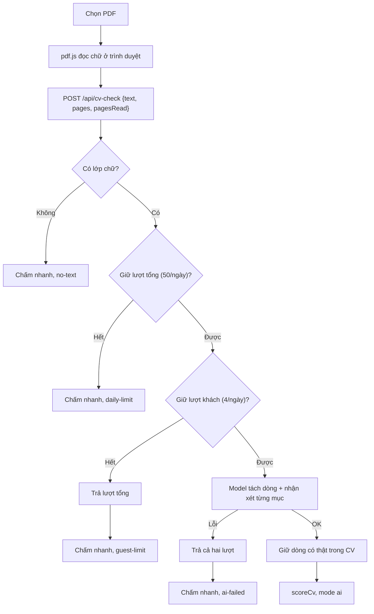
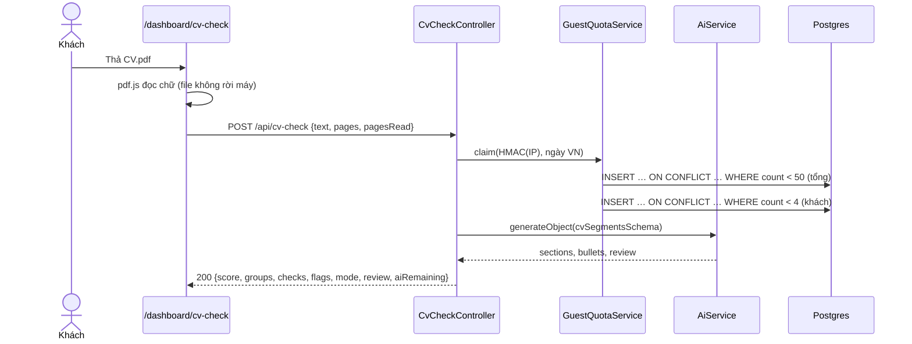

# CV Check — Phân tích CV cho khách

> Giao diện gọi tính năng là **"Phân tích CV"** (đổi từ "Chấm CV" ngày 2026-10-27); mã nguồn, route `/api/cv-check` và ADR 0021 giữ tên `cv-check`/"chấm CV".

> **Phạm vi:** `server/src/modules/cv-check/**` (`CvCheckController` công khai, `CvCheckService`, `GuestQuotaService`, `cv-check.schema.ts`, `utils/*`), bảng `usage_counters`, ADR [0021](../../adr/0021-cham-cv-cho-khach.md). Frontend `ui-ai-job-search/app/dashboard/cv-check/**`, `lib/pdf-browser.ts`, `lib/cv-check.ts`, `services/cv-check.ts`, `hooks/use-pending-cv.ts`.
> **Nguyên tắc:** tài liệu mô tả hệ thống **as-is**. Code là nguồn sự thật duy nhất.

## 1. Purpose

| Mục tiêu | Diễn giải |
|---|---|
| Kéo người dùng mới | Khách kéo-thả CV, thấy ngay điểm và 3 lỗi đáng sửa, không cần tài khoản |
| Điểm ổn định | Điểm do code tính trên các dòng đã tách; chấm lại cùng CV ra đúng số đó |
| Giữ ngân sách AI | AI chỉ tách dòng và nhận xét, có trần theo khách và trần tổng mỗi ngày |
| Không giữ dữ liệu cá nhân | File không rời trình duyệt; máy chủ không lưu chữ CV; IP chỉ lưu dạng HMAC |

## 2. Actors

| Actor | Vai trò |
|---|---|
| Khách / USER | Kéo-thả CV, xem điểm, chia sẻ; USER tạo hồ sơ từ CV vừa chấm |
| Trình duyệt (pdf.js) | Đọc chữ PDF, tối đa 10 trang đầu |
| Model (bể fast) | Tách mục, gạch đầu dòng chép nguyên văn, nhận xét toàn CV theo từng mục và 5 điểm ATS |
| PostgreSQL | Bảng đếm `usage_counters` |

## 3. Business Features

| # | Tính năng | Actor | Endpoint / cơ chế |
|---|---|---|---|
| F1 | Phân tích CV từ chữ đọc ở trình duyệt *(2026-10-27)* | Khách, USER | `POST /api/cv-check` |
| F2 | Chia sẻ thẻ điểm (ảnh vẽ ở trình duyệt) *(2026-10-27)* | Khách, USER | — |
| F3 | Tạo hồ sơ từ CV vừa chấm, không chọn lại file *(2026-10-27)* | USER | luồng tải CV của [cv-import](./cv-import.md) |

## 4. Business Flow

### Luồng A — Phân tích CV (F1)

**Preconditions:** không cần đăng nhập; trong 10 lượt/10 phút/IP.

**Main Flow:**
1. FE `/dashboard/cv-check`: người dùng chọn PDF (≤ 10 MB, kiểm ở trình duyệt). `readPdfText` (pdf.js) đọc tối đa 10 trang, nối chữ theo dòng; chữ cắt ở 40.000 ký tự rồi gửi `POST /api/cv-check { text, pages, pagesRead }` ([cv-check-view.tsx](../../../../ui-ai-job-search/app/dashboard/cv-check/cv-check-view.tsx), [pdf-browser.ts](../../../../ui-ai-job-search/lib/pdf-browser.ts)).
2. Trung bình < 120 ký tự/trang đã đọc → chấm nhanh, `reason: no-text`, không giữ lượt, không gọi model.
3. `GuestQuotaService.claim(HMAC(IP), ngày VN)`: giữ lượt trần tổng (`cv-check-total`/`all`, 50) trước; hết → `daily-limit`. Rồi giữ lượt của khách (`cv-check-guest`/HMAC, 4); hết → trả lại lượt tổng, `guest-limit`. Mỗi lần giữ là một câu `INSERT … ON CONFLICT DO UPDATE … WHERE count < trần RETURNING count` ([guest-quota.service.ts](../../../server/src/modules/cv-check/guest-quota.service.ts)).
4. Có lượt → một lời gọi model (`guest.cvCheck`, bể fast, 90 giây mỗi model, `redactResponse`): `sections`, `bullets` chép nguyên văn (≤ 60), và phần nhận xét: `summary`, `targetRole`, `level`, `review` (từng mục CV: `verdict` ok/fix/missing, `note`, ≤ 4 `issues` mỗi mục, mỗi issue có `quote` nguyên văn và `rewrite`), `ats` (5 điểm: `readingOrder`, `headings`, `dates`, `jobTitles`, `spelling`; pass/warn/fail), `strengths` và `improvements` (mỗi bên ≤ 3), `questions` (≤ 4 câu hỏi phỏng vấn dự đoán: câu hỏi, chủ đề, độ khó, lý do, gợi ý trả lời) *(sửa 2026-10-27)*.
5. `keepVerbatim` giữ gạch đầu dòng ≥ 10 ký tự có thật trong chữ CV (so sau khi gộp khoảng trắng, không phân biệt hoa thường). Không còn dòng nào → lấy dòng do `segmentByLayout` tách.
5a. `verifyReview` bỏ issue có `quote` không có thật trong chữ CV, đục số trong `rewrite` không có trong `quote` thành `[__]`, gộp mục/điểm ATS trùng, bỏ mục lạ, xếp theo thứ tự cố định *(2026-10-27)*.
6. `scoreCv` chấm 8 phép kiểm (§7), trả `{ score, groups, checks, flags (3 phép mất nhiều điểm nhất), mode: 'ai', reason: null, review, aiRemaining }`.

**Alternative Flow:** không giữ được lượt → `segmentByLayout` (dòng có ký hiệu đầu dòng, tiêu đề mục ≤ 40 ký tự khớp từ khoá Việt/Anh) rồi chấm, `mode: 'quick'`, `review: null`, kèm `reason`.

**Failure Flow:** model lỗi → trả lại cả hai lượt, chấm nhanh, `reason: ai-failed` (vẫn 200). pdf.js không mở được file → FE báo lỗi, không gọi máy chủ.

**Postconditions:** tối đa hai dòng `usage_counters` thay đổi; một dòng `ai_calls` (không `userId`, không `responseText`) nếu có gọi model. Không lưu chữ CV.

### Luồng B — Sau khi đăng nhập (F3)

1. Khối khoá "Sửa từng dòng bằng AI", "Mức lương ước tính" → modal đăng nhập/đăng ký; xong thì làm mới phiên tại chỗ, **không tải lại trang**, nên bảng điểm và file còn nguyên.
2. Đã đăng nhập → dải "Bước tiếp theo" ở đầu kết quả, nút "Tạo hồ sơ từ CV này": giữ `File` trong `usePendingCv` (bộ nhớ trang) và chuyển tới `/dashboard/profile/upload`; trang đó lấy file ra và chạy luồng tải CV presigned của [cv-import](./cv-import.md).
3. Link chia sẻ: `/dashboard/cv-check`, người đã đăng nhập kèm `?ref=<mã mời>`; modal đăng ký đọc `ref` từ URL.

## 5. Mermaid Flowchart

## 6. Sequence Diagram

## 7. Business Rules

| Mã | Quy tắc | Tầng | Trạng thái | Nguồn |
|---|---|---|---|---|
| BR-CVC-01 | Điểm = tổng 8 phép kiểm bằng code: lớp chữ 15, không ký tự hỏng 10, email + số điện thoại 5; tỉ lệ dòng có số liệu 20 (đủ điểm từ 50%), mở đầu bằng động từ hành động 15, dòng ≤ 35 chữ 10; đủ mục Kinh nghiệm/Học vấn/Kỹ năng 15 (5 mỗi mục), 1–2 trang 10 *(2026-10-27)* | SV | ✅ | [cv-score.ts](../../../server/src/modules/cv-check/utils/cv-score.ts) |
| BR-CVC-02 | Model không chấm điểm; schema không có trường điểm. Gạch đầu dòng model trả chỉ được tính khi có thật trong chữ CV *(2026-10-27)* | SV | 🔒 Cứng | [cv-lines.ts](../../../server/src/modules/cv-check/utils/cv-lines.ts) |
| BR-CVC-03 | Mỗi khách (HMAC-SHA256 của IP) 4 lượt AI/ngày, toàn bộ khách 50 lượt/ngày, ngày theo giờ Việt Nam; giữ lượt tổng trước rồi tới lượt khách *(2026-10-27)* | SV, DB | 🔒 Cứng | [guest-quota.service.ts](../../../server/src/modules/cv-check/guest-quota.service.ts) |
| BR-CVC-04 | Hết lượt, model lỗi hay PDF không có chữ thì vẫn trả điểm (chấm nhanh, `mode: quick`, kèm `reason`); model lỗi trả lại lượt *(2026-10-27)* | SV | ✅ | [cv-check.service.ts](../../../server/src/modules/cv-check/cv-check.service.ts) |
| BR-CVC-05 | File không rời trình duyệt; máy chủ chỉ nhận chữ ≤ 40.000 ký tự, không lưu; `ai_calls` của khách không lưu `responseText` *(2026-10-27)* | FE, SV | ✅ | [pdf-browser.ts](../../../../ui-ai-job-search/lib/pdf-browser.ts), [ai-call-log.ts](../../../server/src/modules/ai/services/ai-call-log.ts) |
| BR-CVC-06 | Thẻ chia sẻ chỉ có điểm và tên các lỗi, không thứ hạng, không tên người; link luôn mở trang Phân tích CV, của người đã đăng nhập kèm `?ref=<mã giới thiệu>` *(2026-10-27)* | FE | ⚠️ Chỉ frontend | [cv-share.tsx](../../../../ui-ai-job-search/app/dashboard/cv-check/cv-share.tsx) |
| BR-CVC-07 | Nhận xét của AI chỉ giữ ý có câu trích nguyên văn trong CV (hoặc không trích); câu viết mẫu không được mang số liệu mới — số không có trong đoạn trích thành `[__]` *(2026-10-27)* | SV | 🔒 Cứng | [cv-review.ts](../../../server/src/modules/cv-check/utils/cv-review.ts) |

## 8. Validation Rules

| Trường | Quy tắc | Nguồn | Lỗi |
|---|---|---|---|
| `text` | chuỗi ≤ 40.000 ký tự (được rỗng — ảnh quét) | [cv-check.dto.ts](../../../server/src/modules/cv-check/cv-check.dto.ts) | 400 `Chữ của CV dài quá 40.000 ký tự` |
| `pages` | số nguyên 1–500 | CvCheckDto | 400 |
| `pagesRead` | số nguyên 1–10 | CvCheckDto | 400 |
| File | PDF ≤ 10 MB, kiểm ở trình duyệt | [cv-check-view.tsx](../../../../ui-ai-job-search/app/dashboard/cv-check/cv-check-view.tsx) | thông báo ở FE |

## 9. API Mapping

| Method | URL | Role | Mục đích nghiệp vụ | Controller#method | Service | DTO | Response |
|---|---|---|---|---|---|---|---|
| POST | `/api/cv-check` | Public (10/10 phút) | Phân tích CV từ chữ; AI tách dòng có trần *(2026-10-27)* | `CvCheckController#check` | `CvCheckService.check` | `CvCheckDto` | 200 `{ score, groups, checks, flags, mode, reason, review, aiRemaining }` |

## 10. Frontend Mapping

| Route FE | Vai trò | Mục đích | Hook / API client |
|---|---|---|---|
| `/dashboard/cv-check` ([cv-check-view.tsx](../../../../ui-ai-job-search/app/dashboard/cv-check/cv-check-view.tsx)) *(2026-10-27)* | Khách, USER | Chọn CV bằng tab "Tải file PDF" hoặc "Dán văn bản CV" (số trang ước theo độ dài chữ, ~3.500 ký tự/trang); màn chờ có các bước và khung xương báo cáo; báo cáo gồm khối điểm, mục lục dính, Tổng quan (điểm mạnh/cần cải thiện), Đề xuất sửa CV (câu nên viết lại, góp ý chung; hết lượt AI thì là lỗi do code chấm kèm cách sửa), Máy lọc đọc CV thế nào (5 điểm ATS + bảng chấm), Câu hỏi phỏng vấn dự đoán, Việc cần làm tiếp; chia sẻ trong hộp thoại *(sửa 2026-10-27)*; mở cho khách qua `isGuestPath`. Lối vào: ô thả CV ở trang chào `/dashboard` của khách (file giữ trong `usePendingCv`, trang Phân tích CV lấy ra và chấm luôn), mục "Phân tích CV" trên thanh bên (chỉ khách thấy, *2026-10-27*), dải mời đầu danh sách việc làm của khách, sitemap | `useCvCheck`, `readPdfText`, `cvCheckService.check`, `usePendingCv` |

## 11. Database

### `usage_counters` — model `UsageCounter` *(2026-10-27)*

| Cột | Kiểu | Ý nghĩa |
|---|---|---|
| `scope` | text | `cv-check-total` hoặc `cv-check-guest` |
| `key` | text | `all` hoặc HMAC-SHA256 của IP (64 ký tự hex) |
| `day` | date | Ngày theo giờ Việt Nam |
| `count` | int | Số lượt AI đã giữ trong ngày |
| `updatedAt` | timestamp | Lần tăng gần nhất |

Khoá chính `(scope, key, day)`, chỉ mục `day`. Không khoá ngoại. Số dòng mỗi ngày ≤ trần tổng + 1.

## 12. State Machine

Không có.

## 13. Exceptions

| Tình huống | HTTP | Thông điệp nguyên văn | Nguồn |
|---|---|---|---|
| Chữ quá dài | 400 | `Chữ của CV dài quá 40.000 ký tự` | [cv-check.dto.ts](../../../server/src/modules/cv-check/cv-check.dto.ts) |
| Vượt 10 lượt/10 phút | 429 | `Bạn thao tác quá nhanh. Hãy đợi một lát rồi thử lại.` | [cv-check.controller.ts](../../../server/src/modules/cv-check/cv-check.controller.ts) |
| PDF có mật khẩu / hỏng (ở trình duyệt) | — | `File PDF đang đặt mật khẩu nên không đọc được…` / `File này không phải PDF hợp lệ…` | [pdf-browser.ts](../../../../ui-ai-job-search/lib/pdf-browser.ts) |

Hết lượt và model lỗi **không** là lỗi HTTP: trả 200 chấm nhanh kèm `reason`.

## 14. Notifications

Không có.

## 15. Integrations

| Hệ thống | Mục đích | Cấu hình |
|---|---|---|
| `AiService` (bể fast) | Tách dòng + nhận xét toàn CV, `purpose = guest.cvCheck` | `CV_CHECK_AI_PER_GUEST_PER_DAY` (4), `CV_CHECK_AI_PER_DAY` (50), `GUEST_KEY_SECRET` (rỗng thì `JWT_SECRET`) |
| pdf.js (`pdfjs-dist` 6.4.299, trình duyệt) | Đọc chữ PDF | worker đóng gói qua `new URL(…, import.meta.url)` |

## 16. Security

| Lớp | Cách xử lý |
|---|---|
| Rate limit | `@Throttle` 10/10 phút theo IP; trần AI theo khách và trần tổng trong DB |
| Race | Giữ lượt bằng một câu SQL có điều kiện; e2e: hai request song song khi còn một lượt chỉ một request được gọi model |
| Lộ dữ liệu | Không đọc dữ liệu người dùng nào; trả về chỉ điểm và dòng của chính CV gửi lên; IP lưu dạng HMAC |
| Injection | `$queryRaw` dạng template có tham số |
| XSS | Nhận xét và dòng mẫu chỉ hiển thị dạng chữ |

## 17. ⚠️ Sai lệch / Rủi ro nghiệp vụ

**R1 — Trần theo IP chặn nhầm người dùng chung IP, không chặn kẻ đổi IP.** Mức đề xuất: 🟢 *(2026-10-27)*
- Mô tả: văn phòng, ký túc xá dùng chung 4 lượt; kẻ xoay IP vẫn lấy được lượt cho tới khi chạm trần tổng.
- Bằng chứng: [guest-quota.service.ts](../../../server/src/modules/cv-check/guest-quota.service.ts).
- Tác động: người thật bị chấm nhanh sớm hơn; chi phí vẫn bị chặn bởi trần tổng 50/ngày.
- Đề xuất: lượng truy cập lớn thì thêm Cloudflare Turnstile/rate limit ở CDN (ADR 0021).

**R2 — Trần tổng dùng chung bể model với người đăng nhập.** Mức đề xuất: 🟡 *(2026-10-27)*
- Mô tả: 50 lượt khách/ngày ăn vào hạn mức gateway free mà người dùng thật cũng cần.
- Bằng chứng: [cv-check.service.ts](../../../server/src/modules/cv-check/cv-check.service.ts) dùng `fastModelChain`; từ 2026-10-27 đầu ra gồm nhận xét toàn CV nên mỗi lượt tốn nhiều token hơn.
- Tác động: ngày gateway cạn sớm, người đăng nhập cũng bị ảnh hưởng.
- Đề xuất: hạ `CV_CHECK_AI_PER_DAY` hoặc dùng key/model riêng cho khách.

**R3 — Số đo "máy lọc đọc được" do trình duyệt gửi.** Mức đề xuất: 🟢 *(2026-10-27)*
- Mô tả: `pages`, `pagesRead` và chữ do client gửi; người dùng có thể sửa để đẹp điểm của chính mình.
- Bằng chứng: [cv-check.dto.ts](../../../server/src/modules/cv-check/cv-check.dto.ts).
- Tác động: chỉ ảnh hưởng điểm của chính họ; thẻ chia sẻ vốn là ảnh, không phải chứng nhận.
- Đề xuất: chấp nhận.

**R4 — CV dán chữ không kiểm được file PDF.** Mức đề xuất: 🟢 *(2026-10-27)*
- Mô tả: tab "Dán văn bản CV" gửi chữ với số trang ước theo độ dài; ba tiêu chí "File có lớp chữ", "Không có ký tự hỏng", "Độ dài 1–2 trang" khi đó nói về chữ đã dán chứ không về file người dùng sẽ nộp.
- Bằng chứng: [use-cv-check.ts](../../../../ui-ai-job-search/hooks/use-cv-check.ts) (`runText`, `pagesOfText`).
- Tác động: điểm nhóm "Máy lọc đọc được" có thể cao hơn thực tế với CV là ảnh quét.
- Đề xuất: giao diện đã ghi rõ ở tab dán chữ; nếu cần thì gửi kèm cờ nguồn để backend bỏ qua ba tiêu chí này.

## 18. Source References

- [cv-check.controller.ts](../../../server/src/modules/cv-check/cv-check.controller.ts), [cv-check.service.ts](../../../server/src/modules/cv-check/cv-check.service.ts), [guest-quota.service.ts](../../../server/src/modules/cv-check/guest-quota.service.ts), [cv-check.schema.ts](../../../server/src/modules/cv-check/cv-check.schema.ts), [utils/](../../../server/src/modules/cv-check/utils/cv-score.ts)
- Test: [cv-check.e2e-spec.ts](../../../server/test/cv-check.e2e-spec.ts), [cv-score.spec.ts](../../../server/test/unit/modules/cv-check/cv-score.spec.ts)
- Frontend: [cv-check-view.tsx](../../../../ui-ai-job-search/app/dashboard/cv-check/cv-check-view.tsx), [cv-check-report.tsx](../../../../ui-ai-job-search/app/dashboard/cv-check/cv-check-report.tsx), [cv-share.tsx](../../../../ui-ai-job-search/app/dashboard/cv-check/cv-share.tsx), [pdf-browser.ts](../../../../ui-ai-job-search/lib/pdf-browser.ts)
