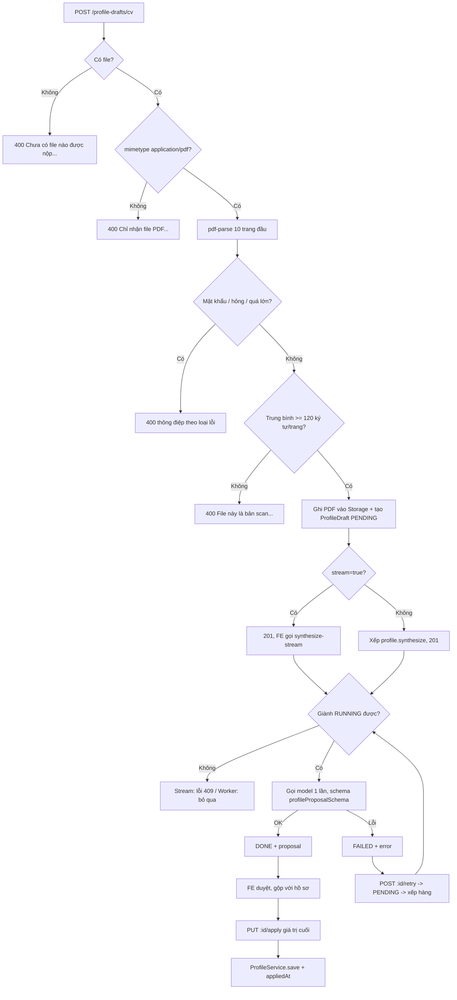
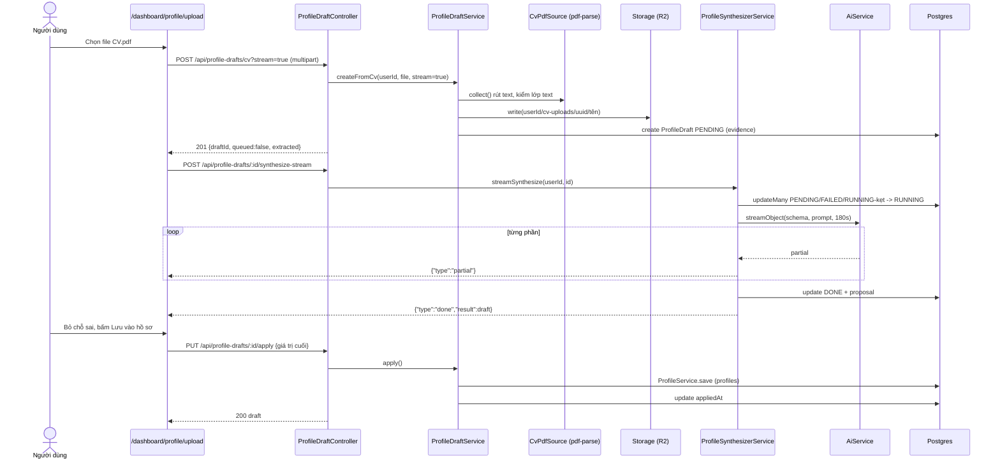
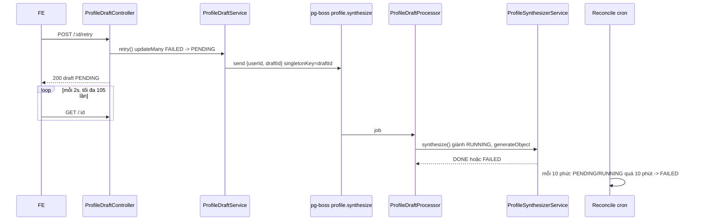
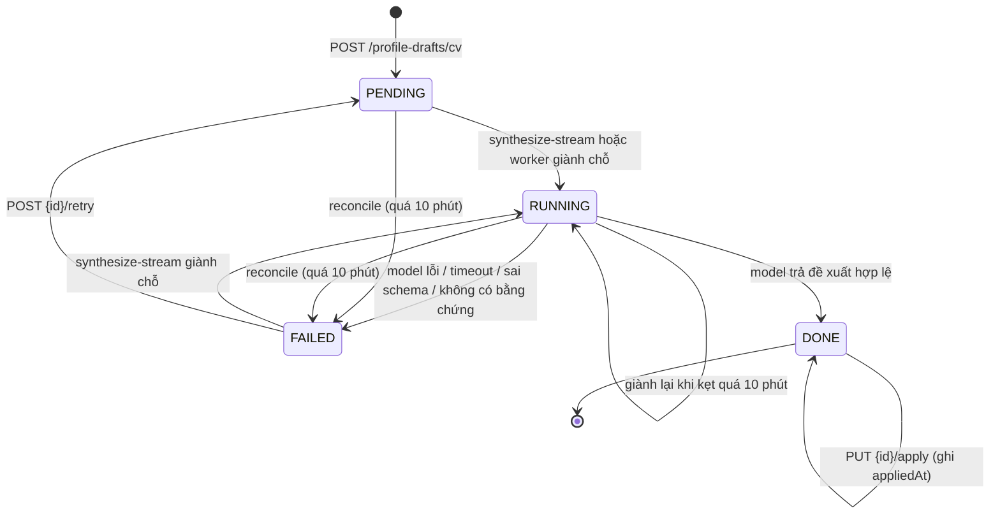

# CV Import — Đọc CV PDF thành đề xuất hồ sơ (Agent 1)

> **Phạm vi:** `server/src/modules/profile-sources/**` (`ProfileDraftController`, `ProfileDraftService`, `ProfileSynthesizerService`, `ProfileDraftProcessor`, `CvPdfSource`, `profile-proposal.schema.ts`, `utils/*`), hàng đợi `profile.synthesize`, model `ProfileDraft`, ADR [0001](../../adr/0001-doc-cv-agent-1.md). Frontend người dùng: `/dashboard/profile/upload` (nộp CV, xem tiến độ đọc, duyệt và lưu vào hồ sơ).
> **Nguyên tắc:** tài liệu mô tả hệ thống **as-is**. Code là nguồn sự thật duy nhất.

## 1. Purpose

| Mục tiêu | Diễn giải |
|---|---|
| Điền hồ sơ nhanh từ CV có sẵn | Người dùng nộp một file PDF; hệ thống rút lớp text rồi gọi model MỘT lần để đề xuất các trường hồ sơ ([profile-synthesizer.service.ts:64](../../../server/src/modules/profile-sources/services/profile-synthesizer.service.ts#L64)). |
| "AI đề xuất, người dùng chốt" | Đề xuất chỉ nằm trong `ProfileDraft.proposal`; **không có gì ghi vào `Profile`** cho tới khi người dùng duyệt và gửi giá trị cuối cùng lên `PUT /profile-drafts/:id/apply` ([ADR 0001](../../adr/0001-doc-cv-agent-1.md), [profile-draft.e2e-spec.ts:148](../../../server/test/profile-draft.e2e-spec.ts#L148)). |
| Truy được nguồn | Giữ file PDF gốc (Storage) và toàn văn đã rút (`evidence`) để người dùng mở lại đúng file đã nộp và để chạy lại mà không cần nộp lại ([schema.prisma:600](../../../server/prisma/schema.prisma#L600)). |
| Không để dữ liệu nhạy cảm/sai lệch lọt vào hồ sơ | Model không có trường để đề xuất sở thích, tình trạng pháp lý, số điện thoại hay kỹ năng còn thiếu ([profile-proposal.schema.ts:60](../../../server/src/modules/profile-sources/profile-proposal.schema.ts#L60)). |

**Điểm mấu chốt:**
- Từ chối sớm ở request (PDF scan/mật khẩu/hỏng) → **không** tạo bản nháp, **không** lưu file ([profile-draft.e2e-spec.ts:298](../../../server/test/profile-draft.e2e-spec.ts#L298)).
- Bản nháp đi qua `PENDING → RUNNING → DONE/FAILED` bằng **giành chỗ có điều kiện**; bản `DONE` không bao giờ bị đọc lại ([profile-synthesizer.service.ts:82](../../../server/src/modules/profile-sources/services/profile-synthesizer.service.ts#L82)).
- FE luôn dùng chế độ stream (đọc trực tiếp, hiện từng phần) khi nộp; hàng đợi chỉ dùng cho nút "Thử đọc lại" và cho client gọi API không stream.

## 2. Actors

| Actor | Quyền trong module | Ghi chú |
|---|---|---|
| Người dùng (`USER`/`ADMIN`) | Nộp CV, xem/đọc lại/chạy lại/áp dụng **bản nháp của chính mình**, tải file gốc | Mọi truy vấn khoá theo `userId` |
| Model AI (qua `AiService`) | Sinh `ProfileProposal` theo schema | `purpose = 'profile.synthesize'` |
| Worker `profile.synthesize` (`ProfileDraftProcessor`) | Đọc bản nháp đã xếp hàng | concurrency 3 |
| `ReconcileService` (cron) | Đánh `FAILED` bản nháp `PENDING`/`RUNNING` kẹt > 10 phút | Module platform-operations |
| Storage (R2) | Lưu/đọc file PDF gốc | Seam `STORAGE` |
| `ProfileService` | Ghi giá trị đã duyệt vào `Profile` | Module profile |

## 3. Business Features

| # | Tính năng | Actor | Endpoint / cơ chế |
|---|---|---|---|
| F1 | Nộp CV PDF, rút text, tạo bản nháp | USER | `POST /api/profile-drafts/cv[?stream=true]` |
| F2 | Đọc CV bằng model, trả từng phần (NDJSON) | USER | `POST /api/profile-drafts/:id/synthesize-stream` |
| F3 | Đọc CV ở nền | Worker | hàng đợi `profile.synthesize` |
| F4 | Xem bản nháp mới nhất | USER | `GET /api/profile-drafts/latest` |
| F5 | Xem một bản nháp | USER | `GET /api/profile-drafts/:id` |
| F6 | Mở file CV gốc | USER | `GET /api/profile-drafts/:id/file` |
| F7 | Chạy lại bản nháp hỏng | USER | `POST /api/profile-drafts/:id/retry` |
| F8 | Duyệt và áp dụng vào hồ sơ | USER | `PUT /api/profile-drafts/:id/apply` |
| F9 | Dọn bản nháp kẹt | Hệ thống | `ReconcileService.failStuck` |

## 4. Business Flow

### Luồng A — Nộp CV (F1)

**Preconditions:** đã đăng nhập; chưa vượt 10 lượt/phút (`@ThrottleAi`, đếm theo user).

**Main Flow:**
1. FE `/dashboard/profile/upload`: người dùng chọn file trong DropZone (`accept="application/pdf,.pdf"`, nhãn "PDF, tối đa 10MB") ([upload-cards.tsx:78](../../../../ui-ai-job-search/app/dashboard/profile/upload/upload-cards.tsx#L78)); `useCvUpload().upload` gửi multipart `file` tới `POST /api/profile-drafts/cv?stream=true` ([use-cv-upload.ts:86](../../../../ui-ai-job-search/hooks/use-cv-upload.ts#L86), [profile-draft.ts:5](../../../../ui-ai-job-search/services/profile-draft.ts#L5)).
2. `FileInterceptor('file', { fileSize: 10MB, files: 1 })` nhận file vào bộ nhớ ([profile-draft.controller.ts:64](../../../server/src/modules/profile-sources/profile-draft.controller.ts#L64)).
3. Controller: không có file → 400; `mimetype !== 'application/pdf'` → 400 ([profile-draft.controller.ts:72](../../../server/src/modules/profile-sources/profile-draft.controller.ts#L72)).
4. `CvPdfSource.collect` → `extractPdfText`: kiểm lại ≤ 10MB; `pdf-parse` đọc tối đa **10 trang đầu**; PDF được coi là có lớp text khi trung bình ≥ **120 ký tự/trang** đã đọc ([pdf-text.ts:40](../../../server/src/modules/profile-sources/utils/pdf-text.ts#L40)). Không đạt → `ScannedPdfError` ([cv-pdf.source.ts:36](../../../server/src/modules/profile-sources/cv-pdf.source.ts#L36)).
5. Text cắt ở **40.000 ký tự**, ghi `meta = { pages, pagesRead, chars, truncated, bytes }` ([cv-pdf.source.ts:10](../../../server/src/modules/profile-sources/cv-pdf.source.ts#L10)).
6. `ProfileDraftService.createFromCv`: ghi file gốc vào Storage với khoá `<userId>/cv-uploads/<uuid>/<tên file đã làm sạch>` (mỗi lần nộp một khoá riêng) ([profile-draft.service.ts:48](../../../server/src/modules/profile-sources/services/profile-draft.service.ts#L48), [profile-draft.utils.ts:19](../../../server/src/modules/profile-sources/utils/profile-draft.utils.ts#L19)).
7. Tạo `ProfileDraft { status: PENDING, evidence, storageKey, filename }` ([profile-draft.service.ts:56](../../../server/src/modules/profile-sources/services/profile-draft.service.ts#L56)).
8. `stream=true` → **không** xếp hàng (client sẽ gọi Luồng B); ngược lại xếp `profile.synthesize { userId, draftId }` ([profile-draft.service.ts:66](../../../server/src/modules/profile-sources/services/profile-draft.service.ts#L66)).
9. Trả **201** `{ draftId, queued, extracted: [meta] }` ([profile-draft.controller.ts:94](../../../server/src/modules/profile-sources/profile-draft.controller.ts#L94)).
10. FE gọi `GET /profile-drafts/:id` rồi ngay lập tức Luồng B ([use-cv-upload.ts:94](../../../../ui-ai-job-search/hooks/use-cv-upload.ts#L94)).

**Alternative Flow:** client không gửi `stream=true` → bản nháp được worker đọc (Luồng C); `queued: true`.

**Failure Flow** (đều **400**, không tạo bản nháp, không ghi Storage — trừ lỗi Storage/DB):
- Không có file: `Chưa có file nào được nộp. Gửi dưới dạng multipart với tên trường "file".`
- Sai mimetype: `Chỉ nhận file PDF. File vừa nộp khai là "<mimetype>".`
- PDF scan: `File này là bản scan hoặc ảnh chụp, chưa đọc được. Hãy nộp bản PDF xuất trực tiếp từ Word, LaTeX hoặc Canva.`
- PDF có mật khẩu: `File PDF này có mật khẩu. Hãy bỏ mật khẩu rồi nộp lại.`
- PDF hỏng: `File không phải PDF hợp lệ, hoặc đã bị hỏng trong lúc tải lên.`
- Quá 10MB (lọt qua multer): `File quá lớn. Giới hạn là 10MB — một CV có lớp text thường dưới 2MB.`; lỗi khác của pdf-parse: `Không đọc được file PDF này.` ([cv-pdf.source.ts:57](../../../server/src/modules/profile-sources/cv-pdf.source.ts#L57)).
- File vượt `fileSize` của multer → 413 do `@nestjs/platform-express` sinh (thông điệp mặc định của thư viện, chưa kiểm chứng nguyên văn).
- Vượt trần → 429.

**Postconditions:** một `ProfileDraft` `PENDING`, file gốc trong Storage; hồ sơ chưa đổi.

### Luồng B — Đọc CV dạng stream (F2)

**Preconditions:** bản nháp thuộc user; trạng thái `PENDING`, `FAILED`, hoặc `RUNNING` mà `updatedAt` cũ hơn 10 phút.

**Main Flow:**
1. FE `streamModel` gửi `POST /api/profile-drafts/:id/synthesize-stream` (fetch, `credentials: include`) ([model-stream.ts:32](../../../../ui-ai-job-search/lib/model-stream.ts#L32)); throttle 10/phút/user.
2. `streamNdjson` đặt header NDJSON, flush ngay (HTTP 200), nhịp tim `\n` mỗi 10 giây ([ndjson.ts:26](../../../server/src/common/ndjson.ts#L26)).
3. `ProfileSynthesizerService.start`: `updateMany({ where: { id, userId, OR: [status ∈ {PENDING, FAILED}, (status = RUNNING ∧ updatedAt < now − 10 phút)] }, data: { status: RUNNING, error: null } })` rồi đọc lại bản nháp ([profile-synthesizer.service.ts:83](../../../server/src/modules/profile-sources/services/profile-synthesizer.service.ts#L83)).
4. Dựng lời gọi: `evidence` rỗng → lỗi `Bản nháp không có bằng chứng nào đọc được`; ngược lại `schema = profileProposalSchema`, system prompt `SYNTHESIS_SYSTEM`, prompt bọc bằng chứng giữa `===== BẰNG CHỨNG =====` / `===== HẾT BẰNG CHỨNG =====`, `timeoutMs = 180.000` ([profile-synthesizer.service.ts:111](../../../server/src/modules/profile-sources/services/profile-synthesizer.service.ts#L111), [profile-synthesis.prompt.ts](../../../server/src/modules/profile-sources/utils/profile-synthesis.prompt.ts)).
5. `AiService.streamObject`; mỗi object từng phần → sự kiện `{ type: 'partial', data }`; FE hiện danh sách "đang đọc" (chức danh, kỹ năng, kinh nghiệm…).
6. Kết thúc → `finish`: `status = DONE`, `proposal`, `modelId`, `generatedAt`, `error = null`; sự kiện `{ type: 'done', result: <bản nháp không kèm evidence> }` ([profile-synthesizer.service.ts:129](../../../server/src/modules/profile-sources/services/profile-synthesizer.service.ts#L129)).
7. FE đặt `draft = done`, làm mới cache `profileCv`, chuyển sang màn duyệt (Luồng F).

**Alternative Flow:** trình duyệt ngắt giữa chừng → server vẫn chạy tới cuối và tự ghi DONE/FAILED (không xếp lại việc) — quy tắc chung của route stream trong `CLAUDE.md`.

**Failure Flow:**
- Bản nháp không thuộc user/không tồn tại → sự kiện `{"type":"error","message":"Không tìm thấy bản nháp hồ sơ: <id>","statusCode":404}` (HTTP vẫn 200) ([profile-synthesizer.service.ts:104](../../../server/src/modules/profile-sources/services/profile-synthesizer.service.ts#L104), [profile-draft.e2e-spec.ts:416](../../../server/test/profile-draft.e2e-spec.ts#L416)).
- Không giành được chỗ (đang `RUNNING` chưa kẹt, hoặc `DONE`) → sự kiện lỗi `statusCode: 409`, `Bản nháp này đang được đọc hoặc đã đọc xong, không đọc lại được.` ([profile-synthesizer.service.ts:42](../../../server/src/modules/profile-sources/services/profile-synthesizer.service.ts#L42)).
- Model lỗi/timeout/sai schema, hoặc không có bằng chứng → `fail`: `status = FAILED`, `error = <thông điệp thô>`; sự kiện `{ type: 'error', message: 'Không hoàn thành được tác vụ.', failureKind }` ([profile-synthesizer.service.ts:58](../../../server/src/modules/profile-sources/services/profile-synthesizer.service.ts#L58), [failure-view.ts:15](../../../server/src/common/ai/failure-view.ts#L15)).
- Vượt trần 429 / chưa đăng nhập 401 → HTTP lỗi trước khi stream; FE: `Phiên đăng nhập đã hết hạn.` hoặc `Máy chủ trả về HTTP <status>` ([model-stream.ts:38](../../../../ui-ai-job-search/lib/model-stream.ts#L38)).

**Postconditions:** bản nháp `DONE` có `proposal`, hoặc `FAILED` có `error`; hồ sơ chưa đổi.

### Luồng C — Đọc CV ở nền (F3)

**Preconditions:** việc `profile.synthesize` được xếp (Luồng A không stream, hoặc Luồng E).

**Main Flow:**
1. `ProfileDraftProcessor` đăng ký worker lúc khởi động module ([profile-draft.processor.ts:18](../../../server/src/modules/profile-sources/profile-draft.processor.ts#L18)); khoá chặn trùng `singletonKey = draftId`, policy `exclusive` ([queue-key.ts:70](../../../server/src/modules/queue/queue-key.ts#L70)).
2. `synthesize(userId, draftId)`: giành chỗ như Luồng B bước 3; không giành được → log debug và bỏ qua (không gọi model) ([profile-synthesizer.service.ts:65](../../../server/src/modules/profile-sources/services/profile-synthesizer.service.ts#L65)).
3. `AiService.generateObject` (một lần) → `finish` (DONE).

**Failure Flow:** lỗi bất kỳ trong lúc gọi → `fail` (FAILED); worker **không ném lỗi** nên pg-boss không tự thử lại.

**Postconditions:** như Luồng B.

### Luồng D — Xem bản nháp / file gốc (F4, F5, F6)

**Preconditions:** đã đăng nhập.

**Main Flow:**
1. Trang upload mở ra gọi song song `GET /api/profile` và `GET /api/profile-drafts/latest` ([use-cv-upload.ts:45](../../../../ui-ai-job-search/hooks/use-cv-upload.ts#L45)).
2. `latest`: bản nháp mới nhất theo `createdAt` của user, **bất kể trạng thái** ([profile-draft.service.ts:87](../../../server/src/modules/profile-sources/services/profile-draft.service.ts#L87)); `GET /:id`: `findFirst({ id, userId })` ([profile-draft.service.ts:97](../../../server/src/modules/profile-sources/services/profile-draft.service.ts#L97)).
3. Cả hai bỏ cột `evidence` (`omit: WITHOUT_EVIDENCE`) và đổi cột `error` thành `failureKind` (`withFailureKind`) trước khi trả **200** ([profile-draft.controller.ts:111](../../../server/src/modules/profile-sources/profile-draft.controller.ts#L111), [failure-view.ts:4](../../../server/src/common/ai/failure-view.ts#L4)).
4. `GET /:id/file`: đọc bản nháp (khoá user) → đọc Storage → trả PDF `inline`, `Content-Disposition: inline; filename*=UTF-8''<tên gốc>`, `Cache-Control: private, max-age=3600` ([profile-draft.controller.ts:116](../../../server/src/modules/profile-sources/profile-draft.controller.ts#L116)).

**Alternative Flow:** chưa từng nộp → `latest` trả 404, FE coi là "chưa có CV" (`null`) ([use-latest-cv.ts:9](../../../../ui-ai-job-search/hooks/use-latest-cv.ts#L9)).

**Failure Flow:** **404** `Chưa có lượt đọc CV nào` / `Không tìm thấy bản nháp: <id>` / `Bản nháp này không giữ file gốc.` ([profile-draft.service.ts:79](../../../server/src/modules/profile-sources/services/profile-draft.service.ts#L79)).

**Postconditions:** không ghi DB.

### Luồng E — Chạy lại bản nháp hỏng (F7)

**Preconditions:** bản nháp thuộc user và đang `FAILED`; throttle 10/phút/user.

**Main Flow:**
1. FE hiện khung `Lần đọc trước không thành công` + thông điệp theo `failureKind`; nút `Thử đọc lại file cũ` chỉ hiện khi lỗi đáng thử lại ([upload-cards.tsx:150](../../../../ui-ai-job-search/app/dashboard/profile/upload/upload-cards.tsx#L150)).
2. `POST /api/profile-drafts/:id/retry` → đọc bản nháp (khoá user); không `FAILED` → 400 ([profile-draft.service.ts:113](../../../server/src/modules/profile-sources/services/profile-draft.service.ts#L113)).
3. Giành chỗ `updateMany({ id, userId, status: FAILED } → { status: PENDING, error: null })`; `count = 0` → **409** ([profile-draft.service.ts:126](../../../server/src/modules/profile-sources/services/profile-draft.service.ts#L126)).
4. Xếp `profile.synthesize`; trả **200** bản nháp (`PENDING`, có `failureKind`).
5. FE hỏi lại `GET /:id` mỗi 2 giây, tối đa 105 lần (~210 giây) tới khi `DONE`/`FAILED` ([use-cv-upload.ts:70](../../../../ui-ai-job-search/hooks/use-cv-upload.ts#L70)).

**Alternative Flow:** hai lần bấm đồng thời → đúng một 200 và một lượt xếp hàng ([profile-draft.e2e-spec.ts:434](../../../server/test/profile-draft.e2e-spec.ts#L434)).

**Failure Flow:** 404 `Không tìm thấy bản nháp: <id>`; 400 `Chỉ chạy lại được bản nháp bị lỗi; bản này đang được đọc hoặc đã đọc xong.`; 409 `Bản nháp vừa được chạy lại ở nơi khác.`; FE hết lượt hỏi → `Chờ quá lâu mà chưa có kết quả. Lượt đọc vẫn chạy ở nền, mở lại trang sau ít phút.`

**Postconditions:** bản nháp `PENDING` rồi được worker đưa sang `RUNNING → DONE/FAILED`.

### Luồng F — Duyệt và áp dụng vào hồ sơ (F8)

**Preconditions:** bản nháp thuộc user, `DONE`.

**Main Flow:**
1. FE dựng màn duyệt khi `DONE` và `appliedAt = null` ([use-cv-upload.ts:143](../../../../ui-ai-job-search/hooks/use-cv-upload.ts#L143)); `buildReview` so đề xuất với hồ sơ hiện tại ([profile-draft-content.ts:86](../../../../ui-ai-job-search/lib/profile-draft-content.ts#L86)):
   - Trường chữ (`headline`, `location`, `country`, `summary`): chỉ hiện khi CV có và khác hồ sơ (không phân biệt hoa thường); mặc định **lấy CV khi hồ sơ đang trống**, giữ bản cũ khi đã có ([profile-draft-content.ts:135](../../../../ui-ai-job-search/lib/profile-draft-content.ts#L135)).
   - Danh sách (`primarySkills`, `secondarySkills`, `directExperienceDomains`, `adjacentExperience`, `languages`): chỉ phần tử MỚI; kỹ năng so với cả kỹ năng chính lẫn phụ; người dùng bỏ từng chip.
   - Mục (`experiences`, `projects`, `educations`, `certificates`): mục mới theo khoá (công ty + chức danh / tên / trường / tên), người dùng sửa/bỏ ([profile-draft-content.ts:40](../../../../ui-ai-job-search/lib/profile-draft-content.ts#L40)).
   - Không có gì mới → màn "đã đủ", không gọi API ([review-card.tsx:155](../../../../ui-ai-job-search/app/dashboard/profile/upload/review-card.tsx#L155)).
2. `reviewValues` dựng **giá trị cuối**: danh sách = `[hiện có, ...mới giữ lại]`; mục = `[...mới giữ lại, ...hiện có]` ([profile-draft-content.ts:148](../../../../ui-ai-job-search/lib/profile-draft-content.ts#L148)).
3. `PUT /api/profile-drafts/:id/apply` với các giá trị đó. `ApplyDraftDto = PickType(UpdateProfileDto, APPLICABLE_FIELDS)` — 13 trường: `headline, location, country, summary, languages, primarySkills, secondarySkills, directExperienceDomains, adjacentExperience, experiences, educations, certificates, projects` ([profile-draft.dto.ts:5](../../../server/src/modules/profile-sources/profile-draft.dto.ts#L5), [profile-draft.utils.ts:3](../../../server/src/modules/profile-sources/utils/profile-draft.utils.ts#L3)).
4. `apply`: bản nháp phải `DONE`; bỏ trường `undefined`; rỗng → 400; `ProfileService.save(userId, data)` (tính lại `completion`, `occupationCode`, xếp `skill.canonicalize`); cập nhật `appliedAt = now` với `where: { id, userId }` ([profile-draft.service.ts:139](../../../server/src/modules/profile-sources/services/profile-draft.service.ts#L139)).
5. Trả **200** bản nháp (không kèm `evidence`). FE toast `Đã cập nhật hồ sơ từ CV`, làm mới profile/profileCv/dashboard/skillGaps/jobLists/learning, chuyển về `/dashboard/profile` ([use-cv-upload.ts:129](../../../../ui-ai-job-search/hooks/use-cv-upload.ts#L129)).

**Alternative Flow:** người dùng bấm "Đọc file khác"/bỏ qua → `dismiss` (chỉ FE), quay về DropZone.

**Failure Flow:**
- Bản nháp người khác/không tồn tại → **404** `Không tìm thấy bản nháp: <id>`.
- Chưa `DONE` → **400** `Bản nháp chưa đọc xong nên chưa có đề xuất để áp dụng.`
- Body rỗng → **400** `Chưa chọn trường nào để áp dụng vào hồ sơ.`
- Gửi trường ngoài danh sách trắng (`citizenship`, `careerGoals`, `phone`…) → **400** `<Nhãn> không phải là trường hợp lệ` ([profile-draft.e2e-spec.ts:270](../../../server/test/profile-draft.e2e-spec.ts#L270)).
- Vi phạm ràng buộc `UpdateProfileDto` (vd > 60 kỹ năng) → **400** (xem [profile.md](./profile.md) §8). FE toast thông điệp backend hoặc `Không lưu được vào hồ sơ`.

**Postconditions:** hồ sơ chứa giá trị đã duyệt; `appliedAt` có giá trị; bản nháp vẫn `DONE` (áp dụng lại được, `appliedAt` bị ghi đè).

### Luồng G — Dọn bản nháp kẹt (F9)

**Preconditions:** cron reconcile bật (`RECONCILE_CRON_SCHEDULE`, mặc định `*/10 * * * *`).

**Main Flow:** `ReconcileService.failStuck` chạy `profileDraft.updateMany({ status ∈ {PENDING, RUNNING}, updatedAt < now − 10 phút } → { status: FAILED, error: STUCK_MESSAGE })` ([reconcile.service.ts:117](../../../server/src/modules/reconcile/services/reconcile.service.ts#L117)). Không xếp lại việc.

**Postconditions:** bản nháp bị bỏ rơi (tiến trình chết, hoặc nộp `stream=true` mà không bao giờ gọi stream) thành `FAILED` với `error = 'Máy chủ khởi động lại khi việc này đang chạy dở, nên nó không bao giờ hoàn tất. Hãy bấm chạy lại.'`; người dùng bấm "Thử đọc lại".

## 5. Mermaid Flowchart

## 6. Sequence Diagram

## 7. Business Rules

| Mã BR | Quy tắc | Nơi thực thi | Mức | Nguồn code |
|---|---|---|---|---|
| BR-CVI-01 | Chỉ nhận đúng một file ở trường `file`, khai `application/pdf`, tối đa 10MB | GD (multer), SV | ✅ Mềm | [profile-draft.controller.ts:64](../../../server/src/modules/profile-sources/profile-draft.controller.ts#L64), [pdf-text.ts:4](../../../server/src/modules/profile-sources/utils/pdf-text.ts#L4) |
| BR-CVI-02 | Chỉ đọc tối đa 10 trang đầu của PDF | SV | ✅ Mềm | [pdf-text.ts:6](../../../server/src/modules/profile-sources/utils/pdf-text.ts#L6) |
| BR-CVI-03 | PDF phải có lớp text (≥ 120 ký tự/trang trung bình); PDF scan, có mật khẩu hoặc hỏng bị từ chối ngay tại request, không tạo bản nháp, không lưu file | SV | ✅ Mềm | [pdf-text.ts:8](../../../server/src/modules/profile-sources/utils/pdf-text.ts#L8), [cv-pdf.source.ts:36](../../../server/src/modules/profile-sources/cv-pdf.source.ts#L36) |
| BR-CVI-04 | Bằng chứng đưa cho model cắt ở 40.000 ký tự, có cờ `truncated` | SV | ✅ Mềm | [cv-pdf.source.ts:10](../../../server/src/modules/profile-sources/cv-pdf.source.ts#L10) |
| BR-CVI-05 | File gốc lưu riêng cho từng lần nộp tại `<userId>/cv-uploads/<uuid>/<tên đã làm sạch ≤ 120 ký tự>` | SV | ✅ Mềm | [profile-draft.service.ts:48](../../../server/src/modules/profile-sources/services/profile-draft.service.ts#L48), [profile-draft.utils.ts:19](../../../server/src/modules/profile-sources/utils/profile-draft.utils.ts#L19) |
| BR-CVI-06 | Bản nháp mới luôn `PENDING`; chế độ stream không xếp hàng, chế độ thường xếp `profile.synthesize` (một việc mỗi `draftId`) | SV | ✅ Mềm | [profile-draft.service.ts:56](../../../server/src/modules/profile-sources/services/profile-draft.service.ts#L56), [queue-key.ts:70](../../../server/src/modules/queue/queue-key.ts#L70) |
| BR-CVI-07 | Không có gì được ghi vào `Profile` cho tới khi người dùng gọi apply | SV | ✅ Mềm | [profile-synthesizer.service.ts:129](../../../server/src/modules/profile-sources/services/profile-synthesizer.service.ts#L129), [ADR 0001](../../adr/0001-doc-cv-agent-1.md) |
| BR-CVI-08 | Chỉ một tiến trình được đọc một bản nháp: giành `RUNNING` có điều kiện từ `PENDING`, `FAILED`, hoặc `RUNNING` kẹt > 10 phút; bản `DONE` không bao giờ đọc lại | SV | ✅ Mềm | [profile-synthesizer.service.ts:83](../../../server/src/modules/profile-sources/services/profile-synthesizer.service.ts#L83) |
| BR-CVI-09 | Một lượt đọc = một lời gọi model, timeout 180 giây, schema `profileProposalSchema`, mục đích `profile.synthesize` | SV | ✅ Mềm | [profile-synthesizer.service.ts:111](../../../server/src/modules/profile-sources/services/profile-synthesizer.service.ts#L111), [profile-synthesis.prompt.ts:3](../../../server/src/modules/profile-sources/utils/profile-synthesis.prompt.ts#L3) |
| BR-CVI-10 | Bản nháp không có bằng chứng thì chuyển `FAILED`, không gọi model | SV | ✅ Mềm | [profile-synthesizer.service.ts:117](../../../server/src/modules/profile-sources/services/profile-synthesizer.service.ts#L117) |
| BR-CVI-11 | Prompt ép model: chỉ điền điều bằng chứng chứng minh, giữ nguyên số, giữ NGÔN NGỮ của CV, kỹ năng "chính" chỉ khi dùng thật, liệt kê `missing`, coi nội dung CV là dữ liệu chứ không phải chỉ dẫn (chống prompt injection) | SV (chỉ dẫn cho model) | ✅ Mềm (phụ thuộc model tuân thủ) | [profile-synthesis.prompt.ts:5](../../../server/src/modules/profile-sources/utils/profile-synthesis.prompt.ts#L5) |
| BR-CVI-12 | Model không được đề xuất: `careerGoals`, `energizingTasks`, `drainingTasks`, `targetSectors`, `dealBreakers` (sở thích), `citizenship`, `workPermit` (pháp lý), `lackingSkills`, `phone` — schema không có các trường này | SV (schema) | ✅ Mềm | [profile-proposal.schema.ts:60](../../../server/src/modules/profile-sources/profile-proposal.schema.ts#L60), [schema.prisma:84](../../../server/prisma/schema.prisma#L84) |
| BR-CVI-13 | Trường làm nên danh tính một mục (`company`, `position`, `school`, tên chứng chỉ/dự án, mô tả dự án) bắt buộc; trường mô tả CV có quyền không ghi (`degree`, `field`, `period` kinh nghiệm) mặc định chuỗi rỗng | SV (schema) | ✅ Mềm | [profile-proposal.schema.ts:4](../../../server/src/modules/profile-sources/profile-proposal.schema.ts#L4), [ADR 0001](../../adr/0001-doc-cv-agent-1.md) |
| BR-CVI-14 | Đầu ra model bị CẮT chứ không từ chối: tối đa 30 kỹ năng chính/phụ, 12 ngôn ngữ, 15 kinh nghiệm (8 gạch đầu dòng mỗi mục), 10 học vấn, 20 chứng chỉ, 15 dự án (20 công nghệ), 15 lĩnh vực, 15 `missing`, 10 `notes` | SV (schema) | ✅ Mềm | [profile-proposal.schema.ts:81](../../../server/src/modules/profile-sources/profile-proposal.schema.ts#L81) |
| BR-CVI-15 | API bản nháp không bao giờ trả `evidence` (toàn văn CV); `get`/`latest`/`retry` thay `error` thô bằng `failureKind` | SV | ✅ Mềm | [profile-draft.utils.ts:28](../../../server/src/modules/profile-sources/utils/profile-draft.utils.ts#L28), [profile-draft.controller.ts:111](../../../server/src/modules/profile-sources/profile-draft.controller.ts#L111) |
| BR-CVI-16 | Chỉ chạy lại được bản `FAILED`; chuyển `FAILED → PENDING` bằng giành chỗ có điều kiện, thua đua trả 409 | SV | ✅ Mềm | [profile-draft.service.ts:113](../../../server/src/modules/profile-sources/services/profile-draft.service.ts#L113) |
| BR-CVI-17 | Không tự xếp lại bản nháp `FAILED`; bản kẹt `PENDING`/`RUNNING` > 10 phút bị reconcile đánh `FAILED` | SV | ✅ Mềm | [reconcile.service.ts:117](../../../server/src/modules/reconcile/services/reconcile.service.ts#L117), [profile-synthesizer.service.ts:77](../../../server/src/modules/profile-sources/services/profile-synthesizer.service.ts#L77) |
| BR-CVI-18 | Chỉ áp dụng bản nháp `DONE`; nhận GIÁ TRỊ cuối (không phải tên trường) trong danh sách trắng 13 trường, kiểm như `UpdateProfileDto`; body rỗng bị 400 | DTO, SV | ✅ Mềm | [profile-draft.dto.ts:5](../../../server/src/modules/profile-sources/profile-draft.dto.ts#L5), [profile-draft.service.ts:139](../../../server/src/modules/profile-sources/services/profile-draft.service.ts#L139) |
| BR-CVI-19 | Áp dụng ghi qua `ProfileService.save` (tính lại `completion`, `occupationCode`, xếp `skill.canonicalize`) rồi đặt `appliedAt` | SV | ✅ Mềm | [profile-draft.service.ts:161](../../../server/src/modules/profile-sources/services/profile-draft.service.ts#L161) |
| BR-CVI-20 | Mọi thao tác khoá theo `userId`; bản nháp người khác trả 404 và không tốn lượt model | SV | ✅ Mềm | [profile-draft.service.ts:97](../../../server/src/modules/profile-sources/services/profile-draft.service.ts#L97), [profile-draft.e2e-spec.ts:405](../../../server/test/profile-draft.e2e-spec.ts#L405) |
| BR-CVI-21 | Nộp CV, đọc stream và chạy lại giới hạn 10 lượt/phút mỗi tài khoản | GD | ✅ Mềm | [profile-draft.controller.ts:49](../../../server/src/modules/profile-sources/profile-draft.controller.ts#L49), [throttle.ts:6](../../../server/src/common/throttle.ts#L6) |
| BR-CVI-22 | "Bản nháp mới nhất" là bản tạo sau cùng, bất kể trạng thái | SV | ✅ Mềm | [profile-draft.service.ts:87](../../../server/src/modules/profile-sources/services/profile-draft.service.ts#L87) |
| BR-CVI-23 | Màn duyệt: trường chữ mặc định lấy CV chỉ khi hồ sơ trống; danh sách và mục chỉ THÊM phần mới vào cái đang có (không thay thế); trùng so không phân biệt hoa thường | FE | ⚠️ Chỉ FE | [profile-draft-content.ts:86](../../../../ui-ai-job-search/lib/profile-draft-content.ts#L86), [profile-draft-content.ts:148](../../../../ui-ai-job-search/lib/profile-draft-content.ts#L148) |
| BR-CVI-24 | FE luôn nộp ở chế độ stream; "Thử đọc lại" dùng hàng đợi và hỏi lại mỗi 2 giây, tối đa 105 lần | FE | ⚠️ Chỉ FE | [use-cv-upload.ts:92](../../../../ui-ai-job-search/hooks/use-cv-upload.ts#L92), [use-cv-upload.ts:19](../../../../ui-ai-job-search/hooks/use-cv-upload.ts#L19) |

> **Possible Business Rule:** Một bản nháp `DONE` áp dụng được nhiều lần (`appliedAt` bị ghi đè, không kiểm `appliedAt` đã có). Cần xác nhận đây là chủ đích (cho phép áp dụng lại sau khi sửa hồ sơ) hay nên chặn.

> **Possible Business Rule:** `synthesize-stream` nhận cả bản `FAILED` (đọc lại trực tiếp, không qua `retry`). FE hiện chỉ dùng `retry` cho bản hỏng; cần xác nhận lối đi tắt này là chủ đích.

> **Possible Business Rule:** Bản nháp và file CV gốc không bao giờ bị xoá (không có endpoint, không có cron dọn) — chỉ mất khi xoá `User`. Cần chốt thời hạn lưu dữ liệu CV.

## 8. Validation Rules

**Upload (controller + `extractPdfText`)**

| Field | Ràng buộc | DTO/Schema | Lỗi trả về |
|---|---|---|---|
| `file` (multipart) | bắt buộc | `uploadCv` | 400 `Chưa có file nào được nộp. Gửi dưới dạng multipart với tên trường "file".` |
| `file.mimetype` | `=== 'application/pdf'` | `uploadCv` | 400 `Chỉ nhận file PDF. File vừa nộp khai là "<mimetype>".` |
| `file.size` | ≤ 10MB (multer `limits.fileSize`, `files: 1`) và kiểm lại trong `extractPdfText` | `FileInterceptor`, [pdf-text.ts:41](../../../server/src/modules/profile-sources/utils/pdf-text.ts#L41) | 413 (multer) hoặc 400 `File quá lớn. Giới hạn là 10MB — một CV có lớp text thường dưới 2MB.` |
| nội dung PDF | đọc được, không mật khẩu, có lớp text | `CvPdfSource` | 400 (thông điệp ở Luồng A) |
| `stream` (query) | `'true'` bật chế độ stream; giá trị khác coi như không stream | `uploadCv` | — |

**`ApplyDraftDto`** = `PickType(UpdateProfileDto, APPLICABLE_FIELDS)` ([profile-draft.dto.ts:5](../../../server/src/modules/profile-sources/profile-draft.dto.ts#L5)) — ràng buộc từng trường giống [profile.md](./profile.md) §8:

| Field | Ràng buộc | DTO/Schema | Lỗi trả về (400) |
|---|---|---|---|
| headline, location, country | chuỗi ≤ 200 | ApplyDraftDto | `Chức danh không được dài quá 200 ký tự` … |
| summary | chuỗi ≤ 4.000 | ApplyDraftDto | `Giới thiệu bản thân không được dài quá 4.000 ký tự` |
| languages, primarySkills, secondarySkills, directExperienceDomains, adjacentExperience | mảng ≤ 60 mục, mỗi mục chuỗi ≤ 200 | ApplyDraftDto | `Kỹ năng chính không được có quá 60 mục` … |
| experiences, educations, certificates, projects | JSON ≤ 64KB, ≤ 100 phần tử, sâu ≤ 6 | ApplyDraftDto | `Kinh nghiệm làm việc vượt quá dung lượng cho phép` … |
| (trường khác) | forbidNonWhitelisted | ValidationPipe | `<Nhãn> không phải là trường hợp lệ` (vd `Quốc tịch không phải là trường hợp lệ`) |
| (body rỗng) | ít nhất một trường | `ProfileDraftService.apply` | `Chưa chọn trường nào để áp dụng vào hồ sơ.` |

**`profileProposalSchema`** (zod, output của model — [profile-proposal.schema.ts](../../../server/src/modules/profile-sources/profile-proposal.schema.ts))

| Field | Ràng buộc | Ghi chú |
|---|---|---|
| headline | string ≤ 200, optional | |
| location | string ≤ 200, optional | |
| country | string ≤ 120, optional | |
| summary | string ≤ 4.000, optional | |
| languages | mảng chuỗi (cắt 80 ký tự), cắt còn 12 | |
| primarySkills / secondarySkills | mảng chuỗi (cắt 80), cắt còn 30 | |
| directExperienceDomains / adjacentExperience | mảng chuỗi (cắt 120), cắt còn 15 | |
| experiences[] | `company` (bắt buộc, ≤160), `position` (bắt buộc, ≤160), `period` (≤60, mặc định ''), `location` (≤160, optional), `highlights` (bắt buộc ≤400 mỗi dòng, cắt còn 8); cắt còn 15 mục | |
| educations[] | `school` (bắt buộc ≤200), `degree`/`field` (≤160, mặc định ''), `period` (≤60), `gpa` (≤40); cắt còn 10 | |
| certificates[] | `name` (bắt buộc ≤200), `issuer` (≤160), `year` (≤20); cắt còn 20 | |
| projects[] | `name` (bắt buộc ≤200), `description` (bắt buộc ≤600), `technologies` (cắt 60, còn 20), `period`; cắt còn 15 | |
| missing | mảng dòng bắt buộc ≤200, cắt còn 15 | Chỗ ghi "CV không có" |
| notes | mảng dòng bắt buộc ≤300, cắt còn 10 | |

Model trả sai schema → lượt đọc `FAILED` với `failureKind = SCHEMA` (không đi tiếp chuỗi dự phòng — theo ADR 0012 của module ai-platform).

## 9. API Mapping

| Method | URL | Role | Mục đích nghiệp vụ | Controller#method | Service | DTO | Response |
|---|---|---|---|---|---|---|---|
| POST | `/api/profile-drafts/cv` | USER/ADMIN | Nộp CV PDF, rút text, tạo bản nháp (`?stream=true` không xếp hàng) | `ProfileDraftController#uploadCv` | `ProfileDraftService.createFromCv`, `CvPdfSource.collect` | multipart `file` | 201 `{ draftId, queued, extracted[] }` |
| GET | `/api/profile-drafts/latest` | USER/ADMIN | Bản nháp mới nhất | `#latest` | `ProfileDraftService.latest` | — | 200 bản nháp (không `evidence`, có `failureKind`) |
| GET | `/api/profile-drafts/:id/file` | USER/ADMIN | Mở file CV gốc | `#file` | `ProfileDraftService.file` | — | 200 `application/pdf` inline |
| GET | `/api/profile-drafts/:id` | USER/ADMIN | Xem một bản nháp | `#get` | `ProfileDraftService.get` | — | 200 bản nháp |
| POST | `/api/profile-drafts/:id/synthesize-stream` | USER/ADMIN | Đọc CV bằng model, đẩy từng phần | `#synthesizeStream` | `ProfileSynthesizerService.streamSynthesize` | — | 200 NDJSON `partial`… `done` / `error` |
| POST | `/api/profile-drafts/:id/retry` | USER/ADMIN | Chạy lại bản `FAILED` qua hàng đợi | `#retry` | `ProfileDraftService.retry` | — | 200 bản nháp `PENDING` |
| PUT | `/api/profile-drafts/:id/apply` | USER/ADMIN | Ghi giá trị đã duyệt vào hồ sơ | `#apply` | `ProfileDraftService.apply` → `ProfileService.save` | `ApplyDraftDto` | 200 bản nháp (có `appliedAt`) |

Throttle riêng `@ThrottleAi` (10/phút/user) cho `cv`, `synthesize-stream`, `retry`; các route còn lại dùng trần mặc định.

**Endpoint ở module khác tác động lên module này**

| Method / cơ chế | Module | Tác động |
|---|---|---|
| Cron reconcile | platform-operations | `PENDING`/`RUNNING` > 10 phút → `FAILED` ([reconcile.service.ts:117](../../../server/src/modules/reconcile/services/reconcile.service.ts#L117)) |
| `useLatestCv` (`GET /profile-drafts/latest`) ở trang hồ sơ, tài liệu | FE nhiều trang | Đọc bản nháp gần nhất làm "CV gần nhất" ([use-latest-cv.ts:16](../../../../ui-ai-job-search/hooks/use-latest-cv.ts#L16)) |
| Xoá `User` | auth/admin | Cascade xoá `ProfileDraft` (file Storage không bị xoá) ([schema.prisma:596](../../../server/prisma/schema.prisma#L596)) |

## 10. Frontend Mapping

| Route FE | Vai trò | Mục đích | Hook / API client |
|---|---|---|---|
| `/dashboard/profile/upload` | USER | Nộp CV, xem tiến độ đọc từng phần, thử đọc lại, duyệt và lưu | [upload-view.tsx](../../../../ui-ai-job-search/app/dashboard/profile/upload/upload-view.tsx), [use-cv-upload.ts](../../../../ui-ai-job-search/hooks/use-cv-upload.ts), [services/profile-draft.ts](../../../../ui-ai-job-search/services/profile-draft.ts) |
| ↳ DropZone / đang đọc / lỗi | USER | Chọn file, hiển thị `partial`, khung lỗi + nút thử lại | [upload-cards.tsx](../../../../ui-ai-job-search/app/dashboard/profile/upload/upload-cards.tsx), [lib/model-stream.ts](../../../../ui-ai-job-search/lib/model-stream.ts) |
| ↳ Màn duyệt | USER | So đề xuất với hồ sơ, chọn/bỏ, "Lưu vào hồ sơ" | [review-card.tsx](../../../../ui-ai-job-search/app/dashboard/profile/upload/review-card.tsx), [lib/profile-draft-content.ts](../../../../ui-ai-job-search/lib/profile-draft-content.ts) |
| Lối vào | USER | Nút "Tải CV lên" ở dashboard lần đầu, panel cải thiện hồ sơ | [first-run.tsx](../../../../ui-ai-job-search/app/dashboard/first-run.tsx), [improve-panel.tsx](../../../../ui-ai-job-search/app/dashboard/profile/improve-panel.tsx) |

## 11. Database

**Bảng `profile_drafts` — model `ProfileDraft`** ([schema.prisma:593](../../../server/prisma/schema.prisma#L593))

| Field | Kiểu | Ràng buộc / mặc định | Ý nghĩa |
|---|---|---|---|
| id | String | `@id cuid()` | |
| userId | String | FK `User`, `onDelete: Cascade` | Chủ sở hữu |
| status | `MatchStatus` | `@default(PENDING)` | Trạng thái lượt đọc |
| evidence | Json? | — | `Evidence[]` (kind `CV_PDF_TEXT`, label = tên file, text ≤ 40.000 ký tự, meta) — không bao giờ trả ra API |
| proposal | Json? | — | `ProfileProposal` do model sinh; chưa phải hồ sơ thật |
| storageKey | String? | — | Khoá file gốc trong Storage |
| filename | String? | — | Tên file lúc nộp (gốc, chưa làm sạch) |
| modelId | String? | — | Model đã sinh đề xuất |
| generatedAt | DateTime? | — | Lúc đọc xong |
| appliedAt | DateTime? | — | Lúc người dùng áp dụng; `null` = chưa |
| error | String? `@db.Text` | — | Lỗi thô (chỉ lưu DB/log; API trả `failureKind`) |
| createdAt / updatedAt | DateTime | `now()` / `@updatedAt` | `updatedAt` dùng làm mốc kẹt |

Index: `@@index([userId, createdAt(sort: Desc)])` — phục vụ `latest`.

**Enum `MatchStatus`** ([schema.prisma:419](../../../server/prisma/schema.prisma#L419)): `PENDING`, `RUNNING`, `DONE`, `FAILED` (dùng chung với `JobMatch`, `Document`…).

**Kiểu `EvidenceKind`** ([evidence.ts:1](../../../server/src/modules/profile-sources/utils/evidence.ts#L1)): `CV_PDF_TEXT` (đang dùng), `CV_PDF_VISION` (khai báo, chưa có nguồn nào sinh).

## 12. State Machine

| Từ → Sang | Trigger | Điều kiện | Nguồn |
|---|---|---|---|
| (mới) → PENDING | `POST /profile-drafts/cv` | PDF có lớp text | [profile-draft.service.ts:56](../../../server/src/modules/profile-sources/services/profile-draft.service.ts#L56) |
| PENDING → RUNNING | `synthesize-stream` / worker | `updateMany` khớp `id`, `userId`, status | [profile-synthesizer.service.ts:88](../../../server/src/modules/profile-sources/services/profile-synthesizer.service.ts#L88) |
| FAILED → RUNNING | `synthesize-stream` (hoặc worker gặp bản FAILED) | như trên | như trên |
| RUNNING → RUNNING | `synthesize-stream` / worker | `updatedAt` \< now − 10 phút | như trên |
| RUNNING → DONE | model xong | — | [profile-synthesizer.service.ts:129](../../../server/src/modules/profile-sources/services/profile-synthesizer.service.ts#L129) |
| RUNNING → FAILED | lỗi trong lượt đọc | — | [profile-synthesizer.service.ts:147](../../../server/src/modules/profile-sources/services/profile-synthesizer.service.ts#L147) |
| FAILED → PENDING | `POST :id/retry` | status = FAILED (giành chỗ) | [profile-draft.service.ts:126](../../../server/src/modules/profile-sources/services/profile-draft.service.ts#L126) |
| PENDING/RUNNING → FAILED | cron reconcile | `updatedAt` \< now − 10 phút | [reconcile.service.ts:117](../../../server/src/modules/reconcile/services/reconcile.service.ts#L117) |
| DONE (appliedAt null → có) | `PUT :id/apply` | status = DONE, body không rỗng | [profile-draft.service.ts:163](../../../server/src/modules/profile-sources/services/profile-draft.service.ts#L163) |

## 13. Exceptions

| Tình huống | HTTP | Thông điệp nguyên văn | Nguồn |
|---|---|---|---|
| Không có file | 400 | `Chưa có file nào được nộp. Gửi dưới dạng multipart với tên trường "file".` | [profile-draft.controller.ts:73](../../../server/src/modules/profile-sources/profile-draft.controller.ts#L73) |
| Sai mimetype | 400 | `Chỉ nhận file PDF. File vừa nộp khai là "<mimetype>".` | [profile-draft.controller.ts:79](../../../server/src/modules/profile-sources/profile-draft.controller.ts#L79) |
| PDF scan | 400 | `File này là bản scan hoặc ảnh chụp, chưa đọc được. Hãy nộp bản PDF xuất trực tiếp từ Word, LaTeX hoặc Canva.` | [cv-pdf.source.ts:59](../../../server/src/modules/profile-sources/cv-pdf.source.ts#L59) |
| PDF có mật khẩu | 400 | `File PDF này có mật khẩu. Hãy bỏ mật khẩu rồi nộp lại.` | [cv-pdf.source.ts:65](../../../server/src/modules/profile-sources/cv-pdf.source.ts#L65) |
| PDF hỏng | 400 | `File không phải PDF hợp lệ, hoặc đã bị hỏng trong lúc tải lên.` | [cv-pdf.source.ts:67](../../../server/src/modules/profile-sources/cv-pdf.source.ts#L67) |
| PDF quá lớn (kiểm lần 2) | 400 | `File quá lớn. Giới hạn là 10MB — một CV có lớp text thường dưới 2MB.` | [cv-pdf.source.ts:69](../../../server/src/modules/profile-sources/cv-pdf.source.ts#L69) |
| Lỗi đọc PDF khác | 400 | `Không đọc được file PDF này.` | [cv-pdf.source.ts:71](../../../server/src/modules/profile-sources/cv-pdf.source.ts#L71) |
| Chưa từng nộp CV | 404 | `Chưa có lượt đọc CV nào` | [profile-draft.service.ts:93](../../../server/src/modules/profile-sources/services/profile-draft.service.ts#L93) |
| Bản nháp không tồn tại/không thuộc user | 404 | `Không tìm thấy bản nháp: <id>` | [profile-draft.service.ts:102](../../../server/src/modules/profile-sources/services/profile-draft.service.ts#L102) |
| Bản nháp không giữ file | 404 | `Bản nháp này không giữ file gốc.` | [profile-draft.service.ts:79](../../../server/src/modules/profile-sources/services/profile-draft.service.ts#L79) |
| Stream: bản nháp không tồn tại | sự kiện `error`, `statusCode: 404` | `Không tìm thấy bản nháp hồ sơ: <id>` | [profile-synthesizer.service.ts:104](../../../server/src/modules/profile-sources/services/profile-synthesizer.service.ts#L104) |
| Stream: không giành được chỗ | sự kiện `error`, `statusCode: 409` | `Bản nháp này đang được đọc hoặc đã đọc xong, không đọc lại được.` | [profile-synthesizer.service.ts:43](../../../server/src/modules/profile-sources/services/profile-synthesizer.service.ts#L43) |
| Stream: model/bằng chứng lỗi | sự kiện `error` (không `statusCode`) | `Không hoàn thành được tác vụ.` + `failureKind` | [failure-view.ts:25](../../../server/src/common/ai/failure-view.ts#L25) |
| Retry bản không FAILED | 400 | `Chỉ chạy lại được bản nháp bị lỗi; bản này đang được đọc hoặc đã đọc xong.` | [profile-draft.service.ts:121](../../../server/src/modules/profile-sources/services/profile-draft.service.ts#L121) |
| Retry thua đua | 409 | `Bản nháp vừa được chạy lại ở nơi khác.` | [profile-draft.service.ts:131](../../../server/src/modules/profile-sources/services/profile-draft.service.ts#L131) |
| Apply bản chưa DONE | 400 | `Bản nháp chưa đọc xong nên chưa có đề xuất để áp dụng.` | [profile-draft.service.ts:147](../../../server/src/modules/profile-sources/services/profile-draft.service.ts#L147) |
| Apply body rỗng | 400 | `Chưa chọn trường nào để áp dụng vào hồ sơ.` | [profile-draft.service.ts:156](../../../server/src/modules/profile-sources/services/profile-draft.service.ts#L156) |
| Apply trường ngoài danh sách trắng | 400 | `<Nhãn> không phải là trường hợp lệ` | [validation-message.ts:106](../../../server/src/common/validation-message.ts#L106) |
| Vượt trần AI | 429 | `Bạn thao tác quá nhanh. Hãy đợi một lát rồi thử lại.` | [app.module.ts:31](../../../server/src/app.module.ts#L31) |
| Bản nháp kẹt bị reconcile | (lưu `error`) | `Máy chủ khởi động lại khi việc này đang chạy dở, nên nó không bao giờ hoàn tất. Hãy bấm chạy lại.` | [reconcile.service.ts:11](../../../server/src/modules/reconcile/services/reconcile.service.ts#L11) |
| Lỗi nội bộ trong lượt đọc (không phải model) | (lưu `error`) | `Bản nháp không có bằng chứng nào đọc được` | [profile-synthesizer.service.ts:118](../../../server/src/modules/profile-sources/services/profile-synthesizer.service.ts#L118) |

Thông điệp FE: `Không tải được dữ liệu hồ sơ`, `Không đọc được CV`, `Không chạy lại được lượt đọc`, `Chờ quá lâu mà chưa có kết quả. Lượt đọc vẫn chạy ở nền, mở lại trang sau ít phút.`, `Đã cập nhật hồ sơ từ CV`, `Không lưu được vào hồ sơ`, `Lần đọc trước không thành công`.

## 14. Notifications

Không có thông báo ra ngoài (email/push). Người dùng chỉ thấy tiến độ trực tiếp qua stream NDJSON, polling sau khi chạy lại, và toast trên giao diện.

## 15. Integrations

| Hệ thống | Mục đích | Cấu hình / ghi chú | Nguồn |
|---|---|---|---|
| `pdf-parse` (pdfjs) | Rút lớp text PDF | Tối đa 10 trang; lỗi `PasswordException`/`InvalidPDFException` được phân loại | [pdf-text.ts](../../../server/src/modules/profile-sources/utils/pdf-text.ts) |
| Storage (Cloudflare R2, seam `STORAGE`) | Lưu/đọc file PDF gốc | `R2_ENDPOINT`, `R2_BUCKET`, `R2_ACCESS_KEY_ID`, `R2_SECRET_ACCESS_KEY` | [storage.interface.ts](../../../server/src/modules/storage/storage.interface.ts), [configuration.ts:164](../../../server/src/config/configuration.ts#L164) |
| `AiService` (`generateObject` / `streamObject`) | Gọi model sinh đề xuất; ghi `AiCall` với `purpose = profile.synthesize` | Chuỗi model và timeout theo module ai-platform | [profile-synthesizer.service.ts:48](../../../server/src/modules/profile-sources/services/profile-synthesizer.service.ts#L48) |
| pg-boss — `profile.synthesize` | Đọc CV ở nền | concurrency 3, policy `exclusive`, `singletonKey = draftId` | [queue.defaults.ts:13](../../../server/src/modules/queue/queue.defaults.ts#L13), [queue-key.ts:70](../../../server/src/modules/queue/queue-key.ts#L70) |
| Reconcile cron | Đánh hỏng bản nháp kẹt | `RECONCILE_CRON_SCHEDULE` (mặc định mỗi 10 phút), `STUCK_AFTER_MS` 10 phút | [reconcile.service.ts:26](../../../server/src/modules/reconcile/services/reconcile.service.ts#L26), [duration.ts:10](../../../server/src/common/duration.ts#L10) |

## 16. Security

- **Phân quyền:** mọi route cần đăng nhập; không route `@Public` (route gọi model không bao giờ mở công khai).
- **Sở hữu:** đọc theo `findFirst({ id, userId })`; giành chỗ `updateMany({ id, userId, status })`; apply ghi `update({ where: { id, userId } })`. Người khác: 404 ở `get`, `apply`, `retry`, `file`, và sự kiện lỗi 404 ở stream — không tốn lượt model ([profile-draft.e2e-spec.ts:387](../../../server/test/profile-draft.e2e-spec.ts#L387)).
- **Rate limit:** `@ThrottleAi` 10/phút/user cho 3 route gọi/khởi động model.
- **Dữ liệu nhạy cảm:** CV gốc và toàn văn (`evidence`) chứa thông tin cá nhân — giữ trong Storage/DB, **không** trả `evidence` ra API; lỗi thô của SDK không trả ra (chỉ `failureKind`). File trả `Cache-Control: private`. API vẫn trả `storageKey` (đường dẫn nội bộ chứa `userId`) trong bản nháp.
- **Prompt injection:** nội dung CV bọc giữa hai dòng ranh giới và system prompt yêu cầu coi đó là dữ liệu ([profile-synthesis.prompt.ts:17](../../../server/src/modules/profile-sources/utils/profile-synthesis.prompt.ts#L17)); dù model bị dẫn dắt, đầu ra vẫn phải qua schema và người dùng duyệt trước khi ghi.
- **Tên file:** tên lưu Storage được làm sạch (bỏ đường dẫn, ký tự lạ, dấu chấm đầu); header `Content-Disposition` mã hoá `encodeURIComponent`.

## 17. ⚠️ Sai lệch / Rủi ro nghiệp vụ

**R1 — Trang upload treo ở "Đang đọc" khi bản nháp mới nhất đang PENDING/RUNNING.** Mức đề xuất: 🟡
- Mô tả: khi mở trang, hook chỉ nạp `latest` một lần; `reading` đúng khi `draft.status` là `PENDING`/`RUNNING` nhưng không có vòng hỏi lại nào được khởi động (chỉ `retry` mới poll). DropZone bị ẩn khi `reading`.
- Bằng chứng: [use-cv-upload.ts:45](../../../../ui-ai-job-search/hooks/use-cv-upload.ts#L45)-67, [use-cv-upload.ts:143](../../../../ui-ai-job-search/hooks/use-cv-upload.ts#L143)-144; [upload-cards.tsx:150](../../../../ui-ai-job-search/app/dashboard/profile/upload/upload-cards.tsx#L150).
- Tác động: người dùng đóng tab giữa lúc đọc, hoặc nộp xong mà lời gọi stream hỏng (401/mạng — `streamModel` không tự refresh token), quay lại sẽ thấy "Đang đọc…" vô thời hạn và không nộp được file khác tới khi bản nháp xong/bị reconcile (10–20 phút với bản `PENDING` bỏ rơi) rồi tải lại trang.
- Đề xuất: khi trang mở mà bản nháp đang chạy thì gọi `waitForDraft`; hiện DropZone kèm cảnh báo thay vì ẩn.

**R2 — Không có chính sách lưu trữ/xoá CV.** Mức đề xuất: 🟡
- Mô tả: mỗi lần nộp lưu vĩnh viễn PDF gốc (Storage) và toàn văn (`evidence` ≤ 40.000 ký tự) trong DB; không có endpoint xoá bản nháp/file, không cron dọn. Xoá `User` chỉ cascade bản ghi DB, file trên Storage vẫn còn.
- Bằng chứng: [profile-draft.service.ts:54](../../../server/src/modules/profile-sources/services/profile-draft.service.ts#L54)-64; [schema.prisma:596](../../../server/prisma/schema.prisma#L596); [storage.interface.ts](../../../server/src/modules/storage/storage.interface.ts) chỉ có `read`/`write`.
- Tác động: dữ liệu cá nhân tích luỹ không giới hạn; không đáp ứng yêu cầu "xoá dữ liệu của tôi".
- Đề xuất: thời hạn lưu + endpoint xoá; thêm `delete` vào seam Storage.

**R3 — Ghi Storage trước khi tạo bản ghi DB.** Mức đề xuất: 🟢
- Mô tả: file được ghi trước `profileDraft.create`; nếu tạo bản ghi lỗi thì file mồ côi, không ai trỏ tới.
- Bằng chứng: [profile-draft.service.ts:54](../../../server/src/modules/profile-sources/services/profile-draft.service.ts#L54)-64.
- Tác động: rác trên Storage (hiếm).
- Đề xuất: chấp nhận được; hoặc dọn khi DB lỗi.

**R4 — `finish`/`fail` ghi theo `id` không điều kiện.** Mức đề xuất: 🟢
- Mô tả: kết quả ghi bằng `update({ where: { id } })`, không kèm `userId` và không kèm điều kiện `status = RUNNING`. Khi một lượt `RUNNING` bị coi là kẹt (> 10 phút) và bị giành lại trong lúc lượt cũ vẫn còn sống, lượt về sau ghi đè kết quả của lượt kia (kể cả `FAILED` đè `DONE`). Lệch quy ước "lệnh ghi theo id cũng mang `userId`" trong `CLAUDE.md`.
- Bằng chứng: [profile-synthesizer.service.ts:134](../../../server/src/modules/profile-sources/services/profile-synthesizer.service.ts#L134), [profile-synthesizer.service.ts:154](../../../server/src/modules/profile-sources/services/profile-synthesizer.service.ts#L154).
- Tác động: thấp vì timeout một lượt (180s) nhỏ hơn mốc kẹt 10 phút; chỉ xảy ra khi tiến trình treo bất thường.
- Đề xuất: thêm `status: 'RUNNING'` (và `userId`) vào `where` của hai lệnh ghi.

**R5 — Gộp danh sách ở FE có thể vượt trần 60 mục của DTO.** Mức đề xuất: 🟢
- Mô tả: FE gửi `[hiện có, ...mới]` cho từng danh sách; hồ sơ đã có nhiều kỹ năng + tối đa 30 kỹ năng từ CV có thể vượt `@ArrayMaxSize(60)`.
- Bằng chứng: [profile-draft-content.ts:160](../../../../ui-ai-job-search/lib/profile-draft-content.ts#L160); [profile.dto.ts:57](../../../server/src/modules/profile/profile.dto.ts#L57).
- Tác động: lưu thất bại toàn bộ với `Kỹ năng chính không được có quá 60 mục`; người dùng phải tự bỏ bớt chip.
- Đề xuất: FE cảnh báo/giới hạn trước khi gửi.

**R6 — Phản hồi `apply` không đồng dạng với các route khác.** Mức đề xuất: 🟢
- Mô tả: `get`/`latest`/`retry` đi qua `withFailureKind` (bỏ `error`, thêm `failureKind`), còn `apply` trả thẳng bản ghi (có `error`, không `failureKind`).
- Bằng chứng: [profile-draft.controller.ts:174](../../../server/src/modules/profile-sources/profile-draft.controller.ts#L174)-180 so với [profile-draft.controller.ts:111](../../../server/src/modules/profile-sources/profile-draft.controller.ts#L111).
- Tác động: không lộ dữ liệu (bản `DONE` có `error = null`), nhưng kiểu `ProfileDraftRecord` phía FE không khớp phản hồi.
- Đề xuất: bọc `withFailureKind` cho đồng bộ.

## 18. Source References

**Backend**
- [profile-draft.controller.ts](../../../server/src/modules/profile-sources/profile-draft.controller.ts)
- [profile-draft.dto.ts](../../../server/src/modules/profile-sources/profile-draft.dto.ts)
- [profile-draft.processor.ts](../../../server/src/modules/profile-sources/profile-draft.processor.ts)
- [profile-sources.module.ts](../../../server/src/modules/profile-sources/profile-sources.module.ts)
- [services/profile-draft.service.ts](../../../server/src/modules/profile-sources/services/profile-draft.service.ts)
- [services/profile-synthesizer.service.ts](../../../server/src/modules/profile-sources/services/profile-synthesizer.service.ts)
- [cv-pdf.source.ts](../../../server/src/modules/profile-sources/cv-pdf.source.ts)
- [profile-proposal.schema.ts](../../../server/src/modules/profile-sources/profile-proposal.schema.ts)
- [utils/pdf-text.ts](../../../server/src/modules/profile-sources/utils/pdf-text.ts), [utils/evidence.ts](../../../server/src/modules/profile-sources/utils/evidence.ts), [utils/profile-draft.utils.ts](../../../server/src/modules/profile-sources/utils/profile-draft.utils.ts), [utils/profile-synthesis.prompt.ts](../../../server/src/modules/profile-sources/utils/profile-synthesis.prompt.ts)
- [common/ndjson.ts](../../../server/src/common/ndjson.ts), [common/ai/failure-view.ts](../../../server/src/common/ai/failure-view.ts), [common/duration.ts](../../../server/src/common/duration.ts), [common/throttle.ts](../../../server/src/common/throttle.ts)
- [modules/queue/queue-key.ts](../../../server/src/modules/queue/queue-key.ts), [modules/queue/queue.defaults.ts](../../../server/src/modules/queue/queue.defaults.ts)
- [modules/reconcile/services/reconcile.service.ts](../../../server/src/modules/reconcile/services/reconcile.service.ts)
- [modules/storage/storage.interface.ts](../../../server/src/modules/storage/storage.interface.ts)
- [modules/profile/profile.service.ts](../../../server/src/modules/profile/profile.service.ts), [modules/profile/profile.dto.ts](../../../server/src/modules/profile/profile.dto.ts)
- [schema.prisma — ProfileDraft](../../../server/prisma/schema.prisma#L593), [MatchStatus](../../../server/prisma/schema.prisma#L419)
- ADR: [0001-doc-cv-agent-1.md](../../adr/0001-doc-cv-agent-1.md)
- Test: [profile-draft.e2e-spec.ts](../../../server/test/profile-draft.e2e-spec.ts)

**Frontend**
- [app/dashboard/profile/upload/page.tsx](../../../../ui-ai-job-search/app/dashboard/profile/upload/page.tsx), [upload-view.tsx](../../../../ui-ai-job-search/app/dashboard/profile/upload/upload-view.tsx), [upload-cards.tsx](../../../../ui-ai-job-search/app/dashboard/profile/upload/upload-cards.tsx), [review-card.tsx](../../../../ui-ai-job-search/app/dashboard/profile/upload/review-card.tsx)
- [hooks/use-cv-upload.ts](../../../../ui-ai-job-search/hooks/use-cv-upload.ts), [hooks/use-latest-cv.ts](../../../../ui-ai-job-search/hooks/use-latest-cv.ts)
- [services/profile-draft.ts](../../../../ui-ai-job-search/services/profile-draft.ts)
- [lib/profile-draft-content.ts](../../../../ui-ai-job-search/lib/profile-draft-content.ts), [lib/model-stream.ts](../../../../ui-ai-job-search/lib/model-stream.ts)
