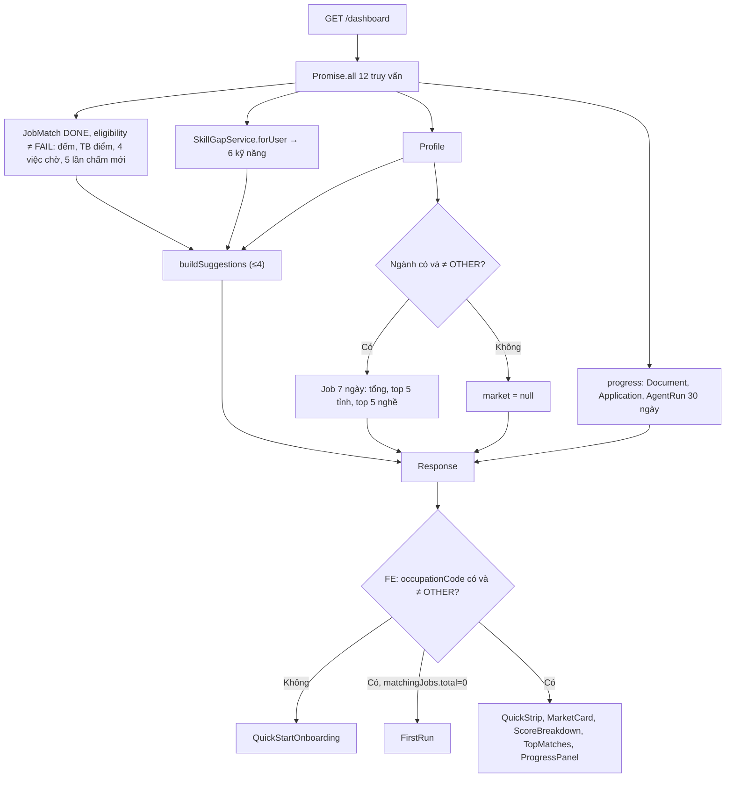
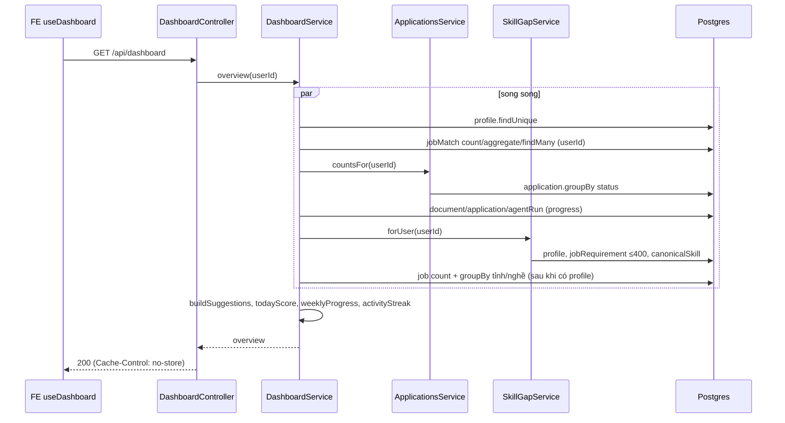

# Dashboard — Trang Tổng quan

> **Phạm vi:** `server/src/modules/dashboard/**` (`dashboard.controller.ts`, `dashboard.service.ts`, `dashboard.utils.ts`, `dashboard.module.ts`) · màn hình `/dashboard` ("Tổng quan") và khung chung `app/dashboard/layout.tsx`; khối "Gợi ý kỹ năng" ở trang Hồ sơ.
> **Nguyên tắc:** tài liệu mô tả hệ thống **as-is**. Code là nguồn sự thật duy nhất.

## 1. Purpose

| Mục tiêu | Diễn giải |
|---|---|
| Một màn hình tổng hợp tình trạng tìm việc | `GET /dashboard` gom trong MỘT request: độ hoàn thiện hồ sơ, thị trường tin trong ngành 7 ngày, số việc phù hợp, điểm trung bình, 4 việc đang chờ, khoảng trống kỹ năng, hành trình (CV/đơn/phỏng vấn thử), mục tiêu tuần, chuỗi ngày hoạt động, việc đang dở, gợi ý, số đơn, "điểm hôm nay" ([dashboard.service.ts:138](../../../server/src/modules/dashboard/dashboard.service.ts#L138)) |
| Cấp riêng danh sách kỹ năng thiếu | `GET /dashboard/skill-gaps` trả 6 kỹ năng đầu, dùng cho trang Hồ sơ mà không phải tải cả trang Tổng quan ([dashboard.service.ts:131](../../../server/src/modules/dashboard/dashboard.service.ts#L131)) |
| Thuần đường ĐỌC | Không gọi model, không ghi database; chỉ truy vấn SQL + hàm thuần trong `dashboard.utils.ts` |

**Điểm mấu chốt:**
- Module **không sở hữu bảng nào**; nó đọc `Profile`, `JobMatch`, `Job`, `Document`, `Application`, `AgentRun`, `JobRequirement`, `CanonicalSkill`.
- Khoảng trống kỹ năng dùng **chung đúng một cách tính** với trang "Lộ trình học" (`SkillGapService.forUser`) để hai nơi luôn ra cùng con số ([upskill.md](./upskill.md)).
- "Việc phù hợp" chỉ tính `JobMatch` `DONE` và **không** `eligibility = FAIL`.
- Ngày/tuần tính theo giờ Việt Nam (`Asia/Ho_Chi_Minh`), tuần bắt đầu thứ Hai ([dashboard.utils.ts:175](../../../server/src/modules/dashboard/dashboard.utils.ts#L175)).

## 2. Actors

| Actor | Quyền trong module | Ghi chú |
|---|---|---|
| Người dùng đã đăng nhập (USER/ADMIN) | Đọc tổng quan và khoảng trống kỹ năng của chính mình | Guard JWT toàn cục; không có `@Public()` |
| Khách | Không có | `/dashboard` hiện **trang chào cho khách** (`GuestHome`: ô thả CV dẫn sang Phân tích CV, thẻ Việc làm kèm số tin công khai, Thị trường, nút Đăng nhập/Đăng ký) thay cho Tổng quan *(2026-10-27)*; các trang khác đẩy về đăng nhập, trừ `/dashboard/jobs`, `/dashboard/market`, `/dashboard/cv-check` (`isGuestPath`, ADR 0008) |

## 3. Business Features

| # | Tính năng | Actor | Endpoint / cơ chế |
|---|---|---|---|
| F1 | Xem tổng quan | USER | `GET /api/dashboard` |
| F2 | Xem 6 kỹ năng còn thiếu hay gặp nhất | USER | `GET /api/dashboard/skill-gaps` |

## 4. Business Flow

### Luồng A — Xem tổng quan (F1)
- **Preconditions:** JWT hợp lệ.
- **Main Flow:**
  1. FE `useDashboard` gọi `GET /api/dashboard` (`staleTime: 0`); controller gắn header `Cache-Control: no-store, no-cache, must-revalidate` ([dashboard.controller.ts:14](../../../server/src/modules/dashboard/dashboard.controller.ts#L14)).
  2. `DashboardService.overview(userId)` chạy song song 12 truy vấn ([dashboard.service.ts:138](../../../server/src/modules/dashboard/dashboard.service.ts#L138)):
     1. `Profile` của người dùng.
     2. `matchCount`: số `JobMatch` `DONE`, `eligibility ≠ FAIL`.
     3. `newThisWeek`: như trên, `createdAt` trong 7 ngày.
     4. Điểm `overallScore` trung bình của tập trên (làm tròn).
     5. `pendingMatches`: tối đa 4 việc phù hợp mà người dùng **chưa có đơn `APPLIED`**, mới chấm nhất trước (`evaluatedAt desc, nulls last`); chỉ chọn `jobId, status, overallScore, strengths` và trường thẻ tin `jobCardSelect` (kèm cờ `saved` của chính người dùng).
     6. `recentFive`: 5 lần chấm phù hợp mới nhất (`evaluatedAt desc`) → "điểm hôm nay" là trung bình từng trục (tổng, kỹ thuật, kinh nghiệm, hành vi, định hướng) ([dashboard.utils.ts:25](../../../server/src/modules/dashboard/dashboard.utils.ts#L25)).
     7. `ineligibleCount`: số `JobMatch` `DONE` có `eligibility = FAIL`.
     8. `applications`: `{ total, active }` từ `ApplicationsService.countsFor` (active = trạng thái chưa kết thúc).
     9. `totalScored`: số `JobMatch` `DONE` (kể cả FAIL).
     10. `progress` ([dashboard.service.ts:62](../../../server/src/modules/dashboard/dashboard.service.ts#L62)): `journey` (tổng số `Document` kind `CV`, số `Application` `APPLIED`, số `AgentRun` workflow `interview`); hoạt động 30 ngày (ngày tạo tài liệu bất kỳ, `appliedAt`, ngày tạo phiên phỏng vấn thử); `weekly` so với mục tiêu cố định 2 tài liệu / 2 đơn / 1 phỏng vấn; `streak` số ngày liên tiếp có hoạt động (hôm nay chưa làm gì thì tính từ hôm qua); `resume` = việc phù hợp mới chấm nhất chưa có CV và chưa nộp đơn.
     11. `skillGaps`: 6 kỹ năng đầu từ `SkillGapService.forUser`, dạng `{ skill, jobCount }`.
     12. `market` ([dashboard.service.ts:35](../../../server/src/modules/dashboard/dashboard.service.ts#L35)): nếu hồ sơ có ngành khác `OTHER` → tổng tin (không phải bản sao) quét trong 7 ngày của ngành, top 5 tỉnh và top 5 nghề con theo số tin (bỏ mã không có tên) ([dashboard.utils.ts:147](../../../server/src/modules/dashboard/dashboard.utils.ts#L147)); ngược lại `null`.
  3. `buildSuggestions` sinh tối đa 4 gợi ý theo thứ tự ([dashboard.utils.ts:63](../../../server/src/modules/dashboard/dashboard.utils.ts#L63)):
     - `profile-incomplete` (hồ sơ \< 100% và còn trường thiếu; liệt kê 3 trường đầu) → `/dashboard/profile`;
     - `skill-<tên>` (kỹ năng thiếu đầu tiên có ≥ 2 tin) → `/dashboard/upskill`;
     - `apply-<jobId>` (việc đang chờ đầu tiên có điểm ≥ 85 và tin quét ≤ 7 ngày) → `/dashboard/jobs/<id>`;
     - `ineligible-high` (≥ 2 việc FAIL và chiếm ≥ 1/3 số đã chấm) → `/dashboard/jobs`;
     - `no-jobs` (chưa có gợi ý nào và chưa chấm việc nào) → `/dashboard/jobs`.
  4. Trả object tổng hợp (§9).
- **Alternative Flow:**
  - Hồ sơ chưa có ngành hoặc ngành `OTHER` → FE hiện `QuickStartOnboarding` thay vì dashboard ([dashboard-view.tsx](../../../../ui-ai-job-search/app/dashboard/dashboard-view.tsx)).
  - `matchingJobs.total = 0` → FE hiện `FirstRun` ("takeover"); hồ sơ chưa đủ hoặc ít việc → "nudge" ([lib/onboarding.ts](../../../../ui-ai-job-search/lib/onboarding.ts)).
  - Không có `Profile` → `profileCompletion = 0`, `missingFields(null)` trả toàn bộ trường chấm.
- **Failure Flow:** không có lỗi nghiệp vụ riêng; lỗi DB → 500 qua filter chung. FE hiện "Không tải được dữ liệu tổng quan".
- **Postconditions:** không ghi gì; không gọi AI.

### Luồng B — Xem kỹ năng còn thiếu (F2)
- **Preconditions:** JWT hợp lệ.
- **Main Flow:**
  1. `GET /api/dashboard/skill-gaps` (header `no-store`) ([dashboard.controller.ts:23](../../../server/src/modules/dashboard/dashboard.controller.ts#L23)).
  2. `SkillGapService.forUser(userId)` → lấy 6 phần tử đầu → `{ skill: name, jobCount: demand }` ([dashboard.service.ts:131](../../../server/src/modules/dashboard/dashboard.service.ts#L131)).
- **Alternative Flow:** hồ sơ chưa có ngành → mảng rỗng (e2e "hồ sơ chưa có ngành thì không có gì để gợi ý").
- **Failure Flow:** không có.
- **Postconditions:** không ghi gì. FE trang Hồ sơ hiện các kỹ năng này làm gợi ý ở nhóm "Kỹ năng còn thiếu" ([skills-section.tsx](../../../../ui-ai-job-search/app/dashboard/profile/sections/skills-section.tsx)).

## 5. Mermaid Flowchart

## 6. Sequence Diagram

## 7. Business Rules

| Mã BR | Quy tắc | Nơi thực thi | Mức | Nguồn code |
|---|---|---|---|---|
| BR-DSH-01 | "Việc phù hợp" = `JobMatch` của người dùng có `status = DONE` và `eligibility ≠ FAIL` | SV | ✅ Mềm | [dashboard.service.ts:29](../../../server/src/modules/dashboard/dashboard.service.ts#L29) |
| BR-DSH-02 | "Mới tuần này" đếm `JobMatch` phù hợp có `createdAt` trong 7 ngày (ngày tạo bản chấm, không phải ngày đăng tin) | SV | ✅ Mềm | [dashboard.service.ts:161](../../../server/src/modules/dashboard/dashboard.service.ts#L161) |
| BR-DSH-03 | "Việc đang chờ" = tối đa 4 việc phù hợp chưa có đơn ở trạng thái `APPLIED`, xếp theo lần chấm mới nhất (không theo điểm) | SV | ✅ Mềm | [dashboard.service.ts:168](../../../server/src/modules/dashboard/dashboard.service.ts#L168) |
| BR-DSH-04 | Thẻ việc đang chờ chỉ trả trường thẻ tin (`JOB_CARD_FIELDS`) + `strengths`, không kèm ghi chú chấm điểm | SV | ✅ Mềm | [dashboard.service.ts:175](../../../server/src/modules/dashboard/dashboard.service.ts#L175), [job-card.select.ts](../../../server/src/modules/jobs/job-card.select.ts) |
| BR-DSH-05 | "Điểm hôm nay" = trung bình làm tròn từng trục điểm của 5 lần chấm phù hợp mới nhất; trục không có số thì `null` | SV | ✅ Mềm | [dashboard.utils.ts:25](../../../server/src/modules/dashboard/dashboard.utils.ts#L25) |
| BR-DSH-06 | Thị trường: chỉ khi hồ sơ có ngành khác `OTHER`; tính tin không phải bản sao, quét trong 7 ngày; top 5 tỉnh/nghề, bỏ mã không có tên | SV | ✅ Mềm | [dashboard.service.ts:35](../../../server/src/modules/dashboard/dashboard.service.ts#L35), [dashboard.utils.ts:133](../../../server/src/modules/dashboard/dashboard.utils.ts#L133) |
| BR-DSH-07 | Mục tiêu tuần cố định: 2 tài liệu, 2 đơn nộp, 1 phiên phỏng vấn thử; tuần thứ Hai–Chủ nhật theo giờ Việt Nam | SV | ✅ Mềm | [dashboard.utils.ts:169](../../../server/src/modules/dashboard/dashboard.utils.ts#L169) |
| BR-DSH-08 | Chuỗi ngày hoạt động: ngày có tạo tài liệu, có `appliedAt`, hoặc mở phiên phỏng vấn thử; hôm nay chưa có hoạt động thì đếm từ hôm qua; chỉ xét 30 ngày gần nhất | SV | ✅ Mềm | [dashboard.utils.ts:212](../../../server/src/modules/dashboard/dashboard.utils.ts#L212), [dashboard.service.ts:63](../../../server/src/modules/dashboard/dashboard.service.ts#L63) |
| BR-DSH-09 | Hành trình: `cvs` = số `Document` kind `CV`; `applied` = số đơn đang `APPLIED`; `interviews` = số `AgentRun` workflow `interview` | SV | ✅ Mềm | [dashboard.service.ts:67](../../../server/src/modules/dashboard/dashboard.service.ts#L67) |
| BR-DSH-10 | "Việc đang dở" = việc phù hợp mới chấm nhất chưa có CV của người dùng và chưa nộp đơn | SV | ✅ Mềm | [dashboard.service.ts:88](../../../server/src/modules/dashboard/dashboard.service.ts#L88) |
| BR-DSH-11 | Khoảng trống kỹ năng trên Tổng quan = 6 kỹ năng đầu của `SkillGapService.forUser` (cùng cách tính trang Lộ trình học) | SV | ✅ Mềm | [dashboard.service.ts:131](../../../server/src/modules/dashboard/dashboard.service.ts#L131) |
| BR-DSH-12 | Gợi ý: tối đa 4, theo thứ tự hồ sơ chưa đủ → kỹ năng thiếu (≥ 2 tin) → việc "tuyển gấp" (điểm ≥ 85, tin ≤ 7 ngày) → nhiều việc không đủ điều kiện (≥ 2 và ≥ 1/3) → "quét việc" khi chưa chấm gì | SV | ✅ Mềm | [dashboard.utils.ts:63](../../../server/src/modules/dashboard/dashboard.utils.ts#L63) |
| BR-DSH-13 | Phản hồi dashboard không được cache (`Cache-Control: no-store, no-cache, must-revalidate`) | SV (header) | ✅ Mềm | [dashboard.controller.ts:14](../../../server/src/modules/dashboard/dashboard.controller.ts#L14) |
| BR-DSH-14 | Mọi số liệu khoá theo `userId` của JWT; số liệu thị trường là dữ liệu chung theo ngành | SV | ✅ Mềm | [dashboard.service.ts](../../../server/src/modules/dashboard/dashboard.service.ts) |
| BR-DSH-15 | Hồ sơ chưa có ngành / ngành `OTHER` → FE hiện màn hình chọn ngành thay vì tổng quan | FE | ⚠️ Chỉ frontend | [dashboard-view.tsx](../../../../ui-ai-job-search/app/dashboard/dashboard-view.tsx) |

> **Possible Business Rule:** "Việc đang chờ" chỉ loại tin đã có đơn `APPLIED`; tin có đơn `WITHDRAWN` hoặc `VIEWED` vẫn hiện lại ([dashboard.service.ts:171](../../../server/src/modules/dashboard/dashboard.service.ts#L171)). Cần xác nhận rút đơn có nên làm tin quay lại danh sách chờ hay không.

## 8. Validation Rules

Không có. Hai route không nhận body, query hay param; `userId` lấy từ JWT.

## 9. API Mapping

| Method | URL | Role | Mục đích nghiệp vụ | Controller#method | Service | DTO | Response |
|---|---|---|---|---|---|---|---|
| GET | `/api/dashboard` | USER | Tổng quan tìm việc | `DashboardController#overview` | `DashboardService.overview` (+ `ApplicationsService.countsFor`, `SkillGapService.forUser`) | — | `{ profileCompletion, occupationCode, market, matchingJobs{total,newThisWeek}, averageMatchScore, pendingMatches[], skillGaps[], totalScored, journey, weekly, streak, resume, suggestions[], applications{total,active}, todayScore }` |
| GET | `/api/dashboard/skill-gaps` | USER | 6 kỹ năng thiếu đầu | `DashboardController#skillGaps` | `DashboardService.skillGaps` | — | `{ skill, jobCount }[]` |

**Endpoint ở module khác tác động lên module này** (đổi dữ liệu mà dashboard đọc; FE invalidate `keys.dashboard()` sau các thao tác này — [lib/query-keys.ts](../../../../ui-ai-job-search/lib/query-keys.ts))

| Nhóm | Tác động |
|---|---|
| Hồ sơ (`/profile*`) | `profileCompletion`, ngành → `market`, khoảng trống |
| Chấm điểm (`/matches*`, hàng đợi `match.evaluate`) | `matchingJobs`, điểm, việc chờ, gợi ý |
| Đơn ứng tuyển (`/applications*`) | `journey.applied`, `applications`, việc chờ, streak |
| Tài liệu (`/documents*`) | `journey.cvs`, `weekly.documents`, `resume` |
| Phỏng vấn thử (`mock-interview`) | `journey.interviews`, `weekly.interviews` |
| Lưu tin (`/jobs/:id/save`) | cờ `saved` trên thẻ việc chờ |
| Kế hoạch học (`/learning/:key`) | khoảng trống kỹ năng (kỹ năng DONE vào hồ sơ) |
| Quét tin + `job.requirements` | `market`, khoảng trống kỹ năng |

## 10. Frontend Mapping

| Route FE | Vai trò | Mục đích | Hook / API client |
|---|---|---|---|
| `/dashboard` | USER | Trang Tổng quan | [page.tsx](../../../../ui-ai-job-search/app/dashboard/page.tsx) → [dashboard-view.tsx](../../../../ui-ai-job-search/app/dashboard/dashboard-view.tsx), `useDashboard` |
| — `QuickStrip` | USER | Hồ sơ %, số tin đã chấm, hành trình, thị trường, việc đang dở | [quick-strip.tsx](../../../../ui-ai-job-search/app/dashboard/quick-strip.tsx) |
| — `MarketCard` | USER | Thị trường 7 ngày | [market-card.tsx](../../../../ui-ai-job-search/app/dashboard/market-card.tsx) |
| — `ScoreBreakdown` | USER | Điểm hôm nay | [score-breakdown.tsx](../../../../ui-ai-job-search/app/dashboard/score-breakdown.tsx) |
| — `TopMatches` | USER | 4 việc đang chờ | [top-matches.tsx](../../../../ui-ai-job-search/app/dashboard/top-matches.tsx) |
| — `ProgressPanel` | USER | Mục tiêu tuần, chuỗi ngày, kỹ năng thiếu | [progress-panel.tsx](../../../../ui-ai-job-search/app/dashboard/progress-panel.tsx) |
| — `FirstRun` / `QuickStartOnboarding` | USER | Màn hình lần đầu / chọn ngành | [first-run.tsx](../../../../ui-ai-job-search/app/dashboard/first-run.tsx), [quick-start-onboarding.tsx](../../../../ui-ai-job-search/app/dashboard/quick-start-onboarding.tsx), [lib/onboarding.ts](../../../../ui-ai-job-search/lib/onboarding.ts) |
| `/dashboard/profile` (khối kỹ năng) | USER | Gợi ý kỹ năng còn thiếu | [skills-section.tsx](../../../../ui-ai-job-search/app/dashboard/profile/sections/skills-section.tsx), `useSkillGaps` |
| Khung `/dashboard/*` | USER (khách ở `/dashboard/jobs`, `/dashboard/salary`) | `SessionProvider` + `AppLayout` + `Sidebar`, `robots: noindex` | [layout.tsx](../../../../ui-ai-job-search/app/dashboard/layout.tsx) |
| API client | — | `/dashboard`, `/dashboard/skill-gaps` | [services/dashboard.ts](../../../../ui-ai-job-search/services/dashboard.ts), [hooks/use-dashboard.ts](../../../../ui-ai-job-search/hooks/use-dashboard.ts) |

Thuật ngữ UI ↔ backend: "Tổng quan" = `/dashboard`; "Việc mới hợp với bạn" / "Việc đang chờ" = `pendingMatches`; "Điểm hôm nay" = `todayScore`; "Chuỗi ngày" = `streak`; "Mục tiêu tuần" = `weekly`.

## 11. Database

Module không có bảng riêng và không ghi. Bảng/trường được đọc:

| Bảng | Trường dùng | Ghi chú |
|---|---|---|
| `Profile` | `completion`, `occupationCode`, các trường chấm hoàn thiện | qua `missingFields` |
| `JobMatch` | `status`, `eligibility`, `overallScore` + 4 điểm trục, `strengths`, `evaluatedAt`, `createdAt` | lọc `userId` |
| `Job` | `JOB_CARD_FIELDS`, `scrapedAt`, `occupationCode`, `provinceCode`, `subOccupationCode`, `duplicateOfId` | thị trường + thẻ việc |
| `Document` | `kind`, `createdAt` | lọc `userId` |
| `Application` | `status`, `appliedAt` | lọc `userId` |
| `AgentRun` | `workflow = 'interview'`, `createdAt` | lọc `userId` |
| `SavedJob` | `userId` | cờ `saved` |
| `JobRequirement`, `CanonicalSkill` | qua `SkillGapService` | xem [upskill.md](./upskill.md) |

## 12. State Machine

Không có. Module không sở hữu field trạng thái nào; nó chỉ ĐỌC `JobMatch.status` (`MatchStatus`), `Application.status` — state machine của chúng nằm ở [matching.md](./matching.md) và [applications.md](./applications.md).

## 13. Exceptions

| Tình huống | HTTP | Thông điệp nguyên văn | Nguồn |
|---|---|---|---|
| Thiếu/sai JWT | 401 | (guard toàn cục — xem [auth.md](./auth.md)) | `JwtAuthGuard` |
| Vượt throttle mặc định | 429 | thông điệp mặc định `@nestjs/throttler` | [configuration.ts](../../../server/src/config/configuration.ts) |
| FE không tải được | (FE) | `Không tải được dữ liệu tổng quan` / `Không tải được gợi ý kỹ năng` | [use-dashboard.ts](../../../../ui-ai-job-search/hooks/use-dashboard.ts) |

Service không ném exception nghiệp vụ nào.

## 14. Notifications

Không có. Gợi ý (`suggestions`) chỉ là dữ liệu trả về trong response, không phải thông báo đẩy.

## 15. Integrations

Không có tích hợp ngoài phía backend (không gọi AI, không hàng đợi). Phía FE trang Tổng quan chèn khối quảng cáo/affiliate (`ResponsiveBannerAd`, `SkillResources`) dùng tên kỹ năng rút từ gợi ý loại `skill` (`suggestionSkill`) ([dashboard-view.tsx](../../../../ui-ai-job-search/app/dashboard/dashboard-view.tsx), [lib/affiliate.ts](../../../../ui-ai-job-search/lib/affiliate.ts)).

## 16. Security

- **Phân quyền:** cần JWT (guard toàn cục mặc-định-đóng); không `@Public()`, không route admin.
- **Kiểm sở hữu:** mọi truy vấn dữ liệu cá nhân lọc `userId` lấy từ `@CurrentUser()`; quan hệ con (`job.applications`, `job.documents`, `saves`) cũng lọc `userId` nên không lộ trạng thái của người khác (e2e "mỗi người chỉ thấy khoảng trống theo hồ sơ của chính mình" — [dashboard-skill-gaps.e2e-spec.ts](../../../server/test/dashboard-skill-gaps.e2e-spec.ts)).
- **Hạn chế trường trả ra:** thẻ việc chờ chọn danh sách trắng `jobCardSelect`, không trả ghi chú chấm điểm (`technicalNote`…) — có e2e ghim.
- **Rate limit:** theo mặc định toàn cục (120 lượt/60s), không throttle riêng.
- **Cache:** `no-store` để dữ liệu cá nhân không bị proxy/trình duyệt giữ lại.

## 17. ⚠️ Sai lệch / Rủi ro nghiệp vụ

### R1 — Một phần lớn payload không có màn hình nào dùng
- **Mô tả:** `suggestions` chỉ được FE dùng để rút tên kỹ năng cho khối affiliate (tiêu đề/mô tả/link gợi ý không hiển thị); `applications`, `matchingJobs.newThisWeek` không có component nào đọc.
- **Bằng chứng:** grep `newThisWeek`, `.applications.`, `suggestions` trong `ui-ai-job-search/app|components|lib|hooks` chỉ ra [dashboard-view.tsx:33](../../../../ui-ai-job-search/app/dashboard/dashboard-view.tsx#L33) (`suggestionSkill`) và [lib/onboarding.ts](../../../../ui-ai-job-search/lib/onboarding.ts) (`matchingJobs.total`); backend vẫn tính ở [dashboard.service.ts:158-205](../../../server/src/modules/dashboard/dashboard.service.ts#L158).
- **Tác động:** thêm 1 `groupBy` và 2 `count` mỗi lần mở trang; logic gợi ý (BR-DSH-12) không đến được người dùng.
- **Đề xuất:** chủ dự án quyết hiển thị lại khối gợi ý hoặc gỡ phần không dùng.
- **Mức đề xuất:** 🟢

### R2 — Mỗi lần mở Tổng quan chạy lại toàn bộ phép tính khoảng trống kỹ năng
- **Mô tả:** `overview` gọi `SkillGapService.forUser` (đọc tới 400 `JobRequirement` + đối chiếu bằng code) mỗi request, không cache; `staleTime: 0` ở FE và header `no-store`. Trang Hồ sơ (`/dashboard/skill-gaps`) và Lộ trình học (`/learning`) tính lại lần nữa.
- **Bằng chứng:** [dashboard.service.ts:131](../../../server/src/modules/dashboard/dashboard.service.ts#L131), [skill-gap.service.ts:86-99](../../../server/src/modules/upskill/services/skill-gap.service.ts#L86), [use-dashboard.ts](../../../../ui-ai-job-search/hooks/use-dashboard.ts).
- **Tác động:** chi phí CPU/DB tăng theo số tin trong ngành; chưa có số đo cho thấy chạm ngưỡng (theo nguyên tắc "tối ưu khi số đo gần ngưỡng" của CLAUDE.md).
- **Đề xuất:** ghi nhận, đo khi kho tin tăng.
- **Mức đề xuất:** 🟢

### R3 — Hai danh sách "mới nhất" xử lý `evaluatedAt = null` khác nhau
- **Mô tả:** `pendingMatches` và `resume` sắp `evaluatedAt desc, nulls last`; `recentFive` ("điểm hôm nay") sắp `evaluatedAt desc` không chỉ định — Postgres đặt `NULL` lên ĐẦU khi `DESC`.
- **Bằng chứng:** [dashboard.service.ts:173](../../../server/src/modules/dashboard/dashboard.service.ts#L173) so với [:185](../../../server/src/modules/dashboard/dashboard.service.ts#L185).
- **Tác động:** chỉ sai nếu có `JobMatch` `DONE` thiếu `evaluatedAt`; đường ghi DONE trong `MatchingService` luôn đặt `evaluatedAt` ([matching.service.ts:226](../../../server/src/modules/matching/ai/services/matching.service.ts#L226)), dữ liệu seed/test có thể thiếu. Chưa kiểm chứng có bản ghi như vậy trong DB thật.
- **Đề xuất:** thêm `nulls: 'last'` cho đồng nhất.
- **Mức đề xuất:** 🟢

## 18. Source References

**Backend**
- [dashboard.controller.ts](../../../server/src/modules/dashboard/dashboard.controller.ts)
- [dashboard.service.ts](../../../server/src/modules/dashboard/dashboard.service.ts)
- [dashboard.utils.ts](../../../server/src/modules/dashboard/dashboard.utils.ts)
- [dashboard.module.ts](../../../server/src/modules/dashboard/dashboard.module.ts)
- [skill-gap.service.ts](../../../server/src/modules/upskill/services/skill-gap.service.ts)
- [applications.service.ts](../../../server/src/modules/applications/applications.service.ts) (`countsFor`)
- [job-card.select.ts](../../../server/src/modules/jobs/job-card.select.ts)
- [profile/utils/completion.ts](../../../server/src/modules/profile/utils/completion.ts)
- [jobs/taxonomy/occupations.ts](../../../server/src/modules/jobs/taxonomy/occupations.ts), [provinces.ts](../../../server/src/modules/jobs/taxonomy/provinces.ts), [sub-occupations.ts](../../../server/src/modules/jobs/taxonomy/sub-occupations.ts)
- [common/duration.ts](../../../server/src/common/duration.ts)
- Test: [dashboard-skill-gaps.e2e-spec.ts](../../../server/test/dashboard-skill-gaps.e2e-spec.ts), [learning.e2e-spec.ts](../../../server/test/learning.e2e-spec.ts) ("trang Tổng quan dùng đúng cách tính của trang Lộ trình học"), [unit/modules/dashboard/dashboard.utils.spec.ts](../../../server/test/unit/modules/dashboard/dashboard.utils.spec.ts)
- [ADR 0008](../../adr/0008-trang-viec-lam-cong-khai.md) (khách ở `/dashboard/jobs`, `/dashboard/salary`)

**Frontend**
- [app/dashboard/page.tsx](../../../../ui-ai-job-search/app/dashboard/page.tsx), [layout.tsx](../../../../ui-ai-job-search/app/dashboard/layout.tsx), [dashboard-view.tsx](../../../../ui-ai-job-search/app/dashboard/dashboard-view.tsx), [quick-strip.tsx](../../../../ui-ai-job-search/app/dashboard/quick-strip.tsx), [market-card.tsx](../../../../ui-ai-job-search/app/dashboard/market-card.tsx), [score-breakdown.tsx](../../../../ui-ai-job-search/app/dashboard/score-breakdown.tsx), [top-matches.tsx](../../../../ui-ai-job-search/app/dashboard/top-matches.tsx), [progress-panel.tsx](../../../../ui-ai-job-search/app/dashboard/progress-panel.tsx), [first-run.tsx](../../../../ui-ai-job-search/app/dashboard/first-run.tsx), [quick-start-onboarding.tsx](../../../../ui-ai-job-search/app/dashboard/quick-start-onboarding.tsx)
- [app/dashboard/profile/sections/skills-section.tsx](../../../../ui-ai-job-search/app/dashboard/profile/sections/skills-section.tsx)
- [services/dashboard.ts](../../../../ui-ai-job-search/services/dashboard.ts), [hooks/use-dashboard.ts](../../../../ui-ai-job-search/hooks/use-dashboard.ts), [lib/onboarding.ts](../../../../ui-ai-job-search/lib/onboarding.ts), [lib/query-keys.ts](../../../../ui-ai-job-search/lib/query-keys.ts), [lib/affiliate.ts](../../../../ui-ai-job-search/lib/affiliate.ts)
