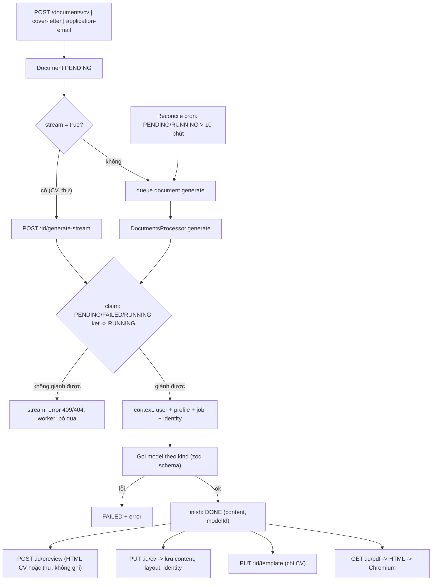
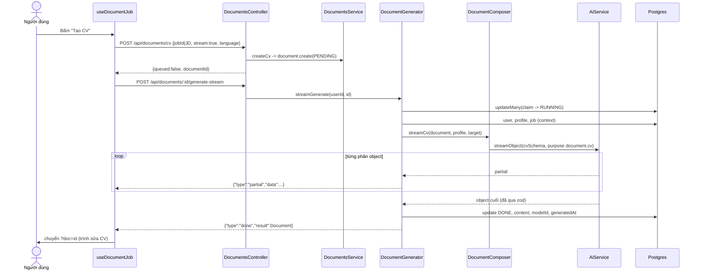
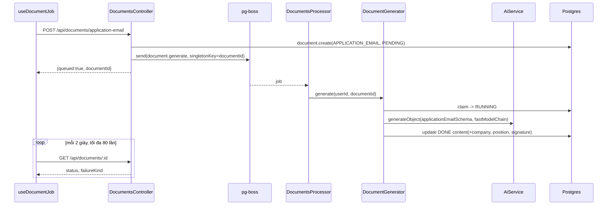
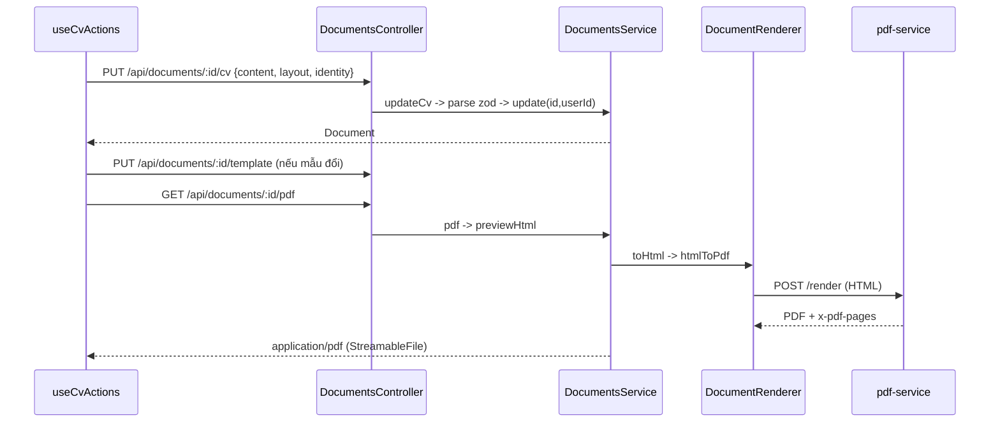

# Documents — Tài liệu ứng tuyển (CV, Thư xin việc, Mail ứng tuyển)

> **Phạm vi:** `server/src/modules/documents/**` (controller, `services/` — `DocumentsService`, `DocumentGenerator`, `DocumentComposer`, `DocumentRenderer`, `JobFromUrlService`; `documents.processor.ts`; `pdf/` seam http/sandbox; `templates/` HTML cho CV và thư; `schemas/`; `utils/`), model `Document`, enum `DocumentKind`, `DocumentLanguage`, `MatchStatus` (dùng cho `Document.status`). Tích hợp `pdf-service/`, Sandbox, hàng đợi `document.generate` *(2026-10-19: gỡ `latex-service/` và không còn ghi Storage R2)*. Màn hình FE: `/dashboard/cv-optimizer` ("Tối ưu CV"), `/dashboard/cover-letter` ("Thư xin việc").
> **Nguyên tắc:** tài liệu mô tả hệ thống **as-is**. Code là nguồn sự thật duy nhất.

---

## 1. Purpose

| Mục tiêu | Diễn giải |
|---|---|
| Sinh CV bám theo một vị trí | Model viết `content` có cấu trúc (giới thiệu, năng lực, kinh nghiệm, dự án, học vấn, kỹ năng) từ hồ sơ ứng viên + tin tuyển dụng (tin có sẵn, JD dán tay, hoặc CV tổng quát). |
| Sinh Thư xin việc (COVER_LETTER) | Thư 1 trang gắn bắt buộc với một tin có sẵn; xem trước và in PDF bằng HTML/Chromium, mượn mẫu của CV cùng tin *(2026-10-19)*. |
| Sinh Mail ứng tuyển (APPLICATION_EMAIL) | Mail ngắn (150–250 chữ) để dán vào hộp thư; chữ ký ghép từ hồ sơ chứ không do model viết; không có bản xem trước HTML hay PDF. |
| Bóc tin từ đường dẫn | `job-from-url` tải trang, gọi model bóc (company, title, description) để người dùng soát lại — **không tạo bản ghi**. |
| Người dùng sửa CV, chọn mẫu, bố cục, phần đầu | Sửa thẳng trên trang xem trước; `content` / `layout` / `identity` / `templateId` / `templateOptions` là các cột riêng ([ADR 0003](../../adr/0003-nguoi-dung-sua-cv.md)). |
| Xuất PDF | Một bộ máy duy nhất: HTML/Chromium (`pdf-service` hoặc sandbox `aijob-pdf`) cho CV và thư; xem trước HTML miễn phí và khớp bản in. LaTeX đã gỡ hẳn *(2026-10-19)* ([ADR 0002](../../adr/0002-cv-html-va-kho-mau.md); [ADR 0004](../../adr/0004-xuat-pdf-latex.md) đã bị thay thế). |

**Điểm mấu chốt:**
- `Document.content` là **nguồn sự thật**; HTML (xem trước và PDF) chỉ là cách trình bày, dựng lại từ các cột mỗi lần cần — không còn file nào lưu trên Storage *(2026-10-19)*. Đổi mẫu, xem trước, sửa nội dung, in PDF **không gọi model**.
- Mỗi lần "tạo" là một `Document` **mới**; sinh lại không bao giờ đè bản đã sửa — bản `DONE` không giành chỗ được nữa (409).
- Sinh tài liệu đi hai đường: **hàng đợi** `document.generate` (`stream` vắng/false) hoặc **stream NDJSON** `POST :id/generate-stream` (FE dùng cho CV và Thư xin việc). Cả hai đều giành chỗ có điều kiện `PENDING|FAILED|RUNNING-kẹt → RUNNING` theo `userId`.
- Bảng có `status: MatchStatus` nên nằm trong `ReconcileService`: bản ghi `PENDING`/`RUNNING` quá 10 phút được **xếp lại hàng đợi** (không đánh FAILED).

## 2. Actors

| Actor | Quyền trong module | Ghi chú |
|---|---|---|
| USER (đã đăng nhập) | Tạo/sinh CV, thư, mail; xem, sửa, đổi mẫu, xem trước, tải PDF tài liệu của mình; bóc tin từ URL | Mọi truy vấn khoá `userId`. Không có route `@Public()`. |
| ADMIN | Không có route riêng | Admin chỉ thấy số đếm `documents` mỗi user và log `AiCall` (purpose `document.*` bị che phần response vì là dữ liệu cá nhân — [response-redaction.ts](../../../server/src/modules/admin/utils/response-redaction.ts)). |
| Hệ thống — worker `DocumentsProcessor` | Chạy `DocumentGenerator.generate` cho việc trong hàng đợi `document.generate` | [documents.processor.ts](../../../server/src/modules/documents/documents.processor.ts) |
| Hệ thống — `ReconcileService` (cron) | Xếp lại `Document` kẹt `PENDING/RUNNING` > `STUCK_AFTER_MS` | [reconcile.service.ts](../../../server/src/modules/reconcile/services/reconcile.service.ts) — xem [platform-operations.md](./platform-operations.md) |
| Module Applications | Tạo CV + Thư khi tạo đơn không `skipDocuments` | [applications.md](./applications.md) |
| Dịch vụ ngoài: model AI, `pdf-service` (hoặc sandbox Docker) | Sinh nội dung, in PDF *(2026-10-19: gỡ `latex-service`, không còn ghi R2)* | §15 |

## 3. Business Features

| # | Tính năng | Actor | Endpoint / cơ chế |
|---|---|---|---|
| F1 | Tạo CV (theo tin / JD dán tay / tổng quát), chọn ngôn ngữ VI/EN | USER | `POST /api/documents/cv` |
| F2 | Tạo Thư xin việc theo tin có sẵn | USER | `POST /api/documents/cover-letter` |
| F3 | Tạo Mail ứng tuyển (tin có sẵn / JD dán tay) | USER | `POST /api/documents/application-email` |
| F4 | Sinh nội dung qua stream NDJSON | USER | `POST /api/documents/:id/generate-stream` |
| F5 | Sinh nội dung qua hàng đợi (nền) | Hệ thống | queue `document.generate` → `DocumentsProcessor` |
| F6 | Bóc tin tuyển dụng từ URL | USER | `POST /api/documents/job-from-url` |
| F7 | Danh sách tài liệu (lọc loại, tin, phân trang) | USER | `GET /api/documents` |
| F8 | Chi tiết tài liệu | USER | `GET /api/documents/:id` |
| F9 | Danh mục mẫu CV | USER | `GET /api/documents/cv-templates` |
| F10 | Xem trước HTML bản nháp CV chưa lưu (kể cả chế độ sửa); xem trước thư xin việc *(2026-10-19)* | USER | `POST /api/documents/:id/preview` |
| F11 | Lưu nội dung/bố cục/phần đầu CV đã sửa | USER | `PUT /api/documents/:id/cv` |
| F12 | Lưu mẫu và tuỳ chọn thiết kế CV | USER | `PUT /api/documents/:id/template` |
| F13 | Tải PDF CV/thư, in bằng HTML/Chromium (không còn tham số `engine`) *(2026-10-19)* | USER | `GET /api/documents/:id/pdf` |
| F14 | ĐÃ XÁC MINH KHÔNG CÒN TRONG CODE (2026-10-19): xem mã nguồn `.tex` | — | — (route đã gỡ cùng LaTeX) |
| F15 | Nhặt tài liệu kẹt | Hệ thống | `ReconcileService.run` (cron) |

## 4. Business Flow

### Luồng A — Tạo CV (F1)

**Preconditions:** đã đăng nhập; body `CreateCvDto` hợp lệ; chưa vượt `@ThrottleAi()` 10 lượt/phút ([documents.controller.ts:161](../../../server/src/modules/documents/documents.controller.ts#L161)).

**Main Flow**
1. FE "Tối ưu CV" gọi `POST /api/documents/cv { jobId? | jobDescription+company+title, stream: true, language: 'vi'|'en' }` ([cv-optimizer-view.tsx](../../../../ui-ai-job-search/app/dashboard/cv-optimizer/cv-optimizer-view.tsx)).
2. Controller map `language === 'en' ? 'EN' : 'VI'` rồi gọi `DocumentsService.createCv` ([documents.service.ts:83](../../../server/src/modules/documents/services/documents.service.ts#L83)).
3. Có `jobId` → `requireJob` (không có → 404 `` `Không tìm thấy tin tuyển dụng: ${jobId}` ``) → tạo `Document { kind: CV, title: '', jobId, language }`.
4. Không `jobId` nhưng có ít nhất một trong ba trường JD → `requirePastedJob` bắt đủ cả ba (thiếu → 400 `"Cần chọn một tin tuyển dụng, hoặc dán mô tả công việc kèm tên công ty và vị trí"`) → JD dán tay được lưu **tạm vào cột `content`** của bản ghi `PENDING`.
5. Không `jobId` và không trường JD nào → tạo CV **tổng quát** (`content = null`).
6. `handOff`: `stream === true` → trả `{ queued: false, documentId }` (client tự gọi Luồng D); ngược lại `queue.send('document.generate', { userId, documentId })` và trả `{ queued: true, documentId }` ([documents.controller.ts:204](../../../server/src/modules/documents/documents.controller.ts#L204)).

**Alternative Flow**
- Nút "Tạo CV cho tin này" ở Lịch sử ứng tuyển gửi `{ jobId }` không `stream` → đi hàng đợi, FE hỏi lại qua danh sách ([applications-view.tsx](../../../../ui-ai-job-search/app/dashboard/applications/applications-view.tsx)).
- Applications `create` (không skip) tạo CV tiêu đề `"CV - {title}"` trực tiếp bằng `DocumentsService.create` và xếp hàng ([applications.md](./applications.md)).

**Failure Flow:** 400 DTO (JD \< 50 hoặc > 60.000 ký tự, company/title 1–300, `language` ∉ \{vi,en\}, `stream` không phải boolean); 400 `requirePastedJob`; 404 tin không tồn tại; 429 throttle.
**Postconditions:** 1 `Document` `PENDING` (`title = ''`); có thể thêm 1 việc trong hàng đợi.

### Luồng B — Tạo Thư xin việc (F2)

**Preconditions:** đã đăng nhập; `jobId` bắt buộc (≤ 40 ký tự); throttle 10/phút.
**Main Flow**
1. FE "Thư xin việc" gọi `POST /api/documents/cover-letter { jobId, stream: true }` ([cover-letter-view.tsx:37](../../../../ui-ai-job-search/app/dashboard/cover-letter/cover-letter-view.tsx#L37)).
2. `DocumentsService.create(userId, 'COVER_LETTER', 'Thư xin việc', jobId)` — **không** kiểm tin tồn tại trước, không nhận `language` ([documents.controller.ts:179](../../../server/src/modules/documents/documents.controller.ts#L179)).
3. `handOff` như Luồng A.

**Alternative Flow:** `stream` vắng → xếp hàng đợi.
**Failure Flow:** `jobId` không tồn tại → khoá ngoại `P2003` → 400 `"Dữ liệu tham chiếu không hợp lệ"`; 400 DTO; 429.
**Postconditions:** 1 `Document` `COVER_LETTER` `PENDING`, `language = VI` (mặc định).

### Luồng C — Tạo Mail ứng tuyển (F3)

**Preconditions:** đã đăng nhập; `jobId` hoặc đủ ba trường JD dán tay; throttle 10/phút.
**Main Flow** ([documents.service.ts:58](../../../server/src/modules/documents/services/documents.service.ts#L58))
1. FE gọi `POST /api/documents/application-email` ([cover-letter-view.tsx:40](../../../../ui-ai-job-search/app/dashboard/cover-letter/cover-letter-view.tsx#L40)).
2. Có `jobId` → `requireJob` (404 nếu không có) → tiêu đề `emailTitle(job.title, job.company)` = `"Mail ứng tuyển: {title} - {company}"` cắt 160 ký tự ([letter-target.ts:16](../../../server/src/modules/documents/utils/letter-target.ts#L16)).
3. Không `jobId` → `requirePastedJob` → JD lưu tạm vào `content`; tiêu đề theo JD dán tay.
4. **Luôn** xếp hàng đợi (route không nhận `stream`) → `{ queued: true, documentId }`. FE poll `GET /documents/:id` mỗi 2 giây, tối đa 80 lần ([use-document-job.ts](../../../../ui-ai-job-search/hooks/use-document-job.ts)).

**Failure Flow:** 400 DTO (`"Thiếu mô tả công việc"`, `"Mô tả công việc quá ngắn hoặc quá dài (cần 50 tới 60.000 ký tự)"`, `"Thiếu tên công ty"`, `"Tên công ty phải từ 1 tới 300 ký tự"`, `"Thiếu tên vị trí ứng tuyển"`, `"Tên vị trí phải từ 1 tới 300 ký tự"`); 404 tin; 429.
**Postconditions:** 1 `Document` `APPLICATION_EMAIL` `PENDING` + 1 việc hàng đợi. Không tạo `Job` nào từ JD dán tay (e2e "dán JD rồi sinh mail, KHÔNG tạo tin tuyển dụng nào").

### Luồng D — Sinh nội dung qua stream NDJSON (F4)

**Preconditions:** đã đăng nhập; tài liệu thuộc người dùng; throttle `@ThrottleAi()` (lượt thứ hai trong 10/phút — một CV stream tiêu 2 lượt: tạo + stream).

**Main Flow** ([document-generator.service.ts:109](../../../server/src/modules/documents/services/document-generator.service.ts#L109), [ndjson.ts](../../../server/src/common/ndjson.ts))
1. FE gọi `POST /api/documents/:id/generate-stream` ([use-document-job.ts:163](../../../../ui-ai-job-search/hooks/use-document-job.ts#L163)). Response `application/x-ndjson`, heartbeat `\n` mỗi 10 giây.
2. `claim`: `updateMany where { id, userId, OR: [status ∈ {PENDING, FAILED}, (status = RUNNING và updatedAt < now − STUCK_AFTER_MS)] } data { status: RUNNING, error: null }`, rồi `findFirst {id, userId}` ([document-generator.service.ts:53](../../../server/src/modules/documents/services/document-generator.service.ts#L53)).
3. Không thấy tài liệu → sự kiện `{type:'error', statusCode:404, message:"Không tìm thấy tài liệu: {id}"}`. Không giành được chỗ → sự kiện `error` 409 `` `Tài liệu này đang được tạo hoặc đã tạo xong, không tạo lại được. Muốn bản khác thì tạo tài liệu mới.` `` (lỗi trước sự kiện đầu đi ra dạng sự kiện `error` kèm `statusCode`).
4. `kind` ∉ \{CV, COVER_LETTER\} (tức APPLICATION_EMAIL) → chạy `compose` không stream và phát một sự kiện `done`.
5. CV/COVER_LETTER: `context` (user.name/email + Profile + Job + `identity` đã gộp) → `composer.streamCv`/`streamCoverLetter` → phát `{type:'partial', data}` cho từng phần object.
6. Hết stream: `object` cuối (đã qua zod) → `finish` cập nhật `status: DONE, content, modelId, generatedAt, error: null` → phát `{type:'done', result: Document}`. Không render, không ghi Storage *(2026-10-19)* ([document-generator.service.ts:79](../../../server/src/modules/documents/services/document-generator.service.ts#L79)).
7. FE đặt cache, chuyển `?doc={id}` mở trình sửa.

**Alternative Flow:** trình duyệt ngắt giữa chừng → server vẫn chạy generator tới cuối và tự ghi DONE/FAILED; không xếp lại việc (theo CLAUDE.md: đã gỡ `onAbandon` *(2026-10-16)*).
**Failure Flow:** lỗi trong lúc sinh → `fail` ghi `status: FAILED, error: <message thô>` → phát `streamFailureEvent`: `HttpException` giữ nguyên câu; lỗi khác → `"Không hoàn thành được tác vụ."` + `failureKind` (e2e: hết giờ thành 504 kèm `failureKind`, không lộ lỗi thô — [stream-claim.e2e-spec.ts](../../../server/test/stream-claim.e2e-spec.ts)).
**Postconditions:** `DONE` (có `content`, `modelId`, `generatedAt`) hoặc `FAILED` (có `error`).

### Luồng E — Sinh nội dung qua hàng đợi (F5)

**Preconditions:** việc `document.generate { userId, documentId }` trong pg-boss (policy `exclusive`, `singletonKey = documentId`, concurrency mặc định 8).
**Main Flow** ([documents.processor.ts:18](../../../server/src/modules/documents/documents.processor.ts#L18), [document-generator.service.ts:148](../../../server/src/modules/documents/services/document-generator.service.ts#L148))
1. Worker gọi `generate(userId, documentId)` → `claim` như Luồng D.
2. Không giành được chỗ (DONE, đang RUNNING chưa kẹt) → log debug "Bỏ qua tài liệu …" và trả tài liệu, **không gọi model**.
3. `compose`: `context` → `DocumentComposer.compose` theo `kind` ([document-composer.service.ts:52](../../../server/src/modules/documents/services/document-composer.service.ts#L52)):
   - **CV:** `cvSchema(language)`, prompt `cvPrompt` (khung `05-cv-templates.md` + `03-writing-style.md` của skill `job-application-assistant`, tóm tắt hồ sơ, vị trí nhắm tới hoặc "CV tổng quát"), purpose `document.cv`, timeout 180 giây, chuỗi model mặc định.
   - **COVER_LETTER:** bắt buộc có `target` (không → 404 `"Thư xin việc bắt buộc phải gắn với một công việc"`); `coverLetterSchema`; prompt kèm thế mạnh/khoảng trống từ `JobMatch` (`matchHints`); purpose `document.coverLetter`; `fastModelChain`.
   - **APPLICATION_EMAIL:** bắt buộc có `target` (không → 404 `"Mail ứng tuyển cần một tin tuyển dụng hoặc một mô tả công việc dán tay"`); `applicationEmailSchema`; purpose `document.applicationEmail`; `fastModelChain`; sau đó code **ghép thêm** `company`, `position`, `signature {name,email,phone,title}` từ `identity` ([document-composer.service.ts:219](../../../server/src/modules/documents/services/document-composer.service.ts#L219)).
   - `FORM_ANSWER` hoặc loại khác → `Error("Không còn hỗ trợ sinh tài liệu loại …")` → FAILED.
4. `finish` → `DONE` (không còn bước render `.tex` *(2026-10-19)*).

**Failure Flow:** mọi lỗi → `fail` → `FAILED` + `error`. Worker không ném lại nên pg-boss coi việc là xong; **không tự thử lại** FAILED.
**Postconditions:** như Luồng D.

### Luồng F — Bóc tin từ URL (F6)

**Preconditions:** đã đăng nhập; `url` chuỗi 1–2000 ký tự; throttle 10/phút.
**Main Flow** ([job-from-url.service.ts:40](../../../server/src/modules/documents/services/job-from-url.service.ts#L40))
1. Ô "Dán đường dẫn" ở trang Tối ưu CV gọi `POST /api/documents/job-from-url { url }` ([cv-source-card.tsx:59](../../../../ui-ai-job-search/app/dashboard/cv-optimizer/cv-source-card.tsx#L59)).
2. `fetchPage` (curl, kiểm địa chỉ công khai ở **từng** chặng chuyển hướng, timeout `AGENT_FETCH_TIMEOUT_MS` mặc định 20 giây, trần `AGENT_FETCH_MAX_BYTES` 2 MB) ([http-get.ts](../../../server/src/common/web/http-get.ts)).
3. Kiểm phản hồi: 401/403/429 → 400 "Trang này chặn truy cập từ máy chủ (HTTP …)"; ngoài 2xx → 400 "Máy chủ của trang trả về HTTP …"; chữ \< 800 ký tự → 400 "Trang này gần như không có chữ trong HTML …".
4. Cắt chữ còn 20.000 ký tự → gọi model (`jobFromUrlSchema`, purpose `job.fromUrl`, `fastModelChain`).
5. Model trả `title` hoặc `description` rỗng → 400 "Không tìm thấy tin tuyển dụng nào trong trang này. …".
6. Trả `{ company, title, description }`; FE điền vào ba ô JD dán tay (`usePastedJob.fill`) để người dùng soát.

**Failure Flow:** tải hỏng/địa chỉ bị chặn → 400 `FETCH_FAILED + PASTE_INSTEAD`; lỗi model → filter toàn cục (502/503/504 kèm `failureKind`).
**Postconditions:** không ghi database (chỉ log `AiCall` ở module AI).

### Luồng G — Danh sách và chi tiết tài liệu (F7, F8)

**Preconditions:** đã đăng nhập.
**Main Flow**
1. `GET /api/documents?kind=&jobId=&limit=&offset=` → `$transaction[findMany, count]` where `{userId, kind?, jobId?}` sắp `createdAt desc`; `select` **không** gồm `content` (chỉ id, jobId, kind, status, title, templateId, templateOptions, language, createdAt, generatedAt, error, job tóm tắt) ([documents.service.ts:133](../../../server/src/modules/documents/services/documents.service.ts#L133)).
2. `GET /api/documents/:id` → `findFirst {id, userId}` kèm job tóm tắt; không có → 404 `` `Không tìm thấy tài liệu: ${id}` `` ([documents.service.ts:171](../../../server/src/modules/documents/services/documents.service.ts#L171)).
3. Cả hai qua `withFailureKind`: bỏ cột `error` thô, thay bằng `failureKind` (SCHEMA/TIMEOUT/UPSTREAM/OTHER hoặc null).

**Alternative Flow:** FE dùng `useRecentDocuments(kind)` (limit gần nhất), `useJobCv(jobId)` (limit 1), `useLetterDocument(id)` ([use-letters.ts](../../../../ui-ai-job-search/hooks/use-letters.ts)).
**Failure Flow:** 404; 400 query (`kind` chỉ nhận CV/COVER_LETTER/APPLICATION_EMAIL).
**Postconditions:** không ghi; đường đọc không gọi AI.

### Luồng H — Danh mục mẫu CV (F9)

**Main Flow:** `GET /api/documents/cv-templates` trả `{ items: CV_TEMPLATES }` — 6 mẫu `classic` (mặc định), `minimal`, `modern`, `thanh-mau`, `trang-trong`, `gon` với `id, name, description, style, accent, usesAccent` ([registry.ts:19](../../../server/src/modules/documents/templates/registry.ts#L19), [themes.ts](../../../server/src/modules/documents/templates/themes.ts)). Route khai **trước** `GET :id` (nếu không Nest khớp "cv-templates" vào `:id` → 404; có e2e ghim).
**Preconditions / Alternative / Failure:** chỉ cần đăng nhập; không có nhánh lỗi riêng. **Postconditions:** không ghi.

### Luồng I — Xem trước HTML bản nháp CV và thư xin việc (F10)

**Preconditions:** đã đăng nhập; tài liệu của mình, `status = DONE` và có `content`; body `PreviewBodyDto`.
**Main Flow** ([documents.service.ts:251](../../../server/src/modules/documents/services/documents.service.ts#L251))
1. `useCvPreview` gọi `POST /api/documents/:id/preview { content, identity, layout, templateId, accent, font, size, lineHeight, editing: true }` mỗi khi cấu trúc/bố cục/mẫu đổi ([use-cv-draft.ts](../../../../ui-ai-job-search/hooks/use-cv-draft.ts)).
2. Ghép bản "xem thử" trong bộ nhớ: `styleOf` lấy mẫu đã lưu (thư thì mượn mẫu CV cùng tin — xem Alternative Flow); `templateId` override; nếu có `templateId` override thì `templateOptions = {accent, font, size, lineHeight}` từ body, ngược lại giữ mẫu vừa lấy; `layout` override; `identity` override qua `parseIdentityEdit`.
3. `generator.context` gộp phần đầu CV; `content` override qua `parseCvEdit` (400 nếu sai).
4. `editing = body.editing === true && body.content !== undefined` → HTML mang `data-field`/`data-entry`/`data-placeholder` và **không** lọc dòng rỗng.
5. `renderer.toHtml` ([document-renderer.service.ts:27](../../../server/src/modules/documents/services/document-renderer.service.ts#L27)): CV → `renderCvHtml` (mẫu theo `templateId`, id lạ quay về `classic`; `resolveTemplateOptions`; `resolveLayout`); COVER_LETTER → `renderLetterHtml` ([registry.ts:75](../../../server/src/modules/documents/templates/registry.ts#L75)) *(2026-10-19)*; loại khác → `null`.
6. Trả HTML 200 với header `Content-Type: text/html`, `Content-Security-Policy: sandbox`, `X-Frame-Options: SAMEORIGIN`; tài liệu tự mang `<meta CSP script-src 'none'>` ([html.ts:26](../../../server/src/modules/documents/templates/html.ts#L26)).

**Alternative Flow:** body rỗng → render đúng bản đã lưu. Thư xin việc *(2026-10-19)*: `styleOf` tìm CV `DONE` cùng `userId` + `jobId` có `updatedAt` mới nhất và mượn `templateId`/`templateOptions` của nó; không có CV nào thì dùng mẫu của chính thư (mặc định `classic`) ([documents.service.ts:313](../../../server/src/modules/documents/services/documents.service.ts#L313)). Bố cục thư: phần đầu dùng chung với CV, tên công ty + ngày "Ngày d tháng m năm y", dòng "Về việc: Ứng tuyển vị trí …", lời chào, các đoạn, "Trân trọng," + tên ([letter.ts:33](../../../server/src/modules/documents/templates/letter.ts#L33)). FE màn Thư xin việc hiện chữ trực tiếp, không gọi route này.
**Failure Flow:** 404 không phải chủ; 422 `` `Tài liệu chưa tạo xong nên chưa xem trước được.` ``; 422 `` `Tài liệu loại ${kind} chưa có mẫu HTML để xem trước.` `` (mail ứng tuyển); 404 `Thư xin việc bắt buộc phải gắn với một công việc` (thư mà tin đã bị xoá); 400 `` `Nội dung CV không hợp lệ — …` `` / `` `Phần đầu CV không hợp lệ — …` ``; 400 DTO (`accent phải có dạng #rrggbb`, font/size ngoài danh sách, lineHeight ngoài 1.2–1.8).
**Postconditions:** **không ghi database** (e2e "xem trước bản nháp KHÔNG ghi gì vào database").

### Luồng J — Lưu CV đã sửa (F11)

**Preconditions:** đã đăng nhập; tài liệu của mình, `kind = CV`, `status = DONE`.
**Main Flow** ([documents.service.ts:208](../../../server/src/modules/documents/services/documents.service.ts#L208))
1. Nút Lưu (`useCvActions.save`) gọi `PUT /api/documents/:id/cv { content, identity, layout }` (FE đã bỏ dòng trống trong các danh sách chữ bằng `withoutEmptyLines`).
2. `get` (404 nếu không phải chủ) → `kind !== CV` → 422 `` `Tài liệu loại ${kind} chưa sửa được bằng đường này.` `` → `status !== DONE` → 422 `` `Tài liệu chưa tạo xong nên chưa sửa được.` ``.
3. `content` vắng → giữ; có → `parseCvEdit` (`cvEditSchema`, cho phép xoá tới rỗng). `layout` vắng → giữ; có → `parseLayoutEdit` (tên mục > 60 ký tự → 400). `identity` vắng → giữ phần đầu đã sửa; có → `parseIdentityEdit`.
4. `update where { id, userId }` — một lệnh ghi duy nhất.
5. ĐÃ XÁC MINH KHÔNG CÒN TRONG CODE (2026-10-19): bước `writeSource` render lại `.tex` và ghi `storageKey`.
6. Trả tài liệu (qua `withFailureKind`).
7. FE: nếu mẫu/màu/typography đổi so với bản đã lưu → gọi tiếp Luồng K (hai request riêng, không nguyên tử).

**Alternative Flow:** chỉ gửi `layout` → nội dung giữ nguyên.
**Failure Flow:** 404, 422, 400 như trên.
**Postconditions:** `content`, `layout`, (`identity`) cập nhật; xem trước và PDF lần sau dựng lại từ các cột này; **không gọi model**. Phần đầu sửa riêng **không** ghi ngược về hồ sơ hay tài khoản.

### Luồng K — Lưu mẫu và thiết kế CV (F12)

**Preconditions:** đã đăng nhập; tài liệu của mình, `kind = CV` (không yêu cầu `DONE`).
**Main Flow** ([documents.service.ts:181](../../../server/src/modules/documents/services/documents.service.ts#L181))
1. `PUT /api/documents/:id/template { templateId, accent?, font?, size?, lineHeight? }`.
2. `kind !== CV` → 422 `` `Tài liệu loại ${kind} không có mẫu trình bày để đổi.` ``; `!isTemplateId` → 400 `` `Không có mẫu CV nào tên "${templateId}"` ``.
3. `templateOptions = resolveTemplateOptions(templateId, dto)`: mẫu không dùng accent → `accent` ép về màu của mẫu; `size = medium` không được lưu (mặc định); giá trị hỏng rơi về mặc định ([registry.ts:33](../../../server/src/modules/documents/templates/registry.ts#L33), [typography.ts:37](../../../server/src/modules/documents/templates/typography.ts#L37)).
4. `update where { id, userId }` — không render gì; thư xin việc cùng tin mượn mẫu mới ở lần xem trước/in kế tiếp *(2026-10-19)*.

**Failure Flow:** 404/422/400 như trên.
**Postconditions:** `templateId`, `templateOptions` cập nhật; `content` không đổi (e2e "đổi mẫu lưu lại và KHÔNG đụng tới nội dung").

### Luồng L — Tải PDF (F13)

**Preconditions:** đã đăng nhập; tài liệu của mình, `DONE` có nội dung, loại CV hoặc COVER_LETTER; `@ThrottlePdf()` 10/phút.
**Main Flow** ([documents.service.ts:308](../../../server/src/modules/documents/services/documents.service.ts#L308), [document-renderer.service.ts:62](../../../server/src/modules/documents/services/document-renderer.service.ts#L62)) *(2026-10-19)*
1. `GET /api/documents/:id/pdf` — không còn tham số `engine` (đã bỏ `PdfQueryDto`).
2. `previewHtml(userId, id)` — bản đã lưu, không override, không `editing`; thư mượn mẫu CV cùng tin như Luồng I.
3. `htmlToPdf` → `PdfRenderer.render` (HTTP `pdf-service` `/render` timeout 30 giây, hoặc `docker run aijob-pdf` timeout 45 giây, 1024 MB) → nếu > 2 trang chỉ log cảnh báo.
4. Trả `StreamableFile` `application/pdf`, `inline; filename="document.pdf"`.

**Alternative Flow:** mọi nút tải (trình sửa CV, màn Thư xin việc, Lịch sử ứng tuyển) gọi `documentsService.pdf(id)` không tham số ([services/documents.ts:41](../../../../ui-ai-job-search/services/documents.ts#L41)). ĐÃ XÁC MINH KHÔNG CÒN TRONG CODE (2026-10-19): nhánh `engine=latex` đọc `.tex` từ Storage rồi biên dịch qua `latex-service`.
**Failure Flow:** 404 không phải chủ; 422 trạng thái chưa DONE; 422 `chưa có mẫu HTML để xem trước` (mail ứng tuyển); 404 thư mà tin đã bị xoá; 422 với lý do in: dòng `!` đầu tiên của log, `"Máy chủ chưa bật được môi trường tạo PDF. Đây là lỗi cấu hình phía hệ thống, không phải do tài liệu của bạn."`, `"Quá thời gian khi tạo PDF. …"`, `"Dịch vụ tạo PDF trả về file rỗng."`; 429.
**Postconditions:** không ghi.

### Luồng M — Xem mã `.tex` (F14)

ĐÃ XÁC MINH KHÔNG CÒN TRONG CODE (2026-10-19): route `GET /api/documents/:id/source` (trả `.tex` đọc từ Storage theo `storageKey`) và khối "Bản LaTeX" ở tab Bố cục màn Tối ưu CV đã gỡ cùng LaTeX; cột `storageKey` đã bị drop ([migration.sql](../../../server/prisma/migrations/20261019100000_drop_document_storage_key/migration.sql)). Controller hiện không còn route này ([documents.controller.ts](../../../server/src/modules/documents/documents.controller.ts)).

### Luồng N — Nhặt tài liệu kẹt (F15)

**Preconditions:** cron reconcile bật (`cron.reconcileEnabled`), vai trò tiến trình chạy cron.
**Main Flow** ([reconcile.service.ts](../../../server/src/modules/reconcile/services/reconcile.service.ts))
1. Tìm `Document` có `status ∈ {PENDING, RUNNING}` và `updatedAt < now − STUCK_AFTER_MS` (≥ 10 phút), tối đa 100 bản/lượt (cũ nhất trước).
2. `queue.sendMany('document.generate', …)` (khoá `singletonKey = documentId` chặn trùng).
3. Worker chạy Luồng E; `claim` chấp nhận `RUNNING` đã kẹt.

**Alternative Flow:** > 100 bản → phần dư đếm vào `deferred`, lượt sau xử lý.
**Failure Flow:** không đánh FAILED cho Document (khác các bảng khác).
**Postconditions:** tài liệu kẹt được sinh lại tự động; **kể cả** CV/thư tạo với `stream: true` mà client không bao giờ gọi `generate-stream` (xem R4).

## 5. Mermaid Flowchart

## 6. Sequence Diagram

### Sinh CV bằng stream (trang Tối ưu CV)

### Mail ứng tuyển qua hàng đợi + poll

### Tải PDF và lưu CV đã sửa

## 7. Business Rules

| Mã BR | Quy tắc | Nơi thực thi | Mức | Nguồn code |
|---|---|---|---|---|
| BR-DOC-01 | Mỗi lần tạo tài liệu là một bản ghi `Document` mới ở `PENDING`; không có route cập nhật nội dung do model sinh tại chỗ. | SV | ✅ Mềm | [documents.service.ts:113](../../../server/src/modules/documents/services/documents.service.ts#L113) |
| BR-DOC-02 | CV có ba nguồn đích: tin có sẵn (`jobId`), JD dán tay (đủ cả mô tả 50–60.000 ký tự, công ty, vị trí), hoặc CV tổng quát khi không gửi trường nào. | DTO + SV | ✅ Mềm | [documents.dto.ts:25](../../../server/src/modules/documents/documents.dto.ts#L25), [documents.service.ts:83](../../../server/src/modules/documents/services/documents.service.ts#L83) |
| BR-DOC-03 | Gửi một phần JD dán tay (thiếu mô tả, công ty hoặc vị trí) bị từ chối 400. | SV | ✅ Mềm | [document-input.ts:52](../../../server/src/modules/documents/utils/document-input.ts#L52) |
| BR-DOC-04 | Thư xin việc bắt buộc gắn với một tin có sẵn (`jobId` bắt buộc); không nhận JD dán tay. | DTO + SV | ✅ Mềm | [documents.dto.ts:99](../../../server/src/modules/documents/documents.dto.ts#L99), [document-composer.service.ts:139](../../../server/src/modules/documents/services/document-composer.service.ts#L139) |
| BR-DOC-05 | Mail ứng tuyển cần tin có sẵn hoặc JD dán tay đầy đủ; JD dán tay không tạo `Job` mới. | DTO + SV | ✅ Mềm | [documents.dto.ts:105](../../../server/src/modules/documents/documents.dto.ts#L105), [documents.service.ts:58](../../../server/src/modules/documents/services/documents.service.ts#L58) |
| BR-DOC-06 | Tiêu đề: CV tạo qua `/documents/cv` là chuỗi rỗng; Thư xin việc là "Thư xin việc"; Mail là "Mail ứng tuyển: \{vị trí\} - \{công ty\}" cắt 160 ký tự. | SV | ✅ Mềm | [documents.service.ts:95](../../../server/src/modules/documents/services/documents.service.ts#L95), [documents.controller.ts:184](../../../server/src/modules/documents/documents.controller.ts#L184), [letter-target.ts:16](../../../server/src/modules/documents/utils/letter-target.ts#L16) |
| BR-DOC-07 | Ngôn ngữ (VI/EN) chỉ chọn được cho CV; Thư và Mail luôn viết tiếng Việt. | SV | ✅ Mềm | [documents.controller.ts:170](../../../server/src/modules/documents/documents.controller.ts#L170), [document.prompt.ts:79](../../../server/src/modules/documents/utils/document.prompt.ts#L79) |
| BR-DOC-08 | `stream: true` thì route tạo chỉ trả `documentId`, client phải gọi `generate-stream`; ngược lại việc được xếp vào hàng đợi `document.generate`. Mail ứng tuyển luôn đi hàng đợi. | SV | ✅ Mềm | [documents.controller.ts:204](../../../server/src/modules/documents/documents.controller.ts#L204) |
| BR-DOC-09 | Chỉ được sinh khi giành được chỗ: tài liệu đang `PENDING`, `FAILED`, hoặc `RUNNING` đã kẹt quá `STUCK_AFTER_MS`; bản `DONE` không bao giờ bị sinh đè (409 qua stream, bỏ qua ở worker). | SV | ✅ Mềm | [document-generator.service.ts:53](../../../server/src/modules/documents/services/document-generator.service.ts#L53) |
| BR-DOC-10 | Lỗi khi sinh ghi `FAILED` kèm thông điệp lỗi; hệ thống không tự thử lại `FAILED` — người dùng tạo tài liệu mới hoặc gọi lại `generate-stream`. | SV | ✅ Mềm | [document-generator.service.ts:96](../../../server/src/modules/documents/services/document-generator.service.ts#L96) |
| BR-DOC-11 | Trình duyệt ngắt stream không huỷ việc: server chạy tới cuối và tự ghi DONE/FAILED. | SV | ✅ Mềm | [ndjson.ts](../../../server/src/common/ndjson.ts), [document-generator.service.ts:109](../../../server/src/modules/documents/services/document-generator.service.ts#L109) |
| BR-DOC-12 | Tài liệu `PENDING`/`RUNNING` quá 10 phút được cron reconcile xếp lại hàng đợi (tối đa 100 bản/lượt), không đánh FAILED. | SV (cron) | ✅ Mềm | [reconcile.service.ts](../../../server/src/modules/reconcile/services/reconcile.service.ts) |
| BR-DOC-13 | Một tài liệu chỉ có tối đa một việc sinh đang chờ trong hàng đợi (`singletonKey = documentId`, policy `exclusive`). | SV (queue) | ✅ Mềm | [queue-key.ts](../../../server/src/modules/queue/queue-key.ts), [queue.constants.ts](../../../server/src/modules/queue/queue.constants.ts) |
| BR-DOC-14 | Nội dung CV/thư chỉ được lấy từ thông tin có thật trong hồ sơ; không thêm công ty, chức danh, con số, kỹ năng; dự án phải ở mục `projects` (3–4 dự án bám tin). | SV (prompt) | ✅ Mềm | [document.prompt.ts:17](../../../server/src/modules/documents/utils/document.prompt.ts#L17) |
| BR-DOC-15 | Output model bị CẮT chứ không từ chối ở trần độ dài/số lượng (CV: ≤8 năng lực, ≤5 bullet/kinh nghiệm, ≤4 dự án, ≤4 học vấn, ≤6 nhóm kỹ năng; thư ≤3 đoạn thân; mail ≤3 đoạn), nhưng giữ sàn tối thiểu (≥3 năng lực, ≥1 bullet, ≥1 đoạn thân, ≥2 đoạn mail). | SV (zod) | ✅ Mềm | [document.schema.ts:11](../../../server/src/modules/documents/schemas/document.schema.ts#L11), [document.schema.ts:180](../../../server/src/modules/documents/schemas/document.schema.ts#L180) |
| BR-DOC-16 | Thư xin việc và mail được gợi ý thế mạnh/khoảng trống từ kết quả chấm điểm (`JobMatch`) của đúng tin đó; JD dán tay không có gợi ý. | SV | ✅ Mềm | [document-composer.service.ts:84](../../../server/src/modules/documents/services/document-composer.service.ts#L84) |
| BR-DOC-17 | Chữ ký mail (tên, email, điện thoại, chức danh), công ty và vị trí do code ghép từ hồ sơ/tin, không do model viết. | SV | ✅ Mềm | [document-composer.service.ts:219](../../../server/src/modules/documents/services/document-composer.service.ts#L219) |
| BR-DOC-18 | Phần đầu CV = tài khoản/hồ sơ đè bởi `Document.identity`: khoá vắng → lấy theo hồ sơ; chuỗi rỗng → cố ý ẩn dòng; không ghi ngược về hồ sơ. | SV | ✅ Mềm | [identity.ts:6](../../../server/src/modules/documents/utils/identity.ts#L6), [document-generator.service.ts:27](../../../server/src/modules/documents/services/document-generator.service.ts#L27) |
| BR-DOC-19 | Chỉ CV ở trạng thái `DONE` mới sửa được nội dung (`PUT :id/cv`); thư/mail chưa sửa được. | SV | ✅ Mềm | [documents.service.ts:215](../../../server/src/modules/documents/services/documents.service.ts#L215) |
| BR-DOC-20 | Người dùng được xoá nội dung CV tới rỗng (`cvEditSchema` không có sàn) nhưng vẫn chịu trần độ dài; dòng rỗng được lưu nhưng không được vẽ ra PDF/HTML in. | SV (zod) | ✅ Mềm | [document.schema.ts:117](../../../server/src/modules/documents/schemas/document.schema.ts#L117), [cv-content.ts:13](../../../server/src/modules/documents/utils/cv-content.ts#L13) |
| BR-DOC-21 | ĐÃ XÁC MINH KHÔNG CÒN TRONG CODE (2026-10-19): lưu CV render lại `.tex` (`writeSource`) để bản LaTeX khớp chữ mới. Nay `updateCv` chỉ ghi các cột. | SV | ✅ Mềm | [documents.service.ts:208](../../../server/src/modules/documents/services/documents.service.ts#L208) |
| BR-DOC-22 | Bố cục CV gồm 6 mục cố định; khoá thiếu được nối cuối, khoá lạ bị bỏ, tên mục rỗng quay về nhãn mặc định theo ngôn ngữ, tên mục > 60 ký tự bị từ chối 400 khi lưu. | SV | ✅ Mềm | [cv-layout.ts:74](../../../server/src/modules/documents/templates/cv-layout.ts#L74), [document-input.ts:39](../../../server/src/modules/documents/utils/document-input.ts#L39) |
| BR-DOC-23 | Mục bị ẩn không được vẽ ra HTML (không giấu bằng CSS) để ATS không đọc thấy. | SV | ✅ Mềm | [body.ts](../../../server/src/modules/documents/templates/body.ts), [ADR 0003](../../adr/0003-nguoi-dung-sua-cv.md) |
| BR-DOC-24 | Mẫu CV chỉ đổi được cho `kind = CV` (thư xin việc cũng 422) và phải là một trong 6 id có sẵn; mẫu không dùng màu nhấn bị ép về màu của mẫu; id lạ trong dữ liệu cũ rơi về `classic`. | SV | ✅ Mềm | [documents.service.ts:181](../../../server/src/modules/documents/services/documents.service.ts#L181), [registry.ts:23](../../../server/src/modules/documents/templates/registry.ts#L23) |
| BR-DOC-25 | Thiết kế CV: font ∈ \{noto-sans, noto-serif, arial, times\}, cỡ chữ ∈ \{small, medium, large\} (nấc nhân với cỡ gốc của mẫu, `medium` không được lưu), khoảng cách dòng 1.2–1.8, màu nhấn `#rrggbb`. | DTO + SV | ✅ Mềm | [documents.dto.ts:82](../../../server/src/modules/documents/documents.dto.ts#L82), [typography.ts:1](../../../server/src/modules/documents/templates/typography.ts#L1) |
| BR-DOC-26 | Xem trước bản nháp không ghi database; mẫu, bố cục, phần đầu và nội dung override chỉ tồn tại trong request. | SV | ✅ Mềm | [documents.service.ts:251](../../../server/src/modules/documents/services/documents.service.ts#L251) |
| BR-DOC-27 | Chỉ tài liệu `DONE` có nội dung mới xem trước/in được; CV và thư xin việc có mẫu HTML, mail ứng tuyển thì không (422) *(2026-10-19)*. | SV | ✅ Mềm | [documents.service.ts:258](../../../server/src/modules/documents/services/documents.service.ts#L258), [document-renderer.service.ts:27](../../../server/src/modules/documents/services/document-renderer.service.ts#L27) |
| BR-DOC-28 | Địa chỉ ô (`data-field`) chỉ có ở chế độ sửa (`editing: true` kèm `content`); bản in không bao giờ mang chúng và chế độ sửa không lọc dòng rỗng. | SV | ✅ Mềm | [documents.service.ts:288](../../../server/src/modules/documents/services/documents.service.ts#L288) |
| BR-DOC-29 | ĐÃ XÁC MINH KHÔNG CÒN TRONG CODE (2026-10-19): chọn bộ máy in qua `engine` (CV mặc định `html`, loại khác LaTeX; LaTeX bỏ qua mọi tuỳ chọn trình bày). | SV | ✅ Mềm | [documents.service.ts:308](../../../server/src/modules/documents/services/documents.service.ts#L308) |
| BR-DOC-29b | Mọi PDF in từ chính HTML xem trước của bản đã lưu (`previewHtml` → `htmlToPdf`), nên PDF giữ mẫu, màu, typography, thứ tự, mục ẩn, tên mục riêng *(2026-10-19)*. | SV | ✅ Mềm | [documents.service.ts:308](../../../server/src/modules/documents/services/documents.service.ts#L308), [document-renderer.service.ts:62](../../../server/src/modules/documents/services/document-renderer.service.ts#L62) |
| BR-DOC-29c | Thư xin việc không có mẫu riêng để đổi: nó mượn `templateId`/`templateOptions` của CV `DONE` có `updatedAt` mới nhất cùng `userId` + `jobId`; không có CV nào thì dùng mẫu `classic`; không bao giờ mượn CV của người khác *(2026-10-19)*. | SV | ✅ Mềm | [documents.service.ts:313](../../../server/src/modules/documents/services/documents.service.ts#L313), e2e [documents-cv-template.e2e-spec.ts:292](../../../server/test/documents-cv-template.e2e-spec.ts#L292) |
| BR-DOC-29d | Bố cục thư: phần đầu, CSS mẫu và typography dùng chung với CV; tên công ty + ngày "Ngày d tháng m năm y"; dòng "Về việc: Ứng tuyển vị trí \<vị trí\>"; lời chào; các đoạn (mở đầu bỏ lời chào lặp ở dòng đầu, thân, động lực, kết; bỏ đoạn rỗng); "Trân trọng," + tên. Mọi chữ qua `escapeHtml` *(2026-10-19)*. | SV | ✅ Mềm | [letter.ts:33](../../../server/src/modules/documents/templates/letter.ts#L33), [registry.ts:75](../../../server/src/modules/documents/templates/registry.ts#L75), [letter.spec.ts](../../../server/test/unit/modules/documents/letter.spec.ts) |
| BR-DOC-29e | Thư mà tin đã bị xoá (`jobId = null`) không xem trước/in được: 404 `Thư xin việc bắt buộc phải gắn với một công việc` *(2026-10-19)*. | SV | ✅ Mềm | [document-renderer.service.ts:36](../../../server/src/modules/documents/services/document-renderer.service.ts#L36) |
| BR-DOC-30 | Mail ứng tuyển không có bản trình bày: xem trước và PDF trả 422 `Tài liệu loại APPLICATION_EMAIL chưa có mẫu HTML để xem trước.` *(2026-10-19)*. | SV | ✅ Mềm | [documents.service.ts:300](../../../server/src/modules/documents/services/documents.service.ts#L300) |
| BR-DOC-31 | ĐÃ XÁC MINH KHÔNG CÒN TRONG CODE (2026-10-19): file `.tex` của CV/thư lưu trên Storage theo khoá có `documentId`; cột `Document.storageKey` đã bị drop. | DB | ✅ Mềm | [migration.sql](../../../server/prisma/migrations/20261019100000_drop_document_storage_key/migration.sql) |
| BR-DOC-32 | PDF > 2 trang chỉ được ghi cảnh báo log, không chặn *(2026-10-19: bỏ phần log ký tự font thiếu của LaTeX)*. | SV | ✅ Mềm | [document-renderer.service.ts:70](../../../server/src/modules/documents/services/document-renderer.service.ts#L70), [seam.ts:14](../../../server/src/modules/documents/pdf/seam.ts#L14) |
| BR-DOC-33 | Bóc tin từ URL chỉ tải địa chỉ công khai (kiểm ở từng chặng chuyển hướng), từ chối trang bị chặn (401/403/429), không 2xx, hoặc có \< 800 ký tự chữ; chỉ gửi model 20.000 ký tự đầu; không tạo bản ghi. | SV | ✅ Mềm | [job-from-url.service.ts:61](../../../server/src/modules/documents/services/job-from-url.service.ts#L61), [http-get.ts](../../../server/src/common/web/http-get.ts) |
| BR-DOC-34 | Các route sinh/bóc (tạo CV, thư, mail, generate-stream, job-from-url) giới hạn 10 lượt/phút/người dùng; tải PDF giới hạn riêng 10 lượt/phút. | GD | ✅ Mềm | [documents.controller.ts:68](../../../server/src/modules/documents/documents.controller.ts#L68), [throttle.ts](../../../server/src/common/throttle.ts) |
| BR-DOC-35 | API không bao giờ trả cột `error` thô; thay bằng `failureKind` phân loại. | SV | ✅ Mềm | [failure-view.ts](../../../server/src/common/ai/failure-view.ts), [documents.controller.ts:65](../../../server/src/modules/documents/documents.controller.ts#L65) |
| BR-DOC-36 | Danh sách tài liệu không trả `content` (chỉ trường để vẽ thẻ). | SV | ✅ Mềm | [documents.service.ts:150](../../../server/src/modules/documents/services/documents.service.ts#L150) |
| BR-DOC-37 | Xoá người dùng xoá theo tài liệu (Cascade); xoá tin chỉ gỡ liên kết (`jobId = null`, SetNull). | DB | 🔒 Cứng | [schema.prisma:724](../../../server/prisma/schema.prisma#L724) |
| BR-DOC-38 | ĐÃ XÁC MINH KHÔNG CÒN TRONG CODE (2026-10-19): trình sửa CV truyền `engine=html`, khối "Bản LaTeX" truyền `engine=latex`. Nay mọi nút gọi `documentsService.pdf(id)` không tham số. | FE | ⚠️ Chỉ frontend | [use-cv-draft.ts:279](../../../../ui-ai-job-search/hooks/use-cv-draft.ts#L279), [services/documents.ts:41](../../../../ui-ai-job-search/services/documents.ts#L41) |
| BR-DOC-39 | FE yêu cầu JD dán tay ≥ 50 ký tự và đủ công ty, vị trí trước khi bật nút tạo; giữ ba ô qua đổi tab/tải lại (sessionStorage). | FE | ⚠️ Chỉ frontend | [use-pasted-job.ts](../../../../ui-ai-job-search/hooks/use-pasted-job.ts), [use-draft-state.ts](../../../../ui-ai-job-search/hooks/use-draft-state.ts) |

> **Possible Business Rule:** JD dán tay được lưu tạm vào `content` rồi bị **ghi đè** bởi output model khi DONE — hệ thống không giữ lại JD gốc của CV/mail dán tay. Cần xác nhận có cần lưu JD (ví dụ để sinh lại hoặc hiện "CV này viết cho tin nào") không.

> **Possible Business Rule:** Thư xin việc và mail luôn tiếng Việt (`groundingRules()` mặc định `'vi'`, route không nhận `language`). Cần xác nhận đây là phạm vi đồ án hay thiếu sót.

> **Possible Business Rule:** `DocumentKind.FORM_ANSWER` và cột `agentRunId` còn trong schema nhưng không route nào tạo/ghi; `compose` ném "Không còn hỗ trợ sinh tài liệu loại …". Có thể là di sản cần gỡ.

## 8. Validation Rules

### `CreateCvDto` ([documents.dto.ts:31](../../../server/src/modules/documents/documents.dto.ts#L31))

| Field | Ràng buộc | DTO/Schema | Lỗi trả về |
|---|---|---|---|
| `jobId` | tuỳ chọn, chuỗi ≤ 40 | CreateCvDto | 400 |
| `language` | tuỳ chọn, `vi` \| `en` | CreateCvDto | 400 "… chỉ nhận một trong các giá trị: vi, en" |
| `stream` | tuỳ chọn, boolean | CreateCvDto | 400 "… phải là đúng hoặc sai" |
| `jobDescription` | khi không `jobId` và có ít nhất một trường JD: chuỗi 50–60.000 | CreateCvDto (`ValidateIf(pastedJob)`) | 400 `Thiếu mô tả công việc` / `Mô tả công việc quá ngắn hoặc quá dài (cần 50 tới 60.000 ký tự)` |
| `company` | như trên, 1–300 | CreateCvDto | 400 `Thiếu tên công ty` / `Tên công ty phải từ 1 tới 300 ký tự` |
| `title` | như trên, 1–300 | CreateCvDto | 400 `Thiếu tên vị trí ứng tuyển` / `Tên vị trí phải từ 1 tới 300 ký tự` |

### `CreateCoverLetterDto` ([documents.dto.ts:99](../../../server/src/modules/documents/documents.dto.ts#L99))

| Field | Ràng buộc | DTO/Schema | Lỗi trả về |
|---|---|---|---|
| `jobId` | bắt buộc, chuỗi ≤ 40 | CreateCoverLetterDto | 400 |
| `stream` | tuỳ chọn, boolean | CreateCoverLetterDto | 400 |

### `CreateApplicationEmailDto` ([documents.dto.ts:105](../../../server/src/modules/documents/documents.dto.ts#L105))

| Field | Ràng buộc | DTO/Schema | Lỗi trả về |
|---|---|---|---|
| `jobId` | tuỳ chọn, chuỗi ≤ 40 | CreateApplicationEmailDto | 400 |
| `jobDescription` / `company` / `title` | **bắt buộc** khi không có `jobId`; cùng độ dài và thông điệp như CreateCvDto | CreateApplicationEmailDto (`ValidateIf(!jobId)`) | 400 |

### `JobFromUrlDto` ([documents.dto.ts:126](../../../server/src/modules/documents/documents.dto.ts#L126))

| Field | Ràng buộc | DTO/Schema | Lỗi trả về |
|---|---|---|---|
| `url` | bắt buộc, chuỗi 1–2000 | JobFromUrlDto | 400 `Thiếu đường dẫn` / `Đường dẫn quá dài` |

### `ListDocumentsDto` ([documents.dto.ts:132](../../../server/src/modules/documents/documents.dto.ts#L132))

| Field | Ràng buộc | DTO/Schema | Lỗi trả về |
|---|---|---|---|
| `kind` | tuỳ chọn, `CV` \| `COVER_LETTER` \| `APPLICATION_EMAIL` | ListDocumentsDto | 400 |
| `jobId` | tuỳ chọn, chuỗi ≤ 40 | ListDocumentsDto | 400 |
| `limit` / `offset` | 1–100 (mặc định 20) / 0–100000 | PaginationQueryDto | 400 |

### `PdfQueryDto` — ĐÃ XÁC MINH KHÔNG CÒN TRONG CODE (2026-10-19)

Tham số `engine` của `GET /api/documents/:id/pdf` đã gỡ cùng LaTeX; route không nhận query nào ([documents.controller.ts:130](../../../server/src/modules/documents/documents.controller.ts#L130)).

### `UpdateCvDto` ([documents.dto.ts:56](../../../server/src/modules/documents/documents.dto.ts#L56)) + zod

| Field | Ràng buộc | DTO/Schema | Lỗi trả về |
|---|---|---|---|
| `content` | tuỳ chọn, object; sau đó `cvEditSchema`: profileStatement ≤ 600; coreCompetencies ≤ 12 mục, mỗi mục 1–160; experiences ≤ 12 (position/company ≤ 120, location ≤ 120, period ≤ 60, bullets ≤ 10 × 1–300); projects ≤ 8 (name ≤ 200, role ≤ 120, organization ≤ 160, period ≤ 60, description ≤ 400, bullets ≤ 10 × 1–300, tools ≤ 20 × 1–60); educations ≤ 8 (degree/institution ≤ 160, period ≤ 60, detail ≤ 300); skillGroups ≤ 10 (label ≤ 80, items ≤ 20 × 1–60) | UpdateCvDto + [cvEditSchema](../../../server/src/modules/documents/schemas/document.schema.ts#L117) | 400 `Nội dung CV không hợp lệ — <path>: <message>` (tối đa 3 lỗi) |
| `layout` | tuỳ chọn, object; `resolveLayout` làm sạch; mỗi `titles[key]` ≤ 60 | UpdateCvDto + [parseLayoutEdit](../../../server/src/modules/documents/utils/document-input.ts#L39) | 400 `Tên mục tối đa 60 ký tự — "<20 ký tự đầu>…" quá dài` |
| `identity` | tuỳ chọn, object; `identityEditSchema`: name ≤ 120, email ≤ 160, phone ≤ 40, location ≤ 160, title ≤ 160 (đều tuỳ chọn) | UpdateCvDto + [identityEditSchema](../../../server/src/modules/documents/schemas/document.schema.ts#L170) | 400 `Phần đầu CV không hợp lệ — …` |

### `PreviewBodyDto` ([documents.dto.ts:62](../../../server/src/modules/documents/documents.dto.ts#L62)) — kế thừa `UpdateCvDto`

| Field | Ràng buộc | DTO/Schema | Lỗi trả về |
|---|---|---|---|
| `templateId` | tuỳ chọn, chuỗi 1–40 (id lạ không lỗi, rơi về `classic`) | PreviewBodyDto | 400 |
| `editing` | tuỳ chọn, boolean | PreviewBodyDto | 400 |
| `accent` | tuỳ chọn, `/^#[0-9a-fA-F]{6}$/` | PreviewBodyDto | 400 `accent phải có dạng #rrggbb` |
| `font` | tuỳ chọn, ∈ khoá `CV_FONTS` | PreviewBodyDto | 400 |
| `size` | tuỳ chọn, ∈ `small`/`medium`/`large` | PreviewBodyDto | 400 |
| `lineHeight` | tuỳ chọn, số 1.2–1.8 | PreviewBodyDto | 400 |
| `layout` | **không** qua `parseLayoutEdit` (chỉ `resolveLayout` lúc render) — tên mục dài không bị chặn ở xem trước | — | — |

### `SetTemplateDto` ([documents.dto.ts:82](../../../server/src/modules/documents/documents.dto.ts#L82))

| Field | Ràng buộc | DTO/Schema | Lỗi trả về |
|---|---|---|---|
| `templateId` | bắt buộc, chuỗi 1–40, phải ∈ 6 id mẫu | SetTemplateDto + `isTemplateId` | 400 / 400 `Không có mẫu CV nào tên "<id>"` |
| `accent` / `font` / `size` / `lineHeight` | như PreviewBodyDto | SetTemplateDto | 400 |

### Schema output model (CẮT, không từ chối — [ADR 0017](../../adr/0017-cat-chuoi-model-output.md))

| Schema | Ràng buộc chính | Nguồn |
|---|---|---|
| `cvSchema(language)` | profileStatement ≤ 600; coreCompetencies ≥ 3, cắt 8; experiences (bullets ≥ 1, cắt 5); projects cắt 4 (bullets cắt 4, tools cắt 8); educations cắt 4; skillGroups cắt 6 (items ≥ 1, cắt 12) | [document.schema.ts:11](../../../server/src/modules/documents/schemas/document.schema.ts#L11) |
| `coverLetterSchema` | salutation ≤ 120, opening ≤ 600, bodyParagraphs ≥ 1 cắt 3 (mỗi đoạn ≤ 700), motivation ≤ 600, closing ≤ 400 | [document.schema.ts:180](../../../server/src/modules/documents/schemas/document.schema.ts#L180) |
| `applicationEmailSchema` | subject ≤ 160, greeting ≤ 120, paragraphs ≥ 2 cắt 3, attachmentNote ≤ 300, closing ≤ 300, signOff ≤ 60 | [document.schema.ts:208](../../../server/src/modules/documents/schemas/document.schema.ts#L208) |
| `jobFromUrlSchema` | company ≤ 300, title ≤ 300, description ≤ 60.000 | [job-source.schema.ts](../../../server/src/modules/documents/schemas/job-source.schema.ts) |

Ngoài ra: body JSON tối đa 1 MB (413 `Nội dung gửi lên quá lớn (tối đa 1MB).`), JSON hỏng → 400 `Nội dung gửi lên không đọc được. Hãy gửi JSON hợp lệ.` ([bootstrap.ts](../../../server/src/bootstrap.ts), [all-exceptions.filter.ts](../../../server/src/common/filters/all-exceptions.filter.ts), e2e [body-limit.e2e-spec.ts](../../../server/test/body-limit.e2e-spec.ts)); trường lạ → 400.

## 9. API Mapping

| Method | URL | Role | Mục đích nghiệp vụ | Controller#method | Service | DTO | Response |
|---|---|---|---|---|---|---|---|
| GET | `/api/documents` | USER | Danh sách tài liệu | `DocumentsController#list` | `DocumentsService.list` | `ListDocumentsDto` | `Page<Document tóm tắt + failureKind>` |
| POST | `/api/documents/job-from-url` | USER (`@ThrottleAi`) | Bóc tin từ URL | `#extractJob` | `JobFromUrlService.extract` | `JobFromUrlDto` | 201 `{company,title,description}` |
| GET | `/api/documents/cv-templates` | USER | Danh mục mẫu CV | `#templates` | — (`CV_TEMPLATES`) | — | `{items: CvTemplateMeta[]}` |
| GET | `/api/documents/:id` | USER | Chi tiết tài liệu | `#get` | `DocumentsService.get` | — | `Document + job + failureKind` |
| PUT | `/api/documents/:id/template` | USER | Lưu mẫu + thiết kế CV | `#setTemplate` | `DocumentsService.setTemplate` | `SetTemplateDto` | `Document + failureKind` |
| POST | `/api/documents/:id/preview` | USER | HTML xem trước bản nháp CV / thư | `#previewDraft` | `DocumentsService.previewHtml` | `PreviewBodyDto` | 200 `text/html` + CSP sandbox |
| PUT | `/api/documents/:id/cv` | USER | Lưu CV đã sửa | `#updateCv` | `DocumentsService.updateCv` | `UpdateCvDto` | `Document + failureKind` |
| GET | `/api/documents/:id/pdf` | USER (`@ThrottlePdf`) | Tải PDF | `#pdf` | `DocumentsService.pdf` | — | `application/pdf` |
| POST | `/api/documents/:id/generate-stream` | USER (`@ThrottleAi`) | Sinh nội dung dạng stream | `#generateStream` | `DocumentGenerator.streamGenerate` | — | `application/x-ndjson` (partial/done/error) |
| POST | `/api/documents/cv` | USER (`@ThrottleAi`) | Tạo CV | `#cv` | `DocumentsService.createCv` (+ queue) | `CreateCvDto` | 201 `{queued, documentId}` |
| POST | `/api/documents/cover-letter` | USER (`@ThrottleAi`) | Tạo Thư xin việc | `#coverLetter` | `DocumentsService.create` (+ queue) | `CreateCoverLetterDto` | 201 `{queued, documentId}` |
| POST | `/api/documents/application-email` | USER (`@ThrottleAi`) | Tạo Mail ứng tuyển | `#applicationEmail` | `DocumentsService.createApplicationEmail` + queue | `CreateApplicationEmailDto` | 201 `{queued: true, documentId}` |

Nguồn: [documents.controller.ts](../../../server/src/modules/documents/documents.controller.ts). `GET /api/documents/:id/source` đã gỡ 2026-10-19 cùng LaTeX.

**Endpoint ở module khác tác động lên module này**

| Endpoint | Module | Tác động |
|---|---|---|
| `POST /api/applications` (không `skipDocuments`) | Applications | Tạo CV + COVER_LETTER `PENDING`, xếp 2 việc `document.generate` ([applications.service.ts:115](../../../server/src/modules/applications/applications.service.ts#L115)) — [applications.md](./applications.md) |
| `GET /api/applications` | Applications | Đọc CV của tin cho từng đơn (id, kind, title, status, templateId, generatedAt) |
| `GET /api/dashboard` | Dashboard | Đếm CV, đếm tài liệu 30 ngày ([dashboard.service.ts](../../../server/src/modules/dashboard/dashboard.service.ts)) |
| Các route `/api/mock-interviews/*` | Mock interview | Đọc tài liệu `DONE` của tin làm ngữ cảnh ([mock-interview.service.ts](../../../server/src/modules/mock-interview/services/mock-interview.service.ts)) |
| `GET /api/admin/users*` | Admin | Đếm `_count.documents` ([admin-users.service.ts](../../../server/src/modules/admin/services/admin-users.service.ts)) |
| Cron reconcile | Platform | Xếp lại tài liệu kẹt ([reconcile.service.ts](../../../server/src/modules/reconcile/services/reconcile.service.ts)) |

## 10. Frontend Mapping

| Route FE | Vai trò | Mục đích | Hook / API client |
|---|---|---|---|
| `/dashboard/cv-optimizer` ([page.tsx](../../../../ui-ai-job-search/app/dashboard/cv-optimizer/page.tsx), [cv-optimizer-view.tsx](../../../../ui-ai-job-search/app/dashboard/cv-optimizer/cv-optimizer-view.tsx)) | USER | "Tối ưu CV": danh sách CV, tạo CV (tin gợi ý / JD dán tay / URL / tổng quát), màn "AI đang viết", trình sửa `?doc=` | `useDocumentJob.startStream` → `documentsService.createCv(…, true, language)` + `generate-stream`; `extractJobFromUrl`; `usePastedJob`, `useDraftState` |
| `/dashboard/cv-optimizer?doc={id}` (workspace) | USER | Sửa thẳng trên trang CV trong iframe, tab Thiết kế/Bố cục/Hoàn thiện, Lưu, Tải PDF (khối "Bản LaTeX" đã gỡ 2026-10-19) | `useCvDraft` (zustand), `useCvPreview` → `previewDraft`, `useCvActions` → `updateCv`, `setTemplate`, `pdf(id)`; `useCvInlineEdit`; `useCvTemplates` → `cvTemplates`; [cv-rail.tsx](../../../../ui-ai-job-search/app/dashboard/cv-optimizer/workspace/cv-rail.tsx) |
| `/dashboard/cover-letter` ([page.tsx](../../../../ui-ai-job-search/app/dashboard/cover-letter/page.tsx), [cover-letter-view.tsx](../../../../ui-ai-job-search/app/dashboard/cover-letter/cover-letter-view.tsx)) | USER | "Thư xin việc": viết Thư (stream) hoặc Mail (hàng đợi + poll), danh sách gom theo tin, mở `?doc=` | `useDocumentJob.startStream` → `createCoverLetter(jobId, true)`; `useDocumentJob.start` → `createApplicationEmail`; `useRecentDocuments`, `useLetterDocument`, `useCvByJob`, `useJobCv` ([use-letters.ts](../../../../ui-ai-job-search/hooks/use-letters.ts)) |
| `/dashboard/cover-letter?doc={id}` (workspace) | USER | Xem thư/mail, sao chép, mở PDF thư (HTML/Chromium, mượn mẫu CV cùng tin *(2026-10-19)*) | [letter-header.tsx](../../../../ui-ai-job-search/app/dashboard/cover-letter/workspace/letter-header.tsx) → `documentsService.pdf` |
| `/dashboard/applications` | USER | Tạo CV cho tin của đơn, mở PDF CV | `documentsService.createCv({jobId})`, `.pdf(id)` |

Hooks: [use-document-job.ts](../../../../ui-ai-job-search/hooks/use-document-job.ts) (stream hoặc poll 2 giây × 80), [use-cv-draft.ts](../../../../ui-ai-job-search/hooks/use-cv-draft.ts), [use-cv-inline-edit.ts](../../../../ui-ai-job-search/hooks/use-cv-inline-edit.ts) (contenteditable từ trang cha, iframe không `allow-scripts`), [use-cv-templates.ts](../../../../ui-ai-job-search/hooks/use-cv-templates.ts), [use-letters.ts](../../../../ui-ai-job-search/hooks/use-letters.ts), [use-pasted-job.ts](../../../../ui-ai-job-search/hooks/use-pasted-job.ts), [use-draft-state.ts](../../../../ui-ai-job-search/hooks/use-draft-state.ts). [use-latest-cv.ts](../../../../ui-ai-job-search/hooks/use-latest-cv.ts) đọc **bản đọc CV PDF của hồ sơ** (`profileDraftService.latest`), không thuộc module này — xem [cv-import.md](./cv-import.md). API client: [services/documents.ts](../../../../ui-ai-job-search/services/documents.ts).

## 11. Database

### `documents` — model `Document` ([schema.prisma:724](../../../server/prisma/schema.prisma#L724))

| Field | Kiểu | Ghi chú |
|---|---|---|
| `id` | String cuid | PK |
| `userId` | String | FK `User`, Cascade |
| `jobId` | String? | FK `Job`, SetNull; null với CV tổng quát / JD dán tay |
| `kind` | `DocumentKind` | |
| `status` | `MatchStatus` | mặc định `PENDING` |
| `language` | `DocumentLanguage` | mặc định `VI` ([schema.prisma:740](../../../server/prisma/schema.prisma#L740)) |
| `title` | String | |
| `content` | Json? | JD dán tay khi PENDING; output model (nguồn sự thật) khi DONE ([schema.prisma:746](../../../server/prisma/schema.prisma#L746)) |
| `agentRunId` | String? | FK `AgentRun`, SetNull — không code nào ghi |
| `templateId` | String | mặc định `"classic"`, không phải enum ([schema.prisma:766](../../../server/prisma/schema.prisma#L766)) |
| `templateOptions` | Json? | `{accent, font?, size?, lineHeight?}` |
| `layout` | Json? | `{order, hidden, titles?}` ([schema.prisma:778](../../../server/prisma/schema.prisma#L778)) |
| `identity` | Json? | `{name?, email?, phone?, location?, title?}` ([schema.prisma:783](../../../server/prisma/schema.prisma#L783)) |
| `modelId` | String? | model đã sinh |
| `generatedAt` | DateTime? | |
| `error` | Text? | lỗi thô (không trả ra API) |
| `createdAt` / `updatedAt` | DateTime | `updatedAt` dùng cho mốc kẹt |

Cột `storageKey` (khoá `.tex` trên Storage) đã bị drop 2026-10-19 ([migration.sql](../../../server/prisma/migrations/20261019100000_drop_document_storage_key/migration.sql)).

Index: `@@index([userId, kind, createdAt desc])` ([schema.prisma:792](../../../server/prisma/schema.prisma#L792)), `@@index([jobId])`, `@@index([agentRunId])`. **Không** có unique nào ngoài PK — một người có thể có nhiều CV cho cùng một tin.

### Enum
- `DocumentKind` ([schema.prisma:705](../../../server/prisma/schema.prisma#L705)): `CV` (CV), `COVER_LETTER` (Thư xin việc), `APPLICATION_EMAIL` (Mail ứng tuyển), `FORM_ANSWER` (câu trả lời form — không còn sinh được).
- `DocumentLanguage` ([schema.prisma:719](../../../server/prisma/schema.prisma#L719)): `VI`, `EN`.
- `MatchStatus` ([schema.prisma:419](../../../server/prisma/schema.prisma#L419)): `PENDING` (chờ sinh), `RUNNING` (đang sinh), `DONE` (xong), `FAILED` (hỏng).

### Storage (R2)
Không còn dùng *(2026-10-19)*: module không ghi file nào lên Storage; PDF không được lưu — sinh lại mỗi lần tải ([documents.module.ts](../../../server/src/modules/documents/documents.module.ts) không import `StorageModule`).

## 12. State Machine

```mermaid
stateDiagram-v2
  [*] --> PENDING: POST /documents/cv | cover-letter | application-email (hoặc Applications)
  PENDING --> RUNNING: claim (generate-stream hoặc worker)
  FAILED --> RUNNING: claim (generate-stream; worker nếu có việc trong hàng đợi)
  RUNNING --> RUNNING: claim lại khi updatedAt < now - STUCK_AFTER_MS
  RUNNING --> DONE: finish (content, modelId)
  RUNNING --> FAILED: fail (error)
  PENDING --> PENDING: reconcile xếp lại hàng đợi sau 10 phút
  DONE --> DONE: PUT {id}/cv, PUT {id}/template (không đổi status)
```

| Từ → Sang | Trigger | Điều kiện | Side effect |
|---|---|---|---|
| (không) → PENDING | Route tạo / `ApplicationsService.prepareDocuments` | DTO hợp lệ; tin tồn tại (CV, mail) | Có thể xếp `document.generate` |
| PENDING → RUNNING | `claim` (Luồng D/E) | `id`, `userId` khớp; status PENDING | `error = null` |
| FAILED → RUNNING | `claim` | status FAILED | `error = null` |
| RUNNING → RUNNING | `claim` | `updatedAt < now − STUCK_AFTER_MS` (≥ 10 phút) | chạy lại từ đầu |
| RUNNING → DONE | `finish` | model trả object hợp lệ | `content`, `modelId`, `generatedAt` *(2026-10-19: không còn render `.tex`)* |
| RUNNING → FAILED | `fail` | bất kỳ lỗi nào trong context/model | `error = messageOf(err)` |
| PENDING/RUNNING (kẹt) → hàng đợi | `ReconcileService.run` | `updatedAt` cũ hơn 10 phút | `sendMany` (singletonKey) |
| DONE → (khác) | — | **Không có**: claim từ chối DONE (409 stream, bỏ qua worker) | — |

## 13. Exceptions

| Tình huống | HTTP | Thông điệp nguyên văn | Nguồn |
|---|---|---|---|
| Tin không tồn tại (CV, mail) | 404 | `Không tìm thấy tin tuyển dụng: ${jobId}` | [documents.service.ts:53](../../../server/src/modules/documents/services/documents.service.ts#L53) |
| Tin không tồn tại (thư — FK) | 400 | `Dữ liệu tham chiếu không hợp lệ` | [prisma-exception.filter.ts](../../../server/src/common/filters/prisma-exception.filter.ts) |
| JD dán tay thiếu trường | 400 | `Cần chọn một tin tuyển dụng, hoặc dán mô tả công việc kèm tên công ty và vị trí` | [document-input.ts:60](../../../server/src/modules/documents/utils/document-input.ts#L60) |
| Tài liệu không tồn tại / của người khác | 404 | `Không tìm thấy tài liệu: ${id}` | [documents.service.ts:176](../../../server/src/modules/documents/services/documents.service.ts#L176), [document-generator.service.ts:73](../../../server/src/modules/documents/services/document-generator.service.ts#L73) |
| Đổi mẫu tài liệu không phải CV | 422 | `Tài liệu loại ${document.kind} không có mẫu trình bày để đổi.` | [documents.service.ts:190](../../../server/src/modules/documents/services/documents.service.ts#L190) |
| Mẫu không tồn tại | 400 | `Không có mẫu CV nào tên "${templateId}"` | [documents.service.ts:196](../../../server/src/modules/documents/services/documents.service.ts#L196) |
| Sửa tài liệu không phải CV | 422 | `Tài liệu loại ${document.kind} chưa sửa được bằng đường này.` | [documents.service.ts:216](../../../server/src/modules/documents/services/documents.service.ts#L216) |
| Sửa CV chưa DONE | 422 | `Tài liệu chưa tạo xong nên chưa sửa được.` | [documents.service.ts:221](../../../server/src/modules/documents/services/documents.service.ts#L221) |
| Xem trước / PDF khi chưa DONE | 422 | `Tài liệu chưa tạo xong nên chưa xem trước được.` | [documents.service.ts:259](../../../server/src/modules/documents/services/documents.service.ts#L259) |
| Xem trước / PDF cho mail ứng tuyển | 422 | `Tài liệu loại ${document.kind} chưa có mẫu HTML để xem trước.` | [documents.service.ts:300](../../../server/src/modules/documents/services/documents.service.ts#L300) |
| Nội dung CV sai schema | 400 | `Nội dung CV không hợp lệ — ${issueDetail}` | [document-input.ts:22](../../../server/src/modules/documents/utils/document-input.ts#L22) |
| Phần đầu CV sai schema | 400 | `Phần đầu CV không hợp lệ — ${issueDetail}` | [document-input.ts:30](../../../server/src/modules/documents/utils/document-input.ts#L30) |
| Tên mục quá dài | 400 | `Tên mục tối đa ${SECTION_TITLE_MAX} ký tự — "${title.slice(0, 20)}…" quá dài` | [document-input.ts:39](../../../server/src/modules/documents/utils/document-input.ts#L39) |
| Stream: tài liệu không giành được chỗ | 409 (sự kiện `error`) | `Tài liệu này đang được tạo hoặc đã tạo xong, không tạo lại được. Muốn bản khác thì tạo tài liệu mới.` | [document-generator.service.ts:115](../../../server/src/modules/documents/services/document-generator.service.ts#L115) |
| Stream: lỗi giữa chừng (không phải HttpException) | sự kiện `error` | `Không hoàn thành được tác vụ.` + `failureKind` | [failure-view.ts](../../../server/src/common/ai/failure-view.ts) |
| Thư không có tin (sinh: ghi FAILED; xem trước/PDF: 404) | 404 | `Thư xin việc bắt buộc phải gắn với một công việc` | [document-composer.service.ts:140](../../../server/src/modules/documents/services/document-composer.service.ts#L140), [document-renderer.service.ts:36](../../../server/src/modules/documents/services/document-renderer.service.ts#L36) |
| Mail không có đích | 404 (ghi FAILED) | `Mail ứng tuyển cần một tin tuyển dụng hoặc một mô tả công việc dán tay` | [document-composer.service.ts:186](../../../server/src/modules/documents/services/document-composer.service.ts#L186) |
| Loại không còn hỗ trợ | (ghi FAILED) | `Không còn hỗ trợ sinh tài liệu loại ${document.kind}` | [document-composer.service.ts:67](../../../server/src/modules/documents/services/document-composer.service.ts#L67) |
| In PDF hỏng | 422 | dòng `!` đầu log, hoặc `Không tạo được PDF từ mẫu này.` / `Không tạo được PDF.` | [seam.ts:19](../../../server/src/modules/documents/pdf/seam.ts#L19), [document-renderer.service.ts:67](../../../server/src/modules/documents/services/document-renderer.service.ts#L67) |
| Dịch vụ PDF không gọi được / docker vắng | 422 | `Máy chủ chưa bật được môi trường tạo PDF. Đây là lỗi cấu hình phía hệ thống, không phải do tài liệu của bạn.` | [seam.ts:16](../../../server/src/modules/documents/pdf/seam.ts#L16), [http.ts:48](../../../server/src/modules/documents/pdf/http.ts#L48) |
| Sandbox thiếu ảnh `aijob-pdf` | 422 | `Máy chủ chưa có bộ công cụ in PDF. Người vận hành cần build ảnh aijob-pdf trước.` | [seam.ts:35](../../../server/src/modules/documents/pdf/seam.ts#L35) |
| PDF quá thời gian (sandbox) | 422 | `Quá thời gian khi tạo PDF. Hãy thử lại; nếu vẫn vậy thì tài liệu có thể quá dài.` | [seam.ts:31](../../../server/src/modules/documents/pdf/seam.ts#L31) |
| Dịch vụ trả file rỗng | 422 | `Dịch vụ tạo PDF trả về file rỗng.` | [http.ts:60](../../../server/src/modules/documents/pdf/http.ts#L60) |
| URL tải hỏng / bị chặn địa chỉ | 400 | `Không tải được trang này: đường dẫn sai, trang không phản hồi, hoặc địa chỉ không được phép truy cập. Hãy copy nội dung tin rồi dán vào ô mô tả công việc.` | [job-from-url.service.ts:70](../../../server/src/modules/documents/services/job-from-url.service.ts#L70) |
| Trang chặn máy chủ | 400 | `Trang này chặn truy cập từ máy chủ (HTTP ${status}). Hãy copy nội dung tin rồi dán vào ô mô tả công việc.` | [job-from-url.service.ts:73](../../../server/src/modules/documents/services/job-from-url.service.ts#L73) |
| Trang trả mã lỗi | 400 | `Máy chủ của trang trả về HTTP ${status}. Hãy copy …` | [job-from-url.service.ts:78](../../../server/src/modules/documents/services/job-from-url.service.ts#L78) |
| Trang render phía trình duyệt | 400 | `Trang này gần như không có chữ trong HTML (${n} ký tự), nhiều khả năng nội dung được render phía trình duyệt. Hãy copy …` | [job-from-url.service.ts:85](../../../server/src/modules/documents/services/job-from-url.service.ts#L85) |
| Model không thấy tin | 400 | `Không tìm thấy tin tuyển dụng nào trong trang này. Hãy copy …` | [job-from-url.service.ts:52](../../../server/src/modules/documents/services/job-from-url.service.ts#L52) |
| Model trả sai cấu trúc / quá giờ / quá tải (job-from-url) | 502 / 504 / 503 | `AI trả về kết quả không đúng cấu trúc. …` / `Quá thời gian chờ phản hồi. …` / `Nhà cung cấp AI đang quá tải hoặc đã hết lượt gọi. …` | [all-exceptions.filter.ts](../../../server/src/common/filters/all-exceptions.filter.ts) |
| Vượt throttle | 429 | `Bạn thao tác quá nhanh. Hãy đợi một lát rồi thử lại.` | [app.module.ts](../../../server/src/app.module.ts) |

## 14. Notifications

Không có kênh thông báo (email/push/in-app). Trạng thái được phản hồi qua stream NDJSON hoặc poll; FE hiện toast (ví dụ "Đang viết CV cho tin này — CV sẽ hiện ở đây khi xong" ở Lịch sử ứng tuyển) ([applications-view.tsx](../../../../ui-ai-job-search/app/dashboard/applications/applications-view.tsx)).

## 15. Integrations

| Tích hợp | Vai trò | Cấu hình / biến môi trường | Nguồn |
|---|---|---|---|
| `AiService` (model AI qua chuỗi dự phòng) | Sinh CV (chuỗi mặc định), thư/mail/bóc URL (`fastModelChain`); timeout tài liệu 180 giây; purpose `document.cv`, `document.coverLetter`, `document.applicationEmail`, `job.fromUrl` | xem [ai-platform.md](./ai-platform.md) | [document-composer.service.ts](../../../server/src/modules/documents/services/document-composer.service.ts), [document.prompt.ts:4](../../../server/src/modules/documents/utils/document.prompt.ts#L4) |
| `SkillRegistry` / `PromptBuilder` | Nạp khung `job-application-assistant` (`05-cv-templates.md`, `06-cover-letter-templates.md`, `03-writing-style.md`) và tóm tắt hồ sơ | `.claude/skills` | [document-composer.service.ts:71](../../../server/src/modules/documents/services/document-composer.service.ts#L71) |
| `pdf-service/` (HTTP) | `POST /render` nhận HTML, trả PDF + `x-pdf-pages`; Chromium chặn mọi tên miền; ≤ 4 MB; timeout 25 giây dịch vụ / 30 giây app | `PDF_SERVICE_URL` | [http.ts](../../../server/src/modules/documents/pdf/http.ts), [pdf-service/server.py](../../../pdf-service/server.py), [ADR 0002](../../adr/0002-cv-html-va-kho-mau.md) |
| Sandbox (`docker run`) | Dự phòng khi không có `PDF_SERVICE_URL`: ảnh `aijob-pdf` (45 giây, 1024 MB) | `PDF_IMAGE` | [sandbox.ts](../../../server/src/modules/documents/pdf/sandbox.ts), [documents.module.ts:18](../../../server/src/modules/documents/documents.module.ts#L18) |
| pg-boss `document.generate` | Sinh nền, policy `exclusive`, `singletonKey = documentId`, concurrency 8 | (QueueConfig có thể chỉnh qua admin) | [queue.defaults.ts](../../../server/src/modules/queue/queue.defaults.ts), [queue-key.ts](../../../server/src/modules/queue/queue-key.ts) |
| Web fetch (curl) | Tải trang cho `job-from-url`, kiểm địa chỉ công khai | `AGENT_FETCH_TIMEOUT_MS` (20000), `AGENT_FETCH_MAX_BYTES` (2000000) | [http-get.ts](../../../server/src/common/web/http-get.ts), [public-url.ts](../../../server/src/common/web/public-url.ts) |

`latex-service/` (HTTP, `LATEX_SERVICE_URL`), ảnh sandbox `aijob-latex` (`LATEX_IMAGE`) và việc ghi/đọc `.tex` trên Storage R2 đã gỡ 2026-10-19 ([ADR 0004](../../adr/0004-xuat-pdf-latex.md) đã bị thay thế).

## 16. Security

- **Xác thực:** guard JWT toàn cục; không route `@Public()`; không gắn lại `@UseGuards`.
- **Kiểm sở hữu:** đọc bằng `findFirst {id, userId}`; ghi `update where {id, userId}` (template, cv); `claim` khoá `userId` trong `updateMany`; route stream truyền `userId` xuống `streamGenerate`. Tài liệu người khác → 404 (kể cả stream: e2e "tài liệu của người khác cũng là 404, không lộ là 409"). `finish`/`fail` cập nhật theo `id` sau khi đã claim/kiểm chủ.
- **Rate limit:** `@ThrottleAi` 10/phút cho 5 route gọi model; `@ThrottlePdf` 10/phút cho PDF; route khác theo throttle toàn cục 120/60 giây; tracker `user:<id>`.
- **XSS ở xem trước:** mọi chữ của CV và thư qua `escapeHtml`; route preview gửi `Content-Security-Policy: sandbox`, `X-Frame-Options: SAMEORIGIN`; HTML tự mang `script-src 'none'`; iframe FE `sandbox="allow-same-origin"` không `allow-scripts` ([ADR 0003](../../adr/0003-nguoi-dung-sua-cv.md)).
- **LaTeX injection:** ĐÃ XÁC MINH KHÔNG CÒN TRONG CODE (2026-10-19) — không còn đường sinh `.tex` nên không còn `escapeLatex`.
- **SSRF (`job-from-url`):** chỉ địa chỉ công khai, kiểm từng chặng chuyển hướng; Chromium in PDF chặn phân giải mọi tên miền.
- **Dữ liệu nhạy cảm:** `content`, `identity` chứa dữ liệu cá nhân; danh sách không trả `content`; `error` thô không trả ra API (trừ R5); response AI purpose `document.*` bị che ở trang admin.
- **Giới hạn kích thước:** body 1 MB; DTO/zod có trần cho mọi chuỗi/mảng người dùng gửi.

## 17. ⚠️ Sai lệch / Rủi ro nghiệp vụ

### R1 — Khoá Storage `.tex` không gắn với tài liệu: nhiều tài liệu dùng chung một file
- ✅ **Đã sửa 2026-10-19:** khoá Storage thêm `_<documentId>` cho CV và thư; e2e `hai CV tổng quát giữ file .tex riêng…` trong [documents-cv-edit.e2e-spec.ts](../../../server/test/documents-cv-edit.e2e-spec.ts). Tài liệu tạo trước ngày này giữ khoá cũ tới lần render kế tiếp (sửa CV, đổi mẫu, sinh lại). Và từ 2026-10-19 LaTeX đã gỡ hẳn (e2e kể trên cũng gỡ theo): không còn file `.tex`, cột `storageKey` đã drop ([migration.sql](../../../server/prisma/migrations/20261019100000_drop_document_storage_key/migration.sql)).
- **Mô tả:** Khoá `.tex` được dựng từ `slug(công ty_vị trí)` hoặc hằng `tong-quat`, không chứa `documentId`. Hai CV cho cùng một tin (tạo lại CV, hoặc CV từ Applications + CV từ Tối ưu CV), mọi CV tổng quát, và mọi thư cho cùng tin đều ghi đè **cùng một file**. Thêm nữa, khi lưu CV JD dán tay (`PUT :id/cv`), `context` đọc `content` (lúc này đã là output CV, không còn JD) nên `letterTarget` trả `null` → khoá chuyển sang `main_tong-quat.tex`, đụng với CV tổng quát.
- **Bằng chứng (code cũ, đã gỡ):** `DocumentRenderer.render` và `templates/latex.ts` trước 2026-10-19; nay xem [document-renderer.service.ts](../../../server/src/modules/documents/services/document-renderer.service.ts) (không còn ghi Storage).
- **Tác động:** `GET :id/source` và `GET :id/pdf` (engine mặc định `latex`) của tài liệu cũ trả **nội dung của tài liệu mới hơn** — người dùng có thể tải/nộp nhầm CV hoặc thư. Không rò chéo người dùng (khoá có tiền tố `userId`).
- **Đề xuất:** đưa `documentId` vào khoá Storage.
- **Mức đề xuất:** 🟠

### R2 — PDF LaTeX (mặc định) bỏ qua mẫu, bố cục, mục ẩn; một số màn vẫn dùng LaTeX cho CV
- ✅ **Đã sửa 2026-10-19:** `GET :id/pdf` không kèm `engine` in CV bằng `html`; khối "Bản LaTeX" truyền `latex` tường minh; e2e `tải PDF CV không nêu engine thì in bằng HTML…` trong [documents-cv-edit.e2e-spec.ts](../../../server/test/documents-cv-edit.e2e-spec.ts). Và từ 2026-10-19 LaTeX đã gỡ hẳn: không còn `engine`, mọi PDF in bằng HTML; e2e nay là `tải PDF CV in bằng HTML để giữ mẫu và bố cục` ([documents-cv-edit.e2e-spec.ts:95](../../../server/test/documents-cv-edit.e2e-spec.ts#L95)) và `tải PDF thư in bằng HTML` ([documents-cv-template.e2e-spec.ts:380](../../../server/test/documents-cv-template.e2e-spec.ts#L380)) ([documents.service.ts:308](../../../server/src/modules/documents/services/documents.service.ts#L308)).
- **Mô tả:** `renderCv` chỉ nhận `identity, content, language`; không dùng `templateId`, `templateOptions`, `layout` (thứ tự, mục ẩn, tên mục riêng). `GET :id/pdf` mặc định `latex`. Trình sửa CV tải bằng `html`, nhưng nút CV ở Lịch sử ứng tuyển và nút "Xem PDF" trong khối "Bản LaTeX" gọi không kèm `engine`.
- **Bằng chứng (code cũ, đã gỡ):** `templates/latex.ts`, `PdfQueryDto`, khối "Bản LaTeX" trước 2026-10-19; nút ở [applications-view.tsx:107](../../../../ui-ai-job-search/app/dashboard/applications/applications-view.tsx#L107) nay nhận PDF HTML.
- **Tác động:** Ở Lịch sử ứng tuyển, người dùng nhận PDF khác thiết kế đã chọn; mục đã ẩn lại xuất hiện trong tầng chữ (trái với quy tắc "mục ẩn không lọt vào ATS" của ADR 0003). ADR 0002 ghi `engine` là "tạm thời" trong lúc chuyển đổi.
- **Đề xuất:** truyền `engine: "html"` cho CV ở mọi nút tải, hoặc đổi mặc định cho `kind = CV`.
- **Mức đề xuất:** 🟠

### R3 — CV tạo qua `/documents/cv` có tiêu đề rỗng
- **Mô tả:** `createCv` luôn truyền `title: ''`. Bảng Lịch sử ứng tuyển dùng `cv.title` làm nhãn nút mở PDF → nút không có chữ.
- **Bằng chứng:** [documents.service.ts:95](../../../server/src/modules/documents/services/documents.service.ts#L95), [documents.service.ts:103](../../../server/src/modules/documents/services/documents.service.ts#L103), [applications-view.tsx](../../../../ui-ai-job-search/app/dashboard/applications/applications-view.tsx) (`: cv.title`).
- **Tác động:** Hiển thị lỗi nhẹ; FE các trang khác tự dựng nhãn từ `job`.
- **Đề xuất:** đặt tiêu đề theo tin/JD lúc tạo, hoặc FE dùng nhãn dự phòng.
- **Mức đề xuất:** 🟡

### R4 — Tài liệu tạo với `stream: true` mà không bao giờ stream vẫn bị sinh tự động sau 10 phút
- **Mô tả:** Route tạo với `stream: true` chỉ tạo bản ghi `PENDING`. Nếu client không gọi `generate-stream` (đóng tab, lỗi mạng giữa hai request), `ReconcileService` coi bản ghi là "kẹt" và xếp hàng đợi → model được gọi dù không ai chờ.
- **Bằng chứng:** [documents.controller.ts:205](../../../server/src/modules/documents/documents.controller.ts#L205), [reconcile.service.ts](../../../server/src/modules/reconcile/services/reconcile.service.ts) (`stuckWhere` gồm `PENDING`).
- **Tác động:** Tốn lượt gọi model (hạn mức gateway free ~30 lượt — CLAUDE.md); đồng thời đây cũng là cơ chế "tự hồi phục" có ích nên chưa chắc là lỗi.
- **Đề xuất:** xác nhận ý đồ; nếu không muốn, chỉ reconcile `PENDING` đã từng được xếp hàng.
- **Mức đề xuất:** 🟡

### R5 — Stream của Mail ứng tuyển trả bản ghi FAILED kèm `error` thô
- **Mô tả:** Với `kind` không phải CV/COVER_LETTER, `streamGenerate` phát `{type:'done', result: await this.compose(document)}`; `compose` bắt lỗi và trả bản ghi `FAILED` (có cột `error` thô) thay vì phát sự kiện `error`. Trái với nguyên tắc "lỗi thô nằm lại trong log và DB".
- **Bằng chứng:** [document-generator.service.ts:120](../../../server/src/modules/documents/services/document-generator.service.ts#L120)–[document-generator.service.ts:122](../../../server/src/modules/documents/services/document-generator.service.ts#L122), [document-generator.service.ts:174](../../../server/src/modules/documents/services/document-generator.service.ts#L174).
- **Tác động:** Thấp — FE không gọi stream cho mail; chỉ lộ qua gọi API trực tiếp, và chỉ lộ lỗi của chính tài liệu người dùng.
- **Đề xuất:** đi qua `withFailureKind` hoặc phát `streamFailureEvent` khi status FAILED.
- **Mức đề xuất:** 🟢

### R6 — Lưu CV và lưu mẫu không nguyên tử
- ✅ **Đã sửa 2026-10-19 (phần `.tex`):** LaTeX đã gỡ — `updateCv` chỉ còn một lệnh `update`, không còn ghi `.tex` lên Storage nên không còn lệch DB/Storage ([documents.service.ts:208](../../../server/src/modules/documents/services/documents.service.ts#L208)). Phần FE lưu nội dung và mẫu bằng hai request tuần tự vẫn còn.
- **Mô tả:** `updateCv` ghi `content/layout/identity` rồi mới render và ghi `.tex`; Storage hỏng → client nhận 500 nhưng DB đã có nội dung mới, `.tex` cũ (lệch đúng điều ADR 0003 muốn tránh). FE lưu nội dung và mẫu bằng hai request tuần tự.
- **Bằng chứng:** [documents.service.ts:208](../../../server/src/modules/documents/services/documents.service.ts#L208), [use-cv-draft.ts](../../../../ui-ai-job-search/hooks/use-cv-draft.ts) (`save`).
- **Tác động:** Hiếm (lỗi R2); người dùng bấm Lưu lại là tự khớp.
- **Mức đề xuất:** 🟢

### R7 — Mã HTTP không nhất quán giữa ba route tạo khi tin không tồn tại; lỗi hạ tầng PDF trả 422
- **Mô tả:** CV/mail kiểm tin trước (404), thư xin việc để khoá ngoại bắt (400 "Dữ liệu tham chiếu không hợp lệ"). Lỗi "Máy chủ chưa bật được môi trường tạo PDF" (lỗi hệ thống) trả 422 như lỗi nội dung.
- **Bằng chứng:** [documents.controller.ts:184](../../../server/src/modules/documents/documents.controller.ts#L184), [documents.service.ts:48](../../../server/src/modules/documents/services/documents.service.ts#L48), [document-renderer.service.ts:67](../../../server/src/modules/documents/services/document-renderer.service.ts#L67).
- **Tác động:** FE hiển thị câu lỗi nên người dùng vẫn hiểu; ảnh hưởng chủ yếu tới giám sát/thống kê lỗi.
- **Mức đề xuất:** 🟢

### R8 — Di sản trong schema: `FORM_ANSWER`, `agentRunId`
- **Mô tả:** Không code nào tạo `FORM_ANSWER` hay ghi `agentRunId`; `compose` cho `FORM_ANSWER` ném lỗi.
- **Bằng chứng:** [schema.prisma:705](../../../server/prisma/schema.prisma#L705), [schema.prisma:753](../../../server/prisma/schema.prisma#L753), [document-composer.service.ts:66](../../../server/src/modules/documents/services/document-composer.service.ts#L66).
- **Tác động:** Không ảnh hưởng runtime; gây hiểu nhầm khi đọc schema.
- **Mức đề xuất:** 🟢

## 18. Source References

**Backend**
- [documents.controller.ts](../../../server/src/modules/documents/documents.controller.ts)
- [documents.dto.ts](../../../server/src/modules/documents/documents.dto.ts)
- [documents.module.ts](../../../server/src/modules/documents/documents.module.ts)
- [documents.processor.ts](../../../server/src/modules/documents/documents.processor.ts)
- [content.types.ts](../../../server/src/modules/documents/content.types.ts)
- services: [documents.service.ts](../../../server/src/modules/documents/services/documents.service.ts), [document-generator.service.ts](../../../server/src/modules/documents/services/document-generator.service.ts), [document-composer.service.ts](../../../server/src/modules/documents/services/document-composer.service.ts), [document-renderer.service.ts](../../../server/src/modules/documents/services/document-renderer.service.ts), [job-from-url.service.ts](../../../server/src/modules/documents/services/job-from-url.service.ts)
- schemas: [document.schema.ts](../../../server/src/modules/documents/schemas/document.schema.ts), [job-source.schema.ts](../../../server/src/modules/documents/schemas/job-source.schema.ts)
- pdf: [seam.ts](../../../server/src/modules/documents/pdf/seam.ts), [http.ts](../../../server/src/modules/documents/pdf/http.ts), [sandbox.ts](../../../server/src/modules/documents/pdf/sandbox.ts)
- templates: [registry.ts](../../../server/src/modules/documents/templates/registry.ts), [themes.ts](../../../server/src/modules/documents/templates/themes.ts), [typography.ts](../../../server/src/modules/documents/templates/typography.ts), [cv-layout.ts](../../../server/src/modules/documents/templates/cv-layout.ts), [body.ts](../../../server/src/modules/documents/templates/body.ts), [html.ts](../../../server/src/modules/documents/templates/html.ts), [letter.ts](../../../server/src/modules/documents/templates/letter.ts)
- utils: [cv-content.ts](../../../server/src/modules/documents/utils/cv-content.ts), [document-input.ts](../../../server/src/modules/documents/utils/document-input.ts), [document.prompt.ts](../../../server/src/modules/documents/utils/document.prompt.ts), [identity.ts](../../../server/src/modules/documents/utils/identity.ts), [job-from-url.prompt.ts](../../../server/src/modules/documents/utils/job-from-url.prompt.ts), [letter-target.ts](../../../server/src/modules/documents/utils/letter-target.ts)
- [schema.prisma — Document, DocumentKind, DocumentLanguage](../../../server/prisma/schema.prisma#L705), [MatchStatus](../../../server/prisma/schema.prisma#L419)
- Common: [ndjson.ts](../../../server/src/common/ndjson.ts), [failure-view.ts](../../../server/src/common/ai/failure-view.ts), [throttle.ts](../../../server/src/common/throttle.ts), [duration.ts](../../../server/src/common/duration.ts), [http-get.ts](../../../server/src/common/web/http-get.ts), [public-url.ts](../../../server/src/common/web/public-url.ts), [all-exceptions.filter.ts](../../../server/src/common/filters/all-exceptions.filter.ts), [prisma-exception.filter.ts](../../../server/src/common/filters/prisma-exception.filter.ts), [bootstrap.ts](../../../server/src/bootstrap.ts)
- Liên module: [queue.service.ts](../../../server/src/modules/queue/queue.service.ts), [queue-key.ts](../../../server/src/modules/queue/queue-key.ts), [queue.defaults.ts](../../../server/src/modules/queue/queue.defaults.ts), [reconcile.service.ts](../../../server/src/modules/reconcile/services/reconcile.service.ts), [applications.service.ts](../../../server/src/modules/applications/applications.service.ts), [configuration.ts](../../../server/src/config/configuration.ts)
- Dịch vụ phụ: [pdf-service/server.py](../../../pdf-service/server.py) (`latex-service/` đã gỡ 2026-10-19)
- Migration: [20261019100000_drop_document_storage_key](../../../server/prisma/migrations/20261019100000_drop_document_storage_key/migration.sql)
- ADR: [0002](../../adr/0002-cv-html-va-kho-mau.md), [0003](../../adr/0003-nguoi-dung-sua-cv.md), [0004](../../adr/0004-xuat-pdf-latex.md), [0017](../../adr/0017-cat-chuoi-model-output.md)
- Test: [documents-cv-edit.e2e-spec.ts](../../../server/test/documents-cv-edit.e2e-spec.ts), [documents-cv-template.e2e-spec.ts](../../../server/test/documents-cv-template.e2e-spec.ts), [documents-application-email.e2e-spec.ts](../../../server/test/documents-application-email.e2e-spec.ts), [stream-claim.e2e-spec.ts](../../../server/test/stream-claim.e2e-spec.ts), [body-limit.e2e-spec.ts](../../../server/test/body-limit.e2e-spec.ts), [security.e2e-spec.ts](../../../server/test/security.e2e-spec.ts), unit [letter.spec.ts](../../../server/test/unit/modules/documents/letter.spec.ts)

**Frontend**
- [app/dashboard/cv-optimizer/page.tsx](../../../../ui-ai-job-search/app/dashboard/cv-optimizer/page.tsx), [cv-optimizer-view.tsx](../../../../ui-ai-job-search/app/dashboard/cv-optimizer/cv-optimizer-view.tsx), [cv-source-card.tsx](../../../../ui-ai-job-search/app/dashboard/cv-optimizer/cv-source-card.tsx)
- [app/dashboard/cover-letter/page.tsx](../../../../ui-ai-job-search/app/dashboard/cover-letter/page.tsx), [cover-letter-view.tsx](../../../../ui-ai-job-search/app/dashboard/cover-letter/cover-letter-view.tsx), [workspace/letter-header.tsx](../../../../ui-ai-job-search/app/dashboard/cover-letter/workspace/letter-header.tsx)
- [app/dashboard/applications/applications-view.tsx](../../../../ui-ai-job-search/app/dashboard/applications/applications-view.tsx)
- [app/dashboard/cv-optimizer/workspace/cv-rail.tsx](../../../../ui-ai-job-search/app/dashboard/cv-optimizer/workspace/cv-rail.tsx)
- [services/documents.ts](../../../../ui-ai-job-search/services/documents.ts)
- Hooks: [use-document-job.ts](../../../../ui-ai-job-search/hooks/use-document-job.ts), [use-cv-draft.ts](../../../../ui-ai-job-search/hooks/use-cv-draft.ts), [use-cv-inline-edit.ts](../../../../ui-ai-job-search/hooks/use-cv-inline-edit.ts), [use-cv-templates.ts](../../../../ui-ai-job-search/hooks/use-cv-templates.ts), [use-latest-cv.ts](../../../../ui-ai-job-search/hooks/use-latest-cv.ts), [use-letters.ts](../../../../ui-ai-job-search/hooks/use-letters.ts), [use-pasted-job.ts](../../../../ui-ai-job-search/hooks/use-pasted-job.ts), [use-draft-state.ts](../../../../ui-ai-job-search/hooks/use-draft-state.ts)
