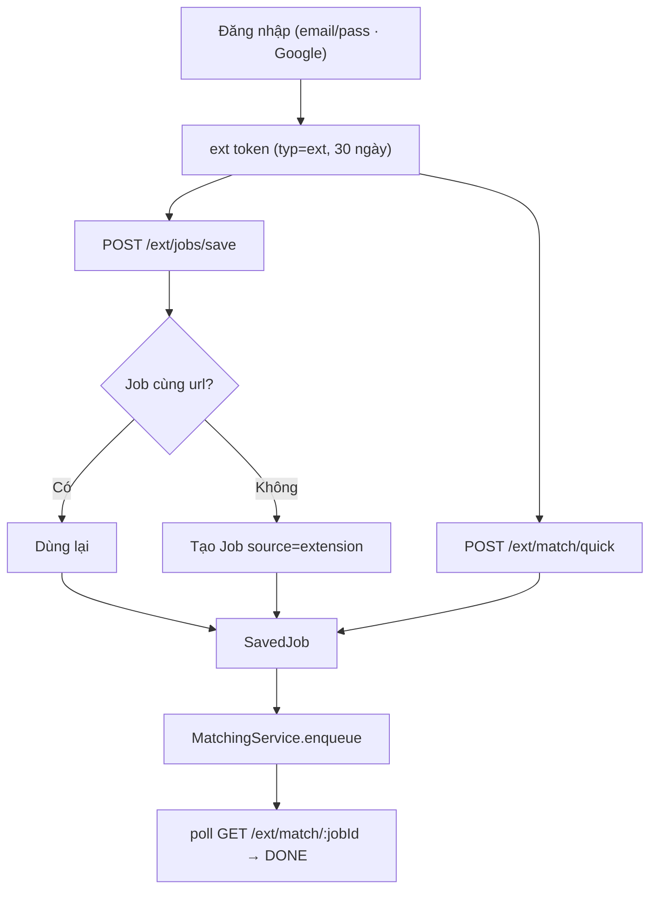
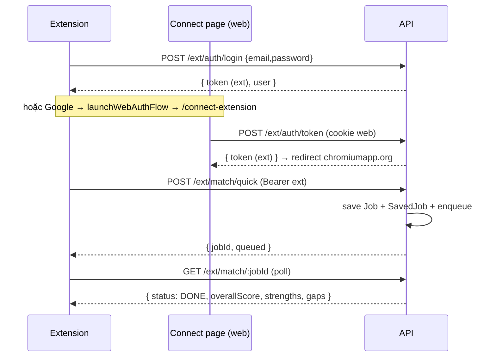

# Ext — Tiện ích trình duyệt (Chrome extension)

> **Phạm vi:** `server/src/modules/ext/**` (`auth/` — `ExtAuthController`, `ExtAuthGuard`, `@ExtAuth`; `profile/`, `jobs/`, `match/`, `company/`); các method `AuthService.extLogin` / `issueExtToken` / `verifyCredentials`, `resolveAuthUser`, loại token `ext` trong `jwt-payload.ts`; cột `User.tokenVersion` (dùng lại), `Job.source = 'extension'`, model `SavedJob` và `JobMatch` (dùng lại). Điểm chạm module khác: `ProfileService.get`, `JobsService.save`, `MatchingService.enqueue/getMatch`, `CompanyService.enqueueRefresh/forJob`, `whereFrom` (lọc `source`). Frontend: extension Chrome ([careelot-extension/](../../../../careelot-extension/README.md)) + trang [`/connect-extension`](../../../../ui-ai-job-search/app/connect-extension/page.tsx).
> **Nguyên tắc:** tài liệu mô tả hệ thống **as-is**. Code là nguồn sự thật duy nhất.

## 1. Purpose

| Mục tiêu | Diễn giải |
|---|---|
| Đăng nhập Careelot từ extension | Không dán token tay: email/mật khẩu hoặc Google, nhận **ext token** riêng (hạn dài, phạm vi hẹp) *(2026-11-01)* |
| Lưu tin từ MỌI trang về Careelot | Một cú bấm trên trang tuyển dụng bất kỳ → tạo/tái dùng Job + thêm vào danh sách đã lưu |
| Soi độ hợp ngay tại chỗ | Kéo kỹ năng hồ sơ để soi nhanh (client); "Soi kỹ" chấm sâu bằng AI với hồ sơ |
| Tìm hiểu công ty tại chỗ | Một cú bấm → AI tóm tắt công ty (kết luận, điểm tốt/hạn chế, điểm sao, nguồn) *(2026-11-02)* |

## 2. Actors

| Actor | Vai trò |
|---|---|
| USER (qua extension) | Đăng nhập, lưu tin, soi kỹ — mang **ext token** gắn `Bearer` |
| Phiên web Careelot | Cấp ext token cho luồng Google (`/connect-extension` đã đăng nhập) |
| Hệ thống | Xác thực, lưu tin, chấm điểm — dùng lại service sẵn có |

## 3. Business Features

| # | Tính năng | Actor | Điểm vào |
|---|---|---|---|
| F1 | Đăng nhập email/mật khẩu lấy ext token *(2026-11-01)* | Khách | `POST /api/ext/auth/login` |
| F2 | Cấp ext token từ phiên web (luồng Google) *(2026-11-01)* | USER | `POST /api/ext/auth/token` |
| F3 | Kiểm ext token, trả tài khoản *(2026-11-01)* | USER | `GET /api/ext/auth/me` |
| F4 | Lấy kỹ năng hồ sơ để soi nhanh *(2026-11-01)* | USER | `GET /api/ext/profile` |
| F5 | Lưu tin từ trang về Careelot *(2026-11-01)* | USER | `POST /api/ext/jobs/save` |
| F6 | Soi kỹ bằng AI + poll kết quả *(2026-11-01)* | USER | `POST /api/ext/match/quick`, `GET /api/ext/match/:jobId` |
| F7 | Tìm hiểu công ty bằng AI + poll kết quả *(2026-11-02)* | USER | `POST /api/ext/company/review`, `GET /api/ext/company/:jobId` |

## 4. Business Flow

### Luồng A — Xác thực (F1–F3)

1. Email/mật khẩu: `extLogin` dùng chung `verifyCredentials` với đăng nhập web, nhưng trả **ext token trong body** (không cookie). Google: extension mở `/connect-extension` qua `launchWebAuthFlow`; trang đã đăng nhập web gọi `POST /api/ext/auth/token` → `issueExtToken` → redirect kèm token về `*.chromiumapp.org`.
2. Ext token là JWT `typ='ext'`, hạn 30 ngày, mang `ver = User.tokenVersion`. `ExtAuthGuard` xác thực Bearer + `resolveAuthUser` (đối chiếu `tokenVersion`) — đăng xuất web (tăng `tokenVersion`) thu hồi luôn ext token.

### Luồng B — Lưu tin (F5)

1. `ExtJobsService.save`: `jobIdFor` **chuẩn hoá url** (`cleanUrl`) rồi tìm Job cùng url (tin đã crawl hoặc đã lưu trước) để tái dùng — khớp cả khi URL có tham số tracking; chưa có thì `create` Job `source='extension'`, `externalId = fingerprint(url chuẩn hoá)`, trường taxonomy từ `derivedFields`. Các trường tuỳ chọn client gửi được lưu: `logoUrl→companyLogo`, `locationText→location` (suy `provinceCode`), `salaryText→salaryRaw` (suy `salaryMin/Max`), `postedText→postedAt` (chỉ nhận ngày hợp lệ). Hai lần lưu đồng thời cùng url: `create` đua, lần thua bắt `P2002` rồi đọc lại → một Job duy nhất.
2. `JobsService.save` thêm `SavedJob(userId, jobId)`. Tin `source='extension'` bị `whereFrom` loại khỏi feed / "phù hợp" / public / match của người khác; chỉ hiện ở view **đã lưu / đã ứng tuyển** của chủ.

### Luồng C — Soi kỹ bằng AI (F6)

1. `ExtMatchService.quick`: lưu tin (Luồng B) → `MatchingService.enqueue` chấm cặp (hồ sơ người gọi, tin). Chấm AI đọc trực tiếp `job.description`, không cần trích requirements.
2. Widget poll `GET /api/ext/match/:jobId` → `getMatch` tới khi `status='DONE'` → hiện `overallScore` + `strengths`/`gaps`.

### Luồng D — Tìm hiểu công ty (F7)

1. `ExtCompanyService.review`: nhận **tên công ty** (widget đọc từ trang, không lưu tin) → `CompanyService.forCompany(company)`. Tên ẩn danh/không rõ (`companyKeyOf` trả null: "không rõ", "confidential"…) → `researchable=false`, **trả về sớm, không xếp hàng AI**. Còn lại → `enqueueRefreshByName` (dùng lại hệ thống "tìm hiểu công ty", bản tóm tắt **chung theo công ty** cache theo `nameKey` — xem [companies.md](./companies.md)): bản còn hạn thì `queued=false` trả cache, thiếu/hết hạn mới xếp hàng.
2. Widget poll `GET /api/ext/company?company=…` → `forCompany` tới khi `brief` khác null → hiện kết luận (`verdict`), tóm tắt, `pros`/`cons`, `rating`/`reviewCount`, độ tin cậy và nguồn. **Không tạo Job**, nên không sinh tin rác/trùng.

## 5. Mermaid Flowchart

## 6. Sequence Diagram

## 7. Business Rules

| Mã | Quy tắc | Tầng | Trạng thái | Nguồn |
|---|---|---|---|---|
| BR-EXT-01 | Ext token là JWT `typ='ext'`, hạn 30 ngày (`JWT_EXT_EXPIRES_IN`), mang `ver = User.tokenVersion`; đăng xuất web / đổi mật khẩu (tăng `tokenVersion`) thu hồi ngay cả ext token *(2026-11-01)* | SV | ✅ | [auth.service.ts](../../../server/src/modules/auth/auth.service.ts), [resolve-user.ts](../../../server/src/modules/auth/resolve-user.ts) |
| BR-EXT-02 | Xác thực email/mật khẩu dùng chung `verifyCredentials` với web (một hash giả khi email không tồn tại để không lộ email đã đăng ký) *(2026-11-01)* | SV | ✅ | [auth.service.ts](../../../server/src/modules/auth/auth.service.ts) |
| BR-EXT-03 | Lưu tin **chuẩn hoá url** (`cleanUrl`: bỏ tham số tracking như `utm_*`/`ta_source`/`click_source`, bỏ fragment và dấu "/" cuối) rồi tìm Job cùng url để tái dùng — kể cả **tin đã crawl** của hệ thống; chưa có thì tạo Job `source='extension'` với `externalId = fingerprint(url đã chuẩn hoá)`; `create` + bắt `P2002` nên hai lần lưu đồng thời cùng url chỉ sinh một Job *(2026-11-01)* | SV, DB | ✅ | [ext-jobs.service.ts](../../../server/src/modules/ext/jobs/ext-jobs.service.ts), [clean-url.ts](../../../server/src/modules/ext/jobs/clean-url.ts) |
| BR-EXT-04 | Tin `source='extension'` bị loại khỏi feed / "phù hợp" / public / chọn job matching; chỉ hiện ở view đã lưu / đã ứng tuyển của chủ (`whereFrom` bỏ khi `saved`/`applied`) *(2026-11-01)* | SV | ✅ | [job-view.ts](../../../server/src/modules/jobs/utils/job-view.ts) |
| BR-EXT-05 | "Soi kỹ" luôn lưu tin về tài khoản người gọi trước khi chấm, nên chỉ chấm tin của chính chủ — kết quả `JobMatch` khoá theo `userId`, không rò sang người khác *(2026-11-01)* | SV | ✅ | [ext-match.service.ts](../../../server/src/modules/ext/match/ext-match.service.ts) |
| BR-EXT-06 | Lưu tin nhận thêm `logoUrl`/`locationText`/`salaryText`/`postedText` (client trích từ JSON-LD của trang) và lưu vào `companyLogo`/`location`/`salaryRaw`/`postedAt`; `postedText` chỉ nhận khi là ngày hợp lệ, còn lại để trống (FE hiện "Thu thập …") *(2026-11-01)* | SV | ✅ | [ext-jobs.service.ts](../../../server/src/modules/ext/jobs/ext-jobs.service.ts) |
| BR-EXT-07 | "Tìm hiểu công ty" chạy theo **tên công ty**, KHÔNG lưu tin (không sinh Job rác/trùng). Tên ẩn danh/không rõ (`companyKeyOf`→null) trả về sớm, **không xếp hàng AI**; bản tóm tắt là chung theo công ty (cache `nameKey`) nên bấm lại cùng công ty không gọi AI mới và đọc không cần khoá `userId` *(2026-11-02)* | SV | ✅ | [ext-company.service.ts](../../../server/src/modules/ext/company/ext-company.service.ts), [company.service.ts](../../../server/src/modules/companies/services/company.service.ts) |

## 8. Validation Rules

| Trường | Quy tắc | Nguồn |
|---|---|---|
| `url` | Chuỗi 1–2048 ký tự | [ext-jobs.dto.ts](../../../server/src/modules/ext/jobs/ext-jobs.dto.ts) |
| `title` | Chuỗi 1–300 ký tự | [ext-jobs.dto.ts](../../../server/src/modules/ext/jobs/ext-jobs.dto.ts) |
| `company` | Tuỳ chọn, chuỗi ≤ 200 ký tự (có thể null) | [ext-jobs.dto.ts](../../../server/src/modules/ext/jobs/ext-jobs.dto.ts) |
| `descriptionText` | Chuỗi ≤ 20000 ký tự | [ext-jobs.dto.ts](../../../server/src/modules/ext/jobs/ext-jobs.dto.ts) |
| `logoUrl` | Tuỳ chọn, chuỗi ≤ 2048 ký tự | [ext-jobs.dto.ts](../../../server/src/modules/ext/jobs/ext-jobs.dto.ts) |
| `locationText` | Tuỳ chọn, chuỗi ≤ 300 ký tự | [ext-jobs.dto.ts](../../../server/src/modules/ext/jobs/ext-jobs.dto.ts) |
| `salaryText` | Tuỳ chọn, chuỗi ≤ 200 ký tự | [ext-jobs.dto.ts](../../../server/src/modules/ext/jobs/ext-jobs.dto.ts) |
| `postedText` | Tuỳ chọn, chuỗi ≤ 40 ký tự (ngày hợp lệ mới nhận) | [ext-jobs.dto.ts](../../../server/src/modules/ext/jobs/ext-jobs.dto.ts) |
| `company` (tìm hiểu công ty) | Chuỗi 1–200 ký tự (body POST và query GET) | [ext-company.dto.ts](../../../server/src/modules/ext/company/ext-company.dto.ts) |

## 9. API Mapping

| Method | URL | Role | Mục đích nghiệp vụ | Controller#method | Service | DTO | Response |
|---|---|---|---|---|---|---|---|
| POST | `/api/ext/auth/login` | Khách | Đăng nhập email/mật khẩu lấy ext token *(2026-11-01)* | `ExtAuthController#login` | `AuthService.extLogin` | `LoginDto` | `{ token, user }` |
| POST | `/api/ext/auth/token` | USER | Cấp ext token từ phiên web (luồng Google) *(2026-11-01)* | `ExtAuthController#token` | `AuthService.issueExtToken` | — | `{ token, user }` |
| GET | `/api/ext/auth/me` | USER | Kiểm ext token, trả tài khoản *(2026-11-01)* | `ExtAuthController#me` | — | — | `{ user }` |
| GET | `/api/ext/profile` | USER | Kỹ năng hồ sơ để soi nhanh *(2026-11-01)* | `ExtProfileController#get` | `ProfileService.get` | — | `{ skills }` |
| POST | `/api/ext/jobs/save` | USER | Lưu tin từ trang về Careelot *(2026-11-01)* | `ExtJobsController#save` | `ExtJobsService.save` | `ExtSaveJobDto` | `{ jobId, saved }` |
| POST | `/api/ext/match/quick` | USER | Soi kỹ: lưu tin + chấm AI với hồ sơ *(2026-11-01)* | `ExtMatchController#quick` | `ExtMatchService.quick` | `ExtSaveJobDto` | `{ jobId, queued, alreadyScored }` |
| GET | `/api/ext/match/:jobId` | USER | Poll kết quả chấm *(2026-11-01)* | `ExtMatchController#result` | `MatchingService.getMatch` | — | `JobMatch` |
| POST | `/api/ext/company/review` | USER | Tìm hiểu công ty theo tên + xếp hàng AI *(2026-11-02)* | `ExtCompanyController#review` | `ExtCompanyService.review` | `ExtCompanyDto` | `{ queued, company, researchable, brief, stale }` |
| GET | `/api/ext/company?company=` | USER | Poll bản tóm tắt công ty *(2026-11-02)* | `ExtCompanyController#result` | `CompanyService.forCompany` | `ExtCompanyDto` | `{ company, researchable, brief, stale }` |

## 10. Frontend Mapping

| Route FE | Vai trò | Mục đích | Hook / API client |
|---|---|---|---|
| Extension Chrome ([careelot-extension/](../../../../careelot-extension/README.md)) *(2026-11-01)* | USER | Popup đăng nhập + widget soi nhanh/lưu/soi kỹ trên mọi trang | `fetch ${apiBase}/api/ext/*` kèm `Bearer ext token` |
| [`/connect-extension`](../../../../ui-ai-job-search/app/connect-extension/page.tsx) *(2026-11-01)* | Khách, USER | Trang trung gian cho `launchWebAuthFlow`: đã đăng nhập thì cấp ext token và redirect về extension; chưa thì render `LoginForm` | `fetch /api/ext/auth/token` + `LoginForm` |

## 11. Database

Không thêm bảng mới. Dùng lại: `User.tokenVersion` (thu hồi token), `Job` (`source='extension'`), `SavedJob`, `JobMatch`. Chi tiết: [05-database-overview.md](../05-database-overview.md).

## 12. State Machine

Không có máy trạng thái riêng. `JobMatch.status` (`PENDING→RUNNING→DONE/FAILED`) do `MatchingService` quản lý — xem [matching.md](./matching.md).

## 13. Exceptions

| Tình huống | HTTP | Thông điệp nguyên văn | Nguồn |
|---|---|---|---|
| Sai email/mật khẩu | 401 | `Email hoặc mật khẩu không đúng` | [auth.service.ts](../../../server/src/modules/auth/auth.service.ts) |
| Thiếu / sai / hết hạn ext token | 401 | *(trống — 401 chung)* | [ext-auth.guard.ts](../../../server/src/modules/ext/auth/ext-auth.guard.ts) |
| Poll tin chưa chấm | 404 | `Chưa chấm điểm công việc này` | [matching.service.ts](../../../server/src/modules/matching/ai/services/matching.service.ts) |
| Lưu tin có `url` không phải http(s) | 400 | `Link tin không hợp lệ.` | [ext-jobs.service.ts](../../../server/src/modules/ext/jobs/ext-jobs.service.ts) |

## 14. Notifications

Không có.

## 15. Integrations

"Soi kỹ" đi qua `MatchingService` → `AiService`; "Tìm hiểu công ty" đi qua `CompanyService` → tìm kiếm web (Serper/Tavily) + `AiService` (xem [companies.md](./companies.md), [ai-platform.md](./ai-platform.md)). Chỉ gửi **tên công ty** ra ngoài, không gửi dữ liệu người dùng.

## 16. Security

| Điểm | Cách xử lý |
|---|---|
| Ext token hạn dài (30 ngày) | Thu hồi được qua `tokenVersion` (đăng xuất web huỷ luôn); phạm vi hẹp — chỉ dùng cho `/api/ext/*`, không thay session web |
| Chèn dữ liệu vào bảng chung | Job `source='extension'` (title/company/description do người dùng nhập) bị loại khỏi mọi bề mặt chia sẻ (feed, "phù hợp", public, matching, job alert); chỉ ở danh sách đã lưu của chủ |
| IDOR | Mọi route khoá theo `userId` của ext token; `GET /ext/match/:jobId` chỉ trả match của chính người gọi; id Job extension không lộ ở list nào nên người khác không lấy được |
| Lạm dụng AI | `POST /ext/match/quick` có `@ThrottleAi`; `getMatch` cache theo `promptHash` nên soi lại cùng tin không gọi AI mới. `POST /ext/company/review` có `@ThrottleAi`; công ty ẩn danh/không rõ bị chặn trước khi xếp hàng (`companyKeyOf`→null), và bản tóm tắt cache chung theo `nameKey` nên bấm lại cùng công ty không gọi AI mới. Route poll `GET /ext/company` KHÔNG gọi AI (chỉ đọc cache) |
| Tin rác / tạo Job thừa | "Tìm hiểu công ty" chạy theo tên, **không** tạo Job — không thể dùng để bơm tin rác hay tin trùng vào DB |
| XSS | Chữ của model (`strengths`/`gaps`) được escape HTML trước khi render trong widget |
| `logoUrl` do người dùng gửi | Chỉ lưu chuỗi và render làm `src` ảnh trong view đã lưu của chính chủ (tải phía client, không phải server fetch); tin extension không lọt sang người khác nên URL ảnh cũng vậy |
| `url` do người dùng gửi | Chuẩn hoá (`cleanUrl`) rồi **chặn ở service nếu không phải http(s)** → 400; tránh lưu `javascript:`/`data:` vì FE mở link bằng `window.open(job.url)` |
| Chống brute-force | `POST /ext/auth/login` có `@ThrottleAuth` (đếm theo IP) |

## 17. ⚠️ Sai lệch / Rủi ro nghiệp vụ

### R1 — Người khác xem tin extension của chủ nếu có đúng `jobId`

`GET /api/matches/:jobId` và `GET /api/jobs/:id` (route web) không chặn `source='extension'`, nên người gọi biết chính xác `jobId` (cuid) vẫn xem được tin extension của người khác. Thực tế id không xuất hiện ở bất kỳ danh sách nào (đã lọc), chỉ chủ biết, nên không đoán được.

**Mức đề xuất: 🟢** — đóng bằng cách lọc discoverable (list) đã đủ; chặn theo id là phòng thủ chiều sâu, làm khi cần.

### R2 — Soi kỹ tốn một lượt AI mỗi tin mới

Mỗi tin chưa chấm bấm "Soi kỹ" là một lượt `match.evaluate`. `@ThrottleAi` + cache `promptHash` chặn lạm dụng, nhưng người dùng vẫn tiêu lượt AI theo số tin khác nhau.

**Mức đề xuất: 🟢** — chấp nhận; giống đường chấm thủ công của web.

## 18. Source References

**Backend:** [modules/ext](../../../server/src/modules/ext) · [ext-auth.guard.ts](../../../server/src/modules/ext/auth/ext-auth.guard.ts) · [resolve-user.ts](../../../server/src/modules/auth/resolve-user.ts)

**Frontend:** [careelot-extension](../../../../careelot-extension/README.md) · [connect-extension](../../../../ui-ai-job-search/app/connect-extension/page.tsx)

**ADR:** [docs/adr/](../../adr/README.md)
