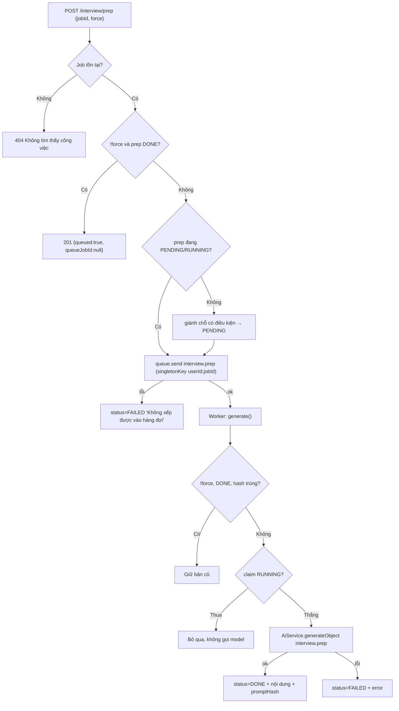
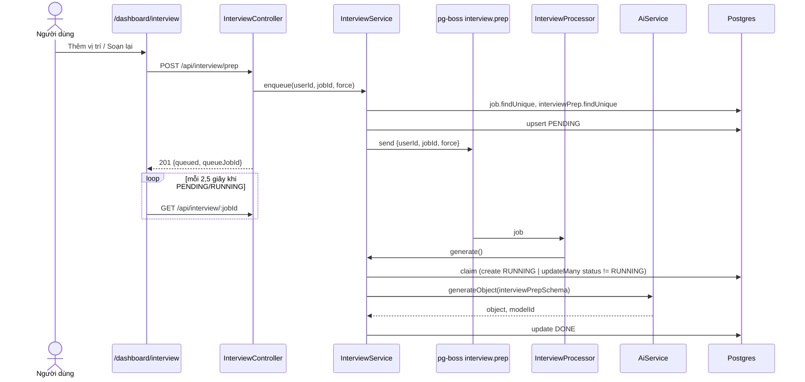
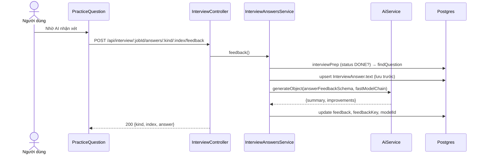
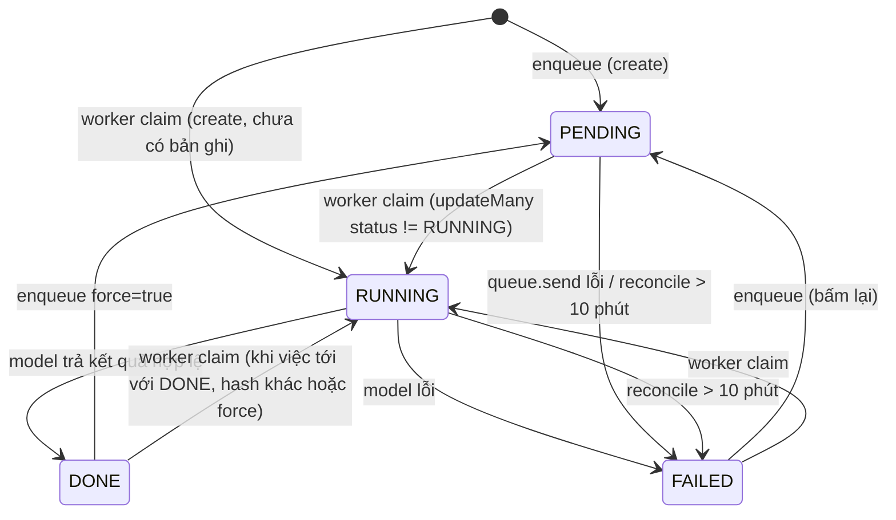

# Interview Preparation — Chuẩn bị phỏng vấn theo tin tuyển dụng

> **Phạm vi:** `server/src/modules/interview/**` (controller, `InterviewService`, `InterviewAnswersService`, `InterviewProcessor`, schema, utils) · hàng đợi `interview.prep` · bảng `InterviewPrep`, `InterviewAnswer` · màn hình `/dashboard/interview` (FE người dùng).
> **Nguyên tắc:** tài liệu mô tả hệ thống **as-is**. Code là nguồn sự thật duy nhất.

## 1. Purpose

| Mục tiêu | Diễn giải |
|---|---|
| Soạn bộ chuẩn bị phỏng vấn cho MỘT tin | Với mỗi cặp (người dùng, tin), model sinh một bộ đề gồm câu chuyện STAR, câu hỏi khó kèm gợi ý, câu nên hỏi lại nhà tuyển dụng, ý chính cần nhắc và điểm yếu dễ bị đào ([interview.schema.ts:10](../../../server/src/modules/interview/interview.schema.ts#L10)). |
| Chạy nền, không chặn request | `POST /interview/prep` chỉ xếp việc vào hàng đợi `interview.prep`; worker gọi model (~50 giây theo đo đạc ở [ADR 0011](../../adr/0011-do-truoc-khi-doan.md)). |
| Cho người dùng tự luyện trả lời | Người dùng gõ câu trả lời cho từng câu STAR/câu khó, lưu lại và tuỳ chọn nhờ AI nhận xét ([interview-answers.service.ts](../../../server/src/modules/interview/interview-answers.service.ts)). |
| Đo mức sẵn sàng | Đếm số câu đã tự trả lời trên tổng số câu của bộ đề HIỆN TẠI (`practiced/total`) ([utils/interview-answers.ts:93](../../../server/src/modules/interview/utils/interview-answers.ts#L93)). |

**Điểm mấu chốt:**
- Bộ đề là duy nhất theo `(userId, jobId)` — ràng buộc DB `@@unique([userId, jobId])` ([schema.prisma:534](../../../server/prisma/schema.prisma#L534)). "Soạn lại" ghi đè lên chính bản ghi đó.
- Câu trả lời tự luyện khoá theo **vân tay chữ câu hỏi** (`questionKey`), không theo vị trí; route vẫn định vị bằng `:kind/:index` là số thứ tự trong mảng GỐC ([ADR 0009](../../adr/0009-tu-tra-loi-phong-van.md)) *(2026-10-14)*.
- Đường đọc (`GET /interview`, `GET /interview/:jobId`) không gọi model; chỉ `POST /interview/prep` (qua worker) và `POST .../feedback` tốn lượt gọi model.

## 2. Actors

| Actor | Quyền trong module | Ghi chú |
|---|---|---|
| Người dùng đã đăng nhập (USER/ADMIN) | Xem danh sách/chi tiết bộ đề CỦA MÌNH, xếp soạn bộ đề cho bất kỳ tin nào tồn tại, lưu/xoá/nhờ nhận xét câu trả lời | Không có route `@Public()`; guard JWT toàn cục mặc-định-đóng. Không phân biệt vai trò trong module này. |
| Worker `interview.prep` (`InterviewProcessor`) | Gọi `InterviewService.generate` để giành chỗ, gọi model, ghi `DONE`/`FAILED` | Chỉ chạy ở tiến trình có vai chạy việc nền (`runsBackgroundWork`) ([queue.service.ts](../../../server/src/modules/queue/queue.service.ts)). |
| Cron reconcile (`ReconcileService`) | Đánh `FAILED` cho `InterviewPrep` kẹt `PENDING`/`RUNNING` quá 10 phút | [reconcile.service.ts:116](../../../server/src/modules/reconcile/services/reconcile.service.ts#L116) |
| Model AI (qua `AiService`) | Sinh nội dung bộ đề (`interview.prep`) và nhận xét câu trả lời (`interview.feedback`) | Không gọi SDK trực tiếp. |

## 3. Business Features

| # | Tính năng | Actor | Endpoint / cơ chế |
|---|---|---|---|
| F1 | Danh sách bộ chuẩn bị phỏng vấn (bản tóm tắt + mức sẵn sàng + số buổi phỏng vấn thử) | Người dùng | `GET /api/interview` |
| F2 | Xem chi tiết một bộ đề kèm câu trả lời đã lưu, đơn ứng tuyển và ngày phỏng vấn | Người dùng | `GET /api/interview/:jobId` |
| F3 | Xếp soạn / soạn lại bộ đề | Người dùng | `POST /api/interview/prep` → hàng đợi `interview.prep` |
| F4 | Worker soạn bộ đề | Hệ thống | `InterviewProcessor` → `InterviewService.generate` |
| F5 | Lưu / xoá câu tự trả lời | Người dùng | `PUT /api/interview/:jobId/answers/:kind/:index` |
| F6 | Lưu câu trả lời rồi nhờ AI nhận xét | Người dùng | `POST /api/interview/:jobId/answers/:kind/:index/feedback` |
| F7 | Dọn bộ đề kẹt | Cron reconcile | `ReconcileService.failStuck` |

## 4. Business Flow

### Luồng A — Danh sách bộ đề (F1)

**Preconditions:** người dùng có JWT hợp lệ.

**Main Flow:**
1. FE gọi `GET /api/interview?limit=&offset=` ([interview.controller.ts:43](../../../server/src/modules/interview/interview.controller.ts#L43)). `PaginationQueryDto` kiểm `limit` 1–100, `offset` 0–100000.
2. `InterviewService.list` đọc trong một `$transaction` trang `InterviewPrep` theo `userId`, sắp `updatedAt desc`, kèm tổng số ([interview.service.ts:272](../../../server/src/modules/interview/interview.service.ts#L272)).
3. Với các `jobId` trong trang, đọc song song: `InterviewAnswer` (chỉ `questionKey`), `Application` (id, status, `interviewAt`), và `AgentRun.groupBy(jobId)` với `workflow: 'interview'` để đếm số buổi phỏng vấn thử ([interview.service.ts:303-317](../../../server/src/modules/interview/interview.service.ts#L303)).
4. Mỗi phần tử tính `practiced/total` bằng `practiceProgress` trên bộ đề hiện tại; nội dung `starAnswers`/`toughQuestions` bị bỏ khỏi phản hồi; `error` thô được thay bằng `failureKind` (`withFailureKind`).
5. Trả `{ items, total, limit, offset }`, HTTP 200.

**Alternative Flow:** chưa có bộ đề nào → `items: []`, `total: 0`.

**Failure Flow:** query sai kiểu → 400 (ValidationPipe, thông điệp tiếng Việt từ `vietnameseValidationError`); thiếu/hết hạn token → 401.

**Postconditions:** không ghi dữ liệu.

### Luồng B — Chi tiết bộ đề (F2)

**Preconditions:** đã đăng nhập.

**Main Flow:**
1. `GET /api/interview/:jobId` ([interview.controller.ts:52](../../../server/src/modules/interview/interview.controller.ts#L52)).
2. `InterviewService.get` đọc `InterviewPrep` theo khoá `userId_jobId` kèm `job { id, title, company, companyLogo }` ([interview.service.ts:242](../../../server/src/modules/interview/interview.service.ts#L242)).
3. Đọc song song câu trả lời của chính người dùng cho tin đó và `Application` (lấy `interviewAt`).
4. `readinessOf` ghép câu trả lời vào câu hỏi của bộ đề HIỆN TẠI theo `questionKey`; câu trả lời của câu đã bị soạn lại (chữ khác) bị bỏ ([utils/interview-answers.ts:104](../../../server/src/modules/interview/utils/interview-answers.ts#L104)).
5. Trả toàn bộ bản ghi (trừ `error`) + `failureKind`, `practiced`, `total`, `answers[]` (kèm `feedbackStale`), `application`.

**Alternative Flow:** bộ đề đang `PENDING`/`RUNNING` → vẫn trả bản ghi; FE hỏi lại mỗi 2,5 giây ([use-interview-prep.ts](../../../../ui-ai-job-search/hooks/use-interview-prep.ts)).

**Failure Flow:** không có bộ đề của người dùng cho tin đó → **404 `Chưa soạn câu hỏi cho công việc này`** ([interview.service.ts:251-252](../../../server/src/modules/interview/interview.service.ts#L251)). Bộ đề của người khác cũng trả 404 vì khoá luôn có `userId`.

**Postconditions:** không ghi dữ liệu.

### Luồng C — Xếp soạn / soạn lại bộ đề (F3)

**Preconditions:** đã đăng nhập; tin `jobId` tồn tại trong bảng `Job` (bảng tin dùng chung, không thuộc người dùng nào).

**Main Flow:**
1. `POST /api/interview/prep` body `{ jobId, force? }` ([interview.controller.ts:57-64](../../../server/src/modules/interview/interview.controller.ts#L57)); `@ThrottleAi()` 10 lượt/phút.
2. Kiểm tin tồn tại; không có → **404 `Không tìm thấy công việc: <jobId>`** ([interview.service.ts:78](../../../server/src/modules/interview/interview.service.ts#L78)).
3. Đọc trạng thái bộ đề hiện có. Nếu `force` không bật và bộ đề đã `DONE` → trả ngay `{ queued: true, queueJobId: null }`, **không xếp việc** ([interview.service.ts:86-88](../../../server/src/modules/interview/interview.service.ts#L86)).
4. Nếu bộ đề KHÔNG đang `PENDING`/`RUNNING` → giành chỗ có điều kiện: `updateMany where status IN (FAILED[, DONE khi force])` về `PENDING`, xoá `error`; không có hàng thì `create` PENDING, trùng khoá (P2002) là thua — không hạ trạng thái của worker vừa chuyển sang RUNNING. Bồi hoàn khi đẩy hàng đợi lỗi cũng chỉ ghi FAILED nếu hàng còn PENDING *(2026-10-26: trước đó `upsert` vô điều kiện)* ([interview.service.ts](../../../server/src/modules/interview/interview.service.ts)).
5. Gửi việc vào `interview.prep` với payload `{ userId, jobId, force }`; khoá chặn trùng `singletonKey = userId:jobId`, policy `exclusive` ([queue-key.ts:55-59](../../../server/src/modules/queue/queue-key.ts#L55)).
6. Trả `{ queued: true, queueJobId }`, HTTP 201.

**Alternative Flow:**
- Bộ đề đang `PENDING`/`RUNNING`: không đổi trạng thái nhưng vẫn gọi `queue.send`; pg-boss `exclusive` gộp việc trùng khoá nên `queueJobId` có thể là `null`.
- `force: true` trên bộ đề `DONE` (nút "Soạn lại", [prep-detail.tsx:125](../../../../ui-ai-job-search/app/dashboard/interview/prep-detail.tsx#L125)): bản ghi về `PENDING`, nội dung cũ vẫn còn tới khi worker ghi đè.

**Failure Flow:** `queue.send` ném lỗi → nếu bước 4 đã chạy thì ghi `FAILED` với `error = 'Không xếp được vào hàng đợi'` rồi ném tiếp (500) ([interview.service.ts:106-113](../../../server/src/modules/interview/interview.service.ts#L106)). Vượt throttle → 429 `Bạn thao tác quá nhanh. Hãy đợi một lát rồi thử lại.`

**Postconditions:** bộ đề ở `PENDING` (hoặc giữ nguyên `PENDING`/`RUNNING`/`DONE`), có một việc trong hàng đợi.

### Luồng D — Worker soạn bộ đề (F4)

**Preconditions:** có việc `interview.prep` trong hàng đợi; tiến trình có vai chạy việc nền.

**Main Flow:**
1. `InterviewProcessor` nhận việc, gọi `generate(userId, jobId, force)` ([interview.processor.ts:18-30](../../../server/src/modules/interview/interview.processor.ts#L18)).
2. Đọc song song `Profile`, `Job`, `JobMatch`, `InterviewPrep` hiện có. Tin không còn → ném 404 (trong worker, không ghi trạng thái) ([interview.service.ts:187](../../../server/src/modules/interview/interview.service.ts#L187)).
3. Dựng prompt: khung từ skill `job-application-assistant` — mục `star format`, `common tough questions`, `questions you should ask` của `07-interview-prep.md` và mục `behavioral`, `strengths`, `communication`, `working style` của `02-behavioral-profile.md` — cộng tóm tắt hồ sơ, tin, và `JobMatch.gaps` ([utils/interview-prep.prompt.ts](../../../server/src/modules/interview/utils/interview-prep.prompt.ts)).
4. Tính `promptHash = fingerprint(skillHash, JSON(profile), job.description, gaps)` ([interview.service.ts:190-195](../../../server/src/modules/interview/interview.service.ts#L190)). Nếu `!force`, bộ đề `DONE` và hash trùng → trả bản cũ, không gọi model.
5. **Giành chỗ có điều kiện** (`claim`): chưa có bản ghi thì `create` trạng thái `RUNNING` (bắt `P2002` bằng `isUniqueViolation`); có rồi thì `updateMany where status != RUNNING → RUNNING` ([interview.service.ts:148-169](../../../server/src/modules/interview/interview.service.ts#L148)).
6. Gọi `AiService.generateObject` với `interviewPrepSchema`, `purpose: 'interview.prep'`.
7. Ghi `DONE` cùng `starAnswers`, `toughQuestions`, `questionsToAsk`, `talkingPoints`, `likelyProbes`, `modelId`, `promptHash`, `generatedAt`, `error: null` ([interview.service.ts:217-231](../../../server/src/modules/interview/interview.service.ts#L217)).

**Alternative Flow:** giành chỗ thất bại (một lượt khác đang `RUNNING`) → log cảnh báo, trả bản ghi hiện có, không gọi model ([interview.service.ts:201-207](../../../server/src/modules/interview/interview.service.ts#L201)).

**Failure Flow:** model lỗi (timeout, schema, upstream) → ghi `FAILED`, `error = messageOf(error)` ([interview.service.ts:232-238](../../../server/src/modules/interview/interview.service.ts#L232)). Không tự xếp lại; người dùng bấm lại. Tiến trình chết giữa chừng → bản ghi nằm `RUNNING` tới khi reconcile đánh `FAILED` (Luồng G).

**Postconditions:** bộ đề `DONE` có nội dung mới, hoặc `FAILED` (nội dung cũ — nếu có — vẫn còn trong cột).

### Luồng E — Lưu / xoá câu tự trả lời (F5)

**Preconditions:** bộ đề của người dùng cho tin này ở `DONE`; câu `kind/index` tồn tại trong mảng gốc.

**Main Flow:**
1. `PUT /api/interview/:jobId/answers/:kind/:index` body `{ text }` ([interview.controller.ts:69](../../../server/src/modules/interview/interview.controller.ts#L69)); `kind ∈ {star, tough}` được ánh xạ sang `STAR`/`TOUGH`.
2. `requireQuestion` đọc bộ đề theo `userId_jobId`; không `DONE` → **404 `Chưa soạn xong câu hỏi cho công việc này`**; không thấy câu → **404 `Không tìm thấy câu hỏi này`** ([interview-answers.service.ts:28-44](../../../server/src/modules/interview/interview-answers.service.ts#L28)).
3. `text.trim()` khác rỗng → `upsert` theo `(userId, jobId, questionKey)`; lần đầu lưu cả `kind` và chữ câu hỏi ([interview-answers.service.ts:46-66](../../../server/src/modules/interview/interview-answers.service.ts#L46)).
4. Trả `{ kind, index, answer: { text, feedback, feedbackStale, updatedAt } }`, HTTP 200.

**Alternative Flow:** `text` rỗng sau `trim` → `deleteMany` câu trả lời, trả `{ kind, index, answer: null }` ([interview-answers.service.ts:78-83](../../../server/src/modules/interview/interview-answers.service.ts#L78)). Sửa chữ sau khi đã có nhận xét → nhận xét được giữ, `feedbackStale: true` ([utils/interview-answers.ts:85-91](../../../server/src/modules/interview/utils/interview-answers.ts#L85)).

**Failure Flow:** `kind` lạ → 400 `Loại câu hỏi không hợp lệ`; `index` không phải số nguyên → 400 `Số thứ tự câu hỏi không hợp lệ`; `index` ngoài 0–50 → 400; `text` > 4000 → 400 `Câu trả lời quá dài (tối đa 4.000 ký tự)`.

**Postconditions:** có/không có một dòng `InterviewAnswer` cho câu đó.

### Luồng F — Nhờ AI nhận xét câu trả lời (F6)

**Preconditions:** như Luồng E; câu trả lời 20–4000 ký tự.

**Main Flow:**
1. `POST /api/interview/:jobId/answers/:kind/:index/feedback` body `{ text }`, `@HttpCode(200)`, `@ThrottleAi()` ([interview.controller.ts:84-102](../../../server/src/modules/interview/interview.controller.ts#L84)).
2. `requireQuestion` như Luồng E; đọc `Profile` và `Job`; tin không còn → 404 `Không tìm thấy công việc: <jobId>` ([interview-answers.service.ts:105](../../../server/src/modules/interview/interview-answers.service.ts#L105)).
3. **Lưu chữ TRƯỚC** (`upsertText`) rồi mới gọi model ([interview-answers.service.ts:107](../../../server/src/modules/interview/interview-answers.service.ts#L107)).
4. Gọi `generateObject` với `answerFeedbackSchema`, `purpose: 'interview.feedback'`, chuỗi model nhanh `fastModelChain` ([interview-answers.service.ts:117-123](../../../server/src/modules/interview/interview-answers.service.ts#L117)).
5. Ghi `feedback = { summary, improvements[] }`, `feedbackKey = fingerprint(text)`, `modelId`; trả như Luồng E.

**Alternative Flow:** không có.

**Failure Flow:** model lỗi → lỗi được bộ lọc toàn cục đổi thành 502 (SCHEMA) / 504 (TIMEOUT, `Quá thời gian chờ phản hồi. Hãy thử lại sau vài phút.`) / 503 (UPSTREAM) kèm `failureKind` ([all-exceptions.filter.ts:20-37](../../../server/src/common/filters/all-exceptions.filter.ts#L20)); câu trả lời đã lưu ở bước 3 vẫn còn, chỉ mất lượt nhận xét. `text` \< 20 ký tự → 400 `Câu trả lời cần từ 20 tới 4.000 ký tự mới nhận xét được` (chặn trước khi tốn lượt model).

**Postconditions:** `InterviewAnswer` có `text` mới; nếu model thành công thì có `feedback` mới và `feedbackStale = false`.

### Luồng G — Reconcile bộ đề kẹt (F7)

**Preconditions:** cron `reconcile.stuck-work` bật (`RECONCILE_CRON_ENABLED != 'false'`, mặc định `*/10 * * * *`) hoặc admin bấm `POST /api/admin/reconcile/run-now`.

**Main Flow:** `interviewPrep.updateMany` với `status IN (PENDING, RUNNING)` và `updatedAt < now − 10 phút` → `FAILED`, `error = 'Máy chủ khởi động lại khi việc này đang chạy dở, nên nó không bao giờ hoàn tất. Hãy bấm chạy lại.'` ([reconcile.service.ts:26-29](../../../server/src/modules/reconcile/services/reconcile.service.ts#L26), [:116](../../../server/src/modules/reconcile/services/reconcile.service.ts#L116)).

**Alternative Flow:** không có bản ghi kẹt → không làm gì. **Failure Flow:** lỗi được cron log, không ném ra ngoài. **Postconditions:** bộ đề kẹt thành `FAILED`; KHÔNG tự xếp lại.

## 5. Mermaid Flowchart

## 6. Sequence Diagram

## 7. Business Rules

| Mã BR | Quy tắc | Nơi thực thi | Mức | Nguồn code |
|---|---|---|---|---|
| BR-INT-01 | Mỗi người dùng có tối đa MỘT bộ chuẩn bị phỏng vấn cho một tin. | DB | 🔒 | [schema.prisma:534](../../../server/prisma/schema.prisma#L534) |
| BR-INT-02 | Chỉ soạn bộ đề cho tin đang tồn tại trong bảng `Job`; không có thì 404. | SV | ✅ | [interview.service.ts:78](../../../server/src/modules/interview/interview.service.ts#L78) |
| BR-INT-03 | Bộ đề đã `DONE` không bị soạn lại nếu không có `force: true`; yêu cầu trả về như đã xếp nhưng `queueJobId: null`. | SV | ✅ | [interview.service.ts:86-88](../../../server/src/modules/interview/interview.service.ts#L86) |
| BR-INT-04 | Bộ đề đang `PENDING`/`RUNNING` không bị đặt lại trạng thái khi người dùng bấm thêm. | SV | ✅ | [interview.service.ts:84-97](../../../server/src/modules/interview/interview.service.ts#L84) |
| BR-INT-05 | Mỗi cặp (userId, jobId) chỉ có một việc `interview.prep` trong hàng đợi (singletonKey `userId:jobId`, policy `exclusive`). | SV (pg-boss) | ✅ | [queue-key.ts:55-59](../../../server/src/modules/queue/queue-key.ts#L55) |
| BR-INT-06 | Xếp hàng thất bại thì bộ đề vừa đặt `PENDING` chuyển `FAILED` với lý do "Không xếp được vào hàng đợi". | SV | ✅ | [interview.service.ts:106-113](../../../server/src/modules/interview/interview.service.ts#L106) |
| BR-INT-07 | Worker chỉ gọi model sau khi giành được chỗ `RUNNING` có điều kiện; người thua bỏ qua. | SV | ✅ | [interview.service.ts:148-169](../../../server/src/modules/interview/interview.service.ts#L148), [:201-207](../../../server/src/modules/interview/interview.service.ts#L201) |
| BR-INT-08 | Bộ đề `DONE` có `promptHash` trùng (khung skill + hồ sơ + mô tả tin + gaps) và không `force` thì không gọi lại model. | SV | ✅ | [interview.service.ts:190-199](../../../server/src/modules/interview/interview.service.ts#L190) |
| BR-INT-09 | Bộ đề phải có ≥2 câu STAR (giữ tối đa 5), ≥2 câu khó (tối đa 6), ≥3 câu hỏi lại (tối đa 8), ≥2 ý chính (tối đa 6), tối đa 6 điểm yếu; độ dài từng trường bị CẮT theo trần. | SV (zod) | ✅ | [interview.schema.ts:10-64](../../../server/src/modules/interview/interview.schema.ts#L10) |
| BR-INT-10 | Prompt cấm bịa dự án/con số/công ty; năng lực thiếu dữ liệu phải đưa vào `likelyProbes`. | SV (prompt) | ✅ | [utils/interview-prep.prompt.ts:28-42](../../../server/src/modules/interview/utils/interview-prep.prompt.ts#L28) |
| BR-INT-11 | Khoảng trống (`JobMatch.gaps`) từ lượt chấm điểm được đưa vào prompt soạn đề. | SV | ✅ | [interview.service.ts:141](../../../server/src/modules/interview/interview.service.ts#L141) |
| BR-INT-12 | Lỗi model khi soạn đề ghi `FAILED` + `error`; không tự thử lại. | SV | ✅ | [interview.service.ts:232-238](../../../server/src/modules/interview/interview.service.ts#L232) |
| BR-INT-13 | Bộ đề kẹt `PENDING`/`RUNNING` quá 10 phút (theo `updatedAt`) bị reconcile đánh `FAILED`. | SV (cron) | ✅ | [reconcile.service.ts:116](../../../server/src/modules/reconcile/services/reconcile.service.ts#L116) |
| BR-INT-14 | Chỉ lưu/nhận xét câu trả lời khi bộ đề của chính người dùng đang `DONE`. | SV | ✅ | [interview-answers.service.ts:38-40](../../../server/src/modules/interview/interview-answers.service.ts#L38) |
| BR-INT-15 | Câu hỏi được định vị bằng `kind` + số thứ tự trong mảng GỐC (`star`/`tough`, 0–50); câu có chữ rỗng bị bỏ khỏi danh sách luyện nhưng không đánh số lại. | SV + DTO | ✅ | [utils/interview-answers.ts:54-83](../../../server/src/modules/interview/utils/interview-answers.ts#L54) |
| BR-INT-16 | Câu trả lời khoá theo vân tay chữ câu hỏi (`questionKey`); mỗi (user, job, câu) một câu trả lời. | DB | 🔒 | [schema.prisma:570](../../../server/prisma/schema.prisma#L570) |
| BR-INT-17 | Soạn lại bộ đề làm câu trả lời của câu đã đổi chữ rơi khỏi mức sẵn sàng (không gắn sang câu mới cùng vị trí); dữ liệu cũ không bị xoá. | SV | ✅ | [utils/interview-answers.ts:104-122](../../../server/src/modules/interview/utils/interview-answers.ts#L104) |
| BR-INT-18 | Lưu câu trả lời rỗng (sau `trim`) là xoá câu trả lời. | SV | ✅ | [interview-answers.service.ts:78-83](../../../server/src/modules/interview/interview-answers.service.ts#L78) |
| BR-INT-19 | Nhận xét AI chỉ cho câu trả lời 20–4000 ký tự; lưu tự do cho phép 0–4000. | DTO | ✅ | [interview.dto.ts:33-45](../../../server/src/modules/interview/interview.dto.ts#L33) |
| BR-INT-20 | Nhận xét lưu chữ câu trả lời TRƯỚC khi gọi model: model hỏng thì mất lượt nhận xét chứ không mất câu trả lời. | SV | ✅ | [interview-answers.service.ts:107-123](../../../server/src/modules/interview/interview-answers.service.ts#L107) |
| BR-INT-21 | Nhận xét được giữ khi người dùng sửa câu trả lời, nhưng bị đánh dấu `feedbackStale` khi vân tay chữ hiện tại khác `feedbackKey`. | SV | ✅ | [utils/interview-answers.ts:85-91](../../../server/src/modules/interview/utils/interview-answers.ts#L85) |
| BR-INT-22 | Nhận xét không chấm điểm; tối đa 4 chỗ cần sửa; chỉ gợi ý dữ liệu có trong hồ sơ. | SV (prompt + zod) | ✅ | [utils/answer-feedback.prompt.ts:5-14](../../../server/src/modules/interview/utils/answer-feedback.prompt.ts#L5), [interview.schema.ts:68-82](../../../server/src/modules/interview/interview.schema.ts#L68) |
| BR-INT-23 | Danh sách bộ đề KHÔNG trả nội dung câu hỏi, chỉ trạng thái, tin, `practiced/total`, đơn ứng tuyển và số buổi phỏng vấn thử (`AgentRun` workflow `interview`). | SV | ✅ | [interview.service.ts:272-342](../../../server/src/modules/interview/interview.service.ts#L272) |
| BR-INT-24 | Lỗi thô của lượt soạn không trả ra API; chỉ trả `failureKind`. | SV | ✅ | [failure-view.ts](../../../server/src/common/ai/failure-view.ts) |
| BR-INT-25 | Ngày phỏng vấn đọc từ `Application.interviewAt`, không có trạng thái "Phỏng vấn" riêng; bộ đề từ tin chỉ lưu (chưa có đơn) không có ngày. | SV | ✅ | [interview.service.ts:37-42](../../../server/src/modules/interview/interview.service.ts#L37), [ADR 0009](../../adr/0009-tu-tra-loi-phong-van.md) |

> **Possible Business Rule:** Bộ đề chỉ soạn được từ tin đã có trong hệ thống; "soạn đề từ mô tả dán tay" được ghi trong ADR 0009 là CHƯA làm. Cần xác nhận có nằm trong phạm vi đồ án hay không.

> **Possible Business Rule:** FE chỉ cho chọn tin từ "đơn đã nộp" hoặc "tin đã lưu" ([add-position-modal.tsx:57-67](../../../../ui-ai-job-search/app/dashboard/interview/add-position-modal.tsx#L57)), nhưng backend nhận BẤT KỲ `jobId` tồn tại. Cần xác nhận ràng buộc "chỉ tin người dùng đã lưu/ứng tuyển" có phải là quy tắc nghiệp vụ không.

## 8. Validation Rules

**`PrepDto`** ([interview.dto.ts:15-18](../../../server/src/modules/interview/interview.dto.ts#L15))

| Field | Ràng buộc | DTO/Schema | Lỗi trả về |
|---|---|---|---|
| `jobId` | chuỗi, tối đa 40 ký tự, bắt buộc | `PrepDto` | 400 (thông điệp mặc định dịch qua `vietnameseValidationError`) |
| `force` | boolean, tuỳ chọn | `PrepDto` | 400 |
| (trường lạ) | `forbidNonWhitelisted` | ValidationPipe toàn cục | 400 |

**`AnswerParamsDto`** ([interview.dto.ts:20-31](../../../server/src/modules/interview/interview.dto.ts#L20))

| Field | Ràng buộc | DTO/Schema | Lỗi trả về |
|---|---|---|---|
| `jobId` | chuỗi ≤ 40 | `AnswerParamsDto` | 400 |
| `kind` | `star` \| `tough` | `AnswerParamsDto` | 400 `Loại câu hỏi không hợp lệ` |
| `index` | số nguyên 0–50 (ép kiểu từ chuỗi) | `AnswerParamsDto` | 400 `Số thứ tự câu hỏi không hợp lệ` (không nguyên); 400 mặc định (ngoài khoảng) |

**`SaveAnswerDto`** / **`FeedbackAnswerDto`** ([interview.dto.ts:33-45](../../../server/src/modules/interview/interview.dto.ts#L33))

| Field | Ràng buộc | DTO/Schema | Lỗi trả về |
|---|---|---|---|
| `text` (lưu) | chuỗi, 0–4000 | `SaveAnswerDto` | 400 `Thiếu câu trả lời` / `Câu trả lời quá dài (tối đa 4.000 ký tự)` |
| `text` (nhận xét) | chuỗi, 20–4000 | `FeedbackAnswerDto` | 400 `Thiếu câu trả lời` / `Câu trả lời cần từ 20 tới 4.000 ký tự mới nhận xét được` |

**`PaginationQueryDto`** ([pagination.dto.ts](../../../server/src/common/dto/pagination.dto.ts)) — `limit` 1–100 (mặc định 20), `offset` 0–100000.

**Schema output model `interviewPrepSchema`** ([interview.schema.ts:10-64](../../../server/src/modules/interview/interview.schema.ts#L10))

| Field | Ràng buộc | Schema | Lỗi trả về |
|---|---|---|---|
| `starAnswers[]` | ≥ 2 phần tử, cắt còn 5; mỗi phần tử `competency` ≤120, `question` ≤200, `situation` ≤500, `task` ≤400, `action` ≤600, `result` ≤400 (cắt, bắt buộc có) | zod | Thiếu phần tử → lỗi schema → bộ đề `FAILED` |
| `toughQuestions[]` | ≥ 2, cắt còn 6; `question` ≤250, `why` ≤300, `suggestedAnswer` ≤700 | zod | như trên |
| `questionsToAsk[]` | ≥ 3, cắt còn 8; mỗi câu ≤220 | zod | như trên |
| `talkingPoints[]` | ≥ 2, cắt còn 6; ≤220 | zod | như trên |
| `likelyProbes[]` | cắt còn 6; ≤220 | zod | — |

**Schema output `answerFeedbackSchema`** ([interview.schema.ts:68-82](../../../server/src/modules/interview/interview.schema.ts#L68)) — `summary` bắt buộc ≤240 (cắt); `improvements` tối đa 4 mục, mỗi mục ≤220. Lỗi schema → 502 `AI trả về kết quả không đúng cấu trúc. Hãy thử lại; nếu vẫn lỗi thì báo lại.`

## 9. API Mapping

| Method | URL | Role | Mục đích nghiệp vụ | Controller#method | Service | DTO | Response |
|---|---|---|---|---|---|---|---|
| GET | `/api/interview` | USER | Danh sách bộ đề kèm mức sẵn sàng | `InterviewController#list` | `InterviewService.list` | `PaginationQueryDto` | `Page<{ id, jobId, status, failureKind, generatedAt, updatedAt, job, practiced, total, application, mockCount }>` |
| GET | `/api/interview/:jobId` | USER | Chi tiết bộ đề + câu trả lời | `InterviewController#get` | `InterviewService.get` | — | bản ghi `InterviewPrep` (trừ `error`) + `failureKind, practiced, total, answers[], application` |
| POST | `/api/interview/prep` | USER (ThrottleAi 10/phút) | Xếp soạn / soạn lại bộ đề | `InterviewController#enqueue` | `InterviewService.enqueue` | `PrepDto` | 201 `{ queued: true, queueJobId }` |
| PUT | `/api/interview/:jobId/answers/:kind/:index` | USER | Lưu / xoá câu tự trả lời | `InterviewController#saveAnswer` | `InterviewAnswersService.save` | `AnswerParamsDto`, `SaveAnswerDto` | 200 `{ kind, index, answer \| null }` |
| POST | `/api/interview/:jobId/answers/:kind/:index/feedback` | USER (ThrottleAi 10/phút) | Lưu và nhờ AI nhận xét | `InterviewController#feedback` | `InterviewAnswersService.feedback` | `AnswerParamsDto`, `FeedbackAnswerDto` | 200 `{ kind, index, answer }` |

**Endpoint ở module khác tác động lên module này**

| Method | URL | Module | Tác động |
|---|---|---|---|
| PUT | `/api/applications/:id/interview-date` | applications | Ghi `Application.interviewAt` — được hiển thị trong `GET /interview` và `GET /interview/:jobId` (e2e ở [interview-answers.e2e-spec.ts:251](../../../server/test/interview-answers.e2e-spec.ts#L251)). Xem [applications.md](./applications.md). |
| POST | `/api/admin/reconcile/run-now` | admin | Chạy reconcile ngay, có thể đánh `FAILED` bộ đề kẹt. Xem [admin-console.md](./admin-console.md). |
| POST | `/api/mock-interviews` | mock-interview | Đọc `InterviewPrep` (`toughQuestions`, `likelyProbes` khi `DONE`) làm bối cảnh buổi phỏng vấn thử. Xem [mock-interview.md](./mock-interview.md). |

## 10. Frontend Mapping

| Route FE | Vai trò | Mục đích | Hook / API client |
|---|---|---|---|
| `/dashboard/interview` ([page.tsx](../../../../ui-ai-job-search/app/dashboard/interview/page.tsx)) | USER | Danh sách vị trí đang chuẩn bị (cột trái) + chi tiết bộ đề (`?job=`) | `interviewService.list` trong [interview-view.tsx:73](../../../../ui-ai-job-search/app/dashboard/interview/interview-view.tsx#L73); `useSelectedJob`, `useInterviewPrep` (poll 2,5 giây khi `PENDING`/`RUNNING`) ở [use-interview-prep.ts](../../../../ui-ai-job-search/hooks/use-interview-prep.ts) |
| Hộp "Thêm vị trí để chuẩn bị" | USER | Chọn tin từ đơn đã nộp hoặc tin đã lưu rồi xếp soạn | `interviewService.prep(jobId)` ở [add-position-modal.tsx:84](../../../../ui-ai-job-search/app/dashboard/interview/add-position-modal.tsx#L84) |
| Nút "Soạn lại" | USER | Soạn lại với `force: true` | [prep-detail.tsx:125](../../../../ui-ai-job-search/app/dashboard/interview/prep-detail.tsx#L125) |
| Ô tự trả lời từng câu | USER | Lưu / nhờ nhận xét; link "Luyện câu này" sang phỏng vấn thử | `interviewService.saveAnswer`, `interviewService.feedback`, `usePrepCache` ở [practice-question.tsx](../../../../ui-ai-job-search/app/dashboard/interview/practice-question.tsx) |
| Ngày phỏng vấn | USER | Đặt `interviewAt` của đơn | [interview-date.tsx](../../../../ui-ai-job-search/app/dashboard/interview/interview-date.tsx) |
| Danh sách buổi phỏng vấn thử của vị trí | USER | Liệt kê `AgentRun` của tin | [job-mock-sessions.tsx](../../../../ui-ai-job-search/app/dashboard/interview/job-mock-sessions.tsx) (thuộc [mock-interview.md](./mock-interview.md)) |

API client: [services/interview.ts](../../../../ui-ai-job-search/services/interview.ts) — `kind` được gửi dạng chữ thường (`kind.toLowerCase()`).

## 11. Database

**`InterviewPrep`** → bảng `interview_preps` ([schema.prisma:505-537](../../../server/prisma/schema.prisma#L505))

| Field | Kiểu | Ghi chú |
|---|---|---|
| `id` | String cuid | PK |
| `userId`, `jobId` | String | FK `User`, `Job` — `onDelete: Cascade` |
| `status` | `MatchStatus` mặc định `PENDING` | xem §12 |
| `starAnswers`, `toughQuestions` | Json? | mảng object theo `interviewPrepSchema` |
| `questionsToAsk`, `talkingPoints`, `likelyProbes` | String[] mặc định `[]` | |
| `modelId`, `promptHash`, `generatedAt` | nullable | dấu vết lượt sinh |
| `error` | Text? | lỗi thô, không trả ra API |
| `createdAt`, `updatedAt` | DateTime | `updatedAt` là mốc reconcile |

Index: `@@unique([userId, jobId])`, `@@index([jobId])`.

**`InterviewAnswer`** → bảng `interview_answers` ([schema.prisma:549-573](../../../server/prisma/schema.prisma#L549))

| Field | Kiểu | Ghi chú |
|---|---|---|
| `userId`, `jobId` | String | FK `onDelete: Cascade` |
| `questionKey` | String | `fingerprint([question.trim()])` |
| `kind` | `InterviewQuestionKind` | `STAR` \| `TOUGH` |
| `question`, `text` | Text | chữ câu hỏi lúc lưu lần đầu; câu trả lời đã `trim` |
| `feedback` | Json? | `{ summary, improvements[] }` |
| `feedbackKey` | String? | vân tay câu trả lời đã được nhận xét |
| `modelId` | String? | model nhận xét |

Index: `@@unique([userId, jobId, questionKey])`, `@@index([jobId])`.

**Enum `InterviewQuestionKind`** ([schema.prisma:539](../../../server/prisma/schema.prisma#L539)): `STAR` (câu chuyện theo khung STAR), `TOUGH` (câu hỏi khó).

Bảng đọc thêm (không thuộc module): `Profile`, `Job`, `JobMatch` (`gaps`), `Application` (`interviewAt`, `status`), `AgentRun` (đếm buổi luyện).

## 12. State Machine

`InterviewPrep.status` (enum `MatchStatus`):

| Từ | Sang | Trigger | Điều kiện |
|---|---|---|---|
| (chưa có) | `PENDING` | `POST /interview/prep` | tin tồn tại |
| `FAILED` | `PENDING` | `POST /interview/prep` | — |
| `DONE` | `PENDING` | `POST /interview/prep` | `force: true` |
| `PENDING`/`DONE`/`FAILED` | `RUNNING` | worker `claim` | `status != RUNNING`; với `DONE`: `force` hoặc `promptHash` khác |
| `RUNNING` | `DONE` | worker | `generateObject` thành công |
| `RUNNING` | `FAILED` | worker `catch` | lỗi model hoặc ghi |
| `PENDING` | `FAILED` | `enqueue` | `queue.send` ném lỗi |
| `PENDING`/`RUNNING` | `FAILED` | cron reconcile | `updatedAt` cũ hơn 10 phút |

`InterviewAnswer` không có trường trạng thái; `feedbackStale` là giá trị suy ra (không lưu).

## 13. Exceptions

| Tình huống | HTTP | Thông điệp nguyên văn | Nguồn |
|---|---|---|---|
| Tin không tồn tại (prep / feedback / worker) | 404 | `Không tìm thấy công việc: <jobId>` | [interview.service.ts:78](../../../server/src/modules/interview/interview.service.ts#L78), [interview-answers.service.ts:105](../../../server/src/modules/interview/interview-answers.service.ts#L105) |
| Chưa có bộ đề (xem chi tiết) | 404 | `Chưa soạn câu hỏi cho công việc này` | [interview.service.ts:252](../../../server/src/modules/interview/interview.service.ts#L252) |
| Bộ đề chưa `DONE` khi lưu/nhận xét | 404 | `Chưa soạn xong câu hỏi cho công việc này` | [interview-answers.service.ts:39](../../../server/src/modules/interview/interview-answers.service.ts#L39) |
| Không có câu `kind/index` | 404 | `Không tìm thấy câu hỏi này` | [interview-answers.service.ts:42](../../../server/src/modules/interview/interview-answers.service.ts#L42) |
| `kind` sai | 400 | `Loại câu hỏi không hợp lệ` | [interview.dto.ts:23](../../../server/src/modules/interview/interview.dto.ts#L23) |
| `index` không nguyên | 400 | `Số thứ tự câu hỏi không hợp lệ` | [interview.dto.ts:27](../../../server/src/modules/interview/interview.dto.ts#L27) |
| Câu trả lời quá dài | 400 | `Câu trả lời quá dài (tối đa 4.000 ký tự)` | [interview.dto.ts:35](../../../server/src/modules/interview/interview.dto.ts#L35) |
| Câu trả lời ngắn/dài khi nhờ nhận xét | 400 | `Câu trả lời cần từ 20 tới 4.000 ký tự mới nhận xét được` | [interview.dto.ts:41-43](../../../server/src/modules/interview/interview.dto.ts#L41) |
| Thiếu `text` | 400 | `Thiếu câu trả lời` | [interview.dto.ts:34](../../../server/src/modules/interview/interview.dto.ts#L34) |
| Xếp hàng lỗi | 500 (lỗi gốc) | ghi DB: `Không xếp được vào hàng đợi` | [interview.service.ts:110](../../../server/src/modules/interview/interview.service.ts#L110) |
| Model hết giờ khi nhận xét | 504 | `Quá thời gian chờ phản hồi. Hãy thử lại sau vài phút.` + `failureKind: TIMEOUT` | [all-exceptions.filter.ts:29-31](../../../server/src/common/filters/all-exceptions.filter.ts#L29) |
| Model sai cấu trúc | 502 | `AI trả về kết quả không đúng cấu trúc. Hãy thử lại; nếu vẫn lỗi thì báo lại.` | [all-exceptions.filter.ts:24-27](../../../server/src/common/filters/all-exceptions.filter.ts#L24) |
| Nhà cung cấp AI quá tải | 503 | `Dịch vụ phía sau đang quá tải hoặc tạm ngưng...` / `Nhà cung cấp AI đang quá tải hoặc đã hết lượt gọi. Hãy thử lại sau vài phút.` | [all-exceptions.filter.ts:32-40](../../../server/src/common/filters/all-exceptions.filter.ts#L32) |
| Vượt throttle | 429 | `Bạn thao tác quá nhanh. Hãy đợi một lát rồi thử lại.` | [app.module.ts:31](../../../server/src/app.module.ts#L31) |
| Bộ đề kẹt (ghi DB) | — | `Máy chủ khởi động lại khi việc này đang chạy dở, nên nó không bao giờ hoàn tất. Hãy bấm chạy lại.` | [reconcile.service.ts:11](../../../server/src/modules/reconcile/services/reconcile.service.ts#L11) |

## 14. Notifications

Không có. Module không gửi email/push; FE tự hỏi lại (poll 2,5 giây) để biết bộ đề đã xong ([use-interview-prep.ts](../../../../ui-ai-job-search/hooks/use-interview-prep.ts)).

## 15. Integrations

| Tích hợp | Cách dùng | Nguồn |
|---|---|---|
| `AiService.generateObject` (seam `Ai`) | `purpose: 'interview.prep'` (chuỗi model mặc định) và `'interview.feedback'` (chuỗi nhanh `fastModelChain`, biến `AI_FAST_MODEL_ID`/`AI_FAST_FALLBACK_IDS`); mỗi lượt được ghi `AiCall` bởi module AI | [interview.service.ts:211](../../../server/src/modules/interview/interview.service.ts#L211), [interview-answers.service.ts:117](../../../server/src/modules/interview/interview-answers.service.ts#L117), [ai-platform.md](./ai-platform.md) |
| `SkillRegistryService` + `PromptBuilderService` | Nạp `.claude/skills/job-application-assistant` (`07-interview-prep.md`, `02-behavioral-profile.md`), lọc mục, `profileSummary` | [interview.service.ts:117-145](../../../server/src/modules/interview/interview.service.ts#L117) |
| pg-boss (`QueueService`) | Hàng đợi `interview.prep`, concurrency mặc định 5, `batchSize: 1`, policy `exclusive` | [queue.defaults.ts:8](../../../server/src/modules/queue/queue.defaults.ts#L8), [queue.constants.ts:3](../../../server/src/modules/queue/queue.constants.ts#L3) |
| Reconcile cron | `RECONCILE_CRON_ENABLED`, `RECONCILE_CRON_SCHEDULE` (mặc định `*/10 * * * *`) | [configuration.ts:149-150](../../../server/src/config/configuration.ts#L149) |

## 16. Security

- **Xác thực:** mọi route cần JWT (guard toàn cục mặc-định-đóng, không có `@Public()`).
- **Sở hữu:** mọi đọc/ghi `InterviewPrep`/`InterviewAnswer` khoá theo `userId` qua khoá kép `userId_jobId` / `userId_jobId_questionKey` hoặc `where: { userId, ... }`. Người dùng khác gọi cùng `jobId` nhận 404 (e2e [interview-answers.e2e-spec.ts:163-188](../../../server/test/interview-answers.e2e-spec.ts#L163), [interview-list.e2e-spec.ts:91](../../../server/test/interview-list.e2e-spec.ts#L91)).
- **Rate limit:** `@ThrottleAi()` 10 lượt/phút cho `POST /prep` và `POST .../feedback`; các route khác dùng giới hạn chung (mặc định 120/phút, `THROTTLE_LIMIT`). Bộ đếm theo `user:<id>` khi có người dùng ([user-throttler.guard.ts:7-10](../../../server/src/common/guards/user-throttler.guard.ts#L7)).
- **Dữ liệu nhạy cảm:** prompt chứa hồ sơ ứng viên; `error` thô không trả ra API (`withFailureKind`). Danh sách không trả nội dung bộ đề.

## 17. ⚠️ Sai lệch / Rủi ro nghiệp vụ

**R1 — Trong lúc soạn lại (hoặc sau khi soạn lại hỏng), người dùng không luyện được bộ đề cũ dù nội dung vẫn hiển thị.**
- Bằng chứng: `enqueue` đặt `PENDING` mà không xoá nội dung ([interview.service.ts:91-97](../../../server/src/modules/interview/interview.service.ts#L91)); worker lỗi chỉ ghi `status: 'FAILED', error` ([:235-238](../../../server/src/modules/interview/interview.service.ts#L235)); còn `requireQuestion` đòi `status === 'DONE'` ([interview-answers.service.ts:38](../../../server/src/modules/interview/interview-answers.service.ts#L38)).
- Tác động: `GET /interview/:jobId` vẫn trả `starAnswers`/`toughQuestions` cũ, nhưng mọi lần lưu câu trả lời trả 404 `Chưa soạn xong câu hỏi cho công việc này` cho tới khi soạn lại thành công.
- Đề xuất: xác nhận hành vi mong muốn; nếu cần, FE khoá ô trả lời khi `status != DONE` hoặc backend cho lưu trên nội dung đang có.
- Mức đề xuất: 🟢

**R2 — Cache `promptHash` gần như không bao giờ được dùng.**
- Bằng chứng: `enqueue` trả sớm khi `DONE` và `!force` ([interview.service.ts:86-88](../../../server/src/modules/interview/interview.service.ts#L86)), còn nhánh bỏ qua theo hash trong `generate` lại đòi `!force && DONE` ([:197](../../../server/src/modules/interview/interview.service.ts#L197)) — với luồng thường, worker luôn thấy bản ghi ở `PENDING` (đã bị `enqueue` đặt lại). Hash còn băm `JSON.stringify(profile)` gồm cả `updatedAt`.
- Tác động: "Soạn lại" luôn gọi model kể cả khi hồ sơ/tin không đổi; không phải lỗi dữ liệu, chỉ là cơ chế cache không có tác dụng như tên gọi.
- Đề xuất: xác nhận ý định; nếu "Soạn lại" luôn phải sinh mới thì bỏ nhánh hash, ngược lại kiểm hash ở `enqueue`.
- Mức đề xuất: 🟢

**R3 — Backend cho soạn bộ đề cho BẤT KỲ tin nào, không riêng tin người dùng đã lưu/ứng tuyển.**
- Bằng chứng: `enqueue` chỉ kiểm `job.findUnique({ where: { id: jobId } })` ([interview.service.ts:74-78](../../../server/src/modules/interview/interview.service.ts#L74)); ràng buộc "đơn đã nộp / tin đã lưu" chỉ nằm ở FE ([add-position-modal.tsx:57-67](../../../../ui-ai-job-search/app/dashboard/interview/add-position-modal.tsx#L57)).
- Tác động: không lộ dữ liệu người khác (bảng `Job` dùng chung), chỉ là ràng buộc ⚠️ Chỉ frontend nếu đó là quy tắc nghiệp vụ.
- Đề xuất: chủ dự án xác nhận (xem Possible Business Rule ở §7).
- Mức đề xuất: 🟢

## 18. Source References

**Backend**
- [interview.controller.ts](../../../server/src/modules/interview/interview.controller.ts)
- [interview.service.ts](../../../server/src/modules/interview/interview.service.ts)
- [interview-answers.service.ts](../../../server/src/modules/interview/interview-answers.service.ts)
- [interview.processor.ts](../../../server/src/modules/interview/interview.processor.ts)
- [interview.dto.ts](../../../server/src/modules/interview/interview.dto.ts)
- [interview.schema.ts](../../../server/src/modules/interview/interview.schema.ts)
- [interview.module.ts](../../../server/src/modules/interview/interview.module.ts)
- [utils/interview-answers.ts](../../../server/src/modules/interview/utils/interview-answers.ts)
- [utils/interview-prep.prompt.ts](../../../server/src/modules/interview/utils/interview-prep.prompt.ts)
- [utils/answer-feedback.prompt.ts](../../../server/src/modules/interview/utils/answer-feedback.prompt.ts)
- [queue-key.ts](../../../server/src/modules/queue/queue-key.ts), [queue.defaults.ts](../../../server/src/modules/queue/queue.defaults.ts), [queue.constants.ts](../../../server/src/modules/queue/queue.constants.ts), [queue.service.ts](../../../server/src/modules/queue/queue.service.ts)
- [reconcile.service.ts](../../../server/src/modules/reconcile/services/reconcile.service.ts)
- [common/throttle.ts](../../../server/src/common/throttle.ts), [user-throttler.guard.ts](../../../server/src/common/guards/user-throttler.guard.ts), [all-exceptions.filter.ts](../../../server/src/common/filters/all-exceptions.filter.ts), [failure-view.ts](../../../server/src/common/ai/failure-view.ts), [pagination.dto.ts](../../../server/src/common/dto/pagination.dto.ts)
- [schema.prisma](../../../server/prisma/schema.prisma#L505)
- [ADR 0009](../../adr/0009-tu-tra-loi-phong-van.md), [ADR 0011](../../adr/0011-do-truoc-khi-doan.md)
- Test: [interview-answers.e2e-spec.ts](../../../server/test/interview-answers.e2e-spec.ts), [interview-list.e2e-spec.ts](../../../server/test/interview-list.e2e-spec.ts), [stream-claim.e2e-spec.ts](../../../server/test/stream-claim.e2e-spec.ts) (lỗi AI trên route `feedback` → 504)

**Frontend**
- [app/dashboard/interview/page.tsx](../../../../ui-ai-job-search/app/dashboard/interview/page.tsx)
- [interview-view.tsx](../../../../ui-ai-job-search/app/dashboard/interview/interview-view.tsx), [prep-detail.tsx](../../../../ui-ai-job-search/app/dashboard/interview/prep-detail.tsx), [practice-question.tsx](../../../../ui-ai-job-search/app/dashboard/interview/practice-question.tsx), [add-position-modal.tsx](../../../../ui-ai-job-search/app/dashboard/interview/add-position-modal.tsx), [interview-date.tsx](../../../../ui-ai-job-search/app/dashboard/interview/interview-date.tsx), [interview-status-badge.tsx](../../../../ui-ai-job-search/app/dashboard/interview/interview-status-badge.tsx)
- [services/interview.ts](../../../../ui-ai-job-search/services/interview.ts)
- [hooks/use-interview-prep.ts](../../../../ui-ai-job-search/hooks/use-interview-prep.ts)
- [lib/interview-status.ts](../../../../ui-ai-job-search/lib/interview-status.ts)
