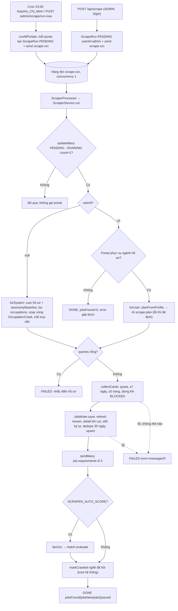
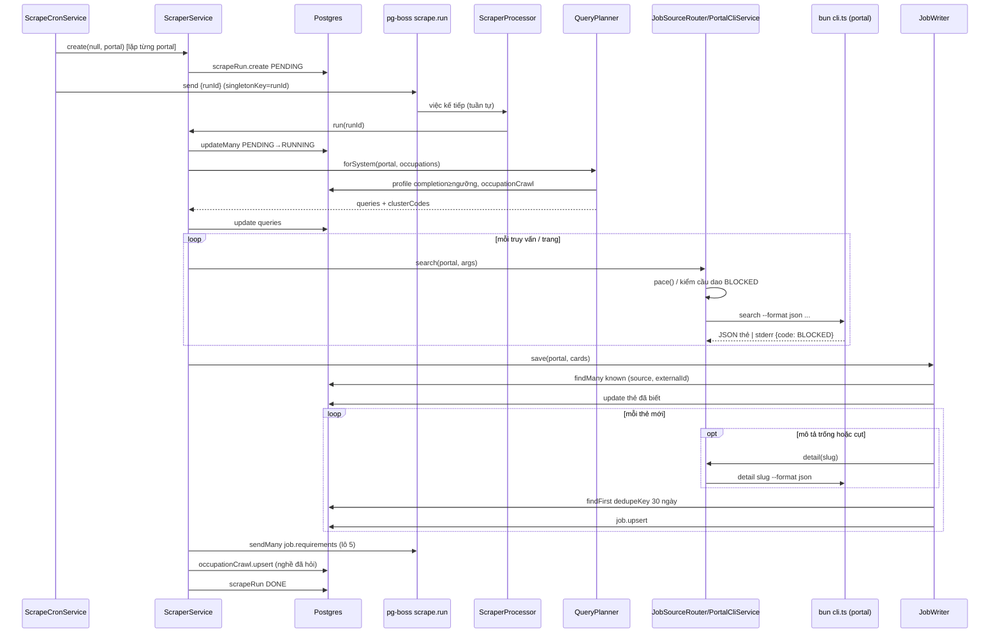
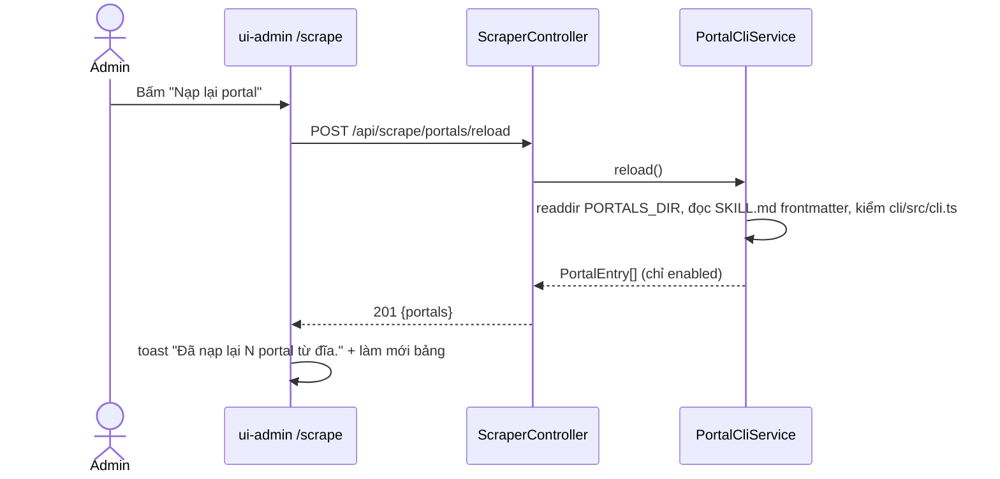
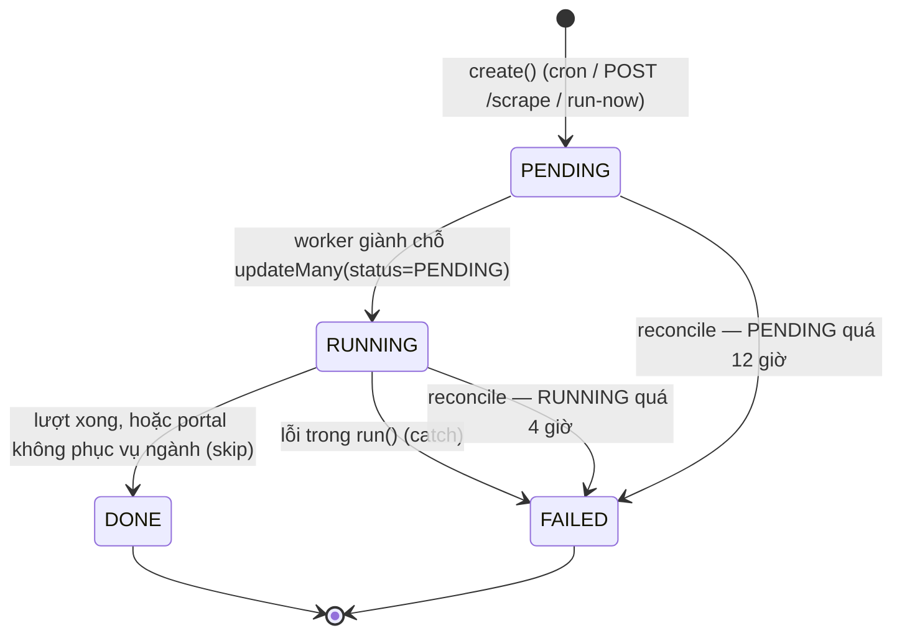

# Job Scraping — Quét tin tuyển dụng từ portal

> **Phạm vi:** `server/src/modules/scraper/**` (`scraper.controller.ts`, `scraper.processor.ts`, `services/scraper.service.ts`, `services/scrape-cron.service.ts`, `services/query-planner.service.ts`, `services/job-source.router.ts`, `services/portal-cli.service.ts`, `services/job-writer.service.ts`, `utils/*`, `planning/*`), bảng `ScrapeRun`, `OccupationCrawl`, hàng đợi `scrape.run`; CLI portal trong `.agents/skills/<portal>-search/` (mức tích hợp). Màn hình: `ui-admin-job-search` — `/scrape` ("Quét tin").
> **Nguyên tắc:** tài liệu mô tả hệ thống **as-is**. Code là nguồn sự thật duy nhất.

Phiên bản 1.0 — 2026-10-19.

## 1. Purpose

| Mục tiêu | Diễn giải |
|---|---|
| Nạp tin vào kho chung | Mỗi đêm hệ thống quét lần lượt mọi portal đang bật, ghi tin mới vào bảng `jobs` dùng chung cho mọi người dùng ([jobs.md](./jobs.md)). |
| Quét đa ngành theo người dùng thật | Từ khoá của lượt hệ thống sinh từ **cụm nghề** của các hồ sơ đủ dữ liệu, cộng sàn phủ toàn bộ danh mục nghề (`taxonomyBaseline`), xoay vòng theo nghề quét lâu nhất ([ADR 0007](../../adr/0007-quet-tin-da-nganh.md)). |
| Không bị chặn IP | Mọi lần gọi portal đi qua một chốt duy nhất giữ nhịp (`pace`) và cầu dao `BLOCKED` 30 phút; hàng đợi `scrape.run` buộc tuần tự ([ADR 0005](../../adr/0005-nguon-tin-portal.md)). |
| Kiểm soát chi phí AI | Lọc tin quá 7 ngày TRƯỚC khi gọi `detail`; trần tin mỗi portal; xếp hàng rút yêu cầu theo lô 5 tin; tự chấm điểm sau quét mặc định TẮT. |
| Nhận ra tin trùng giữa portal | Tin cùng vân tay `dedupeKey` trong 30 ngày được lưu kèm `duplicateOfId` thay vì bỏ qua. |
| Lịch sử quét | Mỗi lượt quét một portal là một `ScrapeRun` (trạng thái, số tin tìm/mới/xếp chấm, truy vấn, lỗi). |

**Điểm mấu chốt:**
- Thêm portal = thêm thư mục `.agents/skills/
-search/` có `SKILL.md` + `cli/src/cli.ts`; không khai cứng tên portal nào trong backend. Nạp lại không cần khởi động máy chủ (`POST /api/scrape/portals/reload`).
- Lượt quét là việc nền: HTTP/cron chỉ tạo `ScrapeRun(PENDING)` và xếp hàng; worker mới chạy thật và giành chỗ có điều kiện `PENDING → RUNNING`.
- "0 tin" có ba nghĩa khác nhau: portal không phục vụ ngành của hồ sơ (`DONE` kèm `error` giải thích), portal bị chặn (`FAILED` với `(BLOCKED)` hoặc `DONE` 0 tin), hoặc thật sự không có tin mới.

## 2. Actors

| Actor | Quyền trong module | Ghi chú |
|---|---|---|
| ADMIN | `POST /api/scrape` (quét một portal theo hồ sơ của chính admin), `POST /api/scrape/portals/reload` | Hai route của module; thêm `POST /api/admin/scrape/run-now` và màn xem lịch sử thuộc [admin-console.md](./admin-console.md). |
| USER | Không có quyền | Gọi hai route trên → 403. |
| Hệ thống — `ScrapeCronService` | Theo lịch `SCRAPE_CRON_SCHEDULE` (mặc định `0 23 * * *`, giờ `Asia/Ho_Chi_Minh`) tạo một `ScrapeRun` (userId `null`) cho mỗi portal | Chỉ chạy ở tiến trình `APP_ROLE` ≠ `api` và khi `SCRAPE_CRON_ENABLED` ≠ `false`. |
| Hệ thống — `ScraperProcessor` (worker `scrape.run`) | Chạy lượt quét | Concurrency 1, `serial: true`. |
| Hệ thống — `ReconcileService` | Đánh `FAILED` cho `ScrapeRun` kẹt | RUNNING > 4 giờ, PENDING > 12 giờ ([platform-operations.md](./platform-operations.md)). |
| Hệ thống ngoài — portal CLI | Được gọi qua `bun run .agents/skills/<dir>/cli/src/cli.ts` | Trả JSON trên stdout, lỗi JSON `{error, code}` trên stderr. |
| Hệ thống — AI (`AiService`) | Tinh chỉnh từ khoá cho lượt của người dùng (`scrape.plan`) | Chỉ lượt có `userId`; lỗi thì lùi về bản tất định. |

## 3. Business Features

| # | Tính năng | Actor | Endpoint / cơ chế |
|---|---|---|---|
| F1 | Quét định kỳ mọi portal | Hệ thống | Cron `scrape.nightly` → `ScrapeCronService.runAllPortals()` |
| F2 | Quét một portal theo yêu cầu (lượt người dùng) | ADMIN | `POST /api/scrape` |
| F3 | Nạp lại danh sách portal từ đĩa | ADMIN | `POST /api/scrape/portals/reload` (+ tự nạp lúc khởi động) |
| F4 | Thực thi một lượt quét | Hệ thống | Hàng đợi `scrape.run` → `ScraperProcessor` → `ScraperService.run()` |
| F5 | Lập kế hoạch từ khoá (hệ thống / người dùng) | Hệ thống | `QueryPlanner.forSystem()` / `forUser()` |
| F6 | Gom thẻ tin qua nhiều truy vấn và trang | Hệ thống | `collectCards()` |
| F7 | Gọi portal có giữ nhịp và cầu dao chặn | Hệ thống | `PortalCliService.invoke()` |
| F8 | Lưu tin mới, làm mới tin đã biết, gộp bản sao | Hệ thống | `JobWriter.save()` |
| F9 | Xếp hàng rút yêu cầu theo lô 5 tin | Hệ thống | `QUEUE.EXTRACT_REQUIREMENTS` (`job.requirements`) |
| F10 | Tự chấm điểm sau quét (mặc định tắt) | Hệ thống | `SCRAPER_AUTO_SCORE=true` → `QUEUE.EVALUATE_MATCH` |
| F11 | Xoay vòng độ phủ nghề | Hệ thống | `OccupationCrawl` + `markCrawled()` |

## 4. Business Flow

### Luồng A — Quét định kỳ (F1)

**Preconditions:** tiến trình có `APP_ROLE` là `all` hoặc `worker`; `SCRAPE_CRON_ENABLED` ≠ `false`; có ít nhất một portal đã nạp.

**Main Flow:**
1. Lúc khởi động module, `ScrapeCronService.onModuleInit` đăng ký `CronJob` tên `scrape.nightly` với `cron.scrapeSchedule` (mặc định `0 23 * * *`) và `cron.timezone` (mặc định `Asia/Ho_Chi_Minh`) ([scrape-cron.service.ts:26-51](../../../server/src/modules/scraper/services/scrape-cron.service.ts#L26)).
2. Đến giờ, `runAllPortals()` kiểm cờ `running` trong bộ nhớ; đang chạy thì log "Lần quét trước còn đang chạy; bỏ qua lượt này" và trả `[]` ([scrape-cron.service.ts:54-59](../../../server/src/modules/scraper/services/scrape-cron.service.ts#L54)).
3. Lấy `listPortals()`; rỗng → log "Không có portal nào được đăng ký; không quét gì".
4. Với TỪNG portal theo thứ tự: `ScraperService.create(null, portal)` tạo `ScrapeRun{userId: null, status: PENDING}` rồi `queue.send('scrape.run', { runId })` ([scrape-cron.service.ts:69-80](../../../server/src/modules/scraper/services/scrape-cron.service.ts#L69)).
5. Trả danh sách `{portal, runId}` đã xếp; cờ `running` được hạ trong `finally`.

**Alternative Flow:**
- A1. `APP_ROLE=api` → log "Vai api: không chạy cron quét tin", không đăng ký cron.
- A2. `SCRAPE_CRON_ENABLED=false` → log "Cron quét tin đang TẮT (SCRAPE_CRON_ENABLED=false)".
- A3. Admin bấm "Quét ngay" → `POST /api/admin/scrape/run-now` gọi đúng `runAllPortals()` (route thuộc admin-console).

**Failure Flow:** tạo/xếp hàng một portal lỗi → log "Không xếp được hàng quét \<portal\>: \<lỗi\>" và tiếp portal sau; portal đó không có lượt đêm nay.

**Postconditions:** N `ScrapeRun` ở `PENDING`, N việc trong hàng đợi `scrape.run` (khoá chặn trùng = `runId`). Việc quét thật diễn ra ở Luồng D, tuần tự từng portal.

### Luồng B — Quét một portal theo yêu cầu (F2)

**Preconditions:** người gọi có role ADMIN; chưa vượt 3 lượt/giờ (tính theo tài khoản).

**Main Flow:**
1. `POST /api/scrape` body `{ portal?: string }` ([scraper.controller.ts:32-57](../../../server/src/modules/scraper/scraper.controller.ts#L32)).
2. `portal = dto.portal ?? <portal đầu tiên đã nạp>`.
3. Không có portal nào → **400** `Chưa có portal nào được đăng ký. Kiểm tra thư mục .agents/skills/.`
4. Portal không có trong danh sách → **400** `Portal chưa được hỗ trợ: <portal>. Đang có: <danh sách>`.
5. `ScraperService.create(user.id, portal)` tạo `ScrapeRun{userId: <admin>, PENDING}` ([scraper.service.ts:55-60](../../../server/src/modules/scraper/services/scraper.service.ts#L55)).
6. `queue.send('scrape.run', { userId, runId })`.
7. Trả **201** `{ queued: true, runId, portal }`.

**Alternative Flow:** không gửi `portal` → quét portal đầu tiên trong danh sách nạp.
**Failure Flow:** 401 (không token), 403 `Không có quyền truy cập` (không phải ADMIN), 400 (như trên, hoặc `portal` > 60 ký tự / không phải chuỗi / trường lạ), 429 (lượt thứ 4 trong giờ).
**Postconditions:** một `ScrapeRun` PENDING gắn `userId` của admin. Lượt này lập kế hoạch từ **hồ sơ của chính admin** (Luồng E2).

### Luồng C — Nạp lại danh sách portal (F3)

**Preconditions:** ADMIN (route thủ công); hoặc lúc khởi động module (`onModuleInit`).

**Main Flow** ([portal-cli.service.ts:104-156](../../../server/src/modules/scraper/services/portal-cli.service.ts#L104)):
1. `POST /api/scrape/portals/reload` ([scraper.controller.ts:25-30](../../../server/src/modules/scraper/scraper.controller.ts#L25)) → `JobSourceRouter.reload()` → `PortalCliService.reload()`.
2. Đọc thư mục `scraper.portalsDir` (mặc định `../.agents/skills` tính từ `server/`).
3. Với mỗi thư mục con: cần `SKILL.md` và `cli/src/cli.ts`; đọc frontmatter → `evaluateCandidate` ([portal-cli.service.ts:38-75](../../../server/src/modules/scraper/services/portal-cli.service.ts#L38)):
   - `key` = tên thư mục bỏ hậu tố `-search|-jobs|-portal`;
   - `enabled` (≠ `false`), `jobAge` (`true` thì truyền `--jobage`), `delayMs`, `maxJobs` (số nguyên dương, sai kiểu thì bỏ qua), `occupations` (mảng chuỗi không rỗng), `description` (≤ 200 ký tự).
4. Portal `enabled: false` bị bỏ khỏi danh sách (log "Portal \<key\> đang tắt").
5. THAY TOÀN BỘ bản đồ portal trong bộ nhớ; trả **201** `{ portals: PortalEntry[] }`.

**Alternative Flow:** thiếu `SKILL.md` hoặc `cli.ts` → bỏ qua thư mục (log debug).
**Failure Flow:** không đọc được thư mục → log `Không đọc được thư mục portal: <dir>`, danh sách portal thành RỖNG, trả `{ portals: [] }` (không lỗi HTTP).
**Postconditions:** danh sách portal trong bộ nhớ của **tiến trình nhận request**; tiến trình khác (nếu chạy tách `api`/`worker`) không được nạp lại.

### Luồng D — Thực thi một lượt quét (F4)

**Preconditions:** việc `scrape.run` với `runId` tồn tại; worker đang chạy (`APP_ROLE` ≠ `api`).

**Main Flow** ([scraper.service.ts:62-161](../../../server/src/modules/scraper/services/scraper.service.ts#L62)):
1. `ScraperProcessor` nhận việc, log "Bắt đầu quét \<runId\>", gọi `run(runId)` ([scraper.processor.ts:18-23](../../../server/src/modules/scraper/scraper.processor.ts#L18)).
2. Đọc `ScrapeRun`; không có → ném `NotFoundException` `Không tìm thấy lần quét: <runId>`.
3. **Giành chỗ:** `updateMany({ id, status: 'PENDING' } → RUNNING, startedAt = now, error = null)`; `count = 0` → log "Bỏ qua lần quét … không còn PENDING" và dừng (không gọi portal, không gọi AI).
4. Lấy `PortalEntry` của portal; `planFor(run, occupations)` (Luồng E).
5. Kế hoạch trả `skip` → cập nhật `DONE`, `jobsFound/jobsNew/jobsQueued = 0`, `error = <lý do>`, `finishedAt`; kết thúc.
6. `plan.queries` rỗng → ném lỗi (lượt người dùng: `Hồ sơ chưa có chức danh hay kỹ năng nào để tìm việc. Hãy điền hồ sơ rồi quét lại.`; lượt hệ thống: `Chưa có hồ sơ nào đủ dữ liệu để quét chung.`).
7. Ghi `queries` và `modelId` vào `ScrapeRun`.
8. `collectCards` gom thẻ (Luồng F) với trần tin = `PortalEntry.maxJobs ?? SCRAPER_MAX_JOBS_PER_PORTAL`.
9. `JobWriter.save(portal, cards)` (Luồng H) trả `savedJobIds, found, fresh, skipped, merged`.
10. Xếp hàng `job.requirements` cho `savedJobIds` theo lô 5 tin (`requirementBatches`) ([scraper.service.ts:200-208](../../../server/src/modules/scraper/services/scraper.service.ts#L200)).
11. Nếu `scraper.autoScore` bật → `fanOut` (Luồng I); tắt thì `queued = 0`.
12. Lượt hệ thống: `markCrawled(portal, clusterCodes[askedIndices])` — chỉ đóng dấu nghề THẬT SỰ đã gửi được request.
13. Cập nhật `DONE`, `jobsFound = found`, `jobsNew = fresh`, `jobsQueued = queued`, `finishedAt`.

**Alternative Flow:** portal phục vụ ngành khác hồ sơ (lượt người dùng) → bước 5 (`DONE` + `error` giải thích, không gọi portal/AI).

**Failure Flow:** bất kỳ lỗi nào từ bước 4–13 → `catch`: cập nhật `FAILED`, `error = messageOf(error)`, `finishedAt` ([scraper.service.ts:153-160](../../../server/src/modules/scraper/services/scraper.service.ts#L153)). Tiến trình chết giữa chừng → `ReconcileService` đánh `FAILED` khi RUNNING > 4 giờ / PENDING > 12 giờ với thông điệp "Máy chủ khởi động lại khi việc này đang chạy dở, nên nó không bao giờ hoàn tất. Hãy bấm chạy lại." ([reconcile.service.ts:119-133](../../../server/src/modules/reconcile/services/reconcile.service.ts#L119)). Trạng thái `FAILED` không tự xếp lại.

**Postconditions:** `ScrapeRun` ở `DONE` hoặc `FAILED`; tin mới trong `jobs`; việc `job.requirements` (và `match.evaluate` nếu bật) trong hàng đợi; `OccupationCrawl.lastCrawledAt` cập nhật cho nghề đã quét.

### Luồng E — Lập kế hoạch từ khoá (F5)

**E1. Lượt hệ thống** (`run.userId = null`) — [query-planner.service.ts:67-111](../../../server/src/modules/scraper/services/query-planner.service.ts#L67):
1. Đọc mọi `Profile` có `completion ≥ MIN_COMPLETION_TO_SCORE` (chỉ `headline`, `primarySkills`, `occupationCode`).
2. `clusterProfiles`: mã cụm = nghề con suy từ headline + kỹ năng chính (`resolveSubOccupation`), lùi về `occupationCode`; hồ sơ không có ngành bị bỏ. Từ khoá cụm = headline phổ biến nhất, không có thì kỹ năng phổ biến nhất (4 kỹ năng đầu mỗi hồ sơ), chuẩn hoá ≤ 60 ký tự ([query-plan.ts:101-131](../../../server/src/modules/scraper/utils/query-plan.ts#L101)).
3. Gộp `taxonomyBaseline()`: mỗi nghề trong `SUB_OCCUPATIONS` chưa có cụm thật thành một cụm `size: 0`; từ khoá nhóm `IT`/`DATA_AI` = từ khoá tiếng Anh đầu tiên, nhóm khác = tên nghề tiếng Việt (ưu tiên nửa có dấu khi tên chứa `/`) ([query-plan.ts:133-166](../../../server/src/modules/scraper/utils/query-plan.ts#L133)).
4. Portal khai `occupations` → chỉ giữ cụm thuộc các nhóm đó, LỌC TRƯỚC khi xoay vòng.
5. Đọc `OccupationCrawl` của portal; sắp cụm theo `lastCrawledAt` tăng dần (chưa quét = 0 đứng đầu), hoà thì cụm đông hồ sơ trước; cắt `SCRAPER_SYSTEM_QUERY_LIMIT` (mặc định 30).
6. Mỗi cụm thành một truy vấn `location: ''` (cả nước). Không gọi AI (`modelId = null`).

**E2. Lượt người dùng** (`run.userId` có giá trị) — [scraper.service.ts:183-197](../../../server/src/modules/scraper/services/scraper.service.ts#L183), [query-planner.service.ts:35-65](../../../server/src/modules/scraper/services/query-planner.service.ts#L35):
1. Đọc `Profile` của `run.userId`.
2. Portal có `occupations` và hồ sơ có `occupationCode` không nằm trong đó → `skip`: `<portal> chỉ phục vụ ngành <...>; hồ sơ thuộc ngành khác nên không có tin nào phù hợp.` Hồ sơ chưa có ngành thì không bị chặn.
3. Bản tất định `planFromProfile`: (a) chức danh `headline`; (b) chức danh ghép từng lĩnh vực mục tiêu; (c) tối đa 4 kỹ năng chính; (d) không có gì thì lùi về từ khoá của nghề đã chọn lúc "Chọn nhanh"; khử trùng không phân biệt hoa thường; tối đa 5 truy vấn; `location` = `Profile.location` ([query-plan.ts:22-70](../../../server/src/modules/scraper/utils/query-plan.ts#L22)).
4. Bản tất định rỗng → trả rỗng, **không gọi model** (dẫn tới FAILED ở Luồng D bước 6).
5. Gọi `AiService.generateObject` purpose `scrape.plan`, schema `searchPlanSchema`, timeout 30 giây, `maxRetries: 0`; thành công thì dùng kế hoạch của model và ghi `modelId`.
6. Model lỗi/timeout → log "Tinh chỉnh truy vấn thất bại (...); dùng bản tất định", dùng bản ở bước 3, `modelId = null`.

### Luồng F — Gom thẻ tin (F6)

[collect-cards.ts:16-154](../../../server/src/modules/scraper/utils/collect-cards.ts#L16)

1. Mỗi truy vấn một con trỏ (trang 1). Hạn ngạch mỗi truy vấn `quota = max(1, floor(trần / số truy vấn))` (làm tròn XUỐNG để mọi truy vấn đều được gọi).
2. Hai vòng: vòng 1 mỗi truy vấn lấy tối đa `quota`; vòng 2 bỏ hạn ngạch để lấp chỗ trống tới trần.
3. Mỗi bước: gọi `search(portal, { query, location: query.location || SCRAPER_DEFAULT_LOCATION, page, limit: 25, postedWithinDays: SCRAPER_MAX_AGE_DAYS })`; không vượt `SCRAPER_MAX_PAGES` trang mỗi truy vấn.
4. Thẻ có ngày đăng quá `SCRAPER_MAX_AGE_DAYS` (7) bị loại TRƯỚC khi gọi `detail`; thẻ không đọc được ngày được GIỮ trừ khi `SCRAPER_REQUIRE_POSTED_AT=true`. Thẻ trùng `id` trong cùng lượt bị bỏ.
5. Trang trả rỗng hoặc trang không thêm thẻ nào → truy vấn kết thúc.
6. Một truy vấn lỗi → đánh dấu lỗi, đi tiếp truy vấn khác. Lỗi chứa `(BLOCKED)` → dừng MỌI truy vấn còn lại nhưng giữ thẻ đã gom.
7. Có truy vấn lỗi và không gom được thẻ nào → ném lỗi đầu tiên (lượt `FAILED` đúng lý do).
8. Trả `cards` (≤ trần) và `askedIndices` (truy vấn đã gửi được ít nhất một request thành công).

### Luồng G — Gọi portal (F7)

[portal-cli.service.ts:170-261](../../../server/src/modules/scraper/services/portal-cli.service.ts#L170)

1. Portal không có trong bản đồ → lỗi `Portal chưa được đăng ký: <portal>. Đang có: <...>`.
2. Portal đang trong cầu dao → lỗi `<portal>: đang tạm ngừng tới <ISO> vì portal trả trang chống bot (BLOCKED)` (không chạy CLI).
3. `pace()`: chờ đủ `delayMs` của portal (frontmatter) hoặc `SCRAPER_PORTAL_DELAY_MS` (3.000ms) kể từ lần GỌI trước, VÀ 1.200ms kể từ lần XONG trước.
4. `execFile('bun', ['run', cliPath, ...args])`, `cwd` = gốc repo, timeout `SCRAPER_TIMEOUT_MS` (60s), stdout tối đa 8MB.
   - `search --format json [--query] [--location] [--remote] [--page] [--limit] [--jobage N nếu portal khai jobAge]`.
   - `detail <slug> --format json`.
5. stdout → `JSON.parse` → `normalizeCards`/`normalizeDetail` (thẻ thiếu `id`, `slug`, `title` hoặc `url` bị bỏ; mảng có thể nằm ở `results|jobs|data|items`).
6. Lỗi: stderr dạng JSON có `code: 'BLOCKED'` → bật cầu dao 30 phút; ném `<portal>: <error> (<code>)`, hoặc `<portal>: <message>`.
7. `detail` trả dữ liệu không hợp lệ → `<portal>: dữ liệu chi tiết không hợp lệ cho <slug>`.

### Luồng H — Lưu tin (F8)

[job-writer.service.ts:36-230](../../../server/src/modules/scraper/services/job-writer.service.ts#L36)

1. Tách thẻ theo `(source, externalId)` đã có trong `jobs`: `known` và `fresh`.
2. **Làm mới thẻ đã biết** (`refreshKnownCards`): chỉ cập nhật trường thẻ có giá trị — `companyLogo`, `postedAt`, `salaryRaw`, `location` (+ `provinceCode`, `dedupeKey` tính lại), và khi thẻ có `categories` thì `categories`, `occupationCode`, `subOccupationCode`. Lỗi từng tin chỉ log.
3. Với mỗi thẻ mới, tuần tự:
   - Mô tả trống hoặc kết thúc bằng `...`/`…` → gọi `detail` lấy mô tả đầy đủ (+ `categories` nếu thẻ chưa có); lỗi `detail` bị nuốt, dùng bản cũ.
   - Mô tả vẫn trống hoặc \< 80 ký tự → bỏ qua (`skipped`).
   - `company` trống → "Không rõ"; tính `derivedFields` (xem [jobs.md](./jobs.md) Luồng H).
   - `findOriginal(dedupeKey)`: tin gốc cùng `dedupeKey`, `duplicateOfId IS NULL`, `scrapedAt` trong 30 ngày, cũ nhất → làm `duplicateOfId`.
   - `job.upsert` theo `(source, externalId)`: tạo mới với đủ trường; nếu đã có (đua giữa hai lượt) thì cập nhật mô tả, lương thô, logo, ngày đăng, nhãn và cột dẫn xuất.
   - Có `duplicateOfId` → tính `merged` (không vào `savedJobIds`); ngược lại → `saved`.
   - Lỗi một thẻ → `skipped`, log "Bỏ qua \<slug\>: \<lỗi\>", đi tiếp.
4. Trả `{ savedJobIds, found: cards.length, fresh: fresh.length, skipped, merged }`.

### Luồng I — Tự chấm điểm sau quét (F10, mặc định TẮT)

[scraper.service.ts:210-275](../../../server/src/modules/scraper/services/scraper.service.ts#L210), [fan-out.ts:14-66](../../../server/src/modules/scraper/utils/fan-out.ts#L14)

**Preconditions:** `SCRAPER_AUTO_SCORE=true`; có `savedJobIds`.

1. Lượt người dùng: xếp `match.evaluate` cho từng cặp `(userId, jobId)`.
2. Lượt hệ thống: đọc hồ sơ `completion ≥ MIN_COMPLETION_TO_SCORE` sắp theo `lastFanOutAt` (chưa từng = đầu tiên), các cặp đã có `JobMatch`, nội dung tin.
3. `planFanOut`: mỗi người tối đa 5 tin chưa chấm, cần ≥ 1 từ khoá kỹ năng khớp trong tiêu đề + mô tả; chia lượt xoay vòng theo hạng; trần 500 lượt mỗi lần quét, phần vượt bị bỏ (`dropped`).
4. `sendMany('match.evaluate', targets)`; cập nhật `Profile.lastFanOutAt` cho người được phục vụ.

**Postconditions:** việc `match.evaluate` trong hàng đợi ([matching.md](./matching.md)).

## 5. Mermaid Flowchart

## 6. Sequence Diagram

## 7. Business Rules

| Mã BR | Quy tắc | Nơi thực thi | Mức | Nguồn code |
|---|---|---|---|---|
| BR-SCR-01 | Cron quét chạy theo `SCRAPE_CRON_SCHEDULE` (mặc định `0 23 * * *`) ở múi giờ `CRON_TIMEZONE` (mặc định `Asia/Ho_Chi_Minh`). | SV | ✅ | [scrape-cron.service.ts:37-48](../../../server/src/modules/scraper/services/scrape-cron.service.ts#L37), [configuration.ts:144-147](../../../server/src/config/configuration.ts#L144) |
| BR-SCR-02 | Cron chỉ đăng ký ở tiến trình `APP_ROLE` ≠ `api` và khi `SCRAPE_CRON_ENABLED` ≠ `false`. | SV | ✅ | [scrape-cron.service.ts:26-35](../../../server/src/modules/scraper/services/scrape-cron.service.ts#L26), [app-role.ts:21-23](../../../server/src/config/app-role.ts#L21) |
| BR-SCR-03 | Mỗi lượt cron tạo một `ScrapeRun` không chủ (`userId = null`) cho MỖI portal đang bật; lỗi một portal không chặn portal khác. | SV | ✅ | [scrape-cron.service.ts:69-80](../../../server/src/modules/scraper/services/scrape-cron.service.ts#L69) |
| BR-SCR-04 | Hai lần gọi `runAllPortals` chồng nhau trong CÙNG tiến trình thì lần sau bị bỏ (cờ bộ nhớ, chỉ phủ khoảng thời gian xếp hàng). | SV | ✅ | [scrape-cron.service.ts:55-59](../../../server/src/modules/scraper/services/scrape-cron.service.ts#L55) |
| BR-SCR-05 | Quét theo yêu cầu và nạp lại portal chỉ dành cho ADMIN. | GD | ✅ | [scraper.controller.ts:26](../../../server/src/modules/scraper/scraper.controller.ts#L26), [scraper.controller.ts:38](../../../server/src/modules/scraper/scraper.controller.ts#L38) |
| BR-SCR-06 | `POST /api/scrape` giới hạn 3 lượt/giờ mỗi tài khoản. | GD | ✅ | [scraper.controller.ts:32](../../../server/src/modules/scraper/scraper.controller.ts#L32), [throttle.ts:12-13](../../../server/src/common/throttle.ts#L12) |
| BR-SCR-07 | Không chỉ định portal thì quét portal đầu tiên đã nạp; portal không có trong danh sách → 400. | SV | ✅ | [scraper.controller.ts:40-52](../../../server/src/modules/scraper/scraper.controller.ts#L40) |
| BR-SCR-08 | Portal hợp lệ = thư mục có `SKILL.md` + `cli/src/cli.ts` và frontmatter không `enabled: false`; khoá portal = tên thư mục bỏ `-search/-jobs/-portal`. | SV | ✅ | [portal-cli.service.ts:34-75](../../../server/src/modules/scraper/services/portal-cli.service.ts#L34), [portal-cli.service.ts:116-147](../../../server/src/modules/scraper/services/portal-cli.service.ts#L116) |
| BR-SCR-09 | Frontmatter `delayMs`, `maxJobs` chỉ nhận số nguyên dương, `occupations` chỉ nhận mảng chuỗi không rỗng; sai kiểu thì dùng giá trị chung. | SV | ✅ | [portal-cli.service.ts:24-32](../../../server/src/modules/scraper/services/portal-cli.service.ts#L24) |
| BR-SCR-10 | Hàng đợi `scrape.run` buộc tuần tự (concurrency 1, `serial: true`), khoá chặn trùng = `runId`. | SV | ✅ | [queue.defaults.ts:19](../../../server/src/modules/queue/queue.defaults.ts#L19), [queue-key.ts:67-68](../../../server/src/modules/queue/queue-key.ts#L67) |
| BR-SCR-11 | Lượt quét chỉ chạy khi giành được chỗ `PENDING → RUNNING`; worker thua thì bỏ qua, không gọi portal/AI. | SV | ✅ | [scraper.service.ts:68-77](../../../server/src/modules/scraper/services/scraper.service.ts#L68) |
| BR-SCR-12 | Lỗi bất kỳ trong lượt → `FAILED` + `error` + `finishedAt`; `FAILED` không tự xếp lại. | SV | ✅ | [scraper.service.ts:153-160](../../../server/src/modules/scraper/services/scraper.service.ts#L153) |
| BR-SCR-13 | `ScrapeRun` kẹt `RUNNING` > 4 giờ hoặc `PENDING` > 12 giờ được reconcile đánh `FAILED`. | SV | ✅ | [reconcile.service.ts:8-9](../../../server/src/modules/reconcile/services/reconcile.service.ts#L8), [reconcile.service.ts:119-133](../../../server/src/modules/reconcile/services/reconcile.service.ts#L119) |
| BR-SCR-14 | Lượt người dùng: portal khai `occupations` mà ngành hồ sơ không thuộc → `DONE`, 0 tin, `error` giải thích, không gọi portal/AI; hồ sơ chưa có ngành thì không chặn. | SV | ✅ | [scraper.service.ts:186-194](../../../server/src/modules/scraper/services/scraper.service.ts#L186) |
| BR-SCR-15 | Không có từ khoá mặc định: kế hoạch rỗng → `FAILED` với lời nhắc điền hồ sơ, không gọi model. | SV | ✅ | [scraper.service.ts:99-105](../../../server/src/modules/scraper/services/scraper.service.ts#L99), [query-planner.service.ts:42-45](../../../server/src/modules/scraper/services/query-planner.service.ts#L42) |
| BR-SCR-16 | Từ khoá lượt người dùng: chức danh trước, chức danh + lĩnh vực mục tiêu, rồi ≤ 4 kỹ năng chính, lùi về nghề "Chọn nhanh"; tối đa 5 truy vấn, ≤ 60 ký tự. | SV | ✅ | [query-plan.ts:15-70](../../../server/src/modules/scraper/utils/query-plan.ts#L15) |
| BR-SCR-17 | AI chỉ TINH CHỈNH từ khoá lượt người dùng (timeout 30s, không thử lại); lỗi → dùng bản tất định. | SV | ✅ | [query-planner.service.ts:47-64](../../../server/src/modules/scraper/services/query-planner.service.ts#L47), [search-plan.prompt.ts:1](../../../server/src/modules/scraper/planning/search-plan.prompt.ts#L1) |
| BR-SCR-18 | Output model: 2–6 truy vấn (thừa thì cắt), `query` ≥ 2 ký tự cắt 60, `location` cắt 40, `rationale` cắt 200; ngành IT/kỹ thuật từ khoá tiếng Anh, ngành khác tiếng Việt có dấu. | SV | ✅ | [search-plan.schema.ts:3-32](../../../server/src/modules/scraper/planning/search-plan.schema.ts#L3), [search-plan.prompt.ts:3-13](../../../server/src/modules/scraper/planning/search-plan.prompt.ts#L3) |
| BR-SCR-19 | Lượt hệ thống: cụm theo NGHỀ con (lùi về nhóm) của hồ sơ đủ dữ liệu + sàn phủ mọi nghề; lọc theo `occupations` của portal TRƯỚC khi xoay vòng; chọn ≤ `SCRAPER_SYSTEM_QUERY_LIMIT` (30) cụm quét lâu nhất, hoà thì cụm đông trước; quét cả nước. | SV | ✅ | [query-planner.service.ts:67-111](../../../server/src/modules/scraper/services/query-planner.service.ts#L67), [query-plan.ts:88-185](../../../server/src/modules/scraper/utils/query-plan.ts#L88) |
| BR-SCR-20 | Chỉ nghề đã thật sự gửi được request mới được đóng dấu `OccupationCrawl.lastCrawledAt`. | SV | ✅ | [scraper.service.ts:136-141](../../../server/src/modules/scraper/services/scraper.service.ts#L136), [collect-cards.ts:77-79](../../../server/src/modules/scraper/utils/collect-cards.ts#L77) |
| BR-SCR-21 | Trần tin mỗi portal mỗi lượt = `maxJobs` của portal hoặc `SCRAPER_MAX_JOBS_PER_PORTAL` (100); hạn ngạch mỗi truy vấn `floor(trần / số truy vấn)`, vòng hai lấp chỗ trống. *(2026-10-16 nâng 50 → 100)* | SV | ✅ | [scraper.service.ts:116-119](../../../server/src/modules/scraper/services/scraper.service.ts#L116), [collect-cards.ts:34-39](../../../server/src/modules/scraper/utils/collect-cards.ts#L34) |
| BR-SCR-22 | Mỗi truy vấn tối đa `SCRAPER_MAX_PAGES` (5) trang × 25 tin/trang. | SV | ✅ | [collect-cards.ts:11](../../../server/src/modules/scraper/utils/collect-cards.ts#L11), [collect-cards.ts:48](../../../server/src/modules/scraper/utils/collect-cards.ts#L48) |
| BR-SCR-23 | Tin đăng quá `SCRAPER_MAX_AGE_DAYS` (7) ngày bị loại TRƯỚC khi gọi `detail`; tin không rõ ngày được giữ trừ khi `SCRAPER_REQUIRE_POSTED_AT=true`; ngày đăng ở tương lai quá 1 ngày coi như không rõ. | SV | ✅ | [collect-cards.ts:141-144](../../../server/src/modules/scraper/utils/collect-cards.ts#L141), [normalize.ts:153-176](../../../server/src/modules/scraper/utils/normalize.ts#L153) |
| BR-SCR-24 | Một truy vấn lỗi không kéo đổ cả lượt; `BLOCKED` dừng mọi truy vấn còn lại nhưng giữ tin đã gom; không gom được tin nào thì lượt thất bại với lỗi đầu tiên. | SV | ✅ | [collect-cards.ts:53-66](../../../server/src/modules/scraper/utils/collect-cards.ts#L53) |
| BR-SCR-25 | Mọi lần gọi portal đi qua `invoke`: giãn cách ≥ `delayMs` (portal) hoặc `SCRAPER_PORTAL_DELAY_MS` (3.000ms) từ lần gọi trước VÀ ≥ 1.200ms từ lần xong trước. | SV | ✅ | [portal-cli.service.ts:170-202](../../../server/src/modules/scraper/services/portal-cli.service.ts#L170) |
| BR-SCR-26 | Portal trả `BLOCKED` → ngừng gọi portal đó 30 phút (cầu dao trong bộ nhớ), ném lỗi ngay không chạy CLI. | SV | ✅ | [portal-cli.service.ts:22](../../../server/src/modules/scraper/services/portal-cli.service.ts#L22), [portal-cli.service.ts:195-226](../../../server/src/modules/scraper/services/portal-cli.service.ts#L195) |
| BR-SCR-27 | Một lần gọi CLI tối đa `SCRAPER_TIMEOUT_MS` (60s), stdout ≤ 8MB. | SV | ✅ | [portal-cli.service.ts:205-210](../../../server/src/modules/scraper/services/portal-cli.service.ts#L205) |
| BR-SCR-28 | `--jobage` chỉ truyền cho portal khai `jobAge: true` (LinkedIn). | SV | ✅ | [portal-cli.service.ts:244-245](../../../server/src/modules/scraper/services/portal-cli.service.ts#L244) |
| BR-SCR-29 | Thẻ thiếu `id`, `slug`, `title` hoặc `url` bị bỏ khi chuẩn hoá. | SV | ✅ | [normalize.ts:48-77](../../../server/src/modules/scraper/utils/normalize.ts#L48) |
| BR-SCR-30 | Tin đã biết (cùng `source` + `externalId`) không gọi `detail` lại; chỉ làm mới trường thẻ có giá trị (logo, ngày đăng, lương thô, địa điểm/tỉnh/dedupeKey, nhãn/ngành). | SV | ✅ | [job-writer.service.ts:37-54](../../../server/src/modules/scraper/services/job-writer.service.ts#L37), [job-writer.service.ts:177-230](../../../server/src/modules/scraper/services/job-writer.service.ts#L177) |
| BR-SCR-31 | Tin mới có mô tả trống hoặc kết thúc bằng dấu ba chấm thì gọi `detail`; lỗi `detail` bị nuốt và giữ bản cụt. | SV | ✅ | [job-writer.service.ts:91-97](../../../server/src/modules/scraper/services/job-writer.service.ts#L91), [normalize.ts:34-35](../../../server/src/modules/scraper/utils/normalize.ts#L34) |
| BR-SCR-32 | Tin có mô tả \< 80 ký tự (hoặc trống) không được lưu. | SV | ✅ | [job-writer.service.ts:99-102](../../../server/src/modules/scraper/services/job-writer.service.ts#L99), [normalize.ts:32](../../../server/src/modules/scraper/utils/normalize.ts#L32) |
| BR-SCR-33 | Tin cùng `dedupeKey` với một tin gốc quét trong 30 ngày được LƯU kèm `duplicateOfId` (gốc = tin cũ nhất), không bỏ qua; bản sao không được rút yêu cầu hay chấm. | SV | ✅ | [job-writer.service.ts:26](../../../server/src/modules/scraper/services/job-writer.service.ts#L26), [job-writer.service.ts:144-162](../../../server/src/modules/scraper/services/job-writer.service.ts#L144) |
| BR-SCR-34 | Tin là duy nhất theo `(source, externalId)`; ghi bằng `upsert` nên hai lượt đua không tạo trùng. | DB | 🔒 | [schema.prisma:237](../../../server/prisma/schema.prisma#L237), [job-writer.service.ts:115-142](../../../server/src/modules/scraper/services/job-writer.service.ts#L115) |
| BR-SCR-35 | Tin mới lưu được xếp hàng `job.requirements` theo lô 5 tin. | SV | ✅ | [requirement-batches.ts:1-11](../../../server/src/modules/scraper/utils/requirement-batches.ts#L1), [scraper.service.ts:200-208](../../../server/src/modules/scraper/services/scraper.service.ts#L200) |
| BR-SCR-36 | Tự chấm điểm sau quét chỉ khi `SCRAPER_AUTO_SCORE=true` (mặc định tắt). | SV | ✅ | [scraper.service.ts:132-134](../../../server/src/modules/scraper/services/scraper.service.ts#L132), [configuration.ts:130](../../../server/src/config/configuration.ts#L130) |
| BR-SCR-37 | Fan-out hệ thống: mỗi hồ sơ (completion ≥ ngưỡng) ≤ 5 tin chưa chấm có ≥ 1 kỹ năng khớp; tối đa 500 lượt mỗi lần quét; người lâu chưa được phục vụ đi trước. | SV | ✅ | [fan-out.ts:8-66](../../../server/src/modules/scraper/utils/fan-out.ts#L8), [scraper.service.ts:223-271](../../../server/src/modules/scraper/services/scraper.service.ts#L223) |
| BR-SCR-38 | Lần nhắc một nghề trên một portal là duy nhất `(portal, occupationCode)`. | DB | 🔒 | [schema.prisma:863](../../../server/prisma/schema.prisma#L863) |
| BR-SCR-39 | Xoá tài khoản không xoá lịch sử quét (`ScrapeRun.userId` → `SetNull`). | DB | 🔒 | [schema.prisma:819-820](../../../server/prisma/schema.prisma#L819) |

> **Possible Business Rule:** `POST /api/scrape` lập kế hoạch từ hồ sơ của **admin gọi nó**, và kết quả ghi vào kho tin chung. Không màn hình FE nào gọi route này (admin dùng "Quét ngay" = `run-now`, lượt hệ thống). Cần xác nhận route này còn là tính năng chủ đích hay di sản của thời "mỗi người tự quét".

> **Possible Business Rule:** Lượt bị bỏ vì portal không phục vụ ngành vẫn là `DONE` nhưng có `error` khác rỗng. Màn admin hiện `error` như lỗi chỉ khi `FAILED` (chưa đối chiếu hết FE) — cần chốt quy ước "DONE kèm ghi chú".

> **Possible Business Rule (chưa kiểm chứng):** pg-boss mặc định hết hạn việc sau một khoảng thời gian; lượt quét dài (100 tin × `delayMs` 8–10s) có thể vượt. Nếu pg-boss giao lại việc, bước giành chỗ (BR-SCR-11) chặn chạy lần hai — nhưng chưa đo thời lượng lượt quét thật so với hạn của pg-boss.

## 8. Validation Rules

### `StartScrapeDto` (`POST /api/scrape`) — [scraper.dto.ts](../../../server/src/modules/scraper/scraper.dto.ts)

| Field | Ràng buộc | DTO/Schema | Lỗi trả về |
|---|---|---|---|
| `portal` | tuỳ chọn, chuỗi, ≤ 60 ký tự | `@IsOptional @IsString @MaxLength(60)` | 400 "portal không được dài quá 60 ký tự" / "portal phải là chuỗi ký tự" |
| (trường khác) | bị cấm | `forbidNonWhitelisted` | 400 "`<tên>` không phải là trường hợp lệ" |
| `portal` có trong danh sách | kiểm ở controller | `JobSourceRouter.has` | 400 `Portal chưa được hỗ trợ: <portal>. Đang có: <...>` |

### `searchPlanSchema` (output model `scrape.plan`) — [search-plan.schema.ts](../../../server/src/modules/scraper/planning/search-plan.schema.ts)

| Field | Ràng buộc | DTO/Schema | Lỗi trả về |
|---|---|---|---|
| `queries` | mảng ≥ 2 phần tử, cắt còn 6 | zod `.min(2).transform(slice 0..6)` | Lỗi schema → planner lùi về bản tất định (không lộ ra HTTP) |
| `queries[].query` | chuỗi ≥ 2 ký tự, trim, cắt 60 | zod | như trên |
| `queries[].location` | chuỗi, trim, cắt 40 | zod | như trên |
| `queries[].rationale` | chuỗi ≥ 1 ký tự, trim, cắt 200 | zod | như trên |

### Frontmatter `SKILL.md` của portal — [portal-cli.service.ts:24-75](../../../server/src/modules/scraper/services/portal-cli.service.ts#L24)

| Field | Ràng buộc | Nơi kiểm | Khi sai |
|---|---|---|---|
| `enabled` | khác `false` thì bật | `evaluateCandidate` | — |
| `jobAge` | đúng `true` mới bật | `evaluateCandidate` | coi như `false` |
| `delayMs`, `maxJobs` | số nguyên dương | `positiveIntFrom` | dùng giá trị chung |
| `occupations` | mảng chuỗi không rỗng | `occupationsFrom` | `null` = phục vụ mọi ngành |
| `description` | chuỗi, gộp khoảng trắng, cắt 200 | `evaluateCandidate` | `''` |

### Payload CLI (thẻ tin) — [normalize.ts:48-77](../../../server/src/modules/scraper/utils/normalize.ts#L48)

| Field | Ràng buộc | Khi sai |
|---|---|---|
| `id`, `slug` (hoặc `id`), `title`, `url` | chuỗi không rỗng | thẻ bị bỏ |
| `postedAt` (hoặc `date`) | `dd/mm/yyyy`, ISO `yyyy-mm-dd…`, hoặc tương đối ("3 ngày trước", "2 days ago") | `null` (không rõ ngày) |
| `tags`, `categories` | mảng chuỗi | `[]` |

## 9. API Mapping

| Method | URL | Role | Mục đích nghiệp vụ | Controller#method | Service | DTO | Response |
|---|---|---|---|---|---|---|---|
| POST | `/api/scrape` | ADMIN (3/giờ) | Xếp một lượt quét một portal theo hồ sơ của admin | `ScraperController#start` | `ScraperService.create` + `QueueService.send` | `StartScrapeDto` | 201 `{queued: true, runId, portal}` |
| POST | `/api/scrape/portals/reload` | ADMIN | Nạp lại danh sách portal từ đĩa | `ScraperController#reloadPortals` | `JobSourceRouter.reload` → `PortalCliService.reload` | — | 201 `{portals: PortalEntry[]}` |

Cơ chế không phải HTTP: cron `scrape.nightly` (`ScrapeCronService`), worker hàng đợi `scrape.run` (`ScraperProcessor`).

**Endpoint ở module khác tác động lên module này**

| Method | URL | Module | Tác động |
|---|---|---|---|
| POST | `/api/admin/scrape/run-now` | [admin-console.md](./admin-console.md) | Gọi `ScrapeCronService.runAllPortals()` ngay, 202 `{queued, runs, note}` ([admin.controller.ts:99-110](../../../server/src/modules/admin/controllers/admin.controller.ts#L99)) |
| GET | `/api/admin/scrape/portals` | [admin-console.md](./admin-console.md) | Đọc `ScrapeRun` + `describePortals()` để hiện sức khoẻ từng portal ([admin-scrape.controller.ts:18](../../../server/src/modules/admin/controllers/admin-scrape.controller.ts#L18)) |
| GET | `/api/admin/scrape/batches` | [admin-console.md](./admin-console.md) | Lịch sử quét gom theo lượt đêm ([admin-scrape.controller.ts:26](../../../server/src/modules/admin/controllers/admin-scrape.controller.ts#L26)) |
| POST | `/api/admin/reconcile/run-now` (+ cron 10 phút) | [platform-operations.md](./platform-operations.md) | Đánh `FAILED` cho `ScrapeRun` kẹt |
| GET/PUT | `/api/admin/queues…` | [admin-console.md](./admin-console.md) | Xem/đổi concurrency; `scrape.run` là `serial` nên luôn 1 |
| POST | `/api/admin/jobs/backfill-taxonomy` | [admin-console.md](./admin-console.md) | Tính lại cột dẫn xuất của tin đã quét ([jobs.md](./jobs.md)) |

## 10. Frontend Mapping

| Route FE | Vai trò | Mục đích | Hook / API client |
|---|---|---|---|
| `/scrape` "Quét tin" ([page.tsx](../../../../ui-admin-job-search/app/%28console%29/scrape/page.tsx), [scrape-view.tsx](../../../../ui-admin-job-search/app/%28console%29/scrape/scrape-view.tsx)) | ADMIN | Tiêu đề "Quét tin tuyển dụng", phụ đề cứng "Cron hằng đêm 23:00 quét mọi portal đang bật"; nút "Quét ngay" | `adminService.scrapeNow()` → `POST /admin/scrape/run-now` ([services/admin.ts](../../../../ui-admin-job-search/services/admin.ts)) |
| Thẻ "Portal" ([portal-health-card.tsx](../../../../ui-admin-job-search/app/%28console%29/scrape/portal-health-card.tsx)) | ADMIN | Sức khoẻ từng portal, cảnh báo "chạm trần"; nút nạp lại portal | `scraperService.portalHealth`, `scraperService.reloadPortals` → `POST /scrape/portals/reload` |
| Thẻ "Lịch sử theo lượt" ([batch-matrix-card.tsx](../../../../ui-admin-job-search/app/%28console%29/scrape/batch-matrix-card.tsx)) | ADMIN | Ma trận lượt × portal, lọc chỉ lượt hỏng, tooltip lỗi | `scraperService.batches` → `GET /admin/scrape/batches` |

API client: [services/scraper.ts](../../../../ui-admin-job-search/services/scraper.ts). Không màn hình nào (admin hay người dùng) gọi `POST /api/scrape`.

## 11. Database

### `scrape_runs` (model `ScrapeRun`, [schema.prisma:807](../../../server/prisma/schema.prisma#L807))

| Field | Kiểu | Ghi chú |
|---|---|---|
| `id` | String cuid | PK |
| `userId` | String? → User | `null` = lượt hệ thống (cron); `onDelete: SetNull` |
| `status` | `MatchStatus` mặc định `PENDING` | Xem §12 |
| `portal` | String | Khoá portal |
| `queries` | Json? | Mảng `{query, location, rationale}` đã dùng |
| `jobsFound` | Int (0) | Số thẻ gom được (sau lọc ngày, ≤ trần) |
| `jobsNew` | Int (0) | Số thẻ chưa có trong kho (gồm cả thẻ sau đó bị bỏ/gộp) |
| `jobsQueued` | Int (0) | Số lượt `match.evaluate` đã xếp (0 khi tắt auto-score) |
| `modelId` | String? | Model tinh chỉnh từ khoá (chỉ lượt người dùng) |
| `startedAt`, `finishedAt` | DateTime? | |
| `error` | Text? | Lỗi (FAILED) hoặc ghi chú bỏ qua (DONE) |
| `createdAt` | DateTime | `now()` |

Index: `@@index([userId, createdAt DESC])`, `@@index([portal, createdAt DESC])` ([schema.prisma:843-844](../../../server/prisma/schema.prisma#L843)).

### `occupation_crawls` (model `OccupationCrawl`, [schema.prisma:857](../../../server/prisma/schema.prisma#L857))

| Field | Kiểu | Ghi chú |
|---|---|---|
| `portal` | String | PK phần 1 |
| `occupationCode` | String | PK phần 2 — nay chứa mã NGHỀ con (vd. `FIN_ACCOUNTING`) hoặc mã nhóm khi cụm lùi về nhóm |
| `lastCrawledAt` | DateTime `@updatedAt` | Mốc quét gần nhất, khoá xoay vòng |

`@@id([portal, occupationCode])`.

### Bảng của module khác được ghi
- `jobs` (tạo/cập nhật) — [jobs.md](./jobs.md).
- `profiles.lastFanOutAt` (chỉ khi auto-score bật).
- Hàng đợi `pgboss.*`: `scrape.run`, `job.requirements`, `match.evaluate`.

## 12. State Machine

`ScrapeRun.status` (`MatchStatus`):

| Từ | Sang | Trigger | Điều kiện |
|---|---|---|---|
| — | PENDING | `ScraperService.create` | Portal đã nạp |
| PENDING | RUNNING | `ScraperService.run` | `updateMany where status=PENDING` trả `count = 1`; ghi `startedAt`, xoá `error` |
| RUNNING | DONE | `run` hoàn tất | Ghi `jobsFound/jobsNew/jobsQueued`, `finishedAt` |
| RUNNING | DONE (skip) | `planFor` trả `skip` | Lượt người dùng, ngành hồ sơ ngoài `occupations` của portal; `error` = lý do |
| RUNNING | FAILED | `catch` trong `run` | Kế hoạch rỗng, portal lỗi/`BLOCKED` không gom được tin, lỗi DB… |
| RUNNING | FAILED | `ReconcileService` | `startedAt < now − 4h` |
| PENDING | FAILED | `ReconcileService` | `createdAt < now − 12h` |
| FAILED/DONE | — | — | Trạng thái cuối; không có đường chạy lại một run (tạo run mới) |

Trạng thái phụ trong bộ nhớ (không lưu DB): cầu dao `blockedUntil` theo portal (bật khi `BLOCKED`, tự hết sau 30 phút); cờ `running` của cron.

## 13. Exceptions

| Tình huống | HTTP | Thông điệp nguyên văn | Nguồn |
|---|---|---|---|
| Chưa nạp portal nào | 400 | `Chưa có portal nào được đăng ký. Kiểm tra thư mục .agents/skills/.` | [scraper.controller.ts:44-46](../../../server/src/modules/scraper/scraper.controller.ts#L44) |
| Portal không hỗ trợ | 400 | `Portal chưa được hỗ trợ: ${portal}. Đang có: ${available.join(', ')}` | [scraper.controller.ts:49-51](../../../server/src/modules/scraper/scraper.controller.ts#L49) |
| Không phải ADMIN | 403 | `Không có quyền truy cập` | [roles.guard.ts:30](../../../server/src/common/guards/roles.guard.ts#L30) |
| Vượt 3 lượt/giờ | 429 | (mặc định `@nestjs/throttler`) | [throttle.ts:12](../../../server/src/common/throttle.ts#L12) |
| `create` với portal chưa đăng ký (đường nội bộ) | 404 | `Portal chưa được đăng ký: ${portal}` | [scraper.service.ts:57](../../../server/src/modules/scraper/services/scraper.service.ts#L57) |
| Worker nhận `runId` không tồn tại | (worker) | `Không tìm thấy lần quét: ${runId}` | [scraper.service.ts:66](../../../server/src/modules/scraper/services/scraper.service.ts#L66) |
| Lượt người dùng, hồ sơ rỗng → `ScrapeRun.error` | — | `Hồ sơ chưa có chức danh hay kỹ năng nào để tìm việc. Hãy điền hồ sơ rồi quét lại.` | [scraper.service.ts:102](../../../server/src/modules/scraper/services/scraper.service.ts#L102) |
| Lượt hệ thống, không có truy vấn → `error` | — | `Chưa có hồ sơ nào đủ dữ liệu để quét chung.` | [scraper.service.ts:103](../../../server/src/modules/scraper/services/scraper.service.ts#L103) |
| Portal không phục vụ ngành (DONE) → `error` | — | `${run.portal} chỉ phục vụ ngành ${occupations.join(', ')}; hồ sơ thuộc ngành khác nên không có tin nào phù hợp.` | [scraper.service.ts:192](../../../server/src/modules/scraper/services/scraper.service.ts#L192) |
| Cầu dao đang bật → `error` | — | `${portal}: đang tạm ngừng tới ${ISO} vì portal trả trang chống bot (BLOCKED)` | [portal-cli.service.ts:197-199](../../../server/src/modules/scraper/services/portal-cli.service.ts#L197) |
| CLI báo lỗi JSON → `error` | — | `${portal}: ${parsed.error} (${parsed.code})` | [portal-cli.service.ts:227-231](../../../server/src/modules/scraper/services/portal-cli.service.ts#L227) |
| CLI lỗi khác (timeout, exit code) → `error` | — | `${portal}: ${message}` | [portal-cli.service.ts:230](../../../server/src/modules/scraper/services/portal-cli.service.ts#L230) |
| Portal chưa đăng ký khi gọi CLI | — | `Portal chưa được đăng ký: ${portal}. Đang có: ${available}` | [portal-cli.service.ts:190-192](../../../server/src/modules/scraper/services/portal-cli.service.ts#L190) |
| Router không tìm được adapter | — | `Nguồn chưa được đăng ký: ${portal}. Đang có: ${...}` | [job-source.router.ts:49-51](../../../server/src/modules/scraper/services/job-source.router.ts#L49) |
| Detail không hợp lệ (nuốt trong JobWriter) | — | `${portal}: dữ liệu chi tiết không hợp lệ cho ${slug}` | [portal-cli.service.ts:258](../../../server/src/modules/scraper/services/portal-cli.service.ts#L258) |
| Lượt kẹt bị reconcile | — | `Máy chủ khởi động lại khi việc này đang chạy dở, nên nó không bao giờ hoàn tất. Hãy bấm chạy lại.` | [reconcile.service.ts:11-12](../../../server/src/modules/reconcile/services/reconcile.service.ts#L11) |

## 14. Notifications

Không có thông báo tới người dùng (email/push). Kênh duy nhất là **log máy chủ** (Nest `Logger`) và bản ghi `ScrapeRun` mà màn admin `/scrape` đọc lại. Màn admin hiện toast "Đã nạp lại N portal từ đĩa." sau khi nạp lại và thông báo "Đã xếp hàng N lượt quét: …" sau "Quét ngay" (FE).

## 15. Integrations

| Tích hợp | Cách gọi | Cấu hình |
|---|---|---|
| Portal CLI (10 thư mục trong `.agents/skills/`; `careerlink` đã gỡ *(2026-10-22)*): `123job`, `careerviet`, `itviec`, `joboko`, `linkedin`, `timviec`, `topcv`, `topdev`, `vieclam24h`, `vietnamworks` | `bun run .agents/skills/<dir>/cli/src/cli.ts search ... --format json` (hoặc `detail`), `cwd` = gốc repo | `PORTALS_DIR` (mặc định `../.agents/skills`), `SCRAPER_TIMEOUT_MS` (60000), `SCRAPER_PORTAL_DELAY_MS` (3000); TopCV và Vieclam24h bị chặn IP thì tải qua `SCRAPINGANT_API_KEY`, dự phòng `ZENROWS_API_KEY` *(2026-10-23)* — [ADR 0005](../../adr/0005-nguon-tin-portal.md) |
| Frontmatter đặc thù hiện có | `itviec`: `maxJobs: 50`, `occupations: [IT, DATA_AI]`; `linkedin`: `jobAge: true`; `123job`, `careerviet`, `joboko`, `topdev`, `vieclam24h`: `delayMs: 8000` | `SKILL.md` từng portal |
| `AiService` (purpose `scrape.plan`) | `generateObject`, timeout 30s, `maxRetries: 0` | Chuỗi model chung — [ai-platform.md](./ai-platform.md) |
| `PromptBuilderService.profileSummary` | Tóm tắt hồ sơ cho prompt | `modules/skills` |
| pg-boss | `scrape.run` (vào), `job.requirements` + `match.evaluate` (ra) | [platform-operations.md](./platform-operations.md) |
| Taxonomy của `jobs` | `derivedFields`, `dedupeKeyOf`, `resolve*`, `SUB_OCCUPATIONS` | [jobs.md](./jobs.md) |
| `@nestjs/schedule` + `cron` | `CronJob(schedule, …, timeZone)` | `SCRAPE_CRON_ENABLED` (true), `SCRAPE_CRON_SCHEDULE` (`0 23 * * *`), `CRON_TIMEZONE` (`Asia/Ho_Chi_Minh`), `APP_ROLE` (`all`) |

Biến môi trường của module ([configuration.ts:111-131](../../../server/src/config/configuration.ts#L111), [.env.example](../../../server/.env.example)):

| Biến | Mặc định | Ý nghĩa |
|---|---|---|
| `SCRAPER_DEFAULT_LOCATION` | `Vietnam` | Địa điểm khi truy vấn không có (LinkedIn bắt buộc) |
| `SCRAPER_MAX_JOBS_PER_PORTAL` | 100 | Trần tin mỗi portal mỗi lượt |
| `SCRAPER_MAX_AGE_DAYS` | 7 | Chỉ lấy tin đăng trong N ngày |
| `SCRAPER_MAX_PAGES` | 5 | Trần trang mỗi truy vấn |
| `SCRAPER_REQUIRE_POSTED_AT` | false | Loại tin không rõ ngày đăng |
| `SCRAPER_SYSTEM_QUERY_LIMIT` | 30 | Trần truy vấn (cụm nghề) mỗi lượt hệ thống |
| `SCRAPER_AUTO_SCORE` | false | Tự chấm điểm sau quét |

Lưu ý: thư mục `tools/` của repo KHÔNG chứa CLI portal (chỉ có script CI và công cụ lương); CLI portal nằm ở `.agents/skills/*-search/cli/`. Pháp lý từng portal: [ADR 0006](../../adr/0006-dieu-khoan-portal.md).

## 16. Security

- **Phân quyền:** cả hai route có `@Roles('ADMIN')` (RolesGuard toàn cục đọc role từ DB, e2e `security.e2e-spec.ts` kiểm USER nhận 403, chưa đăng nhập nhận 401).
- **Rate limit:** `POST /api/scrape` 3 lượt/giờ/tài khoản — để bảo vệ uy tín IP máy chủ với portal ([throttle.e2e-spec.ts](../../../server/test/throttle.e2e-spec.ts)). `portals/reload` theo trần chung.
- **Chạy tiến trình con:** `execFile` (không qua shell) với đối số mảng; `cliPath` dựng từ tên thư mục trên đĩa, không từ input người dùng; `portal` từ body chỉ được dùng sau khi `has()` xác nhận nằm trong bản đồ đã nạp.
- **Kiểm sở hữu:** không áp dụng — `ScrapeRun` và `jobs` là dữ liệu vận hành/dùng chung; `ScrapeRun.userId` chỉ ghi nhận ai khởi động.
- **Chống chặn IP / tuân thủ:** nhịp gọi tập trung ở `pace()`, cầu dao `BLOCKED`, hàng đợi tuần tự, không vượt lớp chặn (ADR 0005); điều khoản từng portal (ADR 0006) — quyết định giữ cách làm trong giai đoạn đồ án phi thương mại.

## 17. ⚠️ Sai lệch / Rủi ro nghiệp vụ

**R1 — Không có lương dạng số từ bất kỳ portal nào.**
- ✅ **Đã sửa 2026-10-19:** `JobWriter` truyền `card.salary` vào `derivedFields`, nên mỗi lần ghi tin đều tính `salaryMin`/`salaryMax`/`currency` — xem [jobs.md](./jobs.md) BR-JOB-29b.
- Mô tả: `JobWriter` chỉ ghi `salaryRaw`; `salaryMin`, `salaryMax`, `currency` không bao giờ được điền, làm hỏng bộ lọc/sắp xếp lương ở [jobs.md](./jobs.md) (`jobs.md#R1`) và thiếu đầu vào cho gợi ý lương.
- Bằng chứng: [job-writer.service.ts:117-141](../../../server/src/modules/scraper/services/job-writer.service.ts#L117), [job-writer.service.ts:192](../../../server/src/modules/scraper/services/job-writer.service.ts#L192); ADR 0005 ghi nhận "đang TRỐNG ở mọi portal quét".
- Tác động: tính năng lọc/sắp theo lương hiển thị nhưng không hoạt động.
- Đề xuất: parse `salaryRaw` (đơn vị triệu/USD, khoảng, "Thoả thuận") ở `derivedFields` + backfill.
- Mức đề xuất: 🟠

**R2 — "Quét ngay" không có giới hạn và cờ chống chồng chỉ phủ vài mili giây.**
- Mô tả: `POST /api/admin/scrape/run-now` không có `@Throttle` riêng; cờ `running` của `runAllPortals` chỉ bật trong lúc tạo run + xếp hàng rồi hạ ngay, không phản ánh lượt quét đang chạy. Bấm nhiều lần (hoặc bấm khi lượt đêm còn chạy) tạo thêm cả loạt `ScrapeRun` cho mọi portal; khoá chặn trùng là `runId` nên không gộp.
- Bằng chứng: [admin.controller.ts:96-110](../../../server/src/modules/admin/controllers/admin.controller.ts#L96), [scrape-cron.service.ts:55-84](../../../server/src/modules/scraper/services/scrape-cron.service.ts#L55), [queue-key.ts:67-68](../../../server/src/modules/queue/queue-key.ts#L67).
- Tác động: mỗi portal bị quét lại liên tiếp — đúng điều ADR 0005 muốn tránh (bị chặn IP); tốn thêm lượt `job.requirements` cho tin mới. Chỉ ADMIN gọi được nên khả năng thấp.
- Đề xuất: từ chối khi còn `ScrapeRun` PENDING/RUNNING (kiểm DB) hoặc gắn `ThrottleScrape` cho `run-now`.
- Mức đề xuất: 🟡

**R3 — Nhịp gọi, cầu dao `BLOCKED` và danh sách portal nằm trong bộ nhớ từng tiến trình.**
- Mô tả: `lastCallAt`, `lastDoneAt`, `blockedUntil`, `portals` là `Map` trong `PortalCliService`. Khởi động lại thì cầu dao mất; chạy ≥ 2 tiến trình vai `worker` (`.env.example` nói "pg-boss tự chia việc nên phần worker an toàn") thì mỗi tiến trình có `localConcurrency = 1` riêng, nên hai `scrape.run` có thể chạy song song, kể cả cùng một portal, mà không chia sẻ nhịp. `POST /scrape/portals/reload` chỉ nạp lại ở tiến trình nhận request.
- Bằng chứng: [portal-cli.service.ts:84-90](../../../server/src/modules/scraper/services/portal-cli.service.ts#L84), [queue.service.ts](../../../server/src/modules/queue/queue.service.ts) (`localConcurrency` theo tiến trình), [.env.example](../../../server/.env.example) dòng 14–21.
- Tác động: cấu hình hiện tại (`APP_ROLE=all`, một tiến trình) không bị; rủi ro xuất hiện khi scale worker.
- Đề xuất: ghi rõ trong ADR/README "chỉ một tiến trình worker được nhận `scrape.run`", hoặc khoá cầu dao trong DB khi cần scale.
- Mức đề xuất: 🟡

**R4 — Ghi kết quả cuối lượt không có điều kiện trạng thái.**
- Mô tả: sau khi giành chỗ, các lệnh ghi `DONE`/`FAILED` dùng `update({ where: { id } })`. Nếu reconcile đã đánh `FAILED` (lượt chạy > 4 giờ) thì worker vẫn ghi đè thành `DONE`.
- Bằng chứng: [scraper.service.ts:143-159](../../../server/src/modules/scraper/services/scraper.service.ts#L143), [reconcile.service.ts:119-133](../../../server/src/modules/reconcile/services/reconcile.service.ts#L119).
- Tác động: thấp — lịch sử quét hiển thị trạng thái cuối thật của lượt; chỉ lệch nếu lượt thật sự dài > 4 giờ.
- Đề xuất: chấp nhận, hoặc ghi `where: { id, status: 'RUNNING' }`.
- Mức đề xuất: 🟢

**R5 — Thông điệp "Quét ngay" trỏ tới endpoint không tồn tại; phụ đề FE cứng giờ cron.**
- Mô tả: `note` của `run-now` ghi "Theo dõi bằng GET /api/scrape/runs." nhưng `ScraperController` không có route đó. Màn admin ghi cứng "Cron hằng đêm 23:00" dù lịch đọc từ `SCRAPE_CRON_SCHEDULE`.
- Bằng chứng: [admin.controller.ts:107](../../../server/src/modules/admin/controllers/admin.controller.ts#L107), [scraper.controller.ts:25-57](../../../server/src/modules/scraper/scraper.controller.ts#L25), [scrape-view.tsx:56](../../../../ui-admin-job-search/app/%28console%29/scrape/scrape-view.tsx#L56).
- Tác động: người vận hành bị dẫn sai; đổi lịch cron thì UI nói sai giờ.
- Đề xuất: sửa `note` thành "xem màn /scrape" hoặc `GET /api/admin/scrape/batches`; trả lịch cron qua API admin.
- Mức đề xuất: 🟢

**R6 — `jobsNew` đếm cả tin sau đó bị bỏ hoặc gộp.**
- Mô tả: `jobsNew = fresh.length` (thẻ chưa có trong kho), không trừ `skipped` (mô tả \< 80 ký tự, lỗi) và `merged` (bản sao); số tin thật sự vào kho là `savedJobIds.length`, không được lưu vào `ScrapeRun`.
- Bằng chứng: [job-writer.service.ts:78-84](../../../server/src/modules/scraper/services/job-writer.service.ts#L78), [scraper.service.ts:146-149](../../../server/src/modules/scraper/services/scraper.service.ts#L146).
- Tác động: biểu đồ "tin mới" ở màn admin có thể cao hơn số tin hiển thị cho người dùng; khó nhận ra portal trả mô tả rỗng.
- Đề xuất: lưu thêm `skipped`/`merged` hoặc đổi định nghĩa `jobsNew`.
- Mức đề xuất: 🟢

## 18. Source References

**Backend**
- [scraper.controller.ts](../../../server/src/modules/scraper/scraper.controller.ts)
- [scraper.dto.ts](../../../server/src/modules/scraper/scraper.dto.ts)
- [scraper.module.ts](../../../server/src/modules/scraper/scraper.module.ts)
- [scraper.processor.ts](../../../server/src/modules/scraper/scraper.processor.ts)
- [types.ts](../../../server/src/modules/scraper/types.ts)
- [services/scraper.service.ts](../../../server/src/modules/scraper/services/scraper.service.ts)
- [services/scrape-cron.service.ts](../../../server/src/modules/scraper/services/scrape-cron.service.ts)
- [services/query-planner.service.ts](../../../server/src/modules/scraper/services/query-planner.service.ts)
- [services/job-source.router.ts](../../../server/src/modules/scraper/services/job-source.router.ts)
- [services/portal-cli.service.ts](../../../server/src/modules/scraper/services/portal-cli.service.ts)
- [services/job-writer.service.ts](../../../server/src/modules/scraper/services/job-writer.service.ts)
- [utils/collect-cards.ts](../../../server/src/modules/scraper/utils/collect-cards.ts)
- [utils/fan-out.ts](../../../server/src/modules/scraper/utils/fan-out.ts)
- [utils/normalize.ts](../../../server/src/modules/scraper/utils/normalize.ts)
- [utils/query-plan.ts](../../../server/src/modules/scraper/utils/query-plan.ts)
- [utils/requirement-batches.ts](../../../server/src/modules/scraper/utils/requirement-batches.ts)
- [planning/search-plan.prompt.ts](../../../server/src/modules/scraper/planning/search-plan.prompt.ts)
- [planning/search-plan.schema.ts](../../../server/src/modules/scraper/planning/search-plan.schema.ts)
- [queue/queue.defaults.ts](../../../server/src/modules/queue/queue.defaults.ts), [queue/queue-key.ts](../../../server/src/modules/queue/queue-key.ts), [queue/queue.constants.ts](../../../server/src/modules/queue/queue.constants.ts), [queue/queue.types.ts](../../../server/src/modules/queue/queue.types.ts), [queue/queue.service.ts](../../../server/src/modules/queue/queue.service.ts)
- [reconcile/services/reconcile.service.ts](../../../server/src/modules/reconcile/services/reconcile.service.ts)
- [admin/controllers/admin.controller.ts](../../../server/src/modules/admin/controllers/admin.controller.ts), [admin/controllers/admin-scrape.controller.ts](../../../server/src/modules/admin/controllers/admin-scrape.controller.ts)
- [config/configuration.ts](../../../server/src/config/configuration.ts), [config/app-role.ts](../../../server/src/config/app-role.ts), [.env.example](../../../server/.env.example)
- [common/throttle.ts](../../../server/src/common/throttle.ts), [common/guards/roles.guard.ts](../../../server/src/common/guards/roles.guard.ts)
- [prisma/schema.prisma](../../../server/prisma/schema.prisma)
- Portal CLI: [.agents/skills/itviec-search/SKILL.md](../../../.agents/skills/itviec-search/SKILL.md), [.agents/skills/linkedin-search/SKILL.md](../../../.agents/skills/linkedin-search/SKILL.md), [.agents/skills/timviec-search/SKILL.md](../../../.agents/skills/timviec-search/SKILL.md) (và 8 thư mục `*-search` còn lại)
- Test: [security.e2e-spec.ts](../../../server/test/security.e2e-spec.ts), [throttle.e2e-spec.ts](../../../server/test/throttle.e2e-spec.ts), [test/unit/modules/scraper/](../../../server/test/unit/modules/scraper/collect-cards.spec.ts)
- ADR: [0005](../../adr/0005-nguon-tin-portal.md), [0006](../../adr/0006-dieu-khoan-portal.md), [0007](../../adr/0007-quet-tin-da-nganh.md), [0010](../../adr/0010-hang-doi.md)

**Frontend (ui-admin-job-search)**
- [app/(console)/scrape/page.tsx](../../../../ui-admin-job-search/app/%28console%29/scrape/page.tsx)
- [app/(console)/scrape/scrape-view.tsx](../../../../ui-admin-job-search/app/%28console%29/scrape/scrape-view.tsx)
- [app/(console)/scrape/portal-health-card.tsx](../../../../ui-admin-job-search/app/%28console%29/scrape/portal-health-card.tsx)
- [app/(console)/scrape/batch-matrix-card.tsx](../../../../ui-admin-job-search/app/%28console%29/scrape/batch-matrix-card.tsx)
- [services/scraper.ts](../../../../ui-admin-job-search/services/scraper.ts), [services/admin.ts](../../../../ui-admin-job-search/services/admin.ts)
