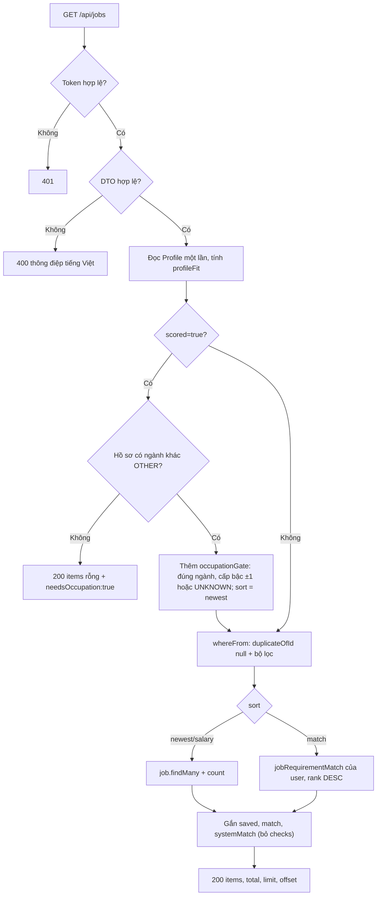
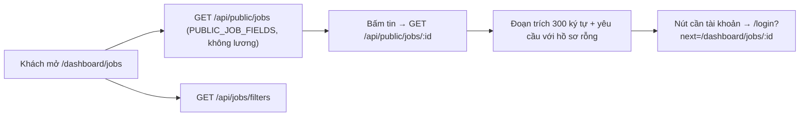
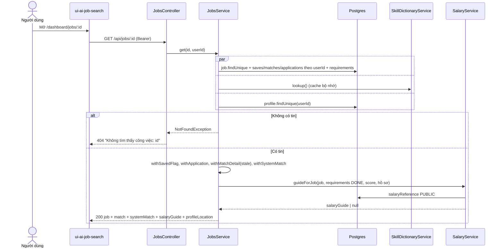
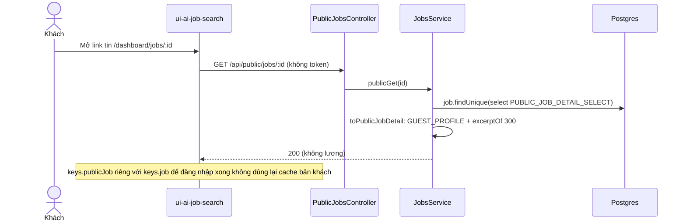
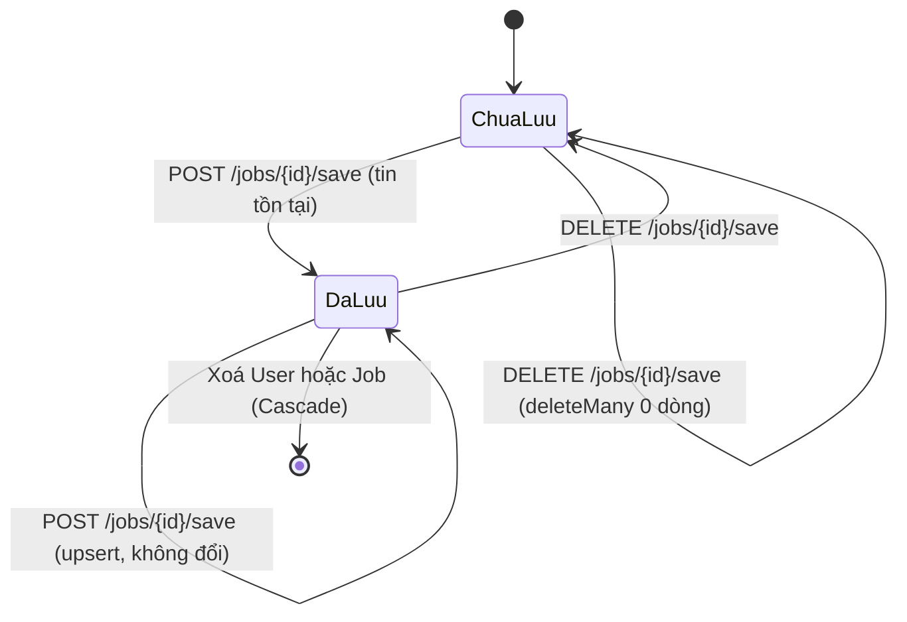

# Jobs — Kho tin tuyển dụng, lọc, xem chi tiết, lưu tin

> **Phạm vi:** `server/src/modules/jobs/**` (`jobs.controller.ts`, `public-jobs.controller.ts`, `jobs.service.ts`, `job.dto.ts`, `job-card.select.ts`, `utils/job-view.ts`, `utils/occupation-gate.ts`, `utils/public-job.ts`, `taxonomy/*`), bảng `Job`, `SavedJob`. Màn hình: `ui-ai-job-search` — `/dashboard/jobs` ("Việc làm phù hợp" khi `?scored=1`, "Tất cả việc làm" khi không), `/dashboard/jobs/[id]`, route cũ `/dashboard/jobs/all`, trang gốc `/`.
> **Nguyên tắc:** tài liệu mô tả hệ thống **as-is**. Code là nguồn sự thật duy nhất.

Phiên bản 1.0 — 2026-10-19.

## 1. Purpose

| Mục tiêu | Diễn giải |
|---|---|
| Kho tin dùng chung | `Job` là bảng **toàn cục**, không có `userId`: một tin quét về phục vụ mọi người dùng. Tin chỉ được GHI bởi module quét ([job-scraping.md](./job-scraping.md)) và bởi backfill taxonomy; module này chỉ ĐỌC và quản lý `SavedJob`. |
| Tìm và lọc tin | Danh sách có phân trang, tìm theo chữ (không dấu), lọc theo tỉnh, nhóm ngành, nghề con, hình thức làm việc, lương tối thiểu, số ngày đăng, đã lưu, đã ứng tuyển; sắp theo mới đăng / lương / điểm khớp. |
| "Việc làm phù hợp" | Cờ `scored=true` bật **cổng ngành + cấp bậc** (`occupationGate`): chỉ tin đúng nhóm ngành của hồ sơ, cấp bậc lệch tối đa một bậc ([ADR 0007](../../adr/0007-quet-tin-da-nganh.md)). |
| Chi tiết tin cho người dùng | Tin + trạng thái lưu + đơn ứng tuyển của chính người dùng + kết quả chấm AI (nếu có) + đối chiếu yêu cầu tính bằng code (`systemMatch`) + gợi ý lương (`salaryGuide`). |
| Trang công khai cho khách | `GET /public/jobs`, `GET /public/jobs/:id`: không token, ẩn lương, mô tả chỉ còn đoạn trích 300 ký tự ([ADR 0008](../../adr/0008-trang-viec-lam-cong-khai.md)). |
| Danh mục bộ lọc | Cây tỉnh/thành, nhóm ngành → nghề con kèm số tin, công khai. |
| Phân loại tin (taxonomy) | Bộ hàm thuần suy `provinceCode`, `occupationCode`, `subOccupationCode`, `searchText`, `dedupeKey` từ tiêu đề/công ty/địa điểm/thẻ/nhãn portal; dùng chung bởi scraper lúc ghi và bởi backfill. |

**Điểm mấu chốt:**
- **Đường đọc không gọi AI.** Danh sách và chi tiết chỉ chạy SQL + hàm thuần (`withSystemMatch` dùng `matchRequirements` thuộc `matching/rules`), điểm AI chỉ đọc lại từ `JobMatch` đã có.
- Danh sách luôn loại tin bản sao (`duplicateOfId: null`) — một tin đăng trên nhiều portal chỉ hiện một lần.
- Khách và người đăng nhập dùng **cùng URL, cùng component** phía FE; backend tách route riêng để danh sách trắng trường (`PUBLIC_JOB_FIELDS`) chặn rò lương.

## 2. Actors

| Actor | Quyền trong module | Ghi chú |
|---|---|---|
| Khách (chưa đăng nhập) | `GET /public/jobs`, `GET /public/jobs/:id`, `GET /jobs/filters` | Đếm throttle theo IP, 60 lượt/phút. Không thấy lương, không lưu tin, không lọc theo tài khoản. |
| USER (đã đăng nhập) | `GET /jobs`, `GET /jobs/:id`, `POST/DELETE /jobs/:id/save`, `GET /jobs/filters` | Mọi dữ liệu gắn tài khoản (lưu, đơn, điểm) khoá theo `userId` lấy từ JWT. |
| ADMIN | Như USER; thêm `POST /admin/jobs/backfill-taxonomy` (thuộc [admin-console.md](./admin-console.md)) | Route admin gọi `TaxonomyBackfillService` của module này. |
| Hệ thống — scraper | Gọi `derivedFields`, `dedupeKeyOf`, `resolve*` khi ghi tin | Xem [job-scraping.md](./job-scraping.md). |
| Hệ thống — module khác | `JobsService`/`TaxonomyBackfillService` được export; taxonomy (`occupations`, `sub-occupations`, `provinces`) được 5+ module đọc | Ví dụ profile, matching, salary, scraper, admin. |

## 3. Business Features

| # | Tính năng | Actor | Endpoint / cơ chế |
|---|---|---|---|
| F1 | Danh sách tin có lọc, tìm, sắp xếp, phân trang | USER | `GET /api/jobs` |
| F2 | "Việc làm phù hợp" (cổng ngành + cấp bậc) | USER | `GET /api/jobs?scored=true` |
| F3 | Danh mục bộ lọc kèm số tin | Khách, USER | `GET /api/jobs/filters` |
| F4 | Chi tiết tin cho người dùng | USER | `GET /api/jobs/:id` |
| F5 | Lưu / bỏ lưu tin | USER | `POST /api/jobs/:id/save`, `DELETE /api/jobs/:id/save` |
| F6 | Danh sách tin cho khách | Khách | `GET /api/public/jobs` |
| F7 | Chi tiết tin cho khách | Khách | `GET /api/public/jobs/:id` |
| F8 | Suy cột phân loại cho tin (taxonomy) | Hệ thống | `derivedFields()` trong `taxonomy/resolve.ts` |
| F9 | Tính lại phân loại cho tin cũ (backfill) | ADMIN | `TaxonomyBackfillService.run()` qua `POST /api/admin/jobs/backfill-taxonomy` |

## 4. Business Flow

### Luồng A — Danh sách tin (F1)

**Preconditions:** người dùng có access token hợp lệ (guard toàn cục `JwtAuthGuard`); query hợp lệ theo `ListJobsQueryDto`.

**Main Flow:**
1. FE gọi `GET /api/jobs?limit=20&offset=..&q=..&province=..&occupation=..&subOccupation=..&workMode=..&salaryMin=..&postedWithin=..&sort=..&saved=..&applied=..` ([jobs.controller.ts:32](../../../server/src/modules/jobs/jobs.controller.ts#L32)).
2. `ValidationPipe` toàn cục (`whitelist`, `forbidNonWhitelisted`, `transform`) kiểm DTO; tham số lạ hoặc sai kiểu → **400** (xem §8).
3. `JobsService.list` đọc hồ sơ MỘT lần (`profileOf`) rồi tính `fit = profileFit(profile)` ([jobs.service.ts:74](../../../server/src/modules/jobs/jobs.service.ts#L74)).
4. Dựng `where` bằng `whereFrom(query, userId, fit)` ([job-view.ts:179](../../../server/src/modules/jobs/utils/job-view.ts#L179)):
   - luôn `duplicateOfId: null`;
   - `q` → `normalizeText` (hạ thường, bỏ dấu) rồi `searchText LIKE %needle%` (index trigram); chuỗi chuẩn hoá rỗng thì bỏ qua bộ lọc;
   - `province` → `provinceCode IN`; `workMode` → `workMode IN`; `salaryMin` → `salaryMax >= salaryMin`; `postedWithin` → `postedAt >= now − N ngày`;
   - `occupation`/`subOccupation` → `occupationFacetWhere`: các mảng là phép HOẶC trong cùng loại; mã `<NHÓM>_OTHER` (nghề "Khác") dịch thành `occupationCode = NHÓM AND subOccupationCode IS NULL` ([job-view.ts:154](../../../server/src/modules/jobs/utils/job-view.ts#L154));
   - `saved=true` → `saves some {userId}`; `applied=true` → `applications some {userId}`;
   - các nhóm lọc khác nhau là phép VÀ.
5. Chọn thứ tự `listOrderFor(query)`: `scored=true` thì luôn `newest`, ngược lại `sort ?? 'newest'` ([job-view.ts:205](../../../server/src/modules/jobs/utils/job-view.ts#L205)).
6. Truy vấn song song:
   - `sort = newest|salary` → `job.findMany` + `job.count` (`byJobColumn`). `newest` = `postedAt DESC NULLS LAST, scrapedAt DESC, id DESC`; `salary` = `salaryMax DESC NULLS LAST, id DESC` ([job-view.ts:208](../../../server/src/modules/jobs/utils/job-view.ts#L208)).
   - `sort = match` → đọc từ `JobRequirementMatch` của chính user, sắp `rank DESC, met DESC, job.scrapedAt DESC, jobId DESC`; **chỉ tin đã có cặp đối chiếu** mới xuất hiện ([jobs.service.ts:123](../../../server/src/modules/jobs/jobs.service.ts#L123)).
   - `SkillDictionaryService.lookup()` (đọc `skill_aliases`, cache trong bộ nhớ).
7. Mỗi dòng được gắn: `saved` (bool), `match` (trạng thái/điểm/verdict của `JobMatch` của user), `systemMatch` (đối chiếu yêu cầu bằng code; bỏ mảng `checks` ở danh sách) — `withoutChecks(withSystemMatch(withMatchState(withSavedFlag(job))))`.
8. Trả **200** `{ items, total, limit, offset }` (`pageOf`). Danh sách KHÔNG chứa `description`.

**Alternative Flow:**
- A1. Người dùng chưa có hồ sơ → `profile = null` → `systemMatch: null` trên mọi thẻ ([job-view.ts:112](../../../server/src/modules/jobs/utils/job-view.ts#L112)).
- A2. Tin chưa rút xong yêu cầu (`JobRequirement.status ≠ DONE`) → `systemMatch.kind = 'KEYWORDS'`, đếm từ khoá kỹ năng hồ sơ trong tiêu đề + thẻ, `score: 0`, `eligibility: 'UNVERIFIED'` ([job-view.ts:135](../../../server/src/modules/jobs/utils/job-view.ts#L135)).
- A3. `scored=true` → xem Luồng B.

**Failure Flow:**
- F-A1. Không có token / token sai → **401** (guard toàn cục, ngoài module).
- F-A2. `offset > 2000`, `limit > 100`, `postedWithin ∉ {1,3,7,30}`, `sort ∉ {newest,salary,match}`, tham số không khai báo → **400** với thông điệp tiếng Việt từ `vietnameseValidationError`.

**Postconditions:** không ghi gì vào database.

### Luồng B — "Việc làm phù hợp" (F2)

**Preconditions:** như Luồng A, kèm `scored=true`.

**Main Flow:**
1. `profileFit`: ngành = `Profile.occupationCode`; cấp bậc = `Profile.experienceLevel` nếu khác `UNKNOWN`, ngược lại suy từ số năm kinh nghiệm (`seniorityFromYears`: \<1 FRESHER, \<3 JUNIOR, \<5 MIDDLE, \<8 SENIOR, còn lại LEAD) ([occupation-gate.ts:9](../../../server/src/modules/jobs/utils/occupation-gate.ts#L9), [seniority.ts:22](../../../server/src/modules/jobs/taxonomy/seniority.ts#L22)).
2. Nếu hồ sơ không có ngành hoặc ngành là `OTHER` (`needsOccupation`) → trả ngay **200** `{ items: [], total: 0, limit, offset, needsOccupation: true }`, không truy vấn tin ([jobs.service.ts:77](../../../server/src/modules/jobs/jobs.service.ts#L77)).
3. Ngược lại `occupationGate` thêm điều kiện `occupationCode = <ngành hồ sơ>`; nếu hồ sơ đã chọn nghề thì thêm `subOccupationCode IN (<các nghề đã chọn>) OR subOccupationCode IS NULL` — tin chưa rõ nghề vẫn hiện; nếu hồ sơ đã chọn nơi làm việc thì thêm `provinceCode IN (<các tỉnh đã chọn>, REMOTE) OR provinceCode IS NULL` *(2026-10-23)*; và, nếu xác định được cấp bậc, `requirements IS NULL OR requirements.seniority IN (bậc−1, bậc, bậc+1, UNKNOWN)` ([occupation-gate.ts:30](../../../server/src/modules/jobs/utils/occupation-gate.ts#L30), [seniority.ts:13](../../../server/src/modules/jobs/taxonomy/seniority.ts#L13)).
4. Bộ lọc ngành trên thanh lọc được **giao (AND)** với cổng chứ không thay cổng.
5. Thứ tự **luôn** `newest`; `sort` gửi lên bị bỏ qua (không 400).
6. Phần còn lại như Luồng A bước 6–8.

**Alternative Flow:** không xác định được cấp bậc (không có `experienceLevel`, không suy được số năm) → chỉ lọc ngành, không lọc cấp bậc.

**Failure Flow:** gửi `anyOccupation` hoặc tham số lạ khác → **400** "`anyOccupation` không phải là trường hợp lệ" (do `forbidNonWhitelisted`).

**Postconditions:** không ghi database.

### Luồng C — Danh mục bộ lọc (F3)

**Preconditions:** không cần token (`@Public()`); trong hạn 60 lượt/phút.

**Main Flow:**
1. `GET /api/jobs/filters` ([jobs.controller.ts:40-45](../../../server/src/modules/jobs/jobs.controller.ts#L40)).
2. Ba `groupBy` song song theo `provinceCode`, `occupationCode`, `subOccupationCode`, đều `where duplicateOfId IS NULL` ([jobs.service.ts:174](../../../server/src/modules/jobs/jobs.service.ts#L174)).
3. `filterTree` dựng: `provinces` (đủ 34 tỉnh/thành của `PROVINCES`, mục không có tin vẫn hiện với `count: 0`), `occupations` (19 nhóm của `OCCUPATIONS`, mỗi nhóm có `subs`; nếu nhóm có nghề con và còn tin chưa phân nghề thì thêm mục `<NHÓM>_OTHER` tên "Khác"), `remote` (`REMOTE`, "Làm việc từ xa") ([job-view.ts:221](../../../server/src/modules/jobs/utils/job-view.ts#L221)).
4. Trả **200**.

**Alternative Flow:** không có.
**Failure Flow:** vượt 60 lượt/phút → **429** (ThrottlerGuard).
**Postconditions:** không ghi database.

### Luồng D — Chi tiết tin cho người dùng (F4)

**Preconditions:** có token.

**Main Flow:**
1. `GET /api/jobs/:id` ([jobs.controller.ts:51](../../../server/src/modules/jobs/jobs.controller.ts#L51)).
2. Song song: `job.findUnique({ id })` kèm `saves`, `matches`, `applications` **lọc theo `userId`** và `requirements`; `dictionary.lookup()`; `profileOf(userId)` ([jobs.service.ts:196](../../../server/src/modules/jobs/jobs.service.ts#L196)).
3. Không thấy tin → **404** `Không tìm thấy công việc: <id>` ([jobs.service.ts:205](../../../server/src/modules/jobs/jobs.service.ts#L205)).
4. Gắn `saved`, `application` (đơn đầu tiên của user hoặc `null`), `match` (đủ trường điểm/nhận xét, `error` được thay bằng `failureKind` qua `withFailureKind`, cờ `stale = evaluatedAt < profile.updatedAt`) ([job-view.ts:77](../../../server/src/modules/jobs/utils/job-view.ts#L77)), `systemMatch` **có** `checks`.
5. Tính `salaryGuide` qua `SalaryService.guideForJob` (đọc bảng lương tham chiếu `PUBLIC`, không gọi AI) với `requirements` DONE, điểm `systemMatch` loại REQUIREMENTS, số năm kinh nghiệm và lương hiện tại/mong muốn của hồ sơ ([jobs.service.ts:217](../../../server/src/modules/jobs/jobs.service.ts#L217)).
6. Trả **200** gồm toàn bộ cột `Job` (kể cả `description`, lương) + các trường trên + `profileLocation`.

**Alternative Flow:** chưa có hồ sơ → `systemMatch: null`, `salaryGuide` tính với `profile = null`; chưa chấm AI → `match: null`.
**Failure Flow:** 401 (không token), 404 (tin không tồn tại).
**Postconditions:** không ghi database.

### Luồng E — Lưu / bỏ lưu tin (F5)

**Preconditions:** có token.

**Main Flow (lưu):**
1. `POST /api/jobs/:id/save` (HTTP 200) ([jobs.controller.ts:58](../../../server/src/modules/jobs/jobs.controller.ts#L58)).
2. Kiểm tin tồn tại; không có → **404** `Không tìm thấy công việc: <jobId>` ([jobs.service.ts:244](../../../server/src/modules/jobs/jobs.service.ts#L244)).
3. `savedJob.upsert({ where: { userId_jobId } , create, update: {} })` — idempotent, lưu lần hai không lỗi ([jobs.service.ts:246](../../../server/src/modules/jobs/jobs.service.ts#L246)).
4. Trả **200** `{ saved: true }`.

**Main Flow (bỏ lưu):**
1. `DELETE /api/jobs/:id/save` (HTTP 200).
2. `savedJob.deleteMany({ where: { userId, jobId } })` ([jobs.service.ts:253](../../../server/src/modules/jobs/jobs.service.ts#L253)).
3. Trả **200** `{ saved: false }`.

**Alternative Flow:** bỏ lưu một tin chưa lưu hoặc không tồn tại → vẫn **200** `{ saved: false }` (không 404).
**Failure Flow:** 401; 404 khi lưu tin không tồn tại. Hai request lưu đồng thời: unique `(userId, jobId)` + `upsert` bảo đảm chỉ một dòng.
**Postconditions:** có/không có một dòng `SavedJob(userId, jobId)`; FE cập nhật lạc quan rồi hoàn tác nếu lỗi ([jobs-view.tsx:160](../../../../ui-ai-job-search/app/dashboard/jobs/jobs-view.tsx#L160)).

### Luồng F — Danh sách tin cho khách (F6)

**Preconditions:** không cần token; ≤ 60 lượt/phút/IP.

**Main Flow:**
1. `GET /api/public/jobs?limit&offset&q&province&occupation&subOccupation&workMode&postedWithin` ([public-jobs.controller.ts:17](../../../server/src/modules/jobs/public-jobs.controller.ts#L17)).
2. `PublicJobsQueryDto` (`PickType` của `ListJobsQueryDto`) chỉ nhận 8 tham số trên; `saved`, `salaryMin`, `sort`, `scored`, `applied` → **400**.
3. `whereFrom(query, null)` (không cổng, không lọc tài khoản), thứ tự `newest` cố định, `select: PUBLIC_JOB_FIELDS` (không `salaryRaw/Min/Max`, `currency`, `externalId`, `description`) ([jobs.service.ts:148](../../../server/src/modules/jobs/jobs.service.ts#L148), [job-card.select.ts:30](../../../server/src/modules/jobs/job-card.select.ts#L30)).
4. Trả **200** `{ items, total, limit, offset }`.

**Alternative/Failure:** 400 khi gửi tham số ngoài danh sách trắng; 429 khi vượt hạn.
**Postconditions:** không ghi database.

### Luồng G — Chi tiết tin cho khách (F7)

**Preconditions:** không cần token.

**Main Flow:**
1. `GET /api/public/jobs/:id` ([public-jobs.controller.ts:27](../../../server/src/modules/jobs/public-jobs.controller.ts#L27)).
2. `job.findUnique` với `PUBLIC_JOB_DETAIL_SELECT` (= `PUBLIC_JOB_FIELDS` + `description` + `requirements`) và `dictionary.lookup()` ([jobs.service.ts:162](../../../server/src/modules/jobs/jobs.service.ts#L162)).
3. Không có → **404** `Không tìm thấy công việc: <id>`.
4. `toPublicJobDetail`: `systemMatch` dựng với `GUEST_PROFILE` (hồ sơ rỗng) để hiện đủ danh sách yêu cầu, mọi kỹ năng `met: false`; `description` thay bằng `excerptOf` — gộp khoảng trắng, cắt ở ranh giới từ ≤ 300 ký tự, thêm `…` ([public-job.ts:25-41](../../../server/src/modules/jobs/utils/public-job.ts#L25)).
5. Trả **200**; FE hiện link "Đọc tin đầy đủ" tới `url` gốc.

**Failure Flow:** 404, 429.
**Postconditions:** không ghi database.

### Luồng H — Suy cột phân loại (F8)

**Preconditions:** được gọi từ code ghi tin (scraper, backfill).

**Main Flow** (`derivedFields(title, company, location, tags, categories)` — [resolve.ts:131](../../../server/src/modules/jobs/taxonomy/resolve.ts#L131)):
1. `provinceCode = resolveProvince(location)`: chuẩn hoá không dấu, khớp alias dài nhất trước (34 tỉnh, gồm alias tỉnh cũ sáp nhập); không khớp thì thử gợi ý từ xa (`remote`, `lam viec tu xa`, `work from home`) → `REMOTE`; không được thì `null` ([resolve.ts:20](../../../server/src/modules/jobs/taxonomy/resolve.ts#L20)).
2. `occupationCode = resolveOccupation(title, tags, categories)` theo thứ tự: từ khoá chính trong tiêu đề → nhãn ngành của portal (`PORTAL_CATEGORY_OCCUPATION`, nhãn `null` thì xét nhãn sau) → từ khoá dự phòng trong tiêu đề → thẻ → `OTHER` (không bao giờ `null`). Từ khoá ≥ 4 ký tự không có dấu cách được khớp theo tiền tố của từ ([resolve.ts:37](../../../server/src/modules/jobs/taxonomy/resolve.ts#L37)).
3. `subOccupationCode = resolveSubOccupation(occupationCode, title, [...categories, ...tags])`: thử tiêu đề trước, rồi nhãn+thẻ; nhóm không có nghề con hoặc không khớp → `null` ([resolve.ts:108](../../../server/src/modules/jobs/taxonomy/resolve.ts#L108)).
4. `searchText = normalizeText(title + company + tags)`.
5. `dedupeKey = dedupeKeyOf(title, company, provinceCode)` = `"<công ty chuẩn hoá>|<chức danh đã bỏ nhiễu>|<tỉnh>"`; trả `null` nếu công ty trống/ẩn danh (`khong ro`, `cong ty bao mat`, `confidential`, `unknown`, `n a`) hoặc chức danh rỗng sau khi bỏ nhiễu (cụm "tuyển gấp", mức lương, tên tỉnh…) ([dedupe.ts:31-61](../../../server/src/modules/jobs/taxonomy/dedupe.ts#L31)).

**Postconditions:** hàm thuần, không I/O.

### Luồng I — Backfill taxonomy (F9)

**Preconditions:** ADMIN gọi `POST /api/admin/jobs/backfill-taxonomy[?all=true]` (route thuộc admin-console).

**Main Flow** ([backfill.service.ts:19](../../../server/src/modules/jobs/taxonomy/backfill.service.ts#L19)):
1. `all=false` (mặc định): chỉ tin `searchText IS NULL`; `all=true`: mọi tin.
2. Đọc lô 500 tin theo `id ASC`, với mỗi tin `job.update({ data: derivedFields(...) })` tuần tự; ghi log mỗi lô.
3. Trả `{ processed, missingProvince, missingDedupeKey }` (đếm tin còn `provinceCode`/`dedupeKey` null trên toàn bảng).

**Alternative Flow:** không có tin nào cần xử lý → `processed: 0`.
**Failure Flow:** lỗi DB giữa chừng → request lỗi 500, các lô trước đã ghi giữ nguyên (không transaction).
**Postconditions:** cột dẫn xuất được tính lại. Lưu ý: backfill **không** tính lại `duplicateOfId`.

## 5. Mermaid Flowchart

## 6. Sequence Diagram

## 7. Business Rules

| Mã BR | Quy tắc | Nơi thực thi | Mức | Nguồn code |
|---|---|---|---|---|
| BR-JOB-01 | Mọi danh sách và bộ đếm bộ lọc loại tin bản sao (`duplicateOfId IS NULL`). | SV | ✅ | [job-view.ts:193](../../../server/src/modules/jobs/utils/job-view.ts#L193), [jobs.service.ts:178](../../../server/src/modules/jobs/jobs.service.ts#L178) |
| BR-JOB-02 | Tìm kiếm chạy trên `searchText` đã hạ thường + bỏ dấu, nên gõ có dấu hay không dấu đều khớp, khớp cả tên công ty và thẻ; chuỗi chỉ toàn dấu câu không thành bộ lọc. | SV | ✅ | [job-view.ts:184](../../../server/src/modules/jobs/utils/job-view.ts#L184), [resolve.ts:122](../../../server/src/modules/jobs/taxonomy/resolve.ts#L122) |
| BR-JOB-03 | Nhiều giá trị trong cùng một bộ lọc là HOẶC; các bộ lọc khác nhau là VÀ. | SV | ✅ | [job-view.ts:179-203](../../../server/src/modules/jobs/utils/job-view.ts#L179) |
| BR-JOB-04 | Nghề "Khác" `<NHÓM>_OTHER` = tin thuộc nhóm nhưng chưa phân được nghề con (`subOccupationCode IS NULL`). Mục "Khác" chỉ hiện trong danh mục khi nhóm có nghề con và còn tin chưa phân nghề. | SV | ✅ | [job-view.ts:154-177](../../../server/src/modules/jobs/utils/job-view.ts#L154), [job-view.ts:249-266](../../../server/src/modules/jobs/utils/job-view.ts#L249) |
| BR-JOB-05 | Lọc lương tối thiểu: giữ tin có `salaryMax ≥ salaryMin`, hoặc tin chỉ ghi mức dưới (`salaryMax` null) có `salaryMin ≥ salaryMin` *(2026-10-19)*; tin không đọc được lương bị loại. | SV | ✅ | [job-view.ts:198](../../../server/src/modules/jobs/utils/job-view.ts#L198) |
| BR-JOB-06 | "Mới nhất" xếp theo ngày ĐĂNG `postedAt DESC NULLS LAST`, rồi `scrapedAt DESC`, `id DESC`; "Lương" xếp `salaryMax DESC NULLS LAST`. *(2026-10-16)* | SV | ✅ | [job-view.ts:208-217](../../../server/src/modules/jobs/utils/job-view.ts#L208) |
| BR-JOB-07 | `sort=match` chỉ trả tin đã có cặp `JobRequirementMatch` của chính người dùng, xếp theo `rank`, `met`. | SV | ✅ | [jobs.service.ts:123-146](../../../server/src/modules/jobs/jobs.service.ts#L123) |
| BR-JOB-08 | "Việc làm phù hợp" (`scored=true`): đúng MỘT nhóm ngành của hồ sơ; hồ sơ đã chọn nghề thì tin phải thuộc một trong các nghề đó hoặc chưa rõ nghề; hồ sơ đã chọn nơi làm việc thì tin phải ở một trong các tỉnh đó, làm từ xa, hoặc chưa rõ địa điểm *(2026-10-23)*; cấp bậc tin trong khoảng ±1 bậc của hồ sơ hoặc tin chưa rút yêu cầu / `seniority = UNKNOWN`. *(2026-10-08)* | SV | ✅ | [occupation-gate.ts:30-47](../../../server/src/modules/jobs/utils/occupation-gate.ts#L30) |
| BR-JOB-09 | Cấp bậc hồ sơ = `experienceLevel` người dùng chọn; nếu `UNKNOWN` thì suy từ số năm (\<1 FRESHER, \<3 JUNIOR, \<5 MIDDLE, \<8 SENIOR, ≥8 LEAD); không suy được thì không lọc cấp bậc. | SV | ✅ | [occupation-gate.ts:9-24](../../../server/src/modules/jobs/utils/occupation-gate.ts#L9), [seniority.ts:13-29](../../../server/src/modules/jobs/taxonomy/seniority.ts#L13) |
| BR-JOB-10 | Hồ sơ chưa có ngành hoặc ngành `OTHER` thì "Việc làm phù hợp" trả rỗng kèm `needsOccupation: true`. | SV | ✅ | [occupation-gate.ts:26](../../../server/src/modules/jobs/utils/occupation-gate.ts#L26), [jobs.service.ts:77-79](../../../server/src/modules/jobs/jobs.service.ts#L77) |
| BR-JOB-11 | Cổng không có lối thoát: bộ lọc ngành được giao với cổng; `sort` bị bỏ qua (luôn mới đăng trước) khi `scored=true`. | SV, DTO | ✅ | [job-view.ts:186-191](../../../server/src/modules/jobs/utils/job-view.ts#L186), [job-view.ts:205](../../../server/src/modules/jobs/utils/job-view.ts#L205) |
| BR-JOB-12 | Danh sách không trả `description` và không trả từng dòng đối chiếu `checks`; trang chi tiết thì có. | SV | ✅ | [job-card.select.ts:3-22](../../../server/src/modules/jobs/job-card.select.ts#L3), [job-view.ts:93-100](../../../server/src/modules/jobs/utils/job-view.ts#L93) |
| BR-JOB-13 | Khi tin chưa có `JobRequirement` DONE, mức khớp hệ thống rơi về đếm từ khoá (`kind: 'KEYWORDS'`, `score: 0`, `eligibility: 'UNVERIFIED'`) để giao diện không hiện như điểm thật. | SV | ✅ | [job-view.ts:103-152](../../../server/src/modules/jobs/utils/job-view.ts#L103) |
| BR-JOB-14 | Kết quả chấm AI trong chi tiết bị đánh dấu `stale` khi `evaluatedAt < Profile.updatedAt`; lỗi thô được thay bằng `failureKind`. | SV | ✅ | [job-view.ts:77-91](../../../server/src/modules/jobs/utils/job-view.ts#L77) |
| BR-JOB-15 | Chi tiết chỉ trả đơn ứng tuyển, lượt lưu và kết quả chấm của CHÍNH người dùng (`where: { userId }` trên quan hệ). | SV | ✅ | [jobs.service.ts:61-66](../../../server/src/modules/jobs/jobs.service.ts#L61) |
| BR-JOB-16 | Mỗi người lưu một tin tối đa một lần; lưu lặp là idempotent. | DB, SV | 🔒 | [schema.prisma:409](../../../server/prisma/schema.prisma#L409), [jobs.service.ts:246-250](../../../server/src/modules/jobs/jobs.service.ts#L246) |
| BR-JOB-17 | Lưu tin không tồn tại → 404; bỏ lưu luôn thành công (idempotent, không 404). | SV | ✅ | [jobs.service.ts:239-256](../../../server/src/modules/jobs/jobs.service.ts#L239) |
| BR-JOB-18 | Khách chỉ nhận các trường trong danh sách trắng `PUBLIC_JOB_FIELDS` — không lương, không `externalId`, không `currency`; trường mới thêm vào `Job` không tự lọt ra. | SV | ✅ | [job-card.select.ts:30-50](../../../server/src/modules/jobs/job-card.select.ts#L30) |
| BR-JOB-19 | Khách chỉ được lọc theo `limit, offset, q, province, occupation, subOccupation, workMode, postedWithin`; bộ lọc gắn tài khoản/lương/sort → 400. | DTO | ✅ | [job.dto.ts:88-97](../../../server/src/modules/jobs/job.dto.ts#L88) |
| BR-JOB-20 | Danh sách cho khách luôn xếp mới đăng trước và không đối chiếu hồ sơ. | SV | ✅ | [jobs.service.ts:148-160](../../../server/src/modules/jobs/jobs.service.ts#L148) |
| BR-JOB-21 | Khách chỉ thấy đoạn trích mô tả ≤ 300 ký tự, cắt ở ranh giới từ, kết thúc bằng `…`; yêu cầu tin hiện đủ nhưng đối chiếu với hồ sơ rỗng. | SV | ✅ | [public-job.ts:9-41](../../../server/src/modules/jobs/utils/public-job.ts#L9) |
| BR-JOB-22 | Route khách và danh mục bộ lọc giới hạn 60 lượt/phút (đếm theo IP khi chưa đăng nhập). | GD | ✅ | [public-jobs.controller.ts:10](../../../server/src/modules/jobs/public-jobs.controller.ts#L10), [jobs.controller.ts:41](../../../server/src/modules/jobs/jobs.controller.ts#L41) |
| BR-JOB-23 | Phân trang danh sách tin: `limit` 1–100 (mặc định 20), `offset` 0–2.000 (trần riêng của tin, chặt hơn trần chung 100.000). | DTO | ✅ | [job.dto.ts:19-31](../../../server/src/modules/jobs/job.dto.ts#L19), [pagination.dto.ts:4-23](../../../server/src/common/dto/pagination.dto.ts#L4) |
| BR-JOB-24 | Danh mục bộ lọc luôn liệt kê đủ 34 tỉnh/thành và 19 nhóm ngành kể cả khi `count = 0`, kèm mục "Làm việc từ xa" (`REMOTE`). | SV | ✅ | [job-view.ts:221-275](../../../server/src/modules/jobs/utils/job-view.ts#L221), [provinces.ts:119](../../../server/src/modules/jobs/taxonomy/provinces.ts#L119) |
| BR-JOB-25 | Tỉnh suy từ `location` bằng alias dài nhất trước; không suy được thì `null` và tin không xuất hiện khi lọc theo tỉnh (cố ý không đoán). | SV | ✅ | [resolve.ts:20-34](../../../server/src/modules/jobs/taxonomy/resolve.ts#L20) |
| BR-JOB-26 | Ngành suy theo thứ tự: từ khoá chính tiêu đề → nhãn portal → từ khoá dự phòng tiêu đề → thẻ → `OTHER`; "thương mại điện tử" đổi thành `ecommerce` trước khi so. | SV | ✅ | [resolve.ts:37-54](../../../server/src/modules/jobs/taxonomy/resolve.ts#L37) |
| BR-JOB-27 | Nghề con suy từ tiêu đề trước, rồi nhãn + thẻ; không đủ căn cứ thì `null`. | SV | ✅ | [resolve.ts:108-120](../../../server/src/modules/jobs/taxonomy/resolve.ts#L108) |
| BR-JOB-28 | Vân tay chống trùng = công ty chuẩn hoá + chức danh bỏ nhiễu + tỉnh; công ty ẩn danh/trống → `null` (tin coi như duy nhất). `dedupeKey` KHÔNG unique ở DB. | SV | ✅ | [dedupe.ts:17-61](../../../server/src/modules/jobs/taxonomy/dedupe.ts#L17), [schema.prisma:199](../../../server/prisma/schema.prisma#L199) |
| BR-JOB-29b | `derivedFields` đọc `salaryRaw` thành `salaryMin`/`salaryMax`/`currency = VND` (lương VND theo tháng: khoảng, "tới/lên đến" → chỉ trần, "từ/trên" → chỉ sàn); USD, lương tuần/giờ, chữ không đọc được → cả ba `null`. Đo trên DB dev: 1.869/1.980 chuỗi đọc được *(2026-10-19)*. | SV | ✅ | [salary.ts](../../../server/src/modules/jobs/taxonomy/salary.ts), [resolve.ts](../../../server/src/modules/jobs/taxonomy/resolve.ts) |
| BR-JOB-29 | Mọi đường ghi tin phải lấy trọn bộ cột dẫn xuất từ `derivedFields`. | SV | ✅ | [resolve.ts:130-157](../../../server/src/modules/jobs/taxonomy/resolve.ts#L130) |
| BR-JOB-30 | Backfill mặc định chỉ xử lý tin `searchText IS NULL`; `all=true` tính lại toàn bộ, lô 500, tuần tự. | SV | ✅ | [backfill.service.ts:5-63](../../../server/src/modules/jobs/taxonomy/backfill.service.ts#L5) |
| BR-JOB-31 | Một tin là duy nhất theo `(source, externalId)`. | DB | 🔒 | [schema.prisma:237](../../../server/prisma/schema.prisma#L237) |
| BR-JOB-32 | Khách bấm "Việc làm phù hợp" bị chặn ở FE với lời mời đăng nhập; mọi nút, mục sidebar và thẻ hành động cần tài khoản mở modal đăng nhập/đăng ký ngay trên trang (không chuyển sang `/login`), đăng nhập xong nạp lại đúng trang hoặc tới mục đã bấm. *(2026-10-23)* | FE | ⚠️ | [jobs-view.tsx:183-197](../../../../ui-ai-job-search/app/dashboard/jobs/jobs-view.tsx#L183), [login-modal.tsx](../../../../ui-ai-job-search/components/auth/login-modal.tsx), [use-login-modal.ts](../../../../ui-ai-job-search/hooks/use-login-modal.ts) |

> **Possible Business Rule:** Chi tiết tin (`GET /jobs/:id`, `GET /public/jobs/:id`) KHÔNG loại tin bản sao — mở trực tiếp id của một bản sao vẫn được. Có thể là cố ý (giữ link cũ còn sống), cần chủ dự án xác nhận.

> **Possible Business Rule:** Không có cơ chế hết hạn/xoá tin: tin quét về nằm trong danh sách mãi mãi, chỉ bộ lọc `postedWithin` thu hẹp theo ngày đăng. Cần xác nhận đây là chủ đích (xem R2).

## 8. Validation Rules

### `ListJobsQueryDto` (`GET /api/jobs`) — [job.dto.ts](../../../server/src/modules/jobs/job.dto.ts)

| Field | Ràng buộc | DTO/Schema | Lỗi trả về |
|---|---|---|---|
| `limit` | tuỳ chọn, số nguyên, 1–100 | `PaginationQueryDto` | 400 "Số dòng mỗi trang không được lớn hơn 100" / "… không được nhỏ hơn 1" |
| `offset` | tuỳ chọn, số nguyên, ≥ 0, ≤ 2.000 (`MAX_JOB_OFFSET`) và ≤ 100.000 | `ListJobsQueryDto` + `PaginationQueryDto` | 400 "Vị trí bắt đầu không được lớn hơn 2.000" |
| `q` | tuỳ chọn, chuỗi, ≤ 200 ký tự | `@IsString @MaxLength(200)` | 400 "Từ khoá tìm kiếm không được dài quá 200 ký tự" |
| `province` | chuỗi hoặc mảng → mảng chuỗi, ≤ 40 mục | `@Transform(toArray) @ArrayMaxSize(40)` | 400 "province không được có quá 40 mục" |
| `occupation` | mảng chuỗi ≤ 30 mục | `@ArrayMaxSize(30)` | 400 "occupation không được có quá 30 mục" |
| `subOccupation` | mảng chuỗi ≤ 30 mục | `@ArrayMaxSize(30)` | 400 tương tự |
| `workMode` | mảng chuỗi ≤ 10 mục | `@ArrayMaxSize(10)` | 400 tương tự |
| `salaryMin` | số nguyên ≥ 0 | `@IsInt @Min(0)` | 400 "salaryMin phải là số nguyên" |
| `postedWithin` | ∈ \{1, 3, 7, 30\} | `@IsIn(POSTED_WINDOWS)` | 400 "postedWithin chỉ nhận một trong các giá trị: 1, 3, 7, 30" |
| `sort` | ∈ \{`newest`, `salary`, `match`\} | `@IsIn(JOB_SORTS)` | 400 "sort chỉ nhận một trong các giá trị: newest, salary, match" |
| `scored`, `saved`, `applied` | `'true'`/`true` → true, mọi giá trị khác → false | `@Transform @IsBoolean` | Không bao giờ 400 vì transform luôn ra boolean |
| (tham số khác) | bị cấm | `forbidNonWhitelisted` | 400 "`<tên>` không phải là trường hợp lệ" |

Ghi chú: mã tỉnh/ngành/nghề KHÔNG được kiểm theo danh mục — mã lạ không 400 mà trả danh sách rỗng (e2e "mã nghề không có thật thì trả rỗng").

### `PublicJobsQueryDto` (`GET /api/public/jobs`)

| Field | Ràng buộc | DTO/Schema | Lỗi trả về |
|---|---|---|---|
| `limit, offset, q, province, occupation, subOccupation, workMode, postedWithin` | như `ListJobsQueryDto` | `PickType(ListJobsQueryDto, [...])` | như trên |
| `saved, applied, scored, salaryMin, sort` | không được gửi | `forbidNonWhitelisted` | 400 "`<tên>` không phải là trường hợp lệ" |

### Tham số đường dẫn `:id`

| Field | Ràng buộc | DTO/Schema | Lỗi trả về |
|---|---|---|---|
| `id` | chuỗi bất kỳ, không kiểm định dạng | — | 404 `Không tìm thấy công việc: <id>` nếu không có |

## 9. API Mapping

| Method | URL | Role | Mục đích nghiệp vụ | Controller#method | Service | DTO | Response |
|---|---|---|---|---|---|---|---|
| GET | `/api/jobs` | USER | Danh sách tin, "Việc làm phù hợp" khi `scored=true` | `JobsController#list` | `JobsService.list` | `ListJobsQueryDto` | `{items, total, limit, offset, needsOccupation?}` |
| GET | `/api/jobs/filters` | Public (60/phút) | Danh mục bộ lọc kèm số tin | `JobsController#filters` | `JobsService.filters` | — | `{provinces[], occupations[{subs[]}], remote}` |
| GET | `/api/jobs/:id` | USER | Chi tiết tin + đơn, điểm, đối chiếu, gợi ý lương | `JobsController#get` | `JobsService.get` | — | Job đầy đủ + `saved, application, match, systemMatch, salaryGuide, profileLocation` |
| POST | `/api/jobs/:id/save` | USER | Lưu tin (200) | `JobsController#save` | `JobsService.save` | — | `{saved: true}` |
| DELETE | `/api/jobs/:id/save` | USER | Bỏ lưu tin (200) | `JobsController#unsave` | `JobsService.unsave` | — | `{saved: false}` |
| GET | `/api/public/jobs` | Public (60/phút) | Danh sách cho khách, không lương | `PublicJobsController#list` | `JobsService.publicList` | `PublicJobsQueryDto` | `{items, total, limit, offset}` |
| GET | `/api/public/jobs/:id` | Public (60/phút) | Chi tiết cho khách, đoạn trích | `PublicJobsController#get` | `JobsService.publicGet` | — | `PUBLIC_JOB_DETAIL` + `systemMatch` |

**Endpoint ở module khác tác động lên module này**

| Method | URL | Module | Tác động |
|---|---|---|---|
| POST | `/api/admin/jobs/backfill-taxonomy?all=` | [admin-console.md](./admin-console.md) | Gọi `TaxonomyBackfillService.run` — ghi lại cột dẫn xuất của `Job` ([admin.controller.ts:121](../../../server/src/modules/admin/controllers/admin.controller.ts#L121)) |
| GET | `/api/admin/jobs`, `/api/admin/jobs/sources`, `/api/admin/jobs/:id` | [admin-console.md](./admin-console.md) | Đọc `Job` cho console quản trị ([admin-jobs.controller.ts:23](../../../server/src/modules/admin/controllers/admin-jobs.controller.ts#L23)) |
| POST | `/api/scrape`, `/api/admin/scrape/run-now` (+ cron 23:00) | [job-scraping.md](./job-scraping.md) | Tạo/cập nhật `Job` qua `JobWriter` |
| (queue) | `job.requirements`, `match.*` | [matching.md](./matching.md) | Tạo `JobRequirement`, `JobMatch`, `JobRequirementMatch` mà danh sách/chi tiết đọc |
| GET | `/api/companies/brief/by-job/:id` | [company-research.md](./company-research.md) | Đọc tin để tìm bản tìm hiểu công ty (công khai) |
| POST | `/api/applications` … | [applications.md](./applications.md) | Tạo `Application` — nguồn cho bộ lọc `applied` và trường `application` |

## 10. Frontend Mapping

| Route FE | Vai trò | Mục đích | Hook / API client |
|---|---|---|---|
| `/` ([page.tsx](../../../../ui-ai-job-search/app/page.tsx)) | Mọi người | Chuyển thẳng sang `/dashboard`; khách không có trang chủ công khai (bị đẩy về đăng nhập vì `/dashboard` không thuộc `isGuestPath`) | — |
| `/dashboard/jobs?scored=1` "Việc làm phù hợp" ([jobs-view.tsx](../../../../ui-ai-job-search/app/dashboard/jobs/jobs-view.tsx)) | USER | Cổng ngành + kinh nghiệm; nhãn "Mới đăng trước", không ô sắp xếp; `needsOccupation` → EmptyState dẫn về Tổng quan | `useApiQuery(keys.jobList)` → `jobsService.list` |
| `/dashboard/jobs` "Tất cả việc làm" | USER, Khách | Danh sách + panel chi tiết `?job=<id>`; USER có ô "Sắp xếp" (Mới nhất / Lương cao nhất / "Điểm AI Match"), khách chỉ "Mới nhất" | `jobsService.list` (USER) / `jobsService.publicList` (khách, `keys.publicJobList`); bộ lọc `jobsService.filters` |
| Thanh lọc ([job-filter-bar.tsx](../../../../ui-ai-job-search/app/dashboard/jobs/job-filter-bar.tsx)) | USER, Khách | Ẩn lọc lương/đã lưu/đã ứng tuyển với khách | `useSession()` |
| `/dashboard/jobs/[id]` ([page.tsx](../../../../ui-ai-job-search/app/dashboard/jobs/%5Bid%5D/page.tsx), [job-detail-view.tsx](../../../../ui-ai-job-search/app/dashboard/jobs/%5Bid%5D/job-detail-view.tsx)) | USER, Khách | Trang chi tiết; server component lấy metadata OG từ `/public/jobs/:id`, `noindex, nofollow` | `useJobDetail` ([use-job-detail.ts](../../../../ui-ai-job-search/hooks/use-job-detail.ts)) — USER: `jobsService.get` khoá `keys.job`; khách: `jobsService.publicGet` khoá `keys.publicJob` |
| `/dashboard/jobs/all` ([page.tsx](../../../../ui-ai-job-search/app/dashboard/jobs/all/page.tsx)) | — | Route cũ, `redirect("/dashboard/jobs")` | — |
| Nút lưu trên thẻ / chi tiết ([job-row.tsx](../../../../ui-ai-job-search/app/dashboard/jobs/job-row.tsx)) | USER | Lưu / bỏ lưu, cập nhật lạc quan | `jobsService.save/unsave`, `afterSaveJob` ([job-cache.ts](../../../../ui-ai-job-search/lib/job-cache.ts)) |
| Chọn tin khi viết CV/thư | USER | Danh sách tin để chọn; tin cố định đọc chung cache chi tiết | `useJobOptions` ([use-job-options.ts](../../../../ui-ai-job-search/hooks/use-job-options.ts)) → `useJobDetail` + `matchesService.list` |
| Metadata tin ([job-metadata.ts](../../../../ui-ai-job-search/lib/job-metadata.ts)) | Server Next | `og:title` "\<tin\> — \<công ty\>", revalidate 300s, timeout 3s | `fetch /api/public/jobs/:id` |

API client: [services/jobs.ts](../../../../ui-ai-job-search/services/jobs.ts). Quyền khách theo đường dẫn: [lib/public-job.ts](../../../../ui-ai-job-search/lib/public-job.ts) (`isGuestPath`, `portalName`, `loginPathForJob`), dùng trong `providers/session-provider.tsx`.

## 11. Database

### `jobs` (model `Job`, [schema.prisma:161](../../../server/prisma/schema.prisma#L161))

| Field | Kiểu | Ghi chú |
|---|---|---|
| `id` | String cuid | PK |
| `externalId` | String? | Id gốc trên portal |
| `source` | String | Khoá portal (`itviec`, `topcv`…) |
| `url`, `title`, `company`, `companyLogo?` | String | Hiển thị; `company` mặc định "Không rõ" khi portal không trả |
| `location?`, `workMode?` | String | Nguồn sự thật địa điểm/hình thức |
| `provinceCode?`, `occupationCode?`, `subOccupationCode?`, `searchText?`, `dedupeKey?` | String | Cột DẪN XUẤT từ `derivedFields` |
| `duplicateOfId?` | String → `Job` | Trỏ về bản gốc; `onDelete: SetNull` |
| `salaryRaw?`, `salaryMin?`, `salaryMax?`, `currency?` | | `salaryMin/Max` hiện không được đường ghi nào điền (R1) |
| `tags[]`, `categories[]` | String[] | `categories` = nhãn ngành của portal |
| `description` | Text | Toàn văn mô tả |
| `postedAt?`, `scrapedAt` | DateTime | `scrapedAt` mặc định `now()` |

Ràng buộc / index ([schema.prisma:237-254](../../../server/prisma/schema.prisma#L237)): `@@unique([source, externalId])`; `@@index([scrapedAt DESC, id DESC])`; `@@index([provinceCode, scrapedAt DESC, id DESC])`; `@@index([occupationCode, …])`; `@@index([subOccupationCode, …])`; `@@index([postedAt])`; `@@index([dedupeKey])`; `@@index([duplicateOfId])`; `@@index([salaryMax DESC])`; GIN `gin_trgm_ops` trên `searchText`. Không có `@@unique` trên `dedupeKey` (cố ý).

Quan hệ con: `matches` (JobMatch), `skillMatches` (JobRequirementMatch), `saves` (SavedJob), `interviewPreps`, `interviewAnswers`, `documents`, `applications`, `agentRuns`, `requirements` (JobRequirement 1-1).

### `saved_jobs` (model `SavedJob`, [schema.prisma:400](../../../server/prisma/schema.prisma#L400))

| Field | Kiểu | Ghi chú |
|---|---|---|
| `id` | String cuid | PK |
| `userId` | String → User | `onDelete: Cascade` |
| `jobId` | String → Job | `onDelete: Cascade` |
| `savedAt` | DateTime | `now()` |

`@@unique([userId, jobId])`, `@@index([jobId])`.

### Enum dùng trong module

`JobSeniority` ([schema.prisma:330](../../../server/prisma/schema.prisma#L330)): `INTERN, FRESHER, JUNIOR, MIDDLE, SENIOR, LEAD, UNKNOWN` — đọc từ `Profile.experienceLevel` và `JobRequirement.seniority` cho cổng cấp bậc.

## 12. State Machine

Module không sở hữu field trạng thái nào: `Job` không có cột `status`, `SavedJob` chỉ tồn tại/không tồn tại. Trạng thái "đã lưu" là sự tồn tại của một dòng:

| Từ | Sang | Trigger | Điều kiện |
|---|---|---|---|
| Chưa lưu | Đã lưu | `POST /api/jobs/:id/save` | Tin tồn tại, có token |
| Đã lưu | Đã lưu | `POST /api/jobs/:id/save` | Idempotent |
| Đã lưu | Chưa lưu | `DELETE /api/jobs/:id/save` | Có token |
| Đã lưu | (xoá) | Xoá `User`/`Job` | `onDelete: Cascade` |

`JobMatch.status`, `JobRequirement.status` (`MatchStatus`) chỉ được đọc ở đây — vòng đời của chúng ở [matching.md](./matching.md).

## 13. Exceptions

| Tình huống | HTTP | Thông điệp nguyên văn | Nguồn |
|---|---|---|---|
| Chi tiết tin không tồn tại (USER) | 404 | `Không tìm thấy công việc: ${id}` | [jobs.service.ts:205](../../../server/src/modules/jobs/jobs.service.ts#L205) |
| Chi tiết tin không tồn tại (khách) | 404 | `Không tìm thấy công việc: ${id}` | [jobs.service.ts:170](../../../server/src/modules/jobs/jobs.service.ts#L170) |
| Lưu tin không tồn tại | 404 | `Không tìm thấy công việc: ${jobId}` | [jobs.service.ts:244](../../../server/src/modules/jobs/jobs.service.ts#L244) |
| Tham số query sai / lạ | 400 | Danh sách thông điệp tiếng Việt, ví dụ `<Nhãn> không phải là trường hợp lệ`, `Vị trí bắt đầu không được lớn hơn 2.000` | [validation-message.ts](../../../server/src/common/validation-message.ts), [bootstrap.ts:47](../../../server/src/bootstrap.ts#L47) |
| Gọi route USER không token | 401 | (guard toàn cục, xem [auth.md](./auth.md)) | `JwtAuthGuard` |
| Vượt 60 lượt/phút ở route công khai | 429 | (mặc định `@nestjs/throttler`) | [public-jobs.controller.ts:10](../../../server/src/modules/jobs/public-jobs.controller.ts#L10) |

## 14. Notifications

Không có. Module chỉ đọc dữ liệu và ghi `SavedJob`; không phát email, push hay sự kiện nào.

## 15. Integrations

| Tích hợp | Hướng | Mô tả |
|---|---|---|
| `matching` (`SkillDictionaryService`, `rules/requirement-match`, `rules/staleness`, `ai/utils/requirements`) | Gọi ra | Đối chiếu yêu cầu tin với hồ sơ bằng code (không gọi model); `lookup()` đọc `skill_aliases` có cache bộ nhớ |
| `salary` (`SalaryService.guideForJob`) | Gọi ra | Gợi ý khoảng lương đàm phán từ bảng tham chiếu công khai |
| `profile/utils/experience-years` | Gọi ra | Số năm kinh nghiệm từ `Profile.experiences` |
| `common/ai/failure-view` | Gọi ra | Ẩn lỗi thô của lượt chấm AI, chỉ trả `failureKind` |
| `scraper` | Được gọi | Dùng `derivedFields`, `dedupeKeyOf`, `resolveProvince/Occupation/SubOccupation` khi ghi tin |
| `admin` | Được gọi | `TaxonomyBackfillService` |
| Next.js server (OG metadata) | Được gọi | `fetch /api/public/jobs/:id` từ server component |

Không có dịch vụ ngoài, không biến môi trường riêng của module.

## 16. Security

- **Phân quyền:** `JwtAuthGuard` toàn cục mặc-định-đóng; `@Public()` mở đúng 3 route: `GET /jobs/filters`, `GET /public/jobs`, `GET /public/jobs/:id`. Không route nào của module gọi model.
- **Kiểm sở hữu:** dữ liệu gắn tài khoản lấy qua quan hệ có `where: { userId }` (`saves`, `matches`, `applications`, `JobRequirementMatch`), `userId` lấy từ JWT, không nhận từ client. Ghi `SavedJob` luôn kèm `userId` trong khoá (`userId_jobId`, `deleteMany({ userId, jobId })`). `Job` là dữ liệu chung nên không kiểm sở hữu.
- **Rate limit:** route công khai 60 lượt/phút (khách đếm theo IP, người đăng nhập đếm theo `user:<id>` — `throttleTracker`); các route còn lại theo trần chung 120/phút (`THROTTLE_LIMIT`).
- **Dữ liệu nhạy cảm / điều khoản:** khách không thấy lương và chỉ thấy đoạn trích mô tả (ADR 0006, 0008); FE đặt `noindex, nofollow` cho trang việc làm. Người đăng nhập nhận toàn văn mô tả.
- **Chống quét sâu:** `offset ≤ 2.000`, `limit ≤ 100`; mảng lọc có `@ArrayMaxSize`; `q ≤ 200` ký tự.

## 17. ⚠️ Sai lệch / Rủi ro nghiệp vụ

**R1 — Bộ lọc "lương tối thiểu" và sắp xếp "Lương cao nhất" không có dữ liệu để chạy.**
- ✅ **Đã sửa 2026-10-19:** thêm `parseSalary` vào `derivedFields` (BR-JOB-29b), bộ lọc giữ tin chỉ có mức dưới (BR-JOB-05). Tin đã có trong DB cần chạy `POST /api/admin/jobs/backfill-taxonomy?all=true` một lần. Test: [salary.spec.ts](../../../server/test/unit/modules/jobs/taxonomy/salary.spec.ts), e2e `lọc lương giữ cả tin chỉ ghi mức dưới` trong [jobs-filter.e2e-spec.ts](../../../server/test/jobs-filter.e2e-spec.ts).
- Mô tả: `salaryMin`/`salaryMax` không được bất kỳ đường ghi nào trong `server/src` điền — `JobWriter` chỉ ghi `salaryRaw`. Bộ lọc `salaryMin` so với `salaryMax` nên mọi tin bị loại; `sort=salary` thực chất là `id DESC`. FE vẫn hiện cả hai cho người dùng.
- Bằng chứng: [job-view.ts:198](../../../server/src/modules/jobs/utils/job-view.ts#L198), [job-view.ts:209-210](../../../server/src/modules/jobs/utils/job-view.ts#L209), [job-writer.service.ts:115-141](../../../server/src/modules/scraper/services/job-writer.service.ts#L115) (chỉ `salaryRaw`), [jobs-view.tsx:28-32](../../../../ui-ai-job-search/app/dashboard/jobs/jobs-view.tsx#L28); ADR 0005 xác nhận "Lương dạng số đang TRỐNG ở mọi portal quét".
- Tác động: người dùng chọn "Từ 15 triệu" nhận 0 tin; "Lương cao nhất" ra thứ tự ngẫu nhiên theo id — trông như lỗi hệ thống. `salaryGuide` cũng mất đầu vào `postedMin/Max`.
- Đề xuất: parse `salaryRaw` → `salaryMin/Max/currency` trong `derivedFields`/`JobWriter` + backfill; hoặc ẩn bộ lọc lương và sắp xếp lương ở FE tới khi có dữ liệu.
- Mức đề xuất: 🟠

**R2 — Tin không bao giờ hết hạn.**
- Mô tả: không có lệnh xoá/ẩn `Job` nào trong `server/src` hay `scripts/`; danh sách mặc định không lọc theo tuổi tin, nên tin đã đóng tuyển vẫn nằm trong "Tất cả việc làm" và "Việc làm phù hợp" vô thời hạn (chỉ bị đẩy xuống theo `postedAt`).
- Bằng chứng: [job-view.ts:192-202](../../../server/src/modules/jobs/utils/job-view.ts#L192) (không điều kiện tuổi trừ khi gửi `postedWithin`); grep `job.delete|job.deleteMany` trên `server/src`, `scripts/` không có kết quả.
- Tác động: người dùng ứng tuyển tin đã đóng; kho phình dần.
- Đề xuất: xác nhận chính sách (Possible BR ở §7); nếu cần, ẩn tin `postedAt` quá N ngày ở danh sách mặc định hoặc thêm cột hết hạn.
- Mức đề xuất: 🟡

**R3 — Nhãn sắp xếp "Điểm AI Match" không phải điểm AI.**
- Mô tả: `sort=match` xếp theo `JobRequirementMatch.rank` do code tính (`matching/rules`), không theo `JobMatch.overallScore` của model.
- Bằng chứng: [jobs-view.tsx:31](../../../../ui-ai-job-search/app/dashboard/jobs/jobs-view.tsx#L31), [jobs.service.ts:131-139](../../../server/src/modules/jobs/jobs.service.ts#L131).
- Tác động: người dùng hiểu sai ý nghĩa thứ tự; tin đã chấm AI cao chưa chắc đứng đầu.
- Đề xuất: đổi nhãn (ví dụ "Khớp yêu cầu") hoặc ghi chú rõ.
- Mức đề xuất: 🟢

**R4 — Tên portal "timviec" chưa có trong bảng tên hiển thị FE.**
- Mô tả: `PORTAL_NAMES` có 10 portal, thiếu `timviec` (thêm 2026-10-17), nên link "Đọc tin đầy đủ trên …" hiện khoá thô `timviec`.
- Bằng chứng: [public-job.ts:1-12](../../../../ui-ai-job-search/lib/public-job.ts#L1); portal `timviec-search` có trong `.agents/skills/`.
- Tác động: hiển thị kém chuyên nghiệp.
- Đề xuất: thêm `timviec: "timviec.ai"`.
- Mức đề xuất: 🟢

**R5 — Backfill taxonomy chạy đồng bộ trong một HTTP request, không transaction.**
- Mô tả: `run(all=true)` cập nhật từng tin tuần tự (lô 500) ngay trong request admin; không tính lại `duplicateOfId`.
- Bằng chứng: [backfill.service.ts:19-63](../../../server/src/modules/jobs/taxonomy/backfill.service.ts#L19).
- Tác động: ở cỡ kho hiện tại (~3.500–4.000 tin) chấp nhận được; khi kho lớn có thể chạm `server.setTimeout` 5 phút và request bị cắt giữa chừng (dữ liệu đã ghi vẫn giữ). Chưa đo — chưa phải lỗi hiện hành.
- Đề xuất: ghi ngưỡng vào ADR, chuyển sang hàng đợi khi gần ngưỡng.
- Mức đề xuất: 🟢

## 18. Source References

**Backend**
- [jobs.controller.ts](../../../server/src/modules/jobs/jobs.controller.ts)
- [public-jobs.controller.ts](../../../server/src/modules/jobs/public-jobs.controller.ts)
- [jobs.service.ts](../../../server/src/modules/jobs/jobs.service.ts)
- [job.dto.ts](../../../server/src/modules/jobs/job.dto.ts)
- [jobs.module.ts](../../../server/src/modules/jobs/jobs.module.ts)
- [jobs.types.ts](../../../server/src/modules/jobs/jobs.types.ts)
- [job-card.select.ts](../../../server/src/modules/jobs/job-card.select.ts)
- [utils/job-view.ts](../../../server/src/modules/jobs/utils/job-view.ts)
- [utils/occupation-gate.ts](../../../server/src/modules/jobs/utils/occupation-gate.ts)
- [utils/public-job.ts](../../../server/src/modules/jobs/utils/public-job.ts)
- [taxonomy/resolve.ts](../../../server/src/modules/jobs/taxonomy/resolve.ts)
- [taxonomy/dedupe.ts](../../../server/src/modules/jobs/taxonomy/dedupe.ts)
- [taxonomy/seniority.ts](../../../server/src/modules/jobs/taxonomy/seniority.ts)
- [taxonomy/occupations.ts](../../../server/src/modules/jobs/taxonomy/occupations.ts)
- [taxonomy/sub-occupations.ts](../../../server/src/modules/jobs/taxonomy/sub-occupations.ts)
- [taxonomy/provinces.ts](../../../server/src/modules/jobs/taxonomy/provinces.ts)
- [taxonomy/portal-categories.ts](../../../server/src/modules/jobs/taxonomy/portal-categories.ts)
- [taxonomy/backfill.service.ts](../../../server/src/modules/jobs/taxonomy/backfill.service.ts)
- [common/pagination.ts](../../../server/src/common/pagination.ts), [common/dto/pagination.dto.ts](../../../server/src/common/dto/pagination.dto.ts)
- [common/validation-message.ts](../../../server/src/common/validation-message.ts), [bootstrap.ts](../../../server/src/bootstrap.ts)
- [common/guards/user-throttler.guard.ts](../../../server/src/common/guards/user-throttler.guard.ts)
- [modules/admin/controllers/admin.controller.ts](../../../server/src/modules/admin/controllers/admin.controller.ts)
- [modules/salary/salary.service.ts](../../../server/src/modules/salary/salary.service.ts)
- [prisma/schema.prisma](../../../server/prisma/schema.prisma)
- Test: [jobs-filter.e2e-spec.ts](../../../server/test/jobs-filter.e2e-spec.ts), [public-jobs.e2e-spec.ts](../../../server/test/public-jobs.e2e-spec.ts), [pagination.e2e-spec.ts](../../../server/test/pagination.e2e-spec.ts), [security.e2e-spec.ts](../../../server/test/security.e2e-spec.ts)
- ADR: [0007](../../adr/0007-quet-tin-da-nganh.md), [0008](../../adr/0008-trang-viec-lam-cong-khai.md), [0006](../../adr/0006-dieu-khoan-portal.md), [0005](../../adr/0005-nguon-tin-portal.md)

**Frontend (ui-ai-job-search)**
- [app/page.tsx](../../../../ui-ai-job-search/app/page.tsx)
- [app/dashboard/jobs/page.tsx](../../../../ui-ai-job-search/app/dashboard/jobs/page.tsx), [jobs-view.tsx](../../../../ui-ai-job-search/app/dashboard/jobs/jobs-view.tsx), [job-filter-bar.tsx](../../../../ui-ai-job-search/app/dashboard/jobs/job-filter-bar.tsx), [job-row.tsx](../../../../ui-ai-job-search/app/dashboard/jobs/job-row.tsx)
- [app/dashboard/jobs/all/page.tsx](../../../../ui-ai-job-search/app/dashboard/jobs/all/page.tsx)
- [app/dashboard/jobs/[id]/page.tsx](../../../../ui-ai-job-search/app/dashboard/jobs/%5Bid%5D/page.tsx), [job-detail-view.tsx](../../../../ui-ai-job-search/app/dashboard/jobs/%5Bid%5D/job-detail-view.tsx)
- [services/jobs.ts](../../../../ui-ai-job-search/services/jobs.ts)
- [hooks/use-job-detail.ts](../../../../ui-ai-job-search/hooks/use-job-detail.ts), [hooks/use-job-options.ts](../../../../ui-ai-job-search/hooks/use-job-options.ts)
- [lib/public-job.ts](../../../../ui-ai-job-search/lib/public-job.ts), [lib/job-metadata.ts](../../../../ui-ai-job-search/lib/job-metadata.ts), [lib/job-cache.ts](../../../../ui-ai-job-search/lib/job-cache.ts)
- [components/layout/nav-items.ts](../../../../ui-ai-job-search/components/layout/nav-items.ts)
- [providers/session-provider.tsx](../../../../ui-ai-job-search/providers/session-provider.tsx)
