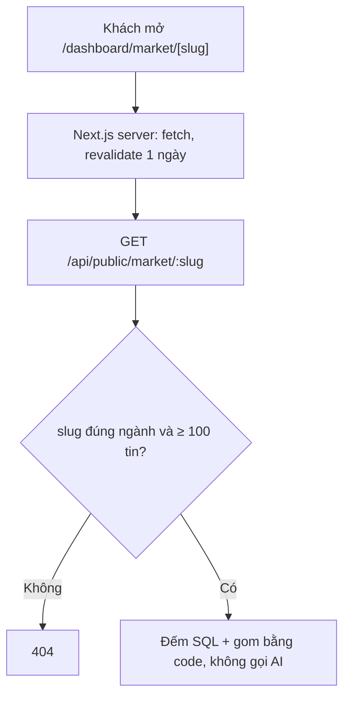
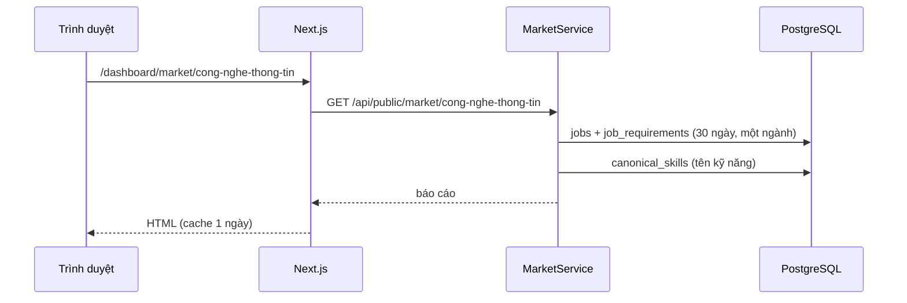

# Market — Báo cáo thị trường việc làm công khai

> **Phạm vi:** `server/src/modules/market/**` (`MarketController` công khai, `MarketService`, `market.utils.ts`). Frontend `ui-ai-job-search/app/dashboard/market/**`, `services/market.ts`.
> **Nguyên tắc:** tài liệu mô tả hệ thống **as-is**. Code là nguồn sự thật duy nhất.

## 1. Purpose

| Mục tiêu | Diễn giải |
|---|---|
| Thu hút người dùng mới từ Google | Mỗi ngành có một trang công khai, index được, số liệu 30 ngày gần nhất từ kho tin |
| Không tái hiện dữ liệu portal | Chỉ số tổng hợp (đếm, %, trung vị); không nêu tên công ty, không trích nội dung tin (ADR 0006) |

## 2. Actors

| Actor | Vai trò |
|---|---|
| Khách | Xem danh sách ngành và báo cáo, không cần đăng nhập |
| Next.js (server) | Gọi API lúc dựng trang, làm mới mỗi ngày |

## 3. Business Features

| # | Tính năng | Actor | Điểm vào |
|---|---|---|---|
| F1 | Danh sách ngành có báo cáo *(2026-10-26)* | Khách | `GET /api/public/market` |
| F2 | Báo cáo 30 ngày của một ngành *(2026-10-26)* | Khách | `GET /api/public/market/:slug` |

## 4. Business Flow

### Luồng A — Xem báo cáo (F1, F2)

1. Trang `/dashboard/market` gọi `GET /api/public/market`: đếm tin theo `occupationCode` trong 30 ngày (tin đăng trong cửa sổ; tin không có `postedAt` tính theo `scrapedAt`), bỏ `OTHER`, giữ ngành ≥ 100 tin, nhiều tin trước.
2. Trang `/dashboard/market/[slug]` gọi `GET /api/public/market/:slug`. `slug` = tên ngành bỏ dấu nối gạch (`marketSlugOf`); slug lạ hoặc ngành < 100 tin → 404.
3. `MarketService.report` đọc mọi tin của ngành trong cửa sổ (không lấy bản trùng), kèm `JobRequirement` nếu có, rồi `marketSections` gom: lương trung vị, top 10 kỹ năng, top 6 nghề kèm lương trung vị và vị trí lương công khai đầu tiên trong bảng nối nghề → vị trí (`SUB_OCCUPATION_POSITIONS`, null nếu không có) để link sang Tra cứu lương *(2026-10-26)*, top 4 tỉnh, phân bố cấp bậc; cộng số công ty khác nhau theo `companyKey`.

## 5. Mermaid Flowchart

## 6. Sequence Diagram

## 7. Business Rules

| Mã | Quy tắc | Tầng | Trạng thái | Nguồn |
|---|---|---|---|---|
| BR-MKT-01 | Cửa sổ 30 ngày trượt; tin tính theo `postedAt`, thiếu thì `scrapedAt`; chỉ tin gốc (`duplicateOfId = null`) *(2026-10-26)* | SV | ✅ | [market.utils.ts](../../../server/src/modules/market/market.utils.ts) |
| BR-MKT-02 | Chỉ có báo cáo cho ngành ≥ 100 tin trong cửa sổ, trừ `OTHER`; còn lại 404 *(2026-10-26)* | SV | ✅ | [market.service.ts](../../../server/src/modules/market/market.service.ts) |
| BR-MKT-03 | Lương đại diện một tin = giữa khoảng hoặc mức duy nhất (VND/tháng như `parseSalary`); trung vị trên tin có lương; kèm % tin có ghi lương *(2026-10-26)* | SV | ✅ | [market.utils.ts](../../../server/src/modules/market/market.utils.ts) |
| BR-MKT-04 | % kỹ năng tính trên tin đã rút yêu cầu (`status = DONE`), mỗi tin đếm một kỹ năng một lần, gộp cách viết qua từ điển kỹ năng (`skillKeyOf`); tên hiển thị viết hoa chữ cái đầu, phần còn lại giữ nguyên ("điều dưỡng" → "Điều dưỡng", "MS Word" giữ nguyên) *(2026-10-26)* | SV | ✅ | [market.service.ts](../../../server/src/modules/market/market.service.ts) |
| BR-MKT-05 | Cấp bậc chia bốn nhóm (Thực tập/Fresher, Junior, Middle, Senior/Lead), % trên tin đã biết cấp bậc (bỏ `UNKNOWN`) *(2026-10-26)* | SV | ✅ | [market.utils.ts](../../../server/src/modules/market/market.utils.ts) |
| BR-MKT-06 | Không trả tên công ty, chỉ số công ty khác nhau; không gọi model *(2026-10-26)* | SV | ✅ | [market.service.ts](../../../server/src/modules/market/market.service.ts) |
| BR-MKT-07 | Không so với 30 ngày trước: kho mới quét đầy đủ gần đây nên số kỳ trước thấp giả (193 so với 739 tin IT, đo 2026-10-26) *(2026-10-26)* | SV | ✅ | [market.service.ts](../../../server/src/modules/market/market.service.ts) |
| BR-MKT-08 | Route công khai throttle 60 lượt/phút/IP; trang Next làm mới mỗi ngày *(2026-10-26)* | GD, FE | ✅ | [market.controller.ts](../../../server/src/modules/market/market.controller.ts) |

## 8. Validation Rules

| Trường | Quy tắc | Nguồn |
|---|---|---|
| `slug` (path) | Phải trùng `marketSlugOf(tên ngành)`; không thì 404 | [market.service.ts](../../../server/src/modules/market/market.service.ts) |

## 9. API Mapping

| Method | URL | Role | Mục đích nghiệp vụ | Controller#method | Service | DTO | Response |
|---|---|---|---|---|---|---|---|
| GET | `/api/public/market` | Public (60/phút) | Ngành có báo cáo *(2026-10-26)* | `MarketController#occupations` | `MarketService.occupations` | — | `[{ slug, name, total }]` |
| GET | `/api/public/market/:slug` | Public (60/phút) | Báo cáo 30 ngày của một ngành *(2026-10-26)* | `MarketController#report` | `MarketService.report` | — | `{ slug, name, from, to, total, companies, salary, skills, subOccupations, provinces, seniority }` |

## 10. Frontend Mapping

| Route FE | Vai trò | Mục đích | Hook / API client |
|---|---|---|---|
| `/dashboard/market` ([page.tsx](../../../../ui-ai-job-search/app/dashboard/market/page.tsx)) *(2026-10-26)* | Khách | Danh sách ngành có báo cáo | `marketService.occupations` (fetch server, revalidate 1 ngày) |
| Mục "Thị trường việc làm" trên thanh bên ([nav-items.ts](../../../../ui-ai-job-search/components/layout/nav-items.ts)), khách bấm được và xem được trong khung dashboard (`isGuestPath`) *(2026-10-26)* | Khách, USER | Mở `/dashboard/market`; lời mời cuối báo cáo: khách → Đăng ký, đã đăng nhập → Lộ trình học ([market-cta.tsx](../../../../ui-ai-job-search/app/dashboard/market/[slug]/market-cta.tsx)) | `useSession` |
| `/dashboard/market/[slug]` ([page.tsx](../../../../ui-ai-job-search/app/dashboard/market/[slug]/page.tsx)) *(2026-10-26)* | Khách | Báo cáo một ngành, index được, nút đăng ký; tên nghề có `salarySlug` là link sang `/dashboard/salary/<slug>` *(2026-10-26)* | `marketService.report` |

## 11. Database

Không có bảng riêng. Đọc `jobs` (`occupationCode`, `subOccupationCode`, `provinceCode`, `salaryMin/Max`, `companyKey`, `postedAt`, `scrapedAt`, `duplicateOfId`), `job_requirements` (`status`, `requiredSkills`, `seniority`), `canonical_skills` (`name`), `skill_aliases` (qua `SkillDictionaryService`).

## 12. State Machine

Không có.

## 13. Exceptions

| Tình huống | HTTP | Thông điệp nguyên văn | Nguồn |
|---|---|---|---|
| Slug lạ hoặc ngành < 100 tin | 404 | `Chưa có báo cáo thị trường cho ngành này.` | [market.service.ts](../../../server/src/modules/market/market.service.ts) |
| Vượt trần tần suất | 429 | (throttler) | [market.controller.ts](../../../server/src/modules/market/market.controller.ts) |

## 14. Notifications

Không có.

## 15. Integrations

Không có; chỉ đọc PostgreSQL.

## 16. Security

| Điểm | Cách xử lý |
|---|---|
| Route công khai | `@Public()` + throttle 60/phút; chỉ trả số tổng hợp, không trường nào của một tin cụ thể |
| Điều khoản portal | Không tên công ty, không nội dung tin (ADR 0006) |

## 17. ⚠️ Sai lệch / Rủi ro nghiệp vụ

Chưa ghi nhận.

## 18. Source References

- [market.controller.ts](../../../server/src/modules/market/market.controller.ts), [market.service.ts](../../../server/src/modules/market/market.service.ts), [market.utils.ts](../../../server/src/modules/market/market.utils.ts)
- Test: [market.e2e-spec.ts](../../../server/test/market.e2e-spec.ts), [market.utils.spec.ts](../../../server/test/unit/modules/market/market.utils.spec.ts)
