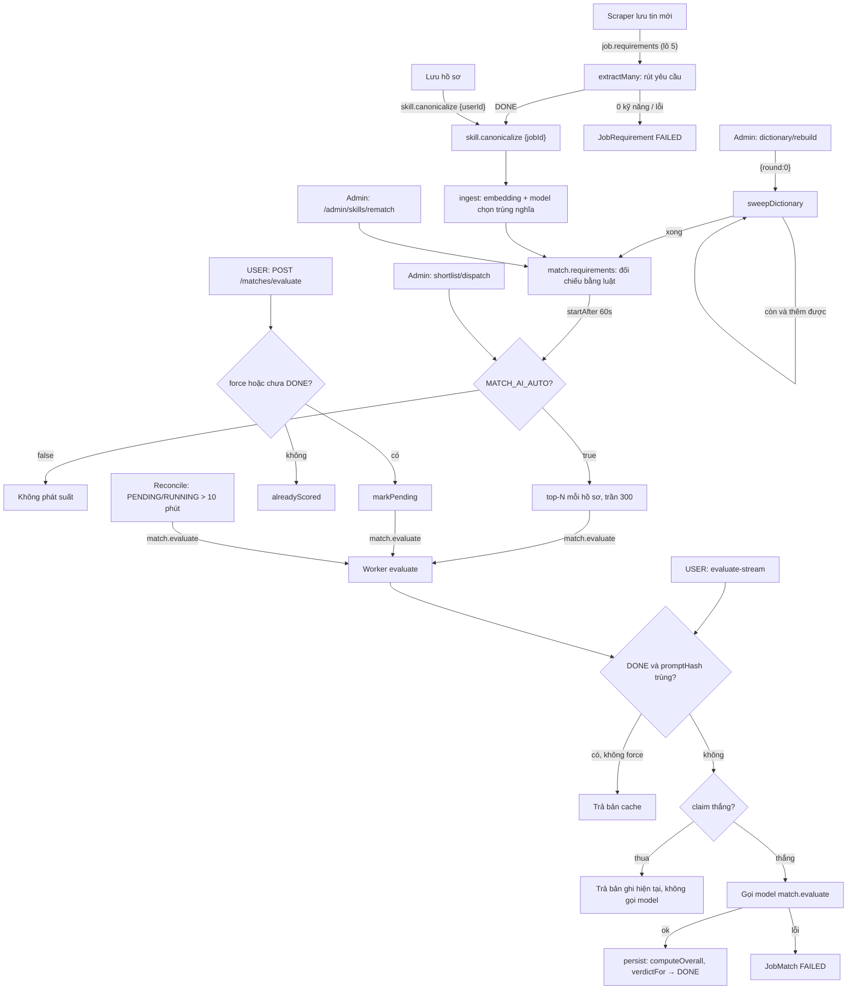
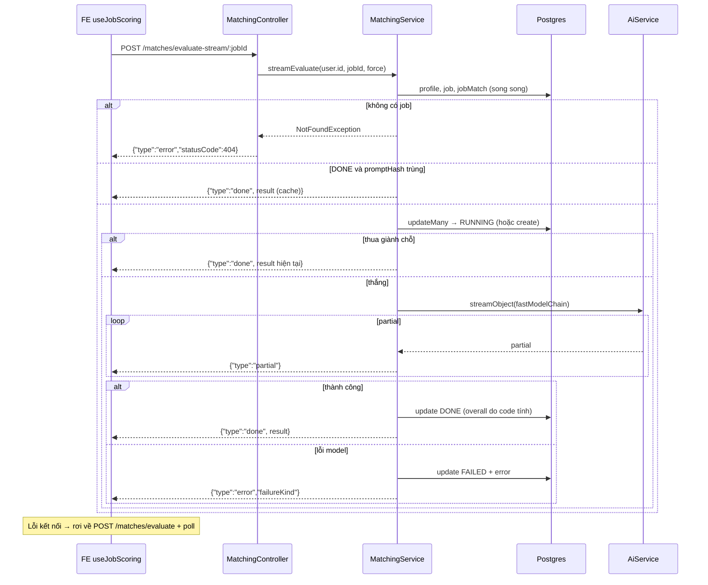
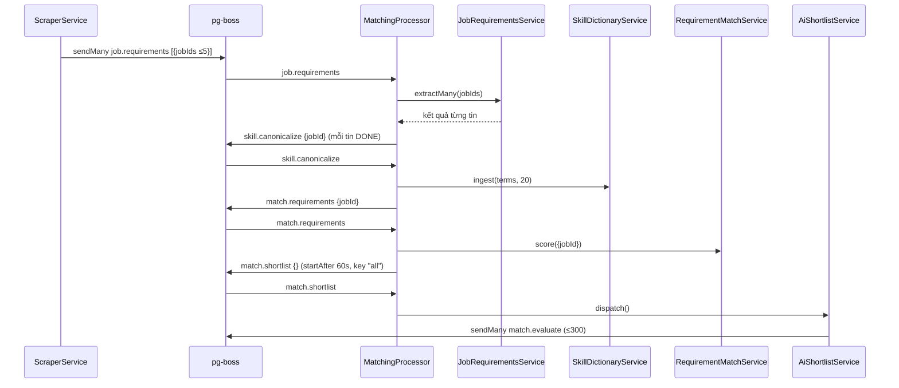
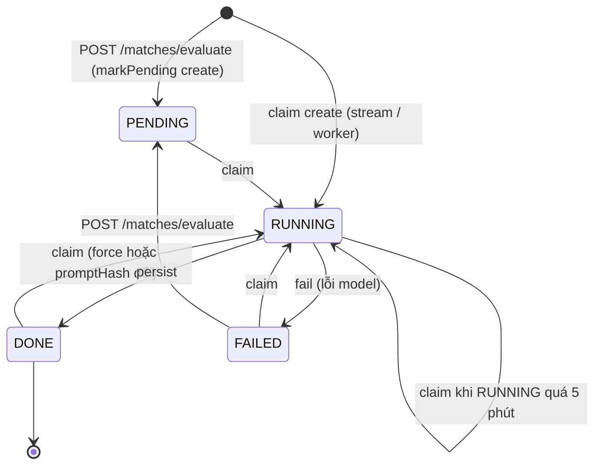
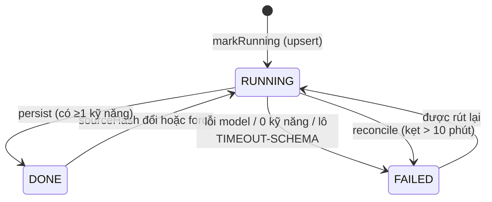

# Matching — Chấm độ phù hợp hồ sơ ↔ tin tuyển dụng

> **Phạm vi:** `server/src/modules/matching/**` (`matching.controller.ts`, `matching.processor.ts`, `ai/` = mọi thứ tốn một lượt gọi model, `rules/` = đối chiếu bằng code), `server/src/modules/semantic/**` (embedding cục bộ); bảng `JobMatch`, `JobRequirement`, `JobRequirementMatch`, `CanonicalSkill`, `SkillAlias`. Màn hình: "Đã chấm bằng AI" (`/dashboard/matches`), thẻ điểm AI trong chi tiết tin (`/dashboard/jobs/[id]`), "Việc làm phù hợp" (`/dashboard/jobs?scored=1`, đọc dữ liệu của module này qua module jobs), trang Bảo trì của admin.
> **Nguyên tắc:** tài liệu mô tả hệ thống **as-is**. Code là nguồn sự thật duy nhất.

---

## 1. Purpose

| Mục tiêu | Diễn giải |
|---|---|
| Chấm điểm phù hợp bằng AI cho một cặp (người dùng, tin) | Model đọc khung đánh giá `04-job-evaluation.md` + hồ sơ + tin, trả 4 điểm chiều 0–100, Eligibility Gate, địa điểm, thế mạnh, khoảng trống, khuyến nghị. Điểm tổng và nhãn phù hợp do **code** tính ([evaluation.schema.ts:61-84](../../../server/src/modules/matching/ai/schemas/evaluation.schema.ts#L61)). Lưu vào `JobMatch`. |
| Không trả tiền hai lần cho cùng một kết quả | Kết quả cache theo `promptHash` (vân tay của `system` + `prompt`); dữ liệu không đổi thì không gọi model ([matching.service.ts:94-99](../../../server/src/modules/matching/ai/services/matching.service.ts#L94)). |
| Rút "yêu cầu" của mỗi tin một lần cho mọi hồ sơ | `job.requirements`: model rút kỹ năng bắt buộc/ưu tiên, số năm, cấp bậc, quốc tịch, giấy phép, thành phố, hình thức làm việc — gộp lô 5 tin ([job-requirements.service.ts:113](../../../server/src/modules/matching/ai/services/job-requirements.service.ts#L113)). Lưu vào `JobRequirement`. |
| Chuẩn hoá cách viết kỹ năng | Danh bạ kỹ năng (`CanonicalSkill` + `SkillAlias`): embedding cục bộ đề cử ứng viên gần nghĩa, model chỉ quyết "cùng một kỹ năng hay không" ([skill-dictionary.service.ts:136](../../../server/src/modules/matching/ai/services/skill-dictionary.service.ts#L136)). |
| Đối chiếu hồ sơ ↔ yêu cầu bằng luật, không tốn AI | `rules/requirement-match.ts` tính "Khớp x/y", `percent`, `rank`; lưu `JobRequirementMatch` cho mọi cặp có ít nhất 1 kỹ năng khớp ([match-write.ts:48](../../../server/src/modules/matching/rules/match-write.ts#L48)). |
| Chọn suất cho AI | `AiShortlistService` lấy top-N cặp theo điểm luật của mỗi hồ sơ rồi xếp hàng `match.evaluate` trong trần mỗi lượt (chỉ khi `MATCH_AI_AUTO=true`) ([ai-shortlist.service.ts:96](../../../server/src/modules/matching/rules/services/ai-shortlist.service.ts#L96)). |

**Điểm mấu chốt**

- Ranh giới nằm trên cây thư mục: `ai/` là mọi thứ tốn một lượt gọi model (`match.evaluate`, `job.requirements`, `skill.canonicalize`), `rules/` không chạm `AiService` dòng nào.
- **Đường đọc không gọi AI**: `GET /matches` và `GET /matches/:jobId` chỉ đọc SQL ([matching.service.ts:274-308](../../../server/src/modules/matching/ai/services/matching.service.ts#L274)).
- Có **hai loại điểm** khác nhau: điểm **AI** (`JobMatch.overallScore`, người dùng bấm chấm) và điểm **luật** (`JobRequirementMatch.percent`, tự tính sau mỗi lần quét tin/lưu hồ sơ). UI gọi điểm AI là "Điểm AI Match"/"Đã chấm bằng AI"; điểm luật hiện thành "Khớp x/y" trên thẻ tin (module jobs).
- Chuỗi việc nền: `job.requirements` → `skill.canonicalize` → `match.requirements` → (60 giây sau) `match.shortlist` → `match.evaluate` ([matching.processor.ts:36-144](../../../server/src/modules/matching/matching.processor.ts#L36)).

## 2. Actors

| Actor | Quyền trong module | Ghi chú |
|---|---|---|
| USER (người dùng đã đăng nhập) | Xem danh sách/chi tiết điểm AI của chính mình; yêu cầu chấm (hàng đợi hoặc stream) | Mọi truy vấn khoá theo `user.id` lấy từ JWT, không nhận `userId` từ client |
| ADMIN | Thêm 3 route: rút yêu cầu một tin (`requirements/:jobId`), dựng lại danh bạ kỹ năng, phát suất AI | `@Roles('ADMIN')` dựa vào `RolesGuard` toàn cục ([matching.controller.ts:82,102,110](../../../server/src/modules/matching/matching.controller.ts#L82)) |
| Khách (chưa đăng nhập) | Không có | Không route nào `@Public()`; guard JWT toàn cục mặc-định-đóng (e2e: `/api/matches` trả 401 — [security.e2e-spec.ts:39-52](../../../server/test/security.e2e-spec.ts#L39)) |
| Worker `MatchingProcessor` (hệ thống) | Xử lý 5 hàng đợi `job.requirements`, `skill.canonicalize`, `match.requirements`, `match.shortlist`, `match.evaluate` | Chỉ chạy ở vai có việc nền (`QueueService.work` thoát ở vai `api`) ([queue.service.ts:139-147](../../../server/src/modules/queue/queue.service.ts#L139)) |
| Scraper (module khác) | Xếp `job.requirements` theo lô 5 tin sau mỗi lượt quét; nếu `SCRAPER_AUTO_SCORE=true` thì xếp thẳng `match.evaluate` | [scraper.service.ts:200-267](../../../server/src/modules/scraper/services/scraper.service.ts#L200) |
| Profile (module khác) | Mỗi lần lưu hồ sơ xếp `skill.canonicalize {userId}` | [profile.service.ts:53](../../../server/src/modules/profile/profile.service.ts#L53) |
| Reconcile (module khác) | Xếp lại `match.evaluate` cho `JobMatch` kẹt PENDING/RUNNING quá 10 phút; đánh `FAILED` cho `JobRequirement` kẹt | [reconcile.service.ts:41-80](../../../server/src/modules/reconcile/services/reconcile.service.ts#L41), [reconcile.service.ts:118](../../../server/src/modules/reconcile/services/reconcile.service.ts#L118) |
| Admin console (module admin) | Sửa tay danh bạ (`MANUAL`), xếp `match.requirements` toàn kho (`rematch`) | [admin-skills.service.ts:118-166](../../../server/src/modules/admin/services/admin-skills.service.ts#L118) |
| AI gateway / model embedding | Nguồn sinh kết quả | Xem §15 |

## 3. Business Features

| # | Tính năng | Actor | Endpoint / cơ chế |
|---|---|---|---|
| F1 | Danh sách tin đã chấm bằng AI (phân trang, sắp xếp) | USER | `GET /api/matches` |
| F2 | Chi tiết điểm AI của một tin | USER | `GET /api/matches/:jobId` |
| F3 | Yêu cầu chấm qua hàng đợi | USER | `POST /api/matches/evaluate` → queue `match.evaluate` |
| F4 | Chấm và stream từng phần (NDJSON) | USER | `POST /api/matches/evaluate-stream/:jobId` |
| F5 | Worker chấm điểm AI (dùng chung cho F3, shortlist, scraper, reconcile) | Hệ thống | queue `match.evaluate` → `MatchingService.evaluate` |
| F6 | Rút yêu cầu của tin (lô hoặc lẻ) | Hệ thống / ADMIN | queue `job.requirements`; `POST /api/matches/requirements/:jobId` |
| F7 | Chuẩn hoá kỹ năng vào danh bạ | Hệ thống / ADMIN | queue `skill.canonicalize`; `POST /api/matches/dictionary/rebuild` |
| F8 | Đối chiếu hồ sơ ↔ yêu cầu bằng luật | Hệ thống | queue `match.requirements` → `RequirementMatchService.score` |
| F9 | Phát suất chấm AI (top-N mỗi hồ sơ) | Hệ thống / ADMIN | queue `match.shortlist`; `POST /api/matches/shortlist/dispatch` |
| F10 | Embedding cục bộ cho danh bạ | Hệ thống | `SemanticModule` → `LocalEmbedder` |

## 4. Business Flow

### Luồng A — Danh sách "Đã chấm bằng AI" (F1)

**Preconditions:** người dùng đăng nhập (JWT hợp lệ).

**Main Flow**
1. FE gọi `GET /api/matches?limit=&offset=&sort=` ([matches.ts:11-14](../../../../ui-ai-job-search/services/matches.ts#L11)).
2. `ValidationPipe` kiểm `ListMatchesQueryDto`: `limit` 1–100, `offset` 0–100.000, `sort ∈ {newest, score_desc, score_asc}` ([matching.dto.ts:20-27](../../../server/src/modules/matching/matching.dto.ts#L20), [pagination.dto.ts](../../../server/src/common/dto/pagination.dto.ts)).
3. `MatchingService.listMatches(user.id, query)` lọc `{ userId, status: 'DONE' }` ([matching.service.ts:275](../../../server/src/modules/matching/ai/services/matching.service.ts#L275)).
4. Thứ tự: `newest` = `evaluatedAt DESC NULLS LAST, updatedAt DESC, id DESC`; `score_*` = `overallScore` theo chiều (NULLS LAST) rồi nối thứ tự `newest` để hoà điểm thì lượt chấm mới hơn lên trước ([match-view.ts:25-36](../../../server/src/modules/matching/ai/utils/match-view.ts#L25)).
5. Chọn `LIST_FIELDS` + thẻ tin (`jobCardSelect(userId)`, kèm `saves` của chính user) ([match-view.ts:38-56](../../../server/src/modules/matching/ai/utils/match-view.ts#L38)); gắn cờ `job.saved` và `stale` ([match-view.ts:10-22](../../../server/src/modules/matching/ai/utils/match-view.ts#L10)).
6. Trả `{ items, total, limit, offset }` — 200.

**Alternative Flow:** không có bản ghi DONE → `items: []`, FE hiện "Bạn chưa chấm điểm tin nào…" kèm link sang "Việc làm phù hợp" ([matches-view.tsx:70-82](../../../../ui-ai-job-search/app/dashboard/matches/matches-view.tsx#L70)).

**Failure Flow:** `sort` lạ → 400 (`sort chỉ nhận một trong các giá trị: newest, score_desc, score_asc`; e2e [matches-sort.e2e-spec.ts:95-97](../../../server/test/matches-sort.e2e-spec.ts#L95)); `limit` > 100 → 400 `Số dòng mỗi trang không được lớn hơn 100`; thiếu token → 401.

**Postconditions:** không ghi gì; không gọi model.

### Luồng B — Chi tiết điểm AI của một tin (F2)

**Preconditions:** đăng nhập.

**Main Flow**
1. `GET /api/matches/:jobId` ([matching.controller.ts:52-57](../../../server/src/modules/matching/matching.controller.ts#L52)).
2. `getMatch` đọc `JobMatch` theo khoá `userId_jobId` với `MATCH_DETAIL_FIELDS` (status, overallScore, verdict, eligibility, eligibilityNote, 4 điểm + ghi chú, strengths, gaps, recommendation, evaluatedAt, error) ([job-view.ts:28-52](../../../server/src/modules/jobs/utils/job-view.ts#L28)) song song với `profile.updatedAt` ([matching.service.ts:298-308](../../../server/src/modules/matching/ai/services/matching.service.ts#L298)).
3. Gắn `stale` = `evaluatedAt < profile.updatedAt` ([staleness.ts](../../../server/src/modules/matching/rules/staleness.ts)).
4. Controller bọc `withFailureKind`: bỏ `error` thô, thay bằng `failureKind` ([failure-view.ts:4-12](../../../server/src/common/ai/failure-view.ts#L4)). Trả 200 ở **mọi** trạng thái (PENDING/RUNNING/DONE/FAILED) — FE dùng để poll.

**Alternative Flow:** bản ghi FAILED → trả `status: 'FAILED'`, `failureKind` (TIMEOUT/SCHEMA/UPSTREAM…), không có điểm.

**Failure Flow:** chưa từng có bản ghi cho cặp này → 404 `Chưa chấm điểm công việc này` ([matching.service.ts:306](../../../server/src/modules/matching/ai/services/matching.service.ts#L306)).

**Postconditions:** không ghi; response không chứa `job`, `error`, `promptHash` (e2e [matching.e2e-spec.ts:152-174](../../../server/test/matching.e2e-spec.ts#L152)).

### Luồng C — Yêu cầu chấm qua hàng đợi (F3)

**Preconditions:** đăng nhập; còn hạn throttle AI (10 lượt/phút).

**Main Flow**
1. `POST /api/matches/evaluate` body `{ jobId, force? }` ([matching.controller.ts:59-80](../../../server/src/modules/matching/matching.controller.ts#L59)).
2. DTO: `jobId` chuỗi ≤ 40 ký tự; `force` boolean tuỳ chọn ([matching.dto.ts:10-18](../../../server/src/modules/matching/matching.dto.ts#L10)).
3. Nếu `force` = false: `findDoneScore` tìm `JobMatch` DONE của cặp; có thì trả ngay `{ queued: false, alreadyScored: true, overallScore, verdict }` — **không xếp hàng, không so `promptHash`** ([matching.controller.ts:67-70](../../../server/src/modules/matching/matching.controller.ts#L67), [matching.service.ts:310-315](../../../server/src/modules/matching/ai/services/matching.service.ts#L310)).
4. `markPending`: `updateMany { userId, jobId, status: 'FAILED' } → PENDING, error=null`; không có hàng FAILED thì `create` PENDING, bỏ qua lỗi trùng khoá (P2002) ([matching.service.ts:317-331](../../../server/src/modules/matching/ai/services/matching.service.ts#L317)).
5. Xếp `match.evaluate { userId, jobId, force }` với `singletonKey = userId:jobId:force|cache` ([queue-key.ts:48-53](../../../server/src/modules/queue/queue-key.ts#L48)).
6. Trả `{ queued: true, alreadyScored: false, queueJobId }` — 201. `queueJobId = null` nghĩa là đã có việc trùng khoá đang chờ (policy `exclusive`).

**Alternative Flow:** `force: true` bỏ bước 3; bản ghi DONE giữ nguyên trạng thái DONE cho tới khi worker giành chỗ (xem §17 R3).

**Failure Flow:**
- `jobId` không phải chuỗi / > 40 ký tự / trường lạ → 400 (`Công việc phải là chuỗi ký tự`, `Công việc không được dài quá 40 ký tự`, `<trường> không phải là trường hợp lệ`).
- `jobId` không tồn tại → `create` vi phạm khoá ngoại P2003 → `PrismaExceptionFilter` trả **400** `Dữ liệu tham chiếu không hợp lệ` ([prisma-exception.filter.ts:25-26](../../../server/src/common/filters/prisma-exception.filter.ts#L25)) — suy từ code, chưa có e2e.
- Vượt throttle → 429.

**Postconditions:** `JobMatch` ở PENDING (mới hoặc từ FAILED) hoặc giữ nguyên trạng thái cũ; một việc `match.evaluate` trong hàng đợi. FE poll `GET /matches/:jobId` mỗi 2,5 giây, tối đa 180 giây ([use-job-scoring.ts:17-51](../../../../ui-ai-job-search/hooks/use-job-scoring.ts#L17)).

### Luồng D — Chấm và stream NDJSON (F4)

**Preconditions:** đăng nhập; còn hạn throttle AI.

**Main Flow**
1. FE `POST /api/matches/evaluate-stream/:jobId[?force=true]` ([match-stream.ts](../../../../ui-ai-job-search/lib/match-stream.ts), [model-stream.ts:25-36](../../../../ui-ai-job-search/lib/model-stream.ts#L25)).
2. `streamNdjson` đặt header `application/x-ndjson`, gửi nhịp `\n` mỗi 10 giây ([ndjson.ts:26-41](../../../server/src/common/ndjson.ts#L26)).
3. `streamEvaluate` → `prepare`: đọc profile, job, JobMatch hiện có; không có job → `NotFoundException` ([matching.service.ts:77-92](../../../server/src/modules/matching/ai/services/matching.service.ts#L77)).
4. Dựng prompt: khung = các mục `eligibility gate`, `scoring dimensions`, `weighting`, `thresholds` của `04-job-evaluation.md`, bỏ tiểu mục `Salary Benchmark`, qua `renderShared` ([matching.service.ts:58-74](../../../server/src/modules/matching/ai/services/matching.service.ts#L58), [evaluation.prompt.ts](../../../server/src/modules/matching/ai/prompt/evaluation.prompt.ts)). `hash = promptHash(system, prompt)`.
5. Không `force`, bản ghi DONE và `promptHash` trùng → yield `done` với bản cache (kèm `failureKind`, `stale`), không gọi model ([matching.service.ts:97-99,158-161](../../../server/src/modules/matching/ai/services/matching.service.ts#L97)).
6. `claim` (giành chỗ có điều kiện, Luồng E bước 2). Thua → yield `done` với bản ghi hiện tại.
7. Thắng → `ai.streamObject` với `evaluationSchema`, purpose `match.evaluate`, chuỗi model **nhanh** `fastModelChain(estimateTokens(...))` ([matching.service.ts:164-172](../../../server/src/modules/matching/ai/services/matching.service.ts#L164)); mỗi partial → sự kiện `{type:'partial', data}`.
8. Kết thúc → `persist` (Luồng E bước 4) → sự kiện `{type:'done', result}` có hình dạng như `GET /matches/:jobId` (không `error`).

**Alternative Flow:** trình duyệt ngắt giữa chừng → server vẫn chạy generator tới cuối và tự ghi DONE/FAILED; **không** xếp lại hàng đợi *(đã gỡ `onAbandon` 2026-10-16, theo CLAUDE.md)*. FE: lỗi kết nối (không phải lỗi server) → rơi về Luồng C; lỗi server báo trong stream → chỉ đọc lại `GET /matches/:jobId`, không xếp hàng ([use-job-scoring.ts:53-83](../../../../ui-ai-job-search/hooks/use-job-scoring.ts#L53)).

**Failure Flow:**
- Job không tồn tại → lỗi trước sự kiện đầu → HTTP 200 + một dòng `{"type":"error","message":"Không tìm thấy công việc: <jobId>","statusCode":404}` ([ndjson.ts:49-61](../../../server/src/common/ndjson.ts#L49)).
- Lỗi model (timeout, schema, upstream) → `fail()` ghi `FAILED` + `error` thô vào DB, rồi sự kiện `{"type":"error","message":"Không hoàn thành được tác vụ.","failureKind":…}` ([failure-view.ts:15-28](../../../server/src/common/ai/failure-view.ts#L15), [matching.service.ts:186-189](../../../server/src/modules/matching/ai/services/matching.service.ts#L186)).
- Lỗi không phải `HttpException` trước sự kiện đầu, hoặc lỗi sau khi đã ghi → `response.destroy()` ([ndjson.ts:62-64](../../../server/src/common/ndjson.ts#L62)).
- Vượt throttle → 429 trước khi stream mở.

**Postconditions:** `JobMatch` DONE (đủ điểm, `promptHash`, `modelId`, `evaluatedAt`) hoặc FAILED; cache FE cập nhật (`invalidateAfter('scoreJob')` làm mới matches, jobLists, dashboard — [query-keys.ts:74](../../../../ui-ai-job-search/lib/query-keys.ts#L74)).

### Luồng E — Worker chấm điểm AI `match.evaluate` (F5)

**Preconditions:** việc `match.evaluate { userId, jobId, force? }` từ Luồng C, shortlist (Luồng I), scraper `fanOut` hoặc reconcile.

**Main Flow**
1. `workEvaluateMatch` gọi `MatchingService.evaluate(userId, jobId, force)` ([matching.processor.ts:126-138](../../../server/src/modules/matching/matching.processor.ts#L126)).
2. `prepare` như Luồng D bước 3–5. Giành chỗ: `updateMany where { userId, jobId, OR: [status ≠ RUNNING, updatedAt < now − 5 phút] } → RUNNING, error=null`; `count > 0` thì thắng; ngược lại `create { status: RUNNING }`, bắt P2002 → thua ([matching.service.ts:232-257](../../../server/src/modules/matching/ai/services/matching.service.ts#L232), `STALE_RUNNING_MS` = 5 phút — [duration.ts:8](../../../server/src/common/duration.ts#L8)).
3. Thua → log debug, trả bản ghi hiện tại, **không gọi model** ([matching.service.ts:101-108](../../../server/src/modules/matching/ai/services/matching.service.ts#L101)).
4. Thắng → `ai.generateObject` (chuỗi model mặc định), rồi `persist`: `eligibility.verdict === 'FAIL'` thì `overallScore = 0`, `verdict = POOR`; ngược lại `overallScore = computeOverall`, `verdict = verdictFor(overall)`; ghi `promptHash`, `modelId`, `evaluatedAt`, xoá `error` — `update where userId_jobId` ([matching.service.ts:192-230](../../../server/src/modules/matching/ai/services/matching.service.ts#L192)).

**Alternative Flow:** cache trùng hash → trả bản cũ, không gọi model (e2e "lần chấm thứ hai… không gọi model", "hồ sơ đổi thì hash đổi", "lương của tin đổi thì chấm lại" — [matching.e2e-spec.ts:176-239](../../../server/test/matching.e2e-spec.ts#L176)).

**Failure Flow:** model lỗi → `FAILED` + `error = messageOf(error)`, không ném ra khỏi worker (e2e [matching.e2e-spec.ts:310-319](../../../server/test/matching.e2e-spec.ts#L310)); job không tồn tại → `NotFoundException` ném trong worker (pg-boss đánh dấu việc lỗi). Tiến trình chết khi đang RUNNING → reconcile xếp lại sau 10 phút.

**Postconditions:** tối đa một lượt gọi model cho hai lượt song song cùng cặp (e2e [matching.e2e-spec.ts:288-308](../../../server/test/matching.e2e-spec.ts#L288)).

### Luồng F — Rút yêu cầu của tin `job.requirements` (F6)

**Preconditions:** tin đã lưu trong `jobs`.

**Main Flow (lô — từ scraper)**
1. Scraper xếp `job.requirements { jobIds: [≤5] }`, khoá dedup = vân tay danh sách id đã sắp xếp ([queue-key.ts:18-31,76-77](../../../server/src/modules/queue/queue-key.ts#L18)).
2. `extractMany`: ≤ 1 tin → đường lẻ. Với mỗi tin: DONE và `sourceHash` (title, description, location, workMode) trùng → giữ nguyên; mô tả > 6.000 ký tự → đường lẻ; còn lại vào lô ([job-requirements.service.ts:113-147](../../../server/src/modules/matching/ai/services/job-requirements.service.ts#L113), [requirements.ts:7-21](../../../server/src/modules/matching/ai/utils/requirements.ts#L7)).
3. Lô ≥ 2 tin: `markRunning` từng tin (upsert RUNNING), gọi model một lượt với `jobRequirementsBatchSchema`, timeout 120 giây ([job-requirements.prompt.ts:3-5](../../../server/src/modules/matching/ai/prompt/job-requirements.prompt.ts#L3)).
4. Ánh xạ theo `index`; phần tử có kỹ năng → `persist` DONE ([job-requirements.service.ts:161-176](../../../server/src/modules/matching/ai/services/job-requirements.service.ts#L161)).
5. Worker xếp `skill.canonicalize { jobId }` cho mỗi tin DONE ([matching.processor.ts:44-59](../../../server/src/modules/matching/matching.processor.ts#L44)).

**Main Flow (lẻ — admin)**
1. `POST /api/matches/requirements/:jobId?force=true|false` (ADMIN, throttle AI) gọi đồng bộ `extract(jobId, force === 'true')` ([matching.controller.ts:82-100](../../../server/src/modules/matching/matching.controller.ts#L82)).
2. Không có job → 404 `Không tìm thấy công việc: <jobId>`. Không `force` và đã cập nhật → trả bản hiện có.
3. `markRunning` → `generateObject(jobRequirementsSchema)`; 0 kỹ năng → ném `NO_SKILLS_ERROR` → FAILED; ngược lại DONE ([job-requirements.service.ts:82-111](../../../server/src/modules/matching/ai/services/job-requirements.service.ts#L82)).
4. Trả bản ghi `JobRequirement` (200/201) — kể cả khi FAILED (không ném lỗi HTTP).

**Alternative Flow:** lô thiếu phần tử hoặc phần tử 0 kỹ năng → riêng tin đó rút lẻ ([job-requirements.service.ts:164-171](../../../server/src/modules/matching/ai/services/job-requirements.service.ts#L164)); lô hỏng vì lỗi không phải TIMEOUT/SCHEMA → rút lẻ từng tin ([job-requirements.service.ts:189-195](../../../server/src/modules/matching/ai/services/job-requirements.service.ts#L189)).

**Failure Flow:** lô hỏng `TIMEOUT` hoặc `SCHEMA` → ghi FAILED **cả lô**, không rút lẻ ([job-requirements.service.ts:178-188](../../../server/src/modules/matching/ai/services/job-requirements.service.ts#L178)); kẹt RUNNING > 10 phút → reconcile ghi FAILED với thông điệp "Máy chủ khởi động lại khi việc này đang chạy dở…" ([reconcile.service.ts:11-12,118](../../../server/src/modules/reconcile/services/reconcile.service.ts#L11)).

**Postconditions:** `JobRequirement` DONE có `sourceHash`, `modelId`, `extractedAt`; hoặc FAILED kèm `error`. FAILED không tự rút lại; lần quét sau đưa tin vào lô lại thì `isUpToDate` = false nên được rút lại.

### Luồng G — Chuẩn hoá kỹ năng `skill.canonicalize` (F7)

**Preconditions:** payload có đúng một trong `jobId`, `userId`, `round`.

**Main Flow (theo tin/hồ sơ)**
1. Lấy chuỗi: tin → `requiredSkills + niceToHaveSkills` của `JobRequirement`; hồ sơ → `headline + primarySkills + secondarySkills` ([matching.processor.ts:146-165](../../../server/src/modules/matching/matching.processor.ts#L146)).
2. `ingest(terms, 20)`: `key = foldTerm(raw)`; bỏ key \< 2 ký tự, key đã có trong danh bạ, key trùng trong lượt ([skill-dictionary.service.ts:140-151](../../../server/src/modules/matching/ai/services/skill-dictionary.service.ts#L140)).
3. Embed các chuỗi mới bằng `LocalEmbedder`; nạp canonical cùng `model` ([skill-dictionary.service.ts:93-111](../../../server/src/modules/matching/ai/services/skill-dictionary.service.ts#L93)).
4. Theo lô 10: mỗi chuỗi lấy tối đa 5 canonical có cosine ≥ 0,72 và còn \< 6 alias ([nearest.ts](../../../server/src/modules/matching/ai/utils/nearest.ts), [skill-merge.prompt.ts:1-3](../../../server/src/modules/matching/ai/prompt/skill-merge.prompt.ts#L1)).
5. Chuỗi có ứng viên → hỏi model (purpose `skill.canonicalize`, model `SKILL_DICTIONARY_MODEL_ID` nếu đặt) chọn số thứ tự ứng viên trùng nghĩa hoặc 0 ([skill-dictionary.service.ts:179-207](../../../server/src/modules/matching/ai/services/skill-dictionary.service.ts#L179)).
6. Ghi: chọn hợp lệ → `SkillAlias { source: 'LLM' }` trỏ canonical đó; 0/không ứng viên → tạo `CanonicalSkill` mới + `SkillAlias { source: 'EXACT' }` trong transaction ([skill-dictionary.service.ts:113-133,209-257](../../../server/src/modules/matching/ai/services/skill-dictionary.service.ts#L113)).
7. Theo hồ sơ (`userId`): `inferImplications(primarySkills + secondarySkills)`, KHÔNG gồm `headline`: kỹ năng chuẩn của hồ sơ chưa hỏi (`impliesCheckedAt = null`) được hỏi model theo lô 30 (purpose `skill.implies`) "người có kỹ năng này chắc chắn đáp ứng thêm gì"; ghi `implies` (khoá `foldTerm`) + `impliesCheckedAt`, rồi `ingest` các tên đó để tra được. Model lỗi → dừng, kỹ năng ở lại chưa hỏi cho lần ghi hồ sơ sau *(2026-10-26)* ([skill-dictionary.service.ts](../../../server/src/modules/matching/ai/services/skill-dictionary.service.ts), [skill-implies.prompt.ts](../../../server/src/modules/matching/ai/prompt/skill-implies.prompt.ts)).
8. Xoá cache danh bạ; xếp `match.requirements` với cùng payload ([matching.processor.ts](../../../server/src/modules/matching/matching.processor.ts)).

**Main Flow (quét toàn kho — admin `POST /api/matches/dictionary/rebuild`)**
1. `SkillDictionaryService.rebuild` xếp `skill.canonicalize { round: 0 }`, trả `{ queued: true, queueJobId }` (controller chỉ gọi service — *2026-10-26*) ([skill-dictionary.service.ts](../../../server/src/modules/matching/ai/services/skill-dictionary.service.ts)).
2. `sweepDictionary(round)`: lấy mọi chuỗi từ `JobRequirement` DONE + mọi `Profile`, `ingest(terms, 20)`; còn `remaining > 0` **và** vòng này thêm được > 0 → xếp vòng `round + 1`; ngược lại hỏi kỹ năng kéo theo cho mọi kỹ năng hồ sơ chưa hỏi rồi xếp `match.requirements {}` toàn kho ([matching.processor.ts:167-180](../../../server/src/modules/matching/matching.processor.ts#L167)).

**Alternative Flow:** mọi chuỗi đã biết → `{ added: 0, remaining: 0 }`, không gọi model. Hai lượt cùng thêm một key → P2002 → bỏ qua, log "đã được lượt khác thêm trước" ([skill-dictionary.service.ts:248-253](../../../server/src/modules/matching/ai/services/skill-dictionary.service.ts#L248)).

**Failure Flow:** model lỗi hoặc bỏ sót dòng → `{ ok: false }` → **không ghi gì** cho cả lô 10 chuỗi, chúng ở lại "chưa biết" cho lượt sau ([skill-dictionary.service.ts:195-206,214](../../../server/src/modules/matching/ai/services/skill-dictionary.service.ts#L195)). Payload không có `jobId`/`userId`/`round` → ném `Payload danh bạ phải có jobId, userId hoặc round.` ([matching.processor.ts:76](../../../server/src/modules/matching/matching.processor.ts#L76)). Vector \< 768 chiều → ném `Vector chỉ có N chiều, cần ít nhất 768.` ([semantic-index.ts:13-24](../../../server/src/modules/semantic/semantic-index.ts#L13)).

**Postconditions:** danh bạ có thêm alias; luôn kéo theo một lượt `match.requirements`.

### Luồng H — Đối chiếu bằng luật `match.requirements` (F8)

**Preconditions:** có `JobRequirement` DONE.

**Main Flow**
1. Phạm vi: `{ jobId }` → một tin × mọi hồ sơ `completion ≥ 30`; chạy theo lô 100 tin × 50 hồ sơ để câu `in`/`OR` của mỗi lượt ghi không vượt trần 65.535 tham số Postgres (đo 2026-10-26: ~550 cặp/hồ sơ, nên ~60 hồ sơ là chạm trần khi chưa chia lô) *(2026-10-26)*; `{ userId }` → một hồ sơ (không lọc completion) × mọi tin; `{}` → toàn kho ([requirement-match.service.ts:23-50](../../../server/src/modules/matching/rules/services/requirement-match.service.ts#L23)). Tin là bản sao (`duplicateOfId` ≠ null) bị loại.
2. Đọc hash cặp đã lưu và danh bạ (cache 60 giây).
3. `planMatchWrites`: hash cặp = `v3:<sourceHash>:<profile.updatedAt>:d<số alias>`; trùng thì bỏ qua ([match-write.ts:35-41,57-63](../../../server/src/modules/matching/rules/match-write.ts#L35)).
4. `matchRequirements` cho từng cặp ([requirement-match.ts:91-184](../../../server/src/modules/matching/rules/requirement-match.ts#L91)):
   - Kỹ năng: khớp chữ hai chiều (`containsTerm`) hoặc cùng canonical qua danh bạ (ghi `via`).
   - YEARS (nếu tin có `minYears`): `null` khi hồ sơ không suy ra số năm. Chỉ tính số năm ở các mục kinh nghiệm CÙNG NGÀNH với tin: mỗi mục xếp ngành theo chức danh (`position`) bằng bộ phân ngành của tin, xếp không được thì theo ngành chính của hồ sơ; tin chưa rõ ngành (`OTHER`/null), hoặc hồ sơ không mục nào xếp được ngành, thì dùng tổng số năm *(2026-10-26)* ([experience-years.ts](../../../server/src/modules/profile/utils/experience-years.ts), `profileForJob` trong [requirements.ts](../../../server/src/modules/matching/ai/utils/requirements.ts)).
   - ELIGIBILITY và LOCATION là dòng kiểm tra, **không tính điểm**.
   - `percent = round(metWeight / totalWeight × 100)`, bắt buộc trọng 1, ưu tiên 0,5; `rank = metWeight / (totalWeight + 2)` (4 chữ số); eligibility FAIL hoặc không có dòng kỹ năng → 0.
5. `skillMet ≥ 1` → ghi mới; cặp đã lưu mà nay `skillMet = 0` → xoá ([match-write.ts:65-71](../../../server/src/modules/matching/rules/match-write.ts#L65)).
6. Một transaction: `deleteMany` mọi cặp cần thay + `createMany skipDuplicates` ([requirement-match.service.ts:88-115](../../../server/src/modules/matching/rules/services/requirement-match.service.ts#L88)).
7. Bàn giao `match.shortlist` (cùng `userId` nếu có) với `startAfter: 60` giây ([matching.processor.ts:89-110,140-144](../../../server/src/modules/matching/matching.processor.ts#L89)).

**Alternative Flow:** admin `POST /api/admin/skills/rematch` xếp `match.requirements {}` (module admin).

**Failure Flow:** lỗi DB trong transaction → việc pg-boss lỗi, không ghi nửa chừng.

**Postconditions:** `JobRequirementMatch` phản ánh điểm luật; module jobs dùng nó cho "Khớp x/y" và sắp xếp "Điểm AI Match" trên "Việc làm phù hợp".

### Luồng I — Phát suất chấm AI `match.shortlist` (F9)

**Preconditions:** `MATCH_AI_AUTO=true` (mặc định **false**) ([configuration.ts:133-142](../../../server/src/config/configuration.ts#L133)).

**Main Flow**
1. Từ hàng đợi (sau Luồng H) hoặc admin `POST /api/matches/shortlist/dispatch[?userId=]` (đồng bộ) ([matching.controller.ts:110-121](../../../server/src/modules/matching/matching.controller.ts#L110)).
2. `topRows` lấy các hồ sơ `completion ≥ 30`, `lastFanOutAt` null hoặc cũ hơn cooldown 6 giờ, đã chọn ngành; với mỗi hồ sơ dựng đúng bộ lọc của trang "Việc làm phù hợp" (`whereFrom({ scored: true, since: lastFanOutAt })`: cùng ngành, đúng nghề con và tỉnh đã chọn, cấp bậc lệch ≤ 1 bậc, tin trong 7 ngày, không phải bản sao, quét sau `lastFanOutAt`) rồi gom tất cả thành MỘT `findMany` trên `JobRequirementMatch` (`OR` theo từng hồ sơ) với `percent ≥ MATCH_MIN_PERCENT` (50), eligibility khác FAIL (kể cả null), **chưa có `JobMatch`**; xếp `userId, percent DESC, rank DESC, scrapedAt DESC` *(2026-10-26: trước đó SQL thô, lọc theo nhóm ngành chứ không theo bộ lọc "Việc làm phù hợp", xếp theo `rank`)* ([ai-shortlist.service.ts](../../../server/src/modules/matching/rules/services/ai-shortlist.service.ts)).
3. `planShortlist`: hồ sơ lâu chưa được phát đứng trước; phát theo vòng vị trí (mọi hồ sơ lấy suất #1 trước, rồi #2…) tới trần `MATCH_AI_MAX_PER_RUN` (300) ([ai-shortlist.ts:47-74](../../../server/src/modules/matching/rules/ai-shortlist.ts#L47)).
4. `sendMany(match.evaluate, targets)`; cập nhật `Profile.lastFanOutAt = now` cho hồ sơ được phục vụ ([ai-shortlist.service.ts:119-129](../../../server/src/modules/matching/rules/services/ai-shortlist.service.ts#L119)).
5. Trả `{ queued, served, deferred }` (`deferred` = số **hồ sơ** không được suất nào).

**Alternative Flow:** `MATCH_AI_AUTO=false` → trả `{0,0,0}`, log debug ([ai-shortlist.service.ts:97-100](../../../server/src/modules/matching/rules/services/ai-shortlist.service.ts#L97)); không có cặp đủ điều kiện → `{0,0,0}`.

**Failure Flow:** lỗi SQL → 500 (route) / việc lỗi (queue).

**Postconditions:** các việc `match.evaluate` mới (Luồng E); hồ sơ được phục vụ vào cooldown.

### Luồng J — Embedding cục bộ (F10)

**Preconditions:** gói `@huggingface/transformers` nạp được model `Xenova/multilingual-e5-base` (dtype `q8`).

**Main Flow:** lần đầu gọi `embed` thì nạp pipeline `feature-extraction` một lần (promise dùng chung), xử lý lô 64 chuỗi, tiền tố `query: `, pooling mean + normalize; cắt về 768 chiều và chuẩn hoá lại ([local.embedder.ts](../../../server/src/modules/semantic/local.embedder.ts), [semantic-index.ts](../../../server/src/modules/semantic/semantic-index.ts)). `modelId = "Xenova/multilingual-e5-base:q8"` được ghi vào `CanonicalSkill.model`.

**Alternative Flow:** danh sách rỗng → `[]`.

**Failure Flow:** vector ngắn hơn 768 → ném lỗi; lỗi nạp model → `ingest` ném, việc `skill.canonicalize` lỗi.

**Postconditions:** không ghi DB (thuần tính toán).

## 5. Mermaid Flowchart

## 6. Sequence Diagram

### 6.1 Chấm stream (Luồng D)

### 6.2 Chuỗi nền sau một lượt quét tin

## 7. Business Rules

| Mã BR | Quy tắc | Nơi thực thi | Mức | Nguồn code |
|---|---|---|---|---|
| BR-MAT-01 | Đường đọc (`GET /matches`, `GET /matches/:jobId`) chỉ truy vấn SQL, không bao giờ gọi model. | SV | ✅ | [matching.service.ts:274-308](../../../server/src/modules/matching/ai/services/matching.service.ts#L274) |
| BR-MAT-02 | Danh sách chỉ gồm `JobMatch` `status = DONE` của chính người dùng. | SV | ✅ | [matching.service.ts:275](../../../server/src/modules/matching/ai/services/matching.service.ts#L275) |
| BR-MAT-03 | Sắp xếp `newest` (mặc định) = `evaluatedAt DESC NULLS LAST, updatedAt DESC, id DESC`; `score_desc`/`score_asc` theo `overallScore` NULLS LAST, hoà điểm thì lượt chấm mới hơn trước. Giá trị khác → 400. | DTO, SV | ✅ | [matching.dto.ts:20-27](../../../server/src/modules/matching/matching.dto.ts#L20), [match-view.ts:25-36](../../../server/src/modules/matching/ai/utils/match-view.ts#L25) |
| BR-MAT-04 | Kết quả là "cũ" (`stale = true`) khi `evaluatedAt < Profile.updatedAt`. | SV | ✅ | [staleness.ts](../../../server/src/modules/matching/rules/staleness.ts) |
| BR-MAT-05 | API không trả `error` thô của lượt chấm; chỉ trả `failureKind` đã phân loại. Chi tiết không kèm nguyên tin, `promptHash`. | SV | ✅ | [failure-view.ts:4-28](../../../server/src/common/ai/failure-view.ts#L4), [matching.controller.ts:56](../../../server/src/modules/matching/matching.controller.ts#L56) |
| BR-MAT-06 | Cache theo `promptHash = fingerprint(system, prompt)`; prompt gồm khung đánh giá + tóm tắt hồ sơ + tin (chức danh, công ty, địa điểm, hình thức, lương, từ khoá, mô tả). Không `force`, DONE và hash trùng → trả bản cũ, không gọi model. | SV | ✅ | [matching.service.ts:94-99](../../../server/src/modules/matching/ai/services/matching.service.ts#L94), [match-view.ts:6-8](../../../server/src/modules/matching/ai/utils/match-view.ts#L6), [evaluation.prompt.ts:33-47](../../../server/src/modules/matching/ai/prompt/evaluation.prompt.ts#L33) |
| BR-MAT-07 | `POST /matches/evaluate` không `force`: cặp đã DONE → trả `alreadyScored: true` kèm điểm, không xếp hàng (không so hash). | SV | ✅ | [matching.controller.ts:67-70](../../../server/src/modules/matching/matching.controller.ts#L67) |
| BR-MAT-08 | `markPending`: FAILED → PENDING (xoá `error`); chưa có bản ghi → tạo PENDING; trạng thái khác giữ nguyên. Chỉ người dùng bấm mới đưa FAILED về PENDING — hệ thống không tự xếp lại FAILED. | SV | ✅ | [matching.service.ts:317-331](../../../server/src/modules/matching/ai/services/matching.service.ts#L317) |
| BR-MAT-09 | Khoá chặn trùng `match.evaluate` = `userId:jobId:force|cache` trên policy `exclusive`: cùng cặp, cùng chế độ chỉ một việc chờ/chạy. | DB (pg-boss) | 🔒 | [queue-key.ts:48-53](../../../server/src/modules/queue/queue-key.ts#L48), [queue.constants.ts:15](../../../server/src/modules/queue/queue.constants.ts#L15) |
| BR-MAT-10 | Giành chỗ có điều kiện: chỉ chuyển sang RUNNING khi trạng thái ≠ RUNNING hoặc RUNNING đã quá 5 phút; không có hàng thì `create`, trùng khoá (P2002) = thua; người thua không gọi model. | SV, DB | 🔒 | [matching.service.ts:232-257](../../../server/src/modules/matching/ai/services/matching.service.ts#L232), [schema.prisma:493](../../../server/prisma/schema.prisma#L493) |
| BR-MAT-11 | Điểm tổng do code tính, không hỏi model: `round(0,30·technical + 0,25·experience + 0,15·behavioral + 0,30·career)`. Prompt dặn model "KHÔNG tính điểm tổng". | SV | ✅ | [evaluation.schema.ts:61-74](../../../server/src/modules/matching/ai/schemas/evaluation.schema.ts#L61), [evaluation.prompt.ts:26](../../../server/src/modules/matching/ai/prompt/evaluation.prompt.ts#L26) |
| BR-MAT-12 | Eligibility `FAIL` → `overallScore = 0`, `verdict = POOR` bất kể điểm chiều. | SV | ✅ | [matching.service.ts:199-220](../../../server/src/modules/matching/ai/services/matching.service.ts#L199) |
| BR-MAT-13 | Nhãn phù hợp: ≥75 STRONG, ≥60 GOOD, ≥45 MODERATE, ≥30 WEAK, còn lại POOR. | SV | ✅ | [evaluation.schema.ts:78-84](../../../server/src/modules/matching/ai/schemas/evaluation.schema.ts#L78) |
| BR-MAT-14 | Địa điểm là PASS/FAIL (`locationPass`), không tính vào điểm trọng số; giá trị không hợp lệ từ model → `false`. | SV | ✅ | [evaluation.schema.ts:33-36](../../../server/src/modules/matching/ai/schemas/evaluation.schema.ts#L33), [schema.prisma:469-471](../../../server/prisma/schema.prisma#L469) |
| BR-MAT-15 | Output chấm điểm: điểm chiều nghiêm ngặt (số nguyên 0–100, sai là lỗi SCHEMA), `verdict` eligibility nghiêm ngặt `PASS|FAIL|UNVERIFIED`; chữ tự do bị CẮT (ghi chú 600, quote 600, strengths ≥1 và ≤6 mục × 300, gaps ≤6 × 300, recommendation 800). | SV | ✅ | [evaluation.schema.ts:4-57](../../../server/src/modules/matching/ai/schemas/evaluation.schema.ts#L4) |
| BR-MAT-16 | Lỗi khi chấm → `FAILED` + `error` = thông điệp lỗi; worker không ném ra ngoài. | SV | ✅ | [matching.service.ts:113-127,147-149](../../../server/src/modules/matching/ai/services/matching.service.ts#L113) |
| BR-MAT-17 | Stream: lỗi `HttpException` trước sự kiện đầu → sự kiện `error` kèm `statusCode`; lỗi model → `FAILED` rồi sự kiện `error` "Không hoàn thành được tác vụ." + `failureKind`; trình duyệt ngắt không làm xếp lại việc *(gỡ `onAbandon` 2026-10-16)*. | SV | ✅ | [ndjson.ts:49-64](../../../server/src/common/ndjson.ts#L49), [matching.service.ts:186-189](../../../server/src/modules/matching/ai/services/matching.service.ts#L186) |
| BR-MAT-18 | Stream dùng chuỗi model nhanh (`fastModelChain` theo ước lượng token); đường hàng đợi dùng chuỗi mặc định. Cả hai chia chung cache `promptHash`. | SV | ✅ | [matching.service.ts:171](../../../server/src/modules/matching/ai/services/matching.service.ts#L171) |
| BR-MAT-19 | `evaluate`, `evaluate-stream`, `requirements/:jobId` giới hạn 10 lượt/phút (`ThrottleAi`). | GD | ✅ | [throttle.ts:6-7](../../../server/src/common/throttle.ts#L6), [matching.controller.ts:59,83,123](../../../server/src/modules/matching/matching.controller.ts#L59) |
| BR-MAT-20 | Rút yêu cầu bỏ qua khi bản DONE có `sourceHash` (title, description, location, workMode) trùng, trừ `force`. | SV | ✅ | [requirements.ts:7-21](../../../server/src/modules/matching/ai/utils/requirements.ts#L7), [job-requirements.service.ts:89-92](../../../server/src/modules/matching/ai/services/job-requirements.service.ts#L89) |
| BR-MAT-21 | Bản rút 0 kỹ năng (bắt buộc + ưu tiên = 0) là FAILED với thông điệp "Không rút được kỹ năng nào từ tin này, nên không có căn cứ để đối chiếu hồ sơ."; chỉ có kỹ năng ưu tiên vẫn hợp lệ. | SV | ✅ | [requirements.ts:62-69](../../../server/src/modules/matching/ai/utils/requirements.ts#L62), [job-requirements.service.ts:106](../../../server/src/modules/matching/ai/services/job-requirements.service.ts#L106) |
| BR-MAT-22 | Gộp lô `job.requirements`: tin > 6.000 ký tự đi lẻ; lô timeout 120 giây; phần tử thiếu hoặc 0 kỹ năng → rút lẻ tin đó; lô hỏng TIMEOUT/SCHEMA → FAILED cả lô; lỗi khác → rút lẻ từng tin. | SV | ✅ | [job-requirements.service.ts:113-197](../../../server/src/modules/matching/ai/services/job-requirements.service.ts#L113), [job-requirements.prompt.ts:3-5](../../../server/src/modules/matching/ai/prompt/job-requirements.prompt.ts#L3) |
| BR-MAT-23 | Output rút yêu cầu: mỗi loại (bắt buộc, ưu tiên) là danh sách NHÓM, tối đa 25 nhóm × 6 lựa chọn thay nhau × 80 ký tự (cắt); model trả chuỗi trơn thì coi là nhóm một lựa chọn, nhóm rỗng bị bỏ. Lưu `skillGroups = { required, preferred }` để đối chiếu, và trải phẳng mọi lựa chọn vào `requiredSkills`/`niceToHaveSkills` cho thống kê, danh bạ, upskill *(2026-10-26, trước đó tối đa 10 kỹ năng phẳng)*. Prompt: ghi đủ mọi yêu cầu, xếp mức theo từng câu, cho rút kỹ năng nghề (giao tiếp, đàm phán) và chứng chỉ hành nghề/bằng lái tin nêu tên, không rút ngành học; `seniority`/`remotePolicy` lạ → `UNKNOWN`, `workPermitRequired` lỗi → `false`, lô tối đa 50 phần tử. | SV | ✅ | [job-requirements.schema.ts:11-80](../../../server/src/modules/matching/ai/schemas/job-requirements.schema.ts#L11) |
| BR-MAT-24 | Chỉ tin rút DONE mới được xếp `skill.canonicalize`. | SV | ✅ | [matching.processor.ts:51-56](../../../server/src/modules/matching/matching.processor.ts#L51) |
| BR-MAT-25 | Khoá danh bạ = `foldTerm(raw)` (bỏ dấu, chữ thường); key \< 2 ký tự bị bỏ; key đã có thì không gọi model. Một key chỉ trỏ một kỹ năng chuẩn. | SV, DB | 🔒 | [skill-dictionary.service.ts:140-147](../../../server/src/modules/matching/ai/services/skill-dictionary.service.ts#L140), [schema.prisma:383-398](../../../server/prisma/schema.prisma#L383) |
| BR-MAT-26 | Ứng viên gộp: cosine ≥ 0,72, kỹ năng chuẩn còn \< 6 cách viết, tối đa 5 ứng viên; không có ứng viên → tạo kỹ năng chuẩn mới (`EXACT`) không gọi model. | SV | ✅ | [nearest.ts](../../../server/src/modules/matching/ai/utils/nearest.ts), [skill-dictionary.service.ts:180-181](../../../server/src/modules/matching/ai/services/skill-dictionary.service.ts#L180) |
| BR-MAT-27 | Model phải trả lời đủ mọi dòng đã hỏi; thiếu dòng hoặc lỗi → bỏ cả lô (không ghi gì). Chọn 0 hoặc ngoài phạm vi → tạo kỹ năng chuẩn mới. | SV | ✅ | [merge-picks.ts](../../../server/src/modules/matching/ai/utils/merge-picks.ts), [skill-dictionary.service.ts:191-223](../../../server/src/modules/matching/ai/services/skill-dictionary.service.ts#L191) |
| BR-MAT-28 | Cách viết đã có (kể cả `MANUAL` do admin sửa) không bao giờ bị máy ghi đè. | SV, DB | 🔒 | [skill-dictionary.service.ts:144](../../../server/src/modules/matching/ai/services/skill-dictionary.service.ts#L144), [schema.prisma:373-380](../../../server/prisma/schema.prisma#L373) |
| BR-MAT-29 | Chỉ so với kỹ năng chuẩn sinh bởi cùng model embedding (`CanonicalSkill.model`). | SV | ✅ | [skill-dictionary.service.ts:97-103](../../../server/src/modules/matching/ai/services/skill-dictionary.service.ts#L97) |
| BR-MAT-30 | Mỗi lượt `ingest` theo tin/hồ sơ xử lý tối đa 20 cách viết mới; quét toàn kho đi theo vòng, sang vòng sau khi còn chuỗi **và** vòng trước thêm được; xong thì đối chiếu lại toàn kho. | SV | ✅ | [matching.processor.ts:18,79,167-180](../../../server/src/modules/matching/matching.processor.ts#L167) |
| BR-MAT-31 | Bảng tra danh bạ cache 60 giây trong bộ nhớ từng tiến trình; xoá sau mỗi `ingest`. | SV | ✅ | [skill-dictionary.service.ts:26,56-65,174](../../../server/src/modules/matching/ai/services/skill-dictionary.service.ts#L56) |
| BR-MAT-32 | Đối chiếu bằng luật không gọi model, một yêu cầu đạt khi một kỹ năng hồ sơ: (1) chứa chữ yêu cầu theo nguyên từ (`containsTerm(kỹ năng, yêu cầu)` — hồ sơ "AWS Lambda" đạt yêu cầu "AWS"; chiều ngược lại KHÔNG còn tính từ 2026-10-26: hồ sơ "SQL" không đạt "SQL Server"); (2) cùng kỹ năng chuẩn qua danh bạ; hoặc (3) kỹ năng chuẩn của nó có yêu cầu trong `implies` (React → JavaScript, có chiều). (2) và (3) ghi `via` = kỹ năng hồ sơ. Mỗi nhóm là một dòng, nhãn ghép các lựa chọn bằng " / ", đạt khi hồ sơ có MỘT lựa chọn bất kỳ; bản rút cũ (`skillGroups = null`) thì mỗi kỹ năng phẳng là một nhóm *(2026-10-26)*. | SV | ✅ | [requirement-match.ts](../../../server/src/modules/matching/rules/requirement-match.ts) |
| BR-MAT-33 | `percent = round(metWeight/totalWeight·100)` với bắt buộc 1, ưu tiên 0,5, YEARS 1; dòng `met = null` không vào mẫu; ELIGIBILITY/LOCATION không tính điểm; eligibility FAIL hoặc không có dòng kỹ năng → `percent = rank = 0`; `rank = metWeight/(totalWeight+2)`. | SV | ✅ | [requirement-match.ts:13-15,151-183](../../../server/src/modules/matching/rules/requirement-match.ts#L151) |
| BR-MAT-34 | Eligibility luật: tin không đòi gì → PASS; đòi quốc tịch: hồ sơ trống → UNVERIFIED, chuỗi quốc tịch hồ sơ chứa chuỗi yêu cầu → PASS, ngược lại FAIL; chỉ đòi giấy phép: có `workPermit` → PASS, không → UNVERIFIED. | SV | ✅ | [requirement-match.ts:55-71](../../../server/src/modules/matching/rules/requirement-match.ts#L55) |
| BR-MAT-35 | Địa điểm luật: REMOTE → khớp; thiếu thành phố/địa điểm → không xét; so mã tỉnh; khác tỉnh nhưng hồ sơ `willingToRelocate` → coi là khớp kèm ghi chú. | SV | ✅ | [requirement-match.ts:73-87,136-149](../../../server/src/modules/matching/rules/requirement-match.ts#L73) |
| BR-MAT-36 | Chỉ lưu cặp đối chiếu khi `skillMet ≥ 1`; cặp đã lưu mà không còn khớp kỹ năng → xoá. | SV | ✅ | [match-write.ts:8,65-71](../../../server/src/modules/matching/rules/match-write.ts#L65) |
| BR-MAT-37 | Bỏ qua tính lại cặp khi hash `v5:<sourceHash>:<profile.updatedAt>:d<số alias>i<số kỹ năng có implies>` trùng; đổi công thức phải bump `FORMULA_VERSION` (v4 2026-10-26: bỏ khớp chữ chiều ngược, thêm kỹ năng kéo theo; v5 cùng ngày: số năm chỉ tính cùng ngành với tin). | SV | ✅ | [match-write.ts](../../../server/src/modules/matching/rules/match-write.ts) |
| BR-MAT-38 | Đối chiếu toàn kho/theo tin chỉ dùng hồ sơ `completion ≥ 30` và tin rút DONE không phải bản sao. | SV | ✅ | [requirement-match.service.ts:23-41](../../../server/src/modules/matching/rules/services/requirement-match.service.ts#L23), [match-write.ts:6](../../../server/src/modules/matching/rules/match-write.ts#L6) |
| BR-MAT-39 | Ghi đối chiếu nguyên tử: `deleteMany` + `createMany skipDuplicates` trong một `$transaction`; khoá chính `(userId, jobId)`. | DB | 🔒 | [requirement-match.service.ts:99-109](../../../server/src/modules/matching/rules/services/requirement-match.service.ts#L99), [schema.prisma:323](../../../server/prisma/schema.prisma#L323) |
| BR-MAT-40 | Phát suất AI chỉ chạy khi `MATCH_AI_AUTO=true` (mặc định tắt). | SV | ✅ | [ai-shortlist.service.ts:26-28,97-100](../../../server/src/modules/matching/rules/services/ai-shortlist.service.ts#L97), [configuration.ts:138](../../../server/src/config/configuration.ts#L138) |
| BR-MAT-41 | Tin được phát suất AI phải nằm trong "Việc làm phù hợp" của hồ sơ (cùng `whereFrom` với trang đó, nên hồ sơ chưa chọn ngành không được suất nào) và: `percent ≥ MATCH_MIN_PERCENT`, eligibility ≠ FAIL, chưa có `JobMatch`, hồ sơ `completion ≥ 30`, qua cooldown `MATCH_AI_COOLDOWN_HOURS`, tin quét sau `lastFanOutAt`; % khớp cao nhất trước *(2026-10-26)*. | SV | ✅ | [ai-shortlist.service.ts](../../../server/src/modules/matching/rules/services/ai-shortlist.service.ts), [job-view.ts](../../../server/src/modules/jobs/utils/job-view.ts) |
| BR-MAT-42 | Mỗi hồ sơ tối đa `MATCH_AI_TOP_N` suất; phát theo vòng vị trí, hồ sơ lâu chưa được phát trước; trần `MATCH_AI_MAX_PER_RUN` mỗi lượt; hồ sơ được phục vụ ghi `lastFanOutAt = now`. | SV | ✅ | [ai-shortlist.ts:15-74](../../../server/src/modules/matching/rules/ai-shortlist.ts#L15), [ai-shortlist.service.ts:124-129](../../../server/src/modules/matching/rules/services/ai-shortlist.service.ts#L124) |
| BR-MAT-43 | Bàn giao `match.shortlist` trễ 60 giây với khoá `all`/`user:<id>` để gộp một loạt đối chiếu thành một lượt phát. | SV, DB (pg-boss) | 🔒 | [matching.processor.ts:20,140-144](../../../server/src/modules/matching/matching.processor.ts#L140), [queue-key.ts:83-86](../../../server/src/modules/queue/queue-key.ts#L83) |
| BR-MAT-44 | Khoá chặn trùng: `job.requirements` = vân tay danh sách id; `skill.canonicalize`/`match.requirements` = `sweep:<round>` / `job:<id>` / `user:<id>` / `all`. | DB (pg-boss) | 🔒 | [queue-key.ts:18-43,76-81](../../../server/src/modules/queue/queue-key.ts#L76) |
| BR-MAT-45 | `requirements/:jobId`, `dictionary/rebuild`, `shortlist/dispatch` chỉ dành cho ADMIN. | GD | ✅ | [matching.controller.ts:82,102,110](../../../server/src/modules/matching/matching.controller.ts#L82) |
| BR-MAT-46 | Embedding: `Xenova/multilingual-e5-base` q8, tiền tố `query: `, cắt về 768 chiều và chuẩn hoá; ít hơn 768 chiều là lỗi. | SV | ✅ | [local.embedder.ts:8-13](../../../server/src/modules/semantic/local.embedder.ts#L8), [semantic-index.ts:3-24](../../../server/src/modules/semantic/semantic-index.ts#L3) |
| BR-MAT-47 | Mỗi cặp (user, job) có tối đa một `JobMatch`; mỗi tin tối đa một `JobRequirement`. | DB | 🔒 | [schema.prisma:263,493](../../../server/prisma/schema.prisma#L263) |
| BR-MAT-48 | Kỹ năng kéo theo chỉ hỏi cho kỹ năng chuẩn xuất hiện trong `primarySkills`/`secondarySkills` của hồ sơ (không hỏi `headline`, không hỏi kỹ năng chỉ có trong tin), mỗi kỹ năng một lần cho cả hệ thống; tên model trả về mà danh bạ chưa tra được thì bị bỏ khi đối chiếu; quan hệ trỏ về chính nó bị bỏ *(2026-10-26)*. | SV | ✅ | [skill-dictionary.service.ts](../../../server/src/modules/matching/ai/services/skill-dictionary.service.ts) |

> **Possible Business Rule:** `POST /matches/evaluate` không `force` trả kết quả DONE cũ mà không so `promptHash`, trong khi đường stream và worker so hash. Có thể là chủ đích (đường hàng đợi chỉ là đường dự phòng, nút "Chấm lại" luôn gửi `force`), cần chủ dự án xác nhận.

> **Possible Business Rule:** `JobRequirement.status = PENDING` (giá trị mặc định của cột) không bao giờ được code ghi — bản ghi luôn được tạo thẳng ở RUNNING ([job-requirements.service.ts:37-43](../../../server/src/modules/matching/ai/services/job-requirements.service.ts#L37)). PENDING có ý nghĩa nghiệp vụ nào không?

> **Possible Business Rule:** đối chiếu theo `{ userId }` (sau khi lưu hồ sơ) không lọc `completion ≥ 30`, nên hồ sơ chưa đủ 30% vẫn có điểm "Khớp x/y" trên thẻ, chỉ không được phát suất AI. Có chủ đích không?

## 8. Validation Rules

### `EvaluateJobDto` (body `POST /matches/evaluate`) — [matching.dto.ts:10-18](../../../server/src/modules/matching/matching.dto.ts#L10)

| Field | Ràng buộc | DTO/Schema | Lỗi trả về |
|---|---|---|---|
| `jobId` | bắt buộc, `@IsString`, `@MaxLength(40)` | EvaluateJobDto | 400 `Công việc phải là chuỗi ký tự` / `Công việc không được dài quá 40 ký tự` |
| `force` | tuỳ chọn, `@IsBoolean` | EvaluateJobDto | 400 `force phải là đúng hoặc sai` |
| (trường lạ) | `forbidNonWhitelisted` | ValidationPipe toàn cục ([bootstrap.ts:46-53](../../../server/src/bootstrap.ts#L46)) | 400 `<trường> không phải là trường hợp lệ` |

Thông điệp tiếng Việt do `vietnameseValidationError` dịch ([validation-message.ts](../../../server/src/common/validation-message.ts)).

### `ListMatchesQueryDto` (query `GET /matches`) — [matching.dto.ts:23-27](../../../server/src/modules/matching/matching.dto.ts#L23), [pagination.dto.ts](../../../server/src/common/dto/pagination.dto.ts)

| Field | Ràng buộc | DTO/Schema | Lỗi trả về |
|---|---|---|---|
| `limit` | tuỳ chọn, số nguyên 1–100, mặc định 20 | PaginationQueryDto | 400 `Số dòng mỗi trang phải là số nguyên` / `… không được nhỏ hơn 1` / `… không được lớn hơn 100` |
| `offset` | tuỳ chọn, số nguyên 0–100.000, mặc định 0 | PaginationQueryDto | 400 `Vị trí bắt đầu không được lớn hơn 100.000` … |
| `sort` | tuỳ chọn, `newest`/`score_desc`/`score_asc` | ListMatchesQueryDto | 400 `sort chỉ nhận một trong các giá trị: newest, score_desc, score_asc` |

### Tham số không qua DTO

| Field | Ràng buộc | Nơi đọc | Lỗi trả về |
|---|---|---|---|
| `:jobId` (path, mọi route) | không kiểm định dạng | `@Param('jobId')` | 404 khi không có tin/không có bản ghi |
| `?force` (`evaluate-stream`, `requirements`) | chuỗi; chỉ `"true"` mới là bật, giá trị khác = tắt | [matching.controller.ts:99,139](../../../server/src/modules/matching/matching.controller.ts#L99) | không lỗi |
| `?userId` (`shortlist/dispatch`) | chuỗi tuỳ ý, không kiểm tồn tại | [matching.controller.ts:119](../../../server/src/modules/matching/matching.controller.ts#L119) | không lỗi (userId lạ → `{0,0,0}`) |

### Schema output của model (zod — cắt chứ không từ chối, ADR 0017)

| Field | Ràng buộc | Schema | Lỗi trả về |
|---|---|---|---|
| `technical/experience/behavioral/career.score` | số nguyên 0–100 **nghiêm ngặt** | [evaluation.schema.ts:4-11](../../../server/src/modules/matching/ai/schemas/evaluation.schema.ts#L4) | SCHEMA → `FAILED` |
| `eligibility.verdict` | enum nghiêm ngặt PASS/FAIL/UNVERIFIED | evaluationSchema | SCHEMA → `FAILED` |
| `*.note`, `eligibility.quote` | cắt 600 ký tự, mặc định `''` | evaluationSchema | — |
| `strengths` | ≥ 1 mục (nghiêm ngặt), bỏ mục rỗng, cắt 6 mục × 300 | evaluationSchema | rỗng → SCHEMA |
| `gaps` | cắt 6 mục × 300, mặc định `[]` | evaluationSchema | — |
| `recommendation` | cắt 800, mặc định `''` | evaluationSchema | — |
| `location.pass` | boolean, lỗi → `false` | evaluationSchema | — |
| `requiredSkills`, `niceToHaveSkills` | ≤ 10 mục × 80 ký tự (cắt) | [job-requirements.schema.ts:11-26](../../../server/src/modules/matching/ai/schemas/job-requirements.schema.ts#L11) | 0 kỹ năng → FAILED (BR-MAT-21) |
| `minYears` | `optionalYears(40)` | jobRequirementsSchema | — |
| `seniority`, `remotePolicy` | `looseEnum`, lạ → `UNKNOWN` | jobRequirementsSchema | — |
| `citizenshipRequired`, `city` | chuỗi tuỳ chọn ≤ 80 | jobRequirementsSchema | — |
| `eligibilityQuote` | ≤ 400, mặc định `''` | jobRequirementsSchema | — |
| `jobs[].index` | số nguyên 1–50; mảng cắt 50 | [job-requirements.schema.ts:64-80](../../../server/src/modules/matching/ai/schemas/job-requirements.schema.ts#L64) | thiếu index → rút lẻ |
| `decisions[].term`, `.match` | số nguyên (không giới hạn, không cắt) | [skill-merge.schema.ts](../../../server/src/modules/matching/ai/schemas/skill-merge.schema.ts) | thiếu → bỏ lô |

## 9. API Mapping

| Method | URL | Role | Mục đích nghiệp vụ | Controller#method | Service | DTO | Response |
|---|---|---|---|---|---|---|---|
| GET | `/api/matches` | USER | Danh sách tin đã chấm AI | `MatchingController#list` | `MatchingService.listMatches` | `ListMatchesQueryDto` | `{items, total, limit, offset}` — item: `LIST_FIELDS` + `job` (thẻ, `saved`) + `stale` |
| GET | `/api/matches/:jobId` | USER | Chi tiết điểm AI (mọi trạng thái) | `MatchingController#get` | `MatchingService.getMatch` | — | `MATCH_DETAIL_FIELDS` − `error` + `failureKind`, `stale`; 404 nếu chưa có |
| POST | `/api/matches/evaluate` | USER | Xếp hàng chấm AI | `MatchingController#enqueue` | `findDoneScore`, `markPending`, `QueueService.send` | `EvaluateJobDto` | `{queued:false, alreadyScored:true, overallScore, verdict}` hoặc `{queued:true, alreadyScored:false, queueJobId}` |
| POST | `/api/matches/evaluate-stream/:jobId?force=` | USER | Chấm AI và stream từng phần | `MatchingController#evaluateStream` | `MatchingService.streamEvaluate` | — | NDJSON: `partial`* → `done` \| `error` |
| POST | `/api/matches/requirements/:jobId?force=` | ADMIN | Rút yêu cầu một tin bằng AI (đồng bộ) | `MatchingController#extractRequirements` | `JobRequirementsService.extract` | — | bản ghi `JobRequirement` |
| POST | `/api/matches/dictionary/rebuild` | ADMIN | Quét toàn kho, dựng lại danh bạ kỹ năng | `MatchingController#rebuildDictionary` | `QueueService.send(skill.canonicalize {round:0})` | — | `{queued:true, queueJobId}` |
| POST | `/api/matches/shortlist/dispatch?userId=` | ADMIN | Phát suất chấm AI ngay | `MatchingController#dispatchShortlist` | `AiShortlistService.dispatch` | — | `{queued, served, deferred}` |

**Endpoint ở module khác tác động lên module này**

| Method | URL | Module | Tác động |
|---|---|---|---|
| PUT/POST (lưu hồ sơ) | `/api/profile` … | profile | Xếp `skill.canonicalize {userId}` → đối chiếu lại hồ sơ đó; đổi `Profile.updatedAt` làm `JobMatch` thành `stale` và đổi hash cặp đối chiếu ([profile.service.ts:53](../../../server/src/modules/profile/profile.service.ts#L53)) — xem [profile.md](./profile.md) |
| (cron/route quét tin) | xem [job-scraping.md](./job-scraping.md) | scraper | Xếp `job.requirements` lô 5 tin; `SCRAPER_AUTO_SCORE=true` thì xếp thẳng `match.evaluate` (`planFanOut`) |
| GET | `/api/jobs?scored=1`, `/api/jobs?sort=match`, `/api/jobs/:id` | jobs | Đọc `JobRequirementMatch` (lọc/sắp xếp), `JobMatch` (trạng thái/điểm), gọi `matchRequirements` + `SkillDictionaryService.lookup` để hiện "Khớp x/y" ([jobs.service.ts:74-147](../../../server/src/modules/jobs/jobs.service.ts#L74)) — xem [jobs.md](./jobs.md) |
| GET/PUT/POST | `/api/admin/skills`, `/api/admin/skills/summary`, `/api/admin/skills/:id`, `PUT /api/admin/skills/:id`, `POST /api/admin/skills/aliases/move`, `POST /api/admin/skills/:id/merge`, `POST /api/admin/skills/rematch` | admin | Đọc/sửa tay `CanonicalSkill`/`SkillAlias` (ghi `source = MANUAL`), xếp `match.requirements {}` ([admin-skills.service.ts](../../../server/src/modules/admin/services/admin-skills.service.ts)) — xem [admin-console.md](./admin-console.md) |
| (cron) | — | reconcile | Xếp lại `match.evaluate` cho `JobMatch` PENDING/RUNNING quá 10 phút (≤100/lượt); `JobRequirement` kẹt → FAILED — xem [platform-operations.md](./platform-operations.md) |
| GET | dashboard, applications, interview, documents, mock-interview, upskill | nhiều | Chỉ đọc `JobMatch` (điểm/nhận xét) làm ngữ cảnh — xem file module tương ứng |

## 10. Frontend Mapping

| Route FE | Vai trò | Mục đích | Hook / API client |
|---|---|---|---|
| `/dashboard/matches` ("Đã chấm bằng AI") | USER | Lưới thẻ tin đã chấm, phân trang 12, sắp xếp "Mới chấm nhất / Điểm cao → thấp / Điểm thấp → cao" | [page.tsx](../../../../ui-ai-job-search/app/dashboard/matches/page.tsx), [matches-view.tsx](../../../../ui-ai-job-search/app/dashboard/matches/matches-view.tsx), [job-card.tsx](../../../../ui-ai-job-search/app/dashboard/matches/job-card.tsx) → `matchesService.list` |
| `/dashboard/jobs/[id]` (phần "Tổng quan") | USER (khách bấm chấm → chuyển đăng nhập) | Thẻ điểm AI, thẻ chấm trực tiếp (partial), nút chấm/chấm lại | [match-panel.tsx](../../../../ui-ai-job-search/app/dashboard/jobs/%5Bid%5D/match/match-panel.tsx) → [use-job-scoring.ts](../../../../ui-ai-job-search/hooks/use-job-scoring.ts) → [match-stream.ts](../../../../ui-ai-job-search/lib/match-stream.ts) (`evaluate-stream`), dự phòng `matchesService.evaluate` + poll `matchesService.get` |
| `/dashboard/jobs?scored=1` ("Việc làm phù hợp") | USER | Danh sách tin đúng ngành; "Khớp x/y" và sort "Điểm AI Match" lấy từ `JobRequirementMatch` (qua `/api/jobs`) | [page.tsx](../../../../ui-ai-job-search/app/dashboard/jobs/page.tsx), [jobs-view.tsx](../../../../ui-ai-job-search/app/dashboard/jobs/jobs-view.tsx) → `jobsService.list({scored:true})` |
| Trang chủ dashboard (khối top matches), CV optimizer (gợi ý tin), chọn tin | USER | Lấy tin điểm cao nhất | [top-matches.tsx](../../../../ui-ai-job-search/app/dashboard/top-matches.tsx), [suggested-jobs.tsx](../../../../ui-ai-job-search/app/dashboard/cv-optimizer/home/suggested-jobs.tsx) (`sort: score_desc`), [use-job-options.ts](../../../../ui-ai-job-search/hooks/use-job-options.ts) → `matchesService.list` |
| Nhãn hiển thị | — | Trọng số 4 chiều và nhãn verdict tiếng Việt | [match-labels.ts](../../../../ui-ai-job-search/lib/match-labels.ts) |
| Admin `/maintenance` (Bảo trì) | ADMIN | "Dựng lại danh bạ", "Phát suất chấm AI" (nhập userId tuỳ chọn) | [maintenance-view.tsx](../../../../ui-admin-job-search/app/%28console%29/maintenance/maintenance-view.tsx) → [matching.ts](../../../../ui-admin-job-search/services/matching.ts) (`rebuildDictionary`, `dispatchShortlist`) |

Client API: [services/matches.ts](../../../../ui-ai-job-search/services/matches.ts) (`list`, `get`, `evaluate`); stream qua [lib/model-stream.ts](../../../../ui-ai-job-search/lib/model-stream.ts) (idle timeout 40 giây, `credentials: include`).

## 11. Database

### `JobMatch` → `job_matches` — [schema.prisma:443-498](../../../server/prisma/schema.prisma#L443)

| Field | Kiểu | Ghi chú |
|---|---|---|
| `id` | String cuid | PK |
| `userId`, `jobId` | String | FK `User`, `Job` (onDelete Cascade) |
| `status` | `MatchStatus` = PENDING | |
| `eligibility`, `eligibilityQuote`, `eligibilityNote` | enum?/Text? | Eligibility Gate |
| `technicalScore/Note`, `experienceScore/Note`, `behavioralScore/Note`, `careerScore/Note` | Int?/Text? | 4 chiều 0–100 |
| `locationPass`, `locationNote` | Boolean?/Text? | không vào điểm trọng số |
| `overallScore`, `verdict` | Int?, `FitVerdict?` | do code tính |
| `strengths`, `gaps` | String[] | |
| `recommendation` | Text? | |
| `modelId`, `promptHash`, `evaluatedAt`, `error` | | truy vết; `error` không trả ra API |
| `createdAt`, `updatedAt` | | `updatedAt` dùng cho stale-claim và reconcile |

Index: `@@unique([userId, jobId])`, `@@index([userId, overallScore DESC])`, `@@index([userId, status])`, `@@index([jobId])`.

### `JobRequirement` → `job_requirements` — [schema.prisma:262-292](../../../server/prisma/schema.prisma#L262)

PK `jobId` (1–1 với `Job`, Cascade). `status MatchStatus`, `requiredSkills[]`, `niceToHaveSkills[]`, `skillGroups Json?` (nhóm lựa chọn thay nhau, null ở bản rút trước 2026-10-26), `minYears?`, `seniority JobSeniority`, `citizenshipRequired?`, `workPermitRequired`, `eligibilityQuote?`, `city?`, `remotePolicy RemotePolicy`, `sourceHash?`, `modelId?`, `extractedAt?`, `error?`. Index `@@index([status])`.

### `JobRequirementMatch` → `job_requirement_matches` — [schema.prisma:299-328](../../../server/prisma/schema.prisma#L299)

PK `(userId, jobId)`; `met`, `total`, `percent` (0–100), `rank` Float, `eligibility?`, `locationPass?`, `hash`, `scoredAt`. Index `(userId, percent DESC)`, `(userId, rank DESC)`, `(jobId)`. Tách riêng khỏi `job_matches` để reconcile không biến hàng nghìn cặp điểm luật thành lượt gọi model (chú thích schema).

### `CanonicalSkill` → `canonical_skills` — [schema.prisma:352-370](../../../server/prisma/schema.prisma#L352)

`id`, `name` (cách viết đầu tiên), `model` (model embedding), `embedding vector(768)` (pgvector, chỉ dùng khi phân loại chuỗi mới), `implies text[]` (khoá `foldTerm` của kỹ năng được kéo theo, model liệt kê), `impliesCheckedAt?` (null = chưa hỏi) *(2026-10-26)*, `createdAt`. Index `(model)`.

### `SkillAlias` → `skill_aliases` — [schema.prisma:383-398](../../../server/prisma/schema.prisma#L383)

PK `key` (dạng bỏ dấu, chữ thường), `raw`, `skillId` (FK Cascade), `source AliasSource`, `createdAt`. Index `(skillId)`. Đây là bảng đường đọc tra.

### Cột liên quan trên `Profile` (thuộc profile.md)

`lastFanOutAt` (mốc phát suất AI gần nhất, index), `completion` (ngưỡng 30), `occupationCode` (cổng ngành) — [schema.prisma:136-153](../../../server/prisma/schema.prisma#L136).

### Enum

| Enum | Giá trị | Nguồn |
|---|---|---|
| `MatchStatus` | PENDING, RUNNING, DONE, FAILED | [schema.prisma:419-424](../../../server/prisma/schema.prisma#L419) |
| `EligibilityVerdict` | PASS, FAIL, UNVERIFIED | [schema.prisma:429-433](../../../server/prisma/schema.prisma#L429) |
| `FitVerdict` | STRONG, GOOD, MODERATE, WEAK, POOR | [schema.prisma:435-441](../../../server/prisma/schema.prisma#L435) |
| `AliasSource` | EXACT, LLM, MANUAL | [schema.prisma:373-380](../../../server/prisma/schema.prisma#L373) |
| `JobSeniority` | INTERN, FRESHER, JUNIOR, MIDDLE, SENIOR, LEAD, UNKNOWN | [schema.prisma:330-338](../../../server/prisma/schema.prisma#L330) |
| `RemotePolicy` | ONSITE, HYBRID, REMOTE, UNKNOWN | [schema.prisma:340-345](../../../server/prisma/schema.prisma#L340) |

## 12. State Machine

### `JobMatch.status`

| Từ → Sang | Trigger | Điều kiện | Nguồn |
|---|---|---|---|
| (chưa có) → PENDING | `POST /matches/evaluate` | chưa có bản ghi cho cặp | [matching.service.ts:324-330](../../../server/src/modules/matching/ai/services/matching.service.ts#L324) |
| FAILED → PENDING | `POST /matches/evaluate` | người dùng bấm (không force: chỉ khi chưa DONE) | [matching.service.ts:318-322](../../../server/src/modules/matching/ai/services/matching.service.ts#L318) |
| (chưa có) → RUNNING | `claim` | `updateMany` không khớp, `create` thắng | [matching.service.ts:248-256](../../../server/src/modules/matching/ai/services/matching.service.ts#L248) |
| PENDING/DONE/FAILED → RUNNING | `claim` (worker/stream) | không cache hit; `status ≠ RUNNING` | [matching.service.ts:235-246](../../../server/src/modules/matching/ai/services/matching.service.ts#L235) |
| RUNNING → RUNNING | `claim` | `updatedAt < now − 5 phút` | như trên |
| RUNNING → DONE | `persist` | model trả object hợp lệ | [matching.service.ts:192-230](../../../server/src/modules/matching/ai/services/matching.service.ts#L192) |
| RUNNING → FAILED | `fail` | model lỗi / schema lỗi | [matching.service.ts:113-127](../../../server/src/modules/matching/ai/services/matching.service.ts#L113) |
| PENDING/RUNNING (kẹt > 10 phút) | reconcile | xếp lại `match.evaluate`, **không** đổi trạng thái | [reconcile.service.ts:51-73](../../../server/src/modules/reconcile/services/reconcile.service.ts#L51) |

### `JobRequirement.status`

| Từ → Sang | Trigger | Điều kiện | Nguồn |
|---|---|---|---|
| (chưa có)/DONE/FAILED/RUNNING → RUNNING | `markRunning` | không `isUpToDate` hoặc `force`; **vô điều kiện** về trạng thái hiện tại | [job-requirements.service.ts:37-43](../../../server/src/modules/matching/ai/services/job-requirements.service.ts#L37) |
| RUNNING → DONE | `persist` | có kỹ năng | [job-requirements.service.ts:45-70](../../../server/src/modules/matching/ai/services/job-requirements.service.ts#L45) |
| RUNNING → FAILED | `markFailed` | lỗi, 0 kỹ năng, lô TIMEOUT/SCHEMA | [job-requirements.service.ts:72-79](../../../server/src/modules/matching/ai/services/job-requirements.service.ts#L72) |
| PENDING/RUNNING → FAILED | reconcile | `updatedAt` cũ hơn 10 phút | [reconcile.service.ts:26-29,118](../../../server/src/modules/reconcile/services/reconcile.service.ts#L118) |

PENDING là mặc định của cột nhưng không đường code nào ghi nó (xem Possible Business Rule ở §7).

### `SkillAlias.source` (không phải trạng thái tiến trình, chỉ chuyển một chiều)

| Từ → Sang | Trigger | Nguồn |
|---|---|---|
| (chưa có) → EXACT | `createCanonical` (không ứng viên / model chọn 0) | [skill-dictionary.service.ts:113-133](../../../server/src/modules/matching/ai/services/skill-dictionary.service.ts#L113) |
| (chưa có) → LLM | model chọn ứng viên trùng nghĩa | [skill-dictionary.service.ts:226-237](../../../server/src/modules/matching/ai/services/skill-dictionary.service.ts#L226) |
| EXACT/LLM → MANUAL | admin chuyển/gộp | [admin-skills.service.ts:118-161](../../../server/src/modules/admin/services/admin-skills.service.ts#L118) |

## 13. Exceptions

| Tình huống | HTTP | Thông điệp nguyên văn | Nguồn |
|---|---|---|---|
| Thiếu/sai token | 401 | (guard JWT toàn cục, xem auth.md) | [security.e2e-spec.ts:39-52](../../../server/test/security.e2e-spec.ts#L39) |
| Người dùng thường gọi route ADMIN | 403 | (RolesGuard, xem auth.md) | [matching.controller.ts:82](../../../server/src/modules/matching/matching.controller.ts#L82) |
| Vượt 10 lượt/phút ở route AI | 429 | thông điệp mặc định của `@nestjs/throttler` | [throttle.ts:6-7](../../../server/src/common/throttle.ts#L6) |
| DTO sai | 400 | dịch tiếng Việt, ví dụ `Công việc không được dài quá 40 ký tự`, `sort chỉ nhận một trong các giá trị: newest, score_desc, score_asc` | [validation-message.ts](../../../server/src/common/validation-message.ts) |
| `GET /matches/:jobId` khi chưa có bản ghi | 404 | `Chưa chấm điểm công việc này` | [matching.service.ts:306](../../../server/src/modules/matching/ai/services/matching.service.ts#L306) |
| Stream/worker với tin không tồn tại | 404 (sự kiện `error` trong NDJSON, HTTP 200) | `Không tìm thấy công việc: <jobId>` | [matching.service.ts:92](../../../server/src/modules/matching/ai/services/matching.service.ts#L92) |
| `requirements/:jobId` với tin không tồn tại | 404 | `Không tìm thấy công việc: <jobId>` | [job-requirements.service.ts:87](../../../server/src/modules/matching/ai/services/job-requirements.service.ts#L87), e2e [admin.e2e-spec.ts:133-141](../../../server/test/admin.e2e-spec.ts#L133) |
| `POST /matches/evaluate` với `jobId` không tồn tại | 400 | `Dữ liệu tham chiếu không hợp lệ` (P2003) | [prisma-exception.filter.ts:25-26](../../../server/src/common/filters/prisma-exception.filter.ts#L25) |
| Lỗi model trong stream | sự kiện `error` | `Không hoàn thành được tác vụ.` + `failureKind` | [failure-view.ts:15-28](../../../server/src/common/ai/failure-view.ts#L15) |
| Lỗi model trong worker/route đồng bộ `requirements` | — (ghi DB) | `JobMatch/JobRequirement.status = FAILED`, `error = messageOf(error)` | [matching.service.ts:113-127](../../../server/src/modules/matching/ai/services/matching.service.ts#L113), [job-requirements.service.ts:72-79](../../../server/src/modules/matching/ai/services/job-requirements.service.ts#L72) |
| Rút 0 kỹ năng | — (FAILED) | `Không rút được kỹ năng nào từ tin này, nên không có căn cứ để đối chiếu hồ sơ.` | [requirements.ts:62-63](../../../server/src/modules/matching/ai/utils/requirements.ts#L62) |
| Payload `skill.canonicalize` sai | — (việc lỗi) | `Payload danh bạ phải có jobId, userId hoặc round.` | [matching.processor.ts:76](../../../server/src/modules/matching/matching.processor.ts#L76) |
| Vector embedding thiếu chiều | — (việc lỗi) | `Vector chỉ có ${n} chiều, cần ít nhất 768.` | [semantic-index.ts:16-18](../../../server/src/modules/semantic/semantic-index.ts#L16) |
| Payload hàng đợi thiếu khoá dedup | — (lỗi khi `send`) | `Payload của hàng đợi "<queue>" thiếu trường chuỗi "<field>", không dựng được khoá dedup.` | [queue-key.ts:4-12](../../../server/src/modules/queue/queue-key.ts#L4) |
| JobRequirement kẹt khi restart | — (reconcile) | `Máy chủ khởi động lại khi việc này đang chạy dở, nên nó không bao giờ hoàn tất. Hãy bấm chạy lại.` | [reconcile.service.ts:11-12](../../../server/src/modules/reconcile/services/reconcile.service.ts#L11) |

## 14. Notifications

Không có. Module không gửi email, push hay thông báo trong ứng dụng; người dùng biết kết quả qua stream NDJSON hoặc FE poll `GET /matches/:jobId` (2,5 giây/lần, tối đa 180 giây — [use-job-scoring.ts:17-18](../../../../ui-ai-job-search/hooks/use-job-scoring.ts#L17)). Admin thấy tiến độ ở trang Hàng đợi (log/pg-boss).

## 15. Integrations

| Tích hợp | Dùng cho | Cấu hình / biến môi trường | Nguồn |
|---|---|---|---|
| `AiService` (gateway model, chuỗi dự phòng) | `match.evaluate` (`generateObject`/`streamObject`), `job.requirements`, `skill.canonicalize` | `AI_FAST_MODEL_ID`, `AI_FAST_FALLBACK_IDS` (stream), `SKILL_DICTIONARY_MODEL_ID` (danh bạ) — xem [ai-platform.md](./ai-platform.md) | [matching.service.ts:139,166](../../../server/src/modules/matching/ai/services/matching.service.ts#L139), [skill-dictionary.service.ts:187](../../../server/src/modules/matching/ai/services/skill-dictionary.service.ts#L187) |
| `SkillRegistry` / `PromptBuilderService` | Khung `job-application-assistant/04-job-evaluation.md`, `profileSummary`, `renderShared` (cache prompt xuyên người dùng, ADR 0014) | — | [matching.service.ts:39-74](../../../server/src/modules/matching/ai/services/matching.service.ts#L39), [04-job-evaluation.md](../../../.claude/skills/job-application-assistant/04-job-evaluation.md) |
| Model embedding cục bộ `@huggingface/transformers` | Vector 768 chiều cho danh bạ | `Xenova/multilingual-e5-base`, dtype `q8` (nạp lần đầu dùng) | [local.embedder.ts](../../../server/src/modules/semantic/local.embedder.ts) |
| Postgres + pgvector | Cột `vector(768)`, truy vấn raw `canonical_skills` | — | [skill-dictionary.service.ts:93-133](../../../server/src/modules/matching/ai/services/skill-dictionary.service.ts#L93) |
| pg-boss (`QueueService`) | 5 hàng đợi, policy `exclusive`, `batchSize 1`, concurrency mặc định: `match.evaluate` 10, `job.requirements` 2, `skill.canonicalize` 10, `match.requirements` 15, `match.shortlist` 1 (serial) | admin đổi ở `/queues` (cần restart worker) | [queue.defaults.ts:6-20](../../../server/src/modules/queue/queue.defaults.ts#L6), [queue.service.ts:110-165](../../../server/src/modules/queue/queue.service.ts#L110) |
| Cấu hình matching | `MATCH_MIN_PERCENT`=50, `MATCH_AI_AUTO`=false, `MATCH_AI_TOP_N`=3, `MATCH_AI_MAX_PER_RUN`=300, `MATCH_AI_COOLDOWN_HOURS`=6, `SKILL_DICTIONARY_MODEL_ID` | `.env` | [configuration.ts:133-142](../../../server/src/config/configuration.ts#L133) |
| Taxonomy jobs | `resolveProvince`, `REMOTE_CODE`, `OTHER_CODE` cho luật địa điểm và cổng ngành | — | [requirement-match.ts:1-2](../../../server/src/modules/matching/rules/requirement-match.ts#L1), [ai-shortlist.service.ts:13](../../../server/src/modules/matching/rules/services/ai-shortlist.service.ts#L13) |

## 16. Security

- **Phân quyền:** mọi route cần JWT (guard toàn cục mặc-định-đóng, không `@Public()`); 3 route quản trị gắn `@Roles('ADMIN')` (BR-MAT-45). Không có e2e riêng kiểm 403 cho `dictionary/rebuild` và `shortlist/dispatch` (xem R10).
- **Kiểm sở hữu:** không route nào nhận `userId` từ người dùng thường; service luôn dùng `user.id` từ JWT và khoá `where { userId, ... }` / `userId_jobId` cả khi đọc lẫn ghi (`persist`, `fail`, `claim`, `markPending`). `jobId` trỏ tới kho tin dùng chung nên không cần kiểm sở hữu tin. E2e: danh sách không lẫn tin người khác đã chấm ([matches-sort.e2e-spec.ts:99-105](../../../server/test/matches-sort.e2e-spec.ts#L99)).
- **Rate limit:** `ThrottleAi` 10 lượt/phút cho 3 route gọi model (đếm theo người dùng — guard `UserThrottlerGuard`, xem auth.md). Route admin `dictionary/rebuild`, `shortlist/dispatch` không có throttle riêng (chỉ xếp hàng; `dispatch` có thể xếp tới 300 lượt `match.evaluate` mỗi lần bấm khi `MATCH_AI_AUTO=true`).
- **Dữ liệu nhạy cảm:** `JobMatch.error` (có thể chứa chi tiết nhà cung cấp) không bao giờ trả ra API — chỉ `failureKind`; stream lỗi không phải `HttpException` chỉ nói "Không hoàn thành được tác vụ.". `promptHash`, `modelId`, `eligibilityQuote`, `locationNote` không có trong response chi tiết. Hồ sơ người dùng được gửi lên AI gateway trong prompt (thuộc phạm vi ai-platform).
- **Chống lạm dụng chi phí:** cache `promptHash`, giành chỗ có điều kiện, khoá dedup pg-boss, `MATCH_AI_AUTO` tắt mặc định, trần 300 suất/lượt, cooldown 6 giờ.

## 17. ⚠️ Sai lệch / Rủi ro nghiệp vụ

### R1 — "Đối chiếu lại" sau khi admin sửa tay danh bạ không tính lại các cặp đã lưu
- ✅ **Đã sửa 2026-10-19:** `POST /api/admin/skills/rematch` đặt `hash = ''` cho mọi dòng `job_requirement_matches` trước khi xếp việc, nên mọi cặp được tính lại theo danh bạ mới; số cũ vẫn hiển thị trong lúc chờ. e2e trong [admin-data.e2e-spec.ts](../../../server/test/admin-data.e2e-spec.ts). Cache danh bạ 60 giây theo tiến trình vẫn còn.
- **Mô tả:** hash cặp đối chiếu chỉ chứa **số lượng** alias (`d${dictionary.size}`). Admin "chuyển cách viết" hoặc "gộp kỹ năng" đổi `skillId` của alias nhưng không đổi số lượng alias, nên `POST /api/admin/skills/rematch` (và cả `match.requirements {}`) bỏ qua mọi cặp đã lưu có hash trùng; chỉ cặp chưa từng lưu mới được tính.
- **Bằng chứng:** [match-write.ts:35-41,61-63](../../../server/src/modules/matching/rules/match-write.ts#L35); [admin-skills.service.ts:118-166](../../../server/src/modules/admin/services/admin-skills.service.ts#L118) (move/merge chỉ `update`/`updateMany` `skillId`, `rematchAll` chỉ xếp hàng); thêm cache danh bạ 60 giây theo tiến trình ([skill-dictionary.service.ts:56-65](../../../server/src/modules/matching/ai/services/skill-dictionary.service.ts#L56)).
- **Tác động:** "Khớp x/y", `percent`, `rank` và việc chọn suất AI không phản ánh bản sửa tay cho các cặp đã có điểm; admin tưởng đã đối chiếu lại.
- **Đề xuất:** đưa một mốc phiên bản danh bạ (ví dụ `max(createdAt)` + số alias `MANUAL`, hoặc một bộ đếm lưu ở DB) vào hash, hoặc để `rematch` xoá hash/bản ghi trước khi xếp hàng.
- **Mức đề xuất:** 🟠

### R2 — `POST /matches/evaluate` (không force) trả điểm cũ dù hồ sơ/tin đã đổi
- **Mô tả:** controller chỉ hỏi "đã có DONE chưa", không so `promptHash`/`stale`. FE rơi về đường này khi stream đứt kết nối (không force) → người dùng nhận lại điểm cũ, không được chấm lại.
- **Bằng chứng:** [matching.controller.ts:67-70](../../../server/src/modules/matching/matching.controller.ts#L67), [matching.service.ts:310-315](../../../server/src/modules/matching/ai/services/matching.service.ts#L310), FE dự phòng [use-job-scoring.ts:63-73](../../../../ui-ai-job-search/hooks/use-job-scoring.ts#L63).
- **Tác động:** hành vi khác nhau giữa stream (so hash) và hàng đợi (không so); điểm `stale` không tự làm mới qua đường dự phòng.
- **Đề xuất:** xác nhận chủ đích (Possible Business Rule ở §7); nếu không chủ đích thì chỉ trả `alreadyScored` khi không `stale`, hoặc để worker tự quyết bằng hash.
- **Mức đề xuất:** 🟡

### R3 — Chấm lại có `force` qua hàng đợi: FE có thể đọc ngay kết quả DONE cũ và dừng poll
- **Mô tả:** `markPending` chỉ đổi FAILED → PENDING; bản ghi DONE vẫn DONE cho tới khi worker giành chỗ. Vòng poll FE dừng ở trạng thái đầu tiên khác PENDING/RUNNING, nên lượt poll đầu (2,5 giây) có thể nhận DONE cũ.
- **Bằng chứng:** [matching.service.ts:317-331](../../../server/src/modules/matching/ai/services/matching.service.ts#L317), [use-job-scoring.ts:40-51](../../../../ui-ai-job-search/hooks/use-job-scoring.ts#L40).
- **Tác động:** người dùng bấm "Chấm lại", thấy điểm cũ; điểm mới về sau mà UI không cập nhật cho tới lần tải lại.
- **Đề xuất:** khi `force` thì `markPending` cũng chuyển DONE → PENDING (giành chỗ có điều kiện), hoặc FE so `evaluatedAt` trước/sau.
- **Mức đề xuất:** 🟡

### R4 — `job.requirements` không giành chỗ có điều kiện — ✅ **Đã sửa 2026-10-26**
- **Đã sửa:** `claim` = `updateMany where status ≠ RUNNING` → RUNNING, không có hàng thì `create`, trùng khoá là thua; thua thì trả bản ghi hiện tại, không gọi model. Tin trong lô cũng giành chỗ từng tin trước khi vào prompt; đường rút lẻ dự phòng trong lô dùng thẳng `runSingle` vì đã giữ RUNNING. RUNNING kẹt do reconcile đánh FAILED rồi mới giành lại được.
- **Mô tả:** `markRunning` là `upsert` vô điều kiện, không kiểm trạng thái RUNNING. Admin gọi `POST /matches/requirements/:jobId` trong lúc worker đang rút cùng tin, hoặc hai lô khác nhau chứa chung một tin (ADR 0007 thừa nhận khoá dedup không chặn được), sẽ gọi model hai lần và lượt về sau ghi đè.
- **Bằng chứng:** [job-requirements.service.ts:37-43,94,149](../../../server/src/modules/matching/ai/services/job-requirements.service.ts#L37); quy tắc "Chuyển trạng thái việc bằng GIÀNH CHỖ có điều kiện" trong `CLAUDE.md`.
- **Tác động:** tốn thêm lượt gọi model (`job.requirements` là khoản chi lớn nhất, ADR 0007); kết quả DONE có thể bị ghi đè bởi lượt FAILED.
- **Đề xuất:** dùng `updateMany where status ≠ RUNNING (hoặc RUNNING quá hạn)` như `MatchingService.claim`.
- **Mức đề xuất:** 🟡

### R5 — Luật quốc tịch so chuỗi con không bỏ dấu
- **Mô tả:** `checkEligibility` so `normalise` (trim + lowercase) bằng `includes`, không dùng `foldTerm`. "Việt Nam" (tin) với "Vietnam"/"Vietnamese" (hồ sơ) → FAIL.
- **Bằng chứng:** [requirement-match.ts:17,62-68](../../../server/src/modules/matching/rules/requirement-match.ts#L62).
- **Tác động:** cặp bị `percent = rank = 0`, không được phát suất AI, xếp cuối khi sort theo điểm (điểm AI vẫn do model tự xét eligibility riêng).
- **Đề xuất:** so bằng `foldTerm`/bảng quốc gia chuẩn hoá; không chắc thì trả UNVERIFIED thay vì FAIL.
- **Mức đề xuất:** 🟡

### R6 — Hồ sơ có hơn 20 kỹ năng mới: phần dư không bao giờ vào danh bạ tự động
- **Mô tả:** `skill.canonicalize {userId}` gọi `ingest(terms, 20)` và bỏ qua `remaining`; không xếp vòng tiếp. Phần dư chỉ được xử lý khi admin bấm "Dựng lại danh bạ".
- **Bằng chứng:** [matching.processor.ts:79-84](../../../server/src/modules/matching/matching.processor.ts#L79), [skill-dictionary.service.ts:149-151](../../../server/src/modules/matching/ai/services/skill-dictionary.service.ts#L149).
- **Tác động:** các kỹ năng đó chỉ khớp bằng chữ, mất khớp đồng nghĩa ("K8s" ↔ "Kubernetes").
- **Đề xuất:** khi `remaining > 0` thì xếp tiếp cùng payload (khoá dedup đã chặn trùng), hoặc ghi rõ đây là chủ đích.
- **Mức đề xuất:** 🟡

### R7 — Stream thua giành chỗ trả `done` với bản ghi RUNNING
- **Mô tả:** khi một tiến trình khác đang chấm cặp này, `prepare` trả bản ghi hiện tại và stream phát `done` với `status: RUNNING`; FE coi đó là kết quả cuối, không poll tiếp.
- **Bằng chứng:** [matching.service.ts:101-107,158-160](../../../server/src/modules/matching/ai/services/matching.service.ts#L101), [use-job-scoring.ts:53-63](../../../../ui-ai-job-search/hooks/use-job-scoring.ts#L53).
- **Tác động:** người dùng thấy thẻ "chưa có điểm" cho tới khi tải lại trang (ví dụ bấm lúc shortlist đang chấm đúng tin đó).
- **Đề xuất:** FE poll khi `done.result.status` là PENDING/RUNNING, hoặc server trả sự kiện `error` 409 như `DocumentGenerator`.
- **Mức đề xuất:** 🟢

### R8 — FE admin diễn giải sai `deferred`
- **Mô tả:** backend đếm `deferred` là số **hồ sơ** không nhận suất nào; FE ghi "hoãn N cặp hồ sơ–tin".
- **Bằng chứng:** [ai-shortlist.ts:69-73](../../../server/src/modules/matching/rules/ai-shortlist.ts#L69), [maintenance-view.tsx](../../../../ui-admin-job-search/app/%28console%29/maintenance/maintenance-view.tsx) (hàm `ShortlistRow`).
- **Tác động:** admin đọc sai mức tồn đọng.
- **Đề xuất:** sửa chữ FE thành "hồ sơ".
- **Mức đề xuất:** 🟢

### R9 — Giá trị mặc định cấu hình bị lặp trong `AiShortlistService`
- **Mô tả:** getter dùng `?? AI_TOP_N`, `?? MAX_SHORTLIST_PER_RUN`, `?? COOLDOWN_HOURS`, `?? 50`, `?? false` trong khi mặc định đã nằm ở `configuration.ts` — trái quy ước "mặc định cấu hình chỉ nằm ở `config/configuration.ts`" trong CLAUDE.md.
- **Bằng chứng:** [ai-shortlist.service.ts:26-48](../../../server/src/modules/matching/rules/services/ai-shortlist.service.ts#L26), [configuration.ts:133-142](../../../server/src/config/configuration.ts#L133).
- **Tác động:** nợ kỹ thuật; đổi mặc định ở một nơi dễ lệch nơi kia.
- **Đề xuất:** đọc `config.get<T>(key)!`.
- **Mức đề xuất:** 🟢

### R10 — Thiếu e2e cho route quản trị và tin không tồn tại
- **Mô tả:** không e2e nào gọi `dictionary/rebuild`, `shortlist/dispatch` (kiểm 403 với USER) hay `POST /matches/evaluate` với `jobId` không tồn tại; `requirements/:jobId` chỉ có một test 404 với ADMIN. CLAUDE.md yêu cầu "route mới phải có kiểm tra quyền sở hữu VÀ test cho chính nó".
- **Bằng chứng:** grep `test/` chỉ thấy [admin.e2e-spec.ts:133-141](../../../server/test/admin.e2e-spec.ts#L133).
- **Tác động:** gỡ nhầm `@Roles('ADMIN')` sẽ không bị phát hiện; người dùng thường có thể kích chi phí AI (phát suất).
- **Đề xuất:** thêm e2e 403 cho hai route; e2e cho `jobId` lạ (đang trả 400 `Dữ liệu tham chiếu không hợp lệ`, khác 404 của stream).
- **Mức đề xuất:** 🟢

### R11 — Schema `skill.canonicalize` chưa theo khuôn "cắt" của ADR 0017
- **Mô tả:** `skillMergeSchema` không `.default`/`.transform`; ADR 0017 ghi 10 lượt SCHEMA vì `decisions` `undefined`. Lỗi bị nuốt trong `decide` (bỏ cả lô), nên không hỏng việc nhưng phí lượt gọi.
- **Bằng chứng:** [skill-merge.schema.ts](../../../server/src/modules/matching/ai/schemas/skill-merge.schema.ts), [skill-dictionary.service.ts:202-206](../../../server/src/modules/matching/ai/services/skill-dictionary.service.ts#L202).
- **Tác động:** thấp — lô 10 chuỗi chờ lượt sau.
- **Đề xuất:** cân nhắc `.default([])` cho `decisions` (vẫn bị `picksFor` chặn khi thiếu dòng).
- **Mức đề xuất:** 🟢

### R11 — Model free liệt kê sai kỹ năng kéo theo, admin chưa sửa được *(2026-10-26)*
- Mô tả: `implies` do chuỗi model mặc định trả lời (chưa đặt `SKILL_DICTIONARY_MODEL_ID`). Chạy thử trên DB dev, gemini-3.1-flash-lite trả "NestJS → Angular", "Docker → Linux, Shell", và "backend engineering" (từ `headline`) → "Java, Python". Đã chặn `headline` và thêm các ví dụ đó vào prompt, nhưng một quan hệ sai vẫn làm mọi hồ sơ có kỹ năng đó được tính đạt oan.
- Bằng chứng: [skill-implies.prompt.ts](../../../server/src/modules/matching/ai/prompt/skill-implies.prompt.ts); trang admin danh bạ chưa hiện hay sửa `implies`.
- Đề xuất: thêm vào trang admin kỹ năng danh sách kỹ năng kéo theo và nút gỡ (ghi `impliesCheckedAt` để không hỏi lại).
- Mức đề xuất: 🟡

### R12 — Ghi hồ sơ kéo theo lượt gọi model, không có trần theo người *(2026-10-26)*
- Mô tả: mỗi lần ghi hồ sơ, kỹ năng chuẩn chưa hỏi được gửi `skill.implies` (lô 30). Một người tự gõ nhiều kỹ năng lạ rồi lưu liên tục sẽ đẩy thêm lượt gọi model; chỉ có trần chung 120 request/phút/người và trần `ingest` 20 cách viết mới mỗi lượt. Hai worker cùng thấy một kỹ năng chưa hỏi thì cả hai cùng gọi model; lệnh ghi có điều kiện `impliesCheckedAt IS NULL` nên chỉ câu trả lời đầu được lưu — chấp nhận tốn trùng một lượt.
- Bằng chứng: [matching.processor.ts](../../../server/src/modules/matching/matching.processor.ts), [skill-dictionary.service.ts](../../../server/src/modules/matching/ai/services/skill-dictionary.service.ts).
- Đã giảm *(2026-10-26)*: lưu hồ sơ xếp `skill.canonicalize` hẹn sau 10 giây (`startAfter`), khoá chặn trùng `user:<id>` gộp mọi lần lưu trong khoảng đó thành một lượt, nên mỗi người tối đa ~6 lượt/phút (ngang `@ThrottleAi`) mà không chặn thao tác sửa hồ sơ.
- Đề xuất: nếu đo thấy lạm dụng, đặt trần số kỹ năng hỏi mỗi người mỗi ngày.
- Mức đề xuất: 🟢

## 18. Source References

### Backend
- Controller/DTO/module/processor: [matching.controller.ts](../../../server/src/modules/matching/matching.controller.ts), [matching.dto.ts](../../../server/src/modules/matching/matching.dto.ts), [matching.module.ts](../../../server/src/modules/matching/matching.module.ts), [matching.processor.ts](../../../server/src/modules/matching/matching.processor.ts)
- `ai/services`: [matching.service.ts](../../../server/src/modules/matching/ai/services/matching.service.ts), [job-requirements.service.ts](../../../server/src/modules/matching/ai/services/job-requirements.service.ts), [skill-dictionary.service.ts](../../../server/src/modules/matching/ai/services/skill-dictionary.service.ts)
- `ai/schemas`: [evaluation.schema.ts](../../../server/src/modules/matching/ai/schemas/evaluation.schema.ts), [job-requirements.schema.ts](../../../server/src/modules/matching/ai/schemas/job-requirements.schema.ts), [skill-merge.schema.ts](../../../server/src/modules/matching/ai/schemas/skill-merge.schema.ts)
- `ai/prompt`: [evaluation.prompt.ts](../../../server/src/modules/matching/ai/prompt/evaluation.prompt.ts), [job-requirements.prompt.ts](../../../server/src/modules/matching/ai/prompt/job-requirements.prompt.ts), [skill-merge.prompt.ts](../../../server/src/modules/matching/ai/prompt/skill-merge.prompt.ts)
- `ai/utils`: [match-view.ts](../../../server/src/modules/matching/ai/utils/match-view.ts), [requirements.ts](../../../server/src/modules/matching/ai/utils/requirements.ts), [nearest.ts](../../../server/src/modules/matching/ai/utils/nearest.ts), [merge-picks.ts](../../../server/src/modules/matching/ai/utils/merge-picks.ts)
- `rules`: [requirement-match.ts](../../../server/src/modules/matching/rules/requirement-match.ts), [match-write.ts](../../../server/src/modules/matching/rules/match-write.ts), [ai-shortlist.ts](../../../server/src/modules/matching/rules/ai-shortlist.ts), [staleness.ts](../../../server/src/modules/matching/rules/staleness.ts), [types.ts](../../../server/src/modules/matching/rules/types.ts), [requirement-match.service.ts](../../../server/src/modules/matching/rules/services/requirement-match.service.ts), [ai-shortlist.service.ts](../../../server/src/modules/matching/rules/services/ai-shortlist.service.ts)
- `semantic`: [semantic.module.ts](../../../server/src/modules/semantic/semantic.module.ts), [semantic-index.ts](../../../server/src/modules/semantic/semantic-index.ts), [local.embedder.ts](../../../server/src/modules/semantic/local.embedder.ts)
- Hàng đợi: [queue.constants.ts](../../../server/src/modules/queue/queue.constants.ts), [queue.types.ts](../../../server/src/modules/queue/queue.types.ts), [queue-key.ts](../../../server/src/modules/queue/queue-key.ts), [queue.defaults.ts](../../../server/src/modules/queue/queue.defaults.ts), [queue.service.ts](../../../server/src/modules/queue/queue.service.ts)
- Common: [ndjson.ts](../../../server/src/common/ndjson.ts), [throttle.ts](../../../server/src/common/throttle.ts), [failure-view.ts](../../../server/src/common/ai/failure-view.ts), [duration.ts](../../../server/src/common/duration.ts), [pagination.dto.ts](../../../server/src/common/dto/pagination.dto.ts), [pagination.ts](../../../server/src/common/pagination.ts), [validation-message.ts](../../../server/src/common/validation-message.ts), [prisma-exception.filter.ts](../../../server/src/common/filters/prisma-exception.filter.ts), [bootstrap.ts](../../../server/src/bootstrap.ts)
- Cấu hình: [configuration.ts](../../../server/src/config/configuration.ts), [.env.example](../../../server/.env.example)
- Module liên quan: [job-view.ts](../../../server/src/modules/jobs/utils/job-view.ts), [job-card.select.ts](../../../server/src/modules/jobs/job-card.select.ts), [jobs.service.ts](../../../server/src/modules/jobs/jobs.service.ts), [profile.service.ts](../../../server/src/modules/profile/profile.service.ts), [scraper.service.ts](../../../server/src/modules/scraper/services/scraper.service.ts), [reconcile.service.ts](../../../server/src/modules/reconcile/services/reconcile.service.ts), [admin-skills.service.ts](../../../server/src/modules/admin/services/admin-skills.service.ts), [model-env.ts](../../../server/src/modules/ai/utils/model-env.ts)
- Prisma: [schema.prisma](../../../server/prisma/schema.prisma) (L262–498)
- Khung đặc tả: [04-job-evaluation.md](../../../.claude/skills/job-application-assistant/04-job-evaluation.md)
- E2E: [matching.e2e-spec.ts](../../../server/test/matching.e2e-spec.ts), [matches-sort.e2e-spec.ts](../../../server/test/matches-sort.e2e-spec.ts), [ai-shortlist.e2e-spec.ts](../../../server/test/ai-shortlist.e2e-spec.ts), [stream-claim.e2e-spec.ts](../../../server/test/stream-claim.e2e-spec.ts), [security.e2e-spec.ts](../../../server/test/security.e2e-spec.ts), [admin.e2e-spec.ts](../../../server/test/admin.e2e-spec.ts)
- ADR: [0007](../../adr/0007-quet-tin-da-nganh.md), [0010](../../adr/0010-hang-doi.md), [0011](../../adr/0011-do-truoc-khi-doan.md), [0014](../../adr/0014-token-va-cache-prompt.md), [0017](../../adr/0017-cat-chuoi-model-output.md)

### Frontend người dùng
- [app/dashboard/matches/page.tsx](../../../../ui-ai-job-search/app/dashboard/matches/page.tsx), [matches-view.tsx](../../../../ui-ai-job-search/app/dashboard/matches/matches-view.tsx), [job-card.tsx](../../../../ui-ai-job-search/app/dashboard/matches/job-card.tsx)
- [app/dashboard/jobs/page.tsx](../../../../ui-ai-job-search/app/dashboard/jobs/page.tsx), [jobs-view.tsx](../../../../ui-ai-job-search/app/dashboard/jobs/jobs-view.tsx), [match-panel.tsx](../../../../ui-ai-job-search/app/dashboard/jobs/%5Bid%5D/match/match-panel.tsx)
- [services/matches.ts](../../../../ui-ai-job-search/services/matches.ts), [hooks/use-job-scoring.ts](../../../../ui-ai-job-search/hooks/use-job-scoring.ts), [lib/match-stream.ts](../../../../ui-ai-job-search/lib/match-stream.ts), [lib/model-stream.ts](../../../../ui-ai-job-search/lib/model-stream.ts), [lib/match-labels.ts](../../../../ui-ai-job-search/lib/match-labels.ts), [lib/query-keys.ts](../../../../ui-ai-job-search/lib/query-keys.ts)
- [app/dashboard/top-matches.tsx](../../../../ui-ai-job-search/app/dashboard/top-matches.tsx), [suggested-jobs.tsx](../../../../ui-ai-job-search/app/dashboard/cv-optimizer/home/suggested-jobs.tsx), [hooks/use-job-options.ts](../../../../ui-ai-job-search/hooks/use-job-options.ts)

### Frontend admin
- [services/matching.ts](../../../../ui-admin-job-search/services/matching.ts), [maintenance-view.tsx](../../../../ui-admin-job-search/app/%28console%29/maintenance/maintenance-view.tsx)
