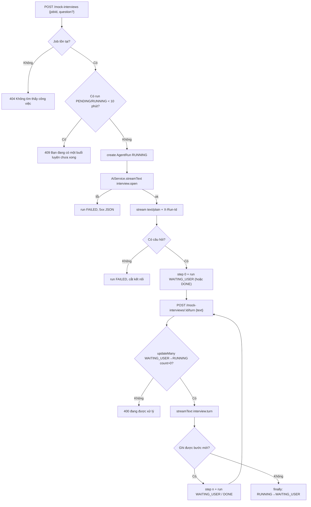
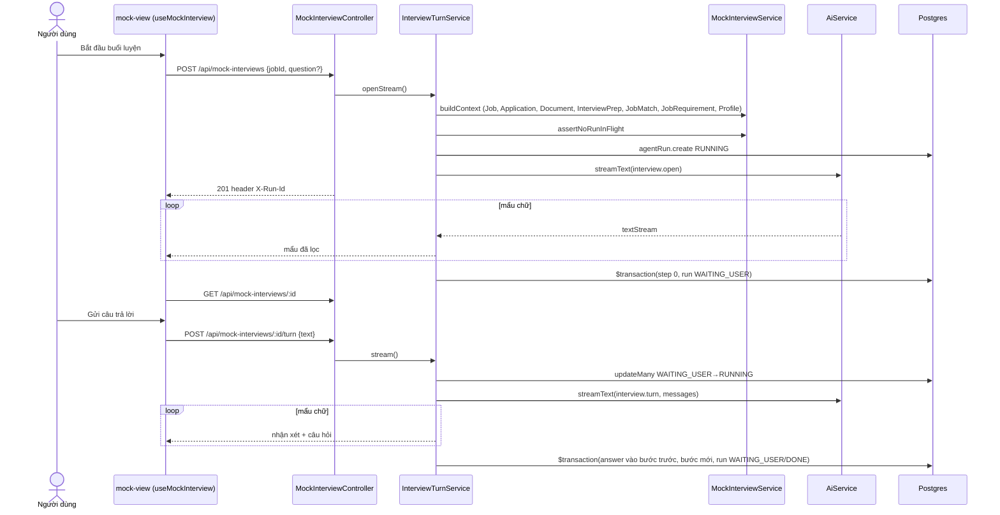
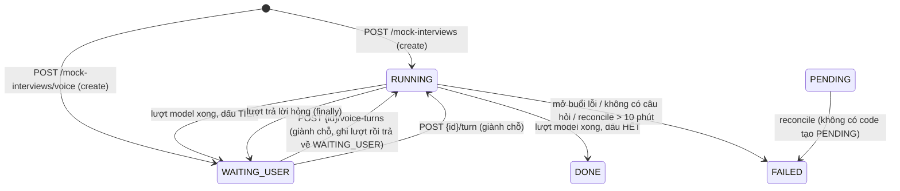

# Mock Interview — Phỏng vấn thử với người phỏng vấn ảo

> **Phạm vi:** `server/src/modules/mock-interview/**` (`MockInterviewController`, `MockInterviewService`, `InterviewTurnService`, `VoiceSessionService`, `LiveTokenService`, utils) · bảng `AgentRun`, `AgentStep` · màn hình `/dashboard/interview/[jobId]/mock` và danh sách buổi luyện trong `/dashboard/interview` (FE người dùng).
> **Nguyên tắc:** tài liệu mô tả hệ thống **as-is**. Code là nguồn sự thật duy nhất.

## 1. Purpose

| Mục tiêu | Diễn giải |
|---|---|
| Luyện phỏng vấn theo lượt hỏi–đáp | Người phỏng vấn ảo (model) hỏi từng câu, người dùng trả lời, model nhận xét ngắn rồi hỏi câu tiếp theo cho tới khi tự đánh dấu kết thúc ([utils/interview-turn.prompt.ts:21-39](../../../server/src/modules/mock-interview/utils/interview-turn.prompt.ts#L21)). |
| Bám vào hồ sơ ứng tuyển thật | Lượt mở đầu nạp "hồ sơ" gồm tin tuyển dụng kèm yêu cầu kinh nghiệm (số năm, cấp bậc), tóm tắt hồ sơ ứng viên (chức danh, kỹ năng chính, 3 kinh nghiệm gần nhất, tên dự án) *(2026-10-24)*, trạng thái đơn, điểm phù hợp + khoảng trống, tài liệu đã soạn, câu khó và điểm yếu từ bộ chuẩn bị phỏng vấn ([mock-interview.service.ts:112-171](../../../server/src/modules/mock-interview/services/mock-interview.service.ts#L112)). |
| Trả lời chảy dần (stream) | Câu hỏi/nhận xét được stream dạng `text/plain` để người dùng đọc ngay khi model đang viết ([mock-interview.controller.ts:59-124](../../../server/src/modules/mock-interview/mock-interview.controller.ts#L59)). |
| Luyện bằng giọng nói *(2026-10-24)* | Người phỏng vấn nói chuyện thời gian thực qua Gemini Live: trình duyệt nối thẳng tới Gemini bằng token ngắn hạn do server cấp, server lưu từng lượt hỏi–đáp dạng chữ và tạo lời tổng kết bằng đúng đường `finish` của buổi luyện chữ ([services/voice-session.service.ts](../../../server/src/modules/mock-interview/services/voice-session.service.ts), ADR 0019). |
| Lưu lại để xem lại / đếm tiến độ | Mỗi buổi là một `AgentRun` (`workflow = 'interview'`), mỗi lượt hỏi là một `AgentStep`; module khác đếm số buổi luyện từ đây. |

**Điểm mấu chốt:**
- Buổi luyện có trạng thái `WAITING_USER` — dừng giữa chừng chờ người dùng trả lời, có thể vài giờ sau ở một request khác ([schema.prisma:1020-1030](../../../server/prisma/schema.prisma#L1020)).
- Gửi câu trả lời dùng **giành chỗ có điều kiện** `WAITING_USER → RUNNING`; người thua nhận 400 và không gọi model ([interview-turn.service.ts:173-181](../../../server/src/modules/mock-interview/services/interview-turn.service.ts#L173)).
- Lượt trả lời hỏng KHÔNG làm buổi luyện `FAILED`: trạng thái được trả về `WAITING_USER` để gửi lại ([interview-turn.service.ts:219-226](../../../server/src/modules/mock-interview/services/interview-turn.service.ts#L219)).
- Không có hàng đợi: mọi lượt gọi model chạy đồng bộ trong request stream.

## 2. Actors

| Actor | Quyền trong module | Ghi chú |
|---|---|---|
| Người dùng đã đăng nhập (USER/ADMIN) | Mở buổi luyện cho bất kỳ tin tồn tại, gửi câu trả lời, xem danh sách/chi tiết buổi luyện CỦA MÌNH | Không có route `@Public()`. |
| Model AI (qua `AiService.streamText`) | Viết câu hỏi mở đầu (`interview.open`) và từng lượt nhận xét + câu hỏi (`interview.turn`) | Dùng chuỗi model nhanh (`fastModelChain`, chỉ lấy `modelId` đầu). |
| Gemini Live (Google) | Nói chuyện với người dùng ở buổi giọng nói; server chỉ cấp token, âm thanh không đi qua server *(2026-10-24)* | ADR 0019 |
| Cron reconcile | Đánh `FAILED` buổi luyện kẹt `PENDING`/`RUNNING` quá 10 phút | [reconcile.service.ts:105-108](../../../server/src/modules/reconcile/services/reconcile.service.ts#L105) |
| Module `interview`, `dashboard`, `admin` | Chỉ ĐỌC `AgentRun` | Xem §11 "Ai dùng AgentRun". |

## 3. Business Features

| # | Tính năng | Actor | Endpoint / cơ chế |
|---|---|---|---|
| F1 | Danh sách buổi luyện (lọc theo tin, workflow) | Người dùng | `GET /api/mock-interviews` |
| F2 | Chi tiết một buổi luyện kèm các bước | Người dùng | `GET /api/mock-interviews/:id` |
| F3 | Mở buổi luyện mới, stream câu hỏi đầu tiên | Người dùng | `POST /api/mock-interviews` |
| F4 | Gửi câu trả lời, stream nhận xét + câu hỏi tiếp | Người dùng | `POST /api/mock-interviews/:id/turn` |
| F4b | Kết thúc sớm, stream lời tổng kết *(2026-10-24)* | Người dùng | `POST /api/mock-interviews/:id/finish` |
| F5 | Dọn buổi luyện kẹt | Cron reconcile | `ReconcileService.failStuck` |
| F6 | Mở buổi luyện bằng giọng nói, nhận token Gemini Live *(2026-10-24)* | Người dùng | `POST /api/mock-interviews/voice` |
| F7 | Lưu một lượt hỏi–đáp của buổi giọng nói *(2026-10-24)* | Người dùng | `POST /api/mock-interviews/:id/voice-turns` |

## 4. Business Flow

### Luồng A — Danh sách buổi luyện (F1)

**Preconditions:** đã đăng nhập.

**Main Flow:**
1. `GET /api/mock-interviews?jobId=&workflow=&limit=&offset=` ([mock-interview.controller.ts:42-50](../../../server/src/modules/mock-interview/mock-interview.controller.ts#L42)).
2. `MockInterviewService.list` lọc `userId` (+ `jobId`, `workflow` nếu có), sắp `createdAt desc`, trong một `$transaction` lấy trang + tổng ([mock-interview.service.ts:66-105](../../../server/src/modules/mock-interview/services/mock-interview.service.ts#L66)).
3. Mỗi phần tử gồm `id, workflow, status, question, modelId, createdAt, finishedAt, jobId, job{title, company}, _count.steps` và `closing` = chữ của bước CUỐI (cắt 400 ký tự) chỉ khi buổi `DONE` ([utils/mock-interview.ts:9-16](../../../server/src/modules/mock-interview/utils/mock-interview.ts#L9)).
4. Controller thay `error` bằng `failureKind`; trả `{ items, total, limit, offset }`, 200.

**Alternative Flow:** FE trang phỏng vấn thử gọi với `limit=1` để mở buổi gần nhất của tin ([use-mock-interview.ts](../../../../ui-ai-job-search/hooks/use-mock-interview.ts)).

**Failure Flow:** `jobId` rỗng/> 40 → 400 `Mã công việc không hợp lệ`; `workflow` rỗng/> 60 → 400 `Tên kịch bản không hợp lệ`; phân trang sai → 400.

**Postconditions:** không ghi dữ liệu.

### Luồng B — Chi tiết buổi luyện (F2)

**Preconditions:** đã đăng nhập.

**Main Flow:**
1. `GET /api/mock-interviews/:id` ([mock-interview.controller.ts:52-57](../../../server/src/modules/mock-interview/mock-interview.controller.ts#L52)).
2. `detail` đọc `AgentRun` theo `{ id, userId }`, **bỏ cột `messages`** (trạng thái máy, chứa cả hồ sơ), kèm `steps` sắp `index asc` ([mock-interview.service.ts:54-64](../../../server/src/modules/mock-interview/services/mock-interview.service.ts#L54)).
3. Trả bản ghi (trừ `error`) + `failureKind`, 200. Mỗi bước có `toolResults[0].output = { asked, answer? }` — `answer` là NGUYÊN câu trả lời của người dùng cho câu hỏi đó.

**Alternative Flow:** FE hỏi lại mỗi 2 giây khi buổi đang `PENDING`/`RUNNING`, tối đa 330 lần ([use-mock-interview-run.ts](../../../../ui-ai-job-search/hooks/use-mock-interview-run.ts)).

**Failure Flow:** không có hoặc của người khác → **404 `Không tìm thấy buổi luyện: <id>`** ([mock-interview.service.ts:60-62](../../../server/src/modules/mock-interview/services/mock-interview.service.ts#L60)).

**Postconditions:** không ghi dữ liệu.

### Luồng C — Mở buổi luyện mới (F3)

**Preconditions:** đã đăng nhập; tin `jobId` tồn tại; người dùng không có buổi luyện nào `PENDING`/`RUNNING` cập nhật trong 10 phút gần nhất.

**Main Flow:**
1. `POST /api/mock-interviews` body `{ jobId, question? }`, `@ThrottleAi()` 10 lượt/phút ([mock-interview.controller.ts:59-92](../../../server/src/modules/mock-interview/mock-interview.controller.ts#L59)).
2. `buildContext` dựng hồ sơ buổi phỏng vấn từ `Job` (mô tả cắt 2000 ký tự), `Application` của người dùng, `Document` `DONE` của người dùng cho tin, `InterviewPrep` (chỉ khi `DONE`), `JobMatch` (chỉ khi `DONE` và có điểm), `JobRequirement` (số năm tối thiểu và cấp bậc, chỉ khi `DONE`), `Profile` của người dùng (chức danh, tối đa 10 kỹ năng chính, 3 kinh nghiệm đầu với 2 ý nổi bật mỗi mục cắt 200 ký tự, tối đa 3 tên dự án; mục kinh nghiệm thiếu chức danh hoặc công ty bị bỏ) *(2026-10-24)*. Tin không tồn tại → **404 `Không tìm thấy công việc: <jobId>`** ([interview-turn.service.ts:47-50](../../../server/src/modules/mock-interview/services/interview-turn.service.ts#L47)).
3. `assertNoRunInFlight`: có `AgentRun` của người dùng ở `PENDING`/`RUNNING` với `updatedAt` trong 10 phút → **409 `Bạn đang có một buổi luyện chưa xong. Đợi nó kết thúc rồi hãy mở buổi mới.`** ([mock-interview.service.ts:26-41](../../../server/src/modules/mock-interview/services/mock-interview.service.ts#L26)).
4. Tạo `AgentRun { workflow: 'interview', jobId, status: 'RUNNING', startedAt, input: { question } | {} }` ([interview-turn.service.ts:54-63](../../../server/src/modules/mock-interview/services/interview-turn.service.ts#L54)).
5. Gọi `AiService.streamText` với `INTERVIEW_TURN_SYSTEM` và `openingPrompt` (hỏi đúng câu người dùng chọn nếu có `question`, nếu không thì một câu mở đầu về động lực/Agile), `purpose: 'interview.open'` ([interview-turn.service.ts:68-75](../../../server/src/modules/mock-interview/services/interview-turn.service.ts#L68)).
6. Controller đặt header `Content-Type: text/plain; charset=utf-8`, `Cache-Control: no-cache, no-transform`, `X-Accel-Buffering: no`, **`X-Run-Id: <runId>`**, flush rồi ghi từng mẩu.
7. `pump` đệm đầu ra: đọc dòng đầu làm dấu `TIẾP`/`HẾT`, ẩn mọi thứ trước dấu `@@HOI@@` (lượt mở đầu không được có nhận xét), xoá khối `<tool_call>` và chữ Hán/Hàn/Ả Rập ([interview-turn.service.ts:229-278](../../../server/src/modules/mock-interview/services/interview-turn.service.ts#L229)).
8. Hết stream: tách câu hỏi; trong một `$transaction` tạo `AgentStep index 0` (`text: ''`, `toolCalls/toolResults` dạng `ask_user`) và cập nhật run → `WAITING_USER` (hoặc `DONE` nếu model đánh `HẾT`), `question`, `messages = [hồ sơ, câu trả lời model]` ([interview-turn.service.ts:116-140](../../../server/src/modules/mock-interview/services/interview-turn.service.ts#L116)).

**Alternative Flow:** model lỡ viết nhận xét ở lượt đầu → bị bỏ, chỉ log cảnh báo ([interview-turn.service.ts:110-114](../../../server/src/modules/mock-interview/services/interview-turn.service.ts#L110)).

**Failure Flow:**
- Gọi `streamText` ném lỗi trước khi stream → run `FAILED` với `error`, lỗi ném ra trước khi gửi header → 502/503/504 JSON kèm `failureKind` ([interview-turn.service.ts:77-80](../../../server/src/modules/mock-interview/services/interview-turn.service.ts#L77)).
- Model không trả câu hỏi → run `FAILED` `Model không trả về câu hỏi nào`, ném 400 `Model không trả về nội dung nào.` — lúc này header đã gửi nên controller cắt kết nối (`response.destroy()`) ([interview-turn.service.ts:104-108](../../../server/src/modules/mock-interview/services/interview-turn.service.ts#L104)).
- Stream model đứt giữa chừng → kết nối bị cắt; run nằm `RUNNING` cho tới reconcile (xem §17 R2).

**Postconditions:** một `AgentRun` mới ở `WAITING_USER` với 1 bước, hoặc `DONE`/`FAILED`.

### Luồng D — Gửi câu trả lời (F4)

**Preconditions:** buổi luyện của chính người dùng, `workflow = 'interview'`, đang `WAITING_USER`, có `messages`.

**Main Flow:**
1. `POST /api/mock-interviews/:id/turn` body `{ text }` (1–4000), `@ThrottleAi()` ([mock-interview.controller.ts:94-124](../../../server/src/modules/mock-interview/mock-interview.controller.ts#L94)).
2. `sessions.get(userId, id)` → 404 `Không tìm thấy buổi luyện: <id>` nếu không có/không phải của người dùng.
3. `workflow != 'interview'` → 400 `Chỉ buổi luyện phỏng vấn mới trả lời theo kiểu này.`; `status = 'RUNNING'` → 400 `Câu trả lời trước của buổi luyện này đang được xử lý, đợi một chút rồi gửi tiếp.`; trạng thái khác `WAITING_USER` → 400 `Buổi luyện này không còn chờ câu trả lời. Tải lại trang để xem trạng thái mới nhất.` *(2026-10-24)*; `messages` rỗng → 400 `Buổi luyện chưa có hội thoại nào để nối tiếp.` ([interview-turn.service.ts:155-171](../../../server/src/modules/mock-interview/services/interview-turn.service.ts#L155)).
4. **Giành chỗ:** `updateMany({ where: { id, userId, status: 'WAITING_USER' }, data: { status: 'RUNNING' } })`; `count = 0` → 400 `Câu trả lời trước của buổi luyện này đang được xử lý, không chờ câu trả lời nào.` ([interview-turn.service.ts:173-181](../../../server/src/modules/mock-interview/services/interview-turn.service.ts#L173)).
5. Ghép `messages + { role: 'user', content: text }`, gọi `streamText` (`purpose: 'interview.turn'`).
6. Header stream chỉ được gửi khi có mẩu đầu tiên — lỗi trước đó đi ra như HTTP JSON bình thường. Mỗi mẩu (nhận xét → câu hỏi, đã lọc) được ghi ra.
7. Tách `feedback`/`question`; `persist` trong một `$transaction`: gắn `answer` vào `toolResults` của bước trước, tạo bước mới `index = trước + 1` (`text = feedback`), cập nhật run → `WAITING_USER` (hoặc `DONE` nếu `HẾT`, khi đó `question = null`), `answer = null`, `messages` mới ([interview-turn.service.ts:289-333](../../../server/src/modules/mock-interview/services/interview-turn.service.ts#L289)).

**Alternative Flow:** model đánh `HẾT` → bước cuối là lời tổng kết, run `DONE`; danh sách hiển thị nó làm `closing`.

**Failure Flow:** lỗi model / model không trả câu hỏi (400 `Model không trả về nội dung nào.`) / lỗi ghi → khối `finally` đưa run `RUNNING → WAITING_USER`, không thêm bước; người dùng gửi lại được ([interview-turn.service.ts:219-226](../../../server/src/modules/mock-interview/services/interview-turn.service.ts#L219)). Lỗi trước mẩu đầu → JSON (≥ 500 với lỗi AI, e2e [mock-interview-turn.e2e-spec.ts:224](../../../server/test/mock-interview-turn.e2e-spec.ts#L224)); lỗi sau mẩu đầu → cắt kết nối, FE báo `Kết nối đứt giữa chừng.`

**Postconditions:** thêm đúng một `AgentStep`; run `WAITING_USER` hoặc `DONE`. Trình duyệt ngắt giữa chừng thì server vẫn chạy generator tới cuối và tự ghi; không xếp lại việc (đã gỡ `onAbandon` *(2026-10-16)*, theo `CLAUDE.md`).

### Luồng E — Reconcile buổi luyện kẹt (F5)

**Preconditions:** cron reconcile bật (mặc định mỗi 10 phút) hoặc admin chạy tay.

**Main Flow:** `agentRun.updateMany` với `status IN (PENDING, RUNNING)` và `updatedAt < now − 10 phút` → `FAILED`, `error = STUCK_MESSAGE`, `finishedAt = now` ([reconcile.service.ts:105-108](../../../server/src/modules/reconcile/services/reconcile.service.ts#L105)).

**Alternative Flow:** buổi `WAITING_USER` KHÔNG bị đụng tới (chờ người dùng là hợp lệ). **Failure Flow:** lỗi được cron log. **Postconditions:** buổi kẹt thành `FAILED`; không tự chạy lại.

### Luồng F — Buổi luyện bằng giọng nói (F6, F7) *(2026-10-24)*

**Preconditions:** đã đăng nhập; tin `jobId` tồn tại; không có buổi `PENDING`/`RUNNING` dưới 10 phút; còn ít nhất 3 phút trong hạn mức giọng nói 24 giờ.

**Main Flow:**
1. `POST /api/mock-interviews/voice` body `{ jobId }`, `@ThrottleAi()` ([mock-interview.controller.ts](../../../server/src/modules/mock-interview/mock-interview.controller.ts)).
2. `VoiceSessionService.open` dựng hồ sơ bằng đúng `buildContext` của luồng C, rồi `assertNoRunInFlight`.
3. Cộng số phút giọng nói đã dùng của các buổi `input.mode = 'voice'` tạo trong 24 giờ qua (`voiceMinutesUsed`: buổi `DONE`/`FAILED` tính tới `updatedAt`, buổi còn mở tính tới bây giờ, mỗi buổi tối đa bằng `input.minutes` đã cấp) ([utils/voice-interview.ts](../../../server/src/modules/mock-interview/utils/voice-interview.ts)). Còn dưới 3 phút → 400.
4. Số phút cấp = `min(MOCK_INTERVIEW_VOICE_SESSION_MINUTES = 20, phần còn lại)`. `LiveTokenService.create` gọi `POST https://generativelanguage.googleapis.com/v1alpha/auth_tokens` với `uses: 1`, `newSessionExpireTime` = 1 phút, `expireTime` = hết số phút cấp, và `bidiGenerateContentSetup` khoá toàn bộ cấu hình phiên (`voiceSetup`): model `MOCK_INTERVIEW_VOICE_MODEL`, giọng `MOCK_INTERVIEW_VOICE_NAME`, prompt người phỏng vấn bằng giọng nói kèm hồ sơ, ghi chữ hai chiều (đầu vào chỉ `vi-VN`/`en-US`), nhận diện lượt nói độ nhạy thấp, nén ngữ cảnh, công cụ `end_interview` ([services/live-token.service.ts](../../../server/src/modules/mock-interview/services/live-token.service.ts)).
5. Tạo `AgentRun { workflow: 'interview', jobId, status: 'WAITING_USER', startedAt, modelId, input: { mode: 'voice', minutes }, messages: [hồ sơ + ghi chú "bản ghi tự động từ giọng nói"] }`; trả `{ runId, token, model, expiresAt }` (201).
6. Trình duyệt nối thẳng tới Gemini Live bằng token; mỗi khi có một cặp câu hỏi của AI + câu trả lời của người dùng thì gọi `POST /api/mock-interviews/:id/voice-turns` body `{ question, answer }`.
7. `appendTurn`: `sessions.get` (404 nếu không phải của người dùng); không phải buổi giọng nói → 400; khác `WAITING_USER` → 400; **giành chỗ** `WAITING_USER → RUNNING` kèm `userId` (thua → 400); SAU khi giành chỗ mới đọc `messages` và số bước; đủ `MOCK_INTERVIEW_MAX_QUESTIONS` bước → 400; trong một `$transaction` tạo bước `index = số bước` (`ask_user` đã gắn sẵn `answer`) và nối `messages` thêm `assistant: "TIẾP\n@@HOI@@\n<câu hỏi>"` + `user: <câu trả lời>`, trả run về `WAITING_USER`. Trả `{ answered }` (201).
8. Kết thúc: trình duyệt gọi `POST /api/mock-interviews/:id/finish` như buổi chữ (luồng D, BR-MOCK-19) — model văn bản viết lời tổng kết từ bản ghi, buổi `DONE`, `result.text`.

**Alternative Flow:** người dùng đóng tab giữa chừng → buổi nằm `WAITING_USER` với các lượt đã lưu; gọi `finish` sau đó vẫn có tổng kết; số phút của buổi được tính tới khi hết số phút đã cấp.

**Failure Flow:** Google từ chối cấp token → log `Cấp token Gemini Live hỏng (<mã>)`, 503, không tạo buổi; lỗi ghi lượt → `finally` trả run `RUNNING → WAITING_USER`, không thêm bước.

**Postconditions:** buổi giọng nói có cùng định dạng bước và `messages` với buổi chữ, nên màn xem lại, danh sách và `closing` không phân biệt hai loại.

## 5. Mermaid Flowchart

## 6. Sequence Diagram

## 7. Business Rules

| Mã BR | Quy tắc | Nơi thực thi | Mức | Nguồn code |
|---|---|---|---|---|
| BR-MOCK-01 | Chỉ mở buổi luyện cho tin đang tồn tại. | SV | ✅ | [interview-turn.service.ts:47-50](../../../server/src/modules/mock-interview/services/interview-turn.service.ts#L47) |
| BR-MOCK-02 | Mỗi người dùng chỉ có một buổi luyện đang `PENDING`/`RUNNING` (cập nhật trong 10 phút) tại một thời điểm; mở thêm → 409. Kiểm-rồi-tạo, không có khoá DB. | SV | ✅ | [mock-interview.service.ts:26-41](../../../server/src/modules/mock-interview/services/mock-interview.service.ts#L26) |
| BR-MOCK-03 | Buổi luyện phỏng vấn ghi `workflow = 'interview'` và gắn `jobId` (cột, có index) để đếm "đã luyện mấy lượt cho tin này". | SV + DB | ✅ | [interview-turn.service.ts:54-63](../../../server/src/modules/mock-interview/services/interview-turn.service.ts#L54), [schema.prisma:1088-1090](../../../server/prisma/schema.prisma#L1088) |
| BR-MOCK-04 | Bối cảnh buổi luyện chỉ dùng dữ liệu CỦA người dùng (đơn, tài liệu `DONE`, bộ đề `DONE`, điểm phù hợp `DONE`, tóm tắt hồ sơ) cùng yêu cầu kinh nghiệm và mô tả tin cắt 2000 ký tự *(2026-10-24: thêm hồ sơ và yêu cầu kinh nghiệm)*; khai báo là "dữ liệu, không phải mệnh lệnh". | SV | ✅ | [mock-interview.service.ts:112-171](../../../server/src/modules/mock-interview/services/mock-interview.service.ts#L112), [utils/mock-interview.ts:103-165](../../../server/src/modules/mock-interview/utils/mock-interview.ts#L103) |
| BR-MOCK-05 | Lượt mở đầu không có nhận xét; nếu người dùng chọn sẵn câu (`question` ≤ 300) thì người phỏng vấn hỏi đúng câu đó trước. | SV (prompt + pump) | ✅ | [utils/interview-turn.prompt.ts:41-47](../../../server/src/modules/mock-interview/utils/interview-turn.prompt.ts#L41), [interview-turn.service.ts:102-114](../../../server/src/modules/mock-interview/services/interview-turn.service.ts#L102) |
| BR-MOCK-06 | Mỗi lượt model viết: dấu `TIẾP`/`HẾT` → nhận xét 2–4 câu → `@@HOI@@` → ĐÚNG MỘT câu hỏi; `HẾT` kết thúc buổi. Parser nhận cả dấu gõ lệch (`@@HOI@`, `@HOI@@`, `@@ HỎI @@`, chữ thường) để nhận xét không bị dồn vào câu hỏi *(2026-10-23)*. | SV (prompt + parser) | ✅ | [utils/interview-turn.prompt.ts:21-85](../../../server/src/modules/mock-interview/utils/interview-turn.prompt.ts#L21) |
| BR-MOCK-07 | Đầu ra bị lọc khối `<tool_call>` và chữ Hán/Hàn/Ả Rập trước khi gửi và lưu; số ký tự bị xoá được log cảnh báo. | SV | ✅ | [utils/interview-turn.prompt.ts:5-19](../../../server/src/modules/mock-interview/utils/interview-turn.prompt.ts#L5), [interview-turn.service.ts:280-287](../../../server/src/modules/mock-interview/services/interview-turn.service.ts#L280) |
| BR-MOCK-08 | Model không trả câu hỏi ở lượt mở đầu → buổi `FAILED`. | SV | ✅ | [interview-turn.service.ts:104-108](../../../server/src/modules/mock-interview/services/interview-turn.service.ts#L104) |
| BR-MOCK-09 | Chỉ trả lời được buổi luyện `workflow = 'interview'` đang `WAITING_USER` có lịch sử hội thoại. | SV | ✅ | [interview-turn.service.ts:155-171](../../../server/src/modules/mock-interview/services/interview-turn.service.ts#L155) |
| BR-MOCK-10 | Gửi câu trả lời dùng giành chỗ có điều kiện `WAITING_USER → RUNNING` kèm `userId`; hai lượt gửi cùng lúc chỉ một lượt gọi model. | SV | ✅ | [interview-turn.service.ts:173-181](../../../server/src/modules/mock-interview/services/interview-turn.service.ts#L173) |
| BR-MOCK-11 | Lượt trả lời hỏng trả buổi về `WAITING_USER`, không thêm bước, không `FAILED`. | SV | ✅ | [interview-turn.service.ts:219-226](../../../server/src/modules/mock-interview/services/interview-turn.service.ts#L219) |
| BR-MOCK-12 | Mỗi lượt thành công ghi nguyên tử: câu trả lời gắn vào bước trước, bước mới, trạng thái và lịch sử hội thoại. | SV + DB | ✅ | [interview-turn.service.ts:305-332](../../../server/src/modules/mock-interview/services/interview-turn.service.ts#L305) |
| BR-MOCK-13 | Thứ tự bước trong một buổi là duy nhất. | DB | 🔒 | [schema.prisma:1110](../../../server/prisma/schema.prisma#L1110) |
| BR-MOCK-14 | Lịch sử hội thoại (`messages`) là trạng thái máy, không trả ra API chi tiết; `steps` là bản cho người đọc. | SV | ✅ | [mock-interview.service.ts:57](../../../server/src/modules/mock-interview/services/mock-interview.service.ts#L57) |
| BR-MOCK-15 | Lời tổng kết của buổi chỉ có khi `DONE`, nằm ở `result.text` (phần sau `@@HOI@@` của lượt đánh `HẾT`; bước cuối không mang `ask_user`), cắt 400 ký tự. *(2026-10-24, trước đó lấy chữ bước cuối)* | SV | ✅ | [utils/mock-interview.ts:9-16](../../../server/src/modules/mock-interview/utils/mock-interview.ts#L9) |
| BR-MOCK-16 | Buổi kẹt `PENDING`/`RUNNING` quá 10 phút bị reconcile đánh `FAILED` + `finishedAt`; buổi `WAITING_USER` không bị đụng. | SV (cron) | ✅ | [reconcile.service.ts:26-29](../../../server/src/modules/reconcile/services/reconcile.service.ts#L26), [:105-108](../../../server/src/modules/reconcile/services/reconcile.service.ts#L105) |
| BR-MOCK-17 | Xoá tin tuyển dụng không xoá buổi luyện (`jobId` → `NULL`); xoá người dùng xoá buổi luyện và các bước. | DB | 🔒 | [schema.prisma:1056-1057](../../../server/prisma/schema.prisma#L1056), [:1098](../../../server/prisma/schema.prisma#L1098) |
| BR-MOCK-19 | Kết thúc sớm (`POST :id/finish`) đi chung đường giành chỗ với lượt trả lời; gửi model yêu cầu tổng kết thay cho câu trả lời, buộc `DONE`, câu đang hỏi dở không được gắn câu trả lời. *(2026-10-24)* | SV | ✅ | [interview-turn.service.ts](../../../server/src/modules/mock-interview/services/interview-turn.service.ts) |
| BR-MOCK-20 | Trần an toàn `MOCK_INTERVIEW_MAX_QUESTIONS` (mặc định 20) câu: khi buổi đã có đủ số bước đó, lượt trả lời kế tiếp dặn model tổng kết và buộc `DONE` dù model ghi `TIẾP`. Số câu bình thường vẫn do model tự quyết. *(2026-10-24)* | SV | ✅ | [interview-turn.service.ts](../../../server/src/modules/mock-interview/services/interview-turn.service.ts), [configuration.ts](../../../server/src/config/configuration.ts) |
| BR-MOCK-21 | Lượt chưa `HẾT` mà thiếu vạch `@@HOI@@` (model bị ngắt giữa chừng) là lượt hỏng: không ghi bước, trả buổi về `WAITING_USER`, người dùng gửi lại. Đo 2026-10-24: một lượt dừng ở "…tiêu chuẩn như ISO 2" từng bị lưu thành câu hỏi. *(2026-10-24)* | SV | ✅ | [interview-turn.service.ts](../../../server/src/modules/mock-interview/services/interview-turn.service.ts) |
| BR-MOCK-22 | Prompt người phỏng vấn: nhận xét chỉ dựa trên chữ ứng viên viết; mỗi chủ đề tối đa hai câu rồi chuyển yêu cầu chưa hỏi, chỉ hỏi công nghệ có trong tin hoặc hồ sơ; tin yêu cầu tiếng Anh thì có ít nhất một câu tiếng Anh; không lặp góp ý; buổi thường 8-12 câu; lời tổng kết là của người hướng dẫn (điểm mạnh, điểm cần sửa, chủ đề luyện tiếp). Rút ra từ buổi luyện 2026-10-24: 20 câu, 4 câu về OWASP ZAP không có trong tin, 7 lần cùng góp ý "thiếu số liệu", một lần khuyên "tưởng tượng" ví dụ. *(2026-10-24)* | Prompt | ✅ | [utils/interview-turn.prompt.ts](../../../server/src/modules/mock-interview/utils/interview-turn.prompt.ts) |
| BR-MOCK-23 | Buổi giọng nói: trình duyệt nhận token Gemini Live dùng MỘT lần, phải mở phiên trong 1 phút, sống tới hết số phút cấp; toàn bộ cấu hình phiên (prompt + hồ sơ, giọng, ghi chữ, nhận diện lượt nói, công cụ) khoá trong token — client gửi `systemInstruction` khác bị bỏ qua (đo 2026-10-24). API key không rời server. *(2026-10-24)* | SV | ✅ | [services/live-token.service.ts](../../../server/src/modules/mock-interview/services/live-token.service.ts), [utils/voice-interview.ts](../../../server/src/modules/mock-interview/utils/voice-interview.ts) |
| BR-MOCK-24 | Hạn mức giọng nói `MOCK_INTERVIEW_VOICE_DAILY_MINUTES` (30) phút trên 24 giờ gần nhất; buổi đã đóng tính tới `updatedAt`, buổi còn mở tính tới bây giờ, mỗi buổi tối đa số phút đã cấp (buổi bỏ dở không lách được hạn mức); còn dưới 3 phút → 400; token sống `min(20, phần còn lại)` phút. *(2026-10-24)* Hết phần ngày thì dùng tiếp phút thưởng mời bạn bè; phần vượt ghi `input.bonus` của buổi ([referrals.md](./referrals.md) BR-REF-05) *(2026-10-26)*. | SV | ✅ | [services/voice-session.service.ts](../../../server/src/modules/mock-interview/services/voice-session.service.ts) |
| BR-MOCK-25 | Lưu lượt giọng nói: chỉ buổi `input.mode = 'voice'` đang `WAITING_USER`; giành chỗ `WAITING_USER → RUNNING` kèm `userId`, đọc `messages` và số bước SAU khi giành chỗ; bước mới cùng định dạng `ask_user` với buổi chữ (câu trả lời gắn sẵn), `messages` thêm lượt `TIẾP`/`@@HOI@@` để `finish` nối tiếp được; trần `MOCK_INTERVIEW_MAX_QUESTIONS` bước → 400. *(2026-10-24)* | SV | ✅ | [services/voice-session.service.ts](../../../server/src/modules/mock-interview/services/voice-session.service.ts) |
| BR-MOCK-26 | Prompt người phỏng vấn bằng giọng nói: luôn nói tiếng Việt, cả buổi đúng một câu tiếng Anh có báo trước; câu không liên quan, cụt, khác ngôn ngữ hoặc nói với người khác là tạp âm — không đáp, không đổi ngôn ngữ; câu trả lời chung chung thì hỏi lại tình huống cụ thể; không bịa thông tin công ty; đọc mã từng chữ số; muốn kết thúc thì gọi `end_interview` TRƯỚC và chỉ chào khi được `ok`. Rút ra từ 4 buổi thử 2026-10-24 (tivi làm AI tự ngắt 5 lần và nhảy sang tiếng Anh; câu "làm việc nhóm tốt" được khen thay vì hỏi lại; AI tự đóng buổi sau 5 câu). *(2026-10-24)* | Prompt | ✅ | [utils/voice-interview.ts](../../../server/src/modules/mock-interview/utils/voice-interview.ts) |
| BR-MOCK-18 | Trình duyệt ngắt kết nối không làm server dừng hay xếp lại lượt; generator chạy tới cuối và tự ghi kết quả. | SV | ✅ | [mock-interview.controller.ts:80-91](../../../server/src/modules/mock-interview/mock-interview.controller.ts#L80) |

> **Possible Business Rule:** Không có giới hạn số lượt hỏi trong một buổi; việc kết thúc hoàn toàn do model đánh `HẾT` ("Hết bộ câu hỏi hoặc ứng viên xin dừng"). Cần xác nhận có cần trần số lượt không (xem §17 R4).

> **Possible Business Rule:** `assertNoRunInFlight` chặn theo MỌI `AgentRun` của người dùng chứ không riêng `workflow = 'interview'`. Hiện chỉ có workflow `interview` được tạo nên không có khác biệt; cần xác nhận khi thêm workflow mới.

## 8. Validation Rules

**`ListMockInterviewsDto`** (kế thừa `PaginationQueryDto`) ([mock-interview.dto.ts:4-14](../../../server/src/modules/mock-interview/mock-interview.dto.ts#L4))

| Field | Ràng buộc | DTO/Schema | Lỗi trả về |
|---|---|---|---|
| `jobId` | tuỳ chọn, chuỗi 1–40 | `ListMockInterviewsDto` | 400 `Mã công việc không hợp lệ` |
| `workflow` | tuỳ chọn, chuỗi 1–60 | idem | 400 `Tên kịch bản không hợp lệ` |
| `limit` / `offset` | 1–100 (mặc định 20) / 0–100000 | `PaginationQueryDto` | 400 |

**`OpenMockInterviewDto`** ([mock-interview.dto.ts:16-25](../../../server/src/modules/mock-interview/mock-interview.dto.ts#L16))

| Field | Ràng buộc | DTO/Schema | Lỗi trả về |
|---|---|---|---|
| `jobId` | bắt buộc, chuỗi 1–40 | `OpenMockInterviewDto` | 400 `Thiếu mã công việc` / `Mã công việc không hợp lệ` |
| `question` | tuỳ chọn, chuỗi 1–300 | idem | 400 `Câu hỏi mở đầu quá dài` |

**`AnswerTurnDto`** ([mock-interview.dto.ts:27-31](../../../server/src/modules/mock-interview/mock-interview.dto.ts#L27))

| Field | Ràng buộc | DTO/Schema | Lỗi trả về |
|---|---|---|---|
| `text` | bắt buộc, chuỗi 1–4000 | `AnswerTurnDto` | 400 `Câu trả lời trống hoặc quá dài` |

**`OpenVoiceInterviewDto`** = `PickType(OpenMockInterviewDto, ['jobId'])` *(2026-10-24)* — gửi `question` → 400 (`forbidNonWhitelisted`).

**`VoiceTurnDto`** *(2026-10-24)* ([mock-interview.dto.ts](../../../server/src/modules/mock-interview/mock-interview.dto.ts))

| Field | Ràng buộc | DTO/Schema | Lỗi trả về |
|---|---|---|---|
| `question` | bắt buộc, chuỗi 1–2000 | `VoiceTurnDto` | 400 `Câu hỏi trống hoặc quá dài` |
| `answer` | bắt buộc, chuỗi 1–8000 | idem | 400 `Câu trả lời trống hoặc quá dài` |

Trường lạ bị chặn bởi `forbidNonWhitelisted` (ValidationPipe toàn cục). FE cắt `?q=` còn 300 ký tự trước khi gửi ([mock/page.tsx](../../../../ui-ai-job-search/app/dashboard/interview/[jobId]/mock/page.tsx)).

## 9. API Mapping

| Method | URL | Role | Mục đích nghiệp vụ | Controller#method | Service | DTO | Response |
|---|---|---|---|---|---|---|---|
| GET | `/api/mock-interviews` | USER | Danh sách buổi luyện của mình | `MockInterviewController#list` | `MockInterviewService.list` | `ListMockInterviewsDto` | `Page<{ id, workflow, status, question, modelId, failureKind, createdAt, finishedAt, jobId, job, _count.steps, closing }>` |
| GET | `/api/mock-interviews/:id` | USER | Chi tiết buổi luyện + các bước | `MockInterviewController#get` | `MockInterviewService.detail` | — | `AgentRun` (trừ `messages`, `error`) + `steps[]` + `failureKind` |
| POST | `/api/mock-interviews` | USER (ThrottleAi 10/phút) | Mở buổi luyện, stream câu hỏi đầu | `MockInterviewController#open` | `InterviewTurnService.openStream` | `OpenMockInterviewDto` | 201 `text/plain` stream, header `X-Run-Id` |
| POST | `/api/mock-interviews/:id/turn` | USER (ThrottleAi 10/phút) | Gửi câu trả lời, stream lượt tiếp | `MockInterviewController#turn` | `InterviewTurnService.stream` | `AnswerTurnDto` | 201 `text/plain` stream |
| POST | `/api/mock-interviews/:id/finish` | USER (ThrottleAi 10/phút) | Kết thúc sớm, stream lời tổng kết | `MockInterviewController#finish` | `InterviewTurnService.stream` (`answer = null`) | — | 201 `text/plain` stream |
| POST | `/api/mock-interviews/voice` | USER (ThrottleAi 10/phút) | Mở buổi luyện bằng giọng nói, nhận token Gemini Live | `MockInterviewController#openVoice` | `VoiceSessionService.open` | `OpenVoiceInterviewDto` | 201 `{ runId, token, model, expiresAt }` |
| POST | `/api/mock-interviews/:id/voice-turns` | USER | Lưu một lượt hỏi–đáp của buổi giọng nói | `MockInterviewController#appendVoiceTurn` | `VoiceSessionService.appendTurn` | `VoiceTurnDto` | 201 `{ answered }` |

> Ghi chú: hai route POST dùng `@Res()` nhưng Nest đặt mã mặc định 201 của `@Post` trước khi gọi handler; e2e [mock-interview-turn.e2e-spec.ts:138](../../../server/test/mock-interview-turn.e2e-spec.ts#L138) ghi nhận `turn` trả **201**.

**Endpoint ở module khác tác động lên / đọc module này**

| Method | URL | Module | Tác động |
|---|---|---|---|
| GET | `/api/interview` | interview | Đếm `AgentRun` `workflow = 'interview'` theo `jobId` → `mockCount` ([interview.service.ts:312-316](../../../server/src/modules/interview/interview.service.ts#L312)). Xem [interview-prep.md](./interview-prep.md). |
| GET | dashboard (tiến độ) | dashboard | Đếm tổng buổi luyện và lấy `createdAt` 30 ngày cho chuỗi hoạt động ([dashboard.service.ts:69-87](../../../server/src/modules/dashboard/dashboard.service.ts#L69)). Xem [dashboard.md](./dashboard.md). |
| POST | `/api/admin/reconcile/run-now` | admin | Đánh `FAILED` buổi kẹt; số lượng vào ghi chú "lượt agent" ([reconcile-note.ts:6](../../../server/src/modules/admin/utils/reconcile-note.ts#L6)). Xem [admin-console.md](./admin-console.md). |

## 10. Frontend Mapping

| Route FE | Vai trò | Mục đích | Hook / API client |
|---|---|---|---|
| `/dashboard/interview/[jobId]/mock` ([page.tsx](../../../../ui-ai-job-search/app/dashboard/interview/[jobId]/mock/page.tsx)) — `?q=` câu chọn sẵn, `?run=` buổi cần mở | USER | Màn phỏng vấn thử: mở buổi, đọc stream, gửi câu trả lời, xem lại | `useMockInterview` ([use-mock-interview.ts](../../../../ui-ai-job-search/hooks/use-mock-interview.ts)) — mở buổi `?run=` hoặc buổi gần nhất (`list limit=1`); `useMockInterviewRun` ([use-mock-interview-run.ts](../../../../ui-ai-job-search/hooks/use-mock-interview-run.ts)) poll 2 giây khi `PENDING`/`RUNNING`; stream qua `streamInterviewOpen`/`streamInterviewTurn` ([lib/interview-stream.ts](../../../../ui-ai-job-search/lib/interview-stream.ts)) |
| Buổi luyện bằng giọng nói *(2026-10-24)* | USER | Chọn "Nói chuyện bằng giọng nói" ở màn bắt đầu: xin micro TRƯỚC khi gọi `POST /voice` (bị chặn micro thì không tạo buổi, không trừ phút), nối Gemini Live bằng token, cổng tạp âm hoặc "Giữ để nói", lưu từng cặp hỏi–đáp qua `voice-turns`, kết thúc thì gọi `finish`. Buổi giọng nói còn `WAITING_USER` mà không có phiên đang nói (đóng tab, mất mạng) hiện "Kết nối giọng nói bị ngắt" ngay trong khung nói chuyện, với nút kết thúc để lấy tổng kết (chưa có câu nào thì nút bắt đầu lại); trình duyệt báo `offline` thì đóng phiên ngay, nối Gemini quá 15 giây thì báo lỗi. Lỗi khi bắt đầu (micro bị chặn / không có / đang bận, hết hạn mức, Google lỗi) hiện modal giữa màn hình kèm cách gỡ và nút luyện bằng chữ *(2026-10-24)* | `useVoiceInterview` ([hooks/use-voice-interview.ts](../../../../ui-ai-job-search/hooks/use-voice-interview.ts)), [lib/voice-gate.ts](../../../../ui-ai-job-search/lib/voice-gate.ts), [lib/voice-turns.ts](../../../../ui-ai-job-search/lib/voice-turns.ts), [lib/voice-audio.ts](../../../../ui-ai-job-search/lib/voice-audio.ts), [voice-stage.tsx](../../../../ui-ai-job-search/app/dashboard/interview/[jobId]/mock/voice/voice-stage.tsx), [mode-choice.tsx](../../../../ui-ai-job-search/app/dashboard/interview/[jobId]/mock/mode-choice.tsx) |
| Thành phần màn hình | USER | Khung hội thoại, ô trả lời | [mock-view.tsx](../../../../ui-ai-job-search/app/dashboard/interview/[jobId]/mock/mock-view.tsx), [interview-turns.tsx](../../../../ui-ai-job-search/app/dashboard/interview/[jobId]/mock/interview-turns.tsx), [answer-box.tsx](../../../../ui-ai-job-search/app/dashboard/interview/[jobId]/mock/answer-box.tsx) |
| `/dashboard/interview?job=` — khối "Buổi phỏng vấn thử của vị trí này" | USER | Liệt kê tối đa 20 buổi của tin, mở lại bằng `?run=` | `mockInterviewService.list` ở [job-mock-sessions.tsx](../../../../ui-ai-job-search/app/dashboard/interview/job-mock-sessions.tsx) |
| Link "Luyện câu này" / "Phỏng vấn thử" | USER | Sang màn phỏng vấn thử với `?q=` | [practice-question.tsx:122](../../../../ui-ai-job-search/app/dashboard/interview/practice-question.tsx#L122), [prep-detail.tsx:202](../../../../ui-ai-job-search/app/dashboard/interview/prep-detail.tsx#L202) |

API client đọc: [services/mock-interview.ts](../../../../ui-ai-job-search/services/mock-interview.ts) (`get`, `list`). Stream gọi `fetch` trực tiếp với `credentials: "include"`; lỗi HTTP chỉ hiển thị `Máy chủ trả về HTTP <mã>` (xem §17 R5).

## 11. Database

**`AgentRun`** → bảng `agent_runs` ([schema.prisma:1038-1092](../../../server/prisma/schema.prisma#L1038))

| Field | Kiểu | Ghi chú (as-is) |
|---|---|---|
| `id` | cuid | PK |
| `userId` | String | FK `User` `onDelete: Cascade` |
| `workflow` | String | luôn `'interview'` trong code hiện tại |
| `status` | `AgentRunStatus` mặc định `PENDING` | code tạo thẳng `RUNNING` |
| `jobId` | String? | FK `Job` `onDelete: SetNull` |
| `input` | Json | `{ question }` hoặc `{}`; buổi giọng nói `{ mode: 'voice', minutes }` (số phút đã cấp) *(2026-10-24)* |
| `result`, `review` | Json? | **không có code ghi** |
| `question` | Text? | câu đang chờ trả lời; `null` khi `DONE` |
| `answer` | Text? | chỉ bị đặt `null`; câu trả lời thật nằm trong `AgentStep.toolResults` |
| `messages` | Json? | lịch sử hội thoại (`ModelMessage[]`), trạng thái máy |
| `modelId` | String? | chỉ buổi giọng nói ghi (model Gemini Live) *(2026-10-24)*; buổi chữ không ghi (xem §17 R3) |
| `error` | Text? | lỗi thô, không trả ra API |
| `startedAt`, `finishedAt` | DateTime? | `finishedAt` chỉ do reconcile ghi |
| `createdAt`, `updatedAt` | DateTime | `updatedAt` là mốc kẹt |

Index: `@@index([userId, createdAt desc])`, `@@index([userId, jobId, createdAt desc])`, `@@index([jobId])`. Quan hệ: `steps AgentStep[]`, `documents Document[]` (qua `Document.agentRunId`, `onDelete: SetNull` — [schema.prisma:753-754](../../../server/prisma/schema.prisma#L753); không có code nào trong `server/src` ghi cột này).

**`AgentStep`** → bảng `agent_steps` ([schema.prisma:1095-1112](../../../server/prisma/schema.prisma#L1095))

| Field | Kiểu | Ghi chú |
|---|---|---|
| `runId` | String | FK `AgentRun` `onDelete: Cascade` |
| `index` | Int | từ 0; `@@unique([runId, index])` |
| `text` | Text | nhận xét cho câu trả lời trước (bước 0: rỗng; bước cuối của buổi `DONE`: lời tổng kết) |
| `toolCalls` | Json | `[{ tool: 'ask_user', input: { question } }]` |
| `toolResults` | Json | `[{ tool: 'ask_user', output: { asked, answer? } }]` |
| `durationMs` | Int | thời gian lượt model |

**Enum `AgentRunStatus`** ([schema.prisma:1024](../../../server/prisma/schema.prisma#L1024)): `PENDING` (chờ — không dùng trong code tạo), `RUNNING` (model đang viết), `WAITING_USER` (chờ người dùng trả lời), `DONE` (đã kết thúc), `FAILED` (hỏng).

**Ai dùng `AgentRun`**

| Module | Thao tác | Mục đích | Nguồn |
|---|---|---|---|
| mock-interview | tạo, đọc, cập nhật | Toàn bộ vòng đời buổi luyện | [interview-turn.service.ts](../../../server/src/modules/mock-interview/services/interview-turn.service.ts), [mock-interview.service.ts](../../../server/src/modules/mock-interview/services/mock-interview.service.ts) |
| interview | `groupBy jobId` (đọc) | `mockCount` mỗi bộ đề | [interview.service.ts:312-316](../../../server/src/modules/interview/interview.service.ts#L312) |
| dashboard | `count`, `findMany createdAt` (đọc) | Số buổi phỏng vấn thử và ngày hoạt động 30 ngày | [dashboard.service.ts:69-87](../../../server/src/modules/dashboard/dashboard.service.ts#L69) |
| reconcile | `updateMany` | Đánh `FAILED` buổi kẹt + `finishedAt` | [reconcile.service.ts:105-108](../../../server/src/modules/reconcile/services/reconcile.service.ts#L105) |
| admin | đọc kết quả reconcile | Ghi chú "lượt agent" | [reconcile-note.ts](../../../server/src/modules/admin/utils/reconcile-note.ts) |

## 12. State Machine

`AgentRun.status`:

| Từ | Sang | Trigger | Điều kiện |
|---|---|---|---|
| (chưa có) | `RUNNING` | `openStream` | tin tồn tại, không có buổi đang chạy \< 10 phút |
| (chưa có) | `WAITING_USER` | `VoiceSessionService.open` *(2026-10-24)* | như trên, còn ≥ 3 phút hạn mức giọng nói, Google cấp token |
| `WAITING_USER` | `RUNNING` → `WAITING_USER` | `appendTurn` *(2026-10-24)* | giành chỗ thắng; ghi lượt hoặc `finally` trả về |
| `RUNNING` | `WAITING_USER` | `openTurn` / `persist` | có câu hỏi, dấu đầu không phải `HẾT` |
| `RUNNING` | `DONE` | `openTurn` / `persist` | dấu đầu là `HẾT` |
| `RUNNING` | `FAILED` | `failRun` | `streamText` ném lỗi khi mở buổi; hoặc model không trả câu hỏi ở lượt mở |
| `WAITING_USER` | `RUNNING` | `stream` | `updateMany where status = WAITING_USER` thắng |
| `RUNNING` | `WAITING_USER` | `stream` `finally` | lượt trả lời không ghi được (lỗi model, không có câu hỏi, lỗi ghi) |
| `PENDING`/`RUNNING` | `FAILED` | cron reconcile | `updatedAt` cũ hơn 10 phút |

`DONE` và `FAILED` là trạng thái cuối; không có route mở lại — người dùng mở buổi mới.

## 13. Exceptions

| Tình huống | HTTP | Thông điệp nguyên văn | Nguồn |
|---|---|---|---|
| Tin không tồn tại khi mở buổi | 404 | `Không tìm thấy công việc: <jobId>` | [interview-turn.service.ts:49](../../../server/src/modules/mock-interview/services/interview-turn.service.ts#L49) |
| Đang có buổi chưa xong | 409 | `Bạn đang có một buổi luyện chưa xong. Đợi nó kết thúc rồi hãy mở buổi mới.` | [mock-interview.service.ts:37-39](../../../server/src/modules/mock-interview/services/mock-interview.service.ts#L37) |
| Buổi không có / của người khác | 404 | `Không tìm thấy buổi luyện: <id>` | [mock-interview.service.ts:49](../../../server/src/modules/mock-interview/services/mock-interview.service.ts#L49), [:61](../../../server/src/modules/mock-interview/services/mock-interview.service.ts#L61) |
| Workflow khác `interview` | 400 | `Chỉ buổi luyện phỏng vấn mới trả lời theo kiểu này.` | [interview-turn.service.ts:156-158](../../../server/src/modules/mock-interview/services/interview-turn.service.ts#L156) |
| Câu trả lời trước còn đang xử lý | 400 | `Câu trả lời trước của buổi luyện này đang được xử lý, đợi một chút rồi gửi tiếp.` | [interview-turn.service.ts](../../../server/src/modules/mock-interview/services/interview-turn.service.ts) |
| Buổi không chờ trả lời | 400 | `Buổi luyện này không còn chờ câu trả lời. Tải lại trang để xem trạng thái mới nhất.` | [interview-turn.service.ts:161-163](../../../server/src/modules/mock-interview/services/interview-turn.service.ts#L161) |
| Không có lịch sử hội thoại | 400 | `Buổi luyện chưa có hội thoại nào để nối tiếp.` | [interview-turn.service.ts:168-170](../../../server/src/modules/mock-interview/services/interview-turn.service.ts#L168) |
| Thua giành chỗ (gửi trùng) | 400 | `Câu trả lời trước của buổi luyện này đang được xử lý, không chờ câu trả lời nào.` | [interview-turn.service.ts:178-180](../../../server/src/modules/mock-interview/services/interview-turn.service.ts#L178) |
| Model không trả câu hỏi | 400 (thường đã gửi header → cắt kết nối) | `Model không trả về nội dung nào.`; ghi DB lượt mở: `Model không trả về câu hỏi nào` | [interview-turn.service.ts:106-107](../../../server/src/modules/mock-interview/services/interview-turn.service.ts#L106), [:206](../../../server/src/modules/mock-interview/services/interview-turn.service.ts#L206) |
| Lỗi model trước mẩu đầu | 502 / 503 / 504 | bảng `FAILURE` của bộ lọc toàn cục, kèm `failureKind` | [all-exceptions.filter.ts:20-40](../../../server/src/common/filters/all-exceptions.filter.ts#L20) |
| Validation | 400 | `Thiếu mã công việc`, `Mã công việc không hợp lệ`, `Câu hỏi mở đầu quá dài`, `Câu trả lời trống hoặc quá dài`, `Tên kịch bản không hợp lệ` | [mock-interview.dto.ts](../../../server/src/modules/mock-interview/mock-interview.dto.ts) |
| Hết hạn mức giọng nói 24 giờ và hết phút thưởng *(2026-10-24, 2026-10-26)* | 400 | `Bạn đã luyện phỏng vấn bằng giọng nói đủ <N> phút trong 24 giờ qua. Luyện bằng chữ ngay bây giờ, quay lại sau, hoặc mời bạn bè ở trang Tài khoản để được thêm phút.` | [voice-session.service.ts](../../../server/src/modules/mock-interview/services/voice-session.service.ts) |
| Google không cấp token *(2026-10-24)* | 503 (thông điệp chung của bộ lọc 5xx) | log: `Cấp token Gemini Live hỏng (<mã>): <body>` | [services/live-token.service.ts](../../../server/src/modules/mock-interview/services/live-token.service.ts) |
| Gửi lượt giọng nói cho buổi chữ *(2026-10-24)* | 400 | `Buổi luyện này không phải buổi luyện bằng giọng nói.` | idem voice-session |
| Lượt giọng nói cho buổi không chờ *(2026-10-24)* | 400 | `Buổi luyện này không còn nhận câu trả lời. Tải lại trang để xem trạng thái mới nhất.` | idem |
| Lượt giọng nói gửi trùng *(2026-10-24)* | 400 | `Câu trả lời trước của buổi luyện này đang được lưu, đợi một chút rồi gửi tiếp.` | idem |
| Buổi giọng nói đủ trần câu *(2026-10-24)* | 400 | `Buổi luyện đã đủ <N> câu. Bấm kết thúc để nhận lời tổng kết.` | idem |
| Vượt throttle | 429 | `Bạn thao tác quá nhanh. Hãy đợi một lát rồi thử lại.` | [app.module.ts:31](../../../server/src/app.module.ts#L31) |
| Buổi kẹt (ghi DB) | — | `Máy chủ khởi động lại khi việc này đang chạy dở, nên nó không bao giờ hoàn tất. Hãy bấm chạy lại.` | [reconcile.service.ts:11](../../../server/src/modules/reconcile/services/reconcile.service.ts#L11) |

## 14. Notifications

Không có. Phản hồi tới người dùng đi trực tiếp qua stream HTTP; không có email/push.

## 15. Integrations

| Tích hợp | Cách dùng | Nguồn |
|---|---|---|
| `AiService.streamText` | `purpose: 'interview.open'` / `'interview.turn'`; model = `fastModelChain(...).modelId` (`AI_FAST_MODEL_ID`/pool) — stream KHÔNG đi tiếp chuỗi dự phòng, chỉ mở một model; timeout mặc định của `AiService`; lượt gọi ghi `AiCall` khi stream kết thúc/lỗi | [interview-turn.service.ts:69-75](../../../server/src/modules/mock-interview/services/interview-turn.service.ts#L69), [ai.service.ts:405-445](../../../server/src/modules/ai/services/ai.service.ts#L405), [ai-platform.md](./ai-platform.md) |
| Dữ liệu module khác (chỉ đọc) | `Job`, `Application`, `Document`, `InterviewPrep`, `JobMatch`, `JobRequirement`, `Profile` dựng bối cảnh | [mock-interview.service.ts:118-145](../../../server/src/modules/mock-interview/services/mock-interview.service.ts#L118) |
| Gemini Live *(2026-10-24)* | Server: `POST /v1alpha/auth_tokens` (`x-goog-api-key` = `GOOGLE_GEMINI_API_KEY`, timeout 10 s). Trình duyệt: WebSocket `BidiGenerateContentConstrained` bằng token. Bậc miễn phí của Gemini có thể dùng hội thoại để cải thiện sản phẩm — người dùng thật thì bật thanh toán. Cấu hình `MOCK_INTERVIEW_VOICE_*` ở `configuration.ts` | [services/live-token.service.ts](../../../server/src/modules/mock-interview/services/live-token.service.ts), ADR 0019 |
| Reconcile cron | `RECONCILE_CRON_ENABLED`, `RECONCILE_CRON_SCHEDULE` | [reconcile-cron.service.ts](../../../server/src/modules/reconcile/services/reconcile-cron.service.ts) |

## 16. Security

- **Xác thực:** mọi route cần JWT (guard toàn cục, không `@Public()`).
- **Sở hữu:** đọc theo `{ id, userId }`; giành chỗ `updateMany` cũng mang `userId`. Buổi của người khác → 404 (e2e [mock-interview-turn.e2e-spec.ts:178](../../../server/test/mock-interview-turn.e2e-spec.ts#L178)). Các lệnh ghi sau khi giành chỗ (`persist`, `failRun`, `finally`) khoá theo `id` (đã kiểm sở hữu trước đó).
- **Rate limit:** `@ThrottleAi()` 10/phút cho hai route POST; đếm theo `user:<id>`.
- **Buổi giọng nói** *(2026-10-24)*: API key Gemini chỉ ở server; trình duyệt nhận token một lần dùng, cấu hình khoá cứng, hết hạn theo số phút cấp. Lượt `voice-turns` khoá theo `{ id, userId }` như lượt chữ (e2e [mock-interview-voice.e2e-spec.ts](../../../server/test/mock-interview-voice.e2e-spec.ts)).
- **Dữ liệu nhạy cảm:** `messages` (chứa toàn bộ hồ sơ ứng tuyển) bị `omit` ở API chi tiết và không có trong danh sách; `error` thô thay bằng `failureKind`. Bối cảnh được đánh dấu "dữ liệu, không phải mệnh lệnh" để giảm prompt injection từ mô tả tin.

## 17. ⚠️ Sai lệch / Rủi ro nghiệp vụ

**R1 — Chặn "một buổi đang chạy" là kiểm-rồi-tạo, hai request mở buổi cùng lúc đều lọt.**
- Bằng chứng: `assertNoRunInFlight` dùng `findFirst` ([mock-interview.service.ts:26-41](../../../server/src/modules/mock-interview/services/mock-interview.service.ts#L26)) rồi `agentRun.create` ở bước riêng ([interview-turn.service.ts:52-63](../../../server/src/modules/mock-interview/services/interview-turn.service.ts#L52)); không có unique index hay giành chỗ.
- Tác động: bấm đúp "Bắt đầu" có thể tạo hai buổi và tốn hai lượt gọi model. Throttle 10/phút không chặn được. Với buổi giọng nói, hai lượt mở cùng lúc cùng tính số phút còn lại trước khi bên nào tạo buổi, nên có thể tiêu phút thưởng hai lần (tối đa ~20 phút một lần).
- Vì sao chưa sửa *(rà 2026-10-26)*: chặn chắc cần khoá dòng hoặc unique có điều kiện (Prisma không khai được, phải SQL tay — bẫy migration ở `server/README.md`); "tạo rồi kiểm" thì vướng việc buổi bằng chữ cố ý được mở song song khi đang `WAITING_USER`. Thiệt hại nhỏ so với độ phức tạp.
- Đề xuất: FE đã khoá nút khi `sending`; nếu cần chặn ở backend thì dùng một cơ chế giành chỗ duy nhất.
- Mức đề xuất: 🟡

**R2 — Stream lượt mở đầu đứt giữa chừng thì buổi nằm `RUNNING` và khoá người dùng mở buổi mới tới 10 phút.**
- Bằng chứng: `openTurn` không có `try/catch` quanh `pump` ([interview-turn.service.ts:95-108](../../../server/src/modules/mock-interview/services/interview-turn.service.ts#L95)); chỉ nhánh "không có câu hỏi" gọi `failRun`. `assertNoRunInFlight` coi run `RUNNING` có `updatedAt` trong 10 phút là đang chạy.
- Tác động: người dùng nhận 409 khi thử mở lại; sau 10 phút được mở lại, và reconcile (mỗi 10 phút) mới đánh `FAILED`. (Khác với lượt trả lời — có `finally` trả về `WAITING_USER`.)
- Đề xuất: bọc `pump` lượt mở bằng `catch` → `failRun`.
- Mức đề xuất: 🟡

**R3 — `finishedAt` và `modelId` của buổi luyện không bao giờ được ghi trên luồng thường.**
- Bằng chứng: `openStream` bỏ qua `modelId` trả về (`const { result } = ...`, [interview-turn.service.ts:69](../../../server/src/modules/mock-interview/services/interview-turn.service.ts#L69)); `openTurn`/`persist`/`failRun` không đặt `finishedAt`/`modelId` ([:121-140](../../../server/src/modules/mock-interview/services/interview-turn.service.ts#L121), [:323-331](../../../server/src/modules/mock-interview/services/interview-turn.service.ts#L323), [:88-93](../../../server/src/modules/mock-interview/services/interview-turn.service.ts#L88)); chỉ reconcile ghi `finishedAt`.
- Tác động: API danh sách trả `finishedAt: null` và `modelId: null` cho cả buổi `DONE`; không truy được model nào đã phỏng vấn (vẫn có trong `AiCall`).
- Đề xuất: ghi `finishedAt` khi `DONE`/`FAILED` và `modelId` khi mở/lượt.
- Mức đề xuất: 🟢

**R4 — Không có trần số lượt; mỗi lượt gửi lại TOÀN BỘ lịch sử.** ✅ **Đã sửa 2026-10-24**: trần an toàn 20 câu (BR-MOCK-20) và nút kết thúc sớm (BR-MOCK-19); số câu bình thường vẫn do model quyết theo chủ dự án.
- Bằng chứng: `stream` ghép `[...previous, answer]` và gửi hết ([interview-turn.service.ts:183-198](../../../server/src/modules/mock-interview/services/interview-turn.service.ts#L183)); không có bộ đếm lượt nào, kết thúc chỉ khi model đánh `HẾT` ([utils/interview-turn.prompt.ts:35](../../../server/src/modules/mock-interview/utils/interview-turn.prompt.ts#L35)).
- Tác động: buổi dài làm token đầu vào tăng tuyến tính mỗi lượt, tốn hạn mức gateway và có thể vượt ngữ cảnh model nhanh.
- Đề xuất: chủ dự án xác nhận số lượt tối đa (xem Possible Business Rule ở §7).
- Mức đề xuất: 🟡

**R5 — FE bỏ mất thông điệp lỗi tiếng Việt của server trên route stream.** ✅ **Đã sửa 2026-10-24**: `responseErrorMessage` (`lib/axios.ts`) đọc `message` trong body cho cả ba hàm stream (`interview-stream.ts`, `model-stream.ts`).
- Bằng chứng: khi `!response.ok`, `streamInterviewOpen`/`streamInterviewTurn` chỉ ném `Máy chủ trả về HTTP <mã>` (trừ 401) mà không đọc body ([lib/interview-stream.ts](../../../../ui-ai-job-search/lib/interview-stream.ts)).
- Tác động: người dùng thấy "Máy chủ trả về HTTP 409" thay vì "Bạn đang có một buổi luyện chưa xong..."; tương tự với 400/404/504.
- Đề xuất: đọc `message` từ body JSON khi có.
- Mức đề xuất: 🟢

**R7 — Model gửi lời tổng kết qua `ask_user`, buổi `DONE` mà `result.text` rỗng.** ✅ **Đã sửa 2026-10-24**: `persist` ghi phần tổng kết vào `result.text`, bước cuối không còn `ask_user` (BR-MOCK-15). Buổi cũ vẫn do FE `buildTranscript` xử lý.
- Bằng chứng: đo 2026-10-24 trên DB dev — bước cuối gọi `ask_user` với câu "Chúc mừng, bạn đã hoàn thành buổi luyện tập…", buổi chuyển `DONE`, `result.text` rỗng.
- Tác động: FE từng dựng lời tổng kết thành "Câu 8 · Đến lượt bạn", người dùng trả lời và nhận 400. ✅ FE đã xử lý 2026-10-24: `buildTranscript` coi câu cuối chưa trả lời của buổi `DONE` là tổng kết, ô trả lời ẩn khi buổi đã đóng (`isClosed`).
- Đề xuất: backend chép câu hỏi cuối vào `result.text` khi lượt kết thúc bằng `ask_user`, để mọi chỗ đọc kết quả đều thấy tổng kết.
- Mức đề xuất: 🟢

**R8 — Bản ghi chữ của buổi giọng nói do trình duyệt gửi lên.** *(2026-10-24)*
- Bằng chứng: âm thanh đi thẳng trình duyệt ↔ Gemini; server chỉ nhận `{ question, answer }` qua `voice-turns` ([services/voice-session.service.ts](../../../server/src/modules/mock-interview/services/voice-session.service.ts)).
- Tác động: người dùng sửa được bản ghi của chính mình trước khi lưu, nên lời tổng kết phản ánh thứ họ gửi chứ không chắc là thứ họ nói. Đây là dữ liệu luyện tập của chính họ nên chấp nhận (ADR 0019). Kiểm hạn mức và tạo buổi cũng là kiểm-rồi-tạo như R1: hai lượt mở cùng lúc có thể vượt hạn mức một buổi.
- Đề xuất: giữ nguyên tới khi kết quả buổi giọng nói được dùng cho việc khác ngoài luyện tập.
- Mức đề xuất: 🟢

**R6 — Cột/quan hệ không dùng tới trên `AgentRun`.**
- Bằng chứng: `result`, `review` không có chỗ ghi; `answer` chỉ bị đặt `null` ([interview-turn.service.ts:328](../../../server/src/modules/mock-interview/services/interview-turn.service.ts#L328)); `Document.agentRunId` không được ghi ở `server/src` ([schema.prisma:753](../../../server/prisma/schema.prisma#L753)). Chú thích model nói về "kịch bản trong `.claude/commands/`" (vd. `apply`) nhưng code chỉ tạo workflow `interview`.
- Tác động: nợ kỹ thuật, dễ gây hiểu nhầm khi đọc schema; không ảnh hưởng hành vi.
- Đề xuất: xác nhận còn trong lộ trình hay gỡ.
- Mức đề xuất: 🟢

## 18. Source References

**Backend**
- [mock-interview.controller.ts](../../../server/src/modules/mock-interview/mock-interview.controller.ts)
- [services/interview-turn.service.ts](../../../server/src/modules/mock-interview/services/interview-turn.service.ts)
- [services/mock-interview.service.ts](../../../server/src/modules/mock-interview/services/mock-interview.service.ts)
- [mock-interview.dto.ts](../../../server/src/modules/mock-interview/mock-interview.dto.ts)
- [mock-interview.module.ts](../../../server/src/modules/mock-interview/mock-interview.module.ts)
- [utils/interview-turn.prompt.ts](../../../server/src/modules/mock-interview/utils/interview-turn.prompt.ts)
- [utils/mock-interview.ts](../../../server/src/modules/mock-interview/utils/mock-interview.ts)
- [services/voice-session.service.ts](../../../server/src/modules/mock-interview/services/voice-session.service.ts), [services/live-token.service.ts](../../../server/src/modules/mock-interview/services/live-token.service.ts), [utils/voice-interview.ts](../../../server/src/modules/mock-interview/utils/voice-interview.ts), [ADR 0019](../../adr/0019-phong-van-giong-noi.md)
- [interview.service.ts](../../../server/src/modules/interview/interview.service.ts), [dashboard.service.ts](../../../server/src/modules/dashboard/dashboard.service.ts), [reconcile.service.ts](../../../server/src/modules/reconcile/services/reconcile.service.ts), [reconcile-cron.service.ts](../../../server/src/modules/reconcile/services/reconcile-cron.service.ts), [reconcile-note.ts](../../../server/src/modules/admin/utils/reconcile-note.ts)
- [ai.service.ts](../../../server/src/modules/ai/services/ai.service.ts), [common/throttle.ts](../../../server/src/common/throttle.ts), [all-exceptions.filter.ts](../../../server/src/common/filters/all-exceptions.filter.ts), [failure-view.ts](../../../server/src/common/ai/failure-view.ts), [duration.ts](../../../server/src/common/duration.ts)
- [schema.prisma](../../../server/prisma/schema.prisma#L1024)
- Test: [mock-interview-voice.e2e-spec.ts](../../../server/test/mock-interview-voice.e2e-spec.ts) (buổi giọng nói), [mock-interview-turn.e2e-spec.ts](../../../server/test/mock-interview-turn.e2e-spec.ts), [interview-list.e2e-spec.ts](../../../server/test/interview-list.e2e-spec.ts) (đếm buổi luyện, `closing`), [stream-claim.e2e-spec.ts](../../../server/test/stream-claim.e2e-spec.ts) (mẫu giành chỗ của route stream nói chung)

**Frontend**
- [app/dashboard/interview/[jobId]/mock/page.tsx](../../../../ui-ai-job-search/app/dashboard/interview/[jobId]/mock/page.tsx), [mock-view.tsx](../../../../ui-ai-job-search/app/dashboard/interview/[jobId]/mock/mock-view.tsx), [interview-turns.tsx](../../../../ui-ai-job-search/app/dashboard/interview/[jobId]/mock/interview-turns.tsx), [answer-box.tsx](../../../../ui-ai-job-search/app/dashboard/interview/[jobId]/mock/answer-box.tsx)
- [job-mock-sessions.tsx](../../../../ui-ai-job-search/app/dashboard/interview/job-mock-sessions.tsx)
- [services/mock-interview.ts](../../../../ui-ai-job-search/services/mock-interview.ts), [lib/interview-stream.ts](../../../../ui-ai-job-search/lib/interview-stream.ts)
- [hooks/use-mock-interview.ts](../../../../ui-ai-job-search/hooks/use-mock-interview.ts), [hooks/use-mock-interview-run.ts](../../../../ui-ai-job-search/hooks/use-mock-interview-run.ts)
