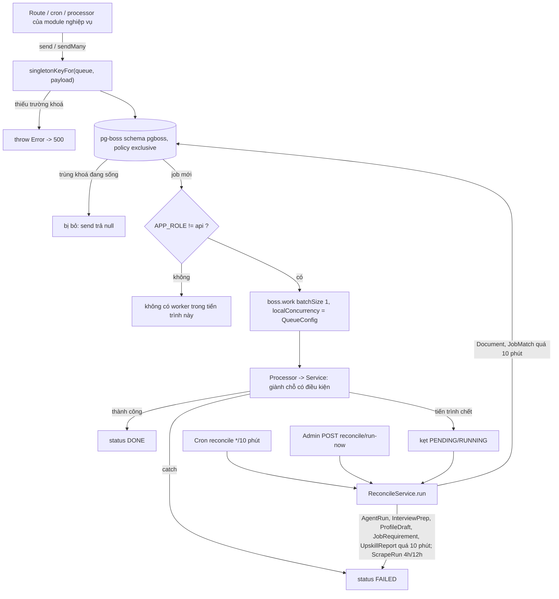
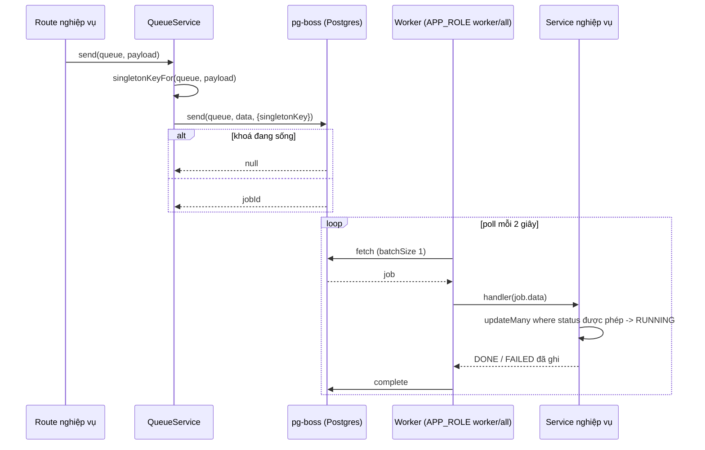
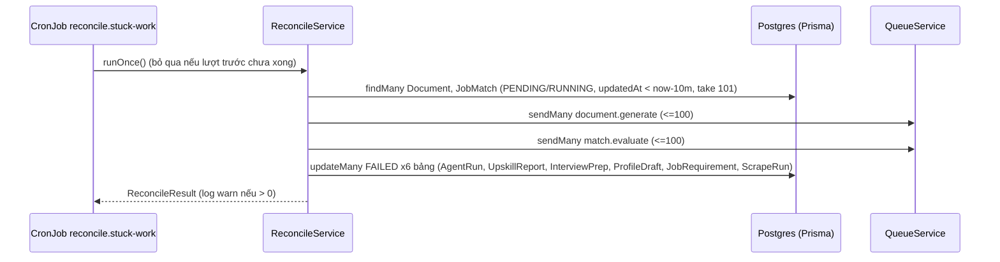
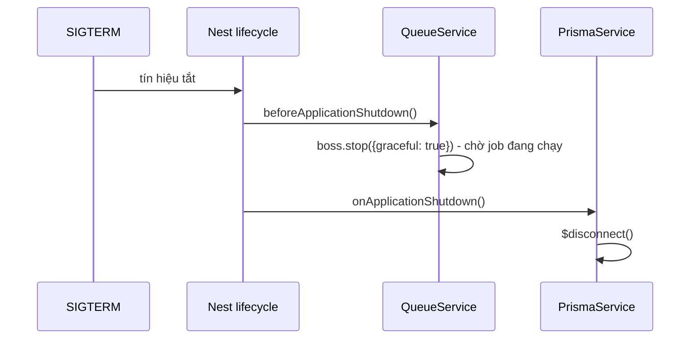
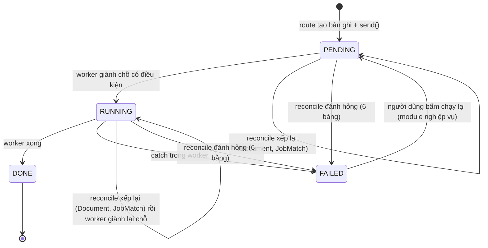
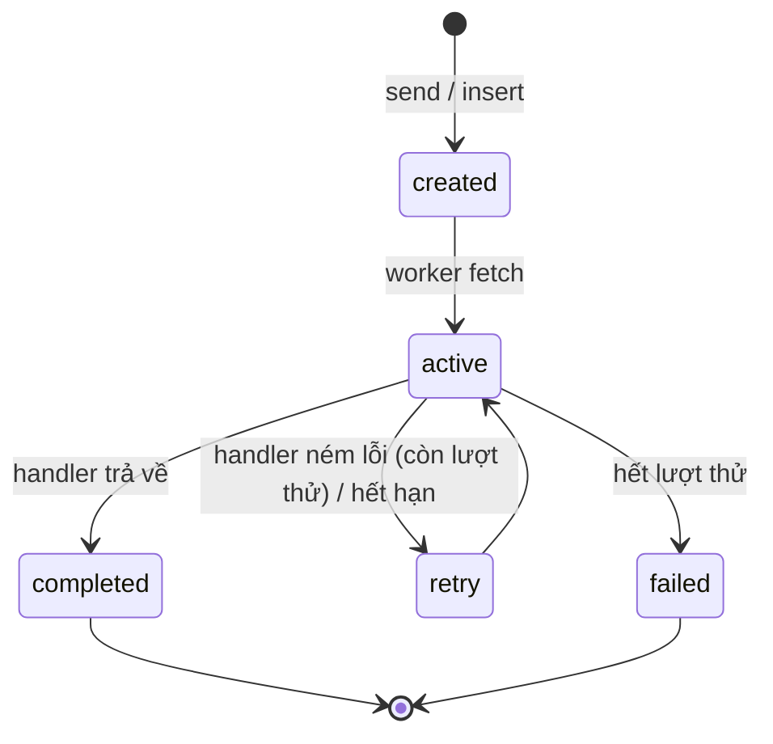

# Platform Operations — Vận hành nền tảng (hàng đợi, nhặt việc rơi, sức khoẻ, sandbox, lưu trữ, xử lý lỗi)

> **Phạm vi:** `server/src/modules/queue/**`, `server/src/modules/reconcile/**`, `server/src/modules/health/**`, `server/src/modules/sandbox/**`, `server/src/modules/storage/**`, `server/src/common/filters/**`, `server/src/common/middleware/**`, `server/src/common/ndjson.ts`, `server/src/common/stream-event.ts`, `server/src/prisma/**`, phần khởi động `server/src/main.ts` + `server/src/bootstrap.ts`. Màn hình admin `/queues` (chi tiết ở [admin-console.md](./admin-console.md)).
> **Nguyên tắc:** tài liệu mô tả hệ thống **as-is**. Code là nguồn sự thật duy nhất.

---

## 1. Purpose

| Mục tiêu | Diễn giải |
|---|---|
| Chạy việc tốn thời gian ở nền | Mọi tác vụ AI dài (chấm điểm, sinh tài liệu, upskill, đọc CV, tìm hiểu công ty...) và quét tin đi qua **một** hàng đợi pg-boss (`QueueService`) trên chính Postgres của ứng dụng, schema `pgboss` ([queue.service.ts:32](../../../server/src/modules/queue/queue.service.ts#L32)). |
| Không chạy trùng một việc | Mọi hàng đợi dùng policy `exclusive`, khoá chặn trùng (`singletonKey`) được **suy ra từ payload** chứ không do người gọi truyền ([queue-key.ts:46](../../../server/src/modules/queue/queue-key.ts#L46)). |
| Điều chỉnh tải không cần sửa code | Số worker song song mỗi hàng đợi đọc từ bảng `QueueConfig`, admin sửa được ([queue-config.service.ts:44](../../../server/src/modules/queue/queue-config.service.ts#L44)). |
| Không để việc "treo" vĩnh viễn | Tiến trình chết giữa chừng thì không khối `catch` nào ghi `FAILED`; `ReconcileService` định kỳ quét các bảng có trạng thái việc nền, xếp lại việc rẻ và đánh hỏng việc đắt ([reconcile.service.ts:41](../../../server/src/modules/reconcile/services/reconcile.service.ts#L41)). |
| Lỗi trả về người dùng thống nhất, tiếng Việt, không lộ nội bộ | `AllExceptionsFilter` + `PrismaExceptionFilter` ánh xạ mọi lỗi ra mã HTTP và thông điệp cố định ([all-exceptions.filter.ts:58](../../../server/src/common/filters/all-exceptions.filter.ts#L58)). |
| Cô lập việc nặng / lưu file người dùng | `SandboxRunner` (Docker, không mạng) và `Storage` (Cloudflare R2 qua S3 API) là hai seam hạ tầng: sandbox cho module tài liệu (in PDF khi không có `pdf-service`), Storage cho đọc CV (file PDF gốc) *(2026-10-19: documents không còn ghi `.tex` lên R2)*. |
| Theo dõi sống/chết | `GET /api/health` (công khai) và `GET /api/queue/stats` (ADMIN). |

**Điểm mấu chốt:**
- Hàng đợi là **cơ chế duy nhất** chặn trùng ở mức job; ở mức bản ghi, từng module tự "giành chỗ có điều kiện" (`updateMany ... where status`) — module này không thay thế việc đó.
- Concurrency admin sửa trong `QueueConfig` **chỉ có hiệu lực sau khi khởi động lại worker** (pg-boss chốt `localConcurrency` lúc đăng ký) — xem [ADR 0010](../../adr/0010-hang-doi.md) và rủi ro R1.
- Reconcile **không bao giờ** đụng bản ghi `FAILED` hay `DONE`; chỉ `PENDING`/`RUNNING` quá hạn.
- Thứ tự timeout là bất biến kiến trúc: **timeout MỘT lời gọi model (mặc định 90s, tài liệu 180s) \< `AI_CHAIN_BUDGET_MS` 240s \< `server.setTimeout` 300s \< `STUCK_AFTER_MS` 600s** ([ADR 0011](../../adr/0011-do-truoc-khi-doan.md)).

---

## 2. Actors

| Actor | Quyền trong module | Ghi chú |
|---|---|---|
| Khách / bất kỳ ai (Public) | Gọi `GET /api/health` | Không cần token, không bị throttle ([health.controller.ts:13](../../../server/src/modules/health/health.controller.ts#L13)). |
| USER (đã đăng nhập) | Gián tiếp: các route của module khác xếp việc vào hàng đợi; nhận lỗi qua filter; nhận stream NDJSON | Không có route riêng trong module. |
| ADMIN | `GET /api/queue/stats`; ở module admin: chạy reconcile ngay, xem/sửa `QueueConfig` | `@Roles('ADMIN')` ([health.controller.ts:23](../../../server/src/modules/health/health.controller.ts#L23), [admin.controller.ts:40](../../../server/src/modules/admin/controllers/admin.controller.ts#L40)). |
| Hệ thống — Worker pg-boss | Lấy việc từ 11 hàng đợi, gọi processor của module nghiệp vụ | Chỉ đăng ký khi `APP_ROLE` ≠ `api` ([queue.service.ts:144](../../../server/src/modules/queue/queue.service.ts#L144)). |
| Hệ thống — Cron `reconcile.stuck-work` | Gọi `ReconcileService.run()` rồi `RetentionService.purge()` định kỳ (dọn dữ liệu quá hạn, *2026-10-28*) | [reconcile-cron.service.ts:22](../../../server/src/modules/reconcile/services/reconcile-cron.service.ts#L22). |
| Hệ thống — Nest lifecycle | Khởi tạo hàng đợi, seed `QueueConfig`, dừng pg-boss rồi ngắt Prisma khi tắt | [queue.service.ts:25](../../../server/src/modules/queue/queue.service.ts#L25), [prisma.service.ts:31](../../../server/src/prisma/prisma.service.ts#L31). |
| Docker daemon / Cloudflare R2 | Dịch vụ ngoài được gọi qua seam | [docker.sandbox.ts:150](../../../server/src/modules/sandbox/docker.sandbox.ts#L150), [r2.storage.ts:16](../../../server/src/modules/storage/r2.storage.ts#L16). |

---

## 3. Business Features

| # | Tính năng | Actor | Endpoint / cơ chế |
|---|---|---|---|
| F1 | Khởi tạo 11 hàng đợi với policy `exclusive` | Hệ thống | `QueueService.onModuleInit` / `ensureQueue` |
| F2 | Xếp việc (một / nhiều) có khoá chặn trùng | Module nghiệp vụ | `QueueService.send`, `sendMany`, `singletonKeyFor` |
| F3 | Đăng ký worker theo vai tiến trình và concurrency | Hệ thống | `QueueService.work`, `APP_ROLE` |
| F4 | Cấu hình concurrency trong database | Hệ thống, ADMIN | `QueueConfigService` (seed, cache, update); `GET/PUT /api/admin/queue/config` (module admin) |
| F5 | Thống kê hàng đợi | ADMIN | `GET /api/queue/stats` |
| F6 | Nhặt việc nền bị rơi (reconcile) theo lịch | Hệ thống | Cron `reconcile.stuck-work` |
| F7 | Chạy reconcile ngay | ADMIN | `POST /api/admin/reconcile/run-now` (module admin) |
| F8 | Liveness probe | Public | `GET /api/health` |
| F9 | Tắt ứng dụng an toàn | Hệ thống | `beforeApplicationShutdown` (pg-boss) → `onApplicationShutdown` (Prisma) |
| F10 | Ánh xạ lỗi ra HTTP thống nhất | Hệ thống | `AllExceptionsFilter`, `PrismaExceptionFilter` (APP_FILTER toàn cục) |
| F11 | Trần thân request, mã request, log request | Hệ thống | `bootstrap.ts` (`express.json` 1MB, `x-request-id`), `RequestLogMiddleware` |
| F12 | Truyền kết quả AI dạng NDJSON | Module nghiệp vụ | `streamNdjson`, `ModelStreamEvent` |
| F13 | Chạy lệnh trong container cách ly | Module documents | `DockerSandbox.run` (token `SANDBOX`) |
| F14 | Đọc/ghi file người dùng trên R2 | Module profile-sources *(2026-10-19: documents không còn dùng Storage)* | `R2Storage.read/write` (token `STORAGE`) |

---

## 4. Business Flow

### Luồng A — Khởi tạo hàng đợi (F1)

**Preconditions:** `DATABASE_URL` đã đặt; Postgres sống.

**Main Flow:**
1. `QueueService.onModuleInit` nạp động `pg-boss`, tạo client `{ schema: 'pgboss', max: 10 }` ([queue.service.ts:27-36](../../../server/src/modules/queue/queue.service.ts#L27)).
2. `boss.start()`, rồi với từng tên trong `QUEUE` (11 hàng đợi, [queue.constants.ts:1](../../../server/src/modules/queue/queue.constants.ts#L1)) gọi `ensureQueue`.
3. Chưa có hàng đợi → `createQueue(name, { policy: 'exclusive' })` ([queue.service.ts:86-88](../../../server/src/modules/queue/queue.service.ts#L86)).
4. Đã có, đúng policy → bỏ qua.
5. Log `Hàng đợi sẵn sàng (policy exclusive): ...` và vai tiến trình.

**Alternative Flow:**
- Hàng đợi có sẵn nhưng policy khác và `QUEUE_POLICY_MIGRATE=true` → log cảnh báo, `deleteQueue` rồi `createQueue` lại; **việc đang chờ trong hàng đợi đó bị mất** ([queue.service.ts:102-107](../../../server/src/modules/queue/queue.service.ts#L102)).

**Failure Flow:**
- Thiếu `DATABASE_URL` → ném `DATABASE_URL chưa được đặt` ([queue.service.ts:30](../../../server/src/modules/queue/queue.service.ts#L30)).
- Policy khác và không có cờ migrate → ném lỗi 3 dòng: `Hàng đợi "<name>" đang dùng policy "<cũ>", cần "exclusive" để chặn trùng việc.` / `pg-boss không cho đổi policy tại chỗ, nên phải xoá và tạo lại hàng đợi - việc đang chờ sẽ MẤT.` / `Bước này cần người xác nhận: chạy lại với QUEUE_POLICY_MIGRATE=true.` ([queue.service.ts:92-100](../../../server/src/modules/queue/queue.service.ts#L92)). Promise `started` bị reject nên mọi `send`/`work` sau đó đều hỏng — chủ đích theo [ADR 0010](../../adr/0010-hang-doi.md): "app không lên".
- pg-boss phát sự kiện `error` → chỉ log `pg-boss lỗi` ([queue.service.ts:37](../../../server/src/modules/queue/queue.service.ts#L37)).

**Postconditions:** 11 hàng đợi tồn tại trong schema `pgboss`, policy `exclusive`.

### Luồng B — Xếp việc có chặn trùng (F2)

**Preconditions:** Luồng A xong (mọi `send` đều `await this.started`).

**Main Flow:**
1. Module nghiệp vụ gọi `queue.send(queue, data, options?)` hoặc `queue.sendMany(queue, items)`.
2. `singletonKeyFor(queue, data)` dựng khoá theo bảng ở §15.1 ([queue-key.ts:46-92](../../../server/src/modules/queue/queue-key.ts#L46)). Khoá do code ghi đè lên mọi `singletonKey` người gọi truyền ([queue.service.ts:116-119](../../../server/src/modules/queue/queue.service.ts#L116)).
3. pg-boss chèn job. Với policy `exclusive`, đã có job cùng `(name, singletonKey)` ở trạng thái chưa xong (created/retry/active) thì job mới bị bỏ: `send` trả `null`, `sendMany` không đếm phần tử đó.
4. `send` trả id job; `sendMany` gọi `boss.insert(..., { returnId: true })` và trả **số** job thực sự được xếp ([queue.service.ts:123-136](../../../server/src/modules/queue/queue.service.ts#L123)).

**Alternative Flow:**
- `sendMany` với mảng rỗng → trả `0`, không gọi pg-boss ([queue.service.ts:125](../../../server/src/modules/queue/queue.service.ts#L125)).
- Người gọi truyền `startAfter` (chỉ `MatchingProcessor.handOverToShortlist`: 60 giây, [matching.processor.ts:140-143](../../../server/src/modules/matching/matching.processor.ts#L140)) → job hẹn giờ; trong 60 giây đó mọi lần gửi cùng khoá bị gộp, tức là cơ chế "đợi lắng" (debounce).

**Failure Flow:**
- Payload thiếu trường khoá → ném trước khi chạm pg-boss: `Payload của hàng đợi "<q>" thiếu trường chuỗi "<field>", không dựng được khoá dedup.` ([queue-key.ts:8](../../../server/src/modules/queue/queue-key.ts#L8)); với `job.requirements` thiếu mảng: `Payload của hàng đợi "<q>" thiếu mảng "jobIds", không dựng được khoá dedup.` ([queue-key.ts:22](../../../server/src/modules/queue/queue-key.ts#L22)).
- Tên hàng đợi chưa có nhánh khoá → `Hàng đợi "<q>" chưa khai khoá dedup. Thêm một nhánh vào singletonKeyFor().` ([queue-key.ts:89](../../../server/src/modules/queue/queue-key.ts#L89)).
- Các lỗi này đi lên route gọi → `AllExceptionsFilter` trả 500 `Máy chủ gặp lỗi ngoài dự kiến. Hãy thử lại sau.`

**Postconditions:** tối đa một job "đang sống" cho mỗi khoá.

### Luồng C — Đăng ký worker (F3)

**Preconditions:** Processor của module nghiệp vụ gọi `queue.work()` trong `onModuleInit`.

**Main Flow:**
1. `runsBackgroundWork()` = `APP_ROLE` ≠ `api` ([app-role.ts:21](../../../server/src/config/app-role.ts#L21)). Vai `api` → log debug và **thoát**, không đăng ký worker ([queue.service.ts:144-147](../../../server/src/modules/queue/queue.service.ts#L144)).
2. Đợi `started`; đọc `concurrency = queueConfig.getConcurrency(queue)` ([queue.service.ts:150](../../../server/src/modules/queue/queue.service.ts#L150)).
3. `boss.work(queue, { batchSize: 1, pollingIntervalSeconds: 2, localConcurrency: concurrency, ...options }, handler)` ([queue.service.ts:151-158](../../../server/src/modules/queue/queue.service.ts#L151)); handler chạy tuần tự từng job trong lô.
4. Log `Worker đang lắng nghe: <queue> (song song <n>)`.

**Alternative Flow:** `APP_ROLE` trống → mặc định `all` (vừa API vừa worker) ([app-role.ts:5-10](../../../server/src/config/app-role.ts#L5)).

**Failure Flow:**
- `APP_ROLE` lạ → ném `APP_ROLE không hợp lệ: "<raw>". Chọn một trong: api, worker, all.` ([app-role.ts:14-16](../../../server/src/config/app-role.ts#L14)).
- Handler ném lỗi → pg-boss áp cấu hình thử lại **mặc định của thư viện** (code không đặt `retryLimit`/`expireInSeconds` ở đâu trong `src`); hầu hết service nghiệp vụ tự `catch` và ghi `FAILED` nên không ném ra (xem R7).

**Postconditions:** worker poll mỗi 2 giây; số worker song song cố định đến lần khởi động sau.

### Luồng D — Cấu hình concurrency (F4)

**Preconditions:** Prisma đã kết nối.

**Main Flow (khởi động):**
1. `QueueConfigService.onModuleInit` gọi `queueConfig.createMany(..., skipDuplicates: true)` từ bảng mặc định ([queue-config.service.ts:22-31](../../../server/src/modules/queue/queue-config.service.ts#L22), [queue.defaults.ts:6-20](../../../server/src/modules/queue/queue.defaults.ts#L6)). Dòng đã có (admin đã sửa) **không bị ghi đè**. Hàng `serial` được ghi note `Bắt buộc tuần tự để tránh chặn IP`.
2. `refreshCache()` nạp toàn bảng vào `Map` trong bộ nhớ.

**Main Flow (đọc concurrency):** `getConcurrency(queue)`: có dòng và `serial` → 1; có dòng → `max(1, concurrency)`; không có dòng → giá trị mặc định (`serial` → 1) ([queue-config.service.ts:44-49](../../../server/src/modules/queue/queue-config.service.ts#L44), [queue.defaults.ts:22-26](../../../server/src/modules/queue/queue.defaults.ts#L22)).

**Main Flow (admin sửa, route ở module admin):**
1. `PUT /api/admin/queue/config/:queueName` với `UpdateQueueConfigDto` ([admin.controller.ts:151](../../../server/src/modules/admin/controllers/admin.controller.ts#L151)).
2. `update()` dựng `data = { concurrency: put.concurrency ?? 1, serial: put.serial ?? false, note: put.note ?? null }` rồi `upsert` theo `queueName`, làm mới cache, log ([queue-config.service.ts:56-77](../../../server/src/modules/queue/queue-config.service.ts#L56)).
3. `GET /api/admin/queue/config` → `findAll()` làm mới cache rồi trả mảng, phân trang trong bộ nhớ ([admin.controller.ts:140](../../../server/src/modules/admin/controllers/admin.controller.ts#L140)).

**Alternative Flow:** trường bỏ trống trong body PUT bị **đặt lại về mặc định** (1 / false / null), không giữ giá trị cũ — PUT là thay thế toàn phần.

**Failure Flow:** `concurrency` ngoài 1..50 hoặc không nguyên → 400 (validator, §8). `serial` không phải boolean → lọt DTO, hỏng ở Prisma → 500 (R2).

**Postconditions:** dòng `QueueConfig` cập nhật; cache cập nhật; `GET /api/queue/stats` hiện số mới; **worker đang chạy vẫn dùng số cũ** đến khi restart (R1).

### Luồng E — Thống kê hàng đợi (F5)

**Preconditions:** ADMIN có access token.

**Main Flow:**
1. `GET /api/queue/stats` → `JwtAuthGuard` + `RolesGuard` (toàn cục) kiểm `ADMIN` ([health.controller.ts:23-32](../../../server/src/modules/health/health.controller.ts#L23)).
2. `QueueService.getStats()` gọi `boss.getQueue(name)` cho 11 hàng đợi song song, lấy `queuedCount`/`activeCount`/`totalCount` và concurrency từ cache ([queue.service.ts:60-81](../../../server/src/modules/queue/queue.service.ts#L60)).
3. Trả `{ queues: [{ name, concurrency, size, active, total }], totalWaiting, totalActive }` ([queue.types.ts:58-70](../../../server/src/modules/queue/queue.types.ts#L58)).

**Alternative Flow:** `getQueue` trả rỗng → các số mặc định 0. Module admin cũng gọi `getStats()` cho trang tổng quan ([admin.service.ts:285](../../../server/src/modules/admin/services/admin.service.ts#L285)).

**Failure Flow:** không token → 401; không phải ADMIN → 403 (thông điệp do guard của module auth — xem [auth.md](./auth.md)); pg-boss không lên → promise `started` reject → 500.

**Postconditions:** không ghi gì.

### Luồng F — Nhặt việc nền bị rơi theo lịch (F6)

**Preconditions:** `APP_ROLE` ≠ `api`; `RECONCILE_CRON_ENABLED` ≠ `false` ([configuration.ts:149-150](../../../server/src/config/configuration.ts#L149)).

**Main Flow:**
1. `ReconcileCronService.onModuleInit` tạo `CronJob(RECONCILE_CRON_SCHEDULE ?? '*/10 * * * *', ..., CRON_TIMEZONE ?? 'Asia/Ho_Chi_Minh')`, đăng ký tên `reconcile.stuck-work` ([reconcile-cron.service.ts:35-48](../../../server/src/modules/reconcile/services/reconcile-cron.service.ts#L35)).
2. Mỗi lần kích hoạt `runOnce()`: cờ `running` trong bộ nhớ; nếu lượt trước chưa xong → log `Lượt nhặt trước còn đang chạy; bỏ qua lượt này` ([reconcile-cron.service.ts:51-55](../../../server/src/modules/reconcile/services/reconcile-cron.service.ts#L51)).
3. `ReconcileService.run()` ([reconcile.service.ts:41-90](../../../server/src/modules/reconcile/services/reconcile.service.ts#L41)):
   1. `stuckBefore = now − STUCK_AFTER_MS` (10 phút, [duration.ts:10](../../../server/src/common/duration.ts#L10)).
   2. Tìm `Document` và `JobMatch` có `status IN (PENDING, RUNNING)` và `updatedAt < stuckBefore`, cũ nhất trước, lấy tối đa 101 dòng mỗi bảng.
   3. Lấy 100 dòng đầu, **xếp lại** bằng `sendMany` vào `document.generate` (`{ userId, documentId }`) và `match.evaluate` (`{ userId, jobId }` — khoá `...:cache`).
   4. `failStuck` — **đánh hỏng** (`status = FAILED`, `error = STUCK_MESSAGE`) đồng thời 6 bảng ([reconcile.service.ts:92-144](../../../server/src/modules/reconcile/services/reconcile.service.ts#L92)):
      - `AgentRun`, `InterviewPrep`, `ProfileDraft`, `JobRequirement`: PENDING/RUNNING và `updatedAt < stuckBefore`; `AgentRun` thêm `finishedAt = now`. (`AgentRun.WAITING_USER` không nằm trong điều kiện nên không bị đụng.)
      - `UpskillReport`: PENDING/RUNNING và **`createdAt`** \< `stuckBefore`.
      - `ScrapeRun`: `RUNNING` và `startedAt` cũ hơn **4 giờ**, hoặc `PENDING` và `createdAt` cũ hơn **12 giờ**; thêm `finishedAt`.
   5. `deferred` = số dòng thứ 101 của hai bảng xếp lại (dấu hiệu "còn nữa, để lượt sau").
   6. Tổng > 0 thì log cảnh báo `Xếp lại X tài liệu, Y lượt chấm; đánh hỏng ...; còn N việc vượt trần, để lượt sau` ([reconcile.service.ts:146-169](../../../server/src/modules/reconcile/services/reconcile.service.ts#L146)).

**Alternative Flow:**
- Cron tắt → log `Cron nhặt việc rơi đang TẮT (RECONCILE_CRON_ENABLED=false)`; vai `api` → log `Vai api: không chạy cron nhặt việc rơi`.
- Job xếp lại trùng khoá với job còn sống trong hàng đợi → pg-boss bỏ, không chạy hai lần (e2e "chạy hai lần không xếp trùng").
- Khi worker nhận lại `Document`/`JobMatch`, chính worker giành chỗ có điều kiện: `DocumentGenerator.claim` nhận `PENDING`/`FAILED` hoặc `RUNNING` quá `STUCK_AFTER_MS` ([document-generator.service.ts:53-77](../../../server/src/modules/documents/services/document-generator.service.ts#L53)); `MatchingService.claim` nhận mọi trạng thái khác `RUNNING` hoặc `RUNNING` quá `STALE_RUNNING_MS` 5 phút ([matching.service.ts:232-257](../../../server/src/modules/matching/ai/services/matching.service.ts#L232)).

**Failure Flow:** mọi lỗi trong `run()` bị bắt, log `Lượt nhặt việc rơi thất bại: <message>`; cờ `running` luôn được trả trong `finally` ([reconcile-cron.service.ts:57-63](../../../server/src/modules/reconcile/services/reconcile-cron.service.ts#L57)).

**Postconditions:** bản ghi kẹt hoặc đã có job mới trong hàng đợi, hoặc ở `FAILED` với thông điệp `Máy chủ khởi động lại khi việc này đang chạy dở, nên nó không bao giờ hoàn tất. Hãy bấm chạy lại.` ([reconcile.service.ts:11-12](../../../server/src/modules/reconcile/services/reconcile.service.ts#L11)) — người dùng tự bấm chạy lại; **không** tự xếp lại `FAILED`.

### Luồng G — Admin chạy reconcile ngay (F7)

**Preconditions:** ADMIN.

**Main Flow:** `POST /api/admin/reconcile/run-now` → `ReconcileService.run()` (cùng logic Luồng F, **không** qua cờ `running` của cron) → HTTP **202** với `ReconcileResult` + `note` do `reconcileNote()` dựng: `Đã xếp lại N việc vào hàng đợi. Worker sẽ xử lý ở nền.` / `Đã đánh hỏng N việc bị kẹt; người dùng bấm chạy lại được.` / `Còn N việc vượt trần, để lượt sau.` hoặc `Không tìm thấy việc nào bị rơi.` ([admin.controller.ts:130-135](../../../server/src/modules/admin/controllers/admin.controller.ts#L130), [reconcile-note.ts:3-28](../../../server/src/modules/admin/utils/reconcile-note.ts#L3)).

**Alternative Flow:** chạy chồng với lượt cron → hai lượt cùng `updateMany` (idempotent) và `sendMany` (bị gộp theo khoá), không gây ghi sai.

**Failure Flow:** lỗi database → 500 qua filter.

**Postconditions:** như Luồng F.

### Luồng H — Liveness probe (F8)

**Preconditions:** không.

**Main Flow:** `GET /api/health` (`@Public()`, `@SkipThrottle()`) → `{ status: 'ok', uptimeSeconds: round(process.uptime()) }` ([health.controller.ts:13-21](../../../server/src/modules/health/health.controller.ts#L13)).

**Alternative Flow:** không có.

**Failure Flow:** chỉ hỏng khi tiến trình không phục vụ HTTP; **không** kiểm database hay pg-boss (R5).

**Postconditions:** không ghi gì.

### Luồng I — Tắt ứng dụng (F9)

**Preconditions:** `app.enableShutdownHooks()` ([main.ts:34](../../../server/src/main.ts#L34)); nhận SIGTERM/SIGINT.

**Main Flow:**
1. Nest gọi `beforeApplicationShutdown` → `QueueService` `boss.stop({ graceful: true })`: ngừng nhận job mới, chờ job đang chạy ([queue.service.ts:56-58](../../../server/src/modules/queue/queue.service.ts#L56)).
2. Nest gọi `onApplicationShutdown` → `PrismaService.$disconnect()` ([prisma.service.ts:31-33](../../../server/src/prisma/prisma.service.ts#L31)).

**Alternative Flow:** tiến trình bị giết cứng (OOM, `kill -9`) → không hook nào chạy; bản ghi nằm `RUNNING` và chờ Luồng F.

**Failure Flow:** không có xử lý riêng.

**Postconditions:** job đang chạy kịp ghi `DONE`/`FAILED` trước khi mất kết nối DB (lý do thứ tự trong CLAUDE.md: `onModuleDestroy` chạy trước khi đóng HTTP nên không được ngắt DB ở đó).

### Luồng J — Ánh xạ lỗi HTTP (F10)

**Preconditions:** lỗi ném ra trong ngữ cảnh `http` (worker/cron không qua filter: `host.getType() !== 'http'` → ném lại, [all-exceptions.filter.ts:64](../../../server/src/common/filters/all-exceptions.filter.ts#L64)).

**Main Flow (`AllExceptionsFilter.catch`, [all-exceptions.filter.ts:63-130](../../../server/src/common/filters/all-exceptions.filter.ts#L63)):**
1. `Prisma.PrismaClientKnownRequestError` → giao cho `PrismaExceptionFilter`: `P2002` → 409 `Dữ liệu đã tồn tại`; `P2025` → 404 `Không tìm thấy dữ liệu`; `P2003` → 400 `Dữ liệu tham chiếu không hợp lệ`; mã khác → 500 `InternalServerErrorException` ([prisma-exception.filter.ts:20-49](../../../server/src/common/filters/prisma-exception.filter.ts#L20)). Log mã lỗi + `meta`.
2. Phản hồi đã gửi header (đang stream) → log `Lỗi sau khi đã gửi phản hồi tại ...` và `response.end()`.
3. `HttpException` → trả nguyên `getResponse()`; nếu là chuỗi thì gói `{ statusCode, message }`.
4. Lỗi không phải `HttpException` nhưng có `status` số 4xx (lỗi body-parser) → 413 `Nội dung gửi lên quá lớn (tối đa 1MB).`, 4xx khác → `Nội dung gửi lên không đọc được. Hãy gửi JSON hợp lệ.` ([all-exceptions.filter.ts:96-101](../../../server/src/common/filters/all-exceptions.filter.ts#L96)).
5. Lỗi gọi dịch vụ ngoài phân loại bằng `classifyFailure` ([failure-kind.ts:36](../../../server/src/common/ai/failure-kind.ts#L36)); `ModelUnavailableError` ép thành `UPSTREAM`:
   - `SCHEMA` → 502 `AI trả về kết quả không đúng cấu trúc. Hãy thử lại; nếu vẫn lỗi thì báo lại.`
   - `TIMEOUT` → 504 `Quá thời gian chờ phản hồi. Hãy thử lại sau vài phút.`
   - `UPSTREAM` → 503 `Dịch vụ phía sau đang quá tải hoặc tạm ngưng. Hãy thử lại sau vài phút.`; nếu là lỗi AI (`ModelUnavailableError` hoặc `name` bắt đầu `AI_`) → `Nhà cung cấp AI đang quá tải hoặc đã hết lượt gọi. Hãy thử lại sau vài phút.`
   - Body: `{ statusCode, message, failureKind, requestId }`.
6. Còn lại → log kèm stack, 500 `{ statusCode: 500, message: 'Máy chủ gặp lỗi ngoài dự kiến. Hãy thử lại sau.', requestId }`.

**Alternative Flow:** `PrismaExceptionFilter` cũng được đăng ký riêng làm APP_FILTER ([common.module.ts:20-21](../../../server/src/common/common.module.ts#L20)); dù filter nào bắt trước, kết quả ánh xạ giống nhau.

**Failure Flow:** không áp dụng.

**Postconditions:** client nhận JSON thống nhất, không có stack trace; log server có `requestId` để đối chiếu.

### Luồng K — Trần thân request, mã request, log request (F11)

**Preconditions:** `NestFactory.create(..., { bodyParser: false })` ([main.ts:10-11](../../../server/src/main.ts#L10)) để `configureApp` tự gắn parser.

**Main Flow:**
1. Tiền tố toàn cục `api` ([bootstrap.ts:22](../../../server/src/bootstrap.ts#L22)).
2. `express.json({ strict: false, limit: '1mb' })` + `express.urlencoded({ limit: '1mb' })` ([bootstrap.ts:24-25](../../../server/src/bootstrap.ts#L24)).
3. `x-request-id`: giữ giá trị client gửi nếu khớp `^[\w-]{1,64}$`, ngược lại sinh UUID; luôn đặt vào header phản hồi ([bootstrap.ts:27-33](../../../server/src/bootstrap.ts#L27)).
4. `helmet` (trừ `/api/docs` ngoài production), `cookieParser`, `ValidationPipe({ whitelist, transform, forbidNonWhitelisted })` với thông điệp tiếng Việt ([bootstrap.ts:35-53](../../../server/src/bootstrap.ts#L35)).
5. `RequestLogMiddleware` cho mọi route: khi phản hồi kết thúc ghi `METHOD path status Nms`; ≥ 500 → `error`; ≥ 1000ms → `warn` kèm `(chậm)`; ≥ 400 → `warn`; còn lại `log` ([request-log.middleware.ts:4-27](../../../server/src/common/middleware/request-log.middleware.ts#L4), [common.module.ts:25-29](../../../server/src/common/common.module.ts#L25)).
6. `server.setTimeout(300_000)` sau `listen` ([main.ts:39-40](../../../server/src/main.ts#L39)).

**Alternative Flow:** production → logger JSON, không dựng Swagger ([main.ts:12-15](../../../server/src/main.ts#L12), [bootstrap.ts:55](../../../server/src/bootstrap.ts#L55)).

**Failure Flow:** body > 1MB → 413; JSON hỏng → 400 (Luồng J bước 4). `JWT_SECRET` trống hoặc còn giá trị mẫu `thay-bang...` → ứng dụng không khởi động: `JWT_SECRET chưa được đặt. Sinh khóa thật trước khi chạy.` ([main.ts:23-26](../../../server/src/main.ts#L23)).

**Postconditions:** mọi phản hồi mang `x-request-id`.

### Luồng L — Stream NDJSON (F12)

**Preconditions:** route stream của module nghiệp vụ (documents, upskill, interview, mock-interview...) gọi `streamNdjson({ response, logger, label, events, prelude? })`.

**Main Flow ([ndjson.ts:26-70](../../../server/src/common/ndjson.ts#L26)):**
1. Đặt `Content-Type: application/x-ndjson; charset=utf-8`, `Cache-Control: no-cache, no-transform`, `X-Accel-Buffering: no`; `flushHeaders()`.
2. Ghi `prelude` nếu có.
3. Nhịp tim: mỗi 10 giây ghi một dòng trống khi chưa xong (giữ kết nối qua proxy).
4. Mỗi sự kiện `ModelStreamEvent` (`partial` / `done` / `error`, [stream-event.ts:3-11](../../../server/src/common/stream-event.ts#L3)) ghi thành một dòng JSON.
5. Hết sự kiện → `response.end()`.

**Alternative Flow:** `justDone(result)` bọc một kết quả có sẵn (cache) thành stream một sự kiện `done` ([ndjson.ts:16-23](../../../server/src/common/ndjson.ts#L16)).

**Failure Flow:**
- `HttpException` **trước sự kiện đầu tiên** (vd. 409 do giành chỗ thất bại) → ghi sự kiện `{ type: 'error', message, statusCode }` rồi đóng; log warn `Stream <label> bị từ chối`.
- Lỗi khác hoặc lỗi giữa chừng → log error `Stream <label> hỏng`, `response.destroy()`.
- Trình duyệt ngắt kết nối → **không** xếp lại việc; generator ở server chạy tới cuối và tự ghi DONE/FAILED *(2026-10-16: gỡ `onAbandon`, theo CLAUDE.md)*.

**Postconditions:** heartbeat luôn được dọn trong `finally`.

### Luồng M — Chạy lệnh trong sandbox Docker (F13)

**Preconditions:** module documents chọn đường sandbox (khi không cấu hình `PDF_SERVICE_URL` — xem [documents.md](./documents.md); từ 2026-10-19 chỉ còn ảnh `aijob-pdf`, LaTeX đã gỡ); có lệnh `docker` và image đã tải sẵn.

**Main Flow ([docker.sandbox.ts:75-121](../../../server/src/modules/sandbox/docker.sandbox.ts#L75)):**
1. Tạo thư mục tạm `aijob-sandbox-*`, tên container `aijob-<uuid>`.
2. Ghi `spec.files` vào thư mục tạm.
3. Chạy `docker run --rm --name <n> --network none --memory <memoryMb ?? 512>m --cpus 1 --pull never -v <tmp>:/work -w /work <image> <command...>` ([docker.sandbox.ts:41-68](../../../server/src/modules/sandbox/docker.sandbox.ts#L41)), `spawn` với `shell: false`.
4. Trả `{ exitCode, stdout, stderr, artifacts }` — artifact thiếu thì bỏ qua.
5. `finally`: xoá thư mục tạm (thử lại 3 lần; hỏng chỉ log warn).

**Alternative Flow:** mã thoát ≠ 0 nhưng không phân loại được (`OTHER`) → vẫn trả kết quả để caller tự xử.

**Failure Flow:**
- Quá `spec.timeoutMs` → `SIGKILL`, `docker rm -f` (hạn 5s), ném `SandboxError('TIMEOUT', 'Lượt chạy vượt <n>ms và đã bị huỷ')`.
- `classify` theo chữ trong lỗi: `ENOENT`/`daemon`/`cannot connect` → `RUNTIME_UNAVAILABLE`; `no such image`/`manifest unknown`/`pull access denied` → `IMAGE_MISSING`; còn lại `OTHER` ([docker.sandbox.ts:28-39](../../../server/src/modules/sandbox/docker.sandbox.ts#L28)).

**Postconditions:** không còn container hay thư mục tạm.

### Luồng N — Đọc/ghi file người dùng trên R2 (F14)

**Preconditions:** `R2_ENDPOINT`, `R2_BUCKET`, `R2_ACCESS_KEY_ID`, `R2_SECRET_ACCESS_KEY` ([configuration.ts:164-169](../../../server/src/config/configuration.ts#L164)).

**Main Flow:**
1. Khoá file dựng bằng `userKey(userId, ...segments)` = `<userId>/<seg>/...` ([storage.interface.ts:8-9](../../../server/src/modules/storage/storage.interface.ts#L8)) — tiền tố userId tách không gian file theo người dùng.
2. `write(key, data)` → `PutObject`, `ContentType` theo đuôi: `.pdf` → `application/pdf`, khác → `application/octet-stream` *(2026-10-19: bỏ nhánh `.tex`)* ([r2.storage.ts:41-54](../../../server/src/modules/storage/r2.storage.ts#L41)).
3. `read(key)` → `GetObject`, gom stream thành `Buffer` ([r2.storage.ts:29-39](../../../server/src/modules/storage/r2.storage.ts#L29)).

**Alternative Flow:** e2e override token `STORAGE` bằng `FakeStorage`, không bao giờ ghi R2 thật (CLAUDE.md).

**Failure Flow:** lỗi S3 SDK ném thẳng lên caller; qua HTTP thì filter trả 500/503 tuỳ phân loại.

**Postconditions:** file nằm trong bucket R2.

---

## 5. Mermaid Flowchart

---

## 6. Sequence Diagram

### 6.1 Xếp việc và chạy worker

### 6.2 Cron reconcile

### 6.3 Tắt ứng dụng

---

## 7. Business Rules

| Mã BR | Quy tắc | Nơi thực thi | Mức | Nguồn code |
|---|---|---|---|---|
| BR-OPS-01 | Hệ thống có đúng 11 hàng đợi cố định (`QUEUE`); tất cả được tạo lúc khởi động với policy `exclusive`. | SV | ✅ | [queue.constants.ts:1-15](../../../server/src/modules/queue/queue.constants.ts#L1), [queue.service.ts:42-44](../../../server/src/modules/queue/queue.service.ts#L42) |
| BR-OPS-02 | Hàng đợi có sẵn với policy khác → ứng dụng từ chối khởi động; chỉ khi `QUEUE_POLICY_MIGRATE=true` mới xoá-tạo lại (mất việc đang chờ). | SV | ✅ | [queue.service.ts:83-108](../../../server/src/modules/queue/queue.service.ts#L83) |
| BR-OPS-03 | Khoá chặn trùng do code suy ra từ payload, ghi đè khoá người gọi truyền; payload thiếu trường khoá hoặc hàng đợi chưa khai khoá → ném lỗi, không xếp. | SV | ✅ | [queue-key.ts:4-92](../../../server/src/modules/queue/queue-key.ts#L4), [queue.service.ts:116-119](../../../server/src/modules/queue/queue.service.ts#L116) |
| BR-OPS-04 | Với policy `exclusive`, mỗi `(queue, singletonKey)` chỉ có tối đa một job chưa xong (created/retry/active); gửi trùng bị bỏ (`send` trả `null`). | DB | 🔒 | Unique index một phần của pg-boss; [queue.service.ts:87](../../../server/src/modules/queue/queue.service.ts#L87); e2e [queue.e2e-spec.ts](../../../server/test/queue.e2e-spec.ts) |
| BR-OPS-05 | `match.evaluate` có lượt `force=true` tách khoá với lượt thường (`userId:jobId:force` vs `:cache`) nên lượt ép chấm lại không bị gộp vào lượt thường đang chờ. | SV | ✅ | [queue-key.ts:48-53](../../../server/src/modules/queue/queue-key.ts#L48) |
| BR-OPS-06 | `job.requirements` khoá theo dấu vân tay của danh sách `jobIds` đã sắp xếp — cùng một lô tin không xếp hai lần. | SV | ✅ | [queue-key.ts:18-31](../../../server/src/modules/queue/queue-key.ts#L18) |
| BR-OPS-07 | `skill.canonicalize`/`match.requirements` khoá theo phạm vi: `sweep:<round>` > `job:<id>` > `user:<id>` > `all`; `match.shortlist` khoá `user:<id>` hoặc `all`. | SV | ✅ | [queue-key.ts:33-43](../../../server/src/modules/queue/queue-key.ts#L33), [queue-key.ts:83-86](../../../server/src/modules/queue/queue-key.ts#L83) |
| BR-OPS-08 | Worker nhận từng job một (`batchSize: 1`), song song bằng `localConcurrency`, poll mỗi 2 giây — một job hỏng không kéo đổ job khác. | SV | ✅ | [queue.service.ts:151-158](../../../server/src/modules/queue/queue.service.ts#L151), [ADR 0010](../../adr/0010-hang-doi.md) |
| BR-OPS-09 | Tiến trình vai `api` không đăng ký worker nào và không chạy cron reconcile/quét tin; `APP_ROLE` trống = `all`, giá trị lạ → không khởi động. | SV | ✅ | [queue.service.ts:144-147](../../../server/src/modules/queue/queue.service.ts#L144), [app-role.ts:8-23](../../../server/src/config/app-role.ts#L8), [reconcile-cron.service.ts:23-26](../../../server/src/modules/reconcile/services/reconcile-cron.service.ts#L23) |
| BR-OPS-10 | Concurrency hiệu lực = dòng `QueueConfig` (`serial` → 1, tối thiểu 1); thiếu dòng → bảng mặc định trong code. | SV | ✅ | [queue-config.service.ts:44-49](../../../server/src/modules/queue/queue-config.service.ts#L44), [queue.defaults.ts:22-26](../../../server/src/modules/queue/queue.defaults.ts#L22) |
| BR-OPS-11 | Khởi động seed `QueueConfig` từ mặc định với `skipDuplicates` — không ghi đè cấu hình admin đã sửa. | SV + DB | ✅ | [queue-config.service.ts:22-31](../../../server/src/modules/queue/queue-config.service.ts#L22) |
| BR-OPS-12 | Concurrency chỉ áp vào worker lúc đăng ký; đổi `QueueConfig` cần khởi động lại worker mới có hiệu lực. | SV | ✅ | [queue.service.ts:150-157](../../../server/src/modules/queue/queue.service.ts#L150), [ADR 0010](../../adr/0010-hang-doi.md) |
| BR-OPS-13 | `PUT` cấu hình hàng đợi là thay thế toàn phần: trường vắng → `concurrency 1`, `serial false`, `note null`; `concurrency` phải là số nguyên 1–50. | SV + DTO | ✅ | [queue-config.service.ts:60-64](../../../server/src/modules/queue/queue-config.service.ts#L60), [admin.dto.ts:28-41](../../../server/src/modules/admin/admin.dto.ts#L28) |
| BR-OPS-14 | `queueName` trong `QueueConfig` là duy nhất. | DB | 🔒 | [schema.prisma:1165](../../../server/prisma/schema.prisma#L1165) |
| BR-OPS-15 | Khi tắt: dừng pg-boss (graceful) ở `beforeApplicationShutdown` TRƯỚC, ngắt Prisma ở `onApplicationShutdown` SAU. | SV | ✅ | [queue.service.ts:56-58](../../../server/src/modules/queue/queue.service.ts#L56), [prisma.service.ts:31-33](../../../server/src/prisma/prisma.service.ts#L31), [main.ts:34](../../../server/src/main.ts#L34) |
| BR-OPS-16 | Một việc nền bị coi là kẹt khi ở `PENDING`/`RUNNING` lâu hơn `STUCK_AFTER_MS` = max(5 phút, 10 phút) = 10 phút tính từ `updatedAt`. | SV | ✅ | [duration.ts:8-10](../../../server/src/common/duration.ts#L8), [reconcile.service.ts:26-29](../../../server/src/modules/reconcile/services/reconcile.service.ts#L26) |
| BR-OPS-17 | `Document` và `JobMatch` kẹt được **xếp lại** vào hàng đợi (cũ nhất trước, tối đa 100 mỗi loại mỗi lượt, phần dư báo `deferred`). | SV | ✅ | [reconcile.service.ts:44-86](../../../server/src/modules/reconcile/services/reconcile.service.ts#L44) |
| BR-OPS-18 | `AgentRun`, `InterviewPrep`, `ProfileDraft`, `JobRequirement` kẹt bị **đánh hỏng** (`FAILED` + thông điệp cố định); `AgentRun` thêm `finishedAt`; `WAITING_USER` không bị đụng. | SV | ✅ | [reconcile.service.ts:105-118](../../../server/src/modules/reconcile/services/reconcile.service.ts#L105) |
| BR-OPS-19 | `UpskillReport` tính kẹt theo `createdAt` (bảng không có `updatedAt`). | SV | ✅ | [reconcile.service.ts:109-115](../../../server/src/modules/reconcile/services/reconcile.service.ts#L109) |
| BR-OPS-20 | `ScrapeRun` bị đánh hỏng khi `RUNNING` quá 4 giờ (theo `startedAt`) hoặc `PENDING` quá 12 giờ (theo `createdAt`). | SV | ✅ | [reconcile.service.ts:8-9](../../../server/src/modules/reconcile/services/reconcile.service.ts#L8), [reconcile.service.ts:119-133](../../../server/src/modules/reconcile/services/reconcile.service.ts#L119) |
| BR-OPS-21 | Reconcile không bao giờ đụng bản ghi `FAILED` hay `DONE` — việc hỏng do người dùng bấm chạy lại. | SV | ✅ | [reconcile.service.ts:27](../../../server/src/modules/reconcile/services/reconcile.service.ts#L27); e2e "tài liệu FAILED KHÔNG được tự xếp lại" |
| BR-OPS-22 | Cron reconcile mặc định `*/10 * * * *` theo `CRON_TIMEZONE` (mặc định `Asia/Ho_Chi_Minh`), tắt được bằng `RECONCILE_CRON_ENABLED=false`; lượt mới bị bỏ nếu lượt trước chưa xong (trong cùng tiến trình); lỗi chỉ log. | SV | ✅ | [reconcile-cron.service.ts:22-64](../../../server/src/modules/reconcile/services/reconcile-cron.service.ts#L22), [configuration.ts:144-151](../../../server/src/config/configuration.ts#L144) |
| BR-OPS-23 | Admin chạy reconcile ngay trả HTTP 202 kèm số liệu và câu tóm tắt tiếng Việt. | SV | ✅ | [admin.controller.ts:130-135](../../../server/src/modules/admin/controllers/admin.controller.ts#L130), [reconcile-note.ts](../../../server/src/modules/admin/utils/reconcile-note.ts) |
| BR-OPS-24 | `GET /api/health` công khai, không throttle, chỉ báo tiến trình sống + uptime. | GD | ✅ | [health.controller.ts:13-21](../../../server/src/modules/health/health.controller.ts#L13) |
| BR-OPS-25 | `GET /api/queue/stats` chỉ dành cho ADMIN. | GD | ✅ | [health.controller.ts:23-32](../../../server/src/modules/health/health.controller.ts#L23) |
| BR-OPS-26 | Thứ tự timeout: một lời gọi model (90s mặc định; tài liệu/đọc CV/upskill.gaps 180s) \< `AI_CHAIN_BUDGET_MS` 240s \< `server.setTimeout` 300s \< `STUCK_AFTER_MS` 600s. | SV | ✅ | [ai.service.ts:40](../../../server/src/modules/ai/services/ai.service.ts#L40), [configuration.ts:42](../../../server/src/config/configuration.ts#L42), [main.ts:40](../../../server/src/main.ts#L40), [duration.ts:10](../../../server/src/common/duration.ts#L10), [ADR 0011](../../adr/0011-do-truoc-khi-doan.md) |
| BR-OPS-27 | Thân request JSON/urlencoded tối đa 1MB; vượt → 413 `Nội dung gửi lên quá lớn (tối đa 1MB).`; JSON hỏng → 400. | GD | ✅ | [bootstrap.ts:24-25](../../../server/src/bootstrap.ts#L24), [all-exceptions.filter.ts:48-56](../../../server/src/common/filters/all-exceptions.filter.ts#L48) |
| BR-OPS-28 | Mỗi phản hồi mang `x-request-id`: giữ id client nếu khớp `^[\w-]{1,64}$`, không thì sinh UUID; id có trong body lỗi 5xx/AI. | GD | ✅ | [bootstrap.ts:13-33](../../../server/src/bootstrap.ts#L13), [all-exceptions.filter.ts:74](../../../server/src/common/filters/all-exceptions.filter.ts#L74) |
| BR-OPS-29 | Lỗi gọi dịch vụ ngoài ánh xạ cố định: SCHEMA → 502, TIMEOUT → 504, UPSTREAM → 503 (kèm `failureKind`); lỗi không xác định → 500 với thông điệp chung, không lộ stack. | GD | ✅ | [all-exceptions.filter.ts:19-46](../../../server/src/common/filters/all-exceptions.filter.ts#L19), [all-exceptions.filter.ts:103-129](../../../server/src/common/filters/all-exceptions.filter.ts#L103) |
| BR-OPS-30 | Lỗi Prisma biết mã: P2002 → 409, P2025 → 404, P2003 → 400, khác → 500. | GD | ✅ | [prisma-exception.filter.ts:20-49](../../../server/src/common/filters/prisma-exception.filter.ts#L20), [prisma-errors.ts:3-7](../../../server/src/prisma/prisma-errors.ts#L3) |
| BR-OPS-31 | Kiểm-tra-rồi-tạo được thay bằng `create` rồi bắt `P2002` qua `isUniqueViolation`. | SV | ✅ | [prisma-errors.ts:9-14](../../../server/src/prisma/prisma-errors.ts#L9) |
| BR-OPS-32 | Stream NDJSON: nhịp tim 10s; `HttpException` trước sự kiện đầu → sự kiện `error` có `statusCode`; hỏng giữa chừng → cắt kết nối; trình duyệt ngắt không xếp lại việc *(2026-10-16)*. | SV | ✅ | [ndjson.ts:6-70](../../../server/src/common/ndjson.ts#L6) |
| BR-OPS-33 | Sandbox chạy container không mạng, RAM mặc định 512MB, 1 CPU, không tự kéo image, xoá container + thư mục tạm dù thành công hay hỏng; quá hạn → `SIGKILL`. | SV | ✅ | [docker.sandbox.ts:41-121](../../../server/src/modules/sandbox/docker.sandbox.ts#L41) |
| BR-OPS-34 | File người dùng trên R2 đặt dưới tiền tố `<userId>/`. | SV | ✅ | [storage.interface.ts:8-9](../../../server/src/modules/storage/storage.interface.ts#L8) |
| BR-OPS-35 | Log request: ≥ 500 → error, ≥ 1000ms → warn "(chậm)", ≥ 400 → warn. | GD | ✅ | [request-log.middleware.ts:4-24](../../../server/src/common/middleware/request-log.middleware.ts#L4) |
| BR-OPS-36 | Kết nối Postgres của Prisma hết hạn sau 10 giây nếu không lập được. | SV | ✅ | [prisma.service.ts:9-24](../../../server/src/prisma/prisma.service.ts#L9) |
| BR-OPS-37 | Xếp việc do người dùng/admin bấm đi qua method `enqueue`/`start` của service, không từ controller. Ghi bản ghi `PENDING` rồi `queue.send` ném lỗi → bản ghi thành `FAILED` (`Không thể đưa vào hàng đợi: …` hoặc lỗi gốc) và lỗi đi tiếp ra request; không còn bản ghi `PENDING` không có việc. `send` trả `null` vì trùng `singletonKey` không phải lỗi. *(2026-10-21)* | SV | ✅ | [matching.service.ts:60](../../../server/src/modules/matching/ai/services/matching.service.ts#L60), [upskill.service.ts:64](../../../server/src/modules/upskill/services/upskill.service.ts#L64), [documents.service.ts:51](../../../server/src/modules/documents/services/documents.service.ts#L51), [applications.service.ts:140](../../../server/src/modules/applications/applications.service.ts#L140), [scraper.service.ts:74](../../../server/src/modules/scraper/services/scraper.service.ts#L74), [profile-draft.service.ts:107](../../../server/src/modules/profile-sources/services/profile-draft.service.ts#L107), [admin-jobs.service.ts:176](../../../server/src/modules/admin/services/admin-jobs.service.ts#L176) |
| BR-OPS-38 | Mỗi lượt cron nhặt việc rơi cũng xoá `ai_calls` có `createdAt` và `usage_counters` có `day` cũ hơn 90 ngày — đúng thời hạn ghi trong Chính sách bảo mật *(2026-10-28)* | SV | ✅ | [retention.service.ts](../../../server/src/modules/reconcile/services/retention.service.ts) |

> **Possible Business Rule:** `match.shortlist` được hẹn 60 giây (`startAfter`) và khoá `user:<id>`/`all` để **gộp** nhiều lần đối chiếu liên tiếp thành một lượt chọn tin cho AI ([matching.processor.ts:140-143](../../../server/src/modules/matching/matching.processor.ts#L140)). Ý đồ "đợi lắng" suy từ tên hằng `SETTLE_SECONDS`, cần xác nhận.

> **Possible Business Rule:** `/api/health` cố ý chỉ là liveness (không chạm DB) để orchestrator không khởi động lại tiến trình khi Postgres chập chờn. Code không ghi lý do — cần chủ dự án xác nhận có cần readiness probe riêng không.

---

## 8. Validation Rules

### 8.1 `UpdateQueueConfigDto` (body `PUT /api/admin/queue/config/:queueName`, khai ở module admin)

| Field | Ràng buộc | DTO/Schema | Lỗi trả về |
|---|---|---|---|
| `concurrency` | Tuỳ chọn; `@IsInt`, `@Min(1)`, `@Max(50)` | [admin.dto.ts:28-33](../../../server/src/modules/admin/admin.dto.ts#L28) | 400 (thông điệp tiếng Việt của `vietnameseValidationError`) |
| `serial` | Tuỳ chọn; **không** có validator kiểu | [admin.dto.ts:35-36](../../../server/src/modules/admin/admin.dto.ts#L35) | Giá trị không phải boolean lọt qua → Prisma ném lỗi kiểu → 500 (R2) |
| `note` | Tuỳ chọn; `@IsString`, không giới hạn độ dài | [admin.dto.ts:38-40](../../../server/src/modules/admin/admin.dto.ts#L38) | 400 nếu không phải chuỗi |
| `:queueName` | Không kiểm (chuỗi tự do) | [admin.controller.ts:151-156](../../../server/src/modules/admin/controllers/admin.controller.ts#L151) | Tên lạ vẫn được `upsert` tạo dòng mới (R2) |
| (field lạ) | `forbidNonWhitelisted` | [bootstrap.ts:46-53](../../../server/src/bootstrap.ts#L46) | 400 |

### 8.2 Payload hàng đợi (kiểm ở `singletonKeyFor`, không phải DTO)

| Hàng đợi | Field bắt buộc | Nguồn | Lỗi |
|---|---|---|---|
| `match.evaluate`, `interview.prep` | `userId`, `jobId` (chuỗi khác rỗng) | [queue-key.ts:48-59](../../../server/src/modules/queue/queue-key.ts#L48) | `Payload của hàng đợi "<q>" thiếu trường chuỗi "<field>", không dựng được khoá dedup.` |
| `upskill.report` | `reportId` | [queue-key.ts:61-62](../../../server/src/modules/queue/queue-key.ts#L61) | như trên |
| `document.generate` | `documentId` | [queue-key.ts:64-65](../../../server/src/modules/queue/queue-key.ts#L64) | như trên |
| `scrape.run` | `runId` | [queue-key.ts:67-68](../../../server/src/modules/queue/queue-key.ts#L67) | như trên |
| `profile.synthesize` | `draftId` | [queue-key.ts:70-71](../../../server/src/modules/queue/queue-key.ts#L70) | như trên |
| `company.brief` | `nameKey` | [queue-key.ts:73-74](../../../server/src/modules/queue/queue-key.ts#L73) | như trên |
| `job.requirements` | `jobIds` mảng không rỗng | [queue-key.ts:18-31](../../../server/src/modules/queue/queue-key.ts#L18) | `Payload của hàng đợi "<q>" thiếu mảng "jobIds", không dựng được khoá dedup.` |
| `skill.canonicalize`, `match.requirements`, `match.shortlist` | Không bắt buộc (rỗng = `all`) | [queue-key.ts:33-43](../../../server/src/modules/queue/queue-key.ts#L33) | — |

### 8.3 Thân request toàn cục

| Field | Ràng buộc | Nguồn | Lỗi trả về |
|---|---|---|---|
| Body JSON / urlencoded | ≤ 1MB | [bootstrap.ts:24-25](../../../server/src/bootstrap.ts#L24) | 413 `Nội dung gửi lên quá lớn (tối đa 1MB).` |
| Body JSON | Cú pháp hợp lệ (`strict: false` cho phép giá trị nguyên thuỷ) | [bootstrap.ts:24](../../../server/src/bootstrap.ts#L24) | 400 `Nội dung gửi lên không đọc được. Hãy gửi JSON hợp lệ.` |
| Header `x-request-id` | `^[\w-]{1,64}$` | [bootstrap.ts:15](../../../server/src/bootstrap.ts#L15) | Không lỗi — bị thay bằng UUID |

---

## 9. API Mapping

| Method | URL | Role | Mục đích nghiệp vụ | Controller#method | Service | DTO | Response |
|---|---|---|---|---|---|---|---|
| GET | `/api/health` | Public (`@SkipThrottle`) | Liveness probe | `HealthController#live` ([health.controller.ts:18](../../../server/src/modules/health/health.controller.ts#L18)) | — | — | `{ status: 'ok', uptimeSeconds: number }` |
| GET | `/api/queue/stats` | ADMIN | Số job chờ/chạy/tổng và concurrency từng hàng đợi | `HealthController#queueStats` ([health.controller.ts:29](../../../server/src/modules/health/health.controller.ts#L29)) | `QueueService.getStats` | — | `QueueStats` |

**Endpoint ở module khác tác động lên module này**

| Method | URL | Role | Tác động | Controller#method | Service |
|---|---|---|---|---|---|
| POST | `/api/admin/reconcile/run-now` | ADMIN | Chạy `ReconcileService.run()` ngay, HTTP 202 | `AdminController#reconcileNow` ([admin.controller.ts:130](../../../server/src/modules/admin/controllers/admin.controller.ts#L130)) | `ReconcileService.run` |
| GET | `/api/admin/queue/config` | ADMIN | Liệt kê `QueueConfig` (phân trang bộ nhớ) | `AdminController#queueConfigList` ([admin.controller.ts:140](../../../server/src/modules/admin/controllers/admin.controller.ts#L140)) | `QueueConfigService.findAll` |
| PUT | `/api/admin/queue/config/:queueName` | ADMIN | Ghi `QueueConfig` (upsert) | `AdminController#queueConfigUpdate` ([admin.controller.ts:151](../../../server/src/modules/admin/controllers/admin.controller.ts#L151)) | `QueueConfigService.update` |
| GET | `/api/admin/overview` | ADMIN | Đọc `getStats()` cho thẻ hàng đợi trên tổng quan | xem [admin-console.md](./admin-console.md) | `AdminService` → `QueueService.getStats` |
| POST | `/api/matching/dictionary/rebuild` | ADMIN | Xếp `skill.canonicalize { round: 0 }` | `MatchingController#rebuildDictionary` ([matching.controller.ts:104](../../../server/src/modules/matching/matching.controller.ts#L104)) | `QueueService.send` |
| (nhiều) | Mọi route xếp việc nền / stream | USER/ADMIN | Xem bảng §15.1 | — | `QueueService.send/sendMany`, `streamNdjson` |

---

## 10. Frontend Mapping

| Route FE | Vai trò | Mục đích | Hook / API client |
|---|---|---|---|
| `/queues` (admin) | ADMIN | Bảng hàng đợi sống (tự làm mới 5 giây), nút chạy reconcile, modal sửa concurrency | [page.tsx](../../../../ui-admin-job-search/app/%28console%29/queues/page.tsx) → [queues-view.tsx](../../../../ui-admin-job-search/app/%28console%29/queues/queues-view.tsx) (`useApiQuery(keys.queueStats(), queueService.stats, { refetchInterval: 5000 })`, `adminService.queueConfig`, `adminService.reconcileNow`); [queue-config-modal.tsx](../../../../ui-admin-job-search/app/%28console%29/queues/queue-config-modal.tsx) (`adminService.updateQueueConfig`); [services/queue.ts](../../../../ui-admin-job-search/services/queue.ts); [services/admin.ts](../../../../ui-admin-job-search/services/admin.ts) |
| `/maintenance` (admin) | ADMIN | Bảo trì dữ liệu (backfill taxonomy...) — không gọi endpoint của module này | [page.tsx](../../../../ui-admin-job-search/app/%28console%29/maintenance/page.tsx) → `maintenance-view.tsx`; chi tiết ở [admin-console.md](./admin-console.md) |
| (mọi trang FE người dùng) | USER | Nhận lỗi JSON thống nhất (`message`, `failureKind`, `requestId`) và stream NDJSON | Chi tiết ở từng module nghiệp vụ |

---

## 11. Database

### `QueueConfig` (`queue_configs`) — [schema.prisma:1161-1180](../../../server/prisma/schema.prisma#L1161)

| Field | Kiểu | Ràng buộc | Ý nghĩa |
|---|---|---|---|
| `id` | String | PK, `cuid()` | |
| `queueName` | String | `@unique` | Tên hàng đợi (ví dụ `match.evaluate`) |
| `concurrency` | Int | default 1 | Số worker song song |
| `serial` | Boolean | default false | `true` → ép concurrency = 1 |
| `note` | String? | | Ghi chú admin; seed ghi `Bắt buộc tuần tự để tránh chặn IP` cho hàng `serial` |
| `createdAt` / `updatedAt` | DateTime | `now()` / `@updatedAt` | |

Giá trị seed (khi chưa có dòng, [queue.defaults.ts:6-20](../../../server/src/modules/queue/queue.defaults.ts#L6)): xem cột "Concurrency mặc định" ở §15.1.

### Bảng do reconcile quét (thuộc module khác)

| Bảng | Field trạng thái | Mốc thời gian dùng để xét kẹt | Hành động | Module sở hữu |
|---|---|---|---|---|
| `Document` | `status: MatchStatus` | `updatedAt` > 10 phút | Xếp lại `document.generate` | [documents.md](./documents.md) |
| `JobMatch` | `status: MatchStatus` | `updatedAt` > 10 phút | Xếp lại `match.evaluate` | [matching.md](./matching.md) |
| `JobRequirement` | `status: MatchStatus` | `updatedAt` > 10 phút | FAILED | [matching.md](./matching.md) |
| `InterviewPrep` | `status: MatchStatus` | `updatedAt` > 10 phút | FAILED | [interview-prep.md](./interview-prep.md) |
| `ProfileDraft` | `status: MatchStatus` | `updatedAt` > 10 phút | FAILED | [cv-import.md](./cv-import.md) |
| `UpskillReport` | `status: MatchStatus` | `createdAt` > 10 phút | FAILED | [upskill.md](./upskill.md) |
| `ScrapeRun` | `status: MatchStatus` | RUNNING: `startedAt` > 4h; PENDING: `createdAt` > 12h | FAILED + `finishedAt` | [job-scraping.md](./job-scraping.md) |
| `AgentRun` | `status: AgentRunStatus` | `updatedAt` > 10 phút (chỉ PENDING/RUNNING) | FAILED + `finishedAt` | [mock-interview.md](./mock-interview.md) |

Toàn bộ 7 bảng có `status: MatchStatus` trong schema ([schema.prisma:419-424](../../../server/prisma/schema.prisma#L419)) đều có mặt trong `ReconcileService`, cộng thêm `AgentRun`. (CLAUDE.md gọi là "sáu bảng" — đó là sáu bảng bị **đánh hỏng**; hai bảng còn lại được **xếp lại**.)

### Schema `pgboss` (do thư viện pg-boss quản lý)

Không có trong Prisma; được tạo bởi `boss.start()` trên cùng `DATABASE_URL` ([queue.service.ts:32-41](../../../server/src/modules/queue/queue.service.ts#L32)). Pool kết nối riêng `max: 10`, tách khỏi pool Prisma — nên ghi bản ghi nghiệp vụ và gửi job **không** cùng transaction (lý do tồn tại của reconcile, theo chú thích e2e [reconcile.e2e-spec.ts](../../../server/test/reconcile.e2e-spec.ts)).

---

## 12. State Machine

### 12.1 `MatchStatus` dưới góc nhìn vận hành (áp chung cho các bảng ở §11)

| Từ | Sang | Trigger | Điều kiện |
|---|---|---|---|
| PENDING/RUNNING | (giữ nguyên, job mới trong hàng đợi) | Reconcile — `Document`, `JobMatch` | `updatedAt` \< now − 10 phút; tối đa 100/loại/lượt |
| PENDING/RUNNING | FAILED | Reconcile — `AgentRun`, `InterviewPrep`, `ProfileDraft`, `JobRequirement` | `updatedAt` \< now − 10 phút |
| PENDING/RUNNING | FAILED | Reconcile — `UpskillReport` | `createdAt` \< now − 10 phút |
| RUNNING | FAILED | Reconcile — `ScrapeRun` | `startedAt` \< now − 4 giờ |
| PENDING | FAILED | Reconcile — `ScrapeRun` | `createdAt` \< now − 12 giờ |
| FAILED / DONE | — | Reconcile | Không bao giờ |
| WAITING_USER (`AgentRun`) | — | Reconcile | Không bao giờ |

Các chuyển PENDING → RUNNING → DONE/FAILED và FAILED → PENDING thuộc từng module nghiệp vụ — xem file module tương ứng.

### 12.2 Vòng đời job pg-boss (thư viện)

| Từ | Sang | Trigger | Điều kiện |
|---|---|---|---|
| (chưa có) | created | `send`/`sendMany` | Không có job cùng `(queue, singletonKey)` ở created/retry/active |
| created | active | Worker poll (2s) | Còn chỗ trong `localConcurrency`; đã qua `startAfter` |
| active | completed | Handler resolve | — |
| active | retry / failed | Handler reject hoặc quá hạn | Theo mặc định thư viện (code không đặt `retryLimit`, `expireInSeconds`) |

### 12.3 `QueueConfig`

Không có field trạng thái — chỉ `serial` (boolean) là cờ cấu hình, không có vòng đời.

---

## 13. Exceptions

| Tình huống | HTTP | Thông điệp nguyên văn | Nguồn |
|---|---|---|---|
| Thiếu `DATABASE_URL` | (không khởi động) | `DATABASE_URL chưa được đặt` | [queue.service.ts:30](../../../server/src/modules/queue/queue.service.ts#L30), [prisma.service.ts:18](../../../server/src/prisma/prisma.service.ts#L18) |
| Policy hàng đợi lệch, chưa bật migrate | (không khởi động) | `Hàng đợi "<name>" đang dùng policy "<old>", cần "exclusive" để chặn trùng việc.` + 2 dòng hướng dẫn | [queue.service.ts:93-99](../../../server/src/modules/queue/queue.service.ts#L93) |
| `APP_ROLE` lạ | (không khởi động) | `APP_ROLE không hợp lệ: "<raw>". Chọn một trong: api, worker, all.` | [app-role.ts:14-16](../../../server/src/config/app-role.ts#L14) |
| `JWT_SECRET` chưa đặt | (không khởi động) | `JWT_SECRET chưa được đặt. Sinh khóa thật trước khi chạy.` | [main.ts:24-26](../../../server/src/main.ts#L24) |
| Payload hàng đợi thiếu khoá | 500 (nếu từ route) | `Payload của hàng đợi "<q>" thiếu trường chuỗi "<f>", không dựng được khoá dedup.` | [queue-key.ts:8](../../../server/src/modules/queue/queue-key.ts#L8) |
| Hàng đợi chưa khai khoá | 500 | `Hàng đợi "<q>" chưa khai khoá dedup. Thêm một nhánh vào singletonKeyFor().` | [queue-key.ts:89](../../../server/src/modules/queue/queue-key.ts#L89) |
| Body quá 1MB | 413 | `Nội dung gửi lên quá lớn (tối đa 1MB).` | [all-exceptions.filter.ts:48](../../../server/src/common/filters/all-exceptions.filter.ts#L48) |
| Body không đọc được | 400 | `Nội dung gửi lên không đọc được. Hãy gửi JSON hợp lệ.` | [all-exceptions.filter.ts:50](../../../server/src/common/filters/all-exceptions.filter.ts#L50) |
| AI/dịch vụ trả sai cấu trúc | 502 | `AI trả về kết quả không đúng cấu trúc. Hãy thử lại; nếu vẫn lỗi thì báo lại.` | [all-exceptions.filter.ts:23-27](../../../server/src/common/filters/all-exceptions.filter.ts#L23) |
| Quá thời gian | 504 | `Quá thời gian chờ phản hồi. Hãy thử lại sau vài phút.` | [all-exceptions.filter.ts:28-31](../../../server/src/common/filters/all-exceptions.filter.ts#L28) |
| Dịch vụ phía sau quá tải (không phải AI) | 503 | `Dịch vụ phía sau đang quá tải hoặc tạm ngưng. Hãy thử lại sau vài phút.` | [all-exceptions.filter.ts:32-36](../../../server/src/common/filters/all-exceptions.filter.ts#L32) |
| Nhà cung cấp AI quá tải / hết lượt / hết model | 503 | `Nhà cung cấp AI đang quá tải hoặc đã hết lượt gọi. Hãy thử lại sau vài phút.` | [all-exceptions.filter.ts:39-44](../../../server/src/common/filters/all-exceptions.filter.ts#L39) |
| Lỗi ngoài dự kiến | 500 | `Máy chủ gặp lỗi ngoài dự kiến. Hãy thử lại sau.` | [all-exceptions.filter.ts:46](../../../server/src/common/filters/all-exceptions.filter.ts#L46) |
| Prisma P2002 | 409 | `Dữ liệu đã tồn tại` | [prisma-exception.filter.ts:21-22](../../../server/src/common/filters/prisma-exception.filter.ts#L21) |
| Prisma P2025 | 404 | `Không tìm thấy dữ liệu` | [prisma-exception.filter.ts:23-24](../../../server/src/common/filters/prisma-exception.filter.ts#L23) |
| Prisma P2003 | 400 | `Dữ liệu tham chiếu không hợp lệ` | [prisma-exception.filter.ts:25-26](../../../server/src/common/filters/prisma-exception.filter.ts#L25) |
| Prisma mã khác | 500 | (mặc định Nest `Internal Server Error`) | [prisma-exception.filter.ts:39-41](../../../server/src/common/filters/prisma-exception.filter.ts#L39) |
| Lỗi sau khi đã gửi header | (cắt kết nối) | log `Lỗi sau khi đã gửi phản hồi tại ...` | [all-exceptions.filter.ts:77-83](../../../server/src/common/filters/all-exceptions.filter.ts#L77) |
| Stream bị từ chối trước sự kiện đầu | 200 + sự kiện `error` | `message` của `HttpException`, kèm `statusCode` | [ndjson.ts:52-60](../../../server/src/common/ndjson.ts#L52) |
| Stream hỏng giữa chừng | (cắt kết nối) | log `Stream <label> hỏng: ...` | [ndjson.ts:62-63](../../../server/src/common/ndjson.ts#L62) |
| Sandbox quá hạn | (lỗi nội bộ `SandboxError` TIMEOUT) | `Lượt chạy vượt <n>ms và đã bị huỷ` | [docker.sandbox.ts:91-97](../../../server/src/modules/sandbox/docker.sandbox.ts#L91) |
| Sandbox: docker vắng / image thiếu | (lỗi nội bộ `SandboxError` RUNTIME_UNAVAILABLE / IMAGE_MISSING) | stderr của docker | [docker.sandbox.ts:99-114](../../../server/src/modules/sandbox/docker.sandbox.ts#L99) |
| Việc kẹt bị reconcile đánh hỏng | (ghi vào cột `error`) | `Máy chủ khởi động lại khi việc này đang chạy dở, nên nó không bao giờ hoàn tất. Hãy bấm chạy lại.` | [reconcile.service.ts:11-12](../../../server/src/modules/reconcile/services/reconcile.service.ts#L11) |
| `/api/queue/stats` không token / không ADMIN | 401 / 403 | Thông điệp guard (xem [auth.md](./auth.md)) | [health.controller.ts:23](../../../server/src/modules/health/health.controller.ts#L23) |

---

## 14. Notifications

Không có. Module không gửi email/push/websocket; tín hiệu vận hành duy nhất là **log** (`Logger` của Nest, dạng JSON ở production — [main.ts:12-15](../../../server/src/main.ts#L12)): cảnh báo reconcile, request chậm, lỗi pg-boss, lỗi filter. Người dùng thấy việc bị đánh hỏng qua chính cột `error` của bản ghi khi FE đọc lại.

---

## 15. Integrations

### 15.1 Bảng tất cả hàng đợi

Policy chung: `exclusive`; `batchSize: 1`; `pollingIntervalSeconds: 2`; `localConcurrency` = concurrency hiệu lực ([queue.service.ts:151-158](../../../server/src/modules/queue/queue.service.ts#L151)).

| Hàng đợi (`QUEUE.*`) | Producer (nơi `send`/`sendMany`) | Worker → service | Concurrency mặc định | `singletonKey` | Bảng trạng thái bị ảnh hưởng |
|---|---|---|---|---|---|
| `match.evaluate` (`EVALUATE_MATCH`) | [matching.controller.ts:74](../../../server/src/modules/matching/matching.controller.ts#L74); [ai-shortlist.service.ts:119](../../../server/src/modules/matching/rules/services/ai-shortlist.service.ts#L119) (lô); [scraper.service.ts:217](../../../server/src/modules/scraper/services/scraper.service.ts#L217), [:260](../../../server/src/modules/scraper/services/scraper.service.ts#L260) (lô); [reconcile.service.ts:70](../../../server/src/modules/reconcile/services/reconcile.service.ts#L70) (lô) | `MatchingProcessor.workEvaluateMatch` → `MatchingService.evaluate` ([matching.processor.ts:126](../../../server/src/modules/matching/matching.processor.ts#L126)) | 10 | `<userId>:<jobId>:force` \| `:cache` | `JobMatch` |
| `interview.prep` (`INTERVIEW_PREP`) | [interview.service.ts:100](../../../server/src/modules/interview/interview.service.ts#L100) | `InterviewProcessor` → `InterviewService.generate` ([interview.processor.ts:19](../../../server/src/modules/interview/interview.processor.ts#L19)) | 5 | `<userId>:<jobId>` | `InterviewPrep` |
| `upskill.report` (`UPSKILL_REPORT`) | [upskill.controller.ts:68](../../../server/src/modules/upskill/upskill.controller.ts#L68) | `UpskillProcessor` → `UpskillService.generate` ([upskill.processor.ts:19](../../../server/src/modules/upskill/upskill.processor.ts#L19)) | 5 | `<reportId>` | `UpskillReport` |
| `document.generate` (`GENERATE_DOCUMENT`) | [documents.controller.ts:206](../../../server/src/modules/documents/documents.controller.ts#L206); [applications.service.ts:132-133](../../../server/src/modules/applications/applications.service.ts#L132); [reconcile.service.ts:63](../../../server/src/modules/reconcile/services/reconcile.service.ts#L63) | `DocumentsProcessor` → `DocumentGenerator.generate` ([documents.processor.ts:19](../../../server/src/modules/documents/documents.processor.ts#L19)) | 8 | `<documentId>` | `Document` |
| `scrape.run` (`SCRAPE_RUN`) | [scraper.controller.ts:55](../../../server/src/modules/scraper/scraper.controller.ts#L55); [scrape-cron.service.ts:72](../../../server/src/modules/scraper/services/scrape-cron.service.ts#L72) | `ScraperProcessor` → `ScraperService.run` ([scraper.processor.ts:19](../../../server/src/modules/scraper/scraper.processor.ts#L19)) | 1, `serial` | `<runId>` | `ScrapeRun` |
| `profile.synthesize` (`PROFILE_SYNTHESIZE`) | [profile-draft.service.ts:107](../../../server/src/modules/profile-sources/services/profile-draft.service.ts#L107) | `ProfileDraftProcessor` → `ProfileSynthesizerService.synthesize` ([profile-draft.processor.ts:19](../../../server/src/modules/profile-sources/profile-draft.processor.ts#L19)) | 3 | `<draftId>` | `ProfileDraft` |
| `job.requirements` (`EXTRACT_REQUIREMENTS`) | [scraper.service.ts:203](../../../server/src/modules/scraper/services/scraper.service.ts#L203) (lô) | `MatchingProcessor.workExtractRequirements` → `JobRequirementsService.extractMany`, rồi gửi `skill.canonicalize { jobId }` cho mỗi tin DONE ([matching.processor.ts:44-59](../../../server/src/modules/matching/matching.processor.ts#L44)) | 2 | fingerprint(`jobIds` đã sắp) | `JobRequirement` |
| `company.brief` (`COMPANY_BRIEF`) | [company.controller.ts:58](../../../server/src/modules/companies/company.controller.ts#L58) | `CompanyProcessor` → `CompanyService.build` ([company.processor.ts:19](../../../server/src/modules/companies/company.processor.ts#L19)) | 3 | `<nameKey>` | `CompanyBrief` (không có cột trạng thái) |
| `match.requirements` (`REQUIREMENT_MATCH`) | [matching.processor.ts:84](../../../server/src/modules/matching/matching.processor.ts#L84), [:179](../../../server/src/modules/matching/matching.processor.ts#L179); [admin-skills.service.ts:164](../../../server/src/modules/admin/services/admin-skills.service.ts#L164) | `MatchingProcessor.workRequirementMatch` → `RequirementMatchService.score`, rồi hẹn `match.shortlist` 60s ([matching.processor.ts:89-110](../../../server/src/modules/matching/matching.processor.ts#L89)) | 15 | `sweep:<round>` \| `job:<id>` \| `user:<id>` \| `all` | `JobRequirementMatch` (không có cột trạng thái) |
| `skill.canonicalize` (`SKILL_CANONICALIZE`) | [matching.processor.ts:53](../../../server/src/modules/matching/matching.processor.ts#L53), [:175](../../../server/src/modules/matching/matching.processor.ts#L175); [matching.controller.ts:106](../../../server/src/modules/matching/matching.controller.ts#L106) (ADMIN); [profile.service.ts:53](../../../server/src/modules/profile/profile.service.ts#L53) | `MatchingProcessor.workSkillCanonicalize` → `SkillDictionaryService.ingest`, rồi `match.requirements` hoặc vòng quét tiếp ([matching.processor.ts:61-87](../../../server/src/modules/matching/matching.processor.ts#L61)) | 10 | như `match.requirements` | `CanonicalSkill`, `SkillAlias` (không có cột trạng thái) |
| `match.shortlist` (`AI_SHORTLIST`) | [matching.processor.ts:141](../../../server/src/modules/matching/matching.processor.ts#L141) (`startAfter: 60`) | `MatchingProcessor.workAiShortlist` → `AiShortlistService.dispatch` → `sendMany match.evaluate` ([matching.processor.ts:112-124](../../../server/src/modules/matching/matching.processor.ts#L112)) | 1, `serial` | `user:<id>` \| `all` | gián tiếp `JobMatch` |

Chuỗi nền của luồng chấm điểm: `scrape.run` → `job.requirements` → `skill.canonicalize` → `match.requirements` → (60s) `match.shortlist` → `match.evaluate` — chi tiết nghiệp vụ ở [matching.md](./matching.md) và [job-scraping.md](./job-scraping.md).

### 15.2 Mọi cron / interval trong `server/src`

| Tên job | Lịch mặc định | Biến môi trường | Múi giờ | Bật/tắt | Chạy ở vai | Việc làm | Nguồn |
|---|---|---|---|---|---|---|---|
| `reconcile.stuck-work` | `*/10 * * * *` (mỗi 10 phút) | `RECONCILE_CRON_SCHEDULE` | `CRON_TIMEZONE` ?? `Asia/Ho_Chi_Minh` | `RECONCILE_CRON_ENABLED` ≠ `false` | `worker`, `all` | `ReconcileService.run` | [reconcile-cron.service.ts:22-49](../../../server/src/modules/reconcile/services/reconcile-cron.service.ts#L22) |
| `scrape.nightly` | `0 23 * * *` (23:00 hằng ngày) | `SCRAPE_CRON_SCHEDULE` | như trên | `SCRAPE_CRON_ENABLED` ≠ `false` | `worker`, `all` | Tạo `ScrapeRun` cho từng portal + `send scrape.run` | [scrape-cron.service.ts:25-51](../../../server/src/modules/scraper/services/scrape-cron.service.ts#L25) |
| `ai.healthcheck` | `35 23 * * *` (23:35 hằng ngày) | `AI_HEALTHCHECK_SCHEDULE` | như trên | `AI_HEALTHCHECK_ENABLED` ≠ `false` | **mọi vai, kể cả `api`** (không kiểm `runsBackgroundWork`) | Quét model mới + probe bể model | [model-health.service.ts:48-66](../../../server/src/modules/ai/services/model-health.service.ts#L48) |
| Nhịp tim NDJSON | `setInterval` 10 giây trong lúc stream | — | — | luôn | vai phục vụ HTTP | Ghi dòng trống giữ kết nối | [ndjson.ts:39-41](../../../server/src/common/ndjson.ts#L39) |
| Poll worker pg-boss | 2 giây | — | — | khi có worker | `worker`, `all` | Lấy job | [queue.service.ts:155](../../../server/src/modules/queue/queue.service.ts#L155) |
| Hẹn `match.shortlist` | `startAfter` 60 giây | — | — | luôn | — | Đợi lắng trước khi chọn tin cho AI | [matching.processor.ts:20](../../../server/src/modules/matching/matching.processor.ts#L20) |

Không có decorator `@Cron`/`@Interval` nào trong `src`; cả ba cron dựng tay bằng `new CronJob(...)` + `SchedulerRegistry.addCronJob` (`ScheduleModule.forRoot()` ở [app.module.ts:37](../../../server/src/app.module.ts#L37)). Múi giờ đọc chung `cron.timezone` ([configuration.ts:147](../../../server/src/config/configuration.ts#L147)).

### 15.3 Thứ tự timeout ([ADR 0011](../../adr/0011-do-truoc-khi-doan.md))

| Mốc | Giá trị | Nguồn |
|---|---|---|
| Timeout MỘT lời gọi model | 90s mặc định (`DEFAULT_TIMEOUT_MS`); `job.requirements` 120s, `company.brief` 120s, `upskill.plan` 120s, `upskill.gaps` 180s, `document.*` 180s, đọc CV 180s, lập kế hoạch quét 30s | [ai.service.ts:40](../../../server/src/modules/ai/services/ai.service.ts#L40), [document.prompt.ts:4](../../../server/src/modules/documents/utils/document.prompt.ts#L4), [upskill.service.ts:36-37](../../../server/src/modules/upskill/services/upskill.service.ts#L36), [profile-synthesis.prompt.ts:3](../../../server/src/modules/profile-sources/utils/profile-synthesis.prompt.ts#L3) |
| `AI_CHAIN_BUDGET_MS` — ngân sách cả chuỗi dự phòng | 240 000 ms; kiểm **giữa** các mắt xích, mắt xích đầu luôn chạy trọn hạn | [configuration.ts:42](../../../server/src/config/configuration.ts#L42), [model-chain.ts:93-101](../../../server/src/modules/ai/services/model-chain.ts#L93) |
| `server.setTimeout` — hạn một request HTTP | 300 000 ms | [main.ts:40](../../../server/src/main.ts#L40) |
| `STUCK_AFTER_MS` — mốc reconcile | 600 000 ms (= max(`STALE_RUNNING_MS` 5 phút, 10 phút)) | [duration.ts:8-10](../../../server/src/common/duration.ts#L8) |
| Mốc phụ: `STALE_RUNNING_MS` | 300 000 ms — `MatchingService.claim` cho phép giành lại lượt chấm `RUNNING` cũ hơn mốc này | [matching.service.ts:233](../../../server/src/modules/matching/ai/services/matching.service.ts#L233) |
| Mốc phụ: kết nối Postgres | 10 000 ms | [prisma.service.ts:9](../../../server/src/prisma/prisma.service.ts#L9) |

Lý do: request treo phải bị cắt (300s) trước khi reconcile coi bản ghi là kẹt (600s), nếu không reconcile sẽ xếp lại một việc vẫn đang chạy. Xem R4 về trường hợp xấu nhất.

### 15.4 Dịch vụ ngoài và biến môi trường

| Tích hợp | Dùng cho | Biến môi trường | Nguồn |
|---|---|---|---|
| Postgres (pg-boss, schema `pgboss`) | Hàng đợi | `DATABASE_URL`, `QUEUE_POLICY_MIGRATE`, `APP_ROLE` | [queue.service.ts](../../../server/src/modules/queue/queue.service.ts) |
| Postgres (Prisma, adapter `pg`) | Dữ liệu | `DATABASE_URL` | [prisma.service.ts](../../../server/src/prisma/prisma.service.ts) |
| Docker CLI/daemon | Sandbox (render PDF bằng Chromium khi không có `PDF_SERVICE_URL`; LaTeX đã gỡ 2026-10-19) | — (image do caller truyền) | [docker.sandbox.ts](../../../server/src/modules/sandbox/docker.sandbox.ts), caller [documents/pdf/sandbox.ts](../../../server/src/modules/documents/pdf/sandbox.ts) |
| Cloudflare R2 (S3 API, `region: 'auto'`) | File PDF CV gốc người dùng tải lên (đọc CV) | `R2_ENDPOINT`, `R2_BUCKET`, `R2_ACCESS_KEY_ID`, `R2_SECRET_ACCESS_KEY` | [r2.storage.ts](../../../server/src/modules/storage/r2.storage.ts); caller [profile-draft.service.ts:38](../../../server/src/modules/profile-sources/services/profile-draft.service.ts#L38) |
| Cron | Lịch | `CRON_TIMEZONE`, `RECONCILE_CRON_ENABLED`, `RECONCILE_CRON_SCHEDULE` | [configuration.ts:144-151](../../../server/src/config/configuration.ts#L144) |

---

## 16. Security

| Khía cạnh | Hiện trạng | Nguồn |
|---|---|---|
| Phân quyền | `JwtAuthGuard`, `UserThrottlerGuard`, `RolesGuard` là APP_GUARD toàn cục (mặc-định-đóng); `/api/health` mở bằng `@Public()`; `/api/queue/stats` cần `@Roles('ADMIN')` | [common.module.ts:15-22](../../../server/src/common/common.module.ts#L15), [health.controller.ts](../../../server/src/modules/health/health.controller.ts) |
| Rate limit | `/api/health` `@SkipThrottle()` (probe gọi dày); `/api/queue/stats` theo throttle toàn cục `THROTTLE_LIMIT` 120 / `THROTTLE_TTL_MS` 60s | [health.controller.ts:13](../../../server/src/modules/health/health.controller.ts#L13), [configuration.ts:153-158](../../../server/src/config/configuration.ts#L153) |
| Kiểm sở hữu | Không áp dụng cho 2 route của module (không dữ liệu người dùng). Payload job mang `userId` để service ở worker tự khoá theo người dùng; khoá file R2 có tiền tố `userId` | [queue.types.ts](../../../server/src/modules/queue/queue.types.ts), [storage.interface.ts:8](../../../server/src/modules/storage/storage.interface.ts#L8) |
| Rò rỉ thông tin lỗi | 500 chỉ trả thông điệp chung + `requestId`; stack chỉ vào log; lỗi Prisma không trả `meta` | [all-exceptions.filter.ts:121-129](../../../server/src/common/filters/all-exceptions.filter.ts#L121), [prisma-exception.filter.ts:44-49](../../../server/src/common/filters/prisma-exception.filter.ts#L44) |
| Chống chèn header | `x-request-id` từ client chỉ được giữ khi khớp `^[\w-]{1,64}$` | [bootstrap.ts:15](../../../server/src/bootstrap.ts#L15) |
| Chống DoS thân request | Trần 1MB | [bootstrap.ts:24-25](../../../server/src/bootstrap.ts#L24) |
| Header bảo mật | `helmet` (CORP `cross-origin`), bỏ qua `/api/docs` ngoài production; Swagger tắt ở production | [bootstrap.ts:17-43](../../../server/src/bootstrap.ts#L17) |
| Cô lập sandbox | `--network none`, giới hạn RAM/CPU, `--pull never`, `shell: false` (tham số không qua shell) | [docker.sandbox.ts:41-68](../../../server/src/modules/sandbox/docker.sandbox.ts#L41), [docker.sandbox.ts:152](../../../server/src/modules/sandbox/docker.sandbox.ts#L152) |
| Bí mật | Khoá R2 đọc từ env, không log (chỉ log tên bucket) | [r2.storage.ts:26](../../../server/src/modules/storage/r2.storage.ts#L26) |
| Thông số vận hành lộ cho ai | `GET /api/queue/stats` chỉ ADMIN; `/api/health` chỉ lộ uptime | [health.controller.ts](../../../server/src/modules/health/health.controller.ts) |

---

## 17. ⚠️ Sai lệch / Rủi ro nghiệp vụ

### R1 — FE báo "Worker nhận giá trị mới trong vòng 30 giây" nhưng backend chỉ áp concurrency khi khởi động lại
- ✅ **Đã sửa 2026-10-19:** câu trên màn Hàng đợi đã sửa — xem [admin-console.md](./admin-console.md) R1.
- **Mô tả:** Sau khi admin lưu cấu hình, modal hiện `Đã lưu cấu hình <queue>. Worker nhận giá trị mới trong vòng 30 giây.` Backend đã gỡ timer làm mới 30 giây (ADR 0010, chốt 2026-10-16); `localConcurrency` được chốt một lần trong `boss.work()`. Đồng thời `GET /api/queue/stats` lấy concurrency từ cache **đã cập nhật**, nên bảng `/queues` hiển thị số mới dù worker vẫn chạy số cũ.
- **Bằng chứng:** [queue-config-modal.tsx:47](../../../../ui-admin-job-search/app/%28console%29/queues/queue-config-modal.tsx), [queue.service.ts:150-157](../../../server/src/modules/queue/queue.service.ts#L150), [queue.service.ts:68](../../../server/src/modules/queue/queue.service.ts#L68), [queue-config.service.ts:71](../../../server/src/modules/queue/queue-config.service.ts#L71), [ADR 0010](../../adr/0010-hang-doi.md).
- **Tác động:** Admin tin rằng đã hạ tải (vd. hạ `match.evaluate` khi gateway cạn hạn mức) nhưng worker vẫn chạy số cũ; màn hình xác nhận sai.
- **Đề xuất:** Sửa thông điệp FE thành "có hiệu lực sau khi khởi động lại worker" và/hoặc `getStats` trả thêm concurrency đang chạy thật (giá trị lúc đăng ký).
- **Mức đề xuất:** 🟠

### R2 — `PUT /api/admin/queue/config/:queueName` nhận tên hàng đợi tuỳ ý, `serial` không kiểm kiểu, body thiếu trường bị đặt lại mặc định
- **Mô tả:** (a) `update()` `upsert` theo `queueName` bất kỳ → gõ sai tên tạo một dòng rác không hàng đợi nào dùng, còn hàng đợi thật không đổi. (b) `serial` chỉ có `@IsOptional()` → `"abc"` lọt validator, Prisma ném lỗi kiểu (không phải `PrismaClientKnownRequestError`) → 500 chung. (c) Thiếu `concurrency` thì ghi 1, thiếu `serial` thì ghi false, thiếu `note` thì xoá note. FE hiện luôn gửi đủ 3 trường nên (c) chỉ xảy ra khi gọi API trực tiếp.
- **Bằng chứng:** [queue-config.service.ts:56-70](../../../server/src/modules/queue/queue-config.service.ts#L56), [admin.dto.ts:28-41](../../../server/src/modules/admin/admin.dto.ts#L28), [admin.controller.ts:151-156](../../../server/src/modules/admin/controllers/admin.controller.ts#L151).
- **Tác động:** Cấu hình lệch âm thầm; 500 thay vì 400.
- **Đề xuất:** Kiểm `queueName ∈ Object.values(QUEUE)` (404/400), thêm `@IsBoolean()` cho `serial`, `@MaxLength` cho `note`.
- **Mức đề xuất:** 🟡

### R3 — Việc còn **đang chờ trong hàng đợi** quá 10 phút bị reconcile coi là kẹt
- **Mô tả:** Điều kiện kẹt là `status IN (PENDING, RUNNING)` và mốc thời gian \< now − 10 phút, không phân biệt bản ghi PENDING vì tiến trình chết hay vì hàng đợi đang dài. Khi backlog vượt 10 phút (vd. nhiều báo cáo upskill với concurrency 5 và mỗi báo cáo ~4 phút), `InterviewPrep`/`ProfileDraft`/`UpskillReport`/`AgentRun` đang hợp lệ chờ bị đánh `FAILED` với thông điệp "Máy chủ khởi động lại...". Với `UpskillReport`, worker sau đó vẫn giành được chỗ vì `start()` nhận cả `FAILED` ([upskill.service.ts:155-168](../../../server/src/modules/upskill/services/upskill.service.ts#L155)) — người dùng thấy FAILED rồi lại thấy chạy; nếu họ bấm chạy lại trong lúc đó có thể sinh hai lượt gọi model. Hành vi ở worker của các bảng khác chưa kiểm chứng từng nhánh.
- **Bằng chứng:** [reconcile.service.ts:26-29](../../../server/src/modules/reconcile/services/reconcile.service.ts#L26), [reconcile.service.ts:105-118](../../../server/src/modules/reconcile/services/reconcile.service.ts#L105).
- **Tác động:** Thông báo lỗi sai cho người dùng khi tải cao; có thể tốn thêm lượt gọi model. Chỉ xảy ra khi hàng chờ dài hơn 10 phút.
- **Đề xuất:** Đối chiếu với pg-boss (job còn `created`/`active` theo `singletonKey` thì bỏ qua), hoặc chỉ đánh hỏng `RUNNING`; đo backlog thực tế trước khi sửa (quy tắc "đủ dùng").
- **Mức đề xuất:** 🟡

### R4 — Trường hợp xấu nhất của chuỗi dự phòng vượt qua `server.setTimeout` và `STUCK_AFTER_MS`
- **Mô tả:** `ModelChain` chỉ kiểm ngân sách **giữa** các mắt xích (`index > 0 && elapsed >= budgetMs`), nên một mắt xích bắt đầu ở giây 239 vẫn được chạy trọn hạn của nó. Một tác vụ 180s có thể kéo dài 240 + 180 = 420s > `server.setTimeout` 300s (route stream). Báo cáo upskill gồm hai chuỗi (gaps 180s, plan 120s) có thể tới (240+180) + (240+120) = 780s > `STUCK_AFTER_MS` 600s, và reconcile tính upskill theo `createdAt` → báo cáo đang chạy thật bị đánh `FAILED`.
- **Bằng chứng:** [model-chain.ts:93-101](../../../server/src/modules/ai/services/model-chain.ts#L93), [upskill.service.ts:36-37](../../../server/src/modules/upskill/services/upskill.service.ts#L36), [main.ts:40](../../../server/src/main.ts#L40), [duration.ts:10](../../../server/src/common/duration.ts#L10), [reconcile.service.ts:109-115](../../../server/src/modules/reconcile/services/reconcile.service.ts#L109).
- **Tác động:** Bất biến "thứ tự timeout" của ADR 0011 chỉ đúng ở trường hợp thông thường; ở trường hợp xấu nhất request bị cắt hoặc báo cáo bị đánh hỏng giữa chừng.
- **Đề xuất:** Ghi rõ biên "ngân sách + một timeout mắt xích" vào ADR 0011, hoặc truyền phần ngân sách còn lại làm timeout cho mắt xích kế tiếp.
- **Mức đề xuất:** 🟡

### R5 — `/api/health` không kiểm database hay hàng đợi
- **Mô tả:** Probe luôn trả `ok` khi tiến trình còn phục vụ HTTP, kể cả khi Postgres mất kết nối hay pg-boss khởi tạo thất bại (promise `started` reject chỉ làm hỏng từng `send`).
- **Bằng chứng:** [health.controller.ts:19-21](../../../server/src/modules/health/health.controller.ts#L19).
- **Tác động:** Orchestrator/giám sát không phát hiện được tiến trình "sống nhưng vô dụng".
- **Đề xuất:** Nếu cần, thêm readiness probe riêng (`SELECT 1` + trạng thái `started`), giữ liveness như cũ.
- **Mức đề xuất:** 🟢

### R6 — Cron `ai.healthcheck` chạy ở mọi tiến trình, kể cả vai `api`
- **Mô tả:** Khác hai cron kia, `ModelHealthService.onModuleInit` không kiểm `runsBackgroundWork()`; tách `api` + `worker` (hoặc nhiều bản sao) thì mỗi tiến trình đều probe toàn bộ bể model mỗi đêm và mỗi lần khởi động (`onApplicationBootstrap`).
- **Bằng chứng:** [model-health.service.ts:48-70](../../../server/src/modules/ai/services/model-health.service.ts#L48) so với [reconcile-cron.service.ts:23-26](../../../server/src/modules/reconcile/services/reconcile-cron.service.ts#L23), [scrape-cron.service.ts:25-29](../../../server/src/modules/scraper/services/scrape-cron.service.ts#L25).
- **Tác động:** Nhân số lượt gọi probe lên gateway free (hạn mức ~30 lượt/buổi theo ADR 0011). Có thể là chủ đích nếu trạng thái bể model nằm trong bộ nhớ từng tiến trình — cần xác nhận với [ai-platform.md](./ai-platform.md).
- **Đề xuất:** Xác nhận ý đồ; nếu bể model cần ở cả vai `api` thì ghi rõ vào ADR 0012.
- **Mức đề xuất:** 🟡

### R7 — Thử lại của pg-boss dựa hoàn toàn vào mặc định thư viện
- **Mô tả:** Code không đặt `retryLimit`, `retryDelay`, `expireInSeconds` ở bất kỳ `createQueue`/`send`/`work` nào. Với pg-boss 12.x đang cài, mặc định là thử lại 2 lần, không trễ, hết hạn job active sau 15 phút. Hầu hết service tự `catch` và ghi `FAILED` nên không ném ra (ví dụ [document-generator.service.ts:173-175](../../../server/src/modules/documents/services/document-generator.service.ts#L173)); nhưng handler nào ném sau khi đã gọi model sẽ được thư viện **tự chạy lại** — trái tinh thần "không tự thử lại khi chưa có bộ đếm" của CLAUDE.md. Chưa kiểm chứng từng handler có ném sau lời gọi model hay không.
- **Bằng chứng:** [queue.service.ts:87](../../../server/src/modules/queue/queue.service.ts#L87), [queue.service.ts:116-119](../../../server/src/modules/queue/queue.service.ts#L116), [queue.service.ts:151-158](../../../server/src/modules/queue/queue.service.ts#L151) (không có tuỳ chọn thử lại).
- **Tác động:** Có thể tốn thêm lượt gọi model ngoài ý muốn; `scrape.run` dài hơn 15 phút bị thư viện coi là hết hạn (lượt thử lại bị `claim` chặn vì chỉ nhận `PENDING`, [scraper.service.ts:68-77](../../../server/src/modules/scraper/services/scraper.service.ts#L68)).
- **Đề xuất:** Ghi quyết định vào ADR 0010: đặt `retryLimit: 0` tường minh hoặc xác nhận mặc định là chủ đích.
- **Mức đề xuất:** 🟢

### R8 — Cờ "lượt trước còn chạy" của cron chỉ nằm trong bộ nhớ một tiến trình
- **Mô tả:** `running` ở `ReconcileCronService` và `ScrapeCronService` là biến instance. Chạy nhiều tiến trình vai `worker`/`all` thì mỗi tiến trình tự kích cron. Với reconcile thì vô hại (updateMany idempotent, sendMany bị gộp khoá). Với `scrape.nightly`, mỗi tiến trình tạo `ScrapeRun` **mới** cho mọi portal (khoá `runId` khác nhau nên không bị gộp) → quét trùng.
- **Bằng chứng:** [reconcile-cron.service.ts:14](../../../server/src/modules/reconcile/services/reconcile-cron.service.ts#L14), [scrape-cron.service.ts:54-80](../../../server/src/modules/scraper/services/scrape-cron.service.ts#L54).
- **Tác động:** Chỉ khi triển khai nhiều worker; quét trùng làm tăng nguy cơ bị portal chặn IP.
- **Đề xuất:** Khi mở rộng nhiều worker, dùng `boss.schedule` (một lần trên toàn cụm) hoặc khoá advisory. Hiện chưa cần nếu chỉ chạy một worker.
- **Mức đề xuất:** 🟢

---

## 18. Source References

### Backend
- Queue: [queue.constants.ts](../../../server/src/modules/queue/queue.constants.ts), [queue.defaults.ts](../../../server/src/modules/queue/queue.defaults.ts), [queue.module.ts](../../../server/src/modules/queue/queue.module.ts), [queue.service.ts](../../../server/src/modules/queue/queue.service.ts), [queue.types.ts](../../../server/src/modules/queue/queue.types.ts), [queue-config.service.ts](../../../server/src/modules/queue/queue-config.service.ts), [queue-key.ts](../../../server/src/modules/queue/queue-key.ts)
- Reconcile: [reconcile.module.ts](../../../server/src/modules/reconcile/reconcile.module.ts), [reconcile.service.ts](../../../server/src/modules/reconcile/services/reconcile.service.ts), [reconcile-cron.service.ts](../../../server/src/modules/reconcile/services/reconcile-cron.service.ts), [reconcile-note.ts](../../../server/src/modules/admin/utils/reconcile-note.ts)
- Health: [health.controller.ts](../../../server/src/modules/health/health.controller.ts), [health.module.ts](../../../server/src/modules/health/health.module.ts)
- Sandbox: [docker.sandbox.ts](../../../server/src/modules/sandbox/docker.sandbox.ts), [sandbox.interface.ts](../../../server/src/modules/sandbox/sandbox.interface.ts), [sandbox.module.ts](../../../server/src/modules/sandbox/sandbox.module.ts)
- Storage: [r2.storage.ts](../../../server/src/modules/storage/r2.storage.ts), [storage.interface.ts](../../../server/src/modules/storage/storage.interface.ts), [storage.module.ts](../../../server/src/modules/storage/storage.module.ts)
- Common: [all-exceptions.filter.ts](../../../server/src/common/filters/all-exceptions.filter.ts), [prisma-exception.filter.ts](../../../server/src/common/filters/prisma-exception.filter.ts), [request-log.middleware.ts](../../../server/src/common/middleware/request-log.middleware.ts), [ndjson.ts](../../../server/src/common/ndjson.ts), [stream-event.ts](../../../server/src/common/stream-event.ts), [duration.ts](../../../server/src/common/duration.ts), [common.module.ts](../../../server/src/common/common.module.ts), [failure-kind.ts](../../../server/src/common/ai/failure-kind.ts)
- Prisma: [prisma.service.ts](../../../server/src/prisma/prisma.service.ts), [prisma.module.ts](../../../server/src/prisma/prisma.module.ts), [prisma-errors.ts](../../../server/src/prisma/prisma-errors.ts), [schema.prisma — QueueConfig](../../../server/prisma/schema.prisma#L1161), [schema.prisma — MatchStatus](../../../server/prisma/schema.prisma#L419)
- Khởi động & cấu hình: [main.ts](../../../server/src/main.ts), [bootstrap.ts](../../../server/src/bootstrap.ts), [app.module.ts](../../../server/src/app.module.ts), [configuration.ts](../../../server/src/config/configuration.ts), [app-role.ts](../../../server/src/config/app-role.ts)
- Producer/worker ở module khác: [matching.processor.ts](../../../server/src/modules/matching/matching.processor.ts), [documents.processor.ts](../../../server/src/modules/documents/documents.processor.ts), [interview.processor.ts](../../../server/src/modules/interview/interview.processor.ts), [upskill.processor.ts](../../../server/src/modules/upskill/upskill.processor.ts), [company.processor.ts](../../../server/src/modules/companies/company.processor.ts), [profile-draft.processor.ts](../../../server/src/modules/profile-sources/profile-draft.processor.ts), [scraper.processor.ts](../../../server/src/modules/scraper/scraper.processor.ts), [scrape-cron.service.ts](../../../server/src/modules/scraper/services/scrape-cron.service.ts), [model-health.service.ts](../../../server/src/modules/ai/services/model-health.service.ts), [model-chain.ts](../../../server/src/modules/ai/services/model-chain.ts), [admin.controller.ts](../../../server/src/modules/admin/controllers/admin.controller.ts), [admin.dto.ts](../../../server/src/modules/admin/admin.dto.ts)
- ADR: [0010-hang-doi.md](../../adr/0010-hang-doi.md), [0011-do-truoc-khi-doan.md](../../adr/0011-do-truoc-khi-doan.md)
- Test: [health.e2e-spec.ts](../../../server/test/health.e2e-spec.ts), [queue.e2e-spec.ts](../../../server/test/queue.e2e-spec.ts), [reconcile.e2e-spec.ts](../../../server/test/reconcile.e2e-spec.ts), [body-limit.e2e-spec.ts](../../../server/test/body-limit.e2e-spec.ts), [error-messages.e2e-spec.ts](../../../server/test/error-messages.e2e-spec.ts), [reconcile.service.spec.ts](../../../server/test/unit/modules/reconcile/reconcile.service.spec.ts), [queue-key.spec.ts](../../../server/test/unit/modules/queue/queue-key.spec.ts), [concurrency.spec.ts](../../../server/test/unit/modules/queue/concurrency.spec.ts), [docker-args.spec.ts](../../../server/test/unit/modules/sandbox/docker-args.spec.ts), [all-exceptions.filter.spec.ts](../../../server/test/unit/common/filters/all-exceptions.filter.spec.ts), [prisma-exception.filter.spec.ts](../../../server/test/unit/common/filters/prisma-exception.filter.spec.ts), [request-log.middleware.spec.ts](../../../server/test/unit/common/middleware/request-log.middleware.spec.ts), [ndjson.spec.ts](../../../server/test/unit/common/ndjson.spec.ts), [fake-queue.ts](../../../server/test/support/fake-queue.ts)

### Frontend (admin)
- [queues/page.tsx](../../../../ui-admin-job-search/app/%28console%29/queues/page.tsx), [queues/queues-view.tsx](../../../../ui-admin-job-search/app/%28console%29/queues/queues-view.tsx), [queues/queue-config-modal.tsx](../../../../ui-admin-job-search/app/%28console%29/queues/queue-config-modal.tsx), [maintenance/page.tsx](../../../../ui-admin-job-search/app/%28console%29/maintenance/page.tsx)
- [services/queue.ts](../../../../ui-admin-job-search/services/queue.ts), [services/admin.ts](../../../../ui-admin-job-search/services/admin.ts), [lib/query-keys.ts](../../../../ui-admin-job-search/lib/query-keys.ts), [hooks/use-api-query.ts](../../../../ui-admin-job-search/hooks/use-api-query.ts)
