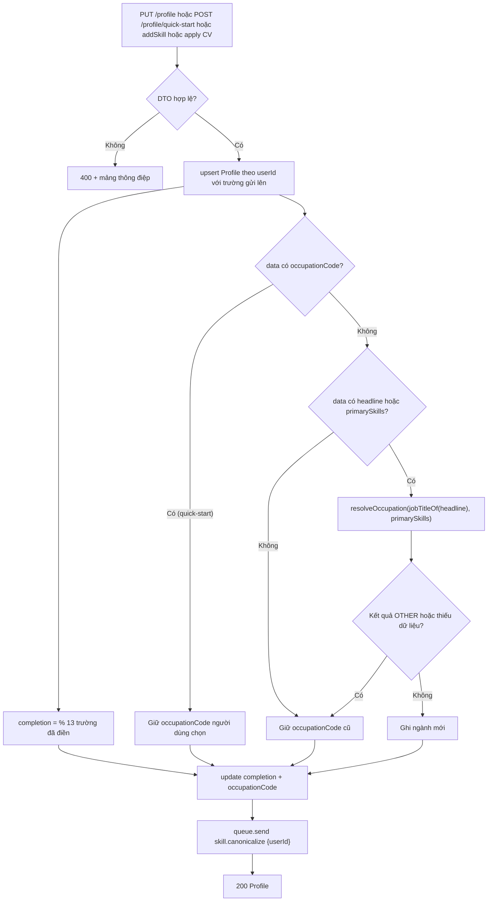
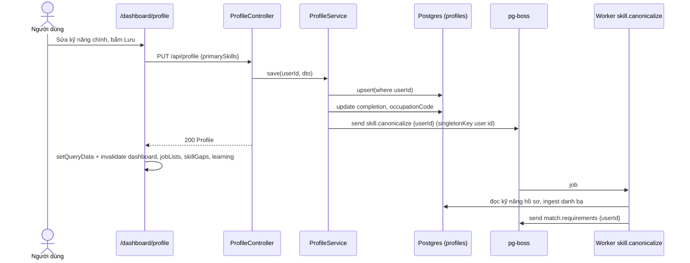
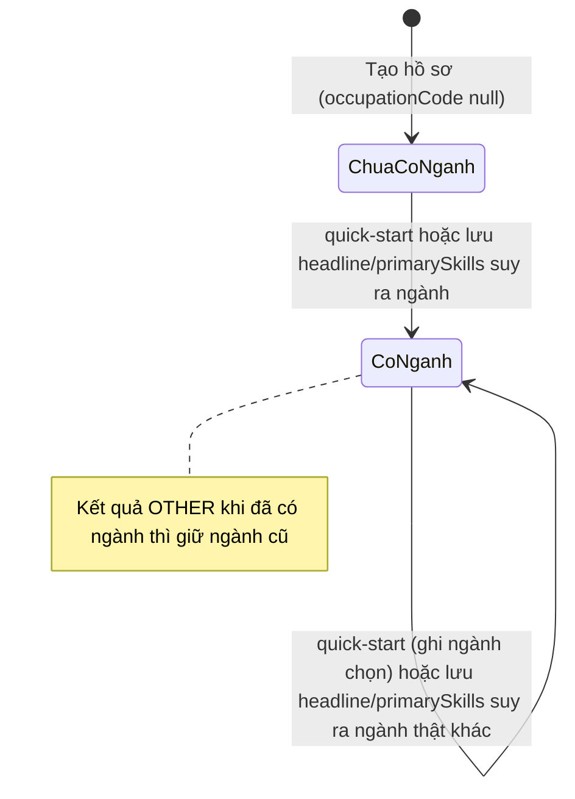

# Profile — Hồ sơ ứng viên

> **Phạm vi:** `server/src/modules/profile/**` (`ProfileController`, `ProfileService`, `utils/completion.ts`, `utils/occupation.ts`, `utils/experience-years.ts`), model `Profile`. Frontend người dùng: `/dashboard/profile` (trang hồ sơ, tab "Hồ sơ nghề nghiệp" / "Mong muốn tìm việc", modal sửa), bước "Chọn nhanh" trên `/dashboard`, `/dashboard/settings` (chỉ hiển thị thông tin tài khoản).
> **Nguyên tắc:** tài liệu mô tả hệ thống **as-is**. Code là nguồn sự thật duy nhất.

## 1. Purpose

| Mục tiêu | Diễn giải |
|---|---|
| Lưu dữ liệu ứng viên dùng chung cho mọi tính năng AI | Kỹ năng, kinh nghiệm, học vấn, mong muốn, ràng buộc pháp lý/đi lại — được đọc bởi chấm điểm (matching), sinh CV/thư, phỏng vấn, upskill, quét tin ([schema.prisma:71](../../../server/prisma/schema.prisma#L71)). |
| Đo mức hoàn thiện hồ sơ | `completion` = % trong 13 trường được chấm, tính lại sau MỖI lần ghi ([completion.ts:3](../../../server/src/modules/profile/utils/completion.ts#L3)). Hồ sơ dưới 30% không được chấm điểm tự động và không góp từ khoá quét tin ([match-write.ts:6](../../../server/src/modules/matching/rules/match-write.ts#L6)). |
| Xếp ứng viên vào nhóm ngành | `occupationCode` dẫn xuất từ chức danh + kỹ năng chính, hoặc do người dùng chọn ở bước "Chọn nhanh"; dùng cho trang "Việc làm phù hợp" và lập kế hoạch quét tin ([occupation.ts:25](../../../server/src/modules/profile/utils/occupation.ts#L25)). |
| Kích hoạt đối chiếu kỹ năng | Mỗi lần lưu xếp việc `skill.canonicalize` để chuẩn hoá kỹ năng mới vào danh bạ và đối chiếu lại hồ sơ với mọi tin ([profile.service.ts:53](../../../server/src/modules/profile/profile.service.ts#L53)). |

**Điểm mấu chốt:**
- `ProfileService.save` là **đường ghi duy nhất** cho dữ liệu hồ sơ do người dùng/CV tạo ra; mọi đường ghi (PUT, quick-start, thêm kỹ năng, áp dụng CV, hoàn thành mục học) đều đi qua nó để không bỏ sót `completion`/`occupationCode` ([profile.service.ts:34](../../../server/src/modules/profile/profile.service.ts#L34)).
- Mỗi người dùng có đúng một hồ sơ; hồ sơ được tạo rỗng ngay lúc đăng ký và tự tạo lại nếu thiếu khi đọc.

## 2. Actors

| Actor | Quyền trong module | Ghi chú |
|---|---|---|
| Người dùng (`USER`/`ADMIN`) | Đọc/ghi **hồ sơ của chính mình** | `userId` luôn lấy từ token, không có tham số id |
| Hệ thống — `AuthService` | Tạo `Profile` rỗng khi tạo tài khoản | Module auth |
| Hệ thống — `ProfileDraftService` | Ghi giá trị người dùng đã duyệt từ CV qua `save` | Module cv-import |
| Hệ thống — `LearningService` | Thêm kỹ năng khi một mục học chuyển `DONE` qua `addSkill` | Module upskill ([learning.service.ts:67](../../../server/src/modules/upskill/services/learning.service.ts#L67)) |
| Hệ thống — worker `skill.canonicalize` | Đọc kỹ năng hồ sơ, chuẩn hoá vào danh bạ rồi xếp `match.requirements` | Module matching |
| Hệ thống — scraper / AI shortlist | Ghi `lastFanOutAt` (không qua `save`) | Module job-scraping, matching |

## 3. Business Features

| # | Tính năng | Actor | Endpoint / cơ chế |
|---|---|---|---|
| F1 | Xem hồ sơ (tự tạo nếu chưa có) | USER | `GET /api/profile` |
| F2 | Cập nhật một phần hồ sơ | USER | `PUT /api/profile` |
| F3 | Thêm một kỹ năng (không trùng) | USER, hệ thống | `POST /api/profile/skills`, `LearningService` |
| F4 | Chọn nhanh ngành + nghề + cấp bậc | USER | `POST /api/profile/quick-start` |
| F5 | Tính mức hoàn thiện và nhóm ngành sau mỗi lần ghi | Hệ thống | `ProfileService.save` |
| F6 | Kích hoạt chuẩn hoá/đối chiếu kỹ năng | Hệ thống | Hàng đợi `skill.canonicalize` |
| F7 | Bắt buộc chọn ngành khi mới vào dashboard | FE | `QuickStartOnboarding` |

## 4. Business Flow

### Luồng A — Xem hồ sơ (F1)

**Preconditions:** đã đăng nhập.

**Main Flow:**
1. FE `/dashboard/profile` gọi `useProfile()` → `GET /api/profile` ([use-profile.ts:42](../../../../ui-ai-job-search/hooks/use-profile.ts#L42)).
2. `ProfileService.get(userId)` chạy `upsert({ where: { userId }, create: { userId }, update: {} })` — tức là **tạo hồ sơ rỗng nếu chưa có** ([profile.service.ts:16](../../../server/src/modules/profile/profile.service.ts#L16)).
3. Trả **200** toàn bộ bản ghi `Profile` kèm header `Cache-Control: no-store, no-cache, must-revalidate` ([profile.controller.ts:27](../../../server/src/modules/profile/profile.controller.ts#L27)).

**Alternative Flow:** không có.

**Failure Flow:** chưa đăng nhập → 401 (guard toàn cục).

**Postconditions:** luôn tồn tại một `Profile` cho user.

### Luồng B — Cập nhật một phần hồ sơ (F2)

**Preconditions:** đã đăng nhập.

**Main Flow:**
1. Người dùng sửa một khối trên trang hồ sơ (modal `EditModal`), FE gọi `useSaveProfile().save(changes)` → `PUT /api/profile` với chỉ các trường thay đổi ([use-profile.ts:49](../../../../ui-ai-job-search/hooks/use-profile.ts#L49)).
2. `ValidationPipe` kiểm `UpdateProfileDto` (§8); trường không có trong DTO — kể cả `occupationCode`, `subOccupationCodes`, `experienceLevel`, `completion` — bị **400** nhờ `forbidNonWhitelisted` ([profile-quick-start.e2e-spec.ts:134](../../../server/test/profile-quick-start.e2e-spec.ts#L134)).
3. `ProfileService.save(userId, dto)`:
   1. `upsert` ghi các trường gửi lên (trường vắng giữ nguyên) ([profile.service.ts:39](../../../server/src/modules/profile/profile.service.ts#L39)).
   2. `update` thứ hai ghi `completion = completionPercent(saved)` và `occupationCode = occupationAfterSave(saved, data)` ([profile.service.ts:45](../../../server/src/modules/profile/profile.service.ts#L45)).
   3. Xếp việc `skill.canonicalize { userId }` hẹn sau 10 giây, để mọi lần lưu liên tiếp (thêm/bỏ từng chip kỹ năng) gộp thành một lượt nhờ khoá chặn trùng `user:<id>` *(2026-10-26)* ([profile.service.ts](../../../server/src/modules/profile/profile.service.ts)).
4. Trả **200** hồ sơ sau cập nhật. FE ghi đè cache `profile`, vá `profileCompletion`/`occupationCode` trong cache dashboard, làm mới dashboard/skill gaps/job lists/learning và hiện toast `Đã lưu` ([use-profile.ts:53](../../../../ui-ai-job-search/hooks/use-profile.ts#L53)).

**Alternative Flow — suy lại nhóm ngành (BR-PRF-08):** nếu lần lưu có `headline` hoặc `primarySkills`, `occupationCode` được suy lại từ phần chức danh của headline (bỏ phần sau `|·•–—`, ngoặc, đuôi "N năm") và kỹ năng chính qua `resolveOccupation`; kết quả `OTHER` hoặc không đủ dữ liệu thì **giữ ngành cũ** ([occupation.ts:9](../../../server/src/modules/profile/utils/occupation.ts#L9), [occupation.ts:35](../../../server/src/modules/profile/utils/occupation.ts#L35)). Nếu ngành cũ do "Chọn nhanh" ghi mà chức danh mới suy ra một ngành thật khác thì ngành **bị ghi đè** ([profile-quick-start.e2e-spec.ts:103](../../../server/test/profile-quick-start.e2e-spec.ts#L103)).

**Failure Flow:** dữ liệu sai → **400** với mảng thông điệp (§8, §13); toast `Không lưu được hồ sơ` hoặc thông điệp backend.

**Postconditions:** hồ sơ cập nhật; `completion` và `occupationCode` nhất quán với dữ liệu mới; một việc `skill.canonicalize` được xếp (gộp nếu việc cùng user đang chờ).

### Luồng C — Thêm một kỹ năng (F3)

**Preconditions:** đã đăng nhập.

**Main Flow:**
1. FE (trang Kỹ năng cần học, khi đánh dấu đã học) gọi `POST /api/profile/skills { skill }` ([use-learning.ts:51](../../../../ui-ai-job-search/hooks/use-learning.ts#L51)); backend `PUT /api/learning/:key` với trạng thái `DONE` cũng gọi `ProfileService.addSkill` ([learning.service.ts:67](../../../server/src/modules/upskill/services/learning.service.ts#L67)).
2. `AddSkillDto`: chuỗi 1–80 ký tự ([profile.dto.ts:161](../../../server/src/modules/profile/profile.dto.ts#L161)).
3. `addSkill`: đọc (hoặc tạo) hồ sơ; so `foldTerm(skill)` (bỏ dấu, chữ thường) với mọi `primarySkills` + `secondarySkills` ([profile.service.ts:24](../../../server/src/modules/profile/profile.service.ts#L24)).
4. Chưa có → `save` với `secondarySkills = [...cũ, skill.trim()]` (chạy đủ bước của Luồng B, gồm xếp `skill.canonicalize`).
5. Trả **200** hồ sơ.

**Alternative Flow:** kỹ năng đã có (khác dấu/hoa thường vẫn tính là có) → trả hồ sơ hiện tại, **không ghi, không xếp việc**.

**Failure Flow:** `skill` thiếu/không phải chuỗi/dài quá → **400** (§8).

**Postconditions:** kỹ năng mới nằm cuối danh sách "kỹ năng phụ".

### Luồng D — Chọn nhanh ngành / nghề / cấp bậc (F4, F7)

**Preconditions:** đã đăng nhập.

**Main Flow:**
1. Dashboard hiện `QuickStartOnboarding` thay cho nội dung khi `occupationCode` là `null` hoặc `OTHER` ([dashboard-view.tsx:28](../../../../ui-ai-job-search/app/dashboard/dashboard-view.tsx#L28)). Người dùng chọn một ngành và **một hoặc nhiều** nghề con của ngành đó (bước 1; FE bắt buộc ít nhất một nghề, ẩn mục ảo "Khác") + cấp bậc (bước 2, bắt buộc trên FE) *(2026-10-23)* ([quick-start-onboarding.tsx:188](../../../../ui-ai-job-search/app/dashboard/quick-start-onboarding.tsx#L188)).
2. `POST /api/profile/quick-start { occupationCode, subOccupationCodes, preferredProvinces, experienceLevel? }` — hai mảng bắt buộc (được gửi rỗng), request luôn mang đủ trạng thái. Bước 2 hỏi thêm "Bạn muốn làm việc ở đâu?" (chọn nhiều tỉnh, không bắt buộc) *(2026-10-23)*.
3. `QuickStartProfileDto`: `occupationCode` ∈ `OCCUPATION_CODES`; `subOccupationCodes` mảng ≤ 20 mã, mỗi mã thuộc danh mục nghề con (`SUB_OCCUPATION_PARENT`); `preferredProvinces` mảng mã trong `PROVINCES`; `experienceLevel` ∈ `INTERN|FRESHER|JUNIOR|MIDDLE|SENIOR|LEAD` ([profile.dto.ts:152](../../../server/src/modules/profile/profile.dto.ts#L152)).
4. `ProfileService.quickStart` khử trùng `subOccupationCodes`, mã nào không thuộc đúng `occupationCode` → **400** `Nghề đã chọn không thuộc nhóm ngành này`; khử trùng `preferredProvinces` *(2026-10-23)*. Rồi `save` — vì `data` có `occupationCode` nên giá trị người dùng chọn được **giữ nguyên**, không suy lại ([occupation.ts:30](../../../server/src/modules/profile/utils/occupation.ts#L30)).
5. Trả **200** hồ sơ; FE làm mới profile/dashboard/skill gaps/job lists/learning ([query-keys.ts:58](../../../../ui-ai-job-search/lib/query-keys.ts#L58)).

**Alternative Flow:** trên trang hồ sơ, hai ô "Ngành" và "Cấp bậc" ở đầu trang cũng gọi quick-start (`saveSearch`) — bốn ô Ngành / Nghề / Cấp bậc / Nơi làm việc đều gửi đủ trạng thái hiện có và chỉ đổi đúng ô vừa sửa; đổi ngành gửi `subOccupationCodes: []`; ô Nghề và Nơi làm việc tick nhiều mục rồi bấm Lưu mới gửi một lần *(2026-10-23)*; các ô Cấp bậc, Nghề, Nơi làm việc bị khoá khi chưa chọn ngành ([profile-summary.tsx:101](../../../../ui-ai-job-search/app/dashboard/profile/profile-summary.tsx#L101), [profile-summary.tsx:124](../../../../ui-ai-job-search/app/dashboard/profile/profile-summary.tsx#L124)).

**Failure Flow:** mã ngành không có trong danh mục (kể cả mã nghề con như `IT_BACKEND`) → **400** `occupationCode Mã ngành nghề không hợp lệ`; cấp bậc sai → **400** (§8). FE onboarding hiện `Không lưu được lựa chọn, thử lại sau` hoặc thông điệp backend.

**Postconditions:** `occupationCode`, `subOccupationCodes`, `experienceLevel` được ghi; các lần `PUT /profile` sau không đụng tới chúng trừ khi `headline`/`primarySkills` đổi và suy ra ngành thật khác — khi đó `occupationCode` đổi và `subOccupationCodes` bị xoá *(2026-10-23)*.

## 5. Mermaid Flowchart

## 6. Sequence Diagram

## 7. Business Rules

| Mã BR | Quy tắc | Nơi thực thi | Mức | Nguồn code |
|---|---|---|---|---|
| BR-PRF-01 | Mỗi người dùng có tối đa một hồ sơ; xoá user thì xoá hồ sơ | DB | 🔒 Cứng | [schema.prisma:73](../../../server/prisma/schema.prisma#L73) |
| BR-PRF-02 | Đọc hồ sơ tự tạo hồ sơ rỗng nếu chưa có; phản hồi không được cache | SV | ✅ Mềm | [profile.service.ts:16](../../../server/src/modules/profile/profile.service.ts#L16), [profile.controller.ts:27](../../../server/src/modules/profile/profile.controller.ts#L27) |
| BR-PRF-03 | Mọi thao tác hồ sơ chỉ trên hồ sơ của user trong token (khoá `userId`, không nhận id từ client) | SV | ✅ Mềm | [profile.controller.ts:29](../../../server/src/modules/profile/profile.controller.ts#L29) |
| BR-PRF-04 | `PUT /profile` là cập nhật một phần; chỉ nhận các trường trong `UpdateProfileDto`, trường lạ (gồm `occupationCode`) bị 400 | DTO | ✅ Mềm | [profile.dto.ts:30](../../../server/src/modules/profile/profile.dto.ts#L30) |
| BR-PRF-05 | Giới hạn độ dài: trường ngắn ≤ 200 ký tự, `phone` ≤ 40, `summary`/`workPermitNote`/`commuteConstraint` ≤ 4.000; mỗi danh sách ≤ 60 mục, mỗi mục ≤ 200 ký tự | DTO | ✅ Mềm | [profile.dto.ts:18](../../../server/src/modules/profile/profile.dto.ts#L18) |
| BR-PRF-06 | `currentSalary`/`expectedSalary` là số nguyên 0 – 2.000.000.000 (mức lương tháng) | DTO | ✅ Mềm | [profile.dto.ts:20](../../../server/src/modules/profile/profile.dto.ts#L20), [profile.dto.ts:44](../../../server/src/modules/profile/profile.dto.ts#L44) |
| BR-PRF-07 | Khối `experiences`, `educations`, `certificates`, `projects`, `behavioralTraits` phải là mảng/đối tượng JSON, ≤ 64KB, mảng ≤ 100 phần tử, lồng ≤ 6 tầng; không kiểm hình dạng phần tử | DTO | ✅ Mềm | [profile.dto.ts:28](../../../server/src/modules/profile/profile.dto.ts#L28), [bounded-json.ts:31](../../../server/src/common/validators/bounded-json.ts#L31) |
| BR-PRF-08 | `completion` = round(số trường đã điền / 13 × 100); 13 trường: kỹ năng chính, kinh nghiệm, chức danh, địa điểm, quốc tịch, mục tiêu nghề nghiệp, giới thiệu, học vấn, kỹ năng phụ, lĩnh vực đã làm, quốc gia, công việc tạo hứng thú, ngành mục tiêu; chuỗi chỉ khoảng trắng và mảng rỗng tính là trống | SV | ✅ Mềm | [completion.ts:3](../../../server/src/modules/profile/utils/completion.ts#L3), [completion.ts:19](../../../server/src/modules/profile/utils/completion.ts#L19) |
| BR-PRF-09 | `completion` được tính lại sau MỌI lần ghi qua `save` | SV | ✅ Mềm | [profile.service.ts:45](../../../server/src/modules/profile/profile.service.ts#L45) |
| BR-PRF-10 | `occupationCode` chỉ suy lại khi lần lưu có `headline` hoặc `primarySkills`; suy từ phần chức danh của headline + kỹ năng chính; ra `OTHER` hoặc thiếu dữ liệu thì giữ ngành cũ | SV | ✅ Mềm | [occupation.ts:25](../../../server/src/modules/profile/utils/occupation.ts#L25), [occupation.ts:35](../../../server/src/modules/profile/utils/occupation.ts#L35) |
| BR-PRF-11 | `occupationCode` chỉ được ghi tường minh qua quick-start và phải thuộc danh mục nhóm ngành (`OCCUPATION_CODES`); lựa chọn đó giữ tới khi một lần lưu headline/kỹ năng suy ra ngành thật khác | DTO, SV | ✅ Mềm | [profile.dto.ts:153](../../../server/src/modules/profile/profile.dto.ts#L153), [occupation.ts:30](../../../server/src/modules/profile/utils/occupation.ts#L30) |
| BR-PRF-12 | `occupationCode = null` nghĩa là chưa đủ dữ liệu; cố ý không quy về `OTHER` | DB, SV | ✅ Mềm | [schema.prisma:130](../../../server/prisma/schema.prisma#L130) |
| BR-PRF-13 | Quick-start: `occupationCode` bắt buộc; `subOccupationCodes` mảng ≤ 20 mã trong danh mục nghề con, mỗi mã phải thuộc `occupationCode` (khác → 400), trùng thì giữ một; `preferredProvinces` mảng mã tỉnh trong danh mục; hai mảng đều bắt buộc *(2026-10-23)*; `experienceLevel` ∈ INTERN/FRESHER/JUNIOR/MIDDLE/SENIOR/LEAD (không nhận `UNKNOWN`) | DTO | ✅ Mềm | [profile.dto.ts:143](../../../server/src/modules/profile/profile.dto.ts#L143) |
| BR-PRF-14a | Lưu `location` khi `preferredProvinces` còn rỗng thì tự điền một tỉnh suy từ nơi ở (`resolveProvince`, bỏ qua `REMOTE`); đã có tỉnh thì không đè *(2026-10-23)* | SV | ✅ Mềm | [profile.service.ts](../../../server/src/modules/profile/profile.service.ts) |
| BR-PRF-14 | `experienceLevel` mặc định `UNKNOWN` (chưa chọn) | DB | 🔒 Cứng | [schema.prisma:145](../../../server/prisma/schema.prisma#L145) |
| BR-PRF-15 | Mỗi lần ghi qua `save` xếp một việc `skill.canonicalize { userId }` (khoá chặn trùng `user:<id>`) | SV | ✅ Mềm | [profile.service.ts:53](../../../server/src/modules/profile/profile.service.ts#L53), [queue-key.ts:41](../../../server/src/modules/queue/queue-key.ts#L41) |
| BR-PRF-16 | Thêm kỹ năng: 1–80 ký tự; trùng (so không dấu, không phân biệt hoa thường) với kỹ năng chính hoặc phụ thì bỏ qua; mới thì thêm vào cuối kỹ năng phụ (đã trim) | DTO, SV | ✅ Mềm | [profile.dto.ts:161](../../../server/src/modules/profile/profile.dto.ts#L161), [profile.service.ts:24](../../../server/src/modules/profile/profile.service.ts#L24) |
| BR-PRF-17 | Hồ sơ có `completion` \< 30 không được chấm điểm tự động và không góp từ khoá cho lượt quét tin (quy tắc của module khác, ngưỡng đọc từ cột của module này) | SV | ✅ Mềm | [match-write.ts:6](../../../server/src/modules/matching/rules/match-write.ts#L6), [query-planner.service.ts:72](../../../server/src/modules/scraper/services/query-planner.service.ts#L72) |
| BR-PRF-18 | Dashboard bắt người dùng chọn ngành + cấp bậc trước khi xem nội dung khi `occupationCode` là `null` hoặc `OTHER` | FE | ⚠️ Chỉ FE | [dashboard-view.tsx:28](../../../../ui-ai-job-search/app/dashboard/dashboard-view.tsx#L28) |
| BR-PRF-19 | Không có API đổi tên/email tài khoản; trang Cài đặt chỉ hiển thị | FE, SV | ✅ Mềm | [settings-view.tsx:60](../../../../ui-ai-job-search/app/dashboard/settings/settings-view.tsx#L60) |

> **Possible Business Rule:** Gửi `null` cho trường JSON (`experiences`…) hoặc trường mảng (`primarySkills`…) lọt qua validator (`@IsOptional` bỏ qua `null`) rồi tới Prisma; Prisma không nhận `null` thô cho cột `Json?`/`String[]` nên khả năng cao trả 500 `Máy chủ gặp lỗi ngoài dự kiến. Hãy thử lại sau.` — chưa kiểm chứng bằng chạy thử. Cần chốt cách "xoá" một khối (gửi `[]`?).

> **Possible Business Rule:** Lựa chọn "Chọn nhanh" bị ghi đè khi chức danh mới suy ra ngành khác (đã có e2e khẳng định là chủ đích). Cần xác nhận có nên đồng thời xoá `subOccupationCode` hay không.

## 8. Validation Rules

Thông điệp đi qua `vietnameseValidationError` với nhãn trường ở [validation-message.ts:3](../../../server/src/common/validation-message.ts#L3). Thông điệp tuỳ biến bị ghép thêm tên/nhãn trường ở đầu (xem [auth.md](./auth.md) §17 R9); cột "Lỗi trả về" ghi đúng chuỗi thực tế.

**`UpdateProfileDto`** ([profile.dto.ts:30](../../../server/src/modules/profile/profile.dto.ts#L30)) — mọi trường `@IsOptional`

| Field | Ràng buộc | DTO/Schema | Lỗi trả về (400) |
|---|---|---|---|
| headline, location, country, employmentStatus, citizenship, workPermit, remotePreference | `@IsString`, `@MaxLength(200)` | UpdateProfileDto | `<Nhãn> phải là chuỗi ký tự` / `<Nhãn> không được dài quá 200 ký tự` (vd `Chức danh không được dài quá 200 ký tự`) |
| phone | `@IsString`, `@MaxLength(40)` | UpdateProfileDto | `Số điện thoại không được dài quá 40 ký tự` |
| summary, workPermitNote, commuteConstraint | `@IsString`, `@MaxLength(4000)` | UpdateProfileDto | `Giới thiệu bản thân không được dài quá 4.000 ký tự` … |
| willingToRelocate | `@IsBoolean` | UpdateProfileDto | `Sẵn sàng chuyển nơi ở phải là đúng hoặc sai` |
| currentSalary, expectedSalary | `@IsInt`, `@Min(0)`, `@Max(2_000_000_000)` | UpdateProfileDto | `Lương mong muốn phải là số nguyên` / `… không được nhỏ hơn 0` / `… không được lớn hơn 2.000.000.000` |
| languages, primarySkills, secondarySkills, lackingSkills, directExperienceDomains, adjacentExperience, careerGoals, energizingTasks, drainingTasks, targetSectors, dealBreakers | `@IsArray`, `@ArrayMaxSize(60)`, `@IsString({each})`, `@MaxLength(200,{each})` | UpdateProfileDto | `Kỹ năng chính phải là một danh sách` / `Kỹ năng chính không được có quá 60 mục` / `Mỗi mục trong Kỹ năng chính không được dài quá 200 ký tự` |
| behavioralTraits, experiences, educations, certificates, projects | `@IsBoundedJson({ maxBytes: 65536, maxItems: 100 })`, độ sâu ≤ 6 | UpdateProfileDto | `Kinh nghiệm làm việc phải là một mảng hoặc một đối tượng JSON` / `… có quá nhiều phần tử` / `… lồng nhau quá sâu` / `… vượt quá dung lượng cho phép` |
| (trường lạ, vd `occupationCode`) | forbidNonWhitelisted | ValidationPipe | `occupationCode không phải là trường hợp lệ` |

**`QuickStartProfileDto`** ([profile.dto.ts:152](../../../server/src/modules/profile/profile.dto.ts#L152))

| Field | Ràng buộc | DTO/Schema | Lỗi trả về (400) |
|---|---|---|---|
| occupationCode | bắt buộc, `@IsIn(OCCUPATION_CODES)` | QuickStartProfileDto | `occupationCode Mã ngành nghề không hợp lệ` |
| subOccupationCodes | bắt buộc (được rỗng), `@IsArray`, `@ArrayMaxSize(20)`, mỗi phần tử `@IsIn` danh mục nghề con | QuickStartProfileDto | `Mã nghề không hợp lệ` |
| preferredProvinces | bắt buộc (được rỗng), `@IsArray`, `@ArrayMaxSize(34)`, mỗi phần tử `@IsIn` mã `PROVINCES` | QuickStartProfileDto | `Mã tỉnh/thành không hợp lệ` |
| subOccupationCodes ↔ occupationCode | mỗi mã phải thuộc đúng nhóm ngành gửi kèm | `ProfileService.quickStart` | `Nghề đã chọn không thuộc nhóm ngành này` |
| experienceLevel | tuỳ chọn, `@IsIn(EXPERIENCE_LEVELS)` | QuickStartProfileDto | `experienceLevel chỉ nhận một trong các giá trị: INTERN, FRESHER, JUNIOR, MIDDLE, SENIOR, LEAD` |

**`AddSkillDto`** ([profile.dto.ts:161](../../../server/src/modules/profile/profile.dto.ts#L161))

| Field | Ràng buộc | DTO/Schema | Lỗi trả về (400) |
|---|---|---|---|
| skill | `@IsString`, `@Length(1, 80)` | AddSkillDto | `skill Thiếu tên kỹ năng` / `skill Tên kỹ năng phải từ 1 tới 80 ký tự` |

## 9. API Mapping

| Method | URL | Role | Mục đích nghiệp vụ | Controller#method | Service | DTO | Response |
|---|---|---|---|---|---|---|---|
| GET | `/api/profile` | USER/ADMIN | Xem hồ sơ của mình (tự tạo nếu thiếu) | `ProfileController#get` | `ProfileService.get` | — | 200 `Profile`, `Cache-Control: no-store` |
| PUT | `/api/profile` | USER/ADMIN | Cập nhật một phần hồ sơ | `ProfileController#update` | `ProfileService.save` | `UpdateProfileDto` | 200 `Profile` |
| POST | `/api/profile/skills` | USER/ADMIN | Thêm một kỹ năng nếu chưa có | `ProfileController#addSkill` | `ProfileService.addSkill` | `AddSkillDto` | 200 `Profile` |
| POST | `/api/profile/quick-start` | USER/ADMIN | Ghi ngành/nghề/cấp bậc người dùng chọn | `ProfileController#quickStart` | `ProfileService.quickStart` | `QuickStartProfileDto` | 200 `Profile` |

Không có throttle riêng (dùng trần mặc định 120/phút/user).

**Endpoint ở module khác tác động lên module này**

| Method | URL | Module | Tác động |
|---|---|---|---|
| POST | `/api/auth/register`, `/api/auth/google` | auth | Tạo `Profile` rỗng cùng lúc tạo `User` |
| PUT | `/api/profile-drafts/:id/apply` | cv-import | Ghi giá trị CV người dùng đã duyệt qua `ProfileService.save` ([profile-draft.service.ts:161](../../../server/src/modules/profile-sources/services/profile-draft.service.ts#L161)) |
| PUT | `/api/learning/:key` (status `DONE`) | upskill | Thêm kỹ năng đã học qua `addSkill` |
| (cron/worker) | lượt quét tin, AI shortlist | job-scraping, matching | Ghi `lastFanOutAt` bằng `updateMany` ([scraper.service.ts:267](../../../server/src/modules/scraper/services/scraper.service.ts#L267), [ai-shortlist.service.ts:125](../../../server/src/modules/matching/rules/services/ai-shortlist.service.ts#L125)) |
| GET | `/api/dashboard` | dashboard | Đọc `completion` và danh sách trường còn thiếu (`missingFields`) ([dashboard.service.ts:211](../../../server/src/modules/dashboard/dashboard.service.ts#L211)) |

## 10. Frontend Mapping

| Route FE | Vai trò | Mục đích | Hook / API client |
|---|---|---|---|
| `/dashboard/profile` | USER | Xem/sửa hồ sơ theo hai tab "Hồ sơ nghề nghiệp" (danh tính, kỹ năng, kinh nghiệm/học vấn/dự án) và "Mong muốn tìm việc" (điều kiện, định hướng); cột "việc nên làm" | [profile-view.tsx](../../../../ui-ai-job-search/app/dashboard/profile/profile-view.tsx), `useProfile`, `useSaveProfile`, `useProfileUi` (zustand) — [use-profile.ts](../../../../ui-ai-job-search/hooks/use-profile.ts), [services/profile.ts](../../../../ui-ai-job-search/services/profile.ts) |
| `/dashboard/profile` — đầu trang | USER | Ô "Ngành" / "Cấp bậc" quyết định "Việc làm phù hợp" | [profile-summary.tsx](../../../../ui-ai-job-search/app/dashboard/profile/profile-summary.tsx), `saveSearch` → quick-start |
| `/dashboard/profile` — modal | USER | Sửa từng khối | [edit-modal.tsx](../../../../ui-ai-job-search/app/dashboard/profile/edit-modal.tsx), [lib/profile-form.ts](../../../../ui-ai-job-search/lib/profile-form.ts) |
| `/dashboard` | USER | Bước "Chọn nhanh" bắt buộc khi chưa có ngành | [dashboard-view.tsx](../../../../ui-ai-job-search/app/dashboard/dashboard-view.tsx), [quick-start-onboarding.tsx](../../../../ui-ai-job-search/app/dashboard/quick-start-onboarding.tsx) |
| `/dashboard/learning` | USER | Thêm kỹ năng đã học vào hồ sơ | [use-learning.ts](../../../../ui-ai-job-search/hooks/use-learning.ts) → `profileService.addSkill` |
| `/dashboard/settings` | USER | Hiển thị tên/email/vai trò (không sửa được), đăng xuất | [settings-view.tsx](../../../../ui-ai-job-search/app/dashboard/settings/settings-view.tsx) |

## 11. Database

**Bảng `profiles` — model `Profile`** ([schema.prisma:71](../../../server/prisma/schema.prisma#L71))

| Nhóm | Field | Kiểu | Ghi chú |
|---|---|---|---|
| Khoá | id | String `@id cuid()` | |
| Khoá | userId | String `@unique`, FK `User` `onDelete: Cascade` | 1–1 với User |
| Danh tính | headline, location, phone, country, employmentStatus | String? | `phone` model không được đề xuất từ CV |
| Danh tính | languages | String[] `@default([])` | |
| Danh tính | summary | String? `@db.Text` | |
| Pháp lý | citizenship, workPermit, workPermitNote | String? | Phục vụ Eligibility Gate |
| Kỹ năng | primarySkills, secondarySkills, lackingSkills | String[] | |
| Kinh nghiệm | directExperienceDomains, adjacentExperience | String[] | |
| Định hướng | careerGoals, energizingTasks, drainingTasks, targetSectors, dealBreakers | String[] | |
| Lương | currentSalary, expectedSalary | Int? | |
| Đi lại | commuteConstraint, remotePreference | String? | |
| Đi lại | willingToRelocate | Boolean `@default(false)` | |
| Khối dài | behavioralTraits, experiences, educations, certificates, projects | Json? | Không có schema DB |
| Phân loại | occupationCode | String? | Dẫn xuất / chọn nhanh ([schema.prisma:136](../../../server/prisma/schema.prisma#L136)) |
| Phân loại | subOccupationCodes | String[] `@default([])` | Chỉ do "Chọn nhanh" ghi; bị xoá khi `occupationCode` đổi ([schema.prisma:141](../../../server/prisma/schema.prisma#L141)) *(2026-10-23, thay `subOccupationCode String?`)* |
| Phân loại | preferredProvinces | String[] `@default([])` | Nơi làm việc; rỗng = không lọc địa điểm; tự điền từ `location` khi còn rỗng *(2026-10-23)* |
| Phân loại | experienceLevel | `JobSeniority` `@default(UNKNOWN)` | ([schema.prisma:145](../../../server/prisma/schema.prisma#L145)) |
| Vận hành | lastFanOutAt | DateTime? | Lần cuối được xếp chấm điểm |
| Vận hành | completion | Int `@default(0)` | % hoàn thiện |
| Vận hành | createdAt, updatedAt | DateTime | |

Index: `@@index([lastFanOutAt])`, unique `userId`. Enum `JobSeniority` ([schema.prisma:330](../../../server/prisma/schema.prisma#L330)): `INTERN, FRESHER, JUNIOR, MIDDLE, SENIOR, LEAD, UNKNOWN`.

## 12. State Machine

`Profile` không có trường trạng thái công việc. Hai trường mang tính trạng thái:

| Trường | Từ → Sang | Trigger | Điều kiện |
|---|---|---|---|
| occupationCode | `null` → mã ngành | `save` có `headline`/`primarySkills` | `resolveOccupation` ra mã (kể cả `OTHER` khi chưa có ngành cũ) |
| occupationCode | bất kỳ → mã chọn | `POST /profile/quick-start` | Mã thuộc `OCCUPATION_CODES` |
| occupationCode | mã A → mã B | `save` có `headline`/`primarySkills` | Suy ra ngành thật B ≠ `OTHER`; `subOccupationCodes` thành rỗng |
| experienceLevel | `UNKNOWN` → cấp bậc | quick-start có `experienceLevel` | Giá trị trong 6 cấp; không có đường quay về `UNKNOWN` qua API |
| completion | n → m | mọi lần `save` | Tính lại từ dữ liệu sau ghi |

## 13. Exceptions

| Tình huống | HTTP | Thông điệp nguyên văn | Nguồn |
|---|---|---|---|
| Chưa đăng nhập | 401 | `Bạn cần đăng nhập để tiếp tục, hoặc phiên đăng nhập đã hết hạn.` | [jwt-auth.guard.ts:10](../../../server/src/common/guards/jwt-auth.guard.ts#L10) |
| Dữ liệu hồ sơ sai | 400 | Mảng thông điệp ở §8 | [profile.dto.ts](../../../server/src/modules/profile/profile.dto.ts) |
| Mã ngành không thuộc danh mục | 400 | `occupationCode Mã ngành nghề không hợp lệ` | [profile.dto.ts:153](../../../server/src/modules/profile/profile.dto.ts#L153) |
| Gửi trường không cho phép (vd `occupationCode` qua PUT) | 400 | `occupationCode không phải là trường hợp lệ` | [validation-message.ts:106](../../../server/src/common/validation-message.ts#L106) |
| Body > 1MB | 413 | `Nội dung gửi lên quá lớn (tối đa 1MB).` | [all-exceptions.filter.ts:48](../../../server/src/common/filters/all-exceptions.filter.ts#L48) |

Thông điệp FE: `Không tải được hồ sơ`, `Không lưu được hồ sơ`, `Đã lưu`, `Không lưu được lựa chọn, thử lại sau`, `Không tải được danh mục ngành nghề`.

## 14. Notifications

Không có thông báo gửi ra ngoài. Chỉ có toast trên giao diện (`Đã lưu` / lỗi) ([use-profile.ts:65](../../../../ui-ai-job-search/hooks/use-profile.ts#L65)).

## 15. Integrations

| Hệ thống | Mục đích | Nguồn |
|---|---|---|
| pg-boss — hàng đợi `skill.canonicalize` (concurrency 10, policy `exclusive`, khoá `user:<id>`) | Chuẩn hoá kỹ năng hồ sơ vào danh bạ (có thể gọi model cho thuật ngữ mới) rồi xếp `match.requirements` đối chiếu hồ sơ với mọi tin | [profile.service.ts:53](../../../server/src/modules/profile/profile.service.ts#L53), [queue.defaults.ts:14](../../../server/src/modules/queue/queue.defaults.ts#L14), [matching.processor.ts:64](../../../server/src/modules/matching/matching.processor.ts#L64) |
| Danh mục nghề `jobs/taxonomy` | `OCCUPATION_CODES`, `OTHER_CODE`, `resolveOccupation` | [occupations.ts:483](../../../server/src/modules/jobs/taxonomy/occupations.ts#L483), [occupation.ts:1](../../../server/src/modules/profile/utils/occupation.ts#L1) |

Không gọi dịch vụ bên ngoài trực tiếp.

## 16. Security

- **Phân quyền:** mọi route cần đăng nhập (guard toàn cục, không `@Public`); không có route admin.
- **Sở hữu:** `userId` chỉ lấy từ `@CurrentUser()`; mọi truy vấn `where: { userId }` — người khác không thể đọc/ghi ([security.e2e-spec.ts:194](../../../server/test/security.e2e-spec.ts#L194)).
- **Rate limit:** trần mặc định 120/phút/user.
- **Dữ liệu nhạy cảm:** hồ sơ chứa số điện thoại, lương hiện tại/mong muốn, quốc tịch/giấy phép lao động; được gửi tới nhà cung cấp model khi chấm điểm/sinh tài liệu (FE ghi rõ ở trang Cài đặt — [settings-view.tsx:78](../../../../ui-ai-job-search/app/dashboard/settings/settings-view.tsx#L78)). `GET /profile` đặt `no-store` để proxy/trình duyệt không cache.
- **Chống phình dữ liệu:** trần độ dài chuỗi, số mục, dung lượng/độ sâu JSON.

## 17. ⚠️ Sai lệch / Rủi ro nghiệp vụ

**R1 — `subOccupationCode` không được kiểm và có thể lệch với `occupationCode`.** ✅ **Đã sửa 2026-10-23**: cột thành `subOccupationCodes`, `ProfileService.quickStart` từ chối nghề không thuộc ngành, `save` xoá danh sách nghề khi ngành đổi.
- Mô tả: DTO chỉ kiểm `subOccupationCode` là chuỗi ≤ 200, không đối chiếu danh mục nghề con hay việc nó thuộc `occupationCode`. Đổi ngành ở đầu trang hồ sơ gửi quick-start **không kèm** `subOccupationCode`, và việc suy lại ngành từ headline chỉ đổi `occupationCode` — nghề con cũ ở lại.
- Bằng chứng: [profile.dto.ts:155](../../../server/src/modules/profile/profile.dto.ts#L155); [profile-summary.tsx:101](../../../../ui-ai-job-search/app/dashboard/profile/profile-summary.tsx#L101); [occupation.ts:25](../../../server/src/modules/profile/utils/occupation.ts#L25)-33.
- Tác động: hồ sơ kiểu `occupationCode = FINANCE`, `subOccupationCode = IT_BACKEND`; nghề con được dùng làm từ khoá dự phòng khi quét tin ([query-plan.ts:59](../../../server/src/modules/scraper/utils/query-plan.ts#L59)) và lọc tin cho skill gap ([skill-gap.service.ts:78](../../../server/src/modules/upskill/services/skill-gap.service.ts#L78)) ⇒ quét/so sai nghề.
- Đề xuất: kiểm `subOccupationCode` thuộc ngành đã chọn; xoá nó khi `occupationCode` đổi.

**R2 — `save` gồm hai lệnh ghi rời, không transaction.** Mức đề xuất: 🟢
- Mô tả: `upsert` dữ liệu rồi `update` `completion`/`occupationCode` tính từ snapshot của chính request; hai lần lưu đồng thời có thể để `completion`/`occupationCode` phản ánh snapshot cũ hơn dữ liệu cuối.
- Bằng chứng: [profile.service.ts:39](../../../server/src/modules/profile/profile.service.ts#L39)-51.
- Tác động: phần trăm hoàn thiện hoặc ngành lệch tới lần lưu kế tiếp (hiếm, FE khoá nút khi đang lưu).
- Đề xuất: gộp vào `$transaction` hoặc tính trong một lệnh.

**R3 — Khối JSON không kiểm hình dạng.** Mức đề xuất: 🟢
- Mô tả: `experiences`, `educations`… chỉ bị giới hạn dung lượng/độ sâu; gọi API trực tiếp có thể lưu đối tượng tuỳ ý.
- Bằng chứng: [profile.dto.ts:132](../../../server/src/modules/profile/profile.dto.ts#L132)-140.
- Tác động: các nơi đọc (CV, tính số năm kinh nghiệm `yearsOfExperience` trả `null` khi một mục không đọc được — [experience-years.ts:82](../../../server/src/modules/profile/utils/experience-years.ts#L82)) phải tự chống dữ liệu sai dạng; FE có thể hiển thị lỗi.
- Đề xuất: validator theo hình dạng phần tử (giống `profile-proposal.schema.ts`).

**R4 — Lưu bất kỳ trường nào cũng xếp đối chiếu kỹ năng.** Mức đề xuất: 🟢
- Mô tả: `save` luôn gửi `skill.canonicalize`, kể cả khi chỉ đổi số điện thoại hay lương; worker sau đó xếp `match.requirements` đối chiếu hồ sơ với mọi tin.
- Bằng chứng: [profile.service.ts:53](../../../server/src/modules/profile/profile.service.ts#L53); [matching.processor.ts:84](../../../server/src/modules/matching/matching.processor.ts#L84).
- Tác động: việc nền thừa (đối chiếu bằng code, không gọi model nếu không có thuật ngữ mới); khoá `user:<id>` chỉ gộp khi việc trước còn đang chờ.
- Đề xuất: chỉ xếp khi trường kỹ năng/kinh nghiệm thay đổi.

## 18. Source References

**Backend**
- [profile.controller.ts](../../../server/src/modules/profile/profile.controller.ts)
- [profile.service.ts](../../../server/src/modules/profile/profile.service.ts)
- [profile.dto.ts](../../../server/src/modules/profile/profile.dto.ts)
- [profile.module.ts](../../../server/src/modules/profile/profile.module.ts)
- [utils/completion.ts](../../../server/src/modules/profile/utils/completion.ts)
- [utils/occupation.ts](../../../server/src/modules/profile/utils/occupation.ts)
- [utils/experience-years.ts](../../../server/src/modules/profile/utils/experience-years.ts)
- [common/validators/bounded-json.ts](../../../server/src/common/validators/bounded-json.ts), [common/validation-message.ts](../../../server/src/common/validation-message.ts)
- [modules/queue/queue-key.ts](../../../server/src/modules/queue/queue-key.ts), [modules/queue/queue.defaults.ts](../../../server/src/modules/queue/queue.defaults.ts)
- [modules/matching/matching.processor.ts](../../../server/src/modules/matching/matching.processor.ts), [modules/matching/rules/match-write.ts](../../../server/src/modules/matching/rules/match-write.ts)
- [modules/upskill/services/learning.service.ts](../../../server/src/modules/upskill/services/learning.service.ts)
- [schema.prisma — Profile](../../../server/prisma/schema.prisma#L71), [JobSeniority](../../../server/prisma/schema.prisma#L330)
- Test: [profile-quick-start.e2e-spec.ts](../../../server/test/profile-quick-start.e2e-spec.ts), [security.e2e-spec.ts](../../../server/test/security.e2e-spec.ts)

**Frontend**
- [app/dashboard/profile/page.tsx](../../../../ui-ai-job-search/app/dashboard/profile/page.tsx), [profile-view.tsx](../../../../ui-ai-job-search/app/dashboard/profile/profile-view.tsx), [profile-summary.tsx](../../../../ui-ai-job-search/app/dashboard/profile/profile-summary.tsx), [edit-modal.tsx](../../../../ui-ai-job-search/app/dashboard/profile/edit-modal.tsx), [improve-panel.tsx](../../../../ui-ai-job-search/app/dashboard/profile/improve-panel.tsx)
- [app/dashboard/dashboard-view.tsx](../../../../ui-ai-job-search/app/dashboard/dashboard-view.tsx), [app/dashboard/quick-start-onboarding.tsx](../../../../ui-ai-job-search/app/dashboard/quick-start-onboarding.tsx)
- [app/dashboard/settings/settings-view.tsx](../../../../ui-ai-job-search/app/dashboard/settings/settings-view.tsx)
- [services/profile.ts](../../../../ui-ai-job-search/services/profile.ts), [hooks/use-profile.ts](../../../../ui-ai-job-search/hooks/use-profile.ts), [hooks/use-learning.ts](../../../../ui-ai-job-search/hooks/use-learning.ts)
- [lib/profile-form.ts](../../../../ui-ai-job-search/lib/profile-form.ts), [lib/query-keys.ts](../../../../ui-ai-job-search/lib/query-keys.ts)
