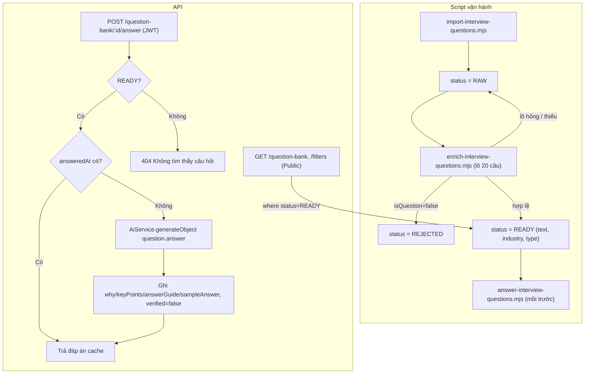
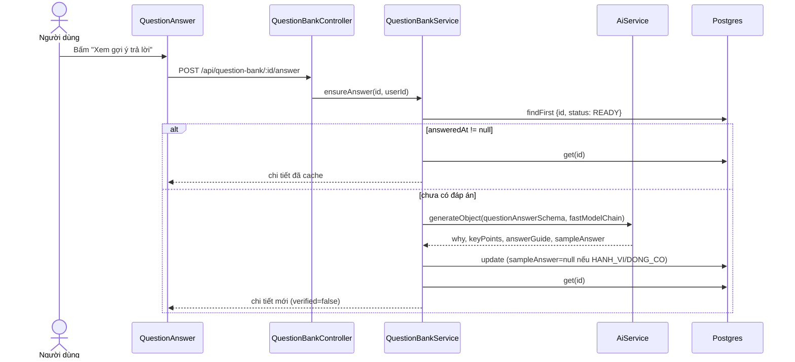
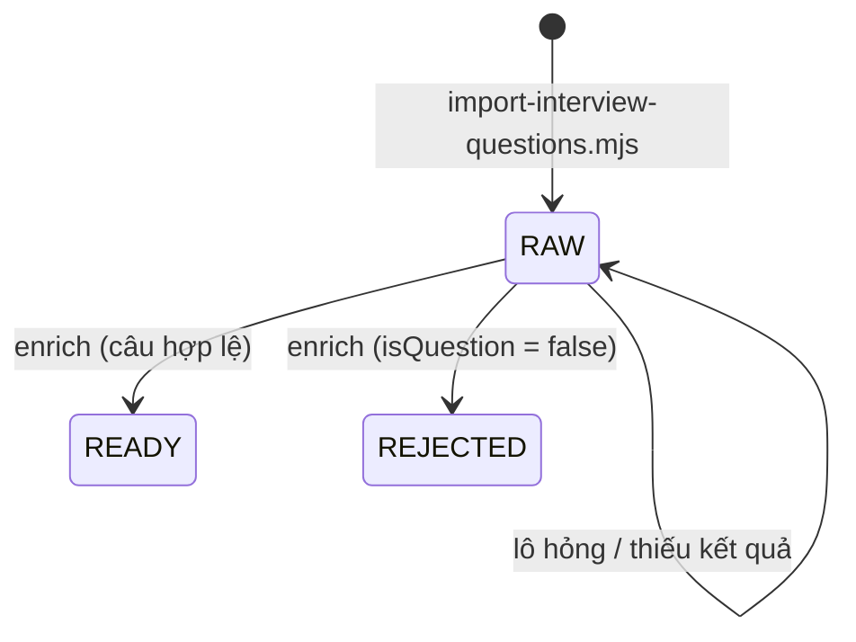

# Question Bank — Ngân hàng câu hỏi phỏng vấn

> **Phạm vi:** `server/src/modules/question-bank/**` · bảng `InterviewQuestion` · script nạp dữ liệu `server/scripts/import-interview-questions.mjs`, `enrich-interview-questions.mjs`, `answer-interview-questions.mjs`, `server/scripts/data/` · màn hình `/dashboard/interview/questions` (FE người dùng).
> **Nguyên tắc:** tài liệu mô tả hệ thống **as-is**. Code là nguồn sự thật duy nhất.

## 1. Purpose

| Mục tiêu | Diễn giải |
|---|---|
| Kho câu hỏi luyện tập dùng chung | Một ngân hàng câu hỏi phỏng vấn KHÔNG gắn với người dùng hay tin nào, lọc theo nhóm ngành, loại câu, độ khó và từ khoá ([question-bank.service.ts](../../../server/src/modules/question-bank/question-bank.service.ts)). |
| Cho khách xem không cần đăng nhập | `GET /question-bank` và `GET /question-bank/filters` là `@Public()` ([question-bank.controller.ts:25-36](../../../server/src/modules/question-bank/question-bank.controller.ts#L25)). |
| Sinh gợi ý trả lời LƯỜI | Phần `why`/`keyPoints`/`answerGuide`/`sampleAnswer` chỉ sinh khi người dùng đầu tiên bấm xem, rồi lưu vĩnh viễn cho mọi người ([question-bank.service.ts:116-161](../../../server/src/modules/question-bank/question-bank.service.ts#L116)). |
| Không dạy ứng viên đọc thuộc chuyện bịa | Câu loại `HANH_VI`, `DONG_CO` không bao giờ có đáp án mẫu ([question-bank.utils.ts:4](../../../server/src/modules/question-bank/question-bank.utils.ts#L4)). |

**Điểm mấu chốt:**
- Dữ liệu KHÔNG được tạo qua API. Nó được nạp bằng script ngoại tuyến từ kho thu thập ở `x-interview.com` ngày 06/09/2026 *(2026-09-06)*, rồi dịch/phân loại bằng model theo lô; API chỉ đọc bản ghi `READY` và sinh đáp án lười ([scripts/data/README.md](../../../server/scripts/data/README.md), [schema.prisma:1250-1345](../../../server/prisma/schema.prisma#L1250)).
- Hai nhóm trường sinh ở hai thời điểm: `text`/`industry`/`type` sinh TRƯỚC cho toàn kho (gộp 20 câu một lượt, ~2,3 giây/câu); phần đáp án sinh LƯỜI (~28 giây/câu) vì 91% câu nguồn chưa ai luyện (chú thích ở [schema.prisma:1286-1297](../../../server/prisma/schema.prisma#L1286)).

## 2. Actors

| Actor | Quyền trong module | Ghi chú |
|---|---|---|
| Khách (chưa đăng nhập) | Xem danh sách và bộ đếm bộ lọc của câu `READY` | Throttle 60 lượt/phút, đếm theo IP. Không xem được đáp án. |
| Người dùng đã đăng nhập | Như khách + bấm xem/sinh đáp án cho một câu | `POST /:id/answer` cần JWT, throttle AI 10 lượt/phút. |
| Vận hành (chạy script) | Nhập kho, dịch & phân loại, mồi đáp án hàng loạt | Chạy tay bằng Node với `DATABASE_URL`, `OMNIROUTE_BASE_URL`, `OMNIROUTE_API_KEY`, `MODEL_ID`. Không có route admin. |
| Model AI | Dịch/phân loại (script), sinh đáp án (`question.answer`) | Qua `AiService` ở API; qua `scripts/lib/model-call.mjs` ở script. |

## 3. Business Features

| # | Tính năng | Actor | Endpoint / cơ chế |
|---|---|---|---|
| F1 | Bộ đếm bộ lọc (ngành, loại, độ khó, tổng) | Khách / người dùng | `GET /api/question-bank/filters` |
| F2 | Danh sách câu hỏi có lọc, tìm kiếm, phân trang | Khách / người dùng | `GET /api/question-bank` |
| F3 | Xem / sinh đáp án cho một câu | Người dùng | `POST /api/question-bank/:id/answer` |
| F4 | Nhập kho câu hỏi thô | Vận hành | `node scripts/import-interview-questions.mjs` |
| F5 | Dịch, gán ngành, phân loại, loại câu không phải câu hỏi | Vận hành | `node scripts/enrich-interview-questions.mjs` |
| F6 | Mồi đáp án trước cho câu phổ biến | Vận hành | `node scripts/answer-interview-questions.mjs` |

## 4. Business Flow

### Luồng A — Bộ đếm bộ lọc (F1)

**Preconditions:** không cần đăng nhập.

**Main Flow:**
1. `GET /api/question-bank/filters?industry=&type=&difficulty=&q=` ([question-bank.controller.ts:25-29](../../../server/src/modules/question-bank/question-bank.controller.ts#L25)).
2. `questionFilters` tách bốn mảnh `where` (tìm `text` chứa `q` không phân biệt hoa thường, `industry`, `type`, `difficulty`) ([question-bank.utils.ts:29-38](../../../server/src/modules/question-bank/question-bank.utils.ts#L29)).
3. `facets` chạy song song ba `groupBy` — mỗi chiều áp mọi bộ lọc TRỪ chính nó — cộng một `count` áp đủ bộ lọc, luôn với `status: 'READY'` ([question-bank.service.ts:36-82](../../../server/src/modules/question-bank/question-bank.service.ts#L36)).
4. Gắn tên ngành từ `OCCUPATION_NAMES`, nhãn loại (`Kiến thức`, `Quy trình`, `Hành vi`, `Động cơ`); sắp theo số đếm giảm dần.
5. Trả `{ total, industries[{code,name,count}], types[...], difficulties[{name,count}] }`, 200.

**Alternative Flow:** không có câu `READY` → mọi mảng rỗng, `total: 0`.

**Failure Flow:** `industry` không thuộc `OCCUPATION_CODES`, `type`/`difficulty` ngoài danh sách, `q` > 80 ký tự → 400. Vượt 60 lượt/phút → 429.

**Postconditions:** không ghi dữ liệu.

### Luồng B — Danh sách câu hỏi (F2)

**Preconditions:** không cần đăng nhập.

**Main Flow:**
1. `GET /api/question-bank?industry=&type=&difficulty=&q=&limit=&offset=` ([question-bank.controller.ts:32-36](../../../server/src/modules/question-bank/question-bank.controller.ts#L32)).
2. `questionWhere` luôn ép `status: 'READY'` ([question-bank.utils.ts:41-50](../../../server/src/modules/question-bank/question-bank.utils.ts#L41)).
3. `findMany` chỉ `select` danh sách trắng `LIST_FIELDS` = `id, text, industry, type, difficulty, answeredAt`, sắp `sourcePracticeCount desc, id asc` ([question-bank.service.ts:84-98](../../../server/src/modules/question-bank/question-bank.service.ts#L84)).
4. `decorate` thêm `industryName`, `typeName`, `canHaveSampleAnswer` ([question-bank.utils.ts:52-61](../../../server/src/modules/question-bank/question-bank.utils.ts#L52)).
5. Trả `{ items, total, limit, offset }`, 200.

**Alternative Flow:** `answeredAt != null` cho FE biết câu đã có đáp án sẵn (mở nhanh).

**Failure Flow:** như Luồng A; `limit` ngoài 1–100 hoặc `offset` ngoài 0–100000 → 400.

**Postconditions:** không ghi dữ liệu.

### Luồng C — Xem / sinh đáp án (F3)

**Preconditions:** người dùng đã đăng nhập; câu hỏi tồn tại và ở `READY`.

**Main Flow:**
1. `POST /api/question-bank/:id/answer` ([question-bank.controller.ts:42-47](../../../server/src/modules/question-bank/question-bank.controller.ts#L42)); `@ThrottleAi()` 10 lượt/phút (ghi đè mức 60/phút của class).
2. Đọc câu theo `id` + `status: 'READY'`; không có → **404 `Không tìm thấy câu hỏi: <id>`** ([question-bank.service.ts:117-127](../../../server/src/modules/question-bank/question-bank.service.ts#L117)).
3. Đã có `answeredAt` → trả bản chi tiết từ DB, KHÔNG gọi model ([question-bank.service.ts:128](../../../server/src/modules/question-bank/question-bank.service.ts#L128)).
4. Chưa có: xác định `noSample` khi `type ∈ {HANH_VI, DONG_CO}`; dựng system prompt (bắt `sampleAnswer = null` hoặc đáp án mẫu 4–8 câu) và prompt (`Câu hỏi`, `Nhóm ngành`) ([question-answer.prompt.ts](../../../server/src/modules/question-bank/question-answer.prompt.ts)).
5. Gọi `generateObject` với `questionAnswerSchema`, `purpose: 'question.answer'`, chuỗi model nhanh `fastModelChain` ([question-bank.service.ts:137-144](../../../server/src/modules/question-bank/question-bank.service.ts#L137)).
6. `update` câu: `why`, `keyPoints`, `answerGuide`, `sampleAnswer` (ép `null` nếu `noSample`, bất kể model trả gì), `answeredAt = now`, `modelId`, `verified = false` ([question-bank.service.ts:146-157](../../../server/src/modules/question-bank/question-bank.service.ts#L146)).
7. Trả chi tiết (`LIST_FIELDS` + `why, keyPoints, answerGuide, sampleAnswer, verified` + trường trang trí), 201.

**Alternative Flow:** câu đã có đáp án (do người khác mở trước hoặc do script mồi) → trả ngay.

**Failure Flow:** lỗi model → 502/504/503 kèm `failureKind` qua bộ lọc toàn cục; câu giữ nguyên chưa có đáp án. Không đăng nhập → 401. FE hiển thị `Chưa lấy được gợi ý trả lời. Thử lại sau ít phút.` ([question-answer.tsx:22-25](../../../../ui-ai-job-search/app/dashboard/interview/questions/question-answer.tsx#L22)).

**Postconditions:** câu có `answeredAt` và đáp án dùng chung cho MỌI người dùng; `verified = false`.

### Luồng D — Nhập kho câu hỏi thô (F4)

**Preconditions:** `DATABASE_URL`; file `scripts/data/clean.jsonl` (6.437 câu sau khử trùng) hoặc đường dẫn truyền vào.

**Main Flow:**
1. Đọc JSONL, chia lô 500 ([import-interview-questions.mjs](../../../server/scripts/import-interview-questions.mjs)).
2. `INSERT ... source = 'X_INTERVIEW', sourceId, sourceText, difficulty, sourcePracticeCount, status = 'RAW'`, `text` = nguyên văn nếu `lang = 'vi'`, ngược lại `null`.
3. `ON CONFLICT ("source", "sourceId") DO NOTHING` — chạy lại không nhân đôi, không xoá công dịch đã làm.
4. In thống kê theo `status`.

**Alternative/Failure Flow:** thiếu `DATABASE_URL` → script ném lỗi `DATABASE_URL chưa được đặt. Hãy tạo server/.env từ .env.example.`

**Postconditions:** câu mới ở `RAW` — chưa hiện ra web vì API chỉ đọc `READY`.

### Luồng E — Dịch & phân loại (F5)

**Preconditions:** `DATABASE_URL`, `OMNIROUTE_BASE_URL`, `OMNIROUTE_API_KEY`; có câu `RAW`.

**Main Flow:**
1. Chọn câu `RAW` (lấy cách quãng theo `sourceId`), cờ `--limit`, `--batch` (mặc định 20), 3 luồng song song ([enrich-interview-questions.mjs](../../../server/scripts/enrich-interview-questions.mjs)).
2. Gọi model cho từng lô; mỗi câu nhận `isQuestion`, `questionVi`, `industry` (18 mã), `type` (4 loại).
3. `isQuestion === false` → `REJECTED`. `questionVi` ≥ 5 ký tự và mã hợp lệ → `READY` với `text`, `industry`, `type`, `modelId`. Còn lại → để nguyên `RAW`.

**Alternative Flow:** cả chuỗi model bị chặn (429) → nghỉ tối đa 5 phút rồi làm lại lô, tối đa 20 lần nghỉ.

**Failure Flow:** lô hỏng → cả lô giữ `RAW`, lượt chạy sau nhặt lại.

**Postconditions:** câu `READY` hiện ra trên web; câu `REJECTED` được giữ để lượt sau không bắt lại.

### Luồng F — Mồi đáp án trước (F6)

**Preconditions:** như Luồng E; có câu `READY` chưa có `answeredAt`.

**Main Flow:** lấy câu `READY AND answeredAt IS NULL` theo `sourcePracticeCount desc` (mặc định 200 câu, 2 luồng), gọi model từng câu, `UPDATE` phần đáp án, `sampleAnswer` ép `null` ở tầng mã cho `HANH_VI`/`DONG_CO`, `verified = false` ([answer-interview-questions.mjs](../../../server/scripts/answer-interview-questions.mjs)).

**Alternative/Failure Flow:** 429 → nghỉ và làm lại; lỗi khác → bỏ câu đó, đếm `failed`.

**Postconditions:** những câu phổ biến nhất có đáp án sẵn, người dùng đầu tiên không phải chờ ~28 giây.

## 5. Mermaid Flowchart

## 6. Sequence Diagram

## 7. Business Rules

| Mã BR | Quy tắc | Nơi thực thi | Mức | Nguồn code |
|---|---|---|---|---|
| BR-QB-01 | API chỉ trả câu hỏi ở trạng thái `READY`; câu `RAW`/`REJECTED` không lộ ra web. | SV | ✅ | [question-bank.utils.ts:41-50](../../../server/src/modules/question-bank/question-bank.utils.ts#L41), [question-bank.service.ts:38](../../../server/src/modules/question-bank/question-bank.service.ts#L38) |
| BR-QB-02 | Câu mới nhập luôn ở `RAW` (mặc định cột và script nhập). | DB + script | 🔒 | [schema.prisma:1307](../../../server/prisma/schema.prisma#L1307), [import-interview-questions.mjs](../../../server/scripts/import-interview-questions.mjs) |
| BR-QB-03 | Mỗi câu nguồn chỉ nhập một lần theo `(source, sourceId)`; nhập lại không ghi đè công dịch đã làm. | DB + script | 🔒 | [schema.prisma:1340](../../../server/prisma/schema.prisma#L1340) |
| BR-QB-04 | Danh sách và bộ lọc mở cho khách, giới hạn 60 lượt/phút. | GD | ✅ | [question-bank.controller.ts:18-36](../../../server/src/modules/question-bank/question-bank.controller.ts#L18) |
| BR-QB-05 | Route công khai chỉ trả các trường trong danh sách trắng `LIST_FIELDS` (không có đáp án, không có `sourceText`). | SV | ✅ | [question-bank.utils.ts:13-20](../../../server/src/modules/question-bank/question-bank.utils.ts#L13) |
| BR-QB-06 | Xem/sinh đáp án cần đăng nhập và giới hạn 10 lượt/phút. | GD | ✅ | [question-bank.controller.ts:42-47](../../../server/src/modules/question-bank/question-bank.controller.ts#L42) |
| BR-QB-07 | Đáp án sinh một lần rồi dùng chung vĩnh viễn cho mọi người dùng; đã có `answeredAt` thì không gọi model. | SV | ✅ | [question-bank.service.ts:128](../../../server/src/modules/question-bank/question-bank.service.ts#L128) |
| BR-QB-08 | Câu loại `HANH_VI` (hành vi) và `DONG_CO` (động cơ) KHÔNG có đáp án mẫu — ép `null` ở tầng mã dù model trả gì. | SV + script | ✅ | [question-bank.service.ts:130-152](../../../server/src/modules/question-bank/question-bank.service.ts#L130), [question-bank.utils.ts:4](../../../server/src/modules/question-bank/question-bank.utils.ts#L4) |
| BR-QB-09 | Đáp án do model sinh luôn mang `verified = false`; giao diện phải cảnh báo chưa có người rà. | SV + FE | ✅ | [question-bank.service.ts:155](../../../server/src/modules/question-bank/question-bank.service.ts#L155), [question-answer.tsx:123](../../../../ui-ai-job-search/app/dashboard/interview/questions/question-answer.tsx#L123) |
| BR-QB-10 | Đáp án gồm `why` ≤400, 3–5 `keyPoints` (tối đa 5, mỗi ý ≤220), `answerGuide` ≤900 (cắt theo trần); `sampleAnswer` ≤2000 hoặc `null`. | SV (zod) | ✅ | [question-bank.schema.ts:6-21](../../../server/src/modules/question-bank/question-bank.schema.ts#L6) |
| BR-QB-11 | Danh sách sắp theo số lượt luyện ở nguồn giảm dần (câu phổ biến lên trước). | SV | ✅ | [question-bank.service.ts:91](../../../server/src/modules/question-bank/question-bank.service.ts#L91) |
| BR-QB-12 | Bộ đếm của một chiều lọc áp mọi bộ lọc khác nhưng bỏ chính nó (để người dùng thấy số câu nếu đổi lựa chọn). | SV | ✅ | [question-bank.service.ts:40-57](../../../server/src/modules/question-bank/question-bank.service.ts#L40) |
| BR-QB-13 | Bộ lọc chỉ nhận mã ngành trong `OCCUPATION_CODES`, 4 loại câu, 3 độ khó `Dễ`/`Trung bình`/`Khó`; từ khoá ≤ 80 ký tự, tìm không phân biệt hoa thường trên `text`. | DTO | ✅ | [question-bank.dto.ts:14-31](../../../server/src/modules/question-bank/question-bank.dto.ts#L14) |
| BR-QB-14 | Bản ghi nguồn `X_INTERVIEW` phải giữ `source` và `sourceId` để còn lọc, thay thế dần hoặc gỡ theo nguồn. | Script (quy ước) | ✅ | [schema.prisma:1250-1252](../../../server/prisma/schema.prisma#L1250), [scripts/data/README.md](../../../server/scripts/data/README.md) |
| BR-QB-15 | Câu bị model đánh giá "không phải câu hỏi" chuyển `REJECTED` và được giữ lại, không xoá. | Script | ✅ | [enrich-interview-questions.mjs](../../../server/scripts/enrich-interview-questions.mjs) |
| BR-QB-16 | Câu chỉ lên `READY` khi có bản tiếng Việt ≥ 5 ký tự, mã ngành và loại hợp lệ; lô hỏng thì cả lô giữ `RAW`. | Script | ✅ | [enrich-interview-questions.mjs](../../../server/scripts/enrich-interview-questions.mjs) |

> **Possible Business Rule:** Enum `InterviewQuestionSource` có `GENERATED` và `USER` nhưng không có code nào tạo bản ghi với hai giá trị này. Cần xác nhận lộ trình: câu tự sinh để thay dần kho `X_INTERVIEW`, và câu do người dùng tự nhập.

> **Possible Business Rule:** Cột `verified` không có route/script nào đặt thành `true`. Cần xác nhận có quy trình rà đáp án (admin) trong phạm vi hay không.

## 8. Validation Rules

**`ListQuestionsQueryDto`** (kế thừa `PaginationQueryDto`) ([question-bank.dto.ts:14-31](../../../server/src/modules/question-bank/question-bank.dto.ts#L14))

| Field | Ràng buộc | DTO/Schema | Lỗi trả về |
|---|---|---|---|
| `industry` | tuỳ chọn, ∈ `OCCUPATION_CODES` | `ListQuestionsQueryDto` | 400 (thông điệp mặc định dịch qua `vietnameseValidationError`) |
| `type` | tuỳ chọn, ∈ `KIEN_THUC`, `QUY_TRINH`, `HANH_VI`, `DONG_CO` | idem | 400 |
| `difficulty` | tuỳ chọn, ∈ `Dễ`, `Trung bình`, `Khó` | idem | 400 |
| `q` | tuỳ chọn, chuỗi ≤ 80 | idem | 400 |
| `limit` / `offset` | 1–100 (mặc định 20) / 0–100000 | `PaginationQueryDto` | 400 |
| (trường lạ) | `forbidNonWhitelisted` | ValidationPipe toàn cục | 400 |

**`:id`** (`POST /:id/answer`) — không có DTO; id không tồn tại hoặc không `READY` → 404.

**Schema output `questionAnswerSchema`** ([question-bank.schema.ts:6-21](../../../server/src/modules/question-bank/question-bank.schema.ts#L6))

| Field | Ràng buộc | Schema | Lỗi trả về |
|---|---|---|---|
| `why` | bắt buộc, cắt ≤ 400 | zod `requiredCappedTextVi` | thiếu → lỗi schema → 502 |
| `keyPoints` | tối đa 5 mục, mỗi mục ≤ 220 | zod `boundedList` | — |
| `answerGuide` | bắt buộc, cắt ≤ 900 | zod | thiếu → 502 |
| `sampleAnswer` | chuỗi ≤ 2000 hoặc `null`; sai thì `.catch(null)` | zod | không lỗi — rơi về `null` |

## 9. API Mapping

| Method | URL | Role | Mục đích nghiệp vụ | Controller#method | Service | DTO | Response |
|---|---|---|---|---|---|---|---|
| GET | `/api/question-bank/filters` | Public (60/phút) | Số câu theo ngành, loại, độ khó | `QuestionBankController#filters` | `QuestionBankService.facets` | `ListQuestionsQueryDto` | `{ total, industries[], types[], difficulties[] }` |
| GET | `/api/question-bank` | Public (60/phút) | Danh sách câu hỏi có lọc | `QuestionBankController#list` | `QuestionBankService.list` | `ListQuestionsQueryDto` | `Page<{ id, text, industry, type, difficulty, answeredAt, industryName, typeName, canHaveSampleAnswer }>` |
| POST | `/api/question-bank/:id/answer` | USER (ThrottleAi 10/phút) | Lấy hoặc sinh đáp án cho câu | `QuestionBankController#answer` | `QuestionBankService.ensureAnswer` → `get` | — | 201 chi tiết + `why, keyPoints, answerGuide, sampleAnswer, verified` |

**Endpoint ở module khác tác động lên module này:** Không có. Không route nào khác ghi `InterviewQuestion`; mọi thay đổi ngoài `POST /:id/answer` đi qua script vận hành (§4 Luồng D–F).

## 10. Frontend Mapping

| Route FE | Vai trò | Mục đích | Hook / API client |
|---|---|---|---|
| `/dashboard/interview/questions` ([page.tsx](../../../../ui-ai-job-search/app/dashboard/interview/questions/page.tsx)) | Server component | Tải bộ lọc và trang đầu ở server bằng `fetch` không token, cache `revalidate: 300` giây | `questionBankService.facets`, `questionBankService.list` ([services/question-bank.ts](../../../../ui-ai-job-search/services/question-bank.ts)) |
| Trình duyệt câu hỏi | USER (trang nằm dưới `/dashboard`) | Lọc ngành/loại/độ khó, tìm kiếm (debounce 250 ms), phân trang 20 câu; đổi bộ lọc quay về trang đầu | `useQuestionBank` ([hooks/use-question-bank.ts](../../../../ui-ai-job-search/hooks/use-question-bank.ts)), [question-bank-browser.tsx](../../../../ui-ai-job-search/app/dashboard/interview/questions/question-bank-browser.tsx) |
| Ô đáp án của từng câu | USER | Bấm mới gọi `POST /:id/answer`; hiện cảnh báo khi `verified = false` | `questionBankService.answer` ở [question-answer.tsx](../../../../ui-ai-job-search/app/dashboard/interview/questions/question-answer.tsx) |
| Link từ `/dashboard/interview` | USER | Vào ngân hàng câu hỏi | [interview-view.tsx:103](../../../../ui-ai-job-search/app/dashboard/interview/interview-view.tsx#L103) |

## 11. Database

**`InterviewQuestion`** → bảng `interview_questions` ([schema.prisma:1298-1345](../../../server/prisma/schema.prisma#L1298); migration [20260907100000_interview_question](../../../server/prisma/migrations/20260907100000_interview_question/migration.sql))

| Field | Kiểu | Ghi chú |
|---|---|---|
| `id` | String cuid (script nhập dùng UUID) | PK |
| `source` | `InterviewQuestionSource` | bắt buộc |
| `sourceId` | String? | id ở nguồn; `null` cho câu tự sinh/người dùng nhập |
| `sourceText` | Text | nguyên văn lúc thu, KHÔNG sửa |
| `status` | `InterviewQuestionStatus` mặc định `RAW` | xem §12 |
| `text` | Text? | câu tiếng Việt hiển thị |
| `industry` | String? | mã nhóm ngành `OCCUPATIONS` |
| `type` | `InterviewQuestionType?` | quyết định có được có đáp án mẫu |
| `difficulty` | String? | chữ nguyên văn nguồn |
| `sourcePracticeCount` | Int mặc định 0 | dùng sắp xếp và chọn câu mồi đáp án |
| `why`, `answerGuide`, `sampleAnswer` | Text? | phần đáp án sinh lười |
| `keyPoints` | String[] mặc định `[]` | |
| `answeredAt` | DateTime? | `null` = chưa ai mở |
| `modelId` | String? | model của lượt dịch hoặc lượt sinh đáp án gần nhất |
| `verified` | Boolean mặc định `false` | chưa có người rà |

Index: `@@unique([source, sourceId])`, `@@index([status, industry])`, `@@index([status, type])`, `@@index([status, sourcePracticeCount desc])`.

**Enum**

| Enum | Giá trị | Nghĩa |
|---|---|---|
| `InterviewQuestionSource` ([schema.prisma:1253](../../../server/prisma/schema.prisma#L1253)) | `X_INTERVIEW` | Nội dung bên thứ ba thu từ x-interview.com |
| | `GENERATED` | Câu tự sinh (chưa có code tạo) |
| | `USER` | Câu người dùng nhập (chưa có code tạo) |
| `InterviewQuestionType` ([schema.prisma:1261](../../../server/prisma/schema.prisma#L1261)) | `KIEN_THUC` | Kiến thức — có đáp án đúng khách quan |
| | `QUY_TRINH` | Quy trình — hỏi cách làm, phương pháp |
| | `HANH_VI` | Hành vi — kể trải nghiệm thật (không đáp án mẫu) |
| | `DONG_CO` | Động cơ — nguyện vọng, lý do chọn (không đáp án mẫu) |
| `InterviewQuestionStatus` ([schema.prisma:1275](../../../server/prisma/schema.prisma#L1275)) | `RAW` | Vừa nhập, chưa dịch/phân loại |
| | `READY` | Đã có `text`, `industry`, `type`; hiển thị được |
| | `REJECTED` | Không phải câu hỏi; giữ lại để không bắt lại |

Dữ liệu nguồn: [scripts/data/README.md](../../../server/scripts/data/README.md) — 11.165 câu thu về, 6.437 câu sau khử trùng gần (Jaccard ≥ 0,6), 92,1% tiếng Anh. Công cụ thu: [crawl.mjs](../../../server/scripts/data/crawl.mjs), [crawl-tags.mjs](../../../server/scripts/data/crawl-tags.mjs), [analyze.mjs](../../../server/scripts/data/analyze.mjs).

## 12. State Machine

`InterviewQuestion.status`:

| Từ | Sang | Trigger | Điều kiện |
|---|---|---|---|
| (chưa có) | `RAW` | script nhập | `(source, sourceId)` chưa tồn tại |
| `RAW` | `READY` | script enrich | `questionVi` ≥ 5 ký tự, `industry` thuộc 18 mã, `type` thuộc 4 loại |
| `RAW` | `REJECTED` | script enrich | model trả `isQuestion: false` |

Không có chuyển trạng thái nào qua API. Trạng thái phụ "đã có đáp án" được suy ra từ `answeredAt` (`null` → có giá trị qua `POST /:id/answer` hoặc script mồi; không có đường quay lại).

## 13. Exceptions

| Tình huống | HTTP | Thông điệp nguyên văn | Nguồn |
|---|---|---|---|
| Câu không tồn tại hoặc không `READY` | 404 | `Không tìm thấy câu hỏi: <id>` | [question-bank.service.ts:127](../../../server/src/modules/question-bank/question-bank.service.ts#L127), [:112](../../../server/src/modules/question-bank/question-bank.service.ts#L112) |
| Bộ lọc sai giá trị | 400 | thông điệp mặc định class-validator dịch qua `vietnameseValidationError` | [question-bank.dto.ts](../../../server/src/modules/question-bank/question-bank.dto.ts), [validation-message.ts](../../../server/src/common/validation-message.ts) |
| Chưa đăng nhập khi xin đáp án | 401 | (JwtAuthGuard) | guard toàn cục |
| Vượt throttle | 429 | `Bạn thao tác quá nhanh. Hãy đợi một lát rồi thử lại.` | [app.module.ts:31](../../../server/src/app.module.ts#L31) |
| Model sai cấu trúc / hết giờ / quá tải | 502 / 504 / 503 | xem bảng `FAILURE` | [all-exceptions.filter.ts:20-40](../../../server/src/common/filters/all-exceptions.filter.ts#L20) |

## 14. Notifications

Không có. Module chỉ phục vụ truy vấn đồng bộ; không có sự kiện nào gửi đi.

## 15. Integrations

| Tích hợp | Cách dùng | Nguồn |
|---|---|---|
| `AiService.generateObject` | `purpose: 'question.answer'`, chuỗi nhanh `fastModelChain` (`AI_FAST_MODEL_ID`, `AI_FAST_FALLBACK_IDS`); lượt gọi ghi `AiCall` | [question-bank.service.ts:137-144](../../../server/src/modules/question-bank/question-bank.service.ts#L137), [ai-platform.md](./ai-platform.md) |
| Taxonomy nghề `jobs/taxonomy/occupations` | `OCCUPATION_CODES` cho validator, `OCCUPATION_NAMES` cho tên ngành | [question-bank.dto.ts:3](../../../server/src/modules/question-bank/question-bank.dto.ts#L3), [question-bank.utils.ts:1](../../../server/src/modules/question-bank/question-bank.utils.ts#L1), [jobs.md](./jobs.md) |
| OmniRoute (script) | `OMNIROUTE_BASE_URL`, `OMNIROUTE_API_KEY`, `MODEL_ID` qua `scripts/lib/model-call.mjs` | [enrich-interview-questions.mjs](../../../server/scripts/enrich-interview-questions.mjs), [answer-interview-questions.mjs](../../../server/scripts/answer-interview-questions.mjs) |
| x-interview.com (nguồn dữ liệu, một lần) | Thu qua endpoint `/mypage/questions/ajax-search` ngày 06/09/2026 | [scripts/data/README.md](../../../server/scripts/data/README.md) |

## 16. Security

- **Xác thực:** `GET /question-bank`, `GET /question-bank/filters` là `@Public()`; `POST /:id/answer` cần JWT (không có `@Public()`).
- **Sở hữu:** không áp dụng — dữ liệu dùng chung, không có trường `userId`. `userId` chỉ được truyền vào `context` của lượt gọi AI để ghi nhận chi phí.
- **Route công khai:** có `@Throttle` riêng 60/phút (đếm theo IP khi không có người dùng — [user-throttler.guard.ts:7-10](../../../server/src/common/guards/user-throttler.guard.ts#L7)), `select` danh sách trắng `LIST_FIELDS`, luôn lọc `READY`. DTO query không có trường gắn tài khoản nên không cần `PickType`. Route gọi model KHÔNG mở công khai.
- **Dữ liệu nhạy cảm:** không có dữ liệu người dùng. `sourceText` (nguyên văn bên thứ ba) không trả ra API.

## 17. ⚠️ Sai lệch / Rủi ro nghiệp vụ

**R1 — Hai người mở cùng một câu chưa có đáp án cùng lúc thì model bị gọi hai lần.**
- Bằng chứng: `ensureAnswer` đọc `answeredAt` rồi gọi model rồi `update({ where: { id } })` không có giành chỗ có điều kiện ([question-bank.service.ts:116-157](../../../server/src/modules/question-bank/question-bank.service.ts#L116)).
- Tác động: tốn thêm lượt gọi model (~28 giây mỗi lượt) và bản ghi cuối thắng; không hỏng dữ liệu. Throttle chỉ giới hạn theo từng người dùng.
- Đề xuất: chấp nhận ở quy mô hiện tại (đáp án được mồi trước cho câu phổ biến); nếu đo thấy trùng nhiều thì thêm điều kiện `answeredAt: null` khi ghi.
- Mức đề xuất: 🟢

**R2 — Rủi ro pháp lý của dữ liệu nguồn `X_INTERVIEW`.**
- *(2026-10-19)* Phương án (a) không đổi gì ở module này: trang `/dashboard/interview/questions` vốn đã cần đăng nhập và có `noindex`, không nằm trong sitemap. API `GET /api/question-bank` vẫn `@Public`.
- Bằng chứng: chú thích enum ghi "Điều khoản của họ cấm sao chép thương mại; chủ đầu tư đã cân nhắc và chốt dùng" ([schema.prisma:1250-1252](../../../server/prisma/schema.prisma#L1250)); README dữ liệu ghi điều khoản cấm "sao chép hoặc khai thác thương mại trái phép" ([scripts/data/README.md](../../../server/scripts/data/README.md)); [ADR 0006](../../adr/0006-dieu-khoan-portal.md) ghi x-interview "cấm đích danh" công cụ tự động và là đối thủ trực tiếp. Danh sách câu hỏi được mở công khai cho khách.
- Tác động: nội dung bên thứ ba hiển thị công khai; quyết định đã được chủ đầu tư chốt, nhưng cần xem lại nếu thương mại hoá.
- Đề xuất: giữ `source`/`sourceId` (đã làm) để gỡ theo nguồn; xem lại trước khi thương mại hoá.
- Mức đề xuất: 🟠

**R3 — `sampleAnswer` dài hơn 2000 ký tự bị bỏ hẳn (thành `null`) thay vì bị cắt.**
- Bằng chứng: `z.string().max(2000).nullable().catch(null)` ([question-bank.schema.ts:13-20](../../../server/src/modules/question-bank/question-bank.schema.ts#L13)), trong khi quy ước ở [ADR 0017](../../adr/0017-cat-chuoi-model-output.md) là CẮT chuỗi model output.
- Tác động: câu `KIEN_THUC`/`QUY_TRINH` có thể mất đáp án mẫu vĩnh viễn (đáp án được cache, không có đường sinh lại).
- Đề xuất: chuyển sang helper cắt của `common/model-output.ts` hoặc xác nhận việc bỏ là cố ý.
- Mức đề xuất: 🟡

**R4 — Không có đường sinh lại hay rà duyệt đáp án.**
- Bằng chứng: đã có `answeredAt` thì luôn trả cache ([question-bank.service.ts:128](../../../server/src/modules/question-bank/question-bank.service.ts#L128)); không route/script nào đặt `verified = true` hay xoá `answeredAt` (grep `verified` trong `server/src` chỉ thấy module này).
- Tác động: một đáp án kỹ thuật sai do model sinh sẽ hiển thị mãi cho mọi người dùng, chỉ kèm cảnh báo "chưa rà".
- Đề xuất: chủ dự án xác nhận có cần công cụ admin rà/sinh lại.
- Mức đề xuất: 🟡

**R5 — Xem lại đáp án đã cache vẫn phải đi qua `POST` có throttle AI.**
- Bằng chứng: hàm `get(id)` không được controller mở ra; chỉ `POST /:id/answer` trả chi tiết ([question-bank.controller.ts:38-47](../../../server/src/modules/question-bank/question-bank.controller.ts#L38)).
- Tác động: người dùng bị giới hạn 10 lượt xem đáp án/phút kể cả khi không tốn lượt model; khách không xem được đáp án đã có sẵn.
- Đề xuất: xác nhận ý định; nếu cần thì mở `GET /:id` chỉ đọc.
- Mức đề xuất: 🟢

## 18. Source References

**Backend**
- [question-bank.controller.ts](../../../server/src/modules/question-bank/question-bank.controller.ts)
- [question-bank.service.ts](../../../server/src/modules/question-bank/question-bank.service.ts)
- [question-bank.dto.ts](../../../server/src/modules/question-bank/question-bank.dto.ts)
- [question-bank.schema.ts](../../../server/src/modules/question-bank/question-bank.schema.ts)
- [question-bank.utils.ts](../../../server/src/modules/question-bank/question-bank.utils.ts)
- [question-answer.prompt.ts](../../../server/src/modules/question-bank/question-answer.prompt.ts)
- [question-bank.module.ts](../../../server/src/modules/question-bank/question-bank.module.ts)
- [common/throttle.ts](../../../server/src/common/throttle.ts), [user-throttler.guard.ts](../../../server/src/common/guards/user-throttler.guard.ts), [all-exceptions.filter.ts](../../../server/src/common/filters/all-exceptions.filter.ts)
- [schema.prisma](../../../server/prisma/schema.prisma#L1250), [migration.sql](../../../server/prisma/migrations/20260907100000_interview_question/migration.sql)
- Script: [import-interview-questions.mjs](../../../server/scripts/import-interview-questions.mjs), [enrich-interview-questions.mjs](../../../server/scripts/enrich-interview-questions.mjs), [answer-interview-questions.mjs](../../../server/scripts/answer-interview-questions.mjs), [scripts/data/README.md](../../../server/scripts/data/README.md)
- Test: [question-bank.utils.spec.ts](../../../server/test/unit/modules/question-bank/question-bank.utils.spec.ts) (không có e2e riêng cho module)
- ADR: [0006](../../adr/0006-dieu-khoan-portal.md), [0017](../../adr/0017-cat-chuoi-model-output.md)

**Frontend**
- [app/dashboard/interview/questions/page.tsx](../../../../ui-ai-job-search/app/dashboard/interview/questions/page.tsx)
- [question-bank-browser.tsx](../../../../ui-ai-job-search/app/dashboard/interview/questions/question-bank-browser.tsx), [question-answer.tsx](../../../../ui-ai-job-search/app/dashboard/interview/questions/question-answer.tsx)
- [services/question-bank.ts](../../../../ui-ai-job-search/services/question-bank.ts)
- [hooks/use-question-bank.ts](../../../../ui-ai-job-search/hooks/use-question-bank.ts)
