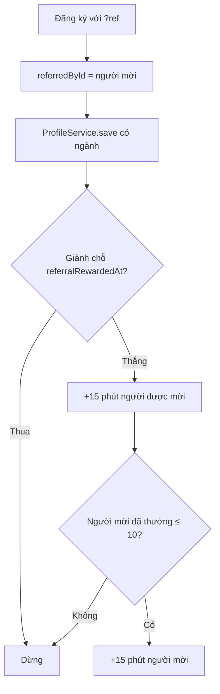
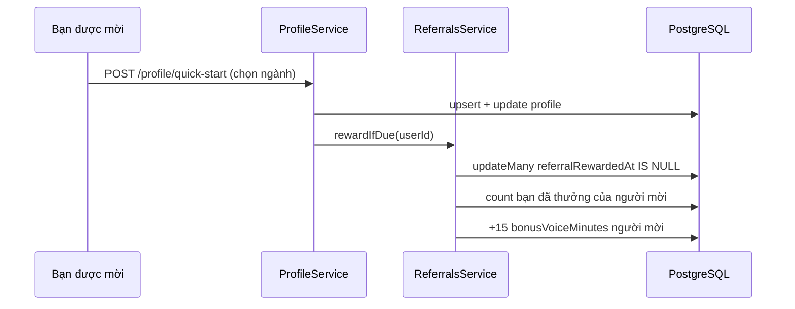

# Referrals — Mời bạn bè

> **Phạm vi:** `server/src/modules/referrals/**` (`ReferralsController`, `ReferralsService`, `referrals.utils.ts`); các cột `users.referralCode`, `referredById`, `referralRewardedAt`, `bonusVoiceMinutes`. Điểm chạm ở module khác: đăng ký (`AuthService`), ghi hồ sơ (`ProfileService.save`), mở buổi giọng nói (`VoiceSessionService.open`). Frontend: thẻ "Mời bạn bè" ở `/dashboard/settings`, dòng lời mời ở `/register?ref=` và trong modal đăng ký khi trang mở bằng `?ref=` (link chia sẻ của Phân tích CV) *(2026-10-27)*.
> **Nguyên tắc:** tài liệu mô tả hệ thống **as-is**. Code là nguồn sự thật duy nhất.

## 1. Purpose

| Mục tiêu | Diễn giải |
|---|---|
| Kéo người dùng mới qua người dùng cũ | Mỗi người có link mời; bạn được mời đăng ký và chọn ngành thì cả hai được thêm phút luyện phỏng vấn bằng giọng nói |
| Phần thưởng có giá trị thật | Phút giọng nói là thứ có hạn mức (30 phút/24 giờ) và tốn chi phí thật |

## 2. Actors

| Actor | Vai trò |
|---|---|
| Người mời (USER) | Lấy link, xem số bạn đã tham gia và phút thưởng còn lại |
| Người được mời | Đăng ký bằng link (email hoặc Google), chọn ngành |
| Hệ thống | Thưởng một lần khi người được mời có ngành |

## 3. Business Features

| # | Tính năng | Actor | Điểm vào |
|---|---|---|---|
| F1 | Xem mã mời và kết quả *(2026-10-26)* | USER | `GET /api/referrals` |
| F2 | Đăng ký bằng mã mời *(2026-10-26)* | Khách | `POST /api/auth/register { ref? }`, `POST /api/auth/google { ref? }` |
| F3 | Thưởng khi người được mời chọn ngành *(2026-10-26)* | Hệ thống | `ProfileService.save` → `ReferralsService.rewardIfDue` |
| F4 | Dùng phút thưởng khi hết hạn mức giọng nói *(2026-10-26)* | USER | `POST /api/mock-interviews/voice` |

## 4. Business Flow

### Luồng A — Mời và thưởng (F1–F3)

1. `GET /api/referrals`: chưa có `referralCode` thì sinh mã 8 ký tự (bỏ 0/O, 1/I) và ghi bằng `updateMany where referralCode IS NULL`, rồi đọc lại; trùng thì sinh lại. Trả `{ code, joined, pending, bonusMinutesLeft, rewardMinutes, maxRewarded }`.
2. Khách mở `/register?ref=<mã>` và đăng ký; `referrerOf` tra mã (không phân biệt hoa thường), mã lạ thì bỏ qua — đăng ký vẫn thành công, `referredById = null`. Google chỉ ghi người mời khi tạo tài khoản mới.
3. Mỗi lần `ProfileService.save` xong mà hồ sơ có ngành khác `OTHER` (chọn nhanh, sửa hồ sơ, hay tự suy từ CV), gọi `rewardIfDue`: giành chỗ `updateMany where { id, referredById ≠ null, referralRewardedAt = null }` → ghi mốc và +15 phút cho người được mời; thua giành chỗ thì dừng.
4. Đếm số người đã được thưởng của người mời; ≤ 10 thì +15 phút cho người mời.

### Luồng B — Dùng phút thưởng (F4)

1. `VoiceSessionService.open`: phút ngày còn lại `left` (30 − đã dùng trong 24 giờ) cộng phút thưởng còn lại; tổng < 3 phút → 400.
2. Buổi được cấp `min(20, left + thưởng)` phút; phần vượt `left` ghi vào `input.bonus` của buổi.
3. Phút thưởng còn lại = `bonusVoiceMinutes` − tổng phần thưởng các buổi đã tiêu thật (`voiceBonusUsed`: buổi dùng hết phần ngày trước, phần vượt mới trừ thưởng). Buổi dừng sớm thì không mất phút thưởng.

## 5. Mermaid Flowchart

## 6. Sequence Diagram

## 7. Business Rules

| Mã | Quy tắc | Tầng | Trạng thái | Nguồn |
|---|---|---|---|---|
| BR-REF-01 | Mã mời 8 ký tự, duy nhất, sinh lần đầu mở thẻ; ghi có điều kiện `referralCode IS NULL` rồi đọc lại, nên hai request cùng lúc nhận cùng một mã và link đã gửi không bị vô hiệu; trùng mã người khác thì sinh lại *(2026-10-26)* | SV, DB | ✅ | [referrals.service.ts](../../../server/src/modules/referrals/referrals.service.ts) |
| BR-REF-02 | Mã lạ khi đăng ký bị bỏ qua, không chặn đăng ký *(2026-10-26)* | SV | ✅ | [referrals.service.ts](../../../server/src/modules/referrals/referrals.service.ts) |
| BR-REF-03 | Điều kiện thưởng: người được mời có ngành khác `OTHER` sau một lần ghi hồ sơ; mỗi người được mời chỉ thưởng một lần nhờ giành chỗ `referralRewardedAt IS NULL` *(2026-10-26)* | SV | ✅ | [profile.service.ts](../../../server/src/modules/profile/profile.service.ts) |
| BR-REF-04 | Mỗi bên +15 phút giọng nói; người mời chỉ được thưởng cho 10 bạn đầu tiên, người được mời luôn được *(2026-10-26)* | SV | ✅ | [referrals.service.ts](../../../server/src/modules/referrals/referrals.service.ts) |
| BR-REF-05 | Phút thưởng không hết hạn, chỉ dùng khi phần ngày (30 phút/24 giờ) không đủ một buổi; tính theo thời lượng thật nên dừng sớm không mất phút *(2026-10-26)* | SV | ✅ | [voice-session.service.ts](../../../server/src/modules/mock-interview/services/voice-session.service.ts), [voice-interview.ts](../../../server/src/modules/mock-interview/utils/voice-interview.ts) |

## 8. Validation Rules

| Trường | Quy tắc | Nguồn |
|---|---|---|
| `ref` (đăng ký email / Google) | Tuỳ chọn, chuỗi ≤ 16 ký tự | [auth.dto.ts](../../../server/src/modules/auth/auth.dto.ts) |

## 9. API Mapping

| Method | URL | Role | Mục đích nghiệp vụ | Controller#method | Service | DTO | Response |
|---|---|---|---|---|---|---|---|
| GET | `/api/referrals` | USER | Mã mời, số bạn đã tham gia/đang chờ, phút thưởng còn lại *(2026-10-26)* | `ReferralsController#summary` | `ReferralsService.summary` | — | `{ code, joined, pending, bonusMinutesLeft, rewardMinutes, maxRewarded }` |

## 10. Frontend Mapping

| Route FE | Vai trò | Mục đích | Hook / API client |
|---|---|---|---|
| `/dashboard/settings` — thẻ "Mời bạn bè" ([referral-card.tsx](../../../../ui-ai-job-search/app/dashboard/settings/referral-card.tsx)) *(2026-10-26)* | USER | Chép link mời, xem số bạn đã tham gia, phút thưởng còn lại | `useReferrals` ([hooks/use-referrals.ts](../../../../ui-ai-job-search/hooks/use-referrals.ts)) |
| `/register?ref=` → `/dashboard?auth=register&ref=` ([login-modal.tsx](../../../../ui-ai-job-search/components/auth/login-modal.tsx)) *(2026-10-26, sửa 2026-10-27)* | Khách | Modal tạo tài khoản mở trên trang chủ, dòng lời mời phía trên form; mã gửi kèm đăng ký email và Google | `authService.register`, `authService.google` |
| Modal đăng ký trên trang có `?ref=` ([login-modal.tsx](../../../../ui-ai-job-search/components/auth/login-modal.tsx)) *(2026-10-27)* | Khách | Link chia sẻ kết quả Phân tích CV là `/dashboard/cv-check?ref=<mã>`: khách phân tích CV trước, bấm đăng ký thì modal hiện dòng lời mời và gửi mã kèm đăng ký | `RegisterForm` (`referral`) |
| Nút "Chia sẻ" ở chi tiết tin ([job-share-button.tsx](../../../../ui-ai-job-search/app/dashboard/jobs/[id]/job-share-button.tsx)) *(2026-10-28)* | Khách, USER | Link `/dashboard/jobs?job=<id>`; người đã đăng nhập thì kèm `&ref=<mã>`, bạn bè mở tin rồi đăng ký trong modal là được ghi người mời | `jobShareUrl` ([public-job.ts](../../../../ui-ai-job-search/lib/public-job.ts)), `useReferrals` |

## 11. Database

Không có bảng riêng; cột trên `users`: `referralCode` (unique, null tới khi mở thẻ), `referredById` (FK tự tham chiếu, `SetNull`), `referralRewardedAt`, `bonusVoiceMinutes` (tổng được thưởng). Phần đã tiêu nằm ở `agent_runs.input.bonus`.

## 12. State Machine

Người được mời: `referredById` có, `referralRewardedAt = null` (đang chờ) → `referralRewardedAt` có (đã thưởng). Không quay lại.

## 13. Exceptions

| Tình huống | HTTP | Thông điệp nguyên văn | Nguồn |
|---|---|---|---|
| Hết phút ngày và hết phút thưởng | 400 | `Bạn đã luyện phỏng vấn bằng giọng nói đủ 30 phút trong 24 giờ qua. Luyện bằng chữ ngay bây giờ, quay lại sau, hoặc mời bạn bè ở trang Tài khoản để được thêm phút.` | [voice-session.service.ts](../../../server/src/modules/mock-interview/services/voice-session.service.ts) |

## 14. Notifications

Không có.

## 15. Integrations

Không có.

## 16. Security

| Điểm | Cách xử lý |
|---|---|
| Lạm dụng bằng tài khoản ảo | Hệ thống không xác minh email; điều kiện "có ngành" không tốn AI nên tài khoản ảo vẫn lấy được phút. Trần 10 bạn/người mời giới hạn mức thiệt hại (tối đa 150 phút cho người mời) |
| Lộ danh tính người được mời | API chỉ trả số đếm, không trả tên/email người được mời |

## 17. ⚠️ Sai lệch / Rủi ro nghiệp vụ

**R1 — Tài khoản ảo lấy phút thưởng.**
- Mô tả: một người tự tạo tài khoản bằng email bất kỳ, chọn ngành, là có +15 phút cho cả hai phía.
- Bằng chứng: `RegisterDto` không có bước xác minh email; điều kiện thưởng chỉ là `occupationCode` ([referrals.service.ts](../../../server/src/modules/referrals/referrals.service.ts)).
- Tác động: tốn chi phí Gemini Live (ước ~$0,3–0,4 / 15 phút nếu trả phí).
- Đề xuất: nếu thấy lạm dụng, đổi điều kiện sang "luyện xong một buổi" hoặc thêm xác minh email.
- Mức đề xuất: 🟡

## 18. Source References

- [referrals.controller.ts](../../../server/src/modules/referrals/referrals.controller.ts), [referrals.service.ts](../../../server/src/modules/referrals/referrals.service.ts), [referrals.utils.ts](../../../server/src/modules/referrals/referrals.utils.ts)
- Test: [referrals.e2e-spec.ts](../../../server/test/referrals.e2e-spec.ts), [mock-interview-voice.e2e-spec.ts](../../../server/test/mock-interview-voice.e2e-spec.ts), [voice-interview.spec.ts](../../../server/test/unit/modules/mock-interview/voice-interview.spec.ts)
