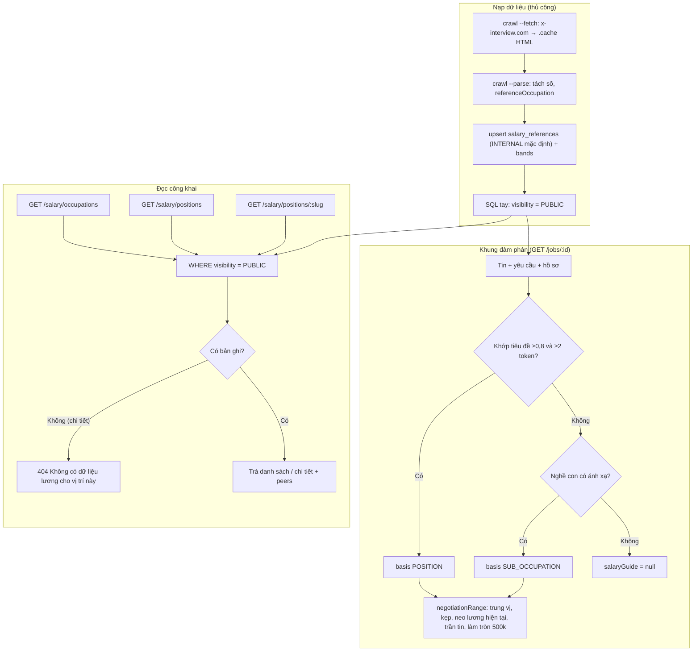
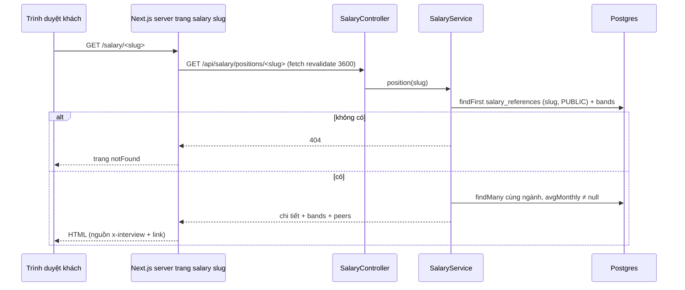
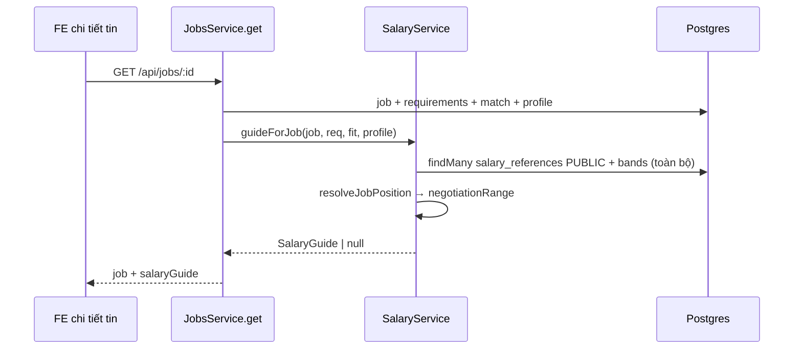
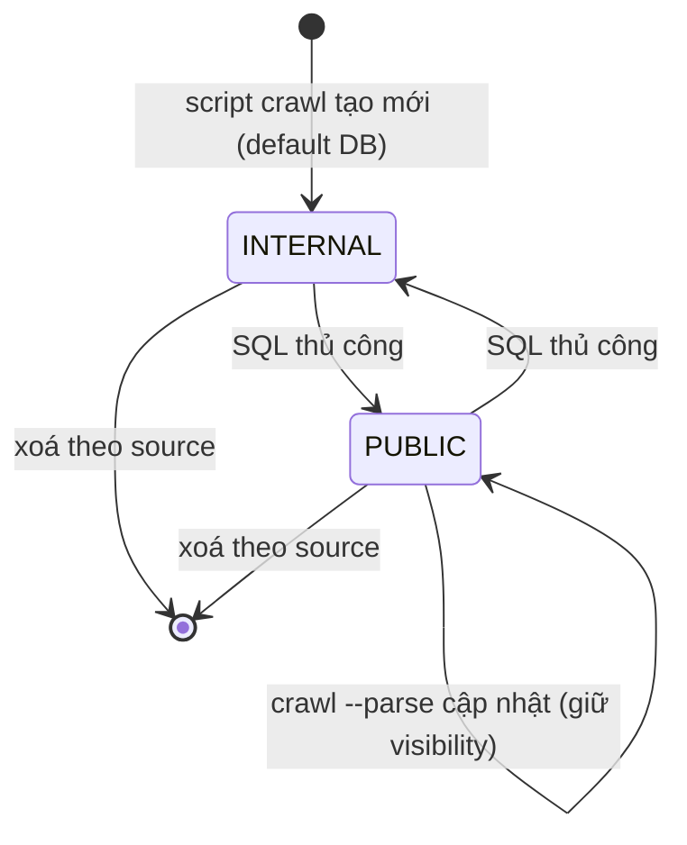

# Salary — Tra cứu lương & khung đàm phán lương

> **Phạm vi:** `server/src/modules/salary/**` (`salary.controller.ts`, `salary.service.ts`, `salary.dto.ts`, `salary.types.ts`, `utils/job-position.ts`, `utils/negotiation.ts`, `utils/reference-map.ts`, `utils/salary-view.ts`, `utils/sub-occupation-map.ts`) · script nạp dữ liệu `server/scripts/crawl-salary-reference.mjs` · bảng `SalaryReference`, `SalaryReferenceBand` · màn hình `/salary`, `/salary/[slug]` (khách), `/dashboard/salary`, `/dashboard/salary/[slug]`, khối "khung lương" trong chi tiết tin.
> **Nguyên tắc:** tài liệu mô tả hệ thống **as-is**. Code là nguồn sự thật duy nhất.

## 1. Purpose

| Mục tiêu | Diễn giải |
|---|---|
| Tra cứu lương tham chiếu công khai | Ba route `@Public()` cho khách: danh mục ngành có dữ liệu, danh sách vị trí kèm khoảng lương, chi tiết một vị trí kèm mốc kinh nghiệm và bảng xếp hạng cùng ngành ([salary.controller.ts](../../../server/src/modules/salary/salary.controller.ts)) |
| Gợi ý khung lương đàm phán cho một tin | `SalaryService.guideForJob` được `JobsService.get` gọi khi người dùng mở chi tiết tin: ghép tin với vị trí tham chiếu, chọn mốc kinh nghiệm, ra `floor/target/ceiling` ([salary.service.ts:40](../../../server/src/modules/salary/salary.service.ts#L40), [jobs.service.ts:217](../../../server/src/modules/jobs/jobs.service.ts#L217)) |
| Kiểm soát dữ liệu bên thứ ba | Dữ liệu nạp vào mặc định `INTERNAL`; mọi đường đọc chỉ lấy `visibility = PUBLIC`; cột `source` để rút cả một nguồn ([schema.prisma:1195](../../../server/prisma/schema.prisma#L1195)) |

**Điểm mấu chốt:**
- Nguồn dữ liệu duy nhất hiện nay là **x-interview.com**, nạp bằng script crawl thủ công, không có cron, không có màn hình admin ([crawl-salary-reference.mjs](../../../server/scripts/crawl-salary-reference.mjs)).
- Lật `INTERNAL → PUBLIC` là **một câu SQL có chủ đích**, không có endpoint nào làm việc này.
- Khung đàm phán tính hoàn toàn bằng code (trung vị, kẹp, làm tròn 500.000), không gọi AI ([negotiation.ts](../../../server/src/modules/salary/utils/negotiation.ts)).
- `salary_lookup.py` ở gốc repo và `tools/convert_salary_excel.py` là công cụ của runtime Claude Code cũ (tra lương theo TÊN CÔNG TY từ `salary_data.json`), **không** nạp vào `SalaryReference` và không được backend dùng ([salary_lookup.py](../../../salary_lookup.py), [README_SALARY_TOOL.md](../../../tools/README_SALARY_TOOL.md)).

## 2. Actors

| Actor | Quyền trong module | Ghi chú |
|---|---|---|
| Khách (chưa đăng nhập) | Đọc 3 route `/salary/*` | `@Public()`, throttle 60 lượt/phút theo IP |
| Người dùng đã đăng nhập | Như khách; thêm khung lương trong `GET /jobs/:id` | Khung lương cần dữ liệu tin + hồ sơ |
| Next.js server (SSR/ISR) | Gọi API lương từ server component, cache 1 giờ; sitemap 24 giờ | Mọi khách đi qua IP của máy chủ Next ([services/salary.ts](../../../../ui-ai-job-search/services/salary.ts)) |
| Vận hành (dev/chủ dự án) | Chạy script crawl, lật `visibility` bằng SQL | Ngoài ứng dụng |

## 3. Business Features

| # | Tính năng | Actor | Endpoint / cơ chế |
|---|---|---|---|
| F1 | Danh mục ngành có dữ liệu lương | Khách/USER | `GET /api/salary/occupations` |
| F2 | Danh sách vị trí kèm khoảng lương (lọc ngành, tìm tên) | Khách/USER | `GET /api/salary/positions` |
| F3 | Chi tiết lương một vị trí | Khách/USER | `GET /api/salary/positions/:slug` |
| F4 | Khung lương đàm phán trong chi tiết tin | USER | `SalaryService.guideForJob` qua `GET /api/jobs/:id` |
| F5 | Nạp dữ liệu lương tham chiếu | Vận hành | `node scripts/crawl-salary-reference.mjs [--fetch] [--parse]` + SQL lật PUBLIC |

## 4. Business Flow

### Luồng A — Danh mục ngành (F1)
- **Preconditions:** không cần đăng nhập; còn hạn mức throttle.
- **Main Flow:**
  1. `GET /api/salary/occupations` ([salary.controller.ts:15](../../../server/src/modules/salary/salary.controller.ts#L15)).
  2. `groupBy occupationCode` trên `SalaryReference` `PUBLIC`, `occupationCode ≠ null`, đếm số vị trí ([salary.service.ts:75](../../../server/src/modules/salary/salary.service.ts#L75)).
  3. Đổi mã sang tên (`OCCUPATION_NAMES`, thiếu tên thì giữ mã), sắp theo số vị trí giảm dần.
- **Alternative Flow:** chưa có bản ghi PUBLIC nào → mảng rỗng.
- **Failure Flow:** vượt 60 lượt/phút → 429.
- **Postconditions:** không ghi gì.

### Luồng B — Danh sách vị trí (F2)
- **Preconditions:** như Luồng A; query hợp lệ theo `ListPositionsQueryDto`.
- **Main Flow:**
  1. `GET /api/salary/positions?occupation=&q=` ([salary.controller.ts:22](../../../server/src/modules/salary/salary.controller.ts#L22)).
  2. Lọc `visibility = PUBLIC`; `occupationCode = occupation` nếu có, ngược lại `occupationCode ≠ null`; `q` → `positionName contains q` không phân biệt hoa thường ([salary.service.ts:91](../../../server/src/modules/salary/salary.service.ts#L91)).
  3. Chọn danh sách trắng `positionSlug, positionName, occupationCode, avgMonthly, rangeMin, rangeMax, currency` (không bands); sắp `avgMonthly desc, positionName asc`; tối đa 1.000 dòng.
  4. Gắn `occupationName`.
- **Alternative Flow:** FE hiện không gửi `occupation`/`q` — tải hết rồi lọc ở trình duyệt ([salary-browser.tsx](../../../../ui-ai-job-search/components/salary/salary-browser.tsx)).
- **Failure Flow:** `occupation` không thuộc `OCCUPATION_CODES`, `q` > 80 ký tự, hoặc tham số lạ → 400.
- **Postconditions:** không ghi gì.

### Luồng C — Chi tiết một vị trí (F3)
- **Preconditions:** như Luồng A.
- **Main Flow:**
  1. `GET /api/salary/positions/:slug` ([salary.controller.ts:32](../../../server/src/modules/salary/salary.controller.ts#L32)).
  2. `findFirst({ positionSlug: slug, visibility: 'PUBLIC' })` kèm `bands` ([salary.service.ts:111](../../../server/src/modules/salary/salary.service.ts#L111)).
  3. Trả: `positionSlug, positionName, occupationCode, occupationName, provider: 'x-interview'` (cố định), `providerUrl = sourceUrl`, `updatedAt = fetchedAt`, `sampleSize: null`, `currency, avgMonthly, rangeMin, rangeMax`, `bands` xếp theo mốc kinh nghiệm (Dưới 1 năm → 1–3 → 3–5 → Trên 5; nhãn lạ xuống cuối) ([salary-view.ts](../../../server/src/modules/salary/utils/salary-view.ts)).
  4. `peers`: mọi vị trí PUBLIC cùng ngành có `avgMonthly`, sắp giảm dần; trả top 6 kèm hạng toàn ngành, và nếu vị trí đang xem không lọt top thì nối thêm nó với hạng thật, đánh dấu `isCurrent` ([salary.service.ts:138](../../../server/src/modules/salary/salary.service.ts#L138), [salary-view.ts:28](../../../server/src/modules/salary/utils/salary-view.ts#L28)).
- **Alternative Flow:** vị trí không có ngành → `peers = []`.
- **Failure Flow:** không có bản ghi PUBLIC → `404 "Không có dữ liệu lương cho vị trí này"`; FE `loadSalaryPosition` nuốt lỗi và gọi `notFound()` ([salary-detail.tsx](../../../../ui-ai-job-search/components/salary/salary-detail.tsx)).
- **Postconditions:** không ghi gì. FE luôn hiện dải ghi nguồn "Nguồn: x-interview · cập nhật \<ngày\>" kèm link `providerUrl`.

### Luồng D — Khung lương đàm phán trong chi tiết tin (F4)
- **Preconditions:** người dùng đăng nhập mở `GET /api/jobs/:id` (xem [jobs.md](./jobs.md)).
- **Main Flow:**
  1. `JobsService.get` gọi `guideForJob(job, requirements nếu DONE, điểm "Khớp x/y" nếu loại REQUIREMENTS, { candidateYears, currentSalary, expectedSalary } từ hồ sơ)` ([jobs.service.ts:217](../../../server/src/modules/jobs/jobs.service.ts#L217)).
  2. Đọc TOÀN BỘ `SalaryReference` PUBLIC kèm bands, dựng chỉ mục theo ngành và theo slug ([salary.service.ts:40](../../../server/src/modules/salary/salary.service.ts#L40), [job-position.ts:54](../../../server/src/modules/salary/utils/job-position.ts#L54)).
  3. `resolveJobPosition` ([job-position.ts:130](../../../server/src/modules/salary/utils/job-position.ts#L130)):
     1. Tin có ngành → so khớp tiêu đề: lấy phần đầu tiêu đề trước dấu `- – — ( [ | / ,`, chuẩn hoá bỏ dấu, bỏ cụm nhiễu ("kinh nghiem", "senior", "junior"…); chọn vị trí cùng ngành có tỉ lệ token khớp cao nhất (hoà thì chọn tên dài hơn); cần tỉ lệ ≥ 0,8 và ≥ 2 token khớp → `basis = POSITION`.
     2. Không khớp mà tin có `subOccupationCode` → nhóm vị trí ánh xạ sẵn trong `SUB_OCCUPATION_POSITIONS` → `basis = SUB_OCCUPATION` ([sub-occupation-map.ts](../../../server/src/modules/salary/utils/sub-occupation-map.ts)).
     3. Không có gì → không trả khung (`salaryGuide = null`).
  4. `negotiationRange` ([negotiation.ts:97](../../../server/src/modules/salary/utils/negotiation.ts#L97)):
     1. Số năm yêu cầu = `minYears` của tin, không có thì quy từ cấp bậc (INTERN/FRESHER 0, JUNIOR 1, MIDDLE 3, SENIOR/LEAD 5).
     2. Mốc kinh nghiệm = theo số năm của ỨNG VIÊN (`PROFILE`), không có thì theo tin (`POSTING`); `experienceGap = true` khi mốc yêu cầu cao hơn mốc ứng viên.
     3. `mid` = trung vị `avgAmount` của mốc đó trên các vị trí; không có mốc thì trung vị `avgMonthly`; vẫn không có → không trả khung. Bỏ số 0 và `null`.
     4. Có mốc: `low/high` = trung vị min/max của mốc; không có mốc: `mid ± 25%` kẹp trong trung vị `rangeMin..rangeMax`.
     5. Độ phù hợp (mặc định 50) kéo `target` về phía `high` hoặc `low`; phù hợp ≥ 75 → nới `ceiling` +15% (không vượt `rangeMax` trung vị nếu có); ≤ 40 → hạ `floor` −15%.
     6. Có lương hiện tại > 0 → `floor` ít nhất bằng lương hiện tại × 1,1 (`anchoredOnCurrentSalary`).
     7. Tin có `salaryMax` thấp hơn `ceiling` → `ceiling = salaryMax` (`cappedByPosting`); tin có `salaryMin` cao hơn `floor` → nâng `floor`.
     8. Làm tròn bội số 500.000 (tối thiểu 500.000); cờ `expectedAboveCeiling`/`expectedBelowFloor` so lương mong muốn với khung.
  5. Trả khung + `positionSlug` (chỉ khi `basis = POSITION`, để FE dẫn link sang trang lương).
- **Alternative Flow:** không có hồ sơ → không có năm ứng viên/lương hiện tại, khung dựa vào tin.
- **Failure Flow:** không ném lỗi; mọi nhánh thiếu dữ liệu trả `null` và FE không hiện khối.
- **Postconditions:** không ghi gì.

### Luồng E — Nạp dữ liệu lương tham chiếu (F5)
- **Preconditions:** `DATABASE_URL` đặt trong `server/.env`; đã `nest build` (script import `dist/generated/prisma/client.js` và `dist/modules/salary/utils/reference-map.js`).
- **Main Flow:** ([crawl-salary-reference.mjs](../../../server/scripts/crawl-salary-reference.mjs))
  1. `--fetch`: tải trang index `https://x-interview.com/mypage/salary`, rút các slug `<industry>/<position>`, tải từng trang (cách nhau 1,5 giây, User-Agent `Careelot-SalaryResearch/1.0 (thesis research; low-rate, cached)`), lưu HTML vào `scripts/.cache/x-interview/`; trang đã có trong cache thì bỏ qua.
  2. `--parse`: đọc HTML đã lưu, rút tên vị trí, "Lương trung bình", "Khoảng lương phổ biến", bốn mốc kinh nghiệm (min/avg/max); số dạng `27,3M` đổi ra VND.
  3. Bỏ trang không có cả lương trung bình lẫn khoảng lương.
  4. Suy `occupationCode` bằng `referenceOccupation` (bảng theo vị trí, rồi theo ngành nguồn; không suy được → `null`) ([reference-map.ts](../../../server/src/modules/salary/utils/reference-map.ts)).
  5. `upsert` theo `(source, positionSlug)` — **không** đụng `visibility` khi cập nhật; xoá rồi tạo lại bands.
  6. Không tham số = chạy cả hai pha.
- **Alternative Flow:** chỉ sửa parser → chạy lại `--parse` trên cache, không đánh lại máy chủ nguồn.
- **Failure Flow:** thiếu `DATABASE_URL` → `"DATABASE_URL chưa được đặt. Hãy tạo server/.env từ .env.example."`; trang tải lỗi → log `LỖI <slug>` và đi tiếp; trang không parse được → liệt kê ở cuối.
- **Postconditions:** bản ghi mới ở `INTERNAL` (mặc định DB). Muốn hiện ra web: chạy SQL `UPDATE salary_references SET visibility='PUBLIC' …` thủ công.

## 5. Mermaid Flowchart

## 6. Sequence Diagram

### Khách xem trang lương

### Khung lương trong chi tiết tin

## 7. Business Rules

| Mã BR | Quy tắc | Nơi thực thi | Mức | Nguồn code |
|---|---|---|---|---|
| BR-SAL-01 | Mọi đường đọc (3 route công khai + khung đàm phán) chỉ lấy bản ghi `visibility = PUBLIC` | SV | ✅ Mềm | [salary.service.ts:47](../../../server/src/modules/salary/salary.service.ts#L47), [:78](../../../server/src/modules/salary/salary.service.ts#L78), [:94](../../../server/src/modules/salary/salary.service.ts#L94), [:113](../../../server/src/modules/salary/salary.service.ts#L113) |
| BR-SAL-02 | Bản ghi mới mặc định `INTERNAL`; lật sang PUBLIC là thao tác SQL có chủ đích, script nạp không đổi `visibility` | DB + script | 🔒 Cứng (default cột) | [schema.prisma:1205](../../../server/prisma/schema.prisma#L1205), [crawl-salary-reference.mjs](../../../server/scripts/crawl-salary-reference.mjs) |
| BR-SAL-03 | Bản ghi chưa xếp được ngành (`occupationCode = null`) không bao giờ được trả ra ở danh mục/danh sách | SV | ✅ Mềm | [salary.service.ts:78](../../../server/src/modules/salary/salary.service.ts#L78), [:95](../../../server/src/modules/salary/salary.service.ts#L95) |
| BR-SAL-04 | Mỗi nguồn có tối đa một bản ghi cho mỗi `positionSlug` | DB | 🔒 Cứng | [schema.prisma:1220](../../../server/prisma/schema.prisma#L1220) |
| BR-SAL-05 | Mỗi vị trí có tối đa một mốc cho mỗi nhãn kinh nghiệm; nhãn giữ nguyên chữ nguồn | DB | 🔒 Cứng | [schema.prisma:1239](../../../server/prisma/schema.prisma#L1239) |
| BR-SAL-06 | Xoá vị trí thì xoá luôn các mốc | DB | 🔒 Cứng | [schema.prisma:1233](../../../server/prisma/schema.prisma#L1233) |
| BR-SAL-07 | Ba route `/salary/*` mở cho khách và giới hạn 60 lượt/phút | GD | ✅ Mềm | [salary.controller.ts:10](../../../server/src/modules/salary/salary.controller.ts#L10) |
| BR-SAL-08 | Danh sách vị trí trả tối đa 1.000 dòng, chỉ các trường trong danh sách trắng, sắp lương TB giảm rồi tên | SV | ✅ Mềm | [salary.service.ts:91](../../../server/src/modules/salary/salary.service.ts#L91) |
| BR-SAL-09 | Danh mục ngành sắp theo số vị trí có dữ liệu giảm dần | SV | ✅ Mềm | [salary.service.ts:75](../../../server/src/modules/salary/salary.service.ts#L75) |
| BR-SAL-10 | Chi tiết luôn ghi nguồn (`provider`, `providerUrl`, `updatedAt = fetchedAt`) và `sampleSize = null` (không bịa cỡ mẫu) | SV | ✅ Mềm | [salary.service.ts:120](../../../server/src/modules/salary/salary.service.ts#L120) |
| BR-SAL-11 | Mốc kinh nghiệm hiển thị theo thứ tự thời gian (Dưới 1 năm, 1–3, 3–5, Trên 5), nhãn lạ xuống cuối | SV | ✅ Mềm | [salary-view.ts:10](../../../server/src/modules/salary/utils/salary-view.ts#L10) |
| BR-SAL-12 | Bảng cùng ngành: top 6 theo lương TB, hạng tính trên toàn ngành; vị trí đang xem luôn có mặt | SV | ✅ Mềm | [salary-view.ts:28](../../../server/src/modules/salary/utils/salary-view.ts#L28) |
| BR-SAL-13 | Ghép tin với vị trí lương: cùng ngành, tỉ lệ token khớp ≥ 0,8 và ≥ 2 token; hoà điểm thì chọn tên vị trí cụ thể hơn | SV | ✅ Mềm | [job-position.ts:71](../../../server/src/modules/salary/utils/job-position.ts#L71) |
| BR-SAL-14 | Không khớp tiêu đề thì dùng nhóm vị trí ánh xạ sẵn theo nghề con | SV | ✅ Mềm | [job-position.ts:115](../../../server/src/modules/salary/utils/job-position.ts#L115), [sub-occupation-map.ts](../../../server/src/modules/salary/utils/sub-occupation-map.ts) |
| BR-SAL-15 | Mốc kinh nghiệm ưu tiên số năm của ứng viên, không có thì theo tin (`minYears`, rồi quy từ cấp bậc) | SV | ✅ Mềm | [negotiation.ts:103](../../../server/src/modules/salary/utils/negotiation.ts#L103) |
| BR-SAL-16 | Gộp nhiều vị trí bằng TRUNG VỊ; bỏ `null` và 0 | SV | ✅ Mềm | [negotiation.ts:52](../../../server/src/modules/salary/utils/negotiation.ts#L52) |
| BR-SAL-17 | Không có mốc kinh nghiệm thì khung = lương TB ± 25%, kẹp trong khoảng phổ biến | SV | ✅ Mềm | [negotiation.ts:136](../../../server/src/modules/salary/utils/negotiation.ts#L136) |
| BR-SAL-18 | Độ phù hợp kéo mục tiêu: ≥ 75 nới trần +15%, ≤ 40 hạ sàn −15%; không có điểm thì coi là 50 | SV | ✅ Mềm | [negotiation.ts:144](../../../server/src/modules/salary/utils/negotiation.ts#L144) |
| BR-SAL-19 | Sàn không thấp hơn lương hiện tại × 1,1 | SV | ✅ Mềm | [negotiation.ts:167](../../../server/src/modules/salary/utils/negotiation.ts#L167) |
| BR-SAL-20 | Lương tối đa của tin chặn trần; lương tối thiểu của tin nâng sàn | SV | ✅ Mềm | [negotiation.ts:178](../../../server/src/modules/salary/utils/negotiation.ts#L178) |
| BR-SAL-21 | Khung làm tròn bội số 500.000 VND, tối thiểu 500.000; mục tiêu luôn nằm trong [sàn, trần] | SV | ✅ Mềm | [negotiation.ts:85](../../../server/src/modules/salary/utils/negotiation.ts#L85), [:194](../../../server/src/modules/salary/utils/negotiation.ts#L194) |
| BR-SAL-22 | Ánh xạ ngành cho dữ liệu nguồn: ưu tiên theo vị trí (vd. `data-analyst → DATA_AI`), rồi theo ngành nguồn (vd. `it-software → IT`); không có thì `null` | Script | ✅ Mềm | [reference-map.ts](../../../server/src/modules/salary/utils/reference-map.ts) |
| BR-SAL-23 | Script crawl chỉ bỏ dữ liệu khi trang thiếu CẢ lương TB lẫn khoảng lương | Script | ✅ Mềm | [crawl-salary-reference.mjs](../../../server/scripts/crawl-salary-reference.mjs) |

> **Possible Business Rule:** `salaryGuide` chỉ dùng điểm "Khớp x/y" (đối chiếu kỹ năng bằng code, `systemMatch.kind = REQUIREMENTS`) làm độ phù hợp, KHÔNG dùng `overallScore` do AI chấm ([jobs.service.ts:220](../../../server/src/modules/jobs/jobs.service.ts#L220)). Cần xác nhận đây là chủ ý.

> **Possible Business Rule:** Theo [ADR 0005](../../adr/0005-nguon-tin-portal.md), `salaryMin/salaryMax` đang trống ở mọi portal (đếm 2026-09-29), nên BR-SAL-20 hiện gần như không bao giờ kích hoạt.

## 8. Validation Rules

### `ListPositionsQueryDto` (query `GET /salary/positions`)
| Field | Ràng buộc | DTO/Schema | Lỗi trả về |
|---|---|---|---|
| `occupation` | tuỳ chọn, phải thuộc `OCCUPATION_CODES` | [salary.dto.ts](../../../server/src/modules/salary/salary.dto.ts) | 400 (thông điệp mặc định, dịch qua `vietnameseValidationError`) |
| `q` | tuỳ chọn, chuỗi ≤ 80 ký tự | như trên | 400 |
| (tham số khác) | `whitelist + forbidNonWhitelisted` toàn cục | [bootstrap.ts](../../../server/src/bootstrap.ts) | 400 |

### Param `:slug` (`GET /salary/positions/:slug`)
| Field | Ràng buộc | DTO/Schema | Lỗi trả về |
|---|---|---|---|
| `slug` | Không có validator (chuỗi tuỳ ý) | — | không khớp → 404 |

## 9. API Mapping

| Method | URL | Role | Mục đích nghiệp vụ | Controller#method | Service | DTO | Response |
|---|---|---|---|---|---|---|---|
| GET | `/api/salary/occupations` | Public (60/phút) | Ngành có dữ liệu lương | `SalaryController#occupations` | `SalaryService.occupations` | — | `{ code, name, positionCount }[]` |
| GET | `/api/salary/positions` | Public (60/phút) | Danh sách vị trí + khoảng lương | `SalaryController#positions` | `SalaryService.positions` | `ListPositionsQueryDto` | `{ positionSlug, positionName, occupationCode, occupationName, avgMonthly, rangeMin, rangeMax, currency }[]` (≤ 1.000) |
| GET | `/api/salary/positions/:slug` | Public (60/phút) | Chi tiết một vị trí | `SalaryController#position` | `SalaryService.position`, `peers` | — | `{ positionSlug, positionName, occupationCode, occupationName, provider, providerUrl, updatedAt, sampleSize, currency, avgMonthly, rangeMin, rangeMax, bands[], peers[] }` / 404 |

**Endpoint ở module khác tác động lên / dùng module này**

| Method | URL | Module | Tác động |
|---|---|---|---|
| GET | `/api/jobs/:id` | jobs | Gọi `SalaryService.guideForJob`, trả trường `salaryGuide` — [jobs.md](./jobs.md) |
| PUT | `/api/profile` | profile | `currentSalary`, `expectedSalary`, kinh nghiệm làm đổi khung đàm phán — [profile.md](./profile.md) |
| — | (không có) | admin | Không có route admin nào quản lý dữ liệu lương |

## 10. Frontend Mapping

| Route FE | Vai trò | Mục đích | Hook / API client |
|---|---|---|---|
| `/salary` | Khách (SEO, có trong sitemap) | Tra cứu lương công khai | [app/salary/page.tsx](../../../../ui-ai-job-search/app/salary/page.tsx) → [salary-list.tsx](../../../../ui-ai-job-search/components/salary/salary-list.tsx), [salary-browser.tsx](../../../../ui-ai-job-search/components/salary/salary-browser.tsx) |
| `/salary/[slug]` | Khách (SEO) | Chi tiết lương một vị trí | [app/salary/[slug]/page.tsx](../../../../ui-ai-job-search/app/salary/%5Bslug%5D/page.tsx) → [salary-detail.tsx](../../../../ui-ai-job-search/components/salary/salary-detail.tsx), [salary-bar.tsx](../../../../ui-ai-job-search/components/salary/salary-bar.tsx) |
| `/dashboard/salary` | USER và khách (`isGuestPath`) | Cùng nội dung trong khung dashboard (noindex) | [app/dashboard/salary/page.tsx](../../../../ui-ai-job-search/app/dashboard/salary/page.tsx) |
| `/dashboard/salary/[slug]` | USER và khách | Chi tiết trong khung dashboard | [app/dashboard/salary/[slug]/page.tsx](../../../../ui-ai-job-search/app/dashboard/salary/%5Bslug%5D/page.tsx) |
| `/dashboard/jobs/[id]` (khối khung lương) | USER | Khung đàm phán `salaryGuide` | [salary-guide-panel.tsx](../../../../ui-ai-job-search/app/dashboard/jobs/%5Bid%5D/salary-guide-panel.tsx) |
| sitemap | Bot tìm kiếm | Liệt kê `/salary` và mọi `/salary/<slug>` (revalidate 24h) | `app/sitemap.ts` (đã xoá 2026-10-19) |
| API client | — | `fetch` từ server component tới `BACKEND_URL/api/salary/*`, `revalidate: 3600` | [services/salary.ts](../../../../ui-ai-job-search/services/salary.ts) |

Thuật ngữ UI ↔ backend: "Tra cứu lương" = `/salary/positions`; "Khoảng lương phổ biến" = `rangeMin–rangeMax`; "Lương trung bình" = `avgMonthly`; mốc "Dưới 1 năm…" = `SalaryReferenceBand.experienceLabel`; "Khung lương/đàm phán" = `salaryGuide` (`floor/target/ceiling`).

## 11. Database

**`salary_references` (`SalaryReference`)** — [schema.prisma:1200](../../../server/prisma/schema.prisma#L1200)

| Field | Kiểu | Ghi chú |
|---|---|---|
| `id` | cuid | PK |
| `source` | String | hiện chỉ `x-interview`; cột cho phép rút cả nguồn |
| `sourceUrl` | String | trả ra dưới tên `providerUrl` |
| `fetchedAt` | DateTime | trả ra dưới tên `updatedAt` |
| `visibility` | `SalaryRefVisibility` mặc định `INTERNAL` | |
| `industrySlug`, `positionSlug`, `positionName` | String | slug theo nguồn |
| `occupationCode` | String? | `null` = không xếp được ngành, không trả ra |
| `avgMonthly`, `rangeMin`, `rangeMax` | Int? | VND/tháng |
| `currency` | String mặc định `VND` | |
| Unique | `@@unique([source, positionSlug])` | [schema.prisma:1220](../../../server/prisma/schema.prisma#L1220) |
| Index | `@@index([occupationCode, visibility])` | [schema.prisma:1221](../../../server/prisma/schema.prisma#L1221) |

**`salary_reference_bands` (`SalaryReferenceBand`)** — [schema.prisma:1230](../../../server/prisma/schema.prisma#L1230)

| Field | Kiểu | Ghi chú |
|---|---|---|
| `id` | cuid | PK |
| `referenceId` | FK → `SalaryReference`, `onDelete: Cascade` | |
| `experienceLabel` | String | giữ NGUYÊN chữ nguồn, không quy về `JobSeniority` |
| `minAmount`, `avgAmount`, `maxAmount` | Int? | |
| Unique | `@@unique([referenceId, experienceLabel])` | [schema.prisma:1239](../../../server/prisma/schema.prisma#L1239) |

Migration: [20260829000000_salary_reference/migration.sql](../../../server/prisma/migrations/20260829000000_salary_reference/migration.sql).

## 12. State Machine

### `SalaryReference.visibility` (`SalaryRefVisibility`)

| Từ | Sang | Trigger | Điều kiện |
|---|---|---|---|
| — | INTERNAL | `crawl-salary-reference.mjs --parse` (create) | trang có lương TB hoặc khoảng lương |
| INTERNAL | PUBLIC | câu SQL do người vận hành chạy | không có endpoint |
| PUBLIC | INTERNAL | câu SQL | không có endpoint |
| bất kỳ | (giữ nguyên) | crawl `--parse` (update) | `update` không ghi `visibility` |

## 13. Exceptions

| Tình huống | HTTP | Thông điệp nguyên văn | Nguồn |
|---|---|---|---|
| Vị trí không có dữ liệu PUBLIC | 404 | `Không có dữ liệu lương cho vị trí này` | [salary.service.ts:118](../../../server/src/modules/salary/salary.service.ts#L118) |
| Query sai (`occupation` lạ, `q` > 80, tham số lạ) | 400 | thông điệp class-validator đã dịch | [salary.dto.ts](../../../server/src/modules/salary/salary.dto.ts) |
| Vượt 60 lượt/phút | 429 | thông điệp mặc định `@nestjs/throttler` | [salary.controller.ts:10](../../../server/src/modules/salary/salary.controller.ts#L10) |
| FE gọi API lỗi | (FE) | `Salary API <status> <path>` (ném trong server component) | [services/salary.ts](../../../../ui-ai-job-search/services/salary.ts) |
| Script thiếu `DATABASE_URL` | (CLI) | `DATABASE_URL chưa được đặt. Hãy tạo server/.env từ .env.example.` | [crawl-salary-reference.mjs](../../../server/scripts/crawl-salary-reference.mjs) |

## 14. Notifications

Không có. Module chỉ đọc; không có sự kiện nào đẩy cho người dùng.

## 15. Integrations

| Tích hợp | Cách dùng | Nguồn |
|---|---|---|
| x-interview.com (`/mypage/salary`) | Nguồn dữ liệu lương duy nhất; crawl thủ công, cache HTML cục bộ, 1,5 giây/trang | [crawl-salary-reference.mjs](../../../server/scripts/crawl-salary-reference.mjs) |
| `jobs` module | `JobsService.get` tiêu thụ `guideForJob` | [jobs.service.ts:217](../../../server/src/modules/jobs/jobs.service.ts#L217) |
| Taxonomy ngành/nghề (`jobs/taxonomy`) | `OCCUPATION_CODES`, `OCCUPATION_NAMES`, `stripNoise`, mã nghề con | [salary.dto.ts](../../../server/src/modules/salary/salary.dto.ts), [job-position.ts](../../../server/src/modules/salary/utils/job-position.ts) |
| Next.js ISR | Trang lương render phía server, cache 1 giờ; sitemap 24 giờ | [services/salary.ts](../../../../ui-ai-job-search/services/salary.ts), `app/sitemap.ts` (đã xoá 2026-10-19) |
| Biến môi trường | `DATABASE_URL` (script), `BACKEND_URL` (FE server), `NEXT_PUBLIC_SITE_URL` (sitemap) | như trên |

## 16. Security

- **Phân quyền:** 3 route `@Public()`; không có route ghi; không gọi model.
- **Rate limit:** `@Throttle({ default: { limit: 60, ttl: 60_000 } })` gắn ở mức controller, áp cho cả 3 route (mẫu 60 lượt/phút của CLAUDE.md). Vì FE gọi từ server component, phần lớn lượt khách đi chung IP của máy chủ Next và được giảm tải nhờ cache 1 giờ.
- **Danh sách trắng trường:** danh mục và danh sách dùng `select` cố định (`INDEX_SELECT`); chi tiết đọc bằng `include` nhưng ánh xạ tay từng trường trả ra, không lộ `source`, `industrySlug`, `visibility`, `id`.
- **Danh sách trắng bộ lọc:** `ListPositionsQueryDto` chỉ có `occupation`, `q`; tham số khác bị 400 nhờ `forbidNonWhitelisted` (không dùng `PickType` vì không có DTO gắn tài khoản để kế thừa).
- **Dữ liệu nội bộ:** bản `INTERNAL` không có đường đọc nào (unit test "chỉ đọc bản ghi PUBLIC" — [salary.service.spec.ts](../../../server/test/unit/modules/salary/salary.service.spec.ts)).
- **Dữ liệu cá nhân:** route công khai không chạm dữ liệu người dùng; `guideForJob` dùng lương hiện tại/mong muốn của chính người đang xem và chỉ trả cho người đó.

## 17. ⚠️ Sai lệch / Rủi ro nghiệp vụ

### R1 — Dữ liệu lương của bên thứ ba được hiển thị công khai và mời Google index
- *(2026-10-19)* **Đã làm phương án (a), rủi ro giảm nhưng chưa hết:** bỏ `sitemap.ts`, trang `/salary` và `/salary/:slug` chuyển hướng vào `/dashboard/salary` (có `noindex` từ layout dashboard), `/dashboard/salary` không còn là trang khách (`isGuestPath`). **Còn lại:** API `/api/salary/*` vẫn `@Public`, và HTML server-render của trang dashboard vẫn chứa dữ liệu trước khi FE chuyển khách về đăng nhập. Muốn khoá hẳn phải chuyển trang lương sang lấy dữ liệu phía trình duyệt kèm phiên đăng nhập.
- **Mô tả:** toàn bộ bảng lương lấy bằng crawler từ x-interview.com, hiện cho khách ở `/salary/*` và liệt kê trong sitemap. ADR 0006 ghi điều khoản x-interview cấm *"trích xuất… tin tuyển dụng bằng công cụ tự động"* và họ là đối thủ trực tiếp; chưa có ADR nào xét riêng việc crawl và công bố **bảng lương** của họ. Script tự mô tả là "thesis research".
- **Bằng chứng:** [crawl-salary-reference.mjs](../../../server/scripts/crawl-salary-reference.mjs) (UA, `BASE = 'https://x-interview.com'`), [salary.service.ts:125](../../../server/src/modules/salary/salary.service.ts#L125), `app/sitemap.ts` (đã xoá 2026-10-19), [ADR 0006](../../adr/0006-dieu-khoan-portal.md).
- **Tác động:** rủi ro pháp lý/điều khoản khi chuyển từ đồ án sang thương mại; cột `source` cho phép gỡ nhanh nhưng trang đã được index.
- **Đề xuất:** chủ dự án xác nhận và ghi quyết định vào một ADR (giống mục `X_INTERVIEW` của ngân hàng câu hỏi); cân nhắc `noindex` cho `/salary` cho tới khi có quyết định.
- **Mức đề xuất:** 🟠

### R2 — Route công khai chưa có e2e gọi không token
- **Mô tả:** CLAUDE.md yêu cầu route `@Public()` kèm một e2e gọi không token; thư mục `server/test` không có e2e nào gọi `/api/salary/*` (chỉ có unit test service với Prisma giả).
- **Bằng chứng:** grep `salary` trong `server/test/*.e2e-spec.ts` chỉ ra các trường `salaryMin/salaryMax` của jobs; [unit/modules/salary/](../../../server/test/unit/modules/salary/salary.service.spec.ts).
- **Tác động:** `@Public()` hoặc `@Throttle` bị gỡ nhầm sẽ không có test đỏ; trang `/salary` (SEO) gãy âm thầm vì `loadSalaryPosition` nuốt lỗi thành 404.
- **Đề xuất:** thêm một e2e gọi 3 route không token, kèm kiểm bản `INTERNAL` không lọt ra.
- **Mức đề xuất:** 🟡

### R3 — Nguồn bị ghi cứng, chi tiết đọc theo slug không kèm nguồn
- **Mô tả:** `position()` dùng `findFirst({ positionSlug })` trong khi khoá duy nhất là `(source, positionSlug)`, và luôn trả `provider: 'x-interview'` thay vì `row.source`.
- **Bằng chứng:** [salary.service.ts:112-125](../../../server/src/modules/salary/salary.service.ts#L112), [schema.prisma:1220](../../../server/prisma/schema.prisma#L1220).
- **Tác động:** hiện chỉ có một nguồn nên đúng; thêm nguồn thứ hai trùng slug thì chi tiết lấy bản ghi bất kỳ và ghi sai nguồn.
- **Đề xuất:** khi thêm nguồn thứ hai, trả `row.source` và xác định thứ tự ưu tiên nguồn.
- **Mức đề xuất:** 🟢

### R4 — Khung đàm phán đọc toàn bộ bảng lương mỗi lần mở chi tiết tin
- **Mô tả:** `guideForJob` `findMany` mọi bản ghi PUBLIC kèm bands và dựng chỉ mục token mỗi request `GET /jobs/:id`, không cache.
- **Bằng chứng:** [salary.service.ts:46-49](../../../server/src/modules/salary/salary.service.ts#L46).
- **Tác động:** chi phí tăng tuyến tính theo số vị trí (tối đa vài trăm theo nguồn hiện tại — chưa đo); chấp nhận được ở quy mô hiện tại.
- **Đề xuất:** ghi nhận; cache trong bộ nhớ khi số đo cho thấy cần.
- **Mức đề xuất:** 🟢

### R5 — Nạp dữ liệu không nguyên tử và không có công cụ vận hành
- **Mô tả:** script `upsert` vị trí rồi `deleteMany` + `createMany` bands bằng ba lệnh rời, không transaction; lật `visibility` chỉ bằng SQL tay; script phụ thuộc `dist/` đã build.
- **Bằng chứng:** [crawl-salary-reference.mjs](../../../server/scripts/crawl-salary-reference.mjs) (hàm `parseAll`).
- **Tác động:** script chết giữa chừng → một vị trí PUBLIC có thể tạm mất mốc kinh nghiệm cho tới lần chạy sau.
- **Đề xuất:** gói ba lệnh trong `$transaction` nếu chạy lại trên dữ liệu đang PUBLIC.
- **Mức đề xuất:** 🟢

## 18. Source References

**Backend**
- [salary.controller.ts](../../../server/src/modules/salary/salary.controller.ts)
- [salary.service.ts](../../../server/src/modules/salary/salary.service.ts)
- [salary.dto.ts](../../../server/src/modules/salary/salary.dto.ts)
- [salary.types.ts](../../../server/src/modules/salary/salary.types.ts)
- [salary.module.ts](../../../server/src/modules/salary/salary.module.ts)
- [utils/job-position.ts](../../../server/src/modules/salary/utils/job-position.ts)
- [utils/negotiation.ts](../../../server/src/modules/salary/utils/negotiation.ts)
- [utils/reference-map.ts](../../../server/src/modules/salary/utils/reference-map.ts)
- [utils/salary-view.ts](../../../server/src/modules/salary/utils/salary-view.ts)
- [utils/sub-occupation-map.ts](../../../server/src/modules/salary/utils/sub-occupation-map.ts)
- [jobs.service.ts](../../../server/src/modules/jobs/jobs.service.ts) (`get`, gọi `guideForJob`)
- [scripts/crawl-salary-reference.mjs](../../../server/scripts/crawl-salary-reference.mjs), [scripts/probe-salary-negotiation.mjs](../../../server/scripts/probe-salary-negotiation.mjs)
- [schema.prisma](../../../server/prisma/schema.prisma) (`SalaryRefVisibility` L1190, `SalaryReference` L1200, `SalaryReferenceBand` L1230), [migration salary_reference](../../../server/prisma/migrations/20260829000000_salary_reference/migration.sql)
- [bootstrap.ts](../../../server/src/bootstrap.ts) (ValidationPipe)
- [salary_lookup.py](../../../salary_lookup.py), [tools/README_SALARY_TOOL.md](../../../tools/README_SALARY_TOOL.md) (công cụ runtime cũ, không dùng cho bảng này)
- [ADR 0005](../../adr/0005-nguon-tin-portal.md), [ADR 0006](../../adr/0006-dieu-khoan-portal.md), [ADR 0008](../../adr/0008-trang-viec-lam-cong-khai.md)
- Test: [unit/modules/salary/salary.service.spec.ts](../../../server/test/unit/modules/salary/salary.service.spec.ts), [negotiation.spec.ts](../../../server/test/unit/modules/salary/negotiation.spec.ts), [job-position.spec.ts](../../../server/test/unit/modules/salary/job-position.spec.ts), [reference-map.spec.ts](../../../server/test/unit/modules/salary/reference-map.spec.ts), [salary-view.spec.ts](../../../server/test/unit/modules/salary/salary-view.spec.ts)

**Frontend**
- [app/salary/page.tsx](../../../../ui-ai-job-search/app/salary/page.tsx), [app/salary/[slug]/page.tsx](../../../../ui-ai-job-search/app/salary/%5Bslug%5D/page.tsx)
- [app/dashboard/salary/page.tsx](../../../../ui-ai-job-search/app/dashboard/salary/page.tsx), [app/dashboard/salary/[slug]/page.tsx](../../../../ui-ai-job-search/app/dashboard/salary/%5Bslug%5D/page.tsx)
- [components/salary/salary-list.tsx](../../../../ui-ai-job-search/components/salary/salary-list.tsx), [salary-browser.tsx](../../../../ui-ai-job-search/components/salary/salary-browser.tsx), [salary-detail.tsx](../../../../ui-ai-job-search/components/salary/salary-detail.tsx), [salary-bar.tsx](../../../../ui-ai-job-search/components/salary/salary-bar.tsx)
- [app/dashboard/jobs/[id]/salary-guide-panel.tsx](../../../../ui-ai-job-search/app/dashboard/jobs/%5Bid%5D/salary-guide-panel.tsx)
- [services/salary.ts](../../../../ui-ai-job-search/services/salary.ts), `app/sitemap.ts` (đã xoá 2026-10-19), [lib/public-job.ts](../../../../ui-ai-job-search/lib/public-job.ts)
