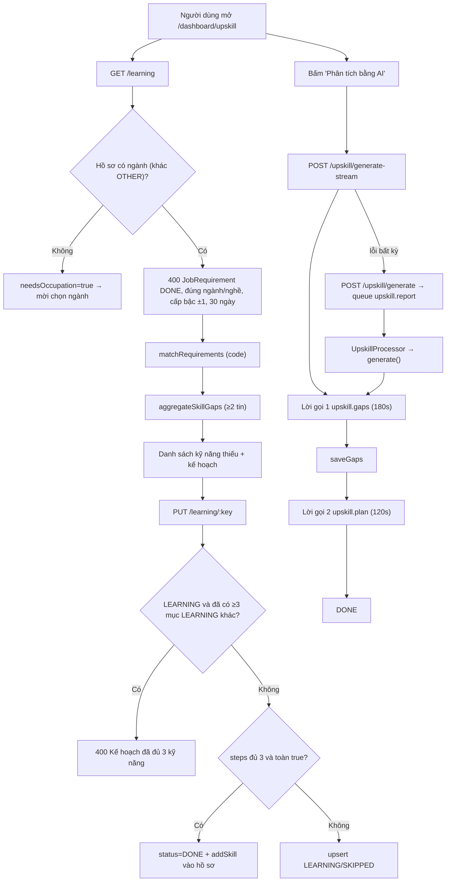
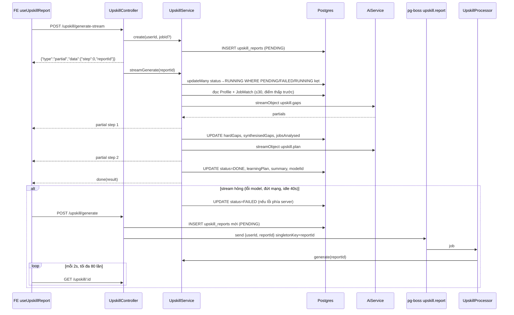
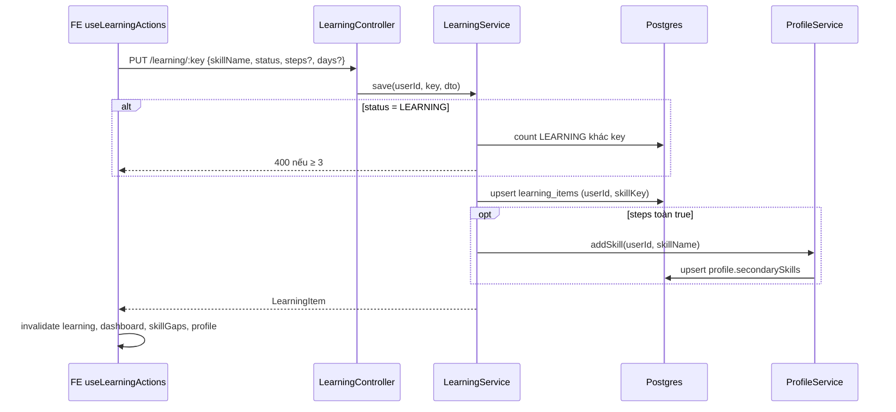
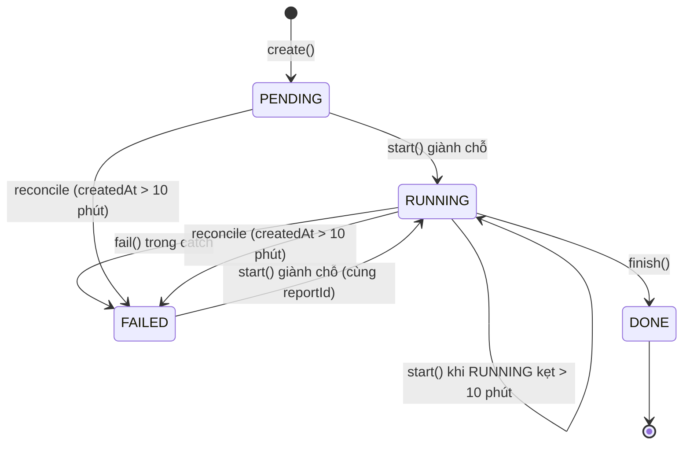
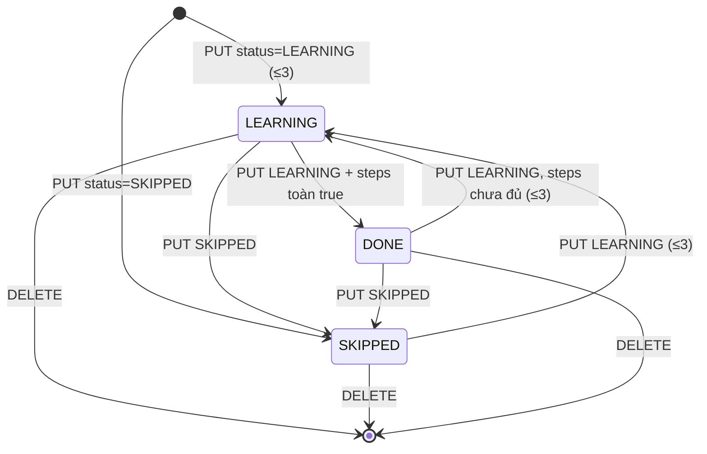

# Upskill — Lộ trình học & báo cáo nâng cấp kỹ năng

> **Phạm vi:** `server/src/modules/upskill/**` (`upskill.controller.ts`, `learning.controller.ts`, `upskill.service.ts`, `learning.service.ts`, `skill-gap.service.ts`, `upskill.processor.ts`, `upskill.schema.ts`, `upskill.dto.ts`, `utils/`) · bảng `UpskillReport`, `LearningItem` · màn hình `/dashboard/upskill` ("Lộ trình học").
> **Nguyên tắc:** tài liệu mô tả hệ thống **as-is**. Code là nguồn sự thật duy nhất.

## 1. Purpose

| Mục tiêu | Diễn giải |
|---|---|
| Chỉ ra kỹ năng còn thiếu **bằng code, không gọi AI** | `SkillGapService.forUser` đối chiếu hồ sơ với yêu cầu đã rút (`JobRequirement` DONE) của tin đúng ngành, cấp bậc ±1, nghề gần, trong 30 ngày, tối đa 400 tin — cùng luật với nhãn "Khớp x/y" ([skill-gap.service.ts:50](../../../server/src/modules/upskill/skill-gap.service.ts#L50)) |
| Cho người dùng lập **kế hoạch học** | Chọn học (tối đa 3 kỹ năng đang học), bỏ qua, đánh dấu 3 mốc, chọn ngày học trong tuần; xong đủ 3 mốc thì kỹ năng tự vào hồ sơ ([learning.service.ts:39](../../../server/src/modules/upskill/learning.service.ts#L39)) |
| Sinh **báo cáo AI** về khoảng trống "mềm" | Hai lời gọi model nối tiếp: `upskill.gaps` (khoảng trống) rồi `upskill.plan` (lộ trình), chạy qua stream NDJSON hoặc hàng đợi `upskill.report` ([upskill.service.ts:83](../../../server/src/modules/upskill/upskill.service.ts#L83), [ADR 0011](../../adr/0011-do-truoc-khi-doan.md)) |
| Cấp số liệu khoảng trống cho trang Tổng quan | `SkillGapService` được export và dùng lại bởi `DashboardService.skillGaps` ([dashboard.md](./dashboard.md)) |

**Điểm mấu chốt:**
- Trang "Lộ trình học" có HAI phần với hai cơ chế khác nhau: danh sách kỹ năng thiếu + kế hoạch học (`/learning`, đường ĐỌC thuần SQL + code) và "Khoảng trống khác" (`/upskill`, AI, chỉ chạy khi người dùng bấm).
- Báo cáo AI chạy bằng **giành chỗ có điều kiện** (`updateMany` theo trạng thái) nên một báo cáo DONE không bao giờ bị chạy lại ([upskill.service.ts:154](../../../server/src/modules/upskill/upskill.service.ts#L154)).
- Lời gọi 2 cố ý KHÔNG mang mô tả công việc — bản một-lời-gọi từng luôn hỏng (ADR 0011).

## 2. Actors

| Actor | Quyền trong module | Ghi chú |
|---|---|---|
| Người dùng đã đăng nhập (USER/ADMIN) | Đọc/tạo báo cáo upskill của chính mình; đọc khoảng trống, ghi/xoá mục kế hoạch học của chính mình | Mọi route qua `JwtAuthGuard` toàn cục (không có `@Public()`) |
| Khách | Không có | Không route nào mở công khai |
| Worker `UpskillProcessor` | Chạy `UpskillService.generate(reportId)` từ hàng đợi `upskill.report` | Chỉ chạy ở vai có việc nền (`runsBackgroundWork()` trong `QueueService.work`) ([upskill.processor.ts:18](../../../server/src/modules/upskill/upskill.processor.ts#L18)) |
| `ReconcileService` (cron) | Đánh `FAILED` báo cáo `PENDING/RUNNING` quá `STUCK_AFTER_MS` (10 phút) tính theo `createdAt` | [reconcile.service.ts:109](../../../server/src/modules/reconcile/services/reconcile.service.ts#L109) |
| Model AI (qua `AiService`) | Sinh `hardGaps`, `synthesisedGaps`, `learningPlan`, `summary` | Purpose `upskill.gaps`, `upskill.plan` |

## 3. Business Features

| # | Tính năng | Actor | Endpoint / cơ chế |
|---|---|---|---|
| F1 | Xem báo cáo upskill mới nhất đã xong | USER | `GET /api/upskill` |
| F2 | Nối lại lượt phân tích đang chạy sau khi rời trang | USER | `GET /api/upskill/in-flight` |
| F3 | Xem một báo cáo theo id (dùng để hỏi vòng) | USER | `GET /api/upskill/:id` |
| F4 | Tạo báo cáo qua hàng đợi | USER + Worker | `POST /api/upskill/generate` → queue `upskill.report` → `UpskillProcessor` |
| F5 | Tạo báo cáo qua stream NDJSON | USER | `POST /api/upskill/generate-stream` |
| F6 | Xem kỹ năng còn thiếu + kế hoạch học | USER | `GET /api/learning` |
| F7 | Học / bỏ qua / cập nhật mốc & ngày học một kỹ năng | USER | `PUT /api/learning/:key` |
| F8 | Bỏ một kỹ năng khỏi kế hoạch hoặc khỏi danh sách bỏ qua | USER | `DELETE /api/learning/:key` |
| F9 | Dọn báo cáo kẹt | Hệ thống | `ReconcileService.failStuck` |

## 4. Business Flow

### Luồng A — Xem báo cáo mới nhất (F1)
- **Preconditions:** người dùng có JWT hợp lệ.
- **Main Flow:**
  1. FE gọi `GET /api/upskill` ([upskill.controller.ts:37](../../../server/src/modules/upskill/upskill.controller.ts#L37)).
  2. `UpskillService.latest` tìm `UpskillReport` có `userId` = người gọi, `status = 'DONE'`, mới nhất theo `createdAt` ([upskill.service.ts:301](../../../server/src/modules/upskill/upskill.service.ts#L301)).
  3. Trả bản ghi qua `withFailureKind`: bỏ cột `error`, thêm `failureKind` ([failure-view.ts](../../../server/src/common/ai/failure-view.ts)).
- **Alternative Flow:** báo cáo RUNNING/FAILED/PENDING không bao giờ được coi là "mới nhất" (e2e `upskill.e2e-spec.ts`).
- **Failure Flow:** chưa có báo cáo DONE → `404 "Chưa có báo cáo upskill nào"`. FE coi 404 là "chưa có" (trả `null`) ([use-upskill-report.ts:40](../../../../ui-ai-job-search/hooks/use-upskill-report.ts#L40)).
- **Postconditions:** không ghi gì.

### Luồng B — Nối lại lượt đang chạy (F2)
- **Preconditions:** đăng nhập.
- **Main Flow:**
  1. Khi trang mount, FE gọi `GET /api/upskill/in-flight` ([use-upskill-report.ts:87](../../../../ui-ai-job-search/hooks/use-upskill-report.ts#L87)).
  2. `inFlight` tìm báo cáo của người gọi có `status ∈ {PENDING, RUNNING}` và `createdAt > now − STUCK_AFTER_MS`, mới nhất; chỉ chọn `id, createdAt, jobsAnalysed` ([upskill.service.ts:310](../../../server/src/modules/upskill/upskill.service.ts#L310)).
  3. Có kết quả → FE bật trạng thái "đang phân tích", suy bước (`jobsAnalysed > 0` ⇒ đã xong lời gọi 1 ⇒ bước 2) và hỏi vòng `GET /upskill/:id`.
- **Alternative Flow:** không có → trả thân rỗng (`null`), FE bỏ qua.
- **Failure Flow:** lượt kẹt quá 10 phút bị bỏ qua (không trả về).
- **Postconditions:** không ghi gì.

### Luồng C — Xem báo cáo theo id (F3)
- **Preconditions:** đăng nhập.
- **Main Flow:**
  1. `GET /api/upskill/:id` → `UpskillService.get(userId, id)` truy vấn `findFirst({ where: { id, userId } })` ([upskill.service.ts:323](../../../server/src/modules/upskill/upskill.service.ts#L323)).
  2. Trả qua `withFailureKind`.
- **Alternative Flow:** FE hỏi vòng mỗi 2 giây, tối đa 80 lần (~160 giây); gặp DONE/FAILED thì dừng ([use-upskill-report.ts:63](../../../../ui-ai-job-search/hooks/use-upskill-report.ts#L63)).
- **Failure Flow:** id không tồn tại hoặc thuộc người khác → `404 "Không tìm thấy báo cáo: <id>"`. Hết 80 lượt hỏi → FE hiện "Phân tích chạy quá lâu. Tải lại trang sau ít phút để xem kết quả."
- **Postconditions:** không ghi gì.

### Luồng D — Tạo báo cáo qua hàng đợi (F4)
- **Preconditions:** đăng nhập; còn hạn mức `@ThrottleAi()` (10 lượt/phút).
- **Main Flow:**
  1. `POST /api/upskill/generate` với body `{ jobId? }` ([upskill.controller.ts:58](../../../server/src/modules/upskill/upskill.controller.ts#L58)).
  2. `UpskillService.create` tạo `UpskillReport` `PENDING`, `mode = TARGETED` nếu có `jobId`, ngược lại `AGGREGATE` ([upskill.service.ts:291](../../../server/src/modules/upskill/upskill.service.ts#L291)).
  3. `QueueService.send(QUEUE.UPSKILL_REPORT, { userId, reportId })`, khoá dedup `singletonKey = reportId` ([queue-key.ts:61](../../../server/src/modules/queue/queue-key.ts#L61)).
  4. Trả `{ queued: true, reportId, mode }` (HTTP 201).
  5. Worker `UpskillProcessor` nhận việc, gọi `UpskillService.generate(reportId)` ([upskill.processor.ts:18](../../../server/src/modules/upskill/upskill.processor.ts#L18)).
  6. `start` giành chỗ: `updateMany` sang `RUNNING` chỉ khi `status ∈ {PENDING, FAILED}` hoặc `RUNNING` có `createdAt` cũ hơn 10 phút; xoá `error` ([upskill.service.ts:154](../../../server/src/modules/upskill/upskill.service.ts#L154)).
  7. `prepare` đọc `Profile` và gom tin: TARGETED → đúng `JobMatch(userId, jobId)`; AGGREGATE → 30 `JobMatch` `DONE` điểm thấp nhất trước ([upskill.service.ts:62](../../../server/src/modules/upskill/upskill.service.ts#L62), [:179](../../../server/src/modules/upskill/upskill.service.ts#L179)).
  8. Lời gọi 1 `upskill.gaps` (timeout 180s) với khung Step 3–5 của `.claude/skills/upskill/SKILL.md`, tóm tắt hồ sơ, danh sách tin (điểm, trọng số `(100−điểm)/100`, yêu cầu đã rút hoặc 600 ký tự mô tả) ([upskill.prompt.ts](../../../server/src/modules/upskill/utils/upskill.prompt.ts)).
  9. `saveGaps` ghi ngay `jobsAnalysed`, `hardGaps`, `synthesisedGaps` (để lời gọi 2 hỏng thì không mất công) ([upskill.service.ts:237](../../../server/src/modules/upskill/upskill.service.ts#L237)).
  10. Lời gọi 2 `upskill.plan` (timeout 120s) với khung Step 6–7, tóm tắt hồ sơ và danh sách khoảng trống — **không** mang mô tả công việc ([upskill.service.ts:220](../../../server/src/modules/upskill/upskill.service.ts#L220)).
  11. `finish` ghi `status = DONE`, `learningPlan`, `summary`, `modelId` (ghép `"<gaps> + <plan>"` nếu hai model khác nhau), `generatedAt`, `error = null` ([upskill.service.ts:248](../../../server/src/modules/upskill/upskill.service.ts#L248)).
- **Alternative Flow:**
  - Giành chỗ thất bại (báo cáo đang RUNNING chưa kẹt hoặc đã DONE) → worker ghi log debug và bỏ qua, không gọi model ([upskill.service.ts:128](../../../server/src/modules/upskill/upskill.service.ts#L128)).
  - TARGETED: chỉ phân tích một tin; không áp ngưỡng 3 tin.
- **Failure Flow:** mọi lỗi trong khối `try` (kể cả lỗi của `prepare`) → `fail` ghi `status = FAILED`, `error = messageOf(error)`; worker KHÔNG ném lại nên pg-boss coi việc thành công ([upskill.service.ts:149](../../../server/src/modules/upskill/upskill.service.ts#L149), [:270](../../../server/src/modules/upskill/upskill.service.ts#L270)). Các lỗi điển hình:
  - Không có tin nào đã chấm → `"Chưa có công việc nào được chấm điểm. Hãy nạp tin tuyển dụng trước."`
  - AGGREGATE dưới 3 tin → `"Cần ít nhất 3 công việc đã chấm điểm để tổng hợp, hiện có <n>."`
  - TARGETED mà `JobMatch(userId, jobId)` không có → `"Công việc này chưa được chấm điểm"`.
  - Lỗi model (timeout, schema, upstream) → phân loại thành `failureKind` khi đọc.
- **Postconditions:** một `UpskillReport` ở `DONE` (đủ 4 cột nội dung) hoặc `FAILED` (có thể đã có `hardGaps/synthesisedGaps` từ lời gọi 1). Hai dòng `AiCall` purpose `upskill.gaps`, `upskill.plan` (do `AiService` ghi — xem [ai-platform.md](./ai-platform.md)).

### Luồng E — Tạo báo cáo qua stream (F5) — đường FE dùng mặc định
- **Preconditions:** như Luồng D.
- **Main Flow:**
  1. FE `streamModel` POST `/api/upskill/generate-stream` (không gửi body) ([use-upskill-report.ts:101](../../../../ui-ai-job-search/hooks/use-upskill-report.ts#L101)).
  2. Controller tạo báo cáo (`create`) rồi `streamNdjson`; dòng mở đầu `{"type":"partial","data":{"step":0,"reportId":...}}` ([upskill.controller.ts:79](../../../server/src/modules/upskill/upskill.controller.ts#L79)).
  3. `streamGenerate`: giành chỗ như Luồng D; nếu không giành được → `ConflictException "Báo cáo đang ở trạng thái <status>, không tạo lại được."` (thành sự kiện `error` kèm `statusCode` vì chưa có sự kiện nào) ([upskill.service.ts:83](../../../server/src/modules/upskill/upskill.service.ts#L83), [ndjson.ts](../../../server/src/common/ndjson.ts)).
  4. Đẩy partial `{ step: 1, value }` trong lúc lời gọi 1 viết, lưu khoảng trống, rồi partial `{ step: 2, value }` cho lời gọi 2.
  5. Sự kiện cuối `{ type: 'done', result: <UpskillReport đã DONE> }`. FE ghi vào cache `keys.upskill()`.
  6. Server gửi dòng trống mỗi 10 giây làm heartbeat; FE bỏ cuộc nếu 40 giây không nhận gì ([model-stream.ts](../../../../ui-ai-job-search/lib/model-stream.ts)).
- **Alternative Flow:** trình duyệt ngắt giữa chừng → server vẫn chạy generator tới cuối và tự ghi DONE/FAILED (không xếp lại việc — quy tắc CLAUDE.md, gỡ `onAbandon` *(2026-10-16)*).
- **Failure Flow:**
  - Lỗi trong `try` → `fail` ghi FAILED, rồi phát `streamFailureEvent`: `HttpException` giữ nguyên câu (vd. "Cần ít nhất 3 công việc…"), lỗi khác chỉ gửi `"Không hoàn thành được tác vụ."` + `failureKind` ([failure-view.ts](../../../server/src/common/ai/failure-view.ts)).
  - **FE bắt MỌI lỗi stream rồi tự gọi `POST /upskill/generate`** tạo báo cáo mới và hỏi vòng ([use-upskill-report.ts:118](../../../../ui-ai-job-search/hooks/use-upskill-report.ts#L118)) — xem R1.
- **Postconditions:** như Luồng D.

### Luồng F — Xem kỹ năng còn thiếu và kế hoạch học (F6)
- **Preconditions:** đăng nhập.
- **Main Flow:**
  1. `GET /api/learning` → `LearningService.overview` chạy song song `SkillGapService.forUser(userId)` và `LearningItem.findMany({ userId })` theo `createdAt` tăng ([learning.service.ts:18](../../../server/src/modules/upskill/learning.service.ts#L18)).
  2. `forUser` ([skill-gap.service.ts:50](../../../server/src/modules/upskill/skill-gap.service.ts#L50)):
     1. Đọc `Profile` (`profileSelect` + `occupationCode`, `subOccupationCode`, `experienceLevel`); `profileFit` suy cấp bậc từ số năm kinh nghiệm khi `experienceLevel = UNKNOWN`.
     2. Không có hồ sơ, chưa có ngành, hoặc ngành = `OTHER` → trả bản rỗng `needsOccupation: true`.
     3. Cấp bậc ±1 (`nearbySeniorities`) cộng `UNKNOWN`; nghề = `subOccupationCode` của hồ sơ hoặc suy bằng `resolveSubOccupation` từ headline + kỹ năng chính, mở rộng sang nghề gần (`nearbySubOccupations`).
     4. Lấy tối đa 400 `JobRequirement` `DONE` của tin đúng ngành, đúng nghề, không phải bản sao (`duplicateOfId = null`), quét trong 30 ngày, mới nhất trước.
     5. Đối chiếu bằng `matchRequirements` (luật trong `matching/rules`, không gọi model) với từ điển kỹ năng.
     6. `aggregateSkillGaps`: mỗi tin đếm một kỹ năng tối đa một lần; chỉ tính kiểm tra `SKILL`/`NICE` có `met === false`; bỏ kỹ năng xuất hiện ở \< 2 tin; `kind = REQUIRED` nếu số tin bắt buộc ≥ số tin ưu tiên; `near` = số tin "gần đạt" (khớp ≥ 50% kỹ năng bắt buộc); hiện tối đa 5 tin, ưu tiên tin gần đạt; sắp theo `demand` giảm, `near` giảm, tên ([skill-gaps.ts:49](../../../server/src/modules/upskill/utils/skill-gaps.ts#L49)).
  3. Gắn `status` của từng kỹ năng từ `LearningItem` (không có → chuỗi ảo `'OPEN'`), tách `plan` (mọi mục khác `SKIPPED`, gồm cả `DONE`) và `skipped`.
- **Alternative Flow:** hồ sơ chưa chọn ngành → FE hiện EmptyState "Chọn ngành nghề để xem kỹ năng còn thiếu" ([upskill-view.tsx](../../../../ui-ai-job-search/app/dashboard/upskill/upskill-view.tsx)).
- **Failure Flow:** không có lỗi nghiệp vụ riêng.
- **Postconditions:** không ghi gì; không gọi AI.

### Luồng G — Học / bỏ qua / cập nhật một kỹ năng (F7)
- **Preconditions:** đăng nhập; body hợp lệ theo `SaveLearningDto`.
- **Main Flow:**
  1. `PUT /api/learning/:key` ([learning.controller.ts:24](../../../server/src/modules/upskill/learning.controller.ts#L24)).
  2. Nếu `status = LEARNING`: đếm `LearningItem` của người gọi đang `LEARNING` với `skillKey` khác; ≥ 3 → `400` ([learning.service.ts:40](../../../server/src/modules/upskill/learning.service.ts#L40)).
  3. Nếu `status = LEARNING` và `steps` có đủ và toàn `true` → trạng thái lưu là `DONE`; ngược lại giữ `dto.status`.
  4. `upsert` theo khoá `(userId, skillKey)`: ghi `skillName`, `status`, và `steps`/`days` nếu có gửi.
  5. Nếu trạng thái thành `DONE` → `ProfileService.addSkill(userId, skillName)` thêm vào `secondarySkills` nếu chưa có (so sánh đã gấp dấu, không phân biệt hoa thường) ([profile.service.ts:24](../../../server/src/modules/profile/profile.service.ts#L24)).
  6. Trả bản ghi `LearningItem`.
- **Alternative Flow:**
  - `status = SKIPPED` không bị giới hạn 3.
  - FE nút "Đã biết" không đi qua route này mà gọi `POST /profile/skills` ([use-learning.ts](../../../../ui-ai-job-search/hooks/use-learning.ts)).
- **Failure Flow:** `400 "Kế hoạch đã đủ 3 kỹ năng. Hoàn thành hoặc bỏ bớt một kỹ năng trước."`; DTO sai → 400 (xem §8).
- **Postconditions:** một `LearningItem` được tạo/cập nhật; có thể thêm kỹ năng vào `Profile.secondarySkills` (và hệ quả của `ProfileService.save`, xem [profile.md](./profile.md)).

### Luồng H — Bỏ một kỹ năng khỏi kế hoạch (F8)
- **Preconditions:** đăng nhập.
- **Main Flow:** `DELETE /api/learning/:key` → `deleteMany({ where: { userId, skillKey } })`, trả `{ removed: <count> }` ([learning.service.ts:71](../../../server/src/modules/upskill/learning.service.ts#L71)).
- **Alternative Flow:** không có mục nào → `{ removed: 0 }`, HTTP 200 (không 404).
- **Failure Flow:** `key` dài quá 120 ký tự → 400 `"Mã kỹ năng không hợp lệ"`.
- **Postconditions:** kỹ năng quay về trạng thái `OPEN` ở danh sách; kỹ năng đã thêm vào hồ sơ (nếu từng DONE) KHÔNG bị gỡ.

### Luồng I — Dọn báo cáo kẹt (F9)
- **Preconditions:** cron reconcile chạy (xem [platform-operations.md](./platform-operations.md)).
- **Main Flow:** `upskillReport.updateMany({ status ∈ {PENDING,RUNNING}, createdAt < now − 10 phút })` → `FAILED`, `error = STUCK_MESSAGE` ([reconcile.service.ts:109](../../../server/src/modules/reconcile/services/reconcile.service.ts#L109)).
- **Alternative Flow:** bảng không có `updatedAt` nên mốc kẹt tính theo `createdAt`.
- **Failure Flow:** không xếp lại việc (quy tắc "không tự xếp lại FAILED").
- **Postconditions:** báo cáo ở `FAILED`, người dùng bấm "Phân tích lại" để tạo bản mới.

## 5. Mermaid Flowchart

## 6. Sequence Diagram

### Tạo báo cáo bằng stream, rơi về hàng đợi khi hỏng

### Ghi một mục kế hoạch học

## 7. Business Rules

| Mã BR | Quy tắc | Nơi thực thi | Mức | Nguồn code |
|---|---|---|---|---|
| BR-UPS-01 | Báo cáo có `jobId` là `TARGETED`, không có là `AGGREGATE` | SV | ✅ Mềm | [upskill.service.ts:291](../../../server/src/modules/upskill/upskill.service.ts#L291) |
| BR-UPS-02 | AGGREGATE lấy tối đa 30 `JobMatch` `DONE` của người dùng, điểm tổng thấp nhất trước | SV | ✅ Mềm | [upskill.service.ts:74](../../../server/src/modules/upskill/upskill.service.ts#L74) |
| BR-UPS-03 | AGGREGATE cần ít nhất 3 tin đã chấm; không có tin nào thì báo nạp tin trước | SV | ✅ Mềm | [upskill.service.ts:179](../../../server/src/modules/upskill/upskill.service.ts#L179) |
| BR-UPS-04 | TARGETED chỉ chạy trên `JobMatch(userId, jobId)` của chính người gọi; không có thì lỗi "chưa được chấm điểm" | SV | ✅ Mềm | [upskill.service.ts:62](../../../server/src/modules/upskill/upskill.service.ts#L62) |
| BR-UPS-05 | Chạy báo cáo bằng giành chỗ có điều kiện: chỉ từ `PENDING`, `FAILED`, hoặc `RUNNING` có `createdAt` quá 10 phút; báo cáo `DONE` không bao giờ chạy lại | SV | ✅ Mềm | [upskill.service.ts:154](../../../server/src/modules/upskill/upskill.service.ts#L154) |
| BR-UPS-06 | Báo cáo gồm hai lời gọi model riêng: `upskill.gaps` (180s) rồi `upskill.plan` (120s); lời gọi 2 không mang mô tả công việc | SV | ✅ Mềm | [upskill.service.ts:202](../../../server/src/modules/upskill/upskill.service.ts#L202), [ADR 0011](../../adr/0011-do-truoc-khi-doan.md) |
| BR-UPS-07 | Khoảng trống của lời gọi 1 được lưu ngay trước lời gọi 2 | SV | ✅ Mềm | [upskill.service.ts:237](../../../server/src/modules/upskill/upskill.service.ts#L237) |
| BR-UPS-08 | Trong prompt, tin điểm thấp nặng ký hơn: trọng số khoảng trống = `(100 − điểm)/100`; tin có yêu cầu đã rút thì đưa danh sách kỹ năng, chưa có thì đưa 600 ký tự đầu mô tả | SV | ✅ Mềm | [upskill.prompt.ts:43](../../../server/src/modules/upskill/utils/upskill.prompt.ts#L43) |
| BR-UPS-09 | Output model bị CẮT: tối đa 12 `hardGaps`, 8 `synthesisedGaps`, 8 mục `learningPlan`, 4 nguồn học/mục; `priority` 0–100 và `estimatedWeeks` 1–52 giữ nghiêm | SV (zod) | ✅ Mềm | [upskill.schema.ts](../../../server/src/modules/upskill/upskill.schema.ts) |
| BR-UPS-10 | Lỗi trong lúc tạo báo cáo → `FAILED` + `error`; khi đọc chỉ trả `failureKind`, không trả lỗi thô | SV | ✅ Mềm | [upskill.service.ts:270](../../../server/src/modules/upskill/upskill.service.ts#L270), [failure-view.ts](../../../server/src/common/ai/failure-view.ts) |
| BR-UPS-11 | "Báo cáo mới nhất" chỉ tính bản `DONE` | SV | ✅ Mềm | [upskill.service.ts:301](../../../server/src/modules/upskill/upskill.service.ts#L301) |
| BR-UPS-12 | "Lượt đang chạy" là `PENDING/RUNNING` tạo trong 10 phút gần nhất; lượt cũ hơn coi như kẹt | SV | ✅ Mềm | [upskill.service.ts:310](../../../server/src/modules/upskill/upskill.service.ts#L310) |
| BR-UPS-13 | Tạo báo cáo (cả hai route) giới hạn 10 lượt/phút mỗi người | GD | ✅ Mềm | [upskill.controller.ts:58](../../../server/src/modules/upskill/upskill.controller.ts#L58), [throttle.ts](../../../server/src/common/throttle.ts) |
| BR-UPS-14 | Việc `upskill.report` chặn trùng theo `reportId` | SV (queue) | ✅ Mềm | [queue-key.ts:61](../../../server/src/modules/queue/queue-key.ts#L61) |
| BR-UPS-15 | Báo cáo `PENDING/RUNNING` quá 10 phút (theo `createdAt`) bị reconcile đánh `FAILED`, không xếp lại | SV (cron) | ✅ Mềm | [reconcile.service.ts:109](../../../server/src/modules/reconcile/services/reconcile.service.ts#L109) |
| BR-UPS-16 | Kỹ năng thiếu tính bằng code: tin đúng ngành, nghề (và nghề gần), cấp bậc ±1 (kèm tin chưa rõ cấp bậc), không phải bản sao, quét trong 30 ngày, tối đa 400 tin | SV | ✅ Mềm | [skill-gap.service.ts:76](../../../server/src/modules/upskill/skill-gap.service.ts#L76) |
| BR-UPS-17 | Hồ sơ chưa có ngành hoặc ngành `OTHER` → không tính khoảng trống, báo `needsOccupation` | SV | ✅ Mềm | [skill-gap.service.ts:74](../../../server/src/modules/upskill/skill-gap.service.ts#L74) |
| BR-UPS-18 | Một kỹ năng chỉ được liệt kê khi ≥ 2 tin yêu cầu mà hồ sơ chưa đáp ứng; mỗi tin đếm một kỹ năng một lần | SV | ✅ Mềm | [skill-gaps.ts:7](../../../server/src/modules/upskill/utils/skill-gaps.ts#L7) |
| BR-UPS-19 | Tin "gần đạt" = đã khớp ≥ 50% kỹ năng bắt buộc; mỗi kỹ năng hiện tối đa 5 tin, ưu tiên tin gần đạt | SV | ✅ Mềm | [skill-gaps.ts:42](../../../server/src/modules/upskill/utils/skill-gaps.ts#L42) |
| BR-UPS-20 | Khoá gộp kỹ năng = id kỹ năng chuẩn trong từ điển, hoặc tên đã gấp dấu nếu chưa có trong từ điển | SV | ✅ Mềm | [skill-gaps.ts:36](../../../server/src/modules/upskill/utils/skill-gaps.ts#L36) |
| BR-UPS-21 | Tối đa 3 kỹ năng ở trạng thái `LEARNING` mỗi người; `SKIPPED` và `DONE` không tính | SV | ✅ Mềm | [learning.service.ts:40](../../../server/src/modules/upskill/learning.service.ts#L40) |
| BR-UPS-22 | Mỗi người có tối đa một mục cho mỗi `skillKey` | DB | 🔒 Cứng | [schema.prisma:656](../../../server/prisma/schema.prisma#L656) |
| BR-UPS-23 | Gửi `LEARNING` với đủ 3 mốc đều `true` → mục thành `DONE` và kỹ năng được thêm vào `secondarySkills` của hồ sơ (nếu chưa có) | SV | ✅ Mềm | [learning.service.ts:52](../../../server/src/modules/upskill/learning.service.ts#L52) |
| BR-UPS-24 | Xoá mục kế hoạch không gỡ kỹ năng đã thêm vào hồ sơ | SV | ✅ Mềm | [learning.service.ts:71](../../../server/src/modules/upskill/learning.service.ts#L71) |
| BR-UPS-25 | Đọc/ghi báo cáo và kế hoạch học luôn khoá theo `userId` của JWT | SV | ✅ Mềm | [upskill.service.ts:323](../../../server/src/modules/upskill/upskill.service.ts#L323), [learning.service.ts:71](../../../server/src/modules/upskill/learning.service.ts#L71) |

> **Possible Business Rule:** `PUT /learning/:key` không kiểm `key`/`skillName` có thuộc danh sách khoảng trống hiện tại hay không — người dùng có thể thêm bất kỳ kỹ năng nào vào kế hoạch và (khi xong 3 mốc) vào hồ sơ. Tương đương `POST /profile/skills` nên không phải lỗ hổng quyền, nhưng cần xác nhận đây là chủ ý.

> **Possible Business Rule:** Nhánh giành chỗ từ `FAILED` và từ `RUNNING` kẹt ([upskill.service.ts:159](../../../server/src/modules/upskill/upskill.service.ts#L159)) chỉ có ý nghĩa nếu một việc `upskill.report` được giao lại cho cùng `reportId`; hiện mọi đường tạo báo cáo đều tạo bản ghi mới, và worker không ném lỗi ra pg-boss. Chưa kiểm chứng pg-boss có giao lại việc khi tiến trình chết (hết `expireIn`) hay không.

## 8. Validation Rules

### `GenerateUpskillDto` (body `POST /upskill/generate`, `/generate-stream`)
| Field | Ràng buộc | DTO/Schema | Lỗi trả về |
|---|---|---|---|
| `jobId` | tuỳ chọn, chuỗi, ≤ 40 ký tự | [upskill.dto.ts:15](../../../server/src/modules/upskill/upskill.dto.ts#L15) | 400, thông điệp mặc định class-validator dịch qua `vietnameseValidationError` |
| (trường lạ) | `forbidNonWhitelisted` | [bootstrap.ts](../../../server/src/bootstrap.ts) | 400 |

### `LearningKeyDto` (param `:key`)
| Field | Ràng buộc | DTO/Schema | Lỗi trả về |
|---|---|---|---|
| `key` | chuỗi, dài 1–120 | [upskill.dto.ts:19](../../../server/src/modules/upskill/upskill.dto.ts#L19) | 400 `"Mã kỹ năng không hợp lệ"` |

### `SaveLearningDto` (body `PUT /learning/:key`)
| Field | Ràng buộc | DTO/Schema | Lỗi trả về |
|---|---|---|---|
| `skillName` | bắt buộc, chuỗi, dài 1–80 | [upskill.dto.ts:25](../../../server/src/modules/upskill/upskill.dto.ts#L25) | 400 `"Thiếu tên kỹ năng"` / `"Tên kỹ năng phải từ 1 tới 80 ký tự"` |
| `status` | `LEARNING` hoặc `SKIPPED` (không cho gửi `DONE`) | như trên | 400 `"Trạng thái không hợp lệ"` |
| `steps` | tuỳ chọn, mảng đúng 3 phần tử boolean | như trên | 400 mặc định (đã dịch) |
| `days` | tuỳ chọn, mảng ≤ 7 phần tử thuộc `MO,TU,WE,TH,FR,SA,SU` | như trên | 400 `"Ngày học không hợp lệ"` |

### Schema output model (`upskill.schema.ts`) — cắt, không từ chối (ADR 0017)
| Field | Ràng buộc | Schema | Lỗi trả về |
|---|---|---|---|
| `hardGaps[].skill` | chuỗi tiếng Việt, cắt 80 | `upskillGapsSchema` | lỗi schema → `FAILED` (`failureKind = SCHEMA`) |
| `hardGaps[].demandCount` | số nguyên ≥ 0 | như trên | như trên |
| `hardGaps[].priority` | số nguyên 0–100 | như trên | như trên |
| `hardGaps[].evidence` | cắt 500 | như trên | — |
| `hardGaps` | cắt còn 12 mục | như trên | — |
| `synthesisedGaps[].category` | enum `domain, soft, tooling, credential` | như trên | lỗi schema |
| `synthesisedGaps[].gap` / `.why` | cắt 160 / 500; mảng cắt còn 8 | như trên | — |
| `learningPlan[].order` | số nguyên ≥ 1 | `upskillPlanSchema` | lỗi schema |
| `learningPlan[].topic` / `.rationale` | cắt 120 / 500 | như trên | — |
| `learningPlan[].estimatedWeeks` | số nguyên 1–52 | như trên | lỗi schema |
| `learningPlan[].resources` | ≥ 1 mục, mỗi mục cắt 300, mảng cắt còn 4 | như trên | lỗi schema nếu rỗng |
| `learningPlan` | ≥ 1 mục, cắt còn 8 | như trên | lỗi schema nếu rỗng |
| `summary` | cắt 800 | như trên | — |

## 9. API Mapping

| Method | URL | Role | Mục đích nghiệp vụ | Controller#method | Service | DTO | Response |
|---|---|---|---|---|---|---|---|
| GET | `/api/upskill` | USER | Báo cáo DONE mới nhất | `UpskillController#latest` | `UpskillService.latest` | — | `UpskillReport` (không `error`, có `failureKind`) / 404 |
| GET | `/api/upskill/in-flight` | USER | Lượt đang chạy để nối lại | `UpskillController#inFlight` | `UpskillService.inFlight` | — | `{ id, createdAt, jobsAnalysed }` hoặc rỗng |
| GET | `/api/upskill/:id` | USER | Chi tiết một báo cáo của mình | `UpskillController#get` | `UpskillService.get` | — | `UpskillReport` + `failureKind` / 404 |
| POST | `/api/upskill/generate` | USER (10/phút) | Tạo báo cáo, xếp hàng | `UpskillController#enqueue` | `UpskillService.create` + `QueueService.send` | `GenerateUpskillDto` | 201 `{ queued: true, reportId, mode }` |
| POST | `/api/upskill/generate-stream` | USER (10/phút) | Tạo báo cáo, stream NDJSON | `UpskillController#generateStream` | `UpskillService.create` + `streamGenerate` | `GenerateUpskillDto` | NDJSON `partial`/`done`/`error` |
| GET | `/api/learning` | USER | Kỹ năng thiếu + kế hoạch | `LearningController#overview` | `LearningService.overview`, `SkillGapService.forUser` | — | `SkillGapReport` + `gaps[].status`, `plan`, `skipped` |
| PUT | `/api/learning/:key` | USER | Học/bỏ qua/cập nhật một kỹ năng | `LearningController#save` | `LearningService.save` | `LearningKeyDto`, `SaveLearningDto` | `LearningItem` |
| DELETE | `/api/learning/:key` | USER | Bỏ một kỹ năng khỏi kế hoạch | `LearningController#remove` | `LearningService.remove` | `LearningKeyDto` | `{ removed: number }` |

**Endpoint ở module khác tác động lên module này**

| Method | URL | Module | Tác động |
|---|---|---|---|
| GET | `/api/dashboard`, `/api/dashboard/skill-gaps` | dashboard | Đọc lại `SkillGapService.forUser` (6 kỹ năng đầu) — [dashboard.md](./dashboard.md) |
| POST | `/api/profile/skills` | profile | Nút "Đã biết" trên thẻ kỹ năng; kỹ năng vào hồ sơ nên rời danh sách thiếu — [profile.md](./profile.md) |
| PUT | `/api/profile` (và các route sửa hồ sơ) | profile | Đổi ngành/nghề/cấp bậc/kỹ năng làm đổi kết quả `forUser` |
| (cron) | reconcile | platform-operations | Đánh `FAILED` báo cáo kẹt |
| (admin) | cấu hình hàng đợi | admin-console | Đổi concurrency của `upskill.report` (mặc định 5, [queue.defaults.ts](../../../server/src/modules/queue/queue.defaults.ts)) |

## 10. Frontend Mapping

| Route FE | Vai trò | Mục đích | Hook / API client |
|---|---|---|---|
| `/dashboard/upskill` | USER | Trang "Lộ trình học" | [page.tsx](../../../../ui-ai-job-search/app/dashboard/upskill/page.tsx) → [upskill-view.tsx](../../../../ui-ai-job-search/app/dashboard/upskill/upskill-view.tsx), `useLearning` |
| — khối "Kỹ năng nên học" | USER | Danh sách khoảng trống, nút Học / Đã biết / Bỏ qua | [skill-gap-list.tsx](../../../../ui-ai-job-search/app/dashboard/upskill/skill-gap-list.tsx), [skill-gap-card.tsx](../../../../ui-ai-job-search/app/dashboard/upskill/skill-gap-card.tsx), `useLearningActions` |
| — khối "Kế hoạch" | USER | Mốc học, ngày học, xoá | [learning-plan.tsx](../../../../ui-ai-job-search/app/dashboard/upskill/learning-plan.tsx), [learning-plan-item.tsx](../../../../ui-ai-job-search/app/dashboard/upskill/learning-plan-item.tsx) |
| — khối "Khoảng trống khác" | USER | Hiện `synthesisedGaps` của báo cáo AI, nút "Phân tích bằng AI"/"Phân tích lại", cảnh báo báo cáo cũ hơn hồ sơ | [soft-gaps.tsx](../../../../ui-ai-job-search/app/dashboard/upskill/soft-gaps.tsx), [upskill-progress.tsx](../../../../ui-ai-job-search/app/dashboard/upskill/upskill-progress.tsx), `useUpskillReport` |
| API client | — | `/upskill`, `/upskill/in-flight`, `/upskill/:id`, `/upskill/generate` | [services/upskill.ts](../../../../ui-ai-job-search/services/upskill.ts); stream qua [lib/model-stream.ts](../../../../ui-ai-job-search/lib/model-stream.ts) |
| API client | — | `/learning`, `/learning/:key` | [services/learning.ts](../../../../ui-ai-job-search/services/learning.ts) |
| Hook | — | Báo cáo AI: đọc mới nhất, stream, rơi về hàng đợi + hỏi vòng | [hooks/use-upskill-report.ts](../../../../ui-ai-job-search/hooks/use-upskill-report.ts) |
| Hook | — | Kế hoạch học; sau mỗi thao tác invalidate `learning`, `dashboard`, `skillGaps`, `profile` | [hooks/use-learning.ts](../../../../ui-ai-job-search/hooks/use-learning.ts) |

Thuật ngữ UI ↔ backend: "Lộ trình học" = `/learning` + `/upskill`; "Khoảng trống khác" = `synthesisedGaps`; "Đã biết" = `POST /profile/skills`; "Phân tích bằng AI" = `generate-stream`.

## 11. Database

**`upskill_reports` (`UpskillReport`)** — [schema.prisma:667](../../../server/prisma/schema.prisma#L667)

| Field | Kiểu | Ghi chú |
|---|---|---|
| `id` | cuid | PK |
| `userId` | FK `User`, `onDelete: Cascade` | chủ sở hữu |
| `mode` | `UpskillMode` mặc định `AGGREGATE` | |
| `status` | `MatchStatus` mặc định `PENDING` | |
| `jobId` | `String?` | chỉ có ở TARGETED; **không có khoá ngoại** tới `Job` |
| `jobsAnalysed` | Int, mặc định 0 | số tin đưa vào phân tích |
| `hardGaps`, `synthesisedGaps`, `learningPlan` | `Json?` | output model |
| `summary` | Text? | |
| `modelId` | String? | model của 2 lời gọi |
| `generatedAt` | DateTime? | lúc DONE |
| `error` | Text? | lỗi thô (không trả ra API) |
| `createdAt` | DateTime | **không có `updatedAt`** |
| Index | `@@index([userId, createdAt desc])` | [schema.prisma:697](../../../server/prisma/schema.prisma#L697) |

**`learning_items` (`LearningItem`)** — [schema.prisma:639](../../../server/prisma/schema.prisma#L639)

| Field | Kiểu | Ghi chú |
|---|---|---|
| `id` | cuid | PK |
| `userId` | FK `User`, Cascade | |
| `skillKey` | String | id kỹ năng chuẩn hoặc tên đã gấp dấu |
| `skillName` | String | tên hiển thị |
| `status` | `LearningStatus` | |
| `steps` | Boolean[] mặc định `[false,false,false]` | 3 mốc: học nền tảng, làm dự án nhỏ, thêm vào hồ sơ |
| `days` | String[] mặc định `[]` | ngày học trong tuần |
| `createdAt`, `updatedAt` | DateTime | |
| Unique | `@@unique([userId, skillKey])` | [schema.prisma:656](../../../server/prisma/schema.prisma#L656) |

Bảng đọc (không ghi): `Profile`, `JobMatch`, `Job`, `JobRequirement`, `CanonicalSkill` (+ từ điển `SkillAlias` qua `SkillDictionaryService`).

## 12. State Machine

### `UpskillReport.status` (`MatchStatus`)

| Từ | Sang | Trigger | Điều kiện |
|---|---|---|---|
| — | PENDING | `POST /upskill/generate` hoặc `/generate-stream` | luôn tạo bản mới |
| PENDING / FAILED | RUNNING | `start()` (worker hoặc stream) | `updateMany` khớp điều kiện trạng thái |
| RUNNING | RUNNING | `start()` | `createdAt < now − STUCK_AFTER_MS` |
| RUNNING | DONE | `finish()` | hai lời gọi model thành công |
| RUNNING | FAILED | `fail()` | lỗi bất kỳ trong `try` (prepare, model, DB) |
| PENDING/RUNNING | FAILED | `ReconcileService.failStuck` | `createdAt` quá 10 phút |

### `LearningItem.status` (`LearningStatus`) — trạng thái ảo `OPEN` = chưa có bản ghi

| Từ | Sang | Trigger | Điều kiện |
|---|---|---|---|
| OPEN (không bản ghi) | LEARNING | `PUT` `status=LEARNING` | số mục LEARNING khác \< 3 |
| OPEN | SKIPPED | `PUT` `status=SKIPPED` | — |
| bất kỳ | DONE | `PUT` `status=LEARNING`, `steps` 3 phần tử đều `true` | \< 3 mục LEARNING khác; thêm kỹ năng vào hồ sơ |
| bất kỳ | LEARNING/SKIPPED | `PUT` | như trên |
| bất kỳ | OPEN | `DELETE` | — |

`UpskillMode` không đổi sau khi tạo.

## 13. Exceptions

| Tình huống | HTTP | Thông điệp nguyên văn | Nguồn |
|---|---|---|---|
| Chưa có báo cáo DONE | 404 | `Chưa có báo cáo upskill nào` | [upskill.service.ts:306](../../../server/src/modules/upskill/upskill.service.ts#L306) |
| Báo cáo không tồn tại / không thuộc người gọi | 404 | `Không tìm thấy báo cáo: <id>` | [upskill.service.ts:327](../../../server/src/modules/upskill/upskill.service.ts#L327) |
| Báo cáo biến mất khi giành chỗ | 404 (stream: sự kiện `error`) | `Không tìm thấy báo cáo: <reportId>` | [upskill.service.ts:174](../../../server/src/modules/upskill/upskill.service.ts#L174) |
| Stream không giành được chỗ | 409 (sự kiện `error` + `statusCode`) | `Báo cáo đang ở trạng thái <status>, không tạo lại được.` | [upskill.service.ts:88](../../../server/src/modules/upskill/upskill.service.ts#L88) |
| TARGETED, tin chưa chấm | ghi `FAILED`; stream: sự kiện `error` | `Công việc này chưa được chấm điểm` | [upskill.service.ts:71](../../../server/src/modules/upskill/upskill.service.ts#L71) |
| Không có tin đã chấm | ghi `FAILED`; stream: sự kiện `error` | `Chưa có công việc nào được chấm điểm. Hãy nạp tin tuyển dụng trước.` | [upskill.service.ts:186](../../../server/src/modules/upskill/upskill.service.ts#L186) |
| AGGREGATE \< 3 tin | ghi `FAILED`; stream: sự kiện `error` | `Cần ít nhất 3 công việc đã chấm điểm để tổng hợp, hiện có <n>.` | [upskill.service.ts:194](../../../server/src/modules/upskill/upskill.service.ts#L194) |
| Lỗi model/khác trong stream | sự kiện `error` | `Không hoàn thành được tác vụ.` + `failureKind` | [failure-view.ts](../../../server/src/common/ai/failure-view.ts) |
| Reconcile đánh kẹt | ghi `FAILED` | `Máy chủ khởi động lại khi việc này đang chạy dở, nên nó không bao giờ hoàn tất. Hãy bấm chạy lại.` | [reconcile.service.ts:11](../../../server/src/modules/reconcile/services/reconcile.service.ts#L11) |
| Kế hoạch đủ 3 kỹ năng | 400 | `Kế hoạch đã đủ 3 kỹ năng. Hoàn thành hoặc bỏ bớt một kỹ năng trước.` | [learning.service.ts:47](../../../server/src/modules/upskill/learning.service.ts#L47) |
| DTO sai | 400 | xem §8 | [upskill.dto.ts](../../../server/src/modules/upskill/upskill.dto.ts) |
| Vượt throttle | 429 | thông điệp mặc định của `@nestjs/throttler` | [throttle.ts](../../../server/src/common/throttle.ts) |
| FE hỏi vòng quá 80 lần | (FE) | `Phân tích chạy quá lâu. Tải lại trang sau ít phút để xem kết quả.` | [use-upskill-report.ts:76](../../../../ui-ai-job-search/hooks/use-upskill-report.ts#L76) |

## 14. Notifications

Không có. Module không gửi email/push; trạng thái báo cáo được FE tự đọc lại (stream hoặc hỏi vòng `GET /upskill/:id`), và thông báo toast chỉ là phía FE (`useLearningActions`).

## 15. Integrations

| Tích hợp | Cách dùng | Nguồn |
|---|---|---|
| `AiService` (model qua gateway, chuỗi dự phòng) | `generateObject`/`streamObject` cho `upskill.gaps`, `upskill.plan`, timeout 180s/120s | [upskill.service.ts](../../../server/src/modules/upskill/upskill.service.ts), [ai-platform.md](./ai-platform.md) |
| `SkillRegistryService` + `PromptBuilderService` | Nạp `.claude/skills/upskill/SKILL.md`, giữ "step 3–5" cho lời gọi 1, "step 6–7" cho lời gọi 2 (`keepSections`); đổi tên tiêu đề thì khung rỗng mà không lỗi (ADR 0011) | [upskill.prompt.ts:4](../../../server/src/modules/upskill/utils/upskill.prompt.ts#L4), [SKILL.md](../../../.claude/skills/upskill/SKILL.md) |
| pg-boss (`QueueService`) | Hàng đợi `upskill.report`, policy `exclusive`, concurrency mặc định 5, `batchSize 1` | [queue.constants.ts](../../../server/src/modules/queue/queue.constants.ts), [queue.defaults.ts](../../../server/src/modules/queue/queue.defaults.ts) |
| `matching/rules` + `SkillDictionaryService` | Đối chiếu kỹ năng bằng code cho `/learning` | [skill-gap.service.ts](../../../server/src/modules/upskill/skill-gap.service.ts) |
| `ProfileService.addSkill` | Thêm kỹ năng đã học xong vào hồ sơ | [profile.service.ts:24](../../../server/src/modules/profile/profile.service.ts#L24) |

## 16. Security

- **Phân quyền:** mọi route cần JWT (guard toàn cục mặc-định-đóng); không route nào `@Public()`, không route admin.
- **Kiểm sở hữu:** `GET /upskill/:id` dùng `findFirst({ id, userId })`; `latest`, `inFlight` lọc `userId`; TARGETED đọc `JobMatch` theo khoá `(userId, jobId)` nên không thể phân tích tin chấm điểm của người khác; `/learning` đọc/ghi/xoá theo `(userId, skillKey)` (e2e "không thấy và không xoá được kế hoạch của người khác", "giới hạn 3 kỹ năng tính riêng cho từng người" — [learning.e2e-spec.ts](../../../server/test/learning.e2e-spec.ts)).
- **Ghi theo id không kèm `userId`:** `saveGaps`, `finish`, `fail` ghi `update({ where: { id } })` — chấp nhận được vì `reportId` đến từ bản ghi vừa tạo cho chính người dùng hoặc payload hàng đợi nội bộ; `streamGenerate(reportId)` không nhận `userId` (khác mẫu `DocumentGenerator.streamGenerate` trong CLAUDE.md).
- **Rate limit:** `@ThrottleAi()` 10 lượt/phút cho hai route tạo báo cáo; các route còn lại theo mặc định toàn cục (`THROTTLE_LIMIT` 120/`THROTTLE_TTL_MS` 60s — [configuration.ts](../../../server/src/config/configuration.ts)).
- **Dữ liệu nhạy cảm:** cột `error` (lỗi thô của model) không bao giờ trả ra API (`withFailureKind`); prompt gửi tóm tắt hồ sơ người dùng cho model bên ngoài.
- **Đường đọc không gọi AI:** `/learning`, `/upskill` (GET) chỉ truy vấn SQL.

## 17. ⚠️ Sai lệch / Rủi ro nghiệp vụ

### R1 — Stream hỏng thì FE tự tạo báo cáo thứ hai và chạy AI lần nữa
- ✅ **Đã sửa 2026-10-19:** FE không tạo báo cáo mới khi stream hỏng. Máy chủ báo lỗi (`ModelServerError`, gồm cả HTTP không 2xx) → hiện thông điệp; đứt kết nối → `GET /api/upskill/in-flight` rồi hỏi lại báo cáo đang chạy ([use-upskill-report.ts](../../../../ui-ai-job-search/hooks/use-upskill-report.ts)). FE không còn gọi `POST /api/upskill/generate` (route vẫn còn ở backend).
- **Mô tả:** `useUpskillReport.generate` bắt MỌI lỗi của `streamModel` (lỗi model phía server, `HttpException` như "Cần ít nhất 3 công việc…", đứt mạng, 40 giây không nhận gì) rồi gọi `POST /upskill/generate` tạo `UpskillReport` MỚI và xếp hàng.
- **Bằng chứng:** [use-upskill-report.ts:108-124](../../../../ui-ai-job-search/hooks/use-upskill-report.ts#L108); server tiếp tục chạy generator khi trình duyệt ngắt ([ndjson.ts](../../../server/src/common/ndjson.ts), quy tắc "Route stream không xếp lại việc khi trình duyệt ngắt" trong CLAUDE.md).
- **Tác động:** (a) đứt mạng giữa chừng → hai báo cáo cùng chạy 2×2 lời gọi model (mỗi lượt ~250 giây, ~21.665 token ra theo ADR 0011); (b) lỗi model (vd. 429 hết hạn mức) → tự thử lại ngay một lần, trái tinh thần "không tự xếp lại việc FAILED"; (c) thông điệp chính xác của `HttpException` bị bỏ, người dùng chỉ thấy câu chung của `failureKind = OTHER` sau khi worker hỏng lần hai, cộng thêm một dòng `FAILED` thừa.
- **Đề xuất:** chỉ rơi về hàng đợi khi stream bị từ chối trước sự kiện đầu (không có `reportId`); nếu đã có `reportId` từ dòng mở đầu thì hỏi vòng `GET /upskill/:id` thay vì tạo bản mới; hiện nguyên văn `message` của sự kiện `error`.
- **Mức đề xuất:** 🟠

### R2 — Kết quả lời gọi 2 (`learningPlan`, `summary`) không được hiển thị ở đâu
- **Mô tả:** FE chỉ đọc `synthesisedGaps` (khối "Khoảng trống khác") và đếm `hardGaps` trong thanh tiến độ; `learningPlan` và `summary` chỉ có trong khai báo kiểu.
- **Bằng chứng:** grep `learningPlan` và `.summary` trong `ui-ai-job-search/app`, `components`, `lib`, `hooks` không ra chỗ nào đọc hai trường này của báo cáo upskill (chỉ khai trong [types/upskill.ts](../../../../ui-ai-job-search/types/upskill.ts)); [upskill-progress.tsx:35](../../../../ui-ai-job-search/app/dashboard/upskill/upskill-progress.tsx#L35) chỉ đếm `hardGaps`; lời gọi `upskill.plan` vẫn chạy ở [upskill.service.ts:104](../../../server/src/modules/upskill/upskill.service.ts#L104) và [:140](../../../server/src/modules/upskill/upskill.service.ts#L140).
- **Tác động:** mỗi báo cáo tốn thêm ~96 giây và ~8.600 token ra (số đo ADR 0011) cho dữ liệu người dùng không thấy; thời gian chờ tăng gần gấp đôi.
- **Đề xuất:** chủ dự án quyết: hiển thị lộ trình AI, hoặc bỏ lời gọi 2 (kết thúc DONE sau `saveGaps`).
- **Mức đề xuất:** 🟡

### R3 — Lỗi tiền điều kiện chỉ lộ ra sau khi đã tạo báo cáo và xếp hàng
- **Mô tả:** `POST /upskill/generate` luôn trả `{ queued: true }` kể cả khi chắc chắn hỏng (chưa có tin đã chấm, AGGREGATE \< 3 tin, `jobId` chưa chấm/không tồn tại — `jobId` không có khoá ngoại). Kiểm tra nằm trong `prepare` của worker.
- **Bằng chứng:** [upskill.controller.ts:62-73](../../../server/src/modules/upskill/upskill.controller.ts#L62), [upskill.service.ts:179-200](../../../server/src/modules/upskill/upskill.service.ts#L179).
- **Tác động:** bản ghi `FAILED` rác; khi đọc lại chỉ còn `failureKind = OTHER`, thông điệp gốc bị ẩn ([failure-view.ts](../../../server/src/common/ai/failure-view.ts)).
- **Đề xuất:** kiểm số tin đã chấm trước `create` ở route queue và trả 400 ngay.
- **Mức đề xuất:** 🟡

### R4 — Không chặn hai lượt phân tích song song của cùng người dùng
- **Mô tả:** mỗi lần bấm tạo một `reportId` mới; khoá dedup hàng đợi theo `reportId` nên không chặn được lượt thứ hai; chỉ có throttle 10 lượt/phút.
- **Bằng chứng:** [upskill.service.ts:291](../../../server/src/modules/upskill/upskill.service.ts#L291), [queue-key.ts:61](../../../server/src/modules/queue/queue-key.ts#L61).
- **Tác động:** mở hai tab và bấm → hai báo cáo chạy song song, tốn gấp đôi lượt model (gateway free cạn sau ~30 lượt — ADR 0011). FE có `in-flight` để nối lại nhưng chỉ khi mount trang.
- **Đề xuất:** nếu cần, từ chối (409) khi `inFlight(userId)` khác null. Theo nguyên tắc "một cơ chế cho một vấn đề", có thể chấp nhận throttle là đủ — cần chủ dự án xác nhận.
- **Mức đề xuất:** 🟢

### R5 — Giới hạn 3 kỹ năng đang học là đếm-rồi-ghi, không nguyên tử
- **Mô tả:** `count` rồi `upsert` riêng rẽ; hai `PUT` song song cho hai kỹ năng khác nhau khi đang có 2 mục LEARNING có thể cùng qua kiểm tra.
- **Bằng chứng:** [learning.service.ts:41-63](../../../server/src/modules/upskill/learning.service.ts#L41).
- **Tác động:** vượt giới hạn 3 trong trường hợp hiếm (bấm rất nhanh); FE giữ `busyKey` theo từng kỹ năng nên không chặn bấm hai kỹ năng khác nhau.
- **Đề xuất:** chấp nhận được ở quy mô hiện tại; ghi nhận.
- **Mức đề xuất:** 🟢

### R6 — Reconcile và giành chỗ tính kẹt theo `createdAt`
- **Mô tả:** `UpskillReport` không có `updatedAt`; nếu một báo cáo được giành lại từ `FAILED` sau hơn 10 phút kể từ lúc tạo, lần reconcile kế tiếp sẽ đánh `FAILED` nó ngay trong lúc đang chạy. Hiện không có đường nào chạy lại một `reportId` cũ (xem Possible BR ở §7) nên chưa xảy ra.
- **Bằng chứng:** [schema.prisma:667-698](../../../server/prisma/schema.prisma#L667), [reconcile.service.ts:109-115](../../../server/src/modules/reconcile/services/reconcile.service.ts#L109), [upskill.service.ts:159-163](../../../server/src/modules/upskill/upskill.service.ts#L159).
- **Tác động:** tiềm ẩn; chỉ thành lỗi nếu sau này thêm nút "chạy lại báo cáo này".
- **Đề xuất:** nếu thêm tính năng chạy lại theo id, thêm `updatedAt` hoặc `startedAt`.
- **Mức đề xuất:** 🟢

### R7 — Sự kiện `done` của stream trả hình dạng khác `GET /upskill/:id`
- **Mô tả:** `finish` trả nguyên `UpskillReport` (có `error`, không có `failureKind`), trong khi GET trả qua `withFailureKind`.
- **Bằng chứng:** [upskill.service.ts:111-122](../../../server/src/modules/upskill/upskill.service.ts#L111), [:248](../../../server/src/modules/upskill/upskill.service.ts#L248).
- **Tác động:** nhỏ — `error` luôn `null` ở DONE; FE ghi thẳng vào cache `keys.upskill()` nên `failureKind` là `undefined` thay vì `null`.
- **Đề xuất:** bọc `withFailureKind` cho kết quả `done`.
- **Mức đề xuất:** 🟢

## 18. Source References

**Backend**
- [upskill.controller.ts](../../../server/src/modules/upskill/upskill.controller.ts)
- [learning.controller.ts](../../../server/src/modules/upskill/learning.controller.ts)
- [upskill.service.ts](../../../server/src/modules/upskill/upskill.service.ts)
- [learning.service.ts](../../../server/src/modules/upskill/learning.service.ts)
- [skill-gap.service.ts](../../../server/src/modules/upskill/skill-gap.service.ts)
- [upskill.processor.ts](../../../server/src/modules/upskill/upskill.processor.ts)
- [upskill.schema.ts](../../../server/src/modules/upskill/upskill.schema.ts)
- [upskill.dto.ts](../../../server/src/modules/upskill/upskill.dto.ts)
- [upskill.module.ts](../../../server/src/modules/upskill/upskill.module.ts)
- [utils/skill-gaps.ts](../../../server/src/modules/upskill/utils/skill-gaps.ts)
- [utils/upskill.prompt.ts](../../../server/src/modules/upskill/utils/upskill.prompt.ts)
- [queue.constants.ts](../../../server/src/modules/queue/queue.constants.ts), [queue-key.ts](../../../server/src/modules/queue/queue-key.ts), [queue.defaults.ts](../../../server/src/modules/queue/queue.defaults.ts), [queue.service.ts](../../../server/src/modules/queue/queue.service.ts)
- [reconcile.service.ts](../../../server/src/modules/reconcile/services/reconcile.service.ts)
- [profile.service.ts](../../../server/src/modules/profile/profile.service.ts)
- [occupation-gate.ts](../../../server/src/modules/jobs/utils/occupation-gate.ts), [seniority.ts](../../../server/src/modules/jobs/taxonomy/seniority.ts), [sub-occupations.ts](../../../server/src/modules/jobs/taxonomy/sub-occupations.ts)
- [common/ndjson.ts](../../../server/src/common/ndjson.ts), [common/ai/failure-view.ts](../../../server/src/common/ai/failure-view.ts), [common/ai/failure-kind.ts](../../../server/src/common/ai/failure-kind.ts), [common/throttle.ts](../../../server/src/common/throttle.ts), [common/duration.ts](../../../server/src/common/duration.ts)
- [schema.prisma](../../../server/prisma/schema.prisma) (`MatchStatus` L419, `LearningStatus` L629, `LearningItem` L639, `UpskillMode` L660, `UpskillReport` L667)
- [.claude/skills/upskill/SKILL.md](../../../.claude/skills/upskill/SKILL.md)
- [ADR 0011](../../adr/0011-do-truoc-khi-doan.md), [ADR 0017](../../adr/0017-cat-chuoi-model-output.md)
- Test: [upskill.e2e-spec.ts](../../../server/test/upskill.e2e-spec.ts), [learning.e2e-spec.ts](../../../server/test/learning.e2e-spec.ts), [unit/modules/upskill/upskill.service.spec.ts](../../../server/test/unit/modules/upskill/upskill.service.spec.ts), [unit/modules/upskill/skill-gaps.spec.ts](../../../server/test/unit/modules/upskill/skill-gaps.spec.ts), [unit/modules/upskill/gaps-prompt.spec.ts](../../../server/test/unit/modules/upskill/gaps-prompt.spec.ts)

**Frontend**
- [app/dashboard/upskill/page.tsx](../../../../ui-ai-job-search/app/dashboard/upskill/page.tsx), [upskill-view.tsx](../../../../ui-ai-job-search/app/dashboard/upskill/upskill-view.tsx), [soft-gaps.tsx](../../../../ui-ai-job-search/app/dashboard/upskill/soft-gaps.tsx), [skill-gap-list.tsx](../../../../ui-ai-job-search/app/dashboard/upskill/skill-gap-list.tsx), [skill-gap-card.tsx](../../../../ui-ai-job-search/app/dashboard/upskill/skill-gap-card.tsx), [learning-plan.tsx](../../../../ui-ai-job-search/app/dashboard/upskill/learning-plan.tsx), [learning-plan-item.tsx](../../../../ui-ai-job-search/app/dashboard/upskill/learning-plan-item.tsx), [upskill-progress.tsx](../../../../ui-ai-job-search/app/dashboard/upskill/upskill-progress.tsx)
- [services/upskill.ts](../../../../ui-ai-job-search/services/upskill.ts), [services/learning.ts](../../../../ui-ai-job-search/services/learning.ts)
- [hooks/use-upskill-report.ts](../../../../ui-ai-job-search/hooks/use-upskill-report.ts), [hooks/use-learning.ts](../../../../ui-ai-job-search/hooks/use-learning.ts)
- [lib/model-stream.ts](../../../../ui-ai-job-search/lib/model-stream.ts), [lib/query-keys.ts](../../../../ui-ai-job-search/lib/query-keys.ts), [types/upskill.ts](../../../../ui-ai-job-search/types/upskill.ts)
